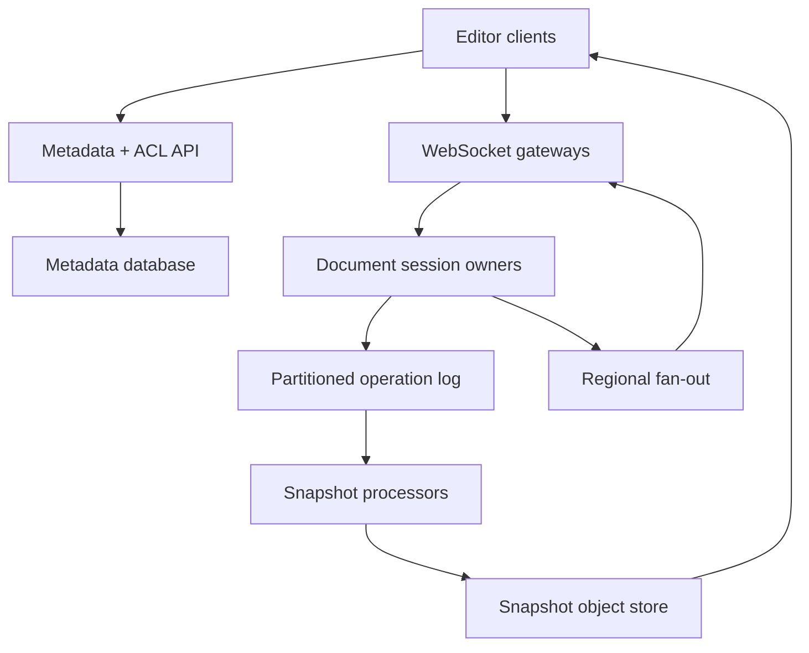

# System Design Interview Practice: Collaborative Document Editor

**Difficulty:** Medium–Hard  
**Primary themes:** real-time collaboration, CRDTs, WebSockets, partitioning, durable logs, snapshots, caching, consistency, multi-region reliability

This is an expanded learning walkthrough. In an actual 45-minute interview, use roughly 5 minutes for requirements, 2 minutes for entities, 5 minutes for interfaces, 10–15 minutes for the high-level design, and 10–15 minutes for deep dives. The ordering follows Hello Interview’s public delivery framework: clarify requirements, identify entities, define the system contract, build the simplest design that satisfies the functional requirements, and then evolve it against non-functional requirements. Hello Interview specifically recommends tracing data and state changes operation by operation instead of prematurely drawing every service. genui{"citation":{"ref":"turn71search13"}}

## Interviewer prompt

> Design a Google Docs–style collaborative text editor. Users should create and share documents, edit them together in real time, continue editing during temporary disconnection, and see version history.

## Targeted clarifying questions with assumed interviewer answers

**Candidate:** “Are we designing rich text, spreadsheets, or plain text?”  
**Interviewer:** “Rich text documents with paragraphs, headings, lists, links, comments, and inline formatting. Exclude spreadsheets, embedded video editing, and layout-perfect desktop publishing.”

**Candidate:** “What forms of collaboration are required?”  
**Interviewer:** “Multiple editors, live cursors and presence, comments, offline edits, reconnect, and version history. Users may share as owner, editor, commenter, or viewer.”

**Candidate:** “What scale should I design for?”  
**Interviewer:** “50 million daily active users, ten million simultaneous connections at peak, two million edit operations per second globally, and up to 100 active editors on an ordinary document. A public event may create a hot document with 100,000 viewers and hundreds of editors.”

**Candidate:** “How large can a document become?”  
**Interviewer:** “Up to 5 MB of structured document state or approximately 500,000 visible characters. Keep ten years of version history.”

**Candidate:** “What latency should users experience?”  
**Interviewer:** “Local keystrokes must render immediately. Remote edits should appear within 200 ms p95 in the same region and 500 ms p95 across continents. Opening an ordinary document should take less than one second p95.”

**Candidate:** “What consistency matters?”  
**Interviewer:** “No acknowledged edit may be lost. All replicas that receive the same operations must converge. Temporary cursor positions may be eventually consistent and may disappear. ACL changes, especially revocation, must take effect quickly.”

**Candidate:** “Can users edit the same document from different home regions?”  
**Interviewer:** “Yes. Optimize for a geographically clustered team, but support global collaborators and regional failure.”

**Candidate:** “What can I exclude?”  
**Interviewer:** “Exclude search across documents, malware scanning, document export, notifications, and the rich-text rendering engine. Focus on synchronization, persistence, access control, presence, and recovery.”

**Say aloud:** “I’ll separate durable document edits from ephemeral presence. First I’ll establish the consistency contract, because that determines whether we need a single writer, transformation, or a convergent replicated data type.”

## 1. Requirements (~5 minutes)

### Core functional requirements

1. **Create, open, and share a document.** Owners manage ACLs; authorized users load current content and version metadata.
2. **Collaboratively edit in real time.** Local changes render immediately, synchronize to other clients, survive retries, and converge under concurrent editing.
3. **Reconnect and recover history.** A client may edit offline, merge after reconnecting, and inspect or restore earlier versions.

Presence, cursors, selections, and comments support those flows. Search, export, notifications, and document rendering internals are out of scope.

### Quantified non-functional requirements

- **Scale:** 50M DAU, 10M concurrent connections, and 2M edit operations/s globally; ordinary sessions support 100 editors, and rare hot documents support 100,000 viewers.
- **Latency:** local application <16 ms; remote edit propagation <200 ms p95 within a region and <500 ms p95 intercontinentally; ordinary document open <1 s p95.
- **Durability:** once the server acknowledges an operation, it must survive process and availability-zone failures. Target zero acknowledged-edit loss.
- **Availability:** 99.99% for opening cached documents and joining active sessions; 99.95% for accepting durable edits. During a control-plane or regional fault, connected clients should keep editing locally and reconcile later.
- **Convergence:** replicas receiving the same valid operation set must reach equivalent document state regardless of delivery order. ACL metadata is strongly consistent per document; cursors and presence are best effort.

### Consistency and availability contract

There are three different contracts:

1. **Document content:** strong eventual consistency. Clients may temporarily display different states, but after they receive the same operations they deterministically converge. A client sees its own local edit immediately.
2. **Durability acknowledgment:** the server responds `ACKED` only after the operation is replicated in a durable per-document log. Receipt and visibility are separate; an operation can be durable before every peer has rendered it.
3. **Authorization:** sharing metadata uses a linearizable per-document version. A session validates permission when joining and revalidates against streamed ACL revisions. Revocation closes or downgrades active sessions; disconnected clients may retain a local copy but cannot append new accepted operations.

We favor availability for local editing during disconnection and convergence after healing. We do not promise that two users always see identical intermediate cursor positions or character order while partitioned.

**Say aloud:** “Content is convergent, not globally linearizable. ACL changes are strongly ordered, and an edit acknowledgment means durable replication—not that every collaborator has already displayed it.”

### Scale estimates that change the design

**Persistent connections.** Ten million WebSockets at roughly 10 KB of connection state would consume about 100 GB of aggregate memory. At 100,000 connections per gateway, we need at least 100 gateways before headroom; provision roughly 200 across regions for failover and uneven load. This rules out sticky connections on general API servers.

**Operation traffic.** At two million operations/s and an average encoded operation of 250 bytes, raw edit traffic is about 500 MB/s, or 43 TB/day before replication and indexing. Storing a full document for every keystroke is impossible. We need compact operations, partitioned append logs, and periodic snapshots.

**Snapshots.** If the average active document receives 10 edits/s and we snapshot every 10,000 operations, recovery replays at most about 17 minutes of edits for that document. For a hot document at 5,000 operations/s, 10,000 operations is only two seconds; use both operation-count and time/size thresholds so snapshot work does not thrash.

**Fan-out.** An edit sent independently from one collaboration worker to 100,000 viewers creates 100,000 socket writes. At 20 edits/s and 250 bytes, payload alone is 500 MB/s for one document, excluding framing. Hot-document delivery therefore needs hierarchical fan-out and viewer coalescing rather than one owner process writing every socket.

## 2. Core entities (~2 minutes)

- **Document:** identity, owner, home region, current snapshot, schema version, and latest durable sequence.
- **ACL:** document role assignments and monotonic ACL revision.
- **Operation:** immutable edit with document ID, actor/device ID, unique operation ID, causal context, payload, and server log sequence.
- **Snapshot:** materialized document state plus the operation frontier it includes.
- **Session:** active connection, authenticated principal, device, document, permission, owner epoch, and last acknowledged frontier.
- **Presence:** ephemeral cursor, selection, viewport, display metadata, and expiry.
- **CommentThread:** durable anchor, messages, resolution state, and author metadata.
- **VersionMarker:** named or periodic point in history and optional restore relationship.

These are intentionally conceptual. We will introduce storage fields next to the services that require them.

## 3. API and system interface (~5 minutes)

Identity is derived from the authenticated access token. The server never trusts a caller-supplied user ID, role, or ACL revision.

### Create a document

```http
POST /v1/documents
Authorization: Bearer <token>
Idempotency-Key: 01J...
Content-Type: application/json

{
  "title": "Launch plan",
  "initial_blocks": [
    {"type": "paragraph", "text": "Draft"}
  ]
}
```

```json
{
  "document_id": "doc_7f2",
  "home_region": "us-east",
  "acl_revision": 1,
  "snapshot_version": 1
}
```

The owner comes from authentication. The idempotency key prevents duplicate documents when the response is lost.

### Open a document and obtain session credentials

```http
GET /v1/documents/doc_7f2/open
Authorization: Bearer <token>
```

```json
{
  "snapshot_url": "https://object-store/...signed...",
  "snapshot_frontier": {"server_seq": 845210},
  "session_url": "wss://collab.example.com/v1/sessions",
  "session_token": "short-lived-bound-token",
  "role": "EDITOR",
  "acl_revision": 14
}
```

The short-lived session token is bound to the user, document, role, device, and ACL revision. The signed snapshot URL avoids sending multi-megabyte state through the metadata API.

### WebSocket session

RFC 6455 defines WebSocket as two-way communication over one underlying connection, which fits bidirectional edits, acknowledgments, and presence. genui{"citation":{"ref":"turn71search25"}}

Client join frame:

```json
{
  "type": "JOIN",
  "session_token": "...",
  "device_id": "dev_b19",
  "known_frontier": {"server_seq": 845210},
  "pending_operation_ids": ["dev_b19:910", "dev_b19:911"]
}
```

Edit operation:

```json
{
  "type": "EDIT",
  "operation_id": "dev_b19:912",
  "document_id": "doc_7f2",
  "causal_context": {"server_seq": 845214},
  "client_hlc": "2026-10-13T16:01:02.104Z-3",
  "payload": {
    "kind": "INSERT_TEXT",
    "left_id": "char_a81",
    "right_id": "char_a82",
    "elements": [{"id": "dev_b19:912:0", "text": "A"}]
  }
}
```

Acknowledgment:

```json
{
  "type": "ACK",
  "operation_id": "dev_b19:912",
  "server_seq": 845215,
  "durability": "QUORUM_REPLICATED",
  "owner_epoch": 38
}
```

Remote operations may arrive individually or in batches. Presence uses separate frames and is never written to the durable operation log.

### Change sharing permission

```http
PUT /v1/documents/doc_7f2/acl/user_42
Authorization: Bearer <owner-token>
If-Match: "acl-revision-14"
Content-Type: application/json

{"role": "COMMENTER"}
```

```json
{"acl_revision":15,"principal_id":"user_42","role":"COMMENTER"}
```

`If-Match` prevents lost ACL updates. The owner’s identity and authority come from authentication plus the current ACL record.

### Version history and restore

```http
GET /v1/documents/doc_7f2/versions?cursor=...&limit=20
```

```http
POST /v1/documents/doc_7f2:restore
Idempotency-Key: 01J...

{"version_id":"ver_600"}
```

A restore does not delete later history. It appends a new operation that replaces the current root with the selected historical state, preserving auditability.

## 4. Data flow

1. The client authenticates through the metadata API, which reads the strongly consistent ACL and returns snapshot and session credentials.
2. The client downloads a snapshot, materializes it locally, and connects to a nearby WebSocket gateway.
3. The gateway routes the session to the active owner for the document shard and provides operations after the snapshot frontier.
4. A local keystroke updates the client replica immediately and emits an immutable, idempotent operation.
5. The collaboration owner validates the session, schema, operation ID, bounds, and current ACL; assigns a log sequence; and appends the operation to a replicated log.
6. After quorum durability, it acknowledges the sender and publishes the operation to regional fan-out workers.
7. Peers apply operations deterministically. Slow or reconnecting peers request the missing range or a newer snapshot.
8. Snapshot workers periodically fold stable operations into a compact document image and publish a new snapshot pointer transactionally.
9. Presence frames travel through a lossy, expiring pub/sub path and never delay edits.

## 5. High-level design (~10–15 minutes)



### Operation 1: create and open a document

The metadata service stores:

```text
Document(document_id, owner_id, title, home_region, schema_version,
         latest_snapshot_id, latest_server_seq, active_owner_epoch,
         created_at, deleted_at)

ACL(document_id, principal_id, role, acl_revision, updated_at)
```

Use a transactional relational or distributed SQL store because document creation, ownership, ACL revision, and snapshot-pointer changes benefit from constraints and compare-and-set transactions. Partition by `document_id`; keep all ACL rows for one document colocated.

On open, the API validates the current role and returns the latest snapshot plus a short-lived session token. Snapshot bytes live in multi-zone object storage and are cached at regional edges. The cache key contains `(document_id, snapshot_id)` because snapshots are immutable. ACL decisions are never inferred from snapshot cacheability.

The client can render the immutable snapshot while it connects for the operation tail, reducing time-to-first-content. If the snapshot represents sequence 845,210 and the durable log is at 845,260, only 50 operations must replay.

### Operation 2: join a live session

The client selects a nearby gateway using latency-based DNS or anycast. Gateways terminate TLS, verify the bound session token, enforce connection limits, and maintain heartbeats. They do not own document state.

A shard directory maps `hash(document_id)` to a collaboration shard. Within the shard, one **session owner** holds the active in-memory state and lease for each hot document. Ownership is identified by a monotonically increasing `owner_epoch`; stale owners cannot append or acknowledge after failover.

The session owner reconstructs a document from its latest snapshot and log tail on the first join, then caches the materialized CRDT state. Subsequent joins reuse it. It records:

```text
Session(session_id, document_id, principal_id, device_id, gateway_id,
        role, acl_revision, owner_epoch, last_acked_seq, expires_at)
```

Session rows may be ephemeral or checkpointed; the durable truth is snapshot plus operation log.

### Operation 3: submit and broadcast an edit

The client first applies the edit locally, so typing does not wait for a network round trip. It persists unacknowledged operations in a local device queue.

The session owner validates:

- token binding and current role;
- operation ID format and per-device replay window;
- document/schema version;
- payload size and structural invariants;
- referenced CRDT element IDs or tombstones;
- rate and abuse limits.

It appends:

```text
Operation(document_id, server_seq, operation_id, actor_id, device_id,
          causal_context, payload, owner_epoch, received_at)
```

`operation_id` is globally unique, normally `(device_id, monotonic_counter)`. A unique index or dedup table makes retries return the original acknowledgment. `server_seq` supplies efficient replay and version-history ordering; convergence still comes from the operation’s CRDT semantics, not arrival order alone.

The operation log is replicated across three availability zones. Only after quorum append does the owner ACK. It then publishes to a channel keyed by `(document_id, owner_epoch)`. Regional fan-out workers send the operation to subscribed gateways; gateways multiplex it to local sockets.

Ordinary documents can fan out directly. For hot documents, the owner writes once to a regional topic. A fan-out tree distributes to many gateway groups, and viewer-only clients may receive coalesced batches every 100–250 ms while editors retain low latency.

### Operation 4: presence and cursors

Presence has a weaker contract than content. A frame contains principal, cursor anchors, selection anchors, viewport, and monotonically increasing presence sequence. Gateways publish it to regional ephemeral pub/sub with a 30-second TTL. Newer sequences overwrite older ones; dropped frames need not retry because another update will arrive.

Cursor positions reference CRDT element IDs rather than numeric offsets. If concurrent edits move surrounding text, the cursor can deterministically anchor before or after the surviving element. If an anchor is deleted and compacted, the client resolves to the nearest surviving neighbor.

### Operation 5: offline reconnect

An offline client continues applying locally generated CRDT operations and stores them in order. On reconnect it sends its known durable frontier and pending operation IDs.

The owner responds with missing server operations, while accepting deduplicated pending client operations. Because operations carry stable element IDs and deterministic conflict rules, the client and server may process the two sets in different orders and still converge once both sets are present.

If the client is too far behind and the log tail has been compacted, it downloads a newer snapshot and reapplies its still-valid local operations. Invalid operations—for example edits to a document deleted while offline or writes after permission revocation—are rejected with explicit machine-readable reasons and retained locally for user recovery or copy-out.

### Operation 6: snapshot and version history

Snapshot processors consume operations by document partition and fold them into materialized state. They checkpoint by operation count, elapsed time, and byte growth. A completed immutable snapshot contains:

```text
Snapshot(snapshot_id, document_id, schema_version, root_object_key,
         included_server_seq, crdt_frontier, content_hash,
         created_at, retention_class)
```

The processor first writes and verifies the object, then conditionally advances `latest_snapshot_id` only if its frontier is newer. A crash before the pointer update leaves an unreferenced object for garbage collection; a crash afterward is safe because the object already exists.

Named versions are cheap metadata pointing to snapshots or frontiers. Historical reconstruction loads the nearest snapshot at or before the target and replays subsequent operations. A background process can materialize popular or legally retained versions.

## 6. Deep dives (~10–15 minutes)

### Deep dive A: concurrent edits—OT versus CRDT

**Where the baseline breaks.** If clients transmit numeric edits such as “insert `A` at offset 10,” two concurrent inserts or a delete can invalidate that offset. Applying operations in arrival order causes replicas to diverge or violates user intent.

| Approach | Strengths | Costs |
|---|---|---|
| Pessimistic locking | Simple consistency | Terrible typing UX; users block one another; weak offline support |
| Last-write-wins document | Easy storage | Silently loses concurrent work |
| Operational transformation | Compact operations; mature for centralized editors | Correct transforms are difficult; clients need shared base versions; offline/multi-master is complex |
| Sequence CRDT | Deterministic convergence; naturally supports offline operations | Identifier/tombstone overhead; rich-text semantics and compaction are complex |

**Choice.** Use a sequence CRDT for document blocks and text, plus CRDT maps/sets for attributes and comments. Each inserted element has a globally unique logical ID and references neighboring IDs. Concurrent inserts in the same gap are ordered deterministically by a stable tie-breaker such as logical ID. Delete operations mark identities, not numeric offsets.

CRDTs target **strong eventual consistency**: replicas that have processed the same updates are equivalent, even if update order differed. Research on WOOT formalizes this property for collaborative text editing. genui{"citation":{"ref":"turn71search1"}}

The server still assigns `server_seq`. This is not a hidden total-order correctness dependency; it makes durable replay, missing-range requests, snapshot frontiers, analytics, and audit efficient. A client can merge offline operations whose causal context predates the current sequence.

**Rich-text challenge.** Character convergence alone is insufficient. Formatting ranges can produce unintuitive results under concurrent edits. Model formatting as marks attached to stable element ranges with deterministic precedence, and model paragraphs/lists as typed blocks with stable IDs. Define product semantics for concurrent split, join, delete, and style changes; test them with randomized histories and permutation replay.

**Metadata growth.** Tombstones and variable-length identifiers can grow. Compact only after a causal-stability frontier shows that no supported replica can reference the old IDs. Long-offline devices beyond the retention horizon must rebase onto a new snapshot. Keep a translation map for recently compacted anchors so comments and cursors can migrate.

**Correctness tests.** Generate concurrent operation sets, deliver them to replicas in every feasible permutation, introduce duplicates and gaps, and assert equivalent canonical state. Also test intention-sensitive cases: simultaneous word inserts, delete-versus-format, paragraph split-versus-join, and offline edits around removed blocks.

**Say aloud:** “I’m choosing a CRDT because offline editing is a core requirement. The server sequence optimizes transport and recovery, while the operation identity and merge rules—not arrival order—guarantee convergence.”

### Deep dive B: hot documents, WebSocket fan-out, and backpressure

**Where the baseline breaks.** Consistent hashing distributes many documents well but cannot split one celebrity document. A single owner that performs 100,000 socket writes becomes CPU/network bound, and a slow viewer can accumulate unbounded buffers.

**Baseline evolution.** Retain one logical mutation owner per document to simplify validation and durable ordering, but separate mutation ownership from delivery fan-out:

1. The owner appends each edit once and publishes it to regional topics.
2. Regional relay groups subscribe once per region.
3. Gateway relays subscribe once per gateway group.
4. Each gateway writes only to its local sockets.

No layer should publish one queue message per viewer. The hierarchy turns owner work from `O(viewers)` into approximately `O(regions)`, while unavoidable final socket writes are distributed across gateways.

**Editors versus viewers.** Editors receive every durable operation with low latency. Viewers can receive micro-batches or periodic state deltas. Presence for 100,000 viewers is suppressed: broadcast only editors, presenters, and a bounded sample, while the UI displays aggregate viewer count.

**Backpressure.** Each connection has a bounded outbound buffer measured in bytes and operation age. If an editor falls behind, stop presence first, batch edits second, then send `RESYNC_REQUIRED` with a newer frontier. A slow viewer jumps directly to a recent snapshot/delta. Never let one socket block the owner or gateway event loop.

**Admission and abuse controls.** Limit operations per actor, device, document, and tenant; cap operation size and structural complexity; bound concurrent connections; and sample expensive validation. A single paste is encoded as a bounded chunk rather than hundreds of thousands of one-character operations.

**Ownership failure.** The shard coordinator grants a lease and fenced `owner_epoch`. A replacement loads the latest snapshot and log tail, acquires epoch 39, and only then accepts writes. The log rejects writes from epoch 38. Clients reconnect or gateways reroute; unacknowledged operation IDs retry safely.

**Observability.** Track active sockets per gateway, event-loop lag, outbound-buffer bytes, fan-out p50/p95/p99, owner operations/s, durable-ACK latency, resync rate, slow-consumer disconnects, hot-document skew, and edit-to-render sampled latency.

**Say aloud:** “I won’t shard one document’s mutation stream across independent writers first. I’ll keep one fenced owner for correctness and split the expensive part—fan-out—into a regional tree.”

### Deep dive C: durable history, snapshots, multi-region recovery, and ACL revocation

**Where the baseline breaks.** Replaying ten years of operations makes open and failover latency unbounded. Snapshotting incorrectly can lose or duplicate edits. Cross-region active-active owners risk split brain, while a home-region outage can make editing unavailable.

**Storage layers.** Use three forms of state:

- a replicated, append-only hot operation log for recent edits and fast recovery;
- immutable snapshots in object storage for materialized state;
- archived log segments in cheaper object storage for ten-year history and audit.

The log retains enough hot history for reconnect—perhaps 7–30 days—while archived segments preserve older versions. Snapshot IDs, operation segment hashes, and checksums detect corruption. Periodic restore drills rebuild sampled documents from snapshot plus log and compare canonical hashes.

**Snapshot safety.** A snapshot declares an exact included frontier. Processing is idempotent, and pointer advancement is compare-and-set. Operations beyond the frontier remain in the log. Compaction deletes a hot segment only when every required snapshot/archive copy is verified and the retention watermark has passed.

**Multi-region choice.** Give each document a home region with one active owner, because most teams are geographically clustered and one owner reduces conflict/control complexity. Remote editors connect locally, then their gateway forwards edits over a private backbone to the home owner. Optimistically applying locally hides the extra round trip; durable ACK is slower across continents.

Replicate the operation log asynchronously to a designated DR region, while quorum replication stays within the home region for normal latency. This gives a small but nonzero regional recovery point unless we synchronously replicate across continents. The product can offer two tiers:

- standard: regional quorum ACK, RPO under a few seconds for total regional loss;
- regulated: cross-region durable ACK, RPO zero but higher write latency.

On failover, the DR coordinator verifies the replication watermark, acquires a globally fenced higher epoch, reconstructs documents, and updates routing. Clients resend unacknowledged operations. An operation acknowledged under the standard tier but absent from DR is an explicit contract violation against the regional-loss RPO, not silently claimed impossible.

**ACL revocation.** ACL updates commit to the strongly consistent metadata store and increment `acl_revision`. A change event is broadcast to session owners. Before accepting an edit, the owner compares the session revision with its cached current revision; cache entries have short TTLs and push invalidation. For revocation, fail closed if the revision cannot be refreshed. The owner closes or downgrades sessions and rejects later offline uploads whose authorization interval is invalid.

There is an unavoidable nuance: a user who previously downloaded plaintext may retain it. Revocation prevents future server access and accepted edits; it cannot erase knowledge or uncontrolled screenshots. Encryption, audit logs, enterprise device controls, and data-loss-prevention policy address adjacent risks.

**Failure modes and responses.**

- Metadata DB unavailable: existing sessions may continue for a very short bounded grace period only if policy permits; new joins and privileged ACL changes fail closed.
- Operation log quorum unavailable: clients keep edits locally; server does not send durable ACKs.
- Snapshot worker crash: replay restarts from its checkpoint and overwrites no immutable object.
- Duplicate or reordered messages: operation IDs deduplicate and CRDT merge is deterministic.
- Gateway loss: clients reconnect with their frontier and pending operation IDs.
- Region loss: promote only with a higher global epoch; never run two accepted owners.
- Corrupt snapshot: verify content hash and fall back to the prior snapshot plus log.

**Observe:** log replication lag and RPO exposure, snapshot age/size/duration, replay operation count, history reconstruction latency, ACL invalidation lag, rejected stale sessions, owner-epoch conflicts, checksum failures, and successful restore-drill rate.

**Say aloud:** “Snapshots accelerate recovery but never replace the log’s durability boundary. Every snapshot names its exact frontier, and failover requires a higher fenced owner epoch so an old region cannot resume writes.”

## 7. Finish

### Concise final design

Clients open a document through a strongly consistent metadata and ACL service, download an immutable cached snapshot, and establish a WebSocket session through a nearby gateway. A shard directory routes the session to one fenced owner for that active document. The client applies each edit immediately and sends an idempotent CRDT operation with stable element IDs and causal context. The owner validates authorization and structure, assigns a replay sequence, appends to a multi-zone durable log, acknowledges after quorum replication, and publishes through a regional fan-out tree.

CRDT semantics make concurrent and offline operations converge; the server sequence supports replay, history, and snapshot frontiers without defining conflict resolution. Presence uses separate lossy TTL-based pub/sub. Bounded buffers and resynchronization protect gateways from slow clients. Snapshot processors fold exact log frontiers into immutable object-store snapshots, and archived segments preserve history. A home-region owner optimizes the normal case; fenced-epoch DR failover prevents split brain. Strongly ordered ACL revisions and push invalidation quickly revoke active sessions.

### Requirements check

| Requirement | Design support |
|---|---|
| Create/open/share | Metadata API, relational constraints, immutable snapshot URLs, versioned ACL |
| Real-time editing | WebSockets, local optimistic apply, session owner, durable log, fan-out tree |
| Concurrent convergence | Sequence CRDT with stable IDs and deterministic merge rules |
| Offline editing | Local pending log, causal context, deduplicated reconnect merge |
| Version history | Server sequences, snapshots, archived operation segments, restore-as-new-operation |
| Low latency | Nearby gateways, cached snapshots, in-memory active state, async fan-out |
| No acknowledged loss | Multi-zone quorum append before ACK |
| Hot documents | Hierarchical regional fan-out, viewer batching, bounded presence |
| Fast recovery | Snapshots plus bounded log tail and fenced owner epochs |
| Permission safety | Strong ACL revisions, invalidation stream, revalidation, fail-closed revocation |

## Realistic interviewer follow-up questions with strong sample answers

**Interviewer:** “Why not use only the database and poll for changes?”  
**Candidate:** “Polling creates waste and visible delay at ten million connections. WebSockets provide bidirectional low-latency delivery, while the durable log—not socket state—remains the recovery source of truth.”

**Interviewer:** “Do WebSockets guarantee delivery?”  
**Candidate:** “No. A connection can fail after either side processed a frame. Stable operation IDs, durable acknowledgments, frontiers, replay, and deduplication provide application-level reliability.”

**Interviewer:** “Why does a CRDT operation need a server sequence?”  
**Candidate:** “It does not need the sequence to converge. The sequence makes range replay, ACK frontiers, version history, snapshots, lag measurement, and garbage collection practical.”

**Interviewer:** “Why not choose operational transformation?”  
**Candidate:** “OT can be more compact and is reasonable for centralized online-first editing. Offline editing is core here, so I prefer operations that merge without sharing one exact base revision. I accept CRDT identifier and compaction complexity.”

**Interviewer:** “Can CRDTs preserve user intent perfectly?”  
**Candidate:** “No algorithm can infer every human intention. CRDTs guarantee deterministic convergence, not universally intuitive outcomes. Product-specific semantics and concurrency tests are still required for rich text.”

**Interviewer:** “What happens if the sender never receives the ACK?”  
**Candidate:** “It retries the same operation ID. The owner or dedup index returns the existing server sequence if the first append committed; otherwise it appends once.”

**Interviewer:** “Can the operation log be the only storage?”  
**Candidate:** “It is sufficient in principle but impractical for open and failover latency over years. Snapshots bound replay, and archived segments provide long-term history cheaply.”

**Interviewer:** “How do comments survive edited text?”  
**Candidate:** “Anchor a thread to stable CRDT element IDs with before/after affinity, not numeric offsets. If anchors are deleted, deterministic migration selects nearby surviving elements and marks fully orphaned comments for user repair.”

**Interviewer:** “How do you move a document to another shard?”  
**Candidate:** “Stop or briefly drain new durable appends, record the source frontier, acquire a higher destination owner epoch, load snapshot plus tail, update the directory, and let clients retry unacknowledged operation IDs. Fencing prevents the source from acknowledging afterward.”

**Interviewer:** “How do you handle one enormous paste?”  
**Candidate:** “Validate a maximum logical and encoded size, split it into bounded chunks under one transaction/group ID, apply locally as one UI action, and allow fan-out batching. This avoids a giant frame and avoids one operation per character.”

**Interviewer:** “What happens when a viewer is far behind?”  
**Candidate:** “Do not buffer indefinitely. Send `RESYNC_REQUIRED`, provide a recent immutable snapshot and frontier, then replay only the remaining tail.”

**Interviewer:** “How is undo implemented?”  
**Candidate:** “Undo is a new intention-preserving inverse operation scoped to the user’s action group, not deletion of history. It references stable inserted/deleted identities and is synchronized like any other operation.”

**Interviewer:** “How do you deploy a new document schema?”  
**Candidate:** “Version operations and snapshots. Session owners support a bounded compatibility window or translate old operations. Migrate snapshots in the background, canary by document cohort, and never mix incompatible operations without an explicit translator.”

**Interviewer:** “How do you detect convergence bugs?”  
**Candidate:** “Sample canonical state hashes at equal frontiers, replay randomized operation permutations in testing, compare server and client implementations, and quarantine a new schema/algorithm version if hash mismatch rises.”

**Interviewer:** “What is your first production version?”  
**Candidate:** “One region, relational metadata and ACLs, WebSocket gateways, one fenced owner per active document, a replicated operation log, CRDT text and blocks, snapshot workers, basic presence, reconnect replay, and metrics. Then add hot-document fan-out, cross-region gateways, archival history, and regional failover.”

## Common pitfalls

1. Saying “use WebSockets” without defining durability, replay, deduplication, or reconnect.
2. Storing a full document after every keystroke.
3. Using numeric character offsets as stable concurrent-edit identities.
4. Claiming CRDT means every intermediate replica is identical.
5. Claiming CRDT automatically preserves human intent.
6. Selecting OT or CRDT without relating the choice to offline editing and topology.
7. Treating server arrival order as the only conflict-resolution rule.
8. Acknowledging an edit before durable replication.
9. Sending one queue message from the document owner to every viewer.
10. Letting a slow socket accumulate an unbounded output buffer.
11. Persisting high-frequency cursor movements in the durable edit log.
12. Broadcasting all viewer presence on a 100,000-person document.
13. Forgetting idempotent operation IDs when clients retry.
14. Replaying from the beginning of history instead of snapshot plus tail.
15. Publishing a snapshot pointer before the object is durable and verified.
16. Compacting tombstones before offline replicas can no longer reference them.
17. Running active owners in two regions without fencing.
18. Promising zero regional data loss while acknowledging only to one region.
19. Caching authorization indefinitely or failing to push revocations.
20. Pretending revocation can erase plaintext already downloaded by a user.
21. Overlooking schema-version compatibility between old clients and new servers.
22. Restoring history by deleting newer operations instead of appending a restore action.
23. Monitoring queue depth without measuring edit-to-render latency and log lag.
24. Drawing many services before tracing open, edit, ACK, fan-out, and reconnect end to end.

## A polished 60-second close

> “The client opens a document through a strongly consistent metadata and ACL service, loads an immutable cached snapshot, and joins through a nearby WebSocket gateway. One fenced session owner per active document keeps the common path simple: it validates the user and operation, assigns an efficient replay sequence, appends the edit to a multi-zone durable log, acknowledges after quorum, and publishes through a hierarchical regional fan-out. Clients apply edits optimistically and encode them as idempotent CRDT operations with stable element IDs, so concurrent and offline work converges after reconnect even if delivery order differs. Presence is separated into lossy expiring pub/sub. Slow clients resynchronize rather than building unbounded buffers. Snapshot processors materialize exact log frontiers into object storage, while archived segments retain history. ACL revisions are strongly ordered and pushed to session owners, and regional failover requires a higher fenced epoch to prevent split brain.”

## Sources

- [Hello Interview: System Design Delivery Framework](https://www.hellointerview.com/learn/system-design/in-a-hurry/delivery)
- [Hello Interview: API Design for System Design Interviews](https://www.hellointerview.com/learn/system-design/core-concepts/api-design)
- [RFC 6455: The WebSocket Protocol](https://datatracker.ietf.org/doc/html/rfc6455)
- [Google Research: Strong Eventual Consistency of the Collaborative Editing Framework WOOT](https://research.google/pubs/strong-eventual-consistency-of-the-collaborative-editing-framework-woot-2/)
- [MIT CSAIL: Peritext—A CRDT for Collaborative Rich Text Editing](https://groups.csail.mit.edu/sdg/pubs/2022/Peritext_PACM_HCI_2022.pdf)
