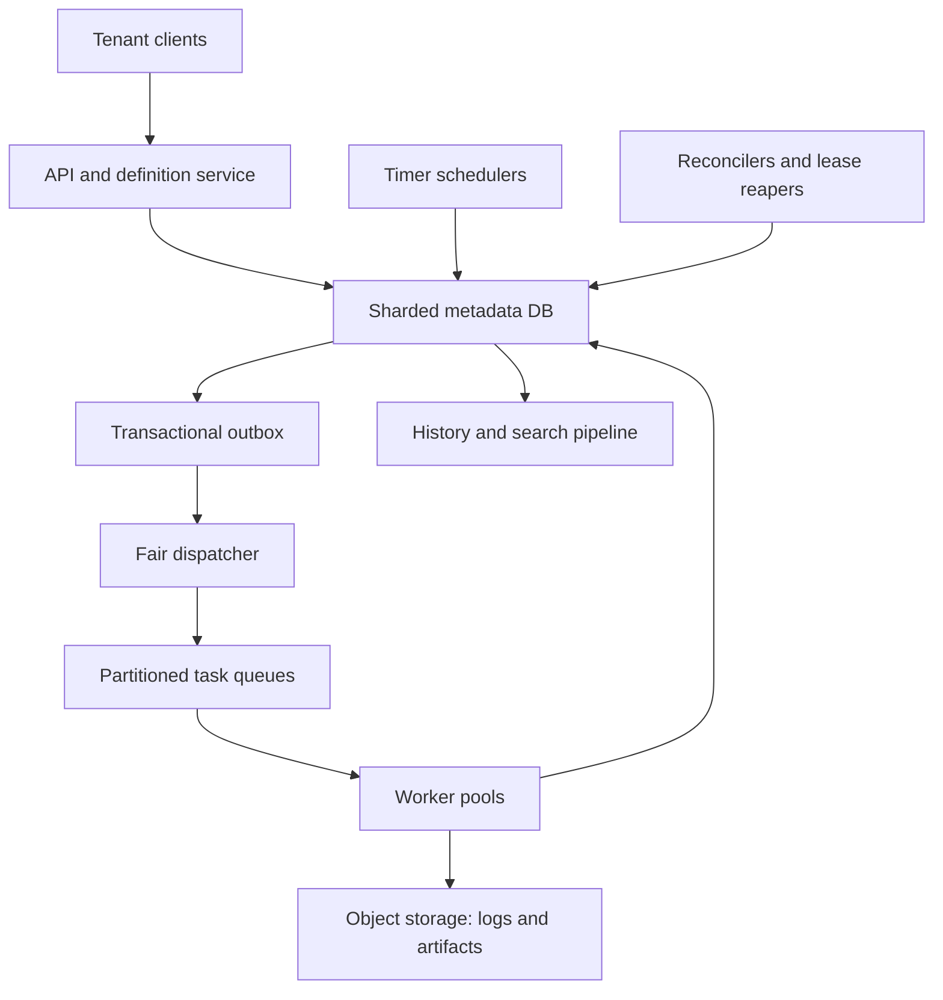

# System Design Interview Practice: Distributed Workflow and Job Scheduler

**Difficulty:** Advanced  
**Primary themes:** delayed scheduling, DAG orchestration, queues, leases, retries, idempotency, fairness, consistency, failure recovery, and multi-region control planes

> **Interview timing vs. this walkthrough:** In a 45-minute interview, spend about 5 minutes on requirements, 2 minutes on entities, 5 minutes on interfaces, 10–15 minutes on the high-level design, and 10–15 minutes on deep dives. This document is intentionally more detailed for study. In the interview, first make one scheduled task run reliably, then add DAG dependencies, scale, and regional recovery.

This answer uses the Hello Interview delivery sequence: establish requirements, identify core entities before over-designing the schema, define interfaces, build a complete system one operation at a time, and spend the remaining time on the bottlenecks that threaten the stated non-functional requirements. genui{"citation":{"ref":"turn80search0"}}

---

## Interviewer prompt

> Design a multi-tenant distributed workflow scheduler similar to the orchestration layer of Airflow. Customers define one-time or recurring workflows as directed acyclic graphs (DAGs). The platform starts runs near their scheduled times, executes ready tasks on heterogeneous worker pools, retries failures, supports cancellation, and retains searchable execution history. Workers and schedulers may crash, queue delivery is at least once, and tasks may perform external side effects.

## Targeted clarifying questions with assumed interviewer answers

**Candidate:** Are we scheduling independent jobs only, or workflows with dependencies?

**Interviewer:** Both. A one-task workflow is common, but support DAGs, fan-out/fan-in, and up to 10,000 task instances in a single run.

**Candidate:** Which scheduling modes matter?

**Interviewer:** Immediate, one-time future execution, and recurring cron schedules with a named time zone. Customers may manually trigger an existing workflow version.

**Candidate:** Who supplies executable code?

**Interviewer:** Tasks reference a registered task type and immutable artifact or container image. Worker pools advertise capabilities. The control plane does not run customer code.

**Candidate:** What scale should I assume?

**Interviewer:** Ten million saved schedules, one million workflow runs per day, roughly one billion task attempts per day, 15,000 task starts per second on average, and 100,000 per second during bursts.

**Candidate:** How precisely must jobs start?

**Interviewer:** For healthy capacity, 99% of eligible tasks should be leased within 5 seconds of `ready_at`; one-minute granularity is acceptable for cron definitions, but immediate jobs should not wait for the next minute.

**Candidate:** Do we promise exactly-once execution?

**Interviewer:** No. Do not lose accepted work. At-least-once execution is acceptable, but the platform should suppress duplicates where it can and give task authors tools to make side effects idempotent.

**Candidate:** How long can tasks run?

**Interviewer:** Milliseconds to 24 hours. Long tasks must heartbeat and may checkpoint progress. A worker can disappear without a final response.

**Candidate:** What are the availability and retention targets?

**Interviewer:** Submission and status APIs should be 99.99% available. Accepted workflow state must survive a zonal failure with no data loss. Retain searchable run history for 90 days and compact audit history for one year.

**Candidate:** What does cancellation mean?

**Interviewer:** Stop scheduling new downstream tasks and best-effort cancel leased tasks. A task already committing an external side effect may still complete, so expose the race honestly.

**Candidate:** Are arbitrary cycles, distributed transactions with customer systems, and a full compute platform in scope?

**Interviewer:** No cycles. Assume worker infrastructure, artifact storage, authentication, and secrets management exist. Design the orchestration control plane and its worker protocol.

### Scope statement to say aloud

> “I’ll treat workflow state in the metadata store as authoritative and queues as delivery hints. Every scheduled occurrence and task attempt gets a deterministic identity. Schedulers create runs transactionally, workers receive time-bounded leases with fencing tokens, and expired leases are safely retried. The guarantee is durable at-least-once execution with idempotency support—not exactly-once external side effects.”

---

## 1. Requirements (~5 minutes)

### Three core functional requirements

1. **Define and trigger workflows.** An authenticated tenant can publish an immutable DAG version, configure immediate/one-time/cron schedules, pause a schedule, and manually trigger a run.
2. **Execute and control task runs.** The system identifies dependency-ready tasks, routes them to compatible workers, manages leases, heartbeats, retries, timeouts, cancellation, and terminal workflow status.
3. **Inspect and recover execution.** Users can read run/task state, attempts, timing, logs, and failure reasons; operators can replay missing queue work and reconcile stuck state from durable records.

### Quantified non-functional requirements

| Property | Target | Design consequence |
|---|---:|---|
| Task-start throughput | 15K average, 100K peak/s | Partition ready queues and state ownership; batch transitions |
| Schedule population | 10M saved schedules | Indexed/bucketed `next_fire_at`; never scan all schedules |
| Scheduling latency | 99% leased within 5 s of `ready_at` | Short polling/timer buckets, autoscaled dispatch, lag SLO |
| API availability | 99.99% | Stateless APIs, multi-zone databases, graceful read degradation |
| Durability | No acknowledged run lost; in-region RPO 0 | Quorum commit plus transactional outbox |
| Execution guarantee | At least once | Leases, heartbeat expiry, retries, fenced completions |
| State freshness | Status visible within 2 s normally | Event-driven projection plus authoritative fallback |
| History | 90 days searchable, 1 year audit | Hot operational tables plus object-storage archive |
| Isolation | No tenant can monopolize shared workers | Admission quotas and weighted fair dispatch |

### Consistency and availability contract

- **Definitions are immutable after publication.** Editing creates a new version. A run pins one version, so replay and audit do not change when the definition changes.
- **Schedule occurrence identity is unique.** `(schedule_id, nominal_fire_time)` identifies one logical run. Multiple schedulers may discover it, but a unique constraint produces one `WorkflowRun`.
- **The metadata store is authoritative.** Queue messages may be duplicated, delayed, or lost; they never alone prove that a task is ready, running, or complete.
- **Task dispatch is at least once.** A worker crash after performing work but before reporting success can cause another attempt. Exactly-once execution across an external system is not promised.
- **A lease has an epoch/fencing token.** Only the current attempt may heartbeat or complete. Late results from an expired worker are rejected or recorded as orphaned evidence.
- **Workflow transitions are monotonic.** Legal compare-and-set transitions prevent a late retry from changing a terminal success back to running.
- **Cancellation is best effort for in-flight work.** Once cancellation commits, no new ordinary downstream task starts; already leased tasks receive cancellation but may finish an irreversible effect.
- **During ambiguous ownership, prefer delayed scheduling to split-brain mutation.** Reads may remain available while a shard elects a new leader.
- **Read-your-writes:** mutation responses include a workflow/run version. A read can request `min_version`; if a replica is behind, route to the leader or wait briefly.

### Out of scope

- Provisioning Kubernetes nodes or building a general container runtime
- Customer code sandbox internals and artifact-build pipelines
- Arbitrary cyclic graphs
- Business compensation semantics for every external side effect
- Secret-manager implementation
- A full log-search engine
- Sub-second hard real-time scheduling

### Scale estimates that change the design

One billion task attempts per day means:

```text
average attempts/s = 1,000,000,000 / 86,400 ≈ 11,574
planned average     ≈ 15,000/s
burst               = 100,000/s
```

If every transition performed five unbatched database writes, peak load would be roughly 500,000 writes/s before indexes and replicas. That rules out one metadata primary and motivates sharded workflow ownership, compact current-state rows, append-only attempt events written in batches, and asynchronous history export.

Ten million schedules polled every second would require ten million checks per second even if almost none are due. Instead, maintain an index on `(time_bucket, next_fire_at)` or insert timer records into near-term buckets. At one million workflow runs/day:

```text
runs/s average = 1,000,000 / 86,400 ≈ 11.6
```

The run rate is modest; task fan-out drives the system. A single run can release 10,000 tasks, so burst handling and per-workflow limits matter more than the average run-creation QPS.

Suppose a current task row plus essential indexes costs 1 KiB and an average attempt has three state events totaling another 1 KiB compressed:

```text
1 billion attempts/day × ~2 KiB ≈ 2 TB/day before replication
```

Ninety days cannot live economically in the hot transactional store. Keep current run/task state and recent attempts hot, stream immutable events to object storage, and build a separate search projection.

**What to say aloud:**

> “Ten million timers make full-table polling impossible, and one-billion daily attempts make the hot database a state machine—not a forever analytics store. I’ll index near-term timers, shard by workflow-run ID, batch state transitions, and archive events asynchronously.”

---

## 2. Core entities (~2 minutes)

| Entity | Essential fields and purpose |
|---|---|
| `WorkflowDefinition` | Tenant, workflow key, immutable version, DAG checksum, task definitions |
| `TaskDefinition` | Task key, artifact/image, command, resource class, timeout, retry policy, dependencies |
| `Schedule` | Schedule ID, workflow version, cron/time zone or one-time time, next fire, pause state, catch-up policy |
| `WorkflowRun` | Run ID, logical occurrence key, definition version, state, timestamps, version, cancellation mode |
| `TaskRun` | Run/task/map index, state, unresolved dependency count, ready time, priority, queue class |
| `TaskAttempt` | Attempt number, lease epoch/token, worker, start/heartbeat/end times, outcome, checkpoint |
| `Lease` | Attempt identity, owner worker, expiry, fencing token |
| `Worker` | Worker ID, pool, capabilities, zone, capacity, health |
| `OutboxEvent` | Durable command/event written with a state transition |
| `InboxReceipt` | Consumer/message deduplication identity |
| `LogArtifact` | Object-store URI, byte range, checksum, retention metadata |
| `TenantQuota` | Max active runs/tasks, dispatch rate, weight, resource-class limits |

Apache Airflow makes a similar distinction between a DAG definition, a DAG Run, and a task instance with lifecycle states such as scheduled, queued, running, success, failed, and retry. genui{"citation":{"ref":"turn81search1"}} The names need not match Airflow; the important modeling decision is to separate reusable definitions from each occurrence and each execution attempt.

### Minimal DAG model

Store immutable task definitions and adjacency lists:

```text
task_definition(workflow_id, version, task_key, resource_class,
                timeout_s, max_attempts, retry_policy, artifact_ref)

task_edge(workflow_id, version, upstream_task_key, downstream_task_key)
```

Validate acyclicity at publish time with a topological sort. For each run, initialize `unresolved_dependencies` from the in-degree. A task becomes ready when the counter reaches zero under the workflow’s trigger rule.

---

## 3. API and system interface (~5 minutes)

Identity and tenant scope come from the authenticated principal. A client never gets to claim another `tenant_id` in the body.

### 3.1 Publish a workflow version

```http
POST /v1/workflows
Authorization: Bearer <tenant-token>
Idempotency-Key: publish-etl-v7
Content-Type: application/json

{
  "workflow_key":"daily_orders_etl",
  "tasks":[
    {
      "task_key":"extract",
      "artifact_ref":"registry.example/etl@sha256:abc...",
      "resource_class":"cpu-medium",
      "timeout_seconds":1800,
      "retry":{"max_attempts":4,"initial_delay_seconds":10,"max_delay_seconds":300}
    },
    {
      "task_key":"transform",
      "artifact_ref":"registry.example/etl@sha256:def...",
      "resource_class":"cpu-large",
      "depends_on":["extract"],
      "timeout_seconds":3600
    }
  ]
}
```

```json
{
  "workflow_id":"wf_41",
  "version":7,
  "state":"PUBLISHED",
  "dag_checksum":"sha256:91c..."
}
```

The server validates task-key uniqueness, dependency references, acyclicity, quotas, retry bounds, artifact policy, and maximum expanded task count. Publication is immutable.

### 3.2 Create or update a schedule

```http
PUT /v1/workflows/wf_41/schedules/nightly
Authorization: Bearer <tenant-token>
If-Match: "schedule-version-12"

{
  "workflow_version":7,
  "cron":"0 2 * * *",
  "time_zone":"America/New_York",
  "catch_up":"LATEST_ONLY",
  "overlap_policy":"SKIP_IF_RUNNING"
}
```

```json
{
  "schedule_id":"sch_81",
  "version":13,
  "next_fire_at":"2026-10-14T06:00:00Z",
  "state":"ACTIVE"
}
```

`If-Match` prevents two administrators from silently overwriting schedule policy. The system stores canonical UTC occurrence times but preserves the named time zone and explicit daylight-saving policy.

### 3.3 Trigger a run immediately

```http
POST /v1/workflows/wf_41/runs
Authorization: Bearer <tenant-token>
Idempotency-Key: orders-2026-10-13-manual-1

{
  "workflow_version":7,
  "input":{"business_date":"2026-10-13"},
  "priority":"NORMAL"
}
```

```json
{
  "run_id":"run_9001",
  "state":"PENDING",
  "version":1,
  "created_at":"2026-10-14T01:59:10Z",
  "status_url":"/v1/runs/run_9001"
}
```

The idempotency record binds the key to a normalized request hash. An identical retry returns `run_9001`; a different body with the same key returns `409`.

### 3.4 Read run and task status

```http
GET /v1/runs/run_9001?include=tasks&min_version=18
Authorization: Bearer <tenant-token>
```

```json
{
  "run_id":"run_9001",
  "state":"RUNNING",
  "version":18,
  "counts":{"pending":0,"ready":12,"running":38,"succeeded":950,"failed":0},
  "tasks":[
    {"task_key":"transform","map_index":17,"state":"RUNNING","attempt":2}
  ],
  "next_cursor":"opaque:..."
}
```

Large runs paginate task instances with an opaque cursor over `(task_key, map_index)` or a stable task sequence.

### 3.5 Cancel a run

```http
POST /v1/runs/run_9001:cancel
Authorization: Bearer <tenant-token>
Idempotency-Key: cancel-run-9001

{"mode":"GRACEFUL","reason":"bad input partition"}
```

```json
{
  "run_id":"run_9001",
  "state":"CANCEL_REQUESTED",
  "version":19
}
```

`GRACEFUL` stops new downstream work and signals leased tasks. A privileged `FORCE` mode may revoke leases, but it still cannot undo an external side effect that already happened.

### 3.6 Worker lease protocol (internal)

Workers long-poll a compatible queue:

```http
POST /internal/v1/worker-pools/cpu-large:lease
Authorization: mTLS <worker-identity>

{
  "worker_id":"worker-77",
  "available_slots":8,
  "capabilities":["linux-amd64","network-egress"]
}
```

```json
{
  "leases":[{
    "task_run_id":"tr_551",
    "attempt":2,
    "lease_token":"opaque-signed-token",
    "lease_epoch":2,
    "expires_at":"2026-10-14T02:00:10Z",
    "artifact_ref":"registry.example/etl@sha256:def...",
    "input_uri":"object://inputs/run_9001/transform/17",
    "idempotency_key":"tr_551:logical-effect"
  }]
}
```

Heartbeat and completion include the token and epoch:

```http
POST /internal/v1/task-attempts/tr_551/2:heartbeat
{"lease_token":"...","checkpoint_uri":"object://checkpoints/tr_551/2/005"}
```

```http
POST /internal/v1/task-attempts/tr_551/2:complete
{"lease_token":"...","outcome":"SUCCEEDED","output_uri":"object://outputs/tr_551/2"}
```

A stale lease receives `409 STALE_ATTEMPT`. Completion APIs are idempotent: repeating the same terminal result returns the recorded result; a contradictory result is rejected and audited.

### Important errors

| Status | Meaning |
|---|---|
| `400` | Invalid DAG, cron, time zone, retry policy, or resource request |
| `403` | Principal lacks tenant/workflow/worker permission |
| `409` | Idempotency mismatch, stale definition/schedule version, stale lease, illegal state transition |
| `422` | DAG exceeds size limits or references unavailable capabilities |
| `429` | Tenant submission or concurrency quota exceeded |
| `503` | Authoritative state shard unavailable; no mutation acknowledged |

---

## 4. Data flow

### Scheduled workflow occurrence

1. A timer scanner claims a near-term schedule row/bucket.
2. It calculates the next nominal occurrence using the saved cron expression, named time zone, daylight-saving policy, and catch-up policy.
3. In one transaction, it inserts a uniquely keyed `WorkflowRun`, initializes root `TaskRun` rows, advances `Schedule.next_fire_at`, and writes outbox events.
4. The outbox relay publishes root-task readiness commands.
5. Admission and fairness choose when each ready task may enter a worker queue.
6. A worker acquires a lease, heartbeats, executes, and reports a fenced terminal result.
7. A transition processor decrements downstream dependency counters and publishes newly ready tasks.
8. When all required terminal states are known, the run becomes `SUCCEEDED`, `FAILED`, or `CANCELLED`.

### Retry after worker failure

1. The lease expires because heartbeats stop.
2. A reaper compare-and-sets the current attempt from `RUNNING` to `TIMED_OUT` only if the epoch still matches.
3. If policy permits, it computes exponential backoff with jitter and creates a new `READY_AT` timer for the next attempt.
4. The old worker’s late heartbeat or completion is rejected by the newer epoch.
5. If attempts are exhausted, the task becomes terminal failure and downstream trigger rules are evaluated.

---

## 5. High-level design (~10–15 minutes)

### Compact architecture



### Operation 1: publish a valid immutable DAG

The API authenticates the tenant, applies size and security policy, and topologically sorts the graph. A failed sort means a cycle. The definition service writes:

```text
workflow_definition(tenant_id, workflow_id, version, checksum,
                    created_at, state)
task_definition(workflow_id, version, task_key, artifact_ref,
                resource_class, timeout_s, retry_policy, trigger_rule)
task_edge(workflow_id, version, upstream_key, downstream_key)
```

The primary key includes the immutable version. A unique `(tenant_id, workflow_key, version)` and checksum-bound idempotency record make publish retries safe. Large input templates live in object storage; the database holds validated references and hashes.

Precompute each task’s in-degree and compact upstream/downstream lists. This makes run initialization predictable. Do not create per-run task rows before a run exists; definitions may never be triggered.

### Operation 2: create a manual run

The simplest complete path is:

1. Claim `(tenant, endpoint, idempotency_key)`.
2. Read the immutable definition version and tenant quota.
3. Insert `WorkflowRun(PENDING, version=1)`.
4. Insert task-run rows. Root tasks have `unresolved_dependencies=0` and `READY`; others begin `BLOCKED` with their in-degree.
5. Insert one outbox event per root batch, not one synchronous queue call per task.
6. Store the canonical API result on the idempotency record.
7. Commit, then return `202`.

For a 10,000-task DAG, inserting all rows in the request transaction can hurt latency. Two viable evolutions are:

- bulk insert compact task rows from a precomputed definition snapshot; or
- create the run plus an initialization command, then materialize task rows asynchronously while the run is `INITIALIZING`.

Choose bulk initialization for ordinary DAGs and asynchronous chunked initialization above a threshold. Either way, the accepted run has durable initialization state, so a crash cannot forget it.

### Operation 3: turn a cron occurrence into one run

The `Schedule` row stores:

```text
schedule_id, tenant_id, workflow_id, workflow_version
cron_expression, time_zone, dst_policy
next_fire_at, catch_up_policy, overlap_policy
state, version, ownership_bucket
```

A bank of scheduler processes scans only due rows in owned near-term buckets. In SQL, a baseline can use an index on `next_fire_at` plus `SELECT ... FOR UPDATE SKIP LOCKED`. Multiple schedulers can safely share work because row claims and a unique occurrence key serialize creation. Apache Airflow also supports concurrent schedulers and coordinates through its metadata database, a useful real-world example of database-backed scheduler high availability. genui{"citation":{"ref":"turn81search6"}}

The scheduler transaction performs:

```text
INSERT workflow_run(
  occurrence_key = hash(schedule_id, nominal_fire_time), ...
) ON CONFLICT DO NOTHING;

UPDATE schedule
SET next_fire_at = compute_next(...), version = version + 1
WHERE schedule_id = ? AND version = ?;

INSERT outbox_event(...);
```

If a process commits and dies before publishing, the outbox relay publishes later. If two processes race, one unique insert wins. The nominal scheduled time—not the scanner’s wall-clock time—is the identity, preventing two runs when scanning is late.

Cron semantics need explicit product choices:

- **spring-forward missing local time:** skip or run at the next valid instant;
- **fall-back repeated local time:** run once or twice;
- **scheduler outage:** run every missed occurrence, only the latest, or none;
- **overlap:** allow, skip, queue one, or replace the prior run.

Store the selected policy; do not let library defaults become an accidental contract.

### Operation 4: admit ready tasks fairly

A ready task row contains:

```text
task_run_id, tenant_id, run_id, task_key, map_index
state, ready_at, priority, resource_class
unresolved_dependencies, current_attempt, version
```

The outbox relay publishes a lightweight `task_ready` command. A dispatcher validates that the database still says `READY`, checks tenant concurrency/rate limits, and enqueues to a queue selected by region and resource class.

One global FIFO is unfair: a tenant releasing one million tasks can delay everybody. Use hierarchical scheduling:

1. per-tenant ready partitions or logical queues;
2. tenant token buckets for start rate and active-task limits;
3. weighted deficit round robin across eligible tenants;
4. priority classes inside a tenant, with aging to avoid starvation;
5. separate resource queues such as `cpu-small`, `gpu-a100`, and `trusted-egress`.

Deficit round robin gives each tenant credits proportional to weight and subtracts an estimated task cost when dispatching. It approximates fairness without sorting every task globally. Admission state can be cached for speed, but durable task state and quotas remain recoverable from the metadata store.

### Operation 5: lease work to a worker

Queue receipt is not yet permission to execute. The worker or lease service performs a conditional transaction:

```text
READY -> RUNNING
current_attempt = current_attempt + 1
lease_epoch = lease_epoch + 1
lease_owner = worker_id
lease_expires_at = now + lease_duration
```

The condition requires the expected task version and a still-valid ready state. A duplicate queue message then either receives the same active attempt where safe or is acknowledged as stale.

The signed lease token binds `task_run_id`, attempt, epoch, worker, and expiry. Heartbeats extend the expiry only for that epoch. Completion conditionally commits:

```text
UPDATE task_run
SET state='SUCCEEDED', version=version+1, output_uri=?
WHERE task_run_id=?
  AND state='RUNNING'
  AND lease_epoch=?
  AND lease_owner=?;
```

If zero rows update, the worker is stale. Its output may be kept for diagnosis but cannot advance the DAG.

### Operation 6: advance DAG dependencies

On success, the same transaction writes `task_attempt=SUCCEEDED` and an outbox `task_terminal` event. A transition processor evaluates direct downstream tasks.

For the common `ALL_SUCCESS` rule, decrement `unresolved_dependencies` using a deduplicated edge-completion key:

```text
UNIQUE(run_id, upstream_task_run_id, downstream_task_run_id)
```

Only the first processing of an upstream success changes the counter. When it reaches zero, compare-and-set the downstream task from `BLOCKED` to `READY` and write its outbox event.

For richer trigger rules, maintain counters such as `upstream_total`, `succeeded`, `failed`, `skipped`, and `terminal`. Evaluate only when a relevant counter changes. This avoids repeatedly joining every ancestor.

Fan-out tasks can dynamically produce child descriptors in object storage. A materializer validates the expansion limit and creates children in chunks. Fan-in parents should depend on an aggregate group completion record rather than listing millions of edges.

### Operation 7: retry, timeout, and detect dead workers

Long tasks heartbeat every fraction of the lease duration. Heartbeats can include a small checkpoint reference, progress, and cancellation acknowledgment. Airflow’s documentation describes the practical failure mode where a task remains running after its worker dies and must be detected from missing heartbeats and failed or retried. genui{"citation":{"ref":"turn81search2"}}

A lease reaper scans an index on `lease_expires_at`. Expiry does not directly overwrite arbitrary state; it compare-and-sets only the matching attempt epoch. Retry timing is:

```text
delay = min(max_delay, initial_delay × 2^(attempt-1))
ready_at = now + random(0.5 × delay, 1.5 × delay)
```

Jitter prevents thousands of failed tasks from retrying simultaneously after a dependency outage. Permanent errors—invalid input, missing artifact, policy denial—skip retries. Retry exhaustion marks the task failed and evaluates downstream failure rules.

For long-running tasks, heartbeat timeouts detect worker loss much earlier than a 24-hour execution timeout. Temporal likewise distinguishes retry policy and heartbeat timeout; a worker learns cancellation through heartbeats, so code that never heartbeats cannot promptly cooperate with cancellation. genui{"citation":{"ref":"turn81search37"}}

### Operation 8: cancel a workflow

The API compare-and-sets the run to `CANCEL_REQUESTED` and records an outbox event. The cancellation processor:

1. marks `BLOCKED` and `READY` tasks `CANCELLED` in chunks;
2. removes or tombstones queued work logically—workers still validate state before leasing;
3. sends cancellation signals to current lease owners;
4. waits for running tasks to finish, acknowledge cancellation, or time out;
5. marks the run `CANCELLED` when all tasks are terminal.

The worker protocol should expose a cancellation token. A well-behaved task stops at a safe boundary and reports `CANCELLED`; an uncooperative task may continue until lease or execution timeout. An external email, charge, or file publication already performed cannot be rolled back by revoking a lease.

### Operation 9: status, logs, and history

Authoritative current state stays in the sharded metadata database. A change stream/outbox builds:

- run summaries keyed by tenant/workflow/time;
- task-attempt search documents;
- metrics and audit history;
- object-storage partitions of immutable transition events.

Workers stream logs directly to object storage through scoped credentials. The control plane stores only the log URI, checksum, byte count, and visibility policy. This avoids routing gigabytes of task output through the state database.

Status APIs read a denormalized summary for ordinary polling and can fall back to the owner shard for a requested `min_version`. WebSocket or server-sent-event notifications are optional optimizations; clients must tolerate disconnects and resume from a cursor.

### Operation 10: recover lost queue work

The queue is not the source of truth, so recovery is straightforward:

- an outbox relay republishes committed but unpublished commands;
- a ready-task reconciler finds `READY` rows whose dispatch marker is old and emits another command;
- a lease reaper retries expired current attempts;
- a run reconciler recomputes inconsistent task counts and terminal status;
- consumers deduplicate event IDs or apply compare-and-set transitions.

This is the core reliability loop: durable state describes what should happen, messages accelerate it, and reconcilers repair missed acceleration.

---

## 6. Deep dives (~10–15 minutes)

### Deep dive A: accurate, scalable timers and duplicate-free logical occurrences

#### Where the baseline breaks

A single process that sleeps until the next timestamp has a single point of failure and cannot hold ten million timers reliably. Scanning the complete schedules table every second wastes capacity. Putting a message into a queue days early may exceed queue delay limits and makes schedule updates or cancellation awkward. Multiple scanners without coordination can create duplicate runs.

#### Plausible approaches

| Approach | Strength | Weakness |
|---|---|---|
| Full DB scan | Simple prototype | Cost grows with all schedules, not due schedules |
| One in-memory priority queue | Precise and fast | Memory/leader bottleneck; slow recovery |
| Queue with long delivery delay | Operationally simple | Delay limits, awkward mutation, queue is not authoritative |
| Indexed due-time table | Durable and understandable | Hot index/database polling at very high scale |
| Hierarchical timing wheel + durable table | Efficient near-term timers | More moving parts and bucket recovery logic |

Start with the indexed table and `SKIP LOCKED`; evolve to durable time buckets when measurements require it.

#### Selected design

Hash schedules into ownership partitions. Persist `next_fire_at` and a coarse `bucket_id`, such as minute plus shard. Scheduler instances lease partitions, but correctness does not depend solely on the partition lease: occurrence uniqueness remains enforced in the database.

Use two horizons:

1. **Far future:** durable rows indexed by bucket and time.
2. **Near future (for example, next 5 minutes):** loaded into a per-partition timing wheel or heap for low-latency wake-up.

When a scheduler starts or takes over a partition, it reloads the overlapping near-term window from the database. Overlap deliberately creates duplicate discovery; the unique occurrence key makes that safe.

The transaction couples run creation with advancing the timer. Consider crash points:

| Crash point | Result |
|---|---|
| Before transaction | Another scanner claims the still-due schedule |
| During transaction | Database rolls back both run and advancement |
| After commit, before queue publish | Outbox publishes later |
| After publish, before local ACK | Duplicate message; task state/ID deduplicates |

#### Clock behavior

Use database time for due comparisons when possible and synchronize hosts, but do not assume perfect clocks. A scheduler may scan through `db_now + lookahead`. Leases and deadlines should use persisted server timestamps. The nominal occurrence is computed from the previous nominal occurrence, not from “now,” or late scans cause recurring schedules to drift.

#### Backfill and thundering herds

After a two-hour outage, running every missed minute for every schedule may overload the system. Catch-up is explicit:

- `ALL`: materialize every missed occurrence, rate-limited;
- `LATEST_ONLY`: create the latest missed occurrence;
- `NONE`: advance without running missed occurrences.

Backfills use a separate quota and lower default priority. `overlap_policy` prevents an hourly workflow that takes three hours from accumulating unlimited simultaneous runs unless the tenant explicitly permits it.

#### What to observe

- schedule discovery lag: `discovered_at - nominal_fire_time`
- run creation lag and ready-to-lease lag separately
- due rows by bucket and oldest due age
- duplicate occurrence conflicts
- partition ownership churn and reload time
- skipped/missed occurrences by catch-up policy
- DST policy outcomes

**What to say aloud:**

> “Scheduler coordination improves efficiency, but the unique `(schedule_id, nominal_time)` key provides correctness. I can safely overlap scans during failover, and the outbox closes the commit-versus-publish gap.”

### Deep dive B: leases, fencing, and the boundary of exactly once

#### Where the baseline breaks

A worker receives a task, calls an external API, and crashes before acknowledging the queue. Redelivery is necessary to avoid losing work, but it can repeat the side effect. A long queue visibility timeout delays recovery; a short timeout creates concurrent attempts. Heartbeats without fencing let a paused or partitioned worker return after reassignment and incorrectly mark the newer attempt complete.

#### Delivery choices

| Guarantee | Meaning | Practical issue |
|---|---|---|
| At most once | Never retry after ambiguous delivery | Work can be lost |
| At least once | Retry until durable terminal state | Task code may execute more than once |
| Exactly once | One externally visible effect | Impossible to guarantee generically without cooperation from the effect system |

Choose at least once with fenced attempts and an idempotency toolkit.

#### Lease design

A lease is time-bounded ownership, not proof that only one process is physically running. Each assignment increments an epoch. All heartbeats, checkpoint updates, log-finalization calls, and completion calls include it. The metadata shard accepts mutations only for the current epoch.

Lease duration trades recovery time against false expiry. For normal tasks, use perhaps 60 seconds with heartbeats every 15 seconds and extend to 60 seconds beyond accepted server time. For high-latency networks, configure by worker pool. The task’s execution timeout is distinct: lease timeout detects a missing worker; execution timeout limits total attempt duration.

#### External side-effect strategies

Offer task authors four patterns:

1. **Idempotency key:** call an external API with stable `task_run_id` or a business key. A retry gets the original result.
2. **Transactional inbox:** the target database inserts the task-effect key under a unique constraint in the same transaction as the effect.
3. **Transactional outbox:** the task commits local state and an event together; another relay performs downstream delivery idempotently.
4. **Check-before-act with authoritative target state:** useful only if the check and act cannot race, or the target supports compare-and-set.

For non-idempotent effects without target cooperation, surface `UNKNOWN` after an ambiguous failure and require reconciliation or human action. Do not automatically retry a potentially completed wire transfer under a new identity.

Temporal’s event-history model is a useful reference for durable orchestration: previously recorded operations replay from history rather than re-executing during workflow replay, while external Activities have their own retry behavior. genui{"citation":{"ref":"turn81search38"}} Our design achieves the relevant interview property through explicit metadata state, attempts, and idempotent transitions rather than assuming a workflow framework.

#### Completion race

Imagine attempt 4 pauses for 70 seconds, its lease expires, and attempt 5 starts. Attempt 4 then sends success.

- The control plane rejects attempt 4 because epoch 4 is stale.
- If attempt 4 wrote an object, its URI is orphaned and later garbage-collected.
- If attempt 4 performed an external idempotent effect, attempt 5 uses the same logical-effect key and retrieves/converges on the same result.
- If the effect is not idempotent, the workflow becomes ambiguous and reconciliation policy decides; the scheduler cannot invent certainty.

#### Checkpointing

A heartbeat may point to an immutable checkpoint. The next attempt is allowed to resume it only if the task contract declares checkpoints compatible across attempts and artifact versions. Checkpoints are optimization, never the only record that work remains due. Cap heartbeat payload sizes and store large state in object storage.

#### What to observe

- lease acquisition and heartbeat latency
- expired leases by worker pool and zone
- concurrent physical attempts detected
- stale completion/heartbeat rejections
- retries by failure class and attempt number
- ambiguous non-idempotent outcomes
- idempotency-key hit/mismatch rate
- checkpoint age and resume success

**What to say aloud:**

> “Fencing prevents an old attempt from changing scheduler state, but it cannot erase an external side effect. I guarantee durable at-least-once dispatch and give tasks stable effect IDs, transactional patterns, and an explicit unknown state when the target cannot deduplicate.”

### Deep dive C: DAG fan-out, hot workflows, fairness, and regional recovery

#### Where the baseline breaks

A naive scheduler repeatedly joins every edge to discover ready tasks. A 10,000-way fan-out produces a write and queue burst. A million-task tenant can consume every worker. If active-active regions both schedule the same workflow shard during a partition, they may create conflicting attempts despite queue deduplication.

#### Dependency processing choices

| Approach | Benefit | Cost |
|---|---|---|
| Query all upstream states | No counters | Repeated expensive joins |
| Per-task unresolved counter | O(1) common transition | Must deduplicate decrements |
| Append-only event replay | Excellent audit/recovery | More complex materialization |

Use counters for the operational path and immutable transition events for audit/rebuild. Each upstream-to-downstream contribution has a unique receipt, preventing a duplicate terminal event from decrementing twice.

For large fan-outs:

- create task rows in chunks;
- publish ready events in batches;
- cap per-run dispatch rate;
- represent homogeneous mapped children as ranges until materialization;
- summarize group progress rather than updating one parent row for every child;
- shard task rows by `(run_id, task_key, map_bucket)` if a single run is too hot.

For fan-in, maintain a sharded group counter and combine partial counts rather than contending on one row 10,000 times per second. The final reducer becomes ready when the aggregate terminal/success condition is met.

#### Fairness and backpressure

Fairness exists at several layers:

- **submission:** tenant run-creation rate and maximum queued tasks;
- **materialization:** maximum expansion rate per run;
- **dispatch:** weighted tenant credits and priority aging;
- **execution:** pool-specific active-slot quota;
- **downstream protection:** concurrency keys, such as at most 20 tasks calling one database.

When workers are scarce, queue lag grows but metadata remains correct. Stop materializing unlimited future work, delay low-priority backfills, and return `429` for optional new load before the control plane collapses. A circuit breaker can pause tasks targeting a failing shared dependency, avoiding a retry storm.

#### Metadata sharding

Assign each `WorkflowRun` to one state shard via a stable directory. Keeping a run’s tasks and attempt state together makes dependency transitions local. Definition and schedule metadata can have separate partitioning because reads dominate, but run creation stores the pinned definition snapshot/checksum.

Very large runs may be subpartitioned, with one run coordinator owning only aggregate state. Cross-partition dependency events use the same outbox/inbox pattern. Introduce this only after measuring the single-run hot-spot; it complicates completion and cancellation.

#### Multi-region model

Give every tenant or workflow a home control-plane region and ownership epoch. API writes route to the home; reads and archived history can be global. Metadata replicates synchronously across zones and asynchronously to a disaster-recovery region.

During regional failover:

1. fence the old region by advancing the ownership epoch in a quorum-controlled directory;
2. promote the DR metadata shard after verifying its replication position;
3. rebuild near-term timers from durable schedules;
4. republish outboxes and reconcile ready/running tasks;
5. reject heartbeats/completions carrying the old regional epoch;
6. resume dispatch gradually to avoid a catch-up storm.

Workers executing in the failed region may still run briefly. Regional epoch plus task lease epoch prevents their late results from mutating new control-plane state. External idempotency keys remain stable across failover.

If cross-region replication is asynchronous, a catastrophic regional loss can violate RPO 0 across regions. State the contract clearly: RPO 0 for a zonal failure; regional RPO follows replication lag unless the business accepts cross-region quorum latency. Do not claim both zero-latency global writes and perfect consistency for free.

#### Reconciliation and invariants

Periodic reconcilers check:

- every active schedule has a valid `next_fire_at` and owner bucket;
- every `READY` task has a recent dispatch marker or pending outbox;
- every `RUNNING` task has a current unexpired lease or is eligible for reaping;
- dependency counters match deduplicated upstream receipts;
- terminal run counts equal task terminal states;
- no task starts after the run’s cancellation version;
- queue backlog contains no correctness-critical state unavailable in the database;
- object logs and archived history match recorded checksums/frontiers.

Repairs use the same idempotent transition APIs. A reconciler should not directly “fix” rows in an untracked side channel.

#### Observability and SLO decomposition

The 5-second start target should be decomposed:

```text
nominal time
  -> discovered_at       (timer lag)
  -> ready_at            (DAG/state lag)
  -> enqueued_at         (dispatch/admission lag)
  -> leased_at           (queue/capacity lag)
  -> worker_started_at   (worker startup lag)
```

Without these timestamps, “jobs are late” is unactionable. Track histograms by tenant, priority, resource class, region, and workflow—but control cardinality.

Alert on:

- oldest due schedule and ready task;
- outbox/inbox lag;
- queue depth and age by pool;
- worker slot utilization and lease expiry rate;
- tasks stuck in each state by age;
- retry storms and circuit-breaker activation;
- fairness debt and quota throttling;
- dependency-counter reconciliation failures;
- cancellation completion time;
- metadata leader changes, replication lag, and failed DR drills;
- archive frontier and restore-test success.

**What to say aloud:**

> “I keep one run local until a measured hot-workflow limit forces subpartitioning. Counters make readiness cheap, receipts make counter updates idempotent, and per-tenant admission prevents one fan-out from consuming the fleet. A single regional owner plus epochs avoids split-brain scheduling.”

---

## 7. Finish

### Concise final design

The tenant publishes an immutable, validated DAG version and configures an explicit schedule policy. Manual and scheduled triggers create a uniquely identified `WorkflowRun`, initialize root tasks, and write outbox events in a quorum-committed metadata transaction. Timer schedulers scan only owned near-term buckets; a deterministic `(schedule_id, nominal_fire_time)` key prevents duplicate logical occurrences even during overlapping failover scans.

Ready tasks flow through tenant quotas and weighted fair dispatch into resource-class queues. Workers do not trust queue receipt alone: they conditionally acquire a time-bounded lease with a monotonically increasing fencing epoch. Heartbeats extend the current lease, completion compare-and-sets the current attempt, and a reaper retries expired leases with jitter. Downstream readiness uses deduplicated edge receipts and dependency counters, so duplicate events cannot unlock a task early.

The platform promises durable at-least-once execution. Stable logical-effect keys, target inboxes, outboxes, and checkpoint references help task authors converge repeated attempts, while ambiguous non-idempotent effects are exposed for reconciliation rather than mislabeled as failed. Current state stays in sharded metadata storage; logs and long-term attempt history stream to object storage and search projections. Reconcilers regenerate lost queue work, repair stale leases, verify DAG counters, and finalize stuck runs. Tenant fairness, backpressure, a single home-region owner, and fencing epochs keep bursts and failures from becoming correctness incidents.

### Requirements check

| Requirement | Design support |
|---|---|
| Publish workflows | Immutable validated versions and DAG checksum |
| Immediate/manual run | Idempotent run-creation transaction |
| One-time/cron schedule | Durable due-time buckets and explicit time-zone policy |
| Near-time start | Near-term timer wheel, batched outbox, autoscaled fair dispatcher |
| DAG dependencies | Deduplicated edge receipts and dependency counters |
| Heterogeneous workers | Capability/resource-class queues and worker authentication |
| Long tasks | Leases, heartbeats, execution timeout, checkpoint URI |
| Retry safety | Attempt epochs, backoff with jitter, stable effect identity |
| No lost accepted work | Quorum metadata commit, transactional outbox, reconcilers |
| Cancellation | Durable cancel version, downstream stop, best-effort worker signal |
| Status and history | Authoritative current state plus search/archive projection |
| Multi-tenancy | Quotas, weighted fairness, priority aging, concurrency keys |
| Zonal resilience | Multi-zone consensus-backed shards and stateless services |
| Regional recovery | Home owner, fenced epoch, timer rebuild, gradual redispatch |

## Realistic interviewer follow-up questions with strong sample answers

**Interviewer:** Why isn’t the queue your source of truth?

**Candidate:** Queues optimize delivery but can duplicate, delay, expire, or lose messages depending on configuration and failure timing. The metadata row tells me whether the task is truly ready, running, or terminal. If a message disappears, the outbox or reconciler can regenerate it from durable state.

**Interviewer:** How do you prevent two schedulers from creating the same cron run?

**Candidate:** Efficiency comes from bucket ownership or row claims, but correctness comes from a unique occurrence key derived from `schedule_id` and nominal fire time. Run creation and advancing `next_fire_at` are transactional. A race produces one inserted run, not two logical occurrences.

**Interviewer:** Why use nominal fire time instead of the time the scanner wakes up?

**Candidate:** Scanner time varies with outages and load. Nominal time is stable, prevents schedule drift, supports catch-up, and gives retries and duplicate scanners the same logical identity.

**Interviewer:** How do you handle daylight-saving time?

**Candidate:** Store the cron expression, named IANA time zone, and an explicit policy for missing and repeated local times. Store each computed occurrence in UTC. I would test spring-forward and fall-back cases rather than rely on an undocumented library default.

**Interviewer:** Can you guarantee exactly-once task execution?

**Candidate:** Not for arbitrary customer code and external systems. If a worker performs a side effect and crashes before reporting, recovery must retry. I guarantee at-least-once dispatch, fence stale completions, and provide stable idempotency keys and transactional patterns so cooperative targets produce one business effect.

**Interviewer:** What does the fencing token actually prevent?

**Candidate:** It prevents an expired attempt from heartbeating, checkpointing, or completing scheduler state after a newer attempt owns the task. It cannot undo side effects outside our database, which is why external idempotency remains necessary.

**Interviewer:** Why not set a very long queue visibility timeout for long tasks?

**Candidate:** Then a dead worker delays recovery for hours. I separate a renewable lease from the execution timeout. Frequent heartbeats prove liveness; loss of heartbeats permits fast retry, while the execution timeout caps a healthy but overlong attempt.

**Interviewer:** What if the worker completes immediately after its lease expires?

**Candidate:** Its epoch is stale, so scheduler state rejects the result. If no replacement has started, an optimization may renew within a grace rule, but correctness should not depend on that. Its external work must converge through the logical-effect idempotency key.

**Interviewer:** How do you avoid decrementing a dependency counter twice?

**Candidate:** Each upstream-to-downstream terminal contribution has a unique receipt. Insert the receipt and decrement in one transaction; a duplicate event conflicts on the receipt and becomes a no-op.

**Interviewer:** What if a DAG has 10,000 roots?

**Candidate:** Materialize and publish in chunks, enforce a per-run release rate, and feed fair tenant admission rather than dumping 10,000 synchronous queue writes into the trigger transaction. The run may be initializing briefly, but it is already durable.

**Interviewer:** How do you know when the whole run is finished?

**Candidate:** Maintain transactional aggregate counts—total, active, succeeded, failed, skipped, cancelled—updated idempotently from task transitions. When all tasks are terminal, evaluate the run result. A reconciler periodically compares aggregates with task rows to catch drift.

**Interviewer:** How do retries interact with downstream tasks?

**Candidate:** A retryable failure is not terminal for dependency purposes. Downstream counters change only after final success or an exhausted/permanent failure, according to the downstream trigger rule.

**Interviewer:** How do you prevent one tenant from starving everyone?

**Candidate:** Rate and concurrency quotas apply before queue admission, and weighted deficit round robin selects among eligible tenants. Priorities operate mostly within a tenant, and aging prevents indefinite starvation. Backfills use separate, lower-priority budgets.

**Interviewer:** What happens if the scheduler is down for two hours?

**Candidate:** Durable schedules remain due. On recovery, scanners rebuild near-term buckets and apply each schedule’s catch-up policy. Backfill work is rate-limited, and occurrence uniqueness makes overlapping recovery scans safe.

**Interviewer:** What if the database commits a ready task but queue publication fails?

**Candidate:** The ready transition and outbox row committed together. A relay publishes later. If even that is delayed, a reconciler finds an old ready row with no recent dispatch marker and republishes it.

**Interviewer:** Could Redis store all timers?

**Candidate:** It could accelerate the near-term horizon, but I would not make it the only durable record. On eviction or failover, I must rebuild timers from persisted `next_fire_at` rows. The unique occurrence key still belongs in the authoritative store.

**Interviewer:** How do you cancel something already running?

**Candidate:** Persist cancellation first, stop unlocking downstream work, and signal the current lease owner. Cooperative code observes cancellation on heartbeat and stops at a safe point. I expose that an irreversible external effect may have completed and use task-specific compensation or reconciliation where needed.

**Interviewer:** How would you roll out a new workflow definition safely?

**Candidate:** Publish a new immutable version, validate it, and update the schedule with optimistic concurrency to point future runs at it. Existing runs stay pinned to their original version. Canary or shadow schedules can exercise the new version before switching production.

**Interviewer:** Why shard by run rather than task ID?

**Candidate:** Most dependency and finalization operations are within a run, so co-locating them avoids distributed transactions. Only exceptionally large runs need subpartitioning; I would add that complexity after measuring hot-run limits.

**Interviewer:** What is your first production version?

**Candidate:** One region, multi-zone SQL, immutable DAGs, an indexed due-time table, one resource-class queue, leased workers, heartbeats, retries, an outbox, logs in object storage, and reconcilers. Then I would add fair multi-tenant dispatch, sharding, timing buckets, and regional DR as measured scale requires.

## Common pitfalls

1. Starting with a diagram before clarifying timing, scale, and delivery guarantees.
2. Calling tasks, task definitions, task runs, and attempts the same thing.
3. Mutating published definitions so historical runs silently change meaning.
4. Allowing cycles without defining cyclic-workflow semantics.
5. Scanning all schedules every second.
6. Using scheduler wake-up time as the recurring occurrence identity.
7. Ignoring time zones and daylight-saving transitions.
8. Failing to define missed-run and overlap policies.
9. Relying only on a distributed lock to suppress duplicate occurrences.
10. Updating `next_fire_at` separately from run creation.
11. Writing database state and queue messages as an uncoordinated dual write.
12. Making the queue the only record that work exists.
13. Assuming queue delivery is exactly once or globally ordered.
14. Treating receipt of a queue message as unconditional permission to execute.
15. Reusing a task lease without a monotonic epoch.
16. Letting stale workers complete newer attempts.
17. Confusing lease timeout with total execution timeout.
18. Running long tasks without heartbeats.
19. Retrying permanent validation failures.
20. Omitting jitter and causing synchronized retry storms.
21. Claiming exactly-once side effects for arbitrary external systems.
22. Generating a new external idempotency key for every retry.
23. Treating an ambiguous external timeout as definite failure.
24. Decrementing dependency counters without deduplicated edge receipts.
25. Joining all ancestor task rows on every readiness check.
26. Materializing a huge fan-out in one latency-sensitive API transaction.
27. Letting one fan-out flood every worker queue.
28. Providing global priority with no tenant fairness or aging.
29. Treating cancellation as proof that in-flight effects did not happen.
30. Routing task logs through the transactional metadata database.
31. Retaining a billion daily attempts only in hot OLTP tables.
32. Having no reconciler for ready tasks, expired leases, counters, and terminal runs.
33. Repairing state with ad hoc database edits instead of idempotent transitions.
34. Allowing two regions to own the same run shard during a partition.
35. Failing to preserve idempotency identities across regional failover.
36. Measuring only API latency instead of timer, DAG, admission, queue, and worker-start lag.
37. Ignoring hot workflows because average run QPS looks small.
38. Introducing cross-run sharding before the simpler local-run design is measured.

## A polished 60-second close

> “The system stores immutable DAG versions and makes workflow-run state authoritative in sharded, multi-zone metadata storage. Manual triggers use request idempotency; scheduled triggers use a unique `(schedule_id, nominal_time)` occurrence key. Timer schedulers scan only near-term buckets, then atomically create a run, advance the timer, and write an outbox event. Ready tasks pass through per-tenant quotas and weighted fair dispatch into resource-class queues. A worker must conditionally acquire a lease with a fencing epoch, heartbeat it, and compare-and-set completion; expired leases retry with jitter, while stale results cannot advance the DAG. Dependency counters are updated through unique edge receipts, so duplicate events cannot unlock downstream work twice. The guarantee is durable at-least-once execution, with stable side-effect IDs and transactional inbox/outbox patterns where one business effect matters. Object storage and search hold logs and long history, while reconcilers regenerate queue work, reap leases, verify counters, and finalize stuck runs. A single home-region owner and ownership epochs prevent split brain during disaster recovery.”

## References

- [Hello Interview: System Design Delivery Framework](https://www.hellointerview.com/learn/system-design/in-a-hurry/delivery)
- [Hello Interview: Design a Distributed Job Scheduler Like Airflow](https://www.hellointerview.com/learn/system-design/problem-breakdowns/job-scheduler)
- [Hello Interview: Managing Long-Running Tasks](https://www.hellointerview.com/learn/system-design/patterns/long-running-tasks)
- [Apache Airflow: Scheduler](https://airflow.apache.org/docs/apache-airflow/2.10.4/administration-and-deployment/scheduler.html)
- [Apache Airflow: Tasks and Task Instance States](https://airflow.apache.org/docs/apache-airflow/stable/concepts/tasks.html)
- [Temporal: Detecting Activity Failures](https://docs.temporal.io/encyclopedia/detecting-activity-failures)
- [Temporal: Tasks and Replay](https://docs.temporal.io/tasks)
