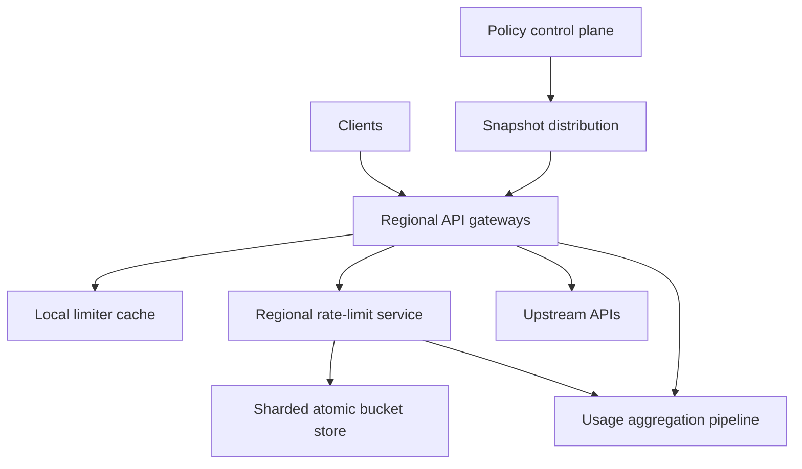

# System Design Interview Practice: Global API Rate Limiting and Quota Service

**Difficulty:** Senior / Advanced  
**Primary themes:** caching, atomic counters, token buckets, API gateways, hot keys, sharding, multi-region consistency, graceful degradation, and observability

> **Interview timing vs. this walkthrough:** In a 45-minute interview, spend about 5 minutes on requirements, 2 minutes on entities, 5 minutes on interfaces, 10–15 minutes building the basic request path, and 10–15 minutes on contention, regional consistency, and failure policy. This study version is deliberately more complete. In the room, first enforce one per-customer token bucket correctly, then add hierarchical rules and distributed scale.

This walkthrough follows Hello Interview’s delivery framework: clarify requirements, identify core entities, define interfaces, build a working design requirement by requirement, and use the remaining time on the bottlenecks implied by the non-functional requirements. genui{"citation":{"ref":"turn82search16"}} The problem and explanations below are original.

---

## Interviewer prompt

> Design a globally distributed rate-limiting and quota service for an API platform. Gateways must decide whether to allow requests based on configurable per-IP, per-user, per-API-key, per-tenant, per-route, and service-protection limits. The decision must add very little latency, tolerate failures, support bursts, and provide useful response headers and usage visibility.

## Targeted clarifying questions with assumed interviewer answers

**Candidate:** Are we limiting requests, business operations, or billable units?

**Interviewer:** The synchronous path must support request counts and weighted cost units. For example, a normal read costs 1, a heavy export costs 100, and an AI request may reserve estimated tokens. Exact billing happens elsewhere.

**Candidate:** Which identities can a policy target?

**Interviewer:** IP before authentication, then API key, user, tenant, route, service, and region after authentication. Multiple applicable rules may be evaluated for one request.

**Candidate:** What traffic scale should I assume?

**Interviewer:** Ten million average and fifty million peak checks per second globally, across 20 regions. There are five million active limit keys in a busy minute and up to 100 million configured rules.

**Candidate:** What latency and availability are required?

**Interviewer:** The gateway’s limiter work should be under 2 ms p99 within a region, excluding Internet transit. Decision availability should be 99.999%. A regional dependency failure must not take down every API.

**Candidate:** How exact must enforcement be?

**Interviewer:** Within one region, do not overspend a bucket under concurrency. Globally, ordinary product quotas may overshoot by up to 1% during partitions. Expensive or security-sensitive operations need stricter regional allocations. DDoS defense at the network edge is out of scope.

**Candidate:** Should legitimate bursts be allowed?

**Interviewer:** Yes. Policies specify a sustained refill rate and burst capacity. We also need some calendar quotas, such as one million requests per month.

**Candidate:** How quickly do configuration changes take effect?

**Interviewer:** Normally within 10 seconds globally. Emergency deny or limit reductions should reach healthy gateways in under 2 seconds. Decisions must report which policy version they used.

**Candidate:** What happens if the rate-limit service is unavailable?

**Interviewer:** It depends on the route. Login, password reset, payments, and costly AI operations should fail closed or fall back to a conservative local limit. Low-risk reads may fail open briefly with a local safety cap.

**Candidate:** Do customers need an API to inspect or modify another user’s counters?

**Interviewer:** No. Administrators configure policies and view aggregate usage. Counter inspection is an internal diagnostic operation with strict authorization.

### Scope statement to say aloud

> “I’ll put enforcement next to the gateway, use token buckets for sustained rate plus burst capacity, and evaluate every applicable hierarchical rule. Regional state will use atomic operations keyed by rule and subject. To keep the global path fast, regions receive bounded token allocations rather than synchronously coordinating every request. Failure behavior will be an explicit per-route contract, not one universal fail-open choice.”

---

## 1. Requirements (~5 minutes)

### Three core functional requirements

1. **Make an allow/deny decision.** Given authenticated request context and estimated cost, evaluate applicable IP, principal, tenant, route, service, and quota rules atomically enough to prevent local overspend.
2. **Manage and distribute policy.** Administrators can create, validate, version, stage, activate, and roll back rules; gateways receive changes quickly and can explain the policy version used.
3. **Expose client and operator feedback.** Denied clients receive `429`, `Retry-After`, and limit metadata; operators receive usage, rejection, saturation, hot-key, propagation, and degraded-mode visibility.

### Quantified non-functional requirements

| Property | Target | Design implication |
|---|---:|---|
| Decision traffic | 10M average, 50M peak checks/s | Local gateway filtering, regional partitioning, pipelining |
| Latency | Regional limiter work p99 < 2 ms | In-memory state, short network hop, no global request round trip |
| Availability | 99.999% decision path | Redundant local clients/services and explicit degraded mode |
| Regional correctness | No bucket overspend from concurrent regional requests | Atomic read-refill-consume operation |
| Global bounded error | ≤1% ordinary-quota overshoot during partitions | Regional token allocation with bounded leases |
| Configuration convergence | <10 s normally; <2 s emergency | Push stream plus version polling/reconciliation |
| Cardinality | 5M active keys/min; 100M rules | Sparse counters, compiled policy index, sharded state |
| Durability | Policy RPO 0; usage aggregates durable | Consensus-backed policy DB; async metrics pipeline |

### Consistency and availability contract

- **Policy metadata is strongly consistent.** Every change produces an immutable version and audit record. Activation uses optimistic concurrency.
- **A decision uses one compiled policy snapshot.** The response includes its version. Gateways never combine half of one configuration with half of another.
- **Regional token consumption is atomic per bucket.** Concurrent requests cannot both spend the same final token.
- **Multi-rule admission is all-or-deny logically.** A request is allowed only if every required rule has capacity. We avoid permanently charging some rules when a later rule denies.
- **Global limits use bounded allocations.** A region can spend only tokens leased to it, so partition overshoot is bounded by outstanding allocations rather than unlimited.
- **Configuration is eventually delivered but versioned.** Emergency rules have an accelerated push path. A gateway beyond its maximum allowed staleness uses the configured conservative behavior.
- **Usage analytics are eventually consistent.** They do not participate in the allow/deny critical path.
- **Failure policy is explicit per route/rule.** `FAIL_CLOSED`, `FAIL_OPEN_WITH_LOCAL_CAP`, or `LOCAL_ONLY` is part of configuration.
- **Denial is not proof of malicious behavior.** The limiter supplies signals; abuse detection and account sanctions are separate systems.

### Out of scope

- Layer 3/4 volumetric DDoS mitigation
- Authentication, WAF signature rules, and bot classification
- Exact billing and invoice generation
- Business concurrency controls such as inventory reservation
- Full API gateway routing implementation
- Customer-facing counter mutation

### Scale estimates that change the design

At 50 million peak decisions per second, even a compact 100-byte request/response exchange with a remote limiter would move roughly:

```text
50,000,000 × 100 bytes = 5 GB/s
```

That excludes protocol, TLS, replication, and state-store traffic. A single centralized global service is impossible. Decisions must stay regional, common protection must happen locally in each gateway, and global quotas need allocated budgets rather than per-request global consensus.

With 5 million active keys in a busy minute and an estimated 100 bytes of bucket state plus key/index overhead:

```text
5,000,000 × 100 bytes ≈ 500 MB per active rule dimension
```

A request can touch several dimensions, and replicas multiply memory. Still, the active working set is manageable when sharded. The 100 million configured rules are different: most are inactive, so compile only relevant policy indexes into gateway snapshots and create counter state lazily on first use.

At 10 million average checks/s:

```text
checks/day = 10,000,000 × 86,400 = 864 billion
```

Storing an event for every check in a transactional database is unreasonable. Aggregate decisions locally by rule, tenant, route, outcome, and time bucket; sample allowed events; retain full denied/security-sensitive events only where policy permits.

**What to say aloud:**

> “The scale rules out a global RPC and a durable write per request. I’ll keep enforcement regional and in memory, create bucket state only for active subjects, and export aggregated usage asynchronously.”

---

## 2. Core entities (~2 minutes)

| Entity | Essential fields and purpose |
|---|---|
| `PolicySet` | Tenant/service scope, immutable version, activation state, checksum |
| `RateLimitRule` | Rule ID, match conditions, subject key, algorithm, rate, burst, cost expression, failure mode |
| `QuotaRule` | Longer calendar/window limit, reset policy, regional allocation policy |
| `CompiledSnapshot` | Deterministic gateway-ready rule graph for one version |
| `BucketKey` | Stable hash of rule ID, subject identity, and optional route/resource dimension |
| `BucketState` | Remaining tokens, last refill time, version/epoch, expiry |
| `RegionalGrant` | Global quota epoch, region, allocated units, spent units, expiry |
| `Decision` | Allow/deny, matched rules, remaining units, retry time, policy version, degraded flag |
| `UsageAggregate` | Time bucket, rule/tenant/route, allowed, denied, cost, degraded count |
| `AuditEvent` | Actor, policy change, previous/new version, timestamp, reason |

The key modeling separation is between durable policy, ephemeral enforcement state, and analytical usage. Policy needs auditability and strong versioning. Bucket state needs atomicity and speed. Analytics can be asynchronous.

---

## 3. API and system interface (~5 minutes)

### 3.1 Decision interface

This is normally a low-overhead internal RPC from a gateway filter to the regional limiter:

```protobuf
message CheckRequest {
  string request_id = 1;
  string tenant_id = 2;       // derived from authenticated credential
  string principal_id = 3;    // derived from auth; omitted pre-auth
  string api_key_id = 4;      // stable ID, never raw secret
  string source_ip_prefix = 5;
  string route_id = 6;        // from trusted gateway routing metadata
  string service_id = 7;
  string region = 8;          // injected by infrastructure
  int64 estimated_cost = 9;
  map<string,string> trusted_attributes = 10;
}

message CheckResponse {
  enum Outcome { ALLOW = 0; DENY = 1; DEGRADED_ALLOW = 2; }
  Outcome outcome = 1;
  string policy_version = 2;
  repeated RuleResult rules = 3;
  int64 retry_after_ms = 4;
  bool shadow_only = 5;
}
```

The gateway derives tenant, user, route, service, and region from authenticated or trusted context. It must not accept client headers such as `X-Tenant-ID` as authoritative.

Example decision:

```json
{
  "outcome":"DENY",
  "policy_version":"ps_91:v204",
  "rules":[
    {"rule_id":"tenant-write-rps","allowed":true,"remaining":381},
    {"rule_id":"user-create-post","allowed":false,"remaining":0,"reset_after_ms":720}
  ],
  "retry_after_ms":720,
  "shadow_only":false
}
```

### 3.2 Public HTTP behavior

If denied, the gateway returns:

```http
HTTP/1.1 429 Too Many Requests
Retry-After: 1
RateLimit-Limit: 20
RateLimit-Remaining: 0
RateLimit-Reset: 1
X-Request-ID: req_123
Content-Type: application/json

{
  "error":"rate_limit_exceeded",
  "message":"Too many create-post requests. Retry shortly.",
  "policy":"user-create-post"
}
```

Do not reveal sensitive internal anti-abuse rules. For multiple limits, return the most constraining client-visible rule and keep the full explanation in protected telemetry.

### 3.3 Create a policy version

```http
POST /v1/services/social-api/rate-limit-policy-versions
Authorization: Bearer <admin-token>
Idempotency-Key: policy-release-204
If-Match: "v203"
Content-Type: application/json

{
  "rules":[
    {
      "rule_key":"user-create-post",
      "match":{"route_id":"posts.create"},
      "subject":"principal_id",
      "algorithm":"TOKEN_BUCKET",
      "refill_per_second":10,
      "burst_capacity":20,
      "cost":"1",
      "failure_mode":"FAIL_CLOSED"
    },
    {
      "rule_key":"tenant-heavy-api",
      "match":{"route_tag":"expensive"},
      "subject":"tenant_id",
      "algorithm":"TOKEN_BUCKET",
      "refill_per_second":1000,
      "burst_capacity":2000,
      "cost":"estimated_cost",
      "failure_mode":"FAIL_OPEN_WITH_LOCAL_CAP"
    }
  ]
}
```

The server validates selectors, subject sources, expression bounds, conflicting rule keys, limits, and emergency safety constraints. It creates an immutable draft and returns validation warnings plus a checksum.

### 3.4 Activate or roll back

```http
POST /v1/services/social-api/rate-limit-policy-versions/v204:activate
Authorization: Bearer <admin-token>
If-Match: "active-v203"

{"rollout":{"percentage":5,"increase_every_seconds":60}}
```

Activation publishes a signed snapshot manifest. A rollback points the active manifest to a previous known-good immutable version; it does not edit history.

### 3.5 Usage interface

```http
GET /v1/services/social-api/rate-limit-usage?from=2026-10-13T23:00:00Z&to=2026-10-14T00:00:00Z&group_by=rule,region
Authorization: Bearer <admin-token>
```

Usage is explicitly marked with aggregation delay and sampling metadata. It is not an authoritative bill.

### Important API errors

| Status | Meaning |
|---|---|
| `400` | Invalid selector, algorithm, cost expression, or limit |
| `403` | Caller lacks service/policy authorization |
| `409` | Stale policy version or idempotency mismatch |
| `422` | Rule is valid syntax but unsafe or internally contradictory |
| `429` | Administrative mutation rate limited |
| `503` | Policy control plane unavailable; no activation acknowledged |

---

## 4. Data flow

### Request decision

1. Edge protections apply a coarse per-connection/IP local limit before expensive parsing.
2. The gateway authenticates when the route requires it and derives trusted subject attributes.
3. A compiled local snapshot finds all applicable rules without a control-plane lookup.
4. Purely local safety rules consume local token buckets immediately.
5. Rules requiring shared regional state are sent as one batched check to the regional limiter.
6. The limiter resolves bucket shards and atomically evaluates/charges the rule set.
7. The gateway allows the upstream request or returns `429` with retry metadata.
8. Local aggregates are exported asynchronously.

### Policy update

1. An administrator submits a new immutable version.
2. The policy service validates and compiles it deterministically.
3. Activation commits the new manifest version and an outbox event.
4. A distribution stream pushes the signed snapshot to regional relays and gateways.
5. Recipients verify checksum/signature, build indexes, and atomically swap the active pointer.
6. Periodic polling reconciles missed pushes.
7. Ack/lag telemetry shows which regions remain stale.

---

## 5. High-level design (~10–15 minutes)

### Compact architecture



### Operation 1: enforce one token bucket

Start with one rule: a user may make 10 requests/s and burst to 20.

A token bucket stores `tokens` and `last_refill_time`. Before consuming cost `c` at time `now`:

```text
elapsed = max(0, now - last_refill_time)
tokens  = min(capacity, tokens + elapsed × refill_rate)

if tokens >= c:
    tokens -= c
    allow
else:
    deny
    retry_after = (c - tokens) / refill_rate
```

Token bucket fits because it permits accumulated bursts while bounding the long-run average. Redis describes the same model: capacity bounds the bucket, refill adds tokens at a fixed rate, and each allowed operation consumes tokens. genui{"citation":{"ref":"turn83search1"}}

The entire read-refill-decide-write must be atomic. In a Redis-style store, use a Lua script or server-side function. Two separate `GET` and `SET` calls can both observe one remaining token and both allow.

Bucket key:

```text
hash(policy_namespace, rule_id, subject_type, subject_id, route_dimension)
```

Bucket value:

```text
tokens_scaled_int, last_refill_ms, policy_epoch
```

Use scaled integers rather than floating-point tokens to make repeated arithmetic deterministic. Derive time from the state-store server or pass a bounded trusted monotonic timestamp; do not trust a client timestamp.

Keys expire after enough idle time to refill completely plus safety margin:

```text
ttl ≈ ceil(capacity / refill_rate) + margin
```

An absent expired bucket is equivalent to a full bucket.

### Operation 2: evaluate hierarchical rules

A request might match:

- IP login protection: 20/minute;
- user login protection: 5/minute;
- tenant API rate: 10,000/s;
- route rate: 1,000/s;
- service emergency cap: 100,000/s.

It is allowed only if all enforced rules pass. Naively calling the store once per rule multiplies latency and can partially charge earlier buckets before a later rule denies.

Compile the matching rules in the gateway, group bucket keys by shard, and issue one batched operation. When all keys are on one shard, one server-side function:

1. refills every bucket;
2. checks every required cost without mutating;
3. if all pass, deducts from all;
4. otherwise leaves enforced buckets unchanged;
5. returns per-rule remaining and retry time.

When keys span shards, full atomicity requires a distributed transaction, which is too expensive for 50M/s. Practical choices:

- co-locate related tenant/user/route buckets using a common hash tag;
- treat broad service protection as a local or separately charged pre-check;
- evaluate most-specific and tenant rules atomically together;
- accept tiny conservative underutilization by reserving a short-lived local allowance from broad buckets.

The selected design co-locates the rules that must be all-or-nothing by hashing on tenant. Pre-auth IP rules and global service safety caps run locally before the shared check. This avoids cross-shard transactions on the hot path.

### Operation 3: integrate at the gateway

The gateway is the best enforcement point because it sees requests before upstream work and already holds trusted route/auth context. Envoy’s global rate-limit architecture similarly lets an HTTP filter call a global gRPC rate-limit service for matching requests. genui{"citation":{"ref":"turn83search7"}}

The gateway maintains:

- the active compiled policy snapshot;
- a small local token-bucket engine;
- a regional limiter client pool with deadlines and circuit breaking;
- a cache of short-lived quota grants where permitted;
- route-specific failure behavior;
- local usage counters.

Decision order:

1. coarse local IP/connection safety check;
2. authentication and route resolution;
3. compiled rule match;
4. local rule/grant consumption;
5. one regional batch check if needed;
6. upstream forwarding or `429`.

Set the limiter RPC deadline well below the gateway’s request budget, for example 1 ms within the same zone. Do not retry serially several times; that amplifies load during failure. Hedging to a second healthy replica can be reserved for strict routes and must use a request ID so duplicate RPCs do not double-charge.

### Operation 4: distribute configuration safely

Policy storage uses a consensus-backed SQL database:

```text
policy_set(service_id, version, state, checksum, created_by, created_at)
rate_rule(policy_version, rule_id, match_spec, subject_spec,
          algorithm, parameters, cost_expr, failure_mode, visibility)
active_manifest(service_id, version, rollout_epoch, activated_at)
audit_event(...)
outbox_event(...)
```

The compiler produces a deterministic snapshot containing route indexes, subject extractors, constant-folded expressions, and rule parameters. The snapshot is signed and content-addressed.

Gateways receive a manifest over a push stream, download/verify the snapshot, construct it off the request thread, and atomically swap a pointer. Existing requests finish on the old immutable snapshot; new requests use the new one. No request sees a half-applied configuration.

Push alone can miss disconnected gateways, so each gateway also polls the manifest version. Emergency changes use a high-priority channel and can instruct gateways to stop using snapshots older than a specified epoch.

Rollouts support `SHADOW`, percentage canary, regional canary, full activation, and rollback. Shadow rules compute outcomes and telemetry without rejecting traffic. This catches a rule that would accidentally block every customer.

### Operation 5: shard regional bucket state

Partition by a stable hash of the bucket’s co-location key, usually tenant plus rule namespace. Use many virtual shards mapped to physical state nodes so rebalancing moves small ranges.

Each shard has a primary and replicas across availability zones. The primary serializes server-side bucket functions. Synchronous replication to one follower gives zonal durability for strict counters, while lower-risk ephemeral buckets may accept asynchronous replication for latency.

Bucket state loss affects enforcement rather than business data. Recovery policy matters:

- resetting a bucket to full is fail-open and can admit a burst;
- resetting to empty is fail-closed and can reject legitimate traffic;
- reconstructing from a replicated write-ahead log is more accurate but slower.

Use replicated state for strict and expensive routes. For ordinary limits, on shard failover initialize conservatively to a fraction of capacity and let refill restore normal service. Record `degraded=true` in telemetry.

Redis documents why a shared atomic store is useful: local per-process counters are bypassed behind a load balancer, while Lua keeps the check/update cycle atomic. genui{"citation":{"ref":"turn83search0"}} Redis is a reasonable implementation, but the interview design depends on the properties—atomic functions, expiry, partitioning, replication—not the brand.

### Operation 6: serve usage without hurting enforcement

Every gateway and limiter process maintains in-memory counters by bounded-cardinality dimensions:

```text
time_bucket, policy_version, rule_id, region, outcome
allowed_count, denied_count, cost_units, degraded_count
```

Flush aggregates every few seconds to a durable log. Stream processors build time-series metrics, tenant dashboards, alerting, and longer-term warehouse tables.

Do not place raw user IDs in metrics labels; cardinality and privacy would explode. For debugging one subject, use sampled protected decision logs or an authorized trace keyed by request ID.

For monthly quotas, the authoritative remaining allocation is maintained separately from dashboard aggregation. Analytics lag must never permit quota spend.

---

## 6. Deep dives (~10–15 minutes)

### Deep dive A: algorithm choice, atomicity, and clock boundaries

#### Where the baseline breaks

A fixed-window counter such as 100 requests per minute is easy, but a client can send 100 requests at `12:00:59.9` and another 100 at `12:01:00.1`, producing 200 requests in 200 ms. Separate read and write operations race. Client clocks can move backward or lie.

#### Algorithm comparison

| Algorithm | State | Advantages | Drawbacks |
|---|---:|---|---|
| Fixed window | Counter + expiry | Cheapest, understandable | Boundary burst up to roughly 2× |
| Sliding log | Timestamp per request | Exact rolling window | Memory/write cost proportional to traffic |
| Sliding-window counter | Two counters | Good approximation, compact | Weighted estimate, not exact |
| Leaky bucket | Queue/water level | Smooth output rate | Can add queueing; less natural for immediate API denial |
| Token bucket | Tokens + timestamp | Allows burst, controls average, compact | Requires atomic refill math |

Choose token bucket for short-term request admission. Use fixed calendar counters or allocated quota for daily/monthly product limits. Different requirements justify different algorithms; one universal limiter is a smell.

#### Atomic server-side function

The function receives keys plus trusted rule parameters and cost. Conceptually:

```text
for each bucket:
    validate policy epoch
    refill using server time
    compute whether tokens >= cost

if every enforced bucket passes:
    deduct each cost
    persist states and TTLs
    return ALLOW
else:
    persist only harmless refill normalization if desired
    return DENY with max required wait
```

Atomic execution prevents double spending on one shard. Cap the number of rules and function runtime so one complex request cannot block the shard.

#### Reservation and actual cost

Some operations know cost only afterward, such as generated AI tokens. Use two phases:

1. reserve a bounded estimate before execution;
2. settle actual cost idempotently afterward using `request_id`;
3. return unused reservation or charge extra within a defined overdraft policy;
4. expire abandoned reservations conservatively.

The settlement record needs a unique `(rule_id, request_id)` so retries cannot refund twice. If strict cost cannot be known or reserved, enforce concurrency plus estimated-cost limits rather than pretending request count captures resource use.

#### Clock handling

Use the state node’s clock for refill on a bucket. Clamp negative elapsed time to zero, cap extreme elapsed time at the time needed to fill the bucket, and monitor clock corrections. During shard migration, carry `tokens` and `last_refill` together and fence old ownership with an epoch.

#### What to observe

- allowed/denied rate and cost by rule
- remaining-token distribution and sustained saturation
- atomic function latency and script timeouts
- fixed-window boundary spikes where used
- reservation age, settlement mismatch, and leaked reservations
- clock skew/correction and negative elapsed detections
- number of rules evaluated per request

**What to say aloud:**

> “Token bucket gives the product behavior we want—controlled average plus explicit burst capacity. The correctness boundary is an atomic refill-check-deduct operation using trusted time, not the choice of Redis by itself.”

### Deep dive B: hot keys, caches, and 50-million-per-second scaling

#### Where the baseline breaks

Hash sharding distributes millions of users well, but one global service rule, giant tenant, or popular shared API key maps to one shard. That single bucket becomes a serialized hot key. Sending every request to a regional store also makes the limiter itself a dependency capable of causing an outage.

#### Options

| Approach | Benefit | Trade-off |
|---|---|---|
| One exact shared counter | Strongest accuracy | One-key throughput ceiling |
| Random counter stripes | Higher write throughput | Summation/coordination complicates exact denial |
| Gateway-local counters | Extremely fast | Overshoot grows with gateway count |
| Leased token batches | Fast local path with bounded overshoot | May strand tokens and underutilize quota |

Choose leased token batches for broad hot limits and exact shared state for granular cold keys.

#### Hierarchical local grants

The regional allocator owns the authoritative broad bucket. Each gateway requests a small grant, such as 100 tokens valid for 100 ms. It spends those tokens locally without an RPC. When low, it asynchronously asks for more.

Bound overshoot by controlling outstanding grants:

```text
maximum outstanding tokens ≤ configured error budget
```

If a 1,000,000-request/s service cap permits 1% error, at most 10,000 unreported tokens may be outstanding across gateways. Grant size adapts to demand and gateway count. Low-traffic gateways receive tiny grants; hot gateways receive larger short-lived grants.

Unused grants expiring can cause conservative underutilization, not overspend. Return unused tokens opportunistically, but correctness does not depend on a return message arriving. An allocation epoch prevents an old gateway from spending a grant after ownership changes.

#### Two-layer limiting

Envoy documents that local and global rate limiting can be combined, with local limiting reducing load on the global service. genui{"citation":{"ref":"turn83search5"}} Apply that pattern deliberately:

- **local emergency limit:** protects each gateway/upstream connection pool immediately;
- **regional exact or granted limit:** coordinates subjects across gateways;
- **global allocation:** bounds cross-region usage.

Local limits are not simply `global_limit / number_of_gateways`; autoscaling would change effective capacity. Grants are demand-aware and centrally bounded.

#### Hot-subject mitigation

- Detect keys with QPS and contention sketches before shard saturation.
- Promote hot buckets to grant mode automatically when policy allows.
- Isolate huge tenants on dedicated virtual shards.
- Batch multiple token requests from the same gateway.
- Pipeline independent bucket checks.
- Use request coalescing for grant refresh.
- Apply backpressure before state-node event loops saturate.

#### Cache semantics

Policy snapshots are excellent cache candidates because they are immutable and versioned. Counter decisions are not safely cacheable as `ALLOW` without consuming capacity. Cache a token grant, not a previous answer.

A cached `DENY` may be honored briefly until its calculated retry time, but new configuration or refill can make it stale. Bound its lifetime and include policy epoch.

#### Capacity planning

Suppose one atomic state shard sustains 100,000 simple checks/s at target p99 after replication. If only 20% of 50M peak requests require shared state because local grants and coarse rules handle the rest:

```text
shared peak = 50M × 0.20 = 10M checks/s
base shards = 10M / 100K = 100
with 2× headroom = about 200 primary shards per global fleet
```

Benchmark determines the real figure. The design decision is to reduce shared-check ratio and partition capacity with headroom, not to assert one magic Redis cluster handles everything.

#### What to observe

- shared-check ratio and local-grant hit rate
- hot keys and per-shard QPS/CPU/p99
- outstanding and stranded grant tokens
- effective overshoot/underutilization
- grant refresh latency and coalescing ratio
- gateway local-cap denials
- rebalance movement and ownership-epoch rejects

**What to say aloud:**

> “Uniform hashing solves average distribution, not celebrity keys. For broad hot limits I lease small, expiring token batches to gateways and cap total outstanding credit. That preserves a quantified error bound while removing a network and serialization step from most requests.”

### Deep dive C: multi-region correctness, policy propagation, and failure modes

#### Where the baseline breaks

Synchronous global token consumption violates the 2 ms target and fails during inter-region partitions. Independent regional counters can overshoot a global limit by roughly the number of regions. A universal fail-open choice protects availability but may bankrupt an expensive API; universal fail-closed turns limiter trouble into a global outage.

#### Global enforcement choices

| Approach | Consistency | Latency/availability |
|---|---|---|
| One home-region counter | Strong | Cross-region latency; home-region dependency |
| Global consensus per request | Strongest | Too slow and partition-sensitive |
| Independent regional buckets | Available | Potentially large overshoot |
| Regional allocations | Bounded error | Rebalancing and stranded-capacity complexity |

Choose regional allocations.

The global quota coordinator periodically allocates tokens to regions based on observed demand, minimum shares, and safety reserve:

```text
regional_grant(global_rule_id, epoch, region,
               granted, spent, expires_at)
```

A region cannot spend more than its grant. During a partition it continues within the remaining allocation. When empty:

- strict rules deny;
- ordinary rules may use a small preconfigured emergency allowance within the 1% global error budget;
- low-risk service-protection limits fall back to local caps.

Short epochs reduce stranded capacity but increase coordination. Keep a central reserve so demand can move between regions without revoking already issued tokens. Strict financial or security operations can use smaller allocations or route through a home region.

#### Failure matrix

| Failure | Selected behavior |
|---|---|
| Gateway cannot reach one limiter replica | Use another within the strict deadline; avoid retry storms |
| Regional limiter cluster unavailable | Apply rule-specific local fallback |
| Bucket shard primary fails | Promote replica; fence old primary with epoch |
| Counter state unavailable after failover | Strict rule starts conservative; ordinary rule gets bounded local cap |
| Global coordinator unreachable | Spend unexpired regional grant only |
| Policy push missed | Poll manifest; continue last known good until max staleness |
| Snapshot invalid/signature mismatch | Reject snapshot and keep last known good; alert |
| Emergency deny snapshot too stale | Enforce prepositioned emergency epoch/fail-closed policy |
| Metrics pipeline down | Decisions continue; buffer/drop aggregates by priority |

Failure modes belong to policy:

```text
FAIL_CLOSED
  deny when no trustworthy shared decision is possible

FAIL_OPEN_WITH_LOCAL_CAP
  permit only while a conservative local bucket has tokens

LOCAL_ONLY
  intentionally enforce a per-gateway protection limit
```

Envoy exposes the same basic operational question: its filter can be configured to deny when the global rate-limit service errors, demonstrating that failure behavior must be chosen rather than assumed. genui{"citation":{"ref":"turn83search9"}}

#### Configuration consistency

Each request uses one snapshot version. Counter keys include a rule compatibility epoch:

- If a limit increases, the old bucket may safely transition using capped tokens.
- If a limit decreases sharply, do not let old accumulated capacity survive. Bump the epoch so a new conservatively initialized bucket is used.
- If only description or shadow metadata changes, retain the same bucket epoch.

This prevents a policy update from accidentally resetting every bucket to full or preserving an unsafe burst.

Emergency changes should be pre-authorized and narrow. Require signed manifests, dual control for global denies, expiry times, and automatic rollback guardrails. A malformed emergency rule can be more damaging than the traffic it intends to stop.

#### Abuse resistance

Attackers can force high cardinality by generating random API keys or spoofed identifiers. Protect the limiter itself:

- create shared state only after credential validation where possible;
- aggregate unauthenticated traffic by normalized IP prefix and route;
- cap new bucket creation per gateway/shard;
- use TTLs and admission sketches for one-hit subjects;
- reject unbounded client-controlled dimensions;
- rate-limit the administrative API;
- separate security limits from customer-visible quota metadata.

#### Observability

Track the complete decision budget:

```text
gateway rule-match time
+ local-bucket/grant time
+ limiter RPC queue/network time
+ shard operation time
= decision latency
```

Key SLOs and alerts:

- decision availability and p50/p95/p99 by region
- gateway timeout and degraded-decision rates
- allowed, denied, shadow-denied, and local-cap-denied cost
- configuration version lag and stale gateway count
- bucket shard saturation, replication lag, and failovers
- global grant remaining, demand forecast error, and stranded capacity
- observed overshoot against the configured error budget
- emergency-rule activation and expiry
- bucket-creation rate and cardinality anomalies
- false-positive reports and top limiting rules

Run synthetic probes for both allow and deny paths. A probe that only expects `200` cannot detect a limiter that accidentally allows everything.

**What to say aloud:**

> “I won’t put inter-region consensus on every request. The global coordinator bounds each region with expiring allocations. During failure, behavior is rule-specific: strict routes deny, ordinary routes may use a quantified emergency allowance, and low-risk reads use a conservative local cap.”

---

## 7. Finish

### Concise final design

Gateways authenticate the request, derive trusted subject attributes, and match rules from one immutable compiled policy snapshot. Coarse local buckets protect each gateway and absorb obvious abuse. Requests needing coordinated enforcement make one short-deadline regional call. A sharded in-memory state layer performs atomic token refill, multi-rule validation, and deduction for co-located tenant buckets, returning allow/deny, remaining capacity, retry time, policy version, and degraded status.

Token buckets enforce sustained rate plus bursts; separate allocated counters handle daily/monthly quotas. Broad hot limits do not serialize every request on one key: the allocator leases small expiring token grants to gateways and caps total outstanding credit. The same hierarchy extends globally—regions receive bounded quota allocations, so partitions trade some utilization for a measurable overshoot limit without putting a global consensus round trip in the request path.

The policy control plane stores immutable versions, compiles and signs snapshots, distributes them by push, and repairs missed delivery by polling. Gateways atomically swap validated snapshots and retain last known good policy. Rule-specific failure modes choose fail closed, bounded local fallback, or intentionally local enforcement. Aggregated usage leaves the critical path, while detailed telemetry tracks latency, denials, hot keys, configuration lag, degraded decisions, grants, and actual overshoot.

### Requirements check

| Requirement | Design support |
|---|---|
| Per-IP/user/key/tenant/route limits | Trusted subject extractors and hierarchical rules |
| Sustained rate with bursts | Token bucket |
| Weighted operations | Integer cost passed to atomic deduction |
| Calendar quota | Regional/global allocation epochs and durable quota state |
| 50M peak checks/s | Local filters/grants, regional sharding, batching |
| p99 under 2 ms | Same-region in-memory operations; no global request round trip |
| Regional correctness | Atomic server-side refill/check/deduct |
| Bounded global overshoot | Capped outstanding regional grants |
| Hot-key scalability | Gateway token grants and dedicated virtual shards |
| Dynamic configuration | Immutable signed snapshots, push plus polling |
| Emergency response | Priority distribution, maximum staleness, narrow signed rules |
| Graceful degradation | Per-rule fail mode and conservative local caps |
| Client feedback | `429`, `Retry-After`, and limit metadata |
| Operator visibility | Aggregated usage, decision tracing, SLO decomposition |

## Realistic interviewer follow-up questions with strong sample answers

**Interviewer:** Why token bucket instead of a fixed window?

**Candidate:** Token bucket directly expresses sustained refill rate and burst capacity. Fixed windows are cheaper but permit a boundary burst close to twice the intended rate. I may still use fixed calendar counters for monthly quotas where reset semantics are part of the product.

**Interviewer:** Why must the check and decrement be atomic?

**Candidate:** If two requests independently read one remaining token, both can allow and write zero. A server-side function refills, tests, and deducts as one serialized operation, so only one request spends the final token.

**Interviewer:** How do you apply five rules without five round trips?

**Candidate:** The gateway matches rules locally and sends their keys/costs in one batch. Rules that need joint charging are co-located by tenant and evaluated in one atomic function. Coarse IP and service-protection rules run locally or use grants.

**Interviewer:** What if one rule passes and another fails?

**Candidate:** The atomic function checks every enforced bucket before deducting any. If a later rule fails, none of that co-located set is charged. I avoid a cross-shard transaction by co-locating the rules requiring all-or-nothing behavior.

**Interviewer:** Why not keep all counters inside gateway processes?

**Candidate:** Traffic is load-balanced, so a client can consume a full allowance on every gateway. Local counters are useful for safety and granted tokens, but coordinated limits need a shared owner or bounded allocation.

**Interviewer:** How do you handle one tenant doing millions of requests per second?

**Candidate:** Detect the hot key and switch the broad bucket to grant mode. Gateways consume small, expiring local allocations whose total is capped by the allocator. Large tenants can also receive dedicated virtual shards.

**Interviewer:** Don’t local grants overshoot?

**Candidate:** They can only overshoot by outstanding valid credit. I size the total credit below the policy’s error budget and use short epochs. The trade-off is sometimes stranded tokens and underutilization, which is safer than unbounded overshoot.

**Interviewer:** Can you enforce a perfectly exact global limit in 2 ms?

**Candidate:** Not across distant regions during partitions. Exact per-request global coordination conflicts with the latency and availability goals. I would ask which requirement wins. Here, regional allocation provides bounded error; stricter operations can route to one home region.

**Interviewer:** What happens when Redis is down?

**Candidate:** The gateway follows each rule’s failure mode. Security and expensive routes fail closed or use a tiny conservative local bucket. Low-risk reads may fail open only through a bounded local cap. Replicas, circuit breakers, and no serial retry storm reduce the chance and blast radius.

**Interviewer:** Should fail-open mean unlimited traffic?

**Candidate:** No. My fail-open mode is “open relative to the shared service but still constrained locally.” That protects availability without removing every guardrail.

**Interviewer:** What time source does the bucket use?

**Candidate:** The state owner’s clock, not a client-provided timestamp. I clamp negative elapsed time, cap refill at bucket capacity, and move timestamp and tokens together during migration.

**Interviewer:** How do you change a limit without resetting capacity incorrectly?

**Candidate:** Each rule has a bucket compatibility epoch. Compatible changes transform/cap current state; a sharp decrease bumps the epoch and initializes conservatively. Snapshot activation and counter epoch are explicit rather than accidental key changes.

**Interviewer:** How do you protect the limiter from random-key attacks?

**Candidate:** Validate credentials before creating per-key state, aggregate unauthenticated traffic by normalized IP prefix, forbid unbounded client dimensions, limit bucket creation, expire idle keys, and use sketches/local limits for one-hit identities.

**Interviewer:** How do monthly quotas differ from rate limits?

**Candidate:** A short-term rate controls velocity; a monthly quota controls total consumption. The monthly quota uses durable global allocation epochs and reconciliation, while the token bucket remains an ephemeral fast-path guardrail.

**Interviewer:** How do you rate-limit streaming or AI requests?

**Candidate:** Combine request/concurrency limits with weighted cost. Reserve estimated tokens before work, then idempotently settle actual usage. Cap estimates and abandoned reservations so a client cannot bypass cost control or leak quota forever.

**Interviewer:** What would you build first?

**Candidate:** One region, gateway integration, immutable policy snapshots, one Redis-style sharded store, atomic token-bucket evaluation, `429` headers, explicit failure modes, and metrics. Then add local grants for hot keys, regional allocation for global quotas, canary policy rollout, and multi-region reconciliation.

## Common pitfalls

1. Discussing algorithms for the entire interview and never building the distributed system.
2. Choosing an algorithm before asking whether bursts are allowed.
3. Treating fixed-window boundary behavior as exact enforcement.
4. Performing token read and decrement as separate operations.
5. Trusting client-supplied tenant, route, cost, or timestamp values.
6. Using floating-point token arithmetic without deterministic rounding.
7. Making one network call per applicable rule.
8. Charging early rules permanently when a later rule denies.
9. Assuming all hierarchical keys naturally live on one shard.
10. Putting a global consensus round trip on every request.
11. Dividing a global limit equally by gateway count despite autoscaling and uneven demand.
12. Assuming consistent hashing eliminates hot keys.
13. Caching previous `ALLOW` decisions instead of caching bounded token grants.
14. Issuing grants without capping total outstanding credit.
15. Forgetting grant epochs during gateway or shard failover.
16. Treating fail-open as unlimited traffic.
17. Applying one failure behavior to every route.
18. Retrying limiter RPCs serially and amplifying an outage.
19. Resetting recovered buckets to full for strict expensive operations.
20. Letting policy changes accidentally refill every bucket.
21. Mutating policy versions in place.
22. Using push-only configuration with no reconciliation poll.
23. Applying new policy structures non-atomically at gateways.
24. Shipping emergency global denies without canaries, expiry, or rollback.
25. Logging every allowed request synchronously.
26. Putting raw user IDs into high-cardinality metrics labels.
27. Using analytics counters as authoritative quota state.
28. Ignoring random-key memory exhaustion attacks.
29. Exposing internal anti-abuse rules in public response headers.
30. Treating rate limiting as complete DDoS protection.
31. Ignoring weighted cost and concurrency for expensive endpoints.
32. Claiming exact multi-region enforcement together with low latency and partition availability.
33. Monitoring average latency but not p99, degraded decisions, hot shards, or policy lag.
34. Probing only the allow path and never verifying denials.

## A polished 60-second close

> “The gateway derives trusted identity and route context, matches all rules from one immutable compiled snapshot, and handles coarse protection locally. Coordinated rules go in one short-deadline regional call to a sharded in-memory store that atomically refills, checks, and deducts token buckets. Rules requiring joint charging are co-located by tenant. Broad hot limits use small expiring gateway grants with a cap on total outstanding credit, so most requests avoid shared-state RPCs while overshoot remains quantified. Global quotas use the same idea at regional scale instead of adding inter-region consensus to every request. Policy versions are validated, compiled, signed, pushed, polled, and atomically swapped; bucket epochs make limit reductions safe. If dependencies fail, each route explicitly fails closed, uses a conservative local cap, or remains local-only. Usage aggregation is asynchronous, and observability tracks decision latency, denials, degraded behavior, hot keys, configuration lag, allocation error, and actual overshoot.”

## References

- [Hello Interview: System Design Delivery Framework](https://www.hellointerview.com/learn/system-design/in-a-hurry/delivery)
- [Hello Interview: Design a Distributed Rate Limiter](https://www.hellointerview.com/learn/system-design/problem-breakdowns/distributed-rate-limiter)
- [Hello Interview: API Gateway Deep Dive](https://www.hellointerview.com/learn/system-design/deep-dives/api-gateway)
- [Redis: Rate Limiter](https://redis.io/docs/latest/develop/use-cases/rate-limiter/)
- [Redis: Token Bucket with Atomic Lua](https://redis.io/docs/latest/develop/use-cases/rate-limiter/redis-py/)
- [Envoy: Global Rate Limiting](https://www.envoyproxy.io/docs/envoy/latest/intro/arch_overview/other_features/global_rate_limiting.html)
- [Envoy: Local Rate Limiting](https://www.envoyproxy.io/docs/envoy/latest/intro/arch_overview/other_features/local_rate_limiting)
- [Envoy: HTTP Rate Limit Filter](https://www.envoyproxy.io/docs/envoy/latest/configuration/http/http_filters/rate_limit_filter)
