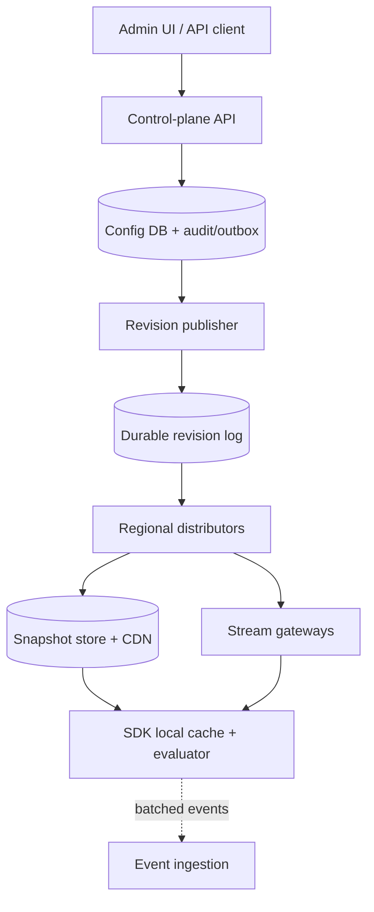

# System Design Interview Practice: Globally Distributed Feature Flag Service

**Difficulty:** Medium  
**Primary themes:** control plane vs. data plane, local caching, ordered configuration propagation, consistency, streaming fan-out, safe rollouts, reliability

> **Interview timing vs. this walkthrough:** In a 45-minute interview, spend roughly 5 minutes on requirements, 2 on entities, 5 on interfaces, 10–15 on the high-level design, and 10–15 on deep dives. This document is deliberately more detailed so you can study the reasoning; you would compress it while speaking.

The delivery order follows the Hello Interview pattern: narrow requirements, name the core entities, define the interface, build the simplest complete design requirement by requirement, and then use the remaining time on the hardest scale and reliability constraints. Hello Interview also cautions against spending so long on API details that there is no time left for the system itself. genui{"citation":{"ref":"turn74search14"}}

---

## Interviewer prompt

> Design a globally distributed feature-flag service similar to LaunchDarkly. Teams should be able to create flags, target users or organizations, perform percentage rollouts, and quickly disable a bad feature. Applications around the world must evaluate flags with very low latency and continue operating through service or network failures.

## Targeted clarifying questions

**Candidate:** Are flags only Boolean, or do we need multivariate values such as strings and JSON?

**Interviewer:** Support Boolean, string, number, and JSON variations. Rules may target attributes and reusable segments, followed by a percentage rollout and a default variation.

**Candidate:** Is evaluation performed by our remote service or inside application SDKs?

**Interviewer:** Server-side and mobile/web SDKs are all in scope. The hot path should be as fast and reliable as possible.

**Candidate:** What scale should I design for?

**Interviewer:** Assume 100,000 customer environments, 10 million active flags, 20 million concurrent SDK connections, roughly 5 billion flag evaluations per second across all applications, and up to 10,000 configuration changes per second during bursts.

**Candidate:** How quickly must edits propagate?

**Interviewer:** Ordinary changes should reach 99% of connected SDKs within 5 seconds. An emergency kill switch should reach 99% within 2 seconds. It is acceptable for disconnected SDKs to use cached state.

**Candidate:** What consistency is required when two administrators edit the same environment?

**Interviewer:** Do not silently lose an update. Writes within an environment must have a single authoritative order. SDKs may temporarily see an older revision, but they must not apply revisions out of order or combine incompatible versions.

**Candidate:** Do we need experimentation statistics and exposure events?

**Interviewer:** Emit evaluation events asynchronously, but detailed statistical analysis is out of scope. Flag management, delivery, evaluation, audit, and rollback are core.

**Candidate:** Are billing, organization invitation flows, and a visual rule builder in scope?

**Interviewer:** No. Assume authentication and basic tenant membership already exist.

**Candidate:** May client-side SDKs receive all targeting rules?

**Interviewer:** No. Rules can contain sensitive segment membership or internal attributes. Server SDKs may evaluate full rules locally; untrusted clients should receive only safe, pre-evaluated values for their context.

### Scope statement to say aloud

> “I’ll design three paths: an authoritative control plane for flag changes, a delivery plane that distributes versioned configuration, and an evaluation plane. Trusted server SDKs evaluate full rules locally; untrusted clients receive context-specific values. I’ll include asynchronous exposure events, but not experimentation analysis or billing.”

---

## 1. Requirements (~5 minutes)

### Core functional requirements

1. **Manage and recover flag configuration.** Authorized operators can create, update, enable, disable, and roll back typed flags, rules, segments, percentage allocations, and defaults. Every accepted change is versioned and audited.
2. **Distribute configuration.** SDKs can bootstrap from a consistent snapshot and receive ordered incremental updates, with polling as a fallback.
3. **Evaluate and observe flags.** Trusted server SDKs evaluate locally from targeting context; untrusted clients obtain safe evaluated values. Both can batch non-blocking exposure and diagnostic events.

### Quantified non-functional requirements

| Property | Target | Design consequence |
|---|---:|---|
| Evaluation latency | Trusted SDK p99 < 1 ms, no network hop | In-process immutable cache and deterministic evaluator |
| Propagation | 99% < 5 s; emergency disable 99% < 2 s | Persistent change log plus regional streaming fan-out |
| Evaluation availability | 99.999% for initialized SDKs | Last known good snapshot; control plane is off the request path |
| Control-plane availability | 99.99% | Multi-zone service, replicated store, explicit regional failover |
| Write correctness | No lost updates; total order per environment | Optimistic concurrency plus monotonic environment revision |
| Durability/audit | No acknowledged edit lost; 1-year audit retention | Transactional write/outbox and immutable audit archive |

### Consistency and availability contract

This is the most important early decision.

- **Administrative writes:** linearizable per environment. If revision 41 is accepted before revision 42, every consumer can identify that order. Concurrent editors use `If-Match`/expected revision; one succeeds and the other receives a conflict.
- **Configuration delivery:** eventual, ordered, and atomic by revision. Two SDKs may briefly be on revisions 41 and 42, but an SDK never publishes a half-applied revision or moves backward.
- **Evaluation:** highly available against the SDK’s last completely validated revision. During a partition, availability wins over freshness.
- **Read-your-writes in the dashboard:** after an edit succeeds, the dashboard reads from the authoritative control-plane store or pins to at least the returned revision. It does not rely on the propagation cache.
- **Kill switch:** accelerated delivery, not magical global linearizability. The write is authoritative immediately, but unreachable clients can remain stale. For truly safety-critical actions, the application needs a separate fail-closed policy or server-side authorization check.

### Out of scope

- Experiment significance calculation and warehouse UI
- Billing and tenant onboarding
- Source-control integrations and approval workflow UI
- Arbitrary code execution in rule expressions
- Global transactions across multiple customer environments

### Scale estimate that changes the architecture

Five billion evaluations per second cannot be served remotely. Even an unrealistically efficient service doing 100,000 evaluations per second per host would require 50,000 hosts before redundancy, and every application request would inherit network latency and a new failure dependency. Therefore, trusted SDKs must evaluate locally.

Twenty million always-on streams also change the delivery design. At 100,000 connections per tuned gateway, the theoretical minimum is 200 gateways. With regional headroom, maintenance, and uneven tenant distribution, budget roughly 400–500 gateway instances. The control-plane service must publish once to a hierarchy, not open or manage 20 million sessions itself.

**What to say aloud:**

> “The evaluation rate eliminates remote evaluation as the default. I’ll spend network and consistency complexity on distributing relatively rare configuration changes, then make the frequent evaluation path an in-process lookup.”

---

## 2. Core entities (~2 minutes)

Name the nouns before drawing storage boxes.

| Entity | Essential fields and purpose |
|---|---|
| `Tenant / Project / Environment` | Ownership boundary; `environment_id` is the ordering and distribution partition |
| `Flag` | `flag_key`, type, variations, ordered rules, fallthrough, off variation, salt, status |
| `Segment` | Reusable include/exclude rules referenced by flags |
| `ConfigRevision` | `environment_id`, monotonic `revision`, content hash, author, timestamp, parent revision |
| `Snapshot` | Complete immutable environment configuration at one revision |
| `ChangeEvent` | Ordered delta from one revision to the next |
| `SDKCredential` | Tenant/environment scope and trust level; never an end-user identity |
| `EvaluationContext` | Targeting subject and attributes such as `targetingKey`, plan, country, and organization |
| `ExposureEvent` | Flag key, revision, variation, reason, anonymized context key, event time |
| `AuditEvent` | Actor, request ID, before/after hashes, action, revision, IP/device metadata |

OpenFeature uses an evaluation context with an optional `targetingKey` and additional attributes, which is a useful interoperability model for our SDK interface. genui{"citation":{"ref":"turn74search17"}}

**What to say aloud:**

> “The key distinction is that an SDK credential authenticates an application to an environment, while evaluation context identifies the subject of a flag decision. I won’t accept a user ID in the URL and treat it as authenticated identity.”

---

## 3. API and system interface (~5 minutes)

The examples use REST for management and streaming HTTP for delivery. The transport is less important than the semantics.

### 3.1 Create a flag

```http
POST /v1/environments/{environmentId}/flags
Authorization: Bearer <admin-token>
Idempotency-Key: 3c829...
Content-Type: application/json

{
  "key": "new-checkout",
  "type": "boolean",
  "variations": [false, true],
  "offVariation": 0,
  "fallthrough": { "variation": 0 }
}
```

```json
{
  "flagKey": "new-checkout",
  "environmentRevision": 812,
  "etag": "flag:new-checkout:v1",
  "propagationStatusUrl": "/v1/environments/prod/revisions/812/status"
}
```

The actor and permitted environments come from the authenticated admin token. The server ignores any client-supplied `actorId`.

### 3.2 Update rules safely

```http
PATCH /v1/environments/{environmentId}/flags/new-checkout
Authorization: Bearer <admin-token>
If-Match: "flag:new-checkout:v7"
Idempotency-Key: 9a123...
Content-Type: application/json

{
  "rules": [
    {
      "id": "enterprise-first",
      "clauses": [{"attribute":"plan","op":"in","values":["enterprise"]}],
      "serve": {"variation":1}
    }
  ],
  "fallthrough": {
    "rollout": [
      {"variation":1,"weight":10000},
      {"variation":0,"weight":90000}
    ]
  }
}
```

Weights sum to 100,000, giving 0.001% granularity. A stale ETag returns `409 Conflict` with the current ETag and revision; it never overwrites another editor’s change.

### 3.3 Emergency disable or rollback

```http
POST /v1/environments/{environmentId}/flags/new-checkout/disable
Authorization: Bearer <admin-token>
If-Match: "flag:new-checkout:v8"
Idempotency-Key: kill-2026-10-13-001

{"reason":"checkout error rate exceeded 5%","priority":"emergency"}
```

Rollback creates a new forward revision whose contents match an older known-good state; it does not delete history:

```http
POST /v1/environments/{environmentId}/rollbacks
Authorization: Bearer <admin-token>

{"targetRevision": 806, "expectedCurrentRevision": 813}
```

### 3.4 SDK bootstrap

```http
GET /sdk/v1/environments/{environmentId}/snapshot
Authorization: Bearer <server-sdk-key>
If-None-Match: "snapshot:811:sha256-abcd"
```

```json
{
  "environmentId": "prod-us",
  "revision": 813,
  "generatedAt": "2026-10-13T19:55:00Z",
  "contentHash": "sha256-ef01",
  "signature": "base64-ed25519-signature",
  "flags": {"new-checkout": {"...": "compiled rule data"}},
  "segments": {"...": "..."}
}
```

Large snapshots are compressed. The credential determines which environment and whether full rules are allowed; it is not trusted from the path alone.

### 3.5 Ordered update stream

```http
GET /sdk/v1/environments/{environmentId}/stream
Authorization: Bearer <server-sdk-key>
Last-Event-ID: 813
Accept: text/event-stream
```

```text
id: 814
event: patch
data: {"baseRevision":813,"revision":814,"ops":[...],"hash":"sha256-1234"}
```

If the retained log no longer contains revision 814, the gateway sends `event: resync-required` and a snapshot URL. Streaming is ideal for one-way updates; long polling with jitter is the fallback.

### 3.6 Local SDK evaluation interface

```ts
const detail = flags.getBooleanValueDetails(
  "new-checkout",
  false, // application-chosen fallback
  { targetingKey: auth.userId, plan: auth.plan, country: request.country }
);

// { value: true, variation: 1, reason: "RULE_MATCH", revision: 814 }
```

Providing a fallback is important: real feature-flag SDKs use it when initialization, connectivity, keys, or context are invalid. genui{"citation":{"ref":"turn74search28"}}

### 3.7 Untrusted client evaluation

Browser and mobile clients must not download server-only rules or private segment membership.

```http
POST /client/v1/evaluate
Authorization: Bearer <public-client-id>
X-Context-Signature: <server-issued-context-signature>

{
  "context": {"targetingKey":"u_123","plan":"pro"},
  "flags": ["new-checkout", "nav-color"]
}
```

```json
{
  "revision": 814,
  "values": {"new-checkout":true,"nav-color":"blue"},
  "expiresAt":"2026-10-13T20:00:00Z"
}
```

The signed context prevents a client from simply claiming `plan=enterprise`. Public flags that do not use privileged attributes can be evaluated without the signature.

---

## 4. Data flow

There are two radically different rates: rare configuration writes and enormous evaluation traffic.

1. An administrator submits a conditional update.
2. The control plane validates types, rule syntax, references, and authorization.
3. One transaction stores the new immutable revision, current flag projection, audit record, and outbox row.
4. An outbox publisher appends the revision to a durable regional replication log.
5. Regional distributors update snapshot storage and publish the ordered delta to stream gateways.
6. SDKs validate and atomically swap their immutable in-memory snapshot.
7. Application threads evaluate without network or locks.
8. SDKs batch sampled exposure events to an asynchronous analytics path; event failure never blocks evaluation.

**Transactional outbox:** a database row written in the same transaction as the business change. A separate publisher repeatedly reads unsent rows. This prevents “database commit succeeded but message publish failed” from losing propagation.

---

## 5. High-level design (~10–15 minutes)

### Compact architecture



The control plane and delivery/evaluation planes scale independently. A dashboard outage should not stop initialized applications from evaluating flags.

### Operation 1: create or edit a flag

The admin request enters a stateless control-plane API behind a regional load balancer. Authentication yields `actor_id`, tenant membership, and roles. Authorization verifies the target project/environment.

The API then:

1. Reads the current flag version and environment revision from the authoritative SQL store.
2. Validates variation types, total rollout weight, referenced segment existence, bounded rule complexity, and prerequisite cycles.
3. Compares the supplied ETag/expected revision.
4. In one serializable transaction, inserts immutable `ConfigRevision(revision=814, parent=813)`, updates the current projection, inserts `AuditEvent`, and inserts `OutboxEvent`.
5. Returns revision 814 after commit.

Why SQL initially? Administrative writes are modest compared with evaluations, relations and uniqueness constraints matter, and transactions make concurrency and audit correctness straightforward. Partition large tables by `environment_id`; route each environment to one leader. We do not need a globally distributed key-value store merely because the SDK population is global.

The revision contains or references a canonical compiled environment document. Canonical serialization gives the same content the same hash, which helps validation, caching, and corruption detection.

### Operation 2: initialize an SDK

On startup, an SDK first loads an encrypted, previously persisted last-known-good snapshot if present. In parallel it requests the latest snapshot from the nearest delivery region.

The snapshot service authenticates the SDK key, resolves its environment, and returns a signed immutable snapshot from object storage/CDN. The SDK checks:

- environment ID and allowed key scope;
- schema version;
- signature and content hash;
- monotonic revision;
- all referenced segments and prerequisites;
- resource limits such as maximum rules and nesting depth.

Only after complete validation does it atomically replace `currentSnapshot`. If validation fails, the old snapshot stays active and a diagnostic is emitted. Application threads therefore never observe a partially updated rule graph.

Commercial SDKs commonly bootstrap configuration and keep a streaming connection open for subsequent updates. genui{"citation":{"ref":"turn74search22"}}

### Operation 3: propagate an update

The outbox publisher sends revision 814 to a partitioned durable log keyed by `environment_id`. Keying preserves per-environment order. Delivery is at least once, so every consumer treats `(environment_id, revision)` idempotently.

Each regional distributor consumes the log, materializes the latest snapshot, stores recent deltas, and notifies a regional pub/sub topic. Stream gateways subscribe only to environments represented by their connected clients. A gateway forwards a small delta, not the whole snapshot, to each interested SDK.

For 20 million connections, a hierarchical fan-out is essential:

- the global log carries one event per accepted revision;
- each region receives one copy;
- regional pub/sub fans it to the relevant gateway shards;
- a gateway writes it to many sockets using an event loop.

The source-of-truth log is durable; gateway notifications are only wake-ups. If a notification is dropped, SDK reconnect with `Last-Event-ID` repairs the gap.

### Operation 4: evaluate a flag locally

The application calls the typed SDK method with `flag_key`, fallback, and evaluation context. The evaluator reads one immutable snapshot pointer and:

1. Finds the flag by key; otherwise returns the fallback with `FLAG_NOT_FOUND`.
2. If disabled, returns `offVariation`.
3. Evaluates prerequisites with cycle/depth protection.
4. Evaluates ordered targeting rules and reusable segments.
5. If a rule specifies a rollout, hashes a stable tuple into a bucket.
6. Otherwise uses the fallthrough result.
7. Returns value plus reason, variation, and snapshot revision.
8. Appends a compact exposure event to an in-memory buffer.

No remote dependency, database query, or shared mutable lock exists in this path. This is the architecture’s main payoff: locally cached evaluation is both fast and resilient. genui{"citation":{"ref":"turn74search29"}}

### Operation 5: evaluate for an untrusted client

A browser cannot safely receive a rule saying “include all users in internal payroll segment X.” The client evaluator therefore runs at a nearby edge service. It loads the same compiled revision, verifies any server-signed private attributes, evaluates requested flags, and returns only values and safe reason metadata.

The response is cacheable only when its key safely includes environment revision, requested flag set, and a privacy-preserving digest of every relevant context attribute. Because this key can explode in cardinality, default to short per-session caching rather than a universal CDN cache.

### Operation 6: record exposure events

SDKs batch events by size or time and send asynchronously. Ingestion acknowledges after a durable log append, then downstream jobs aggregate by tenant, flag, variation, and revision.

Event semantics are **at least once**. Every event carries `event_id`; downstream consumers deduplicate within a retention window. Sampling and per-tenant quotas protect the platform. When buffers fill, ordinary diagnostic events may be dropped and counted. Evaluation must never wait for analytics.

---

## 6. Deep dives (~10–15 minutes)

### Deep dive A: local evaluation and deterministic percentage rollout

#### Where the baseline breaks

A remote evaluation API is easy to reason about but cannot handle 5 billion evaluations per second economically, adds WAN latency, and makes customer applications depend on our uptime. A naive local evaluator can still be wrong if different SDK languages interpret types, rule order, or hashing differently.

#### Options

| Approach | Strength | Failure/tradeoff |
|---|---|---|
| Remote evaluation | Central behavior, instant rule secrecy | Latency, cost, availability coupling |
| Edge evaluation | Lower latency and protects rules | Still a network hop; complex global edge state |
| Local SDK evaluation | Sub-ms and works offline | Must keep many SDK implementations semantically identical |

#### Choice

Use local evaluation for trusted server SDKs and edge evaluation for untrusted clients. Define a language-neutral evaluation specification plus shared conformance fixtures.

For a percentage rollout, calculate:

```text
material = environmentId + ":" + flagKey + ":" + flagSalt + ":" + context.targetingKey
bucket = first_64_bits(SHA-256(material)) mod 100000
```

A 10% allocation to variation 1 owns buckets `[0, 10000)`. The same subject stays in the same bucket across processes, regions, and restarts. Including environment and flag salt prevents accidental correlation between unrelated flags. A rollout edit should preserve the salt so users do not reshuffle unnecessarily.

Do **not** use a language runtime’s ordinary hash: it may be randomized between processes or differ across languages. Specify UTF-8 normalization, separators, missing-value behavior, unsigned conversion, and bucket boundaries precisely.

#### Rule semantics

- Rules are evaluated in stored order; first match wins.
- Clauses within a rule are AND; values inside an `in` clause are OR.
- Missing attributes do not match unless the operator explicitly tests for absence.
- Values are type checked; string `"42"` does not equal number `42`.
- Segment references are pinned to the same environment revision.
- Prerequisite flags form a validated DAG with a small maximum depth.
- Every result includes a reason such as `OFF`, `TARGET_MATCH`, `RULE_MATCH`, `ROLLOUT`, `FALLTHROUGH`, or `ERROR`.

#### Failure behavior

Before initialization, return the application-supplied fallback and a `NOT_READY` reason. After initialization, use the last known good snapshot even when disconnected. If a particular flag is malformed, reject the whole incoming revision rather than mixing old and new objects.

Exposure data can contain personal information. By default, hash the targeting key with a tenant-specific rotating secret and allow attributes to be marked private so their values are never exported. OpenFeature’s observability guidance treats evaluation metadata and context identifiers as telemetry, reinforcing that these fields need deliberate governance. genui{"citation":{"ref":"turn74search11"}}

**What to say aloud:**

> “Local evaluation moves reliability into the SDK, so cross-language conformance becomes a system invariant. I would publish golden fixtures for every operator and hash boundary and require every SDK release to pass them.”

### Deep dive B: ordered propagation at 20 million connections

#### Where the baseline breaks

Publishing directly from the write transaction to every socket couples admin latency to millions of consumers and loses updates when the process crashes after committing. Sending a full 1 MB environment snapshot to 20 million clients after one edit would move roughly 20 PB. Even if only 1% subscribe to that environment, it is wasteful.

#### Options

| Approach | Pros | Cons |
|---|---|---|
| Periodic full polling | Simple and self-healing | Slow kill switch; thundering herd; high bandwidth |
| Direct per-change push | Fresh | No durable replay; control plane coupled to connections |
| Durable log + streamed deltas + snapshot repair | Fast, replayable, bandwidth-efficient | More moving parts and explicit version logic |

#### Choice and evolved design

Use the third approach:

1. The transactional outbox guarantees every acknowledged revision eventually enters the log.
2. The log is partitioned by environment, giving a total order where we need one without a global bottleneck.
3. Each delta declares `baseRevision` and `revision`.
4. SDK at revision 813 accepts a patch `813 → 814`, validates the result hash, and atomically swaps.
5. Duplicate 814 is ignored.
6. Receiving 815 while at 813 reveals a gap. The SDK requests missing deltas or a compacted snapshot; it does not apply 815 optimistically.
7. Reconnect includes the last applied revision, allowing replay.

Keep perhaps 24 hours of deltas and periodic snapshots. This bounds replay storage and recovery time. Snapshot URLs are content-addressed and CDN-cacheable because revision 814 never changes.

#### Backpressure and hot environments

A single tenant editing repeatedly can overload gateways. Coalesce pending ordinary updates per connection: if an SDK has not consumed 814 and 815 arrives, the gateway may send a fresh 815 snapshot reference instead of both patches. Never silently skip a base revision while claiming a delta is applicable.

Bound each connection’s output buffer. A slow client that exceeds the bound is disconnected with `resync-required`; retaining unbounded data would let slow consumers exhaust gateway memory.

Shard connections using rendezvous hashing on `(environment_id, sdk_instance_id)`, which spreads a hot environment across gateways while minimizing movement during resharding. Gateways remain stateless beyond connections and short buffers.

#### Emergency lane

An emergency disable gets priority in the outbox publisher, regional topic, and gateway queue. It still receives the next normal environment revision—there is no second conflicting order. We can pre-warm redundant publisher paths and use smaller batching intervals for emergency events.

Measure propagation using embedded timestamps at commit, log append, regional consume, gateway enqueue, and SDK apply. The dashboard should report distribution, such as p50/p95/p99 apply lag and the fraction of recently connected SDKs on each revision, rather than misleadingly saying “deployed.”

**What to say aloud:**

> “Push gives freshness, but the revision log gives correctness. Streams are hints backed by replay; snapshots are the repair mechanism. Every SDK can prove whether a delta follows its current state.”

### Deep dive C: control-plane correctness, regional failures, and safe rollout

#### Where the baseline breaks

An active-active writable database in every region sounds available but makes concurrent edits and monotonic environment revisions difficult. Last-write-wins could silently resurrect a disabled flag. Conversely, requiring every SDK to contact a single global region would make evaluation fragile.

#### Options for writes

1. **Single global leader:** simplest ordering, but distant admin latency and larger failover blast radius.
2. **Leader per environment/home region:** clear ordering and horizontal scale; writes for that environment depend on its leader.
3. **Multi-leader conflict resolution:** excellent write locality, but rule documents do not have a safe generic merge.

Choose a leader per environment, normally in the tenant’s home region. A metadata directory maps `environment_id → home shard/epoch`. The leader uses consensus-replicated storage across three availability zones. Cross-region replicas are warm for disaster recovery.

During home-region failure, evaluation continues locally. Administrative writes can pause briefly while an operator or automated lease service promotes a replica. Promotion increments a **leader epoch**; the old leader cannot accept writes after losing its lease. Revisions are compared as `(epoch, counter)` or allocated from a sequence within the authoritative database. This avoids split-brain writers.

The tradeoff is deliberate: during a severe partition we favor correctness for rare configuration writes and availability for frequent evaluation.

#### Safe configuration publication

Treat configuration like code:

- validate rule types, segment references, total weights, regex complexity, and prerequisite acyclicity;
- enforce tenant quotas and maximum compiled document size;
- compile to a versioned intermediate representation rather than shipping arbitrary expressions;
- canary new evaluator/schema versions with shadow comparison;
- keep the previous snapshot in every SDK for instant local fallback after a bad update;
- make rollback a new audited revision;
- require step-up authorization or two-person approval for designated production environments, if product policy demands it.

For automated progressive delivery, a separate rollout controller can update 1% → 5% → 25% → 50% → 100% after observing external health signals. Each step is an ordinary conditional revision. If monitoring is unavailable, the controller pauses; it does not assume success.

#### Failure-mode table

| Failure | System behavior | Alert/metric |
|---|---|---|
| Config DB leader fails | Consensus elects AZ replica; writes briefly retry | write error rate, leader-election duration |
| Region isolated | SDKs use local cache; streams reconnect elsewhere with jitter | connected SDKs, stale-revision age by region |
| Outbox publisher crashes | New worker republishes unsent rows; duplicates deduped | oldest unsent outbox age |
| Log consumer lags | Snapshots remain available; autoscale distributors | consumer lag, propagation p99 |
| Gateway overload | Shed/reconnect slow clients; polling fallback | connections, buffer bytes, disconnect reasons |
| Bad/corrupt delta | SDK rejects revision and fetches signed snapshot | validation failures by SDK version |
| Snapshot CDN stale | Immutable revision URLs prevent ambiguity; latest pointer has short TTL | pointer age, revision mismatch |
| Exposure pipeline down | Bounded SDK buffers; sample/drop analytics only | drop count, ingest lag |
| SDK key leaked | Rotate/revoke key; keys scoped to environment and trust level | anomalous regions/IPs, revocation propagation |

#### Observability and SLOs

Track four separate experiences:

1. **Control plane:** accepted/rejected writes, conflict rate, transaction latency, audit completeness.
2. **Propagation:** commit-to-SDK apply latency, revision distribution, stream reconnects, resync rate.
3. **Evaluation:** latency histogram, fallback/error reasons, rule-match distribution, evaluator conformance version.
4. **Events:** ingestion availability, SDK buffer drops, duplicate rate, consumer lag.

Use a synthetic SDK fleet in every region. A probe writes a canary flag, records the committed revision, waits for SDK application, evaluates the expected value, and publishes an event. This exercises the whole path, not merely individual health endpoints.

**What to say aloud:**

> “I isolate the CAP choice by path: writes stop rather than conflict during ambiguous leadership, while evaluations continue from cached state. That matches the business asymmetry—an old flag for a few seconds is preferable to taking customer applications down or losing an operator’s disable.”

---

## 7. Final design and wrap-up

### Concise final design

- A multi-zone **control plane** authorizes and validates conditional flag edits.
- A leader per environment commits immutable, monotonically ordered revisions, audit events, current projections, and an outbox record in one transaction.
- A durable partitioned **revision log** carries each change to regional distributors.
- Distributors produce immutable signed snapshots, recent deltas, and regional notifications.
- Horizontally scaled **stream gateways** maintain millions of SSE connections; polling and CDN-backed snapshots provide fallback and repair.
- Trusted server **SDKs** atomically cache full compiled rules and evaluate locally in under a millisecond using a deterministic cross-language algorithm.
- Untrusted browser/mobile clients receive only context-specific values from an edge evaluator.
- Exposure events flow through a separate bounded, asynchronous, at-least-once pipeline.
- Last-known-good state, revision gap detection, snapshot repair, conditional writes, fencing epochs, and forward rollback cover the principal failure modes.

### Requirements check

| Requirement | How the design satisfies it |
|---|---|
| Manage/version/rollback flags | Conditional SQL transaction, immutable revisions, audit log, forward rollback |
| Distribute configuration | Durable log, regional fan-out, streamed deltas, snapshot/poll fallback |
| Evaluate flags | In-process evaluator for trusted SDKs; edge evaluator for untrusted clients |
| <1 ms trusted evaluation | Immutable memory lookup; no network call |
| 99% propagation <5 s / kill <2 s | Streaming hierarchy, emergency priority, lag SLO instrumentation |
| 99.999% initialized evaluation availability | Last known good snapshot and application fallback |
| No lost concurrent edits | ETag/expected revision and one leader per environment |
| Ordered atomic application | Base revision, content hash, validate-then-swap |
| Audit durability | Audit and outbox written with the configuration transaction |

### Realistic interviewer follow-ups

**Interviewer:** Why SSE instead of WebSockets?

**Candidate:** Updates are primarily server-to-client, so SSE provides reconnection and `Last-Event-ID` semantics over ordinary HTTP infrastructure with less protocol complexity. SDK event uploads can use batched POSTs. WebSockets are reasonable if we later need bidirectional interactive traffic, but they do not remove the need for durable replay or version checks.

**Interviewer:** What happens if an SDK misses revisions 814 and 815 but receives 816?

**Candidate:** It compares `baseRevision` with its current revision. If they differ, it refuses the patch and asks for the missing range. If that range was compacted, it fetches signed snapshot 816. Only a fully validated snapshot is swapped into use.

**Interviewer:** Can you guarantee an emergency flag is off everywhere in two seconds?

**Candidate:** No distributed system can guarantee delivery to disconnected or paused processes. I can offer a measured percentile for connected healthy SDKs. If the action is safety- or authorization-critical, it should fail closed through a separately reachable server policy, short-lived lease, or request-time authorization—not rely solely on eventually delivered feature configuration.

**Interviewer:** How do you prevent a percentage rollout from changing membership after scaling the service?

**Candidate:** Membership is a pure function of stable flag salt and targeting key using a specified cryptographic hash. It does not depend on host count or region. All SDKs share golden conformance vectors. Changing the percentage moves only the newly covered bucket range; keeping the salt preserves existing assignments.

**Interviewer:** Why not use last-write-wins for easier multi-region writes?

**Candidate:** Because flag documents contain ordered rules and an emergency disable. Clock-based last-write-wins can discard a legitimate edit or resurrect unsafe state. A home leader plus optimistic concurrency makes conflicts explicit. Admin writes are low enough that this correctness tradeoff is worthwhile.

**Interviewer:** How would you reduce startup load after a large outage?

**Candidate:** SDKs start from persisted last-known-good state, reconnect with exponential backoff and full jitter, and use content-addressed CDN snapshots. `If-None-Match` avoids downloading unchanged data. Gateways enforce admission and redirect clients across regions; they do not let every SDK stampede the config database.

**Interviewer:** How do segments with millions of members work?

**Candidate:** I would not inline the entire set into every flag. Compile large exact-membership segments into a separate versioned structure—possibly compressed sorted hashes or a local key-value sidecar for server environments—and reference its revision atomically from the snapshot. Bloom filters can reject most non-members cheaply but cannot be the final authority because false positives would serve the wrong variation. For extremely large/private segments, evaluate that condition at the edge and accept the network tradeoff.

**Interviewer:** How do you change the rule schema without breaking old SDKs?

**Candidate:** Every snapshot and flag carries a schema version and required capabilities. The control plane compiles only constructs supported by the environment’s SDK compatibility policy. Additive features roll out behind capability reporting; an unsupported required operator makes an SDK retain its prior snapshot and report a clear diagnostic rather than mis-evaluate.

**Interviewer:** Would you cache the client evaluation endpoint?

**Candidate:** Only carefully. The key must cover environment revision, requested flags, and every relevant context attribute, otherwise one user can receive another’s result. High-cardinality context destroys general CDN hit rate, so I prefer a short client/session cache plus edge-local compiled configuration. Public, context-free flags are safe CDN candidates.

### Common pitfalls

1. **Putting a remote API on every evaluation.** This misses the dominant scale and availability requirement.
2. **Saying “eventual consistency” without a usable contract.** State that revisions are ordered, atomic, monotonic, and repairable.
3. **Pushing from the database transaction directly to sockets.** Without an outbox/log, crashes can lose propagation.
4. **Ignoring simultaneous admin edits.** Last-write-wins can undo a kill switch; use conditional writes.
5. **Downloading private rules to browsers.** Public clients are untrusted; return safe evaluated values.
6. **Using runtime-native hashes.** Cross-language and per-process differences break sticky rollout membership.
7. **Treating at-least-once delivery as exactly once.** Make revisions and events idempotent.
8. **Applying partial deltas in place.** Build and validate a candidate snapshot, then atomically swap.
9. **Claiming a global kill-switch guarantee.** Disconnected clients impose a fundamental limit; describe fail-closed alternatives.
10. **Letting analytics block evaluation.** Exposure delivery is bounded and asynchronous.
11. **Overdesigning the control plane before tracing operations.** First show edit, bootstrap, propagate, evaluate, and recover; then introduce sharding and failover where the baseline breaks.

### Closing statement to say aloud

> “The system scales by moving the hot path out of the service. The control plane gives each environment a durable ordered history; the delivery plane turns that history into regional snapshots and streams; and SDKs atomically cache a known revision and evaluate it locally. That lets us be strict about conflicting writes, fast about propagation, and highly available during evaluation—while making staleness explicit and observable.”

---

## References

- [Hello Interview: Core Concepts for System Design Interviews](https://www.hellointerview.com/learn/system-design/in-a-hurry/core-concepts)
- [OpenFeature: Remote Evaluation Protocol and evaluation context](https://openfeature.dev/docs/reference/other-technologies/ofrep/openapi/)
- [OpenFeature specification: Observability](https://openfeature.dev/specification/appendix-d/)
- [LaunchDarkly: Setting up an SDK](https://launchdarkly.com/docs/home/getting-started/setting-up)
- [LaunchDarkly: Flag variation evaluation](https://launchdarkly.com/docs/sdk/features/evaluating)
- [LaunchDarkly: SDKs, local evaluation, and streaming updates](https://launchdarkly.com/features/sdk/)

