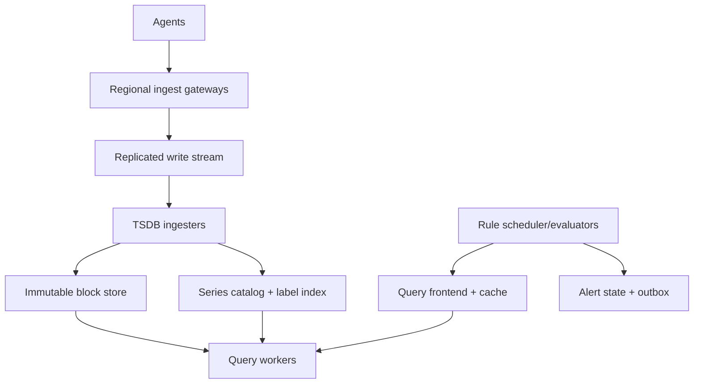

# System Design Interview Practice: Global Metrics Monitoring and Alerting Platform

**Difficulty:** Hard  
**Primary themes:** time-series databases, high-cardinality indexing, streaming ingestion, caching, compaction, alert reliability, multi-tenancy

This is an expanded teaching walkthrough rather than a transcript constrained to 45 minutes. In a real interview, spend roughly 5 minutes on requirements, 2 minutes on entities, 5 minutes on interfaces, 10–15 minutes building the high-level design, and 10–15 minutes on deep dives. The sequence follows Hello Interview’s public delivery framework: clarify requirements, name the entities, define the contract, build a simple design operation by operation, and add complexity only where the non-functional requirements break that baseline. genui{"citation":{"ref":"turn72search9"}}

## Interviewer prompt

> Design a global metrics monitoring platform similar to Datadog, Prometheus at enterprise scale, or Google Cloud Monitoring. Applications and hosts emit numerical metrics with labels. Users should query and graph those metrics and configure alerts.

## Targeted clarifying questions with assumed interviewer answers

**Candidate:** “Are we storing metrics only, or logs and traces too?”  
**Interviewer:** “Metrics only. Support counters, gauges, and distribution or histogram metrics. Logs and traces are out of scope.”

**Candidate:** “How does data enter the platform?”  
**Interviewer:** “Agents batch-push metrics to regional ingestion endpoints. Supporting Prometheus-compatible remote write is useful. Scraping targets and agent fleet management are out of scope.”

**Candidate:** “What query capabilities matter?”  
**Interviewer:** “Select series by metric name and labels; aggregate by labels; calculate rates, percentiles, and arithmetic; graph ranges; and use the same expressions in alert rules.”

**Candidate:** “What scale should I assume?”  
**Interviewer:** “Up to 100 million samples per second globally, 20 billion active time series, 100,000 interactive queries per second at peak, and 50 million alert rule evaluations per minute.”

**Candidate:** “What retention is required?”  
**Interviewer:** “Keep raw 10-second samples for 30 days, one-minute rollups for 13 months, and one-hour rollups for five years.”

**Candidate:** “What freshness and query latency are expected?”  
**Interviewer:** “Accepted samples should normally become queryable within ten seconds. Dashboard queries over the last hour should complete under two seconds p95. A 30-day query should complete under ten seconds p95.”

**Candidate:** “How accurate must alerts be?”  
**Interviewer:** “Do not silently miss a valid firing transition. Duplicate downstream notifications are preferable to missed alerts. Users can specify how missing or late data should behave.”

**Candidate:** “Is this multi-tenant?”  
**Interviewer:** “Yes. Large enterprises and small teams share the service. Enforce isolation, quotas, retention policies, and regional data residency.”

**Candidate:** “Can samples arrive late or out of order?”  
**Interviewer:** “Yes. Usually within two minutes, occasionally hours after network recovery. Duplicate batches are common.”

**Candidate:** “What can I exclude?”  
**Interviewer:** “Exclude agent installation, incident management, notification-channel implementation, logs, traces, and machine-learning anomaly detection. Design ingestion, storage, query, rule evaluation, and reliable alert events.”

**Say aloud:** “The metric data plane is write-heavy and eventually queryable, while alert transitions need durable state and stronger processing guarantees. I’ll keep those contracts separate.”

## 1. Requirements (~5 minutes)

### Core functional requirements

1. **Ingest dimensional metrics.** Accept idempotent batches of counter, gauge, and histogram samples labeled by tenant, metric, service, region, host, and other bounded dimensions.
2. **Query and graph metrics.** Support label selection, time ranges, aggregation, rate and percentile calculations, and dashboards at multiple resolutions.
3. **Evaluate alert rules.** Periodically evaluate saved expressions, track pending/firing/resolved state, and produce reliable deduplicated alert events.

### Quantified non-functional requirements

- **Scale:** 100M samples/s globally, 20B active series, 100K peak interactive query requests/s, and 50M rule evaluations/minute.
- **Freshness and latency:** accepted samples visible within 10 seconds p99; last-hour queries <2 seconds p95; 30-day queries <10 seconds p95; alert transition within one evaluation interval plus 15 seconds.
- **Availability and durability:** 99.99% ingestion endpoint availability; no acknowledged batch lost after an availability-zone failure; query service 99.9%; alert evaluation 99.99% for high-priority rules.
- **Retention:** raw samples 30 days, one-minute rollups 13 months, one-hour rollups five years; tenant policy may shorten these.
- **Isolation:** one tenant’s query, cardinality explosion, or malformed rule must not exhaust shared ingestion, memory, storage, or evaluators.

### Consistency and availability contract

Metric ingestion is **append-oriented and eventually queryable**. An acknowledgment means the batch is durably replicated in the tenant’s home region, not that every index and query replica already exposes it. Queries may omit samples newer than their returned `complete_through` watermark.

For a unique series and timestamp, retries are idempotent. If two distinct values arrive for the same logical point, the service applies a documented deterministic policy—such as latest accepted write by ingestion sequence—and records a conflict metric. Counters should normally be sent as cumulative values so retransmission does not double-count.

Alert rule definitions and alert-instance state are strongly consistent per rule. Evaluation is at least once. Transition IDs are deterministic so retrying an evaluation does not create a new logical firing. Delivery to notification systems is also at least once; downstream integrations deduplicate by transition ID.

During a regional partition, regional agents continue writing locally if their home region is reachable. Cross-region dashboards may be stale. We prioritize ingestion durability and alert correctness over globally fresh reads.

**Say aloud:** “I’ll expose freshness explicitly through a watermark. That is more honest and usable than claiming a query is current when indexes and regions can lag.”

### Scale estimates that change the design

**Ingest bandwidth.** At 100M samples/s, even a compact average of 16 bytes per sample for timestamp and value is 1.6 GB/s before labels, framing, indexes, and replication. With an effective compressed ingestion footprint of 25 bytes/sample, that is 2.5 GB/s, 216 TB/day, and roughly 6.5 PB for 30 days before replication. This rules out row-per-sample writes to a general relational database.

**Series metadata.** Twenty billion active series cannot all live in one global in-memory map. At only 100 bytes of catalog metadata per series, the catalog is 2 TB before replicas and index postings. Partition the catalog by tenant and series fingerprint, cache only hot metadata, and store label postings in distributed shards.

**Rule load.** `50M evaluations/minute ÷ 60 ≈ 833,000 evaluations/s`. If each rule scans 1,000 series naïvely, we would perform hundreds of millions of series reads per second. Rule groups must share input queries, recording rules must precompute common expressions, and the scheduler must spread evaluation start times.

**Long-range queries.** A 30-day query at 10-second resolution requests 259,200 points per series. A graph with 1,000 horizontal pixels cannot usefully display them all. The query planner should choose one-minute rollups or a server-side step appropriate to the requested range and pixel width.

## 2. Core entities (~2 minutes)

- **Tenant:** home region, quotas, retention policy, encryption key, and billing tier.
- **MetricDescriptor:** metric name, type, unit, label schema guidance, and lifecycle state.
- **Series:** a metric name plus canonical label set, represented by a stable series fingerprint.
- **Sample:** series fingerprint, event timestamp, numeric or histogram value, and ingestion metadata.
- **Chunk/Block:** compressed time-bounded samples and immutable storage metadata.
- **LabelIndex:** postings from metric/label predicates to series fingerprints.
- **Query:** expression, time range, step, budget, and freshness watermark.
- **AlertRule:** expression, interval, hold duration, labels, severity, and missing-data policy.
- **AlertInstance:** rule plus grouping labels, current state, evaluation frontier, and transition version.
- **AlertEvent:** immutable firing or resolution transition with a deterministic ID.

## 3. API and system interface (~5 minutes)

Tenant and producer identity come from mutual TLS or a scoped access token. The server does not trust a tenant ID in the request body.

### Ingest a metric batch

```http
POST /v1/metrics:write
Authorization: Bearer <agent-token>
Content-Encoding: zstd
Idempotency-Key: agent-7:batch-99102
Content-Type: application/x-protobuf
```

Decoded conceptual payload:

```json
{
  "series": [
    {
      "metric": "http_requests_total",
      "labels": {
        "service": "checkout",
        "region": "us-east-1",
        "status": "500",
        "instance": "10.2.8.19:8080"
      },
      "type": "COUNTER",
      "samples": [
        {"timestamp_ms": 1791900000000, "value": 98211},
        {"timestamp_ms": 1791900010000, "value": 98218}
      ]
    }
  ]
}
```

```json
{
  "batch_id": "agent-7:batch-99102",
  "status": "DURABLE",
  "accepted_samples": 2,
  "rejected_samples": 0,
  "ingest_watermark_ms": 1791900010000
}
```

The gateway derives `tenant_id`, producer ID, and allowed regions from authentication. A repeated batch ID returns the original result. Partial rejection reports per-series machine-readable errors without silently accepting invalid labels.

### Query a range

```http
POST /v1/metrics:query-range
Authorization: Bearer <user-token>
Content-Type: application/json

{
  "expression": "sum by (region) (rate(http_requests_total{service=\"checkout\",status=~\"5..\"}[5m]))",
  "start": "2026-10-13T16:00:00Z",
  "end": "2026-10-13T17:00:00Z",
  "step_seconds": 30,
  "max_series": 1000
}
```

```json
{
  "resolution_seconds": 10,
  "complete_through": "2026-10-13T16:59:54Z",
  "partial": false,
  "series": [
    {
      "labels": {"region":"us-east-1"},
      "points": [[1791900000,12.3],[1791900030,14.1]]
    }
  ]
}
```

Prometheus uses the same useful dimensional model: a time series is a stream of timestamped values identified by a metric name and a label set, and changing a label value creates a different series. genui{"citation":{"ref":"turn72search1"}}

### Create an alert rule

```http
POST /v1/alert-rules
Authorization: Bearer <user-token>
Idempotency-Key: 01J...
Content-Type: application/json

{
  "name": "CheckoutHighErrorRate",
  "expression": "sum(rate(http_requests_total{service=\"checkout\",status=~\"5..\"}[5m])) / sum(rate(http_requests_total{service=\"checkout\"}[5m])) > 0.02",
  "group_by": ["region"],
  "evaluation_interval_seconds": 30,
  "for_seconds": 300,
  "missing_data": "KEEP_LAST_STATE",
  "severity": "critical"
}
```

```json
{
  "rule_id": "rule_8a1",
  "rule_version": 1,
  "next_evaluation_at": "2026-10-13T17:00:30Z"
}
```

### Inspect alert state

```http
GET /v1/alert-rules/rule_8a1/instances
```

```json
{
  "instances": [
    {
      "labels":{"region":"us-east-1"},
      "state":"FIRING",
      "active_since":"2026-10-13T16:55:00Z",
      "last_evaluated_at":"2026-10-13T17:00:30Z",
      "transition_id":"rule_8a1:us-east-1:v19"
    }
  ]
}
```

### Internal alert-event interface

```json
{
  "transition_id":"rule_8a1:us-east-1:v19",
  "rule_id":"rule_8a1",
  "state":"FIRING",
  "severity":"critical",
  "labels":{"region":"us-east-1","service":"checkout"},
  "evaluation_time":"2026-10-13T17:00:30Z"
}
```

Notification systems acknowledge this event separately. Retrying does not change `transition_id`.

## 4. Data flow

1. Agents aggregate and compress short batches, then send them to their tenant’s regional ingestion endpoint.
2. The ingestion gateway authenticates, applies quotas, validates labels and timestamps, canonicalizes series identities, and appends the batch to a replicated write-ahead stream.
3. Stream consumers route samples by `(tenant_id, series_fingerprint)` to time-series ingesters. They update hot chunks and series/index metadata.
4. Sealed chunks are uploaded into immutable time-partitioned blocks in object storage. Catalog entries make new blocks discoverable.
5. Compactors merge small blocks, deduplicate samples, build label indexes, enforce retention, and produce one-minute and one-hour rollups.
6. Query frontends parse and budget expressions, select raw or rolled-up resolution, use metadata indexes to find series, and scatter subqueries to hot and historical storage.
7. Queriers stream partial aggregates upward; the frontend performs final aggregation, caches safe results, and returns a completeness watermark.
8. A rule scheduler leases rule groups to evaluators. Evaluators execute through the same query path, transactionally update alert-instance state, and write new transition events to an outbox.

## 5. High-level design (~10–15 minutes)



### Operation 1: ingest a batch

The regional gateway terminates mTLS, derives the tenant, and checks three quota classes:

- samples and compressed bytes per second;
- active series and new-series creations per minute;
- maximum labels, label lengths, timestamps, and batch size.

It canonicalizes labels by validating reserved names and sorting key/value pairs. The logical identity is:

```text
SeriesKey = tenant_id || metric_name || sorted(label_name=label_value)
fingerprint = Hash128(SeriesKey)
```

Because hashes can collide, the catalog stores the canonical key and compares it before reusing a fingerprint. A small gateway cache maps recently seen canonical keys to fingerprints; misses go to the partitioned series catalog.

```text
Series(tenant_id, fingerprint, metric_name, canonical_labels,
       metric_type, created_at, last_seen_at, shard_id, state)
```

The gateway rejects pathological labels such as unbounded request IDs unless the tenant has explicit policy. Prometheus documentation warns that every unique label combination becomes another time series and consumes RAM, CPU, disk, and network. genui{"citation":{"refs":["turn72search16","turn72search17"]}}

Validated batches append to a replicated partitioned stream. Partition on `(tenant_id, fingerprint)` so samples for a series preserve ingest order and reach the same ingester shard. The stream record includes batch ID, producer ID, receive time, schema version, and samples. The gateway ACKs only after quorum replication.

Batch deduplication uses `(tenant_id, producer_id, batch_id)` with a bounded retention window. Sample-level reconciliation later handles a duplicate that outlives the batch window.

### Operation 2: build hot chunks and immutable blocks

Each ingester owns a set of series shards. For every active series it maintains a small mutable head chunk, for example two hours or 120 samples. Samples are encoded column-wise:

- timestamp deltas and delta-of-deltas compress regular intervals;
- floating-point XOR compression stores only changed bits;
- repeated labels live once in series metadata, not on every sample;
- histogram bucket structures use sparse/native encodings where possible.

Out-of-order samples within a two-hour window enter a separate patch chunk rather than rewriting the primary chunk. Samples later than the supported window go to a late-data stream for slower block repair or are rejected according to tenant policy.

The ingester replicates the mutable head or relies on replay from the durable stream; a common choice is two live replicas plus stream replay for fast failover. When a chunk seals, a block builder writes an immutable object:

```text
Block(block_id, tenant_id, shard_id, min_time, max_time,
      resolution, object_key, index_key, series_count,
      sample_count, checksum, compaction_level, created_at)
```

The object store holds compressed chunks and per-block label postings. A catalog transaction publishes the block only after data and index objects pass checksum verification. Old stream segments are deleted only after the corresponding block is durable and discoverable.

### Operation 3: compact, downsample, and retain

Initial blocks are small to minimize freshness delay, but thousands of small objects make queries expensive. Compactors lease non-overlapping `(tenant, shard, time-range, resolution)` jobs and merge blocks into larger time windows. They:

1. merge sorted samples;
2. deduplicate identical series/timestamps deterministically;
3. apply late patch chunks;
4. rebuild label postings and summaries;
5. emit raw or rollup blocks;
6. atomically replace catalog inputs with outputs;
7. delete obsolete inputs only after a safety delay.

One-minute rollups store count, sum, min, max, last, counter increase/reset information, and mergeable histogram sketches. One-hour rollups derive from raw or one-minute aggregates. Average alone is insufficient because averages cannot be correctly re-aggregated without count and sum. Arbitrary exact percentiles are not downsample-friendly, so use mergeable histograms/sketches and document approximation error.

Retention workers delete catalog references before objects, then garbage-collect unreferenced data after a grace period. Legal hold or enterprise retention policies produce separate immutable manifests.

### Operation 4: query a dashboard

The query frontend authenticates, parses the expression into an AST, validates functions, and estimates cost using time range, resolution, posting-list cardinality, and operator fan-out. It rejects or queues queries above tenant budgets instead of allowing an accidental Cartesian explosion.

The planner chooses resolution. A one-hour dashboard may read raw ten-second blocks; a 30-day graph uses one-minute rollups; a five-year graph uses one-hour rollups. If an exact-resolution request is impossible under retention, the response says which rollup was used.

The label index maps predicates to sorted series fingerprints:

```text
(tenant, metric_name) -> series IDs
(tenant, label_name, label_value) -> series IDs
```

Equality matchers intersect postings. Negative and regex matchers are more expensive and require bounded dictionary expansion. The planner should start with the most selective positive matcher.

Query workers fetch relevant hot chunks from ingesters and historical blocks from object storage. They push down time filtering, rate calculation, and partial aggregation. Each worker returns partial vectors and its `complete_through` watermark; the frontend merges them.

The cache has several layers:

- immutable historical block/index cache keyed by object checksum;
- query-result cache aligned to fixed time buckets, excluding the mutable recent window;
- metadata/posting cache with tenant-scoped keys;
- dashboard request coalescing so identical concurrent panels share work.

Caching the newest range aggressively would serve stale data, so split a query into cached historical intervals plus an uncached recent tail.

### Operation 5: evaluate an alert

Alert rules are grouped by tenant, interval, and shared input. The scheduler partitions groups and grants a lease with a fencing token:

```text
AlertRule(rule_id, tenant_id, version, expression, interval_s,
          hold_for_s, missing_data_policy, priority, enabled)

AlertInstance(rule_id, group_fingerprint, state, active_since,
              last_value, last_eval_time, eval_version,
              last_transition_id, updated_at)
```

Schedulers add deterministic jitter derived from the rule ID so one-minute rules do not all start at the minute boundary. The evaluator queries at a defined evaluation timestamp and records the query watermark. It converts each label group into an alert instance with states `INACTIVE`, `PENDING`, or `FIRING`.

For a five-minute hold:

- false → true: `INACTIVE` to `PENDING`, record `active_since`;
- true for five continuous minutes: `PENDING` to `FIRING`;
- false: `PENDING/FIRING` to `INACTIVE`, optionally emit `RESOLVED`;
- missing: apply configured `OK`, `ALERT`, `KEEP_LAST_STATE`, or `NO_DATA` semantics.

The evaluator transactionally updates state and inserts an outbox event with deterministic ID `(rule_id, group_fingerprint, transition_version)`. If it crashes after commit but before publish, the outbox relay publishes later. If it retries evaluation, compare-and-set on `eval_version` prevents a duplicate logical transition.

## 6. Deep dives (~10–15 minutes)

### Deep dive A: cardinality, sharding, and noisy-neighbor isolation

**Where the baseline breaks.** A naïve map from arbitrary labels to series allows one deployment with `request_id` or `user_id` labels to create billions of series. Memory rises, indexes explode, caches churn, and every query becomes slower. Hashing only by tenant also places a huge enterprise on one shard.

| Partition choice | Benefit | Failure mode |
|---|---|---|
| Tenant only | Simple isolation | Large tenants create hot shards |
| Series fingerprint only | Even distribution | Tenant quotas and deletion scatter globally |
| Tenant plus fingerprint | Isolation and distribution | Cross-series queries scatter within tenant |
| Metric name only | Metric queries colocate | One popular metric becomes hot |

**Choice.** Partition data by `hash(tenant_id, series_fingerprint)` across many virtual shards. Maintain a tenant-to-approved-region directory. Large tenants receive more virtual shards; small tenants share physical nodes but remain quota-isolated.

Series creation is more dangerous than sample ingestion. Enforce:

- hard and soft active-series quotas;
- new-series-per-minute limits;
- maximum labels and label length;
- deny or rewrite known unbounded labels at agents/gateways;
- per-metric budgets and top-cardinality reports;
- probabilistic distinct-series estimates for early warning;
- series inactivity expiry without immediately deleting historical data.

**Fingerprint hotspot.** One series can itself receive millions of samples/s. Normal monitoring semantics rarely require that; apply a per-series rate limit and recommend upstream aggregation or sharding by a meaningful bounded label. If accepted, split physical writes by time bucket while preserving one logical series at query time.

**Index design.** Posting lists are compressed sorted integers or Roaring-style bitmaps for dense ranges. Very frequent labels such as `region=us-east` can produce enormous postings, so store them in segmented shards and combine lazily. Rare label values use small lists. Maintain metric-level series counts and per-label histograms so planners choose a selective intersection order.

**Isolation.** Every stage accounts resources by tenant: ingest tokens, active-series memory, stream bytes, compaction backlog, query CPU/bytes, cache occupancy, and rule-evaluation concurrency. Use weighted fair queues with minimum shares. A tenant over quota receives explicit throttling and diagnostics; do not randomly drop accepted durable samples.

**Failure modes and observability.** Watch series creation rate, active series, churn, label-value cardinality, catalog latency, posting sizes, per-shard skew, rejected samples, throttling, memory per tenant, and top metric/label offenders. Auto-quarantine a metric family that threatens shared stability while preserving other tenant traffic.

**Say aloud:** “Samples are not the only unit of cost. A new label combination allocates catalog, index, memory, and storage structures, so I meter series creation separately from sample rate.”

### Deep dive B: storage tiers, query planning, and cache correctness

**Where the baseline breaks.** Keeping all raw data on local SSD is too expensive and difficult to rebalance. Putting every query directly on object storage makes recent dashboards slow. Reading raw ten-second samples for multi-year graphs wastes I/O and CPU.

| Storage strategy | Strength | Limitation |
|---|---|---|
| General relational rows | Simple semantics | Write amplification and index cost at 100M samples/s |
| Local TSDB only | Very fast recent reads | Weak elasticity and expensive durable retention |
| Object-store blocks only | Cheap, durable, elastic | Poor newest-data latency and many small objects |
| Hot ingesters + immutable object blocks | Fast freshness plus cheap retention | More components and consistency boundaries |

**Choice.** Use the hybrid tiered design: mutable replicated head chunks for recent data, immutable compressed blocks in object storage, and catalog/index services for discovery. Google’s Monarch work demonstrates that a globally distributed time-series database can separate regional collection/query concerns while serving very large monitoring workloads; our design borrows the general regionalization lesson without copying its internal implementation. genui{"citation":{"ref":"turn72search0"}}

**Query planning.** The planner estimates:

```text
cost ≈ matched_series × time_buckets × operator_factor
```

It uses index statistics, requested step, and rollup availability. It pushes associative operations—sum, count, min, max, mergeable sketches—toward storage workers. Non-associative operations remain higher in the plan. Query fragments have byte/CPU deadlines and return partial-status metadata rather than silently omitting failed shards.

**Counter correctness.** A rate function must detect counter resets and extrapolate only within bounded gaps. Downsampled counter blocks retain first, last, increase, reset count, and sample count; storing only average or last value would make historical rates wrong.

**Histogram correctness.** Percentiles cannot be averaged. Store mergeable bucket counts or sketches. Rollup merges distributions, then computes a percentile at query time. Expose approximation and avoid combining incompatible bucket schemas without normalization.

**Cache correctness.** Cache entries include tenant, canonical expression, authorization scope, resolution, time boundaries, data-version/block checksums, and engine version. Immutable historical buckets have long TTLs. The mutable tail either bypasses cache or uses watermark-bounded short TTLs. Rule evaluations may reuse immutable subquery cache entries but should not trust a stale recent-result cache for firing decisions.

**Late data.** A late patch creates a new block version and advances the catalog manifest. Queries pin a manifest version for consistency during execution. Historical result-cache keys include manifest generation, or compaction emits targeted invalidations. Alerts use an explicit lookback delay—for example evaluate time `T` at wall clock `T+30s`—to absorb normal lateness. Very late corrections can optionally trigger backfill analysis but should not repeatedly page current responders.

**Overload.** Prioritize alert and small interactive queries over exports and unbounded ad hoc queries. Apply per-tenant queues, concurrency, scan-byte limits, timeouts, and progressive result streaming. Allow cancellation to propagate to storage workers. A query circuit breaker protects a failing object-store region.

**Observe:** scanned bytes, matched series, cache hit by layer, index versus chunk time, object-store GET rate, partial-query rate, freshness watermark lag, rollup selection, query cancellations, and top expensive expressions.

**Say aloud:** “The planner should spend resolution only where the user can see it. I’ll use raw data for recent detail, rollups for long ranges, and keep cache correctness tied to immutable block generations and freshness watermarks.”

### Deep dive C: alert evaluation without missed or duplicate logical transitions

**Where the baseline breaks.** A cron process that queries and immediately sends a page can miss evaluations during a crash, send duplicates after retry, oscillate on late data, or lose the distinction between a five-minute pending condition and a firing incident.

**Approaches.**

| Approach | Benefit | Problem |
|---|---|---|
| Stateless cron per rule | Easy | No durable pending/firing state; overlap and gaps |
| Queue one job per evaluation | Durable scheduling | 833K jobs/s and duplicate ownership complexity |
| Leased rule groups with durable frontier | Shared queries, bounded state | Requires fencing and repair scans |

**Choice.** Schedule **rule groups**, not isolated rules. A group shares interval and base selectors, allowing evaluators to load input vectors once. The scheduler maintains `next_evaluation_at`, leases groups with fencing tokens, and periodically scans for overdue groups. Queue messages are hints; the rule-state database is the scheduling truth.

Each evaluation has deterministic identity `(rule_group_id, scheduled_time, rule_version)`. The evaluator:

1. acquires or validates the fenced lease;
2. queries using the fixed scheduled timestamp and lookback delay;
3. computes all rule/group-label results;
4. transactionally advances the group evaluation frontier;
5. compare-and-sets alert instances;
6. inserts any transition events into an outbox;
7. commits before acknowledging the work item.

If a worker crashes before commit, another repeats the evaluation. If it crashes after commit, the deterministic evaluation and transition versions make the repeat a no-op, while the outbox relay still publishes the event.

**No-data semantics.** Missing data may mean healthy silence, a dead agent, or a broken pipeline. Make it configuration, not an implicit false value. Provide `OK`, `ALERT`, `KEEP_LAST_STATE`, and explicit `NO_DATA`. Separately monitor ingestion freshness so a regional pipeline outage does not make thousands of service alerts falsely resolve.

**Flapping.** `for_seconds`, separate fire/resolve thresholds, minimum resend interval, and state-machine hysteresis reduce oscillation. Never hide the raw evaluation history; operators need to distinguish a stable alert from a suppressed transition.

**Rule edits.** A new expression creates `rule_version + 1`. Decide explicitly whether pending state carries over; default to reset if semantic input changed. Old in-flight evaluations cannot update the new version because state compare-and-set includes rule version.

**Multi-region.** Evaluate a tenant’s rules in its home region against that region’s authoritative watermark. Replicate rule definitions and alert state to DR. On failover, acquire a higher scheduler epoch, resume from the last committed evaluation frontier, and allow repeats with the same deterministic IDs. Cross-region queries may be partial; high-priority rules specify whether partial data means hold, no-data, or fail closed.

**Downstream delivery.** The alert event log is at least once. Notification workers use `transition_id` as the idempotency key. A notification provider can still deliver duplicates after an ambiguous timeout, so integrations should deduplicate. The monitoring platform reports event state separately from channel delivery state.

**Observe:** evaluation delay, duration, missed/overdue groups, query partials, state CAS conflicts, transitions by state, outbox lag, duplicate transition attempts, no-data counts, flap rate, scheduler epoch conflicts, and end-to-end condition-to-event latency.

**Say aloud:** “I can’t make an external page exactly once, but I can make the logical alert transition deterministic and durable. Evaluation retries then converge on one transition ID, and delivery retries remain explicit.”

## 7. Finish

### Concise final design

Agents batch and compress dimensional metrics to regional gateways. Gateways authenticate the tenant, canonicalize label sets, enforce sample and cardinality quotas, resolve stable series fingerprints, and append batches to a quorum-replicated stream before acknowledging. Partitioned ingesters build compressed hot chunks and seal them into immutable time-range blocks in object storage. A distributed series catalog and label-posting index map query predicates to series.

Compactors merge blocks, reconcile duplicates and late patches, enforce retention, and create mergeable one-minute and one-hour rollups. Query frontends parse and budget expressions, choose the appropriate resolution, intersect label indexes, scatter to hot ingesters and historical block workers, push down partial aggregates, and merge responses with an explicit completeness watermark. Immutable block and historical-result caches accelerate dashboards without making the mutable tail appear fresher than it is.

Alert schedulers lease rule groups with fencing, spread start times, and evaluate through the same query engine at fixed timestamps. Durable per-instance state implements inactive, pending, firing, and missing-data semantics. Compare-and-set plus a transactional outbox produces one deterministic logical transition under retries; downstream notification delivery remains at least once. Tenant-scoped quotas, fair queues, regional ownership, manifest-versioned storage, repair scans, and DR epochs isolate failures and make recovery auditable.

### Requirements check

| Requirement | Design support |
|---|---|
| Ingest metrics | authenticated compressed batches, canonical series IDs, replicated WAL/stream |
| Dimensional model | metric plus canonical labels, distributed postings index |
| High write scale | hash-partitioned streams, append-only chunks, column compression |
| Query and graph | expression planner, raw/rollup resolution, distributed partial aggregation |
| Fresh data | mutable ingester heads plus `complete_through` watermark |
| Long retention | immutable object blocks, compaction, tiered rollups, lifecycle deletion |
| Late/duplicate samples | batch idempotency, deterministic point reconciliation, patch blocks |
| Reliable alerts | leased rule groups, durable state machine, deterministic transitions, outbox |
| Tenant isolation | per-stage quotas, fair scheduling, query budgets, cardinality controls |
| Regional resilience | home-region durability, replicated metadata/state, fenced DR failover |

## Realistic interviewer follow-up questions with strong sample answers

**Interviewer:** “Why not store every sample in Cassandra?”  
**Candidate:** “A wide-column store can serve an initial version, but at 100M samples/s we want time-series-specific compression, immutable blocks, rollups, label postings, and query pushdown. A general store may still back metadata or small-scale deployments.”

**Interviewer:** “How do you identify a series?”  
**Candidate:** “Canonicalize metric name plus sorted labels within the authenticated tenant and hash that key. The catalog compares the canonical key to protect against hash collisions.”

**Interviewer:** “Why is `user_id` a dangerous label?”  
**Candidate:** “Every distinct value creates a series and allocates memory, postings, and chunks. User IDs or request IDs can create unbounded cardinality. They belong in logs or traces, or must be aggressively aggregated.”

**Interviewer:** “Why not ACK after writing to an ingester’s memory?”  
**Candidate:** “An ingester or zone failure could lose acknowledged data. I ACK only after the batch reaches a replicated durable stream; ingesters can replay from it.”

**Interviewer:** “How do you deal with duplicate batches?”  
**Candidate:** “Deduplicate recent producer batch IDs at ingestion and reconcile duplicate series/timestamp points during compaction. Cumulative counter semantics also avoid incrementing twice on retransmission.”

**Interviewer:** “How do counters differ from gauges?”  
**Candidate:** “A gauge is sampled state and may rise or fall. A counter is cumulative and normally increases until reset. Rate queries must detect resets; counter rollups preserve increase and reset information.”

**Interviewer:** “Can you average one-minute averages into an hour?”  
**Candidate:** “Not correctly unless the buckets have equal counts. Store sum and count and compute `total_sum / total_count`; also retain min, max, and last as needed.”

**Interviewer:** “Can you average p99 values?”  
**Candidate:** “No. Percentiles are not composable. Merge histogram buckets or quantile sketches, then compute the percentile from the combined distribution.”

**Interviewer:** “How does a regex label matcher work?”  
**Candidate:** “Expand matching values through a label-value dictionary under a strict bound, union their postings, and intersect with selective positive matchers. Reject expressions whose expansion exceeds the query budget.”

**Interviewer:** “What if a query touches billions of series?”  
**Candidate:** “Estimate before execution using index statistics, then reject, require more selective labels, or run it as a lower-priority asynchronous export. Runtime scan-byte and CPU limits provide a second guardrail.”

**Interviewer:** “How can cached query results remain correct after late data?”  
**Candidate:** “Pin queries to a block-manifest generation. Late repair publishes a new generation. Cache keys include that generation, or the catalog emits invalidation for affected time buckets.”

**Interviewer:** “What does the freshness watermark mean?”  
**Candidate:** “All required shards claim their data is complete through that event time under the current lateness contract. Data newer than the minimum shard watermark may be incomplete.”

**Interviewer:** “Why add jitter to alert evaluation?”  
**Candidate:** “Without it, millions of one-minute rules start simultaneously and create a query thundering herd. Deterministic jitter spreads load while keeping schedules predictable.”

**Interviewer:** “What if an evaluator crashes after writing state but before sending the alert?”  
**Candidate:** “State and an outbox row commit in one transaction. The relay later sends the deterministic transition ID. Retrying the evaluation cannot create a second logical transition.”

**Interviewer:** “What if metrics disappear?”  
**Candidate:** “Apply the rule’s explicit missing-data policy and separately alert on ingestion pipeline freshness. Treating missing as false could incorrectly resolve every alert during a telemetry outage.”

**Interviewer:** “Would alert queries use the normal dashboard cache?”  
**Candidate:** “They may reuse immutable historical fragments, but not a stale mutable-tail result. Alert correctness uses a fixed evaluation time, watermark requirements, and stricter cache bounds.”

**Interviewer:** “How do you support regional residency?”  
**Candidate:** “Assign each tenant a home region, keep raw blocks and series metadata there, and route agents accordingly. Replicate only policy-permitted metadata, rollups, or DR copies to approved regions.”

**Interviewer:** “What happens if object storage is slow?”  
**Candidate:** “Recent data remains available from ingesters, historical queries may return explicit partial status or fail within deadlines, circuit breakers protect workers, and alert rules define partial-data behavior. We never silently label a partial query complete.”

**Interviewer:** “What would you build first?”  
**Candidate:** “One region: authenticated batch ingestion, replicated write stream, sharded head chunks, immutable object blocks, series catalog and basic label index, range queries, simple compaction, rule groups with durable alert state, and strict quotas. Add rollups, advanced caches, multi-region DR, and richer query functions after validating workload.”

## Common pitfalls

1. Treating monitoring as a generic key-value store without time-range and label access patterns.
2. Writing one relational row and secondary indexes per sample at massive scale.
3. Repeating labels on every stored sample.
4. Ignoring cardinality and allowing arbitrary request IDs as labels.
5. Metering samples but not new-series creation.
6. Hashing only by tenant and creating huge-enterprise hot shards.
7. Assuming a series fingerprint can never collide.
8. Acknowledging before durable replicated append.
9. Claiming exactly-once ingestion instead of idempotent batches and deterministic reconciliation.
10. Treating out-of-order samples as normal in-place rewrites of immutable blocks.
11. Querying five years of raw ten-second data for a 1,000-pixel chart.
12. Storing only averages in rollups.
13. Averaging percentiles instead of merging distributions.
14. Losing counter-reset information during downsampling.
15. Building one global unpartitioned label index.
16. Evaluating negative or regex matchers without expansion bounds.
17. Letting one expensive query monopolize all workers.
18. Returning partial results without marking them partial.
19. Caching the mutable tail as if it were immutable.
20. Omitting block/manifest generation from cache correctness.
21. Deleting source blocks before compacted outputs are verified and published.
22. Running every alert rule as an independent cron job.
23. Sending a page directly before durably committing alert state.
24. Treating missing data as automatically healthy.
25. Resetting or carrying pending state across rule edits without explicit semantics.
26. Claiming external notifications are exactly once.
27. Ignoring evaluation jitter and creating minute-boundary load spikes.
28. Monitoring average query latency but not scanned bytes, shard skew, or watermark lag.
29. Promising global freshness during regional partitions.
30. Drawing the final architecture before tracing ingest, seal, query, and alert transitions.

## A polished 60-second close

> “Agents send compressed dimensional metric batches to regional gateways. The gateway derives tenant identity, enforces sample and cardinality quotas, canonicalizes series labels, and appends to a quorum-replicated stream before ACK. Sharded ingesters maintain compressed recent chunks and seal immutable time-range blocks into object storage; a distributed catalog and label-posting index discover series and blocks. Compactors deduplicate, apply late patches, enforce retention, and build mergeable one-minute and one-hour rollups. Query frontends budget expressions, select resolution, intersect label postings, scatter to hot and historical workers, push down partial aggregation, and return an explicit completeness watermark. Historical caches are keyed by immutable block generations, while the recent tail stays watermark-aware. A fenced scheduler assigns rule groups to evaluators, which query at fixed timestamps and transactionally update inactive, pending, or firing instances plus an outbox. Deterministic transition IDs make evaluation retries idempotent; downstream notifications remain at least once. Tenant quotas, fair queues, regional ownership, repair loops, and fenced DR failover contain failures without silently losing accepted metrics or valid alert transitions.”

## Sources

- [Hello Interview: System Design Delivery Framework](https://www.hellointerview.com/learn/system-design/in-a-hurry/delivery)
- [Hello Interview: API Design for System Design Interviews](https://www.hellointerview.com/learn/system-design/core-concepts/api-design)
- [Prometheus: Data Model](https://prometheus.io/docs/concepts/data_model/)
- [Prometheus: Instrumentation Best Practices](https://prometheus.io/docs/practices/instrumentation/)
- [Prometheus: Metric and Label Naming](https://prometheus.io/docs/practices/naming/)
- [Google Research: Monarch—Google’s Planet-Scale In-Memory Time Series Database](https://research.google/pubs/monarch-googles-planet-scale-in-memory-time-series-database/)
