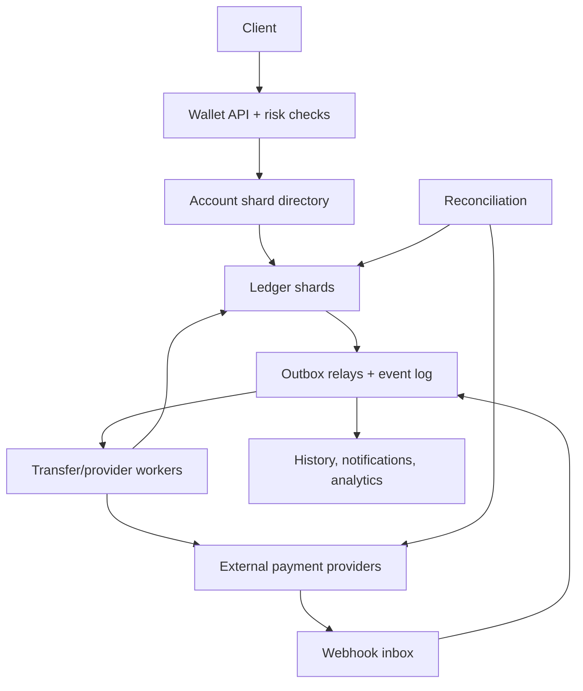
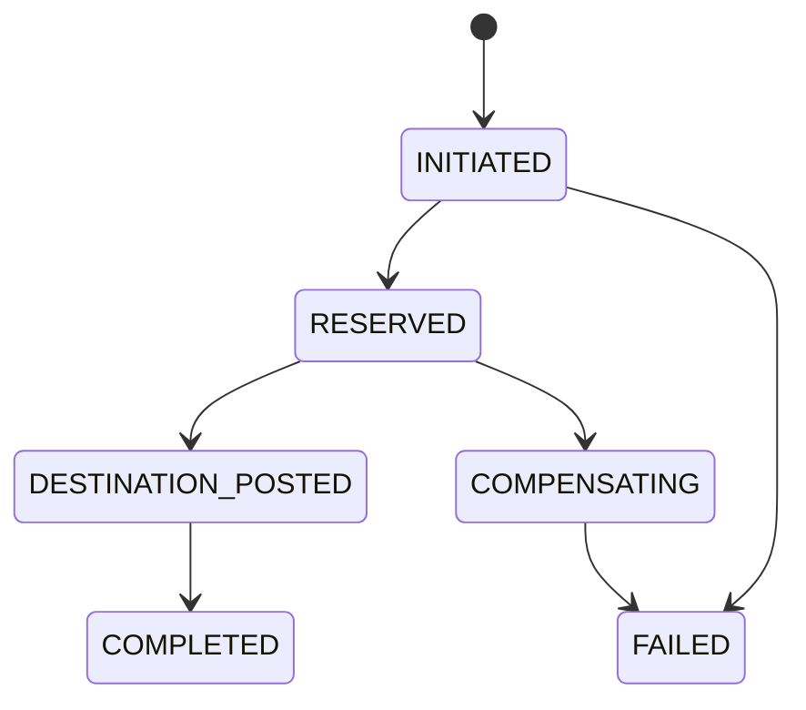

# System Design Interview Practice: Global Wallet and Double-Entry Payment Ledger

**Difficulty:** Advanced  
**Primary themes:** transactional databases, double-entry accounting, idempotency, cross-shard workflows, queues, reconciliation, strong consistency, and failure recovery

> **Interview timing vs. this walkthrough:** In a 45-minute interview, spend roughly 5 minutes on requirements, 2 minutes on entities, 5 minutes on interfaces, 10–15 minutes on the high-level design, and 10–15 minutes on deep dives. This document is deliberately more detailed for study. In the room, first make the single-shard transfer correct, then evolve it only when scale forces sharding and external-provider workflows.

This answer follows the Hello Interview delivery framework: define functional and non-functional requirements, name the core entities before overcommitting to a schema, specify the system interface, build a complete design operation by operation, and use the remaining time to harden bottlenecks and failure cases. genui{"citation":{"ref":"turn77search4"}}

---

## Interviewer prompt

> Design a globally available digital wallet and payment ledger. Users can hold balances, transfer money to another user, add funds through an external payment provider, and withdraw funds to a bank. The system must prevent double-spending, maintain an auditable accounting history, tolerate retries and duplicate events, and scale to millions of accounts.

## Targeted clarifying questions with assumed interviewer answers

**Candidate:** Are we moving actual bank deposits, or maintaining an internal stored-value wallet backed by external settlement accounts?

**Interviewer:** Maintain internal wallet balances. External providers handle card charges and bank payouts. Our ledger is the authoritative record of what we owe users.

**Candidate:** Which operations are core?

**Interviewer:** Internal wallet-to-wallet transfer, balance and transaction-history reads, external top-up, and withdrawal. Refunds and disputes should fit the model, but a complete dispute product is out of scope.

**Candidate:** Do we support multiple currencies and currency conversion?

**Interviewer:** Support multiple currencies, but do not design foreign-exchange pricing. A wallet account is denominated in one currency. Cross-currency movement goes through explicit conversion accounts supplied by another service.

**Candidate:** Can users spend a negative balance or use credit?

**Interviewer:** No. Available balance must never go below zero for ordinary wallets. Some platform-owned clearing accounts may be allowed to go negative under controlled limits.

**Candidate:** What scale should I assume?

**Interviewer:** Fifty million wallet accounts, 2,000 average and 20,000 peak financial mutations per second, twenty balance/history reads per mutation, and seven years of ledger retention.

**Candidate:** How fast should an internal transfer appear?

**Interviewer:** Same-shard transfers should finish in under 300 ms p99. Cross-shard transfers should normally complete within 2 seconds. Users must immediately see funds reserved after we accept a transfer, even if final credit is still pending.

**Candidate:** What availability and consistency do we need?

**Interviewer:** Balance reads should be 99.99% available. Financial writes should be 99.95% available, but correctness is more important than accepting a write during an ambiguous partition. Never acknowledge a transfer and later forget it.

**Candidate:** Can external providers send duplicate or out-of-order callbacks?

**Interviewer:** Yes. Assume requests, responses, queue messages, and webhooks can all be duplicated, delayed, or lost. We can also poll provider APIs for reconciliation.

**Candidate:** Are authentication, KYC, AML, and fraud detection in scope?

**Interviewer:** Assume authentication and identity verification exist. Call synchronous risk limits before accepting a movement and emit events for downstream compliance, but do not design the fraud models.

**Candidate:** Should the client provide a user ID in the transfer request?

**Interviewer:** The sender comes from authentication. The client supplies only the destination wallet and transfer details.

### Scope statement to say aloud

> “I’ll make our ledger authoritative for internal obligations and model every movement as immutable balanced postings. For one database shard, I’ll use a serializable transaction. When accounts span shards or an external provider is involved, I’ll use reserved funds, idempotent state transitions, balanced clearing accounts, and reconciliation rather than claiming a distributed exactly-once transaction.”

---

## 1. Requirements (~5 minutes)

### Three core functional requirements

1. **Move funds safely.** An authenticated user can transfer money between wallets, top up through a provider, withdraw, cancel when allowed, and retry without creating a duplicate movement.
2. **Expose balances and history.** A user can retrieve authoritative available/pending/posted balances and a paginated, human-readable transaction history.
3. **Maintain an auditable ledger and recover workflows.** Every accepted mutation produces immutable, balanced postings; asynchronous provider and cross-shard steps are retryable, deduplicated, reconcilable, and observable.

### Quantified non-functional requirements

| Property | Target | Design implication |
|---|---:|---|
| Mutation scale | 2K average, 20K peak/s | Partition ledger ownership; avoid global locks |
| Read scale | ~40K average, 400K peak/s | Materialized balances, replicas/cache for non-authoritative history |
| Same-shard latency | p99 < 300 ms | One local serializable transaction |
| Cross-shard completion | 99% < 2 s normally | Durable workflow with immediate source reservation |
| Write availability | 99.95% | Multi-zone consensus, but reject ambiguous writes |
| Balance-read availability | 99.99% | Primary for authoritative reads; versioned replicas for display reads |
| Durability | No acknowledged transfer lost; RPO 0 in-region | Quorum commit, outbox in same transaction, tested restore |
| Audit retention | 7 years | Append-only ledger, immutable archive, partitioned storage |
| Correctness | User available balance never negative | Row/version serialization plus holds and invariant checks |

### Consistency and availability contract

- **Ledger postings are immutable.** We correct an error with a compensating transaction, never an update or delete.
- **Every ledger transaction balances to zero per currency.** For each currency, total debits equal total credits. Cross-currency conversion is represented by separate balanced legs and explicit FX accounts.
- **Balance-affecting writes are strongly consistent at the owning shard.** Concurrent debits serialize; one either sees funds and reserves them or fails.
- **Available balance never goes below zero for user wallets.** `available = posted - active_holds`, using one documented sign convention.
- **An accepted request is durable.** We return success or `PENDING` only after committing the transfer intent, idempotency record, required reservation/postings, and outbox event.
- **Cross-shard transfer completion is eventually consistent but monotonic.** A transfer moves through an allowed state machine and never reverts from terminal success to pending.
- **Read-your-writes:** the mutation response contains the new account version. An authoritative read can request `min_version`; a display replica that is behind either waits briefly or routes to the primary.
- **Partition choice:** when shard leadership is uncertain, reject or time out new debits rather than risk two leaders spending the same money. Previously committed reads and workflow recovery continue where possible.
- **External status:** provider callbacks are hints. Our provider-attempt state plus periodic reconciliation determines whether local and external records agree.

### Out of scope

- Authentication, KYC document collection, and fraud-model design
- Card-network or ACH protocol implementation
- Foreign-exchange price discovery
- Lending, interest, and general credit accounts
- Tax reporting UI
- Merchant acquiring and chargeback adjudication

### Scale estimates that change the design

At 2,000 average mutations per second:

```text
mutations/day = 2,000 × 86,400 = 172.8 million
```

If a logical transfer averages four posting rows plus indexes and metadata at roughly 1 KiB total compressed storage, that is about 173 GB/day before replicas—roughly 440 TB over seven years. Exact row sizes vary, but this rules out treating one unpartitioned OLTP table as both the forever archive and every analytics query source. We need time/account partitioning, archival, and separate analytical projections.

Read traffic peaks near:

```text
20,000 mutations/s × 20 reads = 400,000 reads/s
```

We should not sum the entire journal for each balance read. Maintain balance buckets transactionally with postings, while preserving the journal as source of truth and continuously checking that projection.

If one well-tuned consensus-backed SQL shard sustains a conservative 2,000 financial transactions/s at target p99 under contention, 20,000 peak mutations need at least 10 write shards. With 50% headroom, maintenance, and hot-account skew, start around 20–24 logical shards and reshard behind stable account-to-shard metadata. The number is benchmark-dependent; the decision is that ownership must be partitioned.

**What to say aloud:**

> “The ledger is append-heavy, but the concurrency boundary is the account. I’ll partition ownership while keeping each debit decision local and serializable. History can scale through projections; spend authorization cannot rely on an eventually consistent cache.”

---

## 2. Core entities (~2 minutes)

| Entity | Essential fields and purpose |
|---|---|
| `WalletAccount` | `account_id`, owner, currency, shard, status, account class, version |
| `BalanceBucket` | Posted, pending debit/credit, available, version for one account/currency |
| `Transfer` | Logical customer operation, source, destination, amount, currency, state, idempotency identity |
| `LedgerTransaction` | Immutable journal header: type, effective time, correlation ID, reversal-of |
| `Posting` | One debit/credit leg: transaction, account, currency, signed amount, shard sequence |
| `Hold` | Reserved source funds with amount, reason, state, expiration, transfer ID |
| `ClearingAccount` | Platform-owned account pairing cross-shard or external settlement legs |
| `ProviderAttempt` | External request key, provider reference, status/version, retry metadata |
| `IdempotencyRecord` | Tenant, endpoint, key, request hash, result/status, expiry |
| `InboxEvent` | Deduplicated incoming provider/queue event and processing state |
| `OutboxEvent` | Durable event written with local financial state and later published |
| `ReconciliationRecord` | Expected internal amount/status versus provider statement result |

Do not start by listing fifty tables. Hello Interview’s guidance is to identify the core nouns first and introduce fields alongside the components that need them. genui{"citation":{"ref":"turn77search4"}}

### Debit and credit convention

Choose one convention and say it explicitly. Here, positive posting amounts increase an account’s balance and negative amounts decrease it. Therefore a $25 internal transfer creates:

```text
source wallet       -25 USD
destination wallet  +25 USD
sum                   0 USD
```

In formal accounting, customer wallets are liabilities to the platform, so debit/credit terminology may be reversed from the user-facing intuition. In an interview, consistency of the invariant matters more than arguing over labels.

---

## 3. API and system interface (~5 minutes)

### 3.1 Create an internal transfer

```http
POST /v1/transfers
Authorization: Bearer <user-token>
Idempotency-Key: 8bc5a32e-...
Content-Type: application/json

{
  "destination_wallet_id": "wal_987",
  "money": {"currency":"USD", "amount_minor":2500},
  "description":"Dinner split"
}
```

`source_wallet_id` and actor identity come from the authenticated principal and its selected wallet scope. Money uses integer minor units, never floating point.

Same-shard completion:

```json
{
  "transfer_id":"tr_123",
  "state":"COMPLETED",
  "money":{"currency":"USD","amount_minor":2500},
  "source_balance":{"available_minor":73400,"version":4812},
  "created_at":"2026-10-14T00:00:00Z"
}
```

Cross-shard acceptance may return:

```json
{
  "transfer_id":"tr_124",
  "state":"PENDING",
  "source_balance":{"available_minor":73400,"held_minor":2500,"version":4813},
  "status_url":"/v1/transfers/tr_124"
}
```

The same `(tenant, endpoint, idempotency key)` and identical request body returns the stored result. Reusing the key with another destination or amount returns `409 Conflict`. This follows the standard idempotency pattern: store the first operation result so a client can safely retry an ambiguous network response without performing the mutation twice. genui{"citation":{"ref":"turn77search0"}}

### 3.2 Read transfer state

```http
GET /v1/transfers/tr_124
Authorization: Bearer <user-token>
```

```json
{
  "transfer_id":"tr_124",
  "state":"COMPLETED",
  "source_wallet_id":"wal_123",
  "destination_wallet_id":"wal_987",
  "money":{"currency":"USD","amount_minor":2500},
  "created_at":"2026-10-14T00:00:00Z",
  "completed_at":"2026-10-14T00:00:01Z"
}
```

Authorization checks that the caller may view one of the involved wallets; knowing a transfer ID is insufficient.

### 3.3 Read balance

```http
GET /v1/wallets/wal_123/balance?consistency=authoritative&min_version=4813
Authorization: Bearer <user-token>
```

```json
{
  "wallet_id":"wal_123",
  "currency":"USD",
  "posted_minor":75900,
  "held_minor":2500,
  "available_minor":73400,
  "version":4813,
  "as_of":"2026-10-14T00:00:00.220Z"
}
```

For home screens, `consistency=bounded_stale` can read a replica and returns `as_of` plus version. Checkout or transfer authorization always uses the primary transaction path.

### 3.4 Paginate transaction history

```http
GET /v1/wallets/wal_123/transactions?limit=50&cursor=<opaque>
Authorization: Bearer <user-token>
```

Use a stable cursor over `(account_sequence, transaction_id)`, not page numbers. History entries are a read projection joined with descriptions and counterparty-safe display data; the raw posting journal stays immutable.

### 3.5 Create a top-up

```http
POST /v1/topups
Authorization: Bearer <user-token>
Idempotency-Key: topup-client-55

{
  "wallet_id":"wal_123",
  "money":{"currency":"USD","amount_minor":10000},
  "payment_method_token":"pm_tok_abc"
}
```

```json
{
  "topup_id":"top_1",
  "state":"PROVIDER_PENDING",
  "client_action":{"type":"redirect","url":"https://provider.example/..."}
}
```

We do not credit spendable funds merely because the provider API request returned `200`; credit follows the provider state and risk/settlement policy.

### 3.6 Withdraw

```http
POST /v1/withdrawals
Authorization: Bearer <user-token>
Idempotency-Key: payout-client-72

{
  "wallet_id":"wal_123",
  "bank_destination_id":"bank_44",
  "money":{"currency":"USD","amount_minor":5000}
}
```

The response is normally `PENDING`. Funds become unavailable immediately through a hold; final debit occurs when the payout is accepted under the provider contract. Failure releases or compensates the reservation.

### 3.7 Provider webhook

```http
POST /internal/webhooks/providers/{provider}
Provider-Signature: t=...,v1=...
Content-Type: application/json

{ "id":"evt_77", "type":"payment.succeeded", "object":{...} }
```

The webhook ingress verifies the signature against the raw body, checks timestamp/replay policy, durably inserts a unique inbox event, and quickly acknowledges. Business processing happens asynchronously.

### Important API errors

| Status | Meaning |
|---|---|
| `400` | Invalid amount/currency or malformed request |
| `403` | Caller does not control the source wallet |
| `409` | Idempotency mismatch, stale expected state, or terminal-state conflict |
| `422` | Insufficient available funds or account restricted |
| `429` | Tenant/user rate limit or risk velocity limit |
| `503` | Authoritative shard unavailable; no mutation accepted |

---

## 4. Data flow

### Internal transfer

1. Authenticate the sender and resolve its authorized source wallet.
2. Validate integer amount, currency match, destination status, limits, and risk decision.
3. Claim the idempotency key using a request hash.
4. If both accounts share a shard, lock/compare account versions, verify available funds, append balanced postings, update balance buckets, transfer state, audit metadata, and outbox in one transaction.
5. If shards differ, atomically create the transfer and source hold; a durable coordinator drives idempotent balanced clearing legs.
6. Publish committed events through the outbox.
7. Update history/search/notification projections asynchronously.
8. Reconciliation continuously checks workflow and accounting invariants.

### External top-up or payout

1. Persist the intent and provider attempt with an idempotency key.
2. A worker calls the provider; ambiguous timeouts are retried with the same provider key.
3. Webhook ingress verifies and stores events idempotently.
4. A processor fetches current provider state when needed, then compare-and-sets the local state machine.
5. Successful top-up or payout creates an immutable balanced ledger transaction.
6. A reconciler compares provider statements/API objects with attempts, clearing balances, and postings.

---

## 5. High-level design (~10–15 minutes)

### Compact architecture



### Operation 1: read an authoritative balance

The API authenticates the caller and checks its permission on `wallet_id`. The shard directory maps the stable account ID to an owning ledger shard and epoch. The directory is cached, but entries are versioned so a stale router can be redirected safely during resharding.

Each ledger shard is a multi-zone consensus-backed SQL group with one write leader. Relevant tables include:

```text
wallet_account(account_id, currency, status, shard_epoch, version)
balance_bucket(account_id, posted_minor, held_minor, available_minor, version)
ledger_transaction(tx_id, transfer_id, type, effective_at, reversal_of)
posting(tx_id, account_id, currency, amount_minor, account_sequence)
hold(hold_id, account_id, amount_minor, state, expires_at, transfer_id)
```

An authoritative read goes to the leader or a synchronous follower able to prove it has applied at least `min_version`. A home-screen read may use an asynchronous replica or cache with explicit `as_of` metadata.

The balance bucket is a transactional projection: posting/hold changes and its new version commit together. The immutable postings remain the audit source and let us recompute the bucket. Never authorize spending from Redis or an asynchronous replica.

### Operation 2: same-shard wallet transfer

When source and destination share the shard, one database transaction provides the simplest correct design.

1. Insert or read the idempotency record keyed by `(tenant_id, operation, key)`.
2. Lock balance rows in deterministic account-ID order to prevent deadlocks.
3. Recheck wallet status, currency, limits, and `source.available_minor >= amount`.
4. Insert `Transfer(state=COMPLETED)` and a `LedgerTransaction`.
5. Insert source `-amount` and destination `+amount` postings.
6. Update both balance buckets and increment account versions.
7. Insert an audit record and `OutboxEvent(transfer.completed)`.
8. Store the canonical API result on the idempotency record.
9. Commit, then return.

The database enforces:

```text
UNIQUE(tenant_id, operation, idempotency_key)
UNIQUE(transfer_id, leg_type)
CHECK(amount_minor <> 0)
CHECK(user_account_available_minor >= 0)
```

A deferred constraint or transaction procedure verifies posting sums are zero per currency before commit. Application checks improve errors, but database constraints protect against buggy code paths.

Serializable isolation makes concurrent operations behave as though some one-at-a-time order occurred; an implementation may abort one conflicting transaction, so the whole transaction must retry with the same idempotency identity. PostgreSQL documents that serializable conflicts can result in a `serialization_failure` requiring full transaction retry. genui{"citation":{"ref":"turn77search2"}}

**Response rule:** return `COMPLETED` only after quorum commit. If the connection breaks after commit, the client retries the same key and receives the stored result.

### Operation 3: cross-shard transfer

A distributed transaction across every account shard would couple availability, hold locks during failures, and make resharding difficult. Instead, use a durable transfer state machine with local balanced accounting.

Each shard owns a platform clearing account per currency:

```text
source shard:       user source -25, outgoing clearing +25
destination shard: incoming clearing -25, user destination +25
```

Each local ledger transaction sums to zero. Globally, outgoing and incoming clearing positions should net to zero for a completed transfer. Reconciliation detects unmatched positions.

#### State machine



The exact steps:

1. **Reserve source:** on the source shard, atomically verify funds, create `Hold(ACTIVE)`, reduce available balance, create `Transfer(RESERVED)`, and write an outbox command.
2. **Credit destination:** a worker consumes the command and, on the destination shard, inserts the destination clearing and wallet postings using unique `(transfer_id, DESTINATION_CREDIT)`.
3. **Finalize source:** after durable destination success, the source shard converts the hold into the source wallet/outgoing-clearing postings, closes the hold, and marks the transfer `COMPLETED`.
4. **Project globally:** workflow state and history projections converge from the shard events.

Why credit before final source posting? Funds were already unavailable through the source hold. If the destination step succeeds, the workflow must eventually finalize the source. If destination validation permanently fails before credit, release the hold. Once the destination receives money, never simply release the source; complete or explicitly reverse both sides.

Every command is at least once. Unique leg keys make repeat execution a no-op returning the original result. The workflow coordinator stores no correctness-critical fact only in memory; next actions derive from durable transfer/hold/posting state.

For a user, `RESERVED` means source available balance has decreased and transfer is pending. The recipient sees funds only after destination posting. A timeout endpoint reports `PENDING`; it does not guess failure.

### Operation 4: publish events without losing them

Writing the ledger and then publishing to a queue has a dual-write failure: the process can commit money and crash before publishing. Publishing first can expose an event for a transaction that later rolls back.

Use a transactional outbox on every shard:

```text
outbox_event(event_id, aggregate_id, shard_sequence, type, payload, published_at)
```

The ledger mutation and outbox row commit together. A relay reads committed rows, publishes them to a partitioned durable log, and marks progress. A crash can produce duplicate publication, so consumers deduplicate by `event_id` or make their projections idempotent.

Partition account events by `account_id` and transfer-workflow events by `transfer_id` to preserve the relevant local order. There is no need for one total global order of all payments.

### Operation 5: build balance/history read models

Balance is maintained synchronously because it governs spending. Rich transaction history is asynchronous. Consumers transform ledger/transfer events into a denormalized store containing display description, safe counterparty label, status, and account sequence.

Cursor pagination over immutable account sequence avoids duplicates and gaps caused by new transactions arriving between page requests. If a projection is behind, the UI displays pending items from the mutation service or requests an authoritative account version.

Redis may cache recent pages and bounded-stale balance displays, keyed by `(account_id, version)`. It is never the source of truth, and cache failure only increases database/read-store load—it must not change financial correctness.

### Operation 6: top up through an external provider

The top-up API commits:

- `PaymentIntent(PROVIDER_PENDING)`;
- `ProviderAttempt(attempt=1, idempotency_key=topup_id:1)`;
- an outbox command to call the provider;
- the API idempotency result.

A worker calls the provider with the stable provider idempotency key. Outcomes:

- **definitive failure:** mark the attempt failed;
- **definitive asynchronous/pending:** wait for callback or poll;
- **success:** verify the provider object, then post the credit under policy;
- **timeout/connection loss:** status is `UNKNOWN`, not failed; retry with the same provider key or retrieve by reference.

On confirmed success, create balanced entries such as:

```text
provider receivable/settlement asset  +100 USD
customer wallet liability             +100 USD
```

The precise accounting signs depend on the chart of accounts, but the transaction balances. If funds are not yet considered spendable, credit a pending customer bucket first and release it after settlement/risk delay.

### Operation 7: withdraw to a bank

Withdrawal first reserves funds locally. After the hold commits, a provider worker creates a payout. On provider acceptance, the ledger converts the hold to a wallet debit and payout-clearing credit. Settlement later moves clearing to the external bank asset account.

If the provider definitively rejects before acceptance, release the hold. If the provider times out, keep the transfer `UNKNOWN/PENDING` and retrieve/reconcile; releasing immediately could let the user spend money that the provider actually paid out.

### Operation 8: ingest provider webhooks

Webhook ingress:

1. reads the raw body;
2. verifies provider signature, timestamp tolerance, endpoint secret, and account context;
3. inserts `InboxEvent(provider, event_id)` under a unique constraint;
4. stores the encrypted payload or approved subset;
5. acknowledges quickly after durable commit;
6. processes asynchronously.

The processor never assumes delivery order. It applies valid monotonic state transitions or fetches the provider object’s current state. Duplicate events return the already recorded processing result. Stripe’s own engineering guidance notes that retries can create duplicates and network conditions can produce out-of-order events, motivating event-ID deduplication and state-based processing. genui{"citation":{"ref":"turn79search0"}}

### Operation 9: reconcile

Reconciliation is a first-class subsystem, not an afterthought.

- **Internal accounting reconciliation:** every ledger transaction balances; balance buckets equal replayed postings minus holds; completed cross-shard clearing legs pair by transfer ID.
- **Workflow reconciliation:** no hold or transfer stays in a nonterminal state beyond its SLA without an owned recovery action.
- **Provider reconciliation:** ingest provider balance/settlement reports and compare amount, currency, reference, status, and fees against `ProviderAttempt` and clearing postings.
- **Bank reconciliation:** compare actual bank-statement lines with settlement accounts.

Differences create durable exceptions with reason, owner, age, and remediation—not silent log messages. Automated fixes use the same idempotent posting APIs and create compensating transactions.

---

## 6. Deep dives (~10–15 minutes)

### Deep dive A: double-entry integrity, concurrency, and idempotency

#### Where the baseline breaks

A naive schema stores `wallet.balance` and performs:

```text
read balance
if balance >= amount:
    write balance - amount
```

Two concurrent requests can both read $100 and each spend $80. Updating only a mutable balance also destroys the evidence needed to explain or reconstruct money movement. Retrying after a timeout can charge twice.

#### Approaches

| Approach | Advantage | Failure/tradeoff |
|---|---|---|
| Mutable balance only | Simple, fast reads | Weak auditability; lost-update/double-spend risk |
| Ledger only; sum on every read | Beautiful source of truth | Too slow for hot authorization and reads |
| Immutable ledger + transactional balance projection | Correct history and fast balance | Must continuously verify projection |

Choose the third.

#### Transaction invariants

For every local financial commit:

1. all posting amounts are integer minor units;
2. accounts and transaction currency agree;
3. sum of postings is zero per currency;
4. user available balance remains nonnegative;
5. each business leg has a unique semantic key;
6. the balance projection version advances with postings/holds;
7. idempotency result and outbox row commit with the mutation.

Use deterministic row-lock order or serializable transactions. `SELECT ... FOR UPDATE` is easy to explain for a small number of account rows; serializable isolation is more general but can abort transactions. In either case, retry with bounded exponential backoff and the same idempotency key.

#### Idempotency lifecycle

The idempotency table stores:

```text
(tenant_id, operation, key) PRIMARY KEY
request_hash
state: IN_PROGRESS | COMPLETED | FAILED_FINAL
resource_id
response_status
response_body_or_reference
created_at, expires_at
```

The first request claims the key. A concurrent identical request sees `IN_PROGRESS` and can poll or wait briefly. A later identical retry receives the same resource/result. A different request hash receives `409`.

Do not delete financial idempotency keys so quickly that a delayed retry can repeat a transfer. Retain a compact tombstone or immutable mapping for at least the maximum client/provider retry window and according to business policy. A natural customer-supplied order ID can be an additional long-term uniqueness key.

Idempotency does not mean “exactly once execution.” Code may execute more than once, queue messages repeat, and a transaction may retry. It means all executions converge to one durable business effect.

#### Reversal, refund, and correction

Never update the original posting to zero. Create a new transaction with `reversal_of=original_tx_id` and equal/opposite postings. A partial refund references the original but posts only the partial amount. Unique policy keys prevent refunded total from exceeding the eligible amount under concurrent requests.

#### Hot accounts

Platform clearing and merchant accounts may receive thousands of postings per second, creating one-row balance contention. Options:

- maintain N striped subaccounts and periodically aggregate;
- partition by time/bucket for append throughput;
- use commutative balance deltas while serializing only limit enforcement;
- isolate platform accounts on dedicated shards.

For user wallets, keep one serialized available balance because overspend prevention matters. For a platform clearing account allowed controlled negative balance, stripe it by transfer hash and reconcile the aggregate. This removes a global hot row without weakening user debit checks.

#### What to observe

- unbalanced transaction attempts and constraint failures
- serialization/deadlock retries by account and endpoint
- negative-available invariant attempts
- idempotency hits, mismatches, and stuck `IN_PROGRESS` keys
- balance-projection versus ledger replay drift
- posting latency and hot-account contention

**What to say aloud:**

> “The journal explains money; the balance bucket authorizes money. They commit together. Idempotency does not stop retries—it makes every retry point to the same immutable financial effect.”

### Deep dive B: cross-shard transfer saga and failure recovery

#### Where the baseline breaks

Once accounts live on different shards, a local SQL transaction cannot atomically update both. A synchronous distributed transaction is possible but holds participants across network failures and reduces availability. A naive asynchronous debit-then-credit can lose money between steps; credit-then-debit can create money.

#### Options

| Approach | Strength | Cost/risk |
|---|---|---|
| Two-phase commit across shards | Atomic outcome | Blocking coordinator/participants, operational coupling |
| Global single ledger leader | Simple total order | Throughput/latency bottleneck and large blast radius |
| Saga with holds and clearing accounts | Scalable, recoverable local commits | Intermediate pending state and compensation logic |

Choose the saga. The product already accepts a short `PENDING` state, and source funds become unavailable immediately.

#### Durable orchestration

The coordinator is a state machine driven from durable records, not a thread holding a lock. Each transition uses compare-and-set:

```text
UPDATE transfer
SET state = 'DESTINATION_POSTED', version = version + 1
WHERE transfer_id = ? AND state = 'RESERVED' AND version = ?
```

Commands carry deterministic IDs such as:

```text
transfer_id + ":reserve"
transfer_id + ":destination-credit"
transfer_id + ":source-finalize"
transfer_id + ":compensate-destination"
```

Each shard stores processed command IDs or enforces unique posting semantic keys. Queue ACK happens only after local commit. If a worker dies after commit but before ACK, replay observes the existing leg and returns success.

#### Failure matrix

| Failure | Recovery |
|---|---|
| Crash before source reservation commit | No accepted transfer; retry idempotently |
| Crash after reservation, before event publish | Outbox relay publishes later |
| Duplicate destination command | Unique leg returns existing destination result |
| Destination account closed before credit | Mark permanent failure; release source hold |
| Destination commits but response is lost | Retry discovers existing leg; proceed to source finalize |
| Source finalize temporarily unavailable | Destination stays credited; retry until source clearing leg commits |
| Coordinator unavailable | Durable state/outboxes remain; replacement resumes |
| Event arrives out of order | State precondition rejects or parks it until prerequisite exists |

The most dangerous state is destination credited but source not finalized. Do not compensate merely because finalization is slow; repeated source finalization is the preferred path. Compensation requires a new balanced reversal and is used only when business rules demand rollback and funds have not subsequently moved.

#### Hold expiration

Do not let a generic TTL release a hold while the destination may already be credited. Expiration emits a recovery command. A sweeper examines authoritative workflow state:

- no destination leg and provider/action definitively absent → release;
- destination leg exists → finalize source;
- outcome unknown → retain/quarantine and reconcile.

This is a key interview distinction: timers trigger investigation; they do not decide financial truth.

#### Resharding

Account ownership uses `(shard_id, shard_epoch)`. To move an account:

1. mark it migrating and stop new mutation admission briefly;
2. drain or fence workflows at the old epoch;
3. copy verified ledger/balance state or start a new account segment with a migration posting;
4. publish the new directory epoch;
5. old-shard late commands reject and redirect;
6. retain audit linkage across segments.

Never let both epochs accept debits. Read traffic may use both during transition, but mutation ownership is singular.

#### Clearing reconciliation

For completed transfers, source outgoing and destination incoming clearing totals should offset by transfer and currency. Aggregate checks detect missing legs, while per-transfer joins identify exact exceptions. Clearing accounts may temporarily carry balances for pending workflows; monitor age buckets, not merely total value.

#### What to observe

- transfers in each state and age percentiles
- hold age and amount by reason
- duplicate command rate and CAS conflicts
- destination-posted/source-unfinalized exposure
- clearing-account imbalance by currency and shard pair
- outbox/inbox lag and dead-letter counts
- coordinator recovery time after failover

**What to say aloud:**

> “The saga does not pretend the shards commit simultaneously. It makes the temporary state explicit: the source is reserved, each shard stays locally balanced against clearing, every leg is idempotent, and reconciliation proves that completed transfers have matching legs.”

### Deep dive C: provider ambiguity, reconciliation, and multi-region reliability

#### Where the baseline breaks

External providers sit outside our transaction boundary. A timeout does not reveal whether a charge or payout occurred. Webhooks can repeat, arrive late, or be processed out of order. Treating timeout as failure can duplicate a payout; treating a callback as unquestioned truth can corrupt state or enable forgery.

#### Provider attempt state machine

```text
CREATED → SENT → PENDING → SUCCEEDED
                 ↘ FAILED
                 ↘ UNKNOWN
```

`UNKNOWN` is a real operational state. From it, retrieve the provider object using our reference/idempotency key, wait for a verified event, or escalate to reconciliation. Never create a new provider attempt merely because the first HTTP response was lost.

#### Inbox pattern

Webhook receipt and business processing are separated:

- verify signature before acknowledging;
- unique `(provider, event_id)` prevents repeat processing;
- preserve provider object ID, event type, API version, and received time;
- enqueue after inbox commit or use inbox polling;
- apply compare-and-set state transitions;
- fetch current provider state if the event is stale or prerequisites are missing;
- dead-letter after bounded retries with an operator-visible reason.

Security controls include secret rotation, tight timestamp tolerance, raw-body verification, IP/rate defenses as a secondary layer, encrypted payload storage, and strict outbound egress to provider endpoints.

#### Reconciliation hierarchy

1. **Near-real-time sweeper:** finds attempts stuck beyond expected callback time and polls the provider.
2. **Daily statement reconciliation:** matches provider transactions and fees to internal attempts/postings by stable references, amount, and currency.
3. **Bank settlement reconciliation:** matches provider settlement batches to bank-statement lines and clearing movements.
4. **Ledger invariant scan:** independently recomputes sampled/all balances and clearing pairs.

Matching results are `MATCHED`, `MISSING_INTERNAL`, `MISSING_EXTERNAL`, `AMOUNT_MISMATCH`, `CURRENCY_MISMATCH`, or `STATUS_MISMATCH`. Each exception has an owner and aging SLA. Automated remediation posts a documented adjustment; it never edits history.

#### Multi-region model

Give each account a home region and shard. All mutations for that account route there, preserving one serial order. Serve bounded-stale history and balance displays closer to users, but route authoritative debit decisions to the home leader.

The home shard replicates synchronously across availability zones and asynchronously to a disaster-recovery region. RPO 0 is guaranteed within the region; cross-region RPO depends on the replication contract unless using a quorum spanning regions, which would increase every write’s latency.

For regional disaster recovery:

1. fence the old region using a higher ownership epoch;
2. verify replication/reconciliation position;
3. promote the DR shard;
4. resume idempotent workflows from durable state;
5. reject late commands from the old epoch.

During uncertain cross-region partition, do not run two debit leaders. A write may be unavailable while read-only balances remain available. This is the intentional consistency-over-availability choice for spend authorization.

#### Backups and restore

Quorum replication is not a backup; it faithfully replicates accidental corruption. Use encrypted continuous WAL/archive plus immutable periodic snapshots. Test point-in-time restore into an isolated environment, then run:

- posting balance checks;
- balance replay comparisons;
- idempotency/resource linkage checks;
- clearing pair reconciliation;
- outbox/inbox frontier checks.

Recovery objectives should include not just “database starts” but “ledger invariants pass.”

#### Operational SLOs and alerts

- API accepted/error/ambiguous-result rate
- authoritative balance and transfer latency
- shard leader changes and replication lag
- serialization retry and hot-account contention
- outbox/inbox oldest age
- transfers/holds/provider attempts stuck by state and value
- clearing mismatch value and age
- webhook signature failures, duplicates, and event lag
- provider API latency/error/circuit state
- reconciliation exception count/value and time to resolution
- ledger invariant scan failures
- backup age and restore-test success

Use synthetic low-value transfers between controlled wallets, provider sandbox probes, and end-to-end reconciliation canaries. Alert on money at risk and age, not only request error percentage.

**What to say aloud:**

> “A provider timeout is epistemic uncertainty, not failure. I retain the reservation, reuse the same provider idempotency identity, accept deduplicated callbacks, poll current state, and reconcile against statements before deciding whether to finalize or release money.”

---

## 7. Finish

### Concise final design

The wallet API derives the source identity from authentication, validates integer money and risk limits, and claims a request-hash-bound idempotency key. Accounts map through a versioned directory to multi-zone consensus-backed ledger shards. On one shard, a serializable SQL transaction checks available funds, writes an immutable balanced journal, updates transactional balance buckets, stores the transfer and idempotent response, and inserts an outbox event before acknowledging.

Cross-shard transfers immediately reserve source funds and proceed through a durable saga. Source and destination shards use platform clearing accounts so every local ledger transaction balances. Deterministic leg IDs and compare-and-set states make at-least-once commands converge; sweepers recover stuck workflows without blindly expiring holds. Balance authorization stays on the primary projection, while history, notifications, and analytics use asynchronous idempotent projections.

Top-ups and withdrawals persist provider attempts before making external calls, reuse provider idempotency keys after ambiguous timeouts, ingest signed callbacks through a durable deduplicating inbox, and represent uncertainty explicitly. Internal ledger checks, workflow sweepers, provider-statement matching, and bank reconciliation detect missing or mismatched effects. A single home-region leader per account, fencing epochs, immutable corrections, point-in-time backups, and value/age-based observability preserve correctness through failures.

### Requirements check

| Requirement | Design support |
|---|---|
| Internal transfer | Same-shard transaction; cross-shard reserved saga |
| Top-up | Durable provider intent, verified success, balanced credit |
| Withdrawal | Immediate hold, idempotent payout, finalize/release from known outcome |
| Balance | Transactional balance bucket with authoritative version |
| History | Immutable postings plus cursor-paginated read projection |
| No double-spend | Serialized debit decision and nonnegative available invariant |
| Retry safety | Request idempotency, semantic leg uniqueness, provider keys |
| Auditability | Append-only balanced journal and compensating corrections |
| Queue reliability | Transactional outbox, deduplicating inbox, at-least-once consumers |
| Cross-shard recovery | Durable state machine, clearing accounts, sweepers |
| External ambiguity | `UNKNOWN` state, retrieve/poll, statement reconciliation |
| Regional resilience | Home leader, multi-zone quorum, fenced DR promotion |

## Realistic interviewer follow-up questions with strong sample answers

**Interviewer:** Why not just store a balance column?

**Candidate:** I do store a balance projection for fast authorization, but it commits with immutable postings. The journal explains every change and can rebuild the projection. A balance alone cannot prove why money moved or support safe correction and audit.

**Interviewer:** Why double-entry?

**Candidate:** Every movement records where value came from and where it went. A zero-sum invariant catches incomplete or one-sided bugs locally, while clearing accounts make cross-system and cross-shard positions explicit and reconcilable.

**Interviewer:** Can an idempotency key guarantee exactly-once execution?

**Candidate:** No. Transactions and handlers can execute repeatedly. The unique key, request hash, and semantic posting keys guarantee one durable business effect and stable response. That is idempotent convergence, not magical exactly-once computation.

**Interviewer:** What if the client times out after a transfer commits?

**Candidate:** It retries the same idempotency key. Because the result committed with the transfer, the server returns the original transfer and balance version instead of moving money again.

**Interviewer:** Why use integer minor units?

**Candidate:** Binary floating point cannot exactly represent many decimal amounts. Integer minor units make equality and zero-sum checks deterministic. For currencies with different exponent rules, the currency metadata defines the scale; the amount and currency always travel together.

**Interviewer:** How do two concurrent $80 debits against a $100 balance behave?

**Candidate:** Both route to the source’s owning shard. A row lock or serializable conflict orders them. The first commits and reduces available to $20; the second rechecks after the order is established and fails insufficient funds. It never trusts a cached precheck.

**Interviewer:** Why not use two-phase commit for cross-shard transfers?

**Candidate:** It can give atomicity, but holds participants and availability across network failures and creates tight coupling. The product accepts a visible pending state, so a saga with an immediate hold, balanced clearing legs, idempotent commands, and reconciliation scales and recovers more cleanly.

**Interviewer:** What if the destination was credited but finalizing the source keeps failing?

**Candidate:** Keep retrying source finalization because funds are already reserved. The transfer is high-priority stuck exposure, and clearing reconciliation surfaces it. I do not release the source hold. Compensation, if business-approved, is another explicit balanced reversal on both sides.

**Interviewer:** Why can’t a hold simply expire by TTL?

**Candidate:** The external or destination effect may already have happened. Expiration should trigger a workflow check. Release only after authoritative evidence says no counter-effect exists; otherwise finalize or retain pending for reconciliation.

**Interviewer:** What if a provider request times out?

**Candidate:** Mark the attempt unknown, not failed. Query it by our reference or retry with the same provider idempotency key. Keep any withdrawal reservation until a definitive provider state or reconciliation result prevents a duplicate payout.

**Interviewer:** How do you process out-of-order webhooks?

**Candidate:** Deduplicate by provider event ID, apply only legal compare-and-set transitions, and fetch the provider object’s current state when the event is stale or prerequisites are missing. Event arrival order is not my business-state order.

**Interviewer:** Is the queue the source of truth for pending transfers?

**Candidate:** No. Queue messages are retryable work hints. Transfer, hold, posting, inbox, and outbox records are durable truth. A sweeper can regenerate missing work from those records.

**Interviewer:** Can you cache balances?

**Candidate:** I can cache versioned balances for display, returning `as_of`. I never authorize a debit from that cache. Mutations and authoritative reads use the owning shard or a replica proven to have applied at least the requested version.

**Interviewer:** How do you shard without making a clearing account hot?

**Candidate:** User accounts remain the debit serialization boundary. Platform clearing accounts can be striped by hash, time bucket, or shard pair because they allow controlled aggregate exposure. Reconciliation sums the stripes; no single row receives every transfer.

**Interviewer:** How do you correct a bad posting?

**Candidate:** Append a compensating transaction linked through `reversal_of`; never update the original. This preserves the audit trail. If only part is wrong, post a partial adjustment with a unique remediation case ID.

**Interviewer:** What does reconciliation catch that transactions do not?

**Candidate:** Transactions protect one local commit. Reconciliation catches bugs across commits and systems: missing saga legs, projection drift, provider-success without local credit, local payout without provider settlement, fees or currency mismatches, and corrupted operational processes.

**Interviewer:** What would you build first?

**Candidate:** One currency and one regional SQL ledger: authenticated transfers, immutable two-leg postings, transactional balances, idempotency, outbox, history projection, and invariant scans. Then add holds and one provider. Shard only after measuring contention, introducing clearing-based sagas and reconciliation before accepting cross-shard traffic.

## Common pitfalls

1. Using floating point for money.
2. Trusting a client-supplied sender identity instead of authentication context.
3. Storing only a mutable balance with no immutable journal.
4. Updating or deleting incorrect ledger rows rather than compensating.
5. Calling a transaction “double-entry” without checking that postings sum to zero.
6. Mixing currencies in one balanced transaction without explicit FX accounts.
7. Authorizing spending from Redis or an asynchronous replica.
8. Performing read-check-write without row serialization or serializable retry.
9. Locking accounts in inconsistent order and creating avoidable deadlocks.
10. Treating a serialization abort as a failed payment instead of retrying idempotently.
11. Storing an idempotency key without the request hash.
12. Allowing a reused key with different parameters.
13. Expiring idempotency mappings before delayed retries are impossible.
14. Claiming idempotency provides exactly-once execution.
15. Writing the ledger and publishing a message as separate uncoordinated writes.
16. Assuming queue messages are delivered once or globally ordered.
17. Making the queue the only record of unfinished financial work.
18. Debiting one shard and crediting another with no explicit pending state.
19. Using a cross-shard saga without balanced clearing accounts.
20. Releasing a source hold after a timeout without checking destination/provider state.
21. Making compensations invisible instead of journaled.
22. Letting one global clearing-account row become a hot lock.
23. Treating provider timeout as definitive failure.
24. Generating a new provider idempotency key on every retry.
25. Crediting spendable funds from an unverified webhook body.
26. Assuming webhook delivery order.
27. Marking an event processed before its durable business transaction commits.
28. Omitting provider and bank reconciliation.
29. Logging reconciliation mismatches without ownership and aging.
30. Allowing active leaders in two regions during a partition.
31. Calling replication a backup without testing point-in-time restore and invariants.
32. Monitoring request errors but not stuck value, hold age, clearing imbalance, or ledger drift.
33. Querying the full seven-year journal to render every balance.
34. Starting with distributed complexity before proving the single-shard transaction.

## A polished 60-second close

> “The wallet derives the source account from authentication and claims a request-hash-bound idempotency key. Account ownership maps to a consensus-backed ledger shard. On one shard, a serializable transaction checks available funds, appends balanced immutable postings, updates versioned balance buckets, stores the stable API result, and writes an outbox event before ACK. Cross-shard transfers first reserve source funds, then execute idempotent locally balanced clearing legs through a durable saga; sweepers and reconciliation recover missing work without guessing from timeouts. Top-ups and withdrawals persist provider attempts before external calls, reuse provider idempotency identities after ambiguous responses, and ingest signed events through a deduplicating inbox. Balance authorization stays strongly consistent, while history and notifications use asynchronous projections. A single home leader, fenced failover, immutable reversals, internal and external reconciliation, and value-and-age-based observability prevent double-spend and make every accepted unit of money explainable.”

## References

- [Hello Interview: System Design Delivery Framework](https://www.hellointerview.com/learn/system-design/in-a-hurry/delivery)
- [Hello Interview: Design a Payment System](https://www.hellointerview.com/learn/system-design/problem-breakdowns/payment-system)
- [Hello Interview: API Design](https://www.hellointerview.com/learn/system-design/core-concepts/api-design)
- [Stripe: Idempotent Requests](https://docs.stripe.com/api/idempotent_requests)
- [Stripe Developer Blog: Building Resilient Webhook Handlers](https://stripe.dev/blog/building-resilient-webhook-handlers-aws-dlqs-stripe-events)
- [PostgreSQL: Transaction Isolation](https://www.postgresql.org/docs/current/transaction-iso.html)

