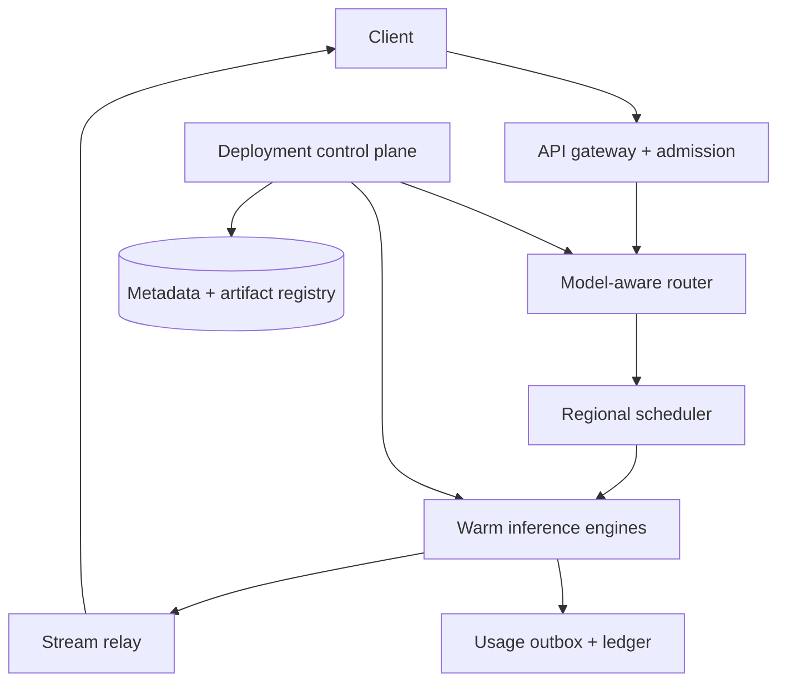
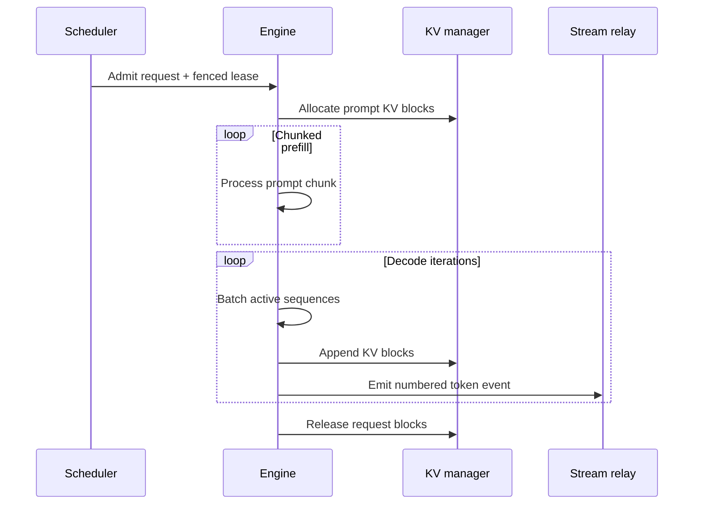

# System Design Interview Practice: Multi-Tenant LLM Inference Platform

**Difficulty:** Advanced  
**Primary themes:** AI inference serving, GPU scheduling, continuous batching, KV-cache management, streaming, admission control, multi-tenancy, reliability, and cost efficiency

> **Interview timing vs. this walkthrough:** In a 45-minute interview, budget about 5 minutes for requirements, 2 minutes for entities, 5 minutes for interfaces, 10–15 minutes for the high-level design, and 10–15 minutes for deep dives. This walkthrough is intentionally more detailed for learning. In the interview, state the core contract, build one complete request path, and let the interviewer choose which bottleneck to explore.

This answer follows the Hello Interview delivery sequence: clarify and prioritize requirements, identify the essential entities, define the system contract, build a working design one operation at a time, and then deepen the design where the baseline breaks. The framework emphasizes reaching a complete working system before spending the interview on refinements. genui{"citation":{"ref":"turn76search0"}}

---

## Interviewer prompt

> Design a managed, multi-tenant LLM inference platform. Customers deploy approved language models and call an OpenAI-compatible API to generate text with token streaming. The platform should provide low latency, high GPU utilization, fair tenant isolation, usage metering, and safe model rollouts.

## Targeted clarifying questions with assumed answers

**Candidate:** Are we training models or only serving already-produced checkpoints?

**Interviewer:** Only online inference. Model training, fine-tuning pipelines, and dataset management are out of scope. Customers may choose approved base models and approved LoRA adapters.

**Candidate:** Which model sizes and hardware should we support?

**Interviewer:** Support models from roughly 7B to 70B parameters on heterogeneous accelerator pools. A large model may use tensor parallelism across several GPUs. Design abstractions rather than hard-coding a vendor.

**Candidate:** Is the primary API synchronous, asynchronous, or streaming?

**Interviewer:** Interactive streaming is primary. Non-streaming responses use the same execution path. Offline batch inference is out of scope.

**Candidate:** What scale and workload should I assume?

**Interviewer:** At peak, 2,000 new requests per second, an average 800-token prompt, an average 200-token response, and bursty traffic across hundreds of tenants. There may be 50,000 concurrent generations. Some tenants repeatedly use a large shared system prompt.

**Candidate:** What latency targets matter for generated text?

**Interviewer:** For prompts up to 1,000 tokens, p99 time to first token should be under 2 seconds when the tenant is within quota. Once generation starts, p99 inter-token latency should be under 80 ms for the standard service tier. Availability should be 99.95% per region.

**Candidate:** Should a request ever change model version after it begins?

**Interviewer:** No. A request is pinned to one model version, tokenizer, adapter version, and sampling configuration for its lifetime.

**Candidate:** What isolation is required?

**Interviewer:** One tenant must not see another tenant’s prompt, generated output, prefix-cache entries, adapter, or billing records. Noisy tenants should not starve others. Enterprise tenants may request dedicated capacity.

**Candidate:** If the client disconnects, must generation continue and be resumable?

**Interviewer:** Default to cancellation after a short reconnect grace period. Support best-effort stream resume from a bounded buffer, but do not promise durable exactly-once token delivery.

**Candidate:** Are safety moderation, retrieval-augmented generation, or tool execution in scope?

**Interviewer:** Expose extension points, but the core design stops at text generation. Treat moderation as an optional pre/post-processing service and exclude RAG and tool execution.

### Scope statement to say aloud

> “I’ll separate the control plane that validates and deploys immutable model versions from the data plane that admits, schedules, batches, executes, and streams generations. I’ll optimize two user-visible latency metrics—time to first token and inter-token latency—while enforcing token-based fairness and GPU-memory safety.”

---

## 1. Requirements (~5 minutes)

### Three core functional requirements

1. **Deploy and version models.** An authorized operator creates an endpoint from an approved model artifact, runtime configuration, parallelism plan, optional adapter, and rollout policy. The platform loads, warms, health-checks, shifts traffic, and supports rollback.
2. **Generate and stream text.** An authenticated application submits a prompt and sampling limits, receives ordered token events, can cancel, and gets a terminal usage/result record.
3. **Share accelerators safely and efficiently.** The platform enforces per-tenant quotas and priorities, routes to compatible warm replicas, continuously batches work, manages KV-cache memory, applies backpressure, and meters usage.

### Quantified non-functional requirements

| Property | Target | Architectural consequence |
|---|---:|---|
| Peak arrivals | 2,000 requests/s; 50,000 concurrent | Distributed admission and model-aware regional scheduling |
| Prompt/response | Average 800 input + 200 output tokens | Token-based, not request-count-based, capacity planning |
| Time to first token | p99 < 2 s for ≤1,000-token prompts within quota | Bounded queues, chunked prefill, warm capacity |
| Inter-token latency | p99 < 80 ms, standard tier | Decode-aware batching and preemption controls |
| Availability | 99.95% per regional endpoint | Multi-zone replicas, rerouting before generation, graceful degradation |
| Isolation | No cross-tenant data/cache leakage | Tenant-scoped cache keys, encryption, authorization, resource quotas |
| Metering | No acknowledged usage lost; duplicate charges prevented | Durable usage ledger with idempotent finalization |
| Rollout | No in-flight version switch; rollback within 5 minutes | Immutable deployment revisions and weighted routing |

### Consistency and availability contract

- **Deployment configuration:** strongly consistent per endpoint. A deployment revision is immutable once published. Concurrent edits use an expected revision; no silent last-write-wins.
- **Request pinning:** admission resolves an endpoint alias to an exact `(model_version, tokenizer_version, runtime_version, adapter_version)` and stores that identity on the request. It never changes mid-generation.
- **Token stream:** ordered per request and numbered monotonically. Delivery is best effort over the live stream, with bounded replay after reconnect. A client can see a connection failure without knowing whether more tokens were generated.
- **Generation retries:** never automatically restart a partially streamed generation on another replica, because the client could receive duplicate or divergent text. Retry is safe only before the first externally visible token, or when the client explicitly creates a new attempt.
- **Usage:** the logical request has one metering record finalized idempotently. Internal execution may retry before streaming, but billing aggregates the accepted attempt only.
- **Availability under overload:** reject quickly with `429`/`503` and a retry hint rather than accepting work into an unbounded queue that violates latency SLOs.

### Out of scope

- Model training, fine-tuning jobs, evaluation datasets, and checkpoint production
- Retrieval, vector databases, agents, and tool execution
- Detailed safety-policy implementation
- Offline batch inference
- Durable storage of every prompt and completion by default
- Cross-region continuation of a generation after accelerator failure

### Scale estimates that change design decisions

Peak token demand is:

```text
prompt tokens/s  = 2,000 requests/s × 800  = 1,600,000 input tokens/s
output tokens/s  = 2,000 requests/s × 200  =   400,000 output tokens/s
```

Prefill and decode are different workloads. Prefill processes many prompt tokens in parallel and is generally compute-heavy. Decode repeatedly produces one next token per active sequence and repeatedly reads model weights and KV state, making batching and memory bandwidth crucial. We should plan and measure these phases separately.

Suppose a representative replica sustains 1,000 output tokens/s at our chosen latency SLO after benchmarking. Decode alone needs at least `400,000 / 1,000 = 400` replica-equivalents. At 70% target utilization, add roughly 43% headroom: about 572 equivalents, before failure reserve and model-mix fragmentation. This estimate makes three decisions concrete:

1. one central request queue is insufficient;
2. routing must consider the exact warm model and live KV capacity, not only CPU load;
3. admission control must happen before an expensive prompt consumes accelerator memory.

Model weights are also a placement constraint. A 70B-parameter model at 16 bits needs about `70B × 2 bytes = 140 GB` just for weights, excluding KV cache, activations, and runtime workspace. It cannot fit on one 80 GB accelerator and therefore needs quantization or model parallelism.

KV cache can dominate memory for long contexts. For a transformer with grouped-query attention, an approximate KV size per token is:

```text
2 × layers × KV_heads × head_dim × bytes_per_element
```

For an illustrative 80-layer model with 8 KV heads, head dimension 128, and 2-byte values:

```text
2 × 80 × 8 × 128 × 2 = 327,680 bytes ≈ 320 KiB per token
```

An 8,000-token active sequence then consumes about 2.5 GiB of KV memory. Exact architectures vary, but this magnitude proves that concurrency cannot be governed by request count alone. Admission must reserve **tokens and KV blocks**.

**What to say aloud:**

> “The average request count hides the actual resource demand. I’ll admit by predicted prompt and output tokens, then schedule prefill compute, decode slots, and KV blocks separately. The capacity unit is closer to token work plus memory residency than requests per second.”

---

## 2. Core entities (~2 minutes)

| Entity | Important fields and role |
|---|---|
| `Tenant` | Service tier, regional policy, request/token quotas, concurrency limit |
| `ModelArtifact` | Immutable weights URI, architecture, precision, checksum, license, allowed hardware |
| `ModelVersion` | Artifact plus tokenizer, runtime image, quantization, parallelism, compatibility metadata |
| `AdapterVersion` | Immutable LoRA artifact, base-model compatibility, tenant ownership |
| `Endpoint` | Stable customer-facing name and authorization policy |
| `DeploymentRevision` | Version-to-traffic weights, minimum replicas, autoscaling and rollback policy |
| `Replica` | Loaded version, accelerator topology, health, queue depth, KV capacity, prefix-cache summary |
| `GenerationRequest` | Request ID, tenant, pinned version, prompt-token count, limits, state, deadlines, seed |
| `AdmissionLease` | Reserved prefill tokens, decode budget, KV blocks, expiration, fencing token |
| `StreamEvent` | Request ID, attempt, sequence number, token/text delta, finish reason |
| `UsageRecord` | Input, cached-input, output tokens, accelerator class, accepted attempt, pricing version |

**What to say aloud:**

> “The endpoint is a stable alias, but a generation request stores an immutable version tuple. That gives us safe rollouts without changing the model underneath an active stream.”

---

## 3. API and system interface (~5 minutes)

### 3.1 Create or update a deployment

```http
POST /v1/endpoints
Authorization: Bearer <operator-token>
Idempotency-Key: ep-create-7f2...
Content-Type: application/json

{
  "name": "support-assistant",
  "region": "us-east",
  "modelVersion": "llama-family-70b@sha256:abcd",
  "adapterVersion": "support-lora@sha256:9912",
  "runtime": {
    "precision": "bf16",
    "tensorParallelSize": 4,
    "maxContextTokens": 16384
  },
  "capacity": {
    "minReplicas": 4,
    "maxReplicas": 40,
    "serviceTier": "standard"
  }
}
```

```json
{
  "endpointId": "ep_123",
  "deploymentRevision": 1,
  "state": "LOADING"
}
```

Updating traffic is conditional:

```http
PATCH /v1/endpoints/ep_123/deployment
Authorization: Bearer <operator-token>
If-Match: "deployment:ep_123:r7"

{
  "routes": [
    {"modelVersion":"model@old","weight":90},
    {"modelVersion":"model@new","weight":10}
  ]
}
```

Actor identity and tenant scope come from authentication, not request fields.

### 3.2 Start a streaming generation

```http
POST /v1/responses
Authorization: Bearer <tenant-api-key>
Idempotency-Key: req-client-8842
Accept: text/event-stream
Content-Type: application/json

{
  "endpoint": "support-assistant",
  "input": [
    {"role":"system","content":"You are the support assistant..."},
    {"role":"user","content":"Why was my invoice adjusted?"}
  ],
  "max_output_tokens": 400,
  "temperature": 0.2,
  "seed": 42,
  "stream": true,
  "deadline_ms": 15000
}
```

The gateway returns headers as soon as the request is admitted:

```http
HTTP/1.1 200 OK
Content-Type: text/event-stream
X-Request-Id: gen_456
X-Model-Version: model@old
```

Stream events are numbered:

```text
id: 0
event: response.created
data: {"request_id":"gen_456","model_version":"model@old"}

id: 1
event: response.output_text.delta
data: {"delta":"Your","token_count":1}

id: 2
event: response.output_text.delta
data: {"delta":" invoice","token_count":1}

id: 39
event: response.completed
data: {"finish_reason":"stop","usage":{"input_tokens":812,"output_tokens":38}}
```

The idempotency key maps to one logical request for a retention window. Repeating it returns the existing request state or reconnect information; it does not silently start a second billable generation.

### 3.3 Non-streaming generation

The same endpoint with `"stream": false` buffers output in the gateway until completion. It uses the identical scheduler and engine path, so semantics do not diverge.

### 3.4 Cancel

```http
POST /v1/responses/gen_456/cancel
Authorization: Bearer <tenant-api-key>
```

```json
{"request_id":"gen_456","state":"CANCELLATION_REQUESTED"}
```

Cancellation is idempotent. It may race with completion. The engine checks a cancellation bitmap between decode iterations and releases KV blocks as soon as it fences the request out of future batches.

### 3.5 Best-effort stream resume

```http
GET /v1/responses/gen_456/events
Authorization: Bearer <tenant-api-key>
Last-Event-ID: 12
Accept: text/event-stream
```

The stream service replays events 13 onward if they remain in its bounded encrypted buffer and the reconnect grace period has not expired. Otherwise it returns `410 Gone` with the terminal state if known. This is not durable exactly-once streaming.

### 3.6 Status and usage

```http
GET /v1/responses/gen_456
Authorization: Bearer <tenant-api-key>
```

```json
{
  "request_id":"gen_456",
  "state":"COMPLETED",
  "model_version":"model@old",
  "usage":{"input_tokens":812,"cached_input_tokens":640,"output_tokens":38},
  "finish_reason":"stop"
}
```

### Important errors

| Status | Meaning |
|---|---|
| `400` | Invalid sampling parameters or context exceeds model limit |
| `401/403` | Invalid credential or endpoint not authorized for tenant |
| `409` | Idempotency key reused with a different request body |
| `429` | Tenant quota/fair-share limit; includes `Retry-After` |
| `503` | No compatible capacity before admission deadline |
| `504` | Admitted work exceeded the deadline before first token |

---

## 4. Data flow

### Deployment flow

1. The control plane authenticates the operator and validates artifact compatibility.
2. It commits an immutable deployment revision and desired capacity.
3. The deployment controller selects accelerator pools and creates replica groups.
4. Each replica downloads weights to local NVMe, verifies the checksum, loads shards into accelerator memory, compiles/warms representative shapes, and reports readiness.
5. A synthetic request verifies tokenizer, output, streaming, and metrics.
6. The router receives a versioned route table only after minimum healthy warm capacity exists.
7. Traffic shifts gradually; rollback publishes another route revision.

### Generation flow

1. The gateway authenticates the tenant, validates parameters, and resolves endpoint alias to an immutable deployment version.
2. The tokenizer service or trusted gateway counts input tokens using the pinned tokenizer.
3. Admission checks tenant quotas, deadline feasibility, projected token work, and available KV capacity.
4. A model-aware router selects a regional scheduler shard and compatible warm replica group.
5. The scheduler queues the request fairly, grants a fenced capacity lease, and sends it to an engine.
6. The engine performs chunked prefill, allocates paged KV blocks, and joins the sequence to continuous decode batches.
7. Tokens flow through a bounded stream relay to the client.
8. Completion or cancellation releases KV blocks and finalizes usage through a durable outbox/ledger.

---

## 5. High-level design (~10–15 minutes)

### Compact architecture



There are two planes:

- The **control plane** owns desired state: immutable model versions, endpoint routing revisions, capacity policy, artifact verification, rollout, and rollback.
- The **data plane** owns live requests: authentication, admission, routing, scheduling, inference, streaming, cancellation, and usage.

A control-plane outage must not interrupt already loaded models or active generation. Data-plane components use the last valid signed route configuration.

### Operation 1: deploy a model version

The operator submits a model artifact and runtime specification. The control plane validates:

- artifact checksum, signature, license, and tenant permissions;
- tokenizer identity and maximum context;
- adapter compatibility with the base model;
- supported precision and accelerator type;
- tensor/pipeline parallel degree versus topology;
- runtime image and kernel compatibility;
- estimated weight, workspace, and KV memory.

The metadata database stores `ModelVersion` and `DeploymentRevision` transactionally. Large artifacts live in immutable object storage. A regional artifact cache stages weights onto node-local NVMe so restarts do not repeatedly download hundreds of gigabytes across the network.

The deployment controller asks the capacity manager for a compatible placement. Kubernetes can expose GPUs as custom schedulable resources through vendor device plugins; the higher-level serving scheduler still needs model, topology, memory, and locality awareness beyond merely requesting `vendor.com/gpu: N`. genui{"citation":{"ref":"turn75search24"}}

Replicas transition through:

```text
ALLOCATED → DOWNLOADING → LOADING → WARMING → READY → DRAINING → TERMINATED
```

Readiness is not “process started.” It means weights are resident, collectives work across all shards, warmup completed, and a generation probe passed. Only then does the control plane publish the replica into the routing directory.

### Operation 2: authenticate, tokenize, and admit a request

The gateway derives `tenant_id`, allowed endpoints, service tier, and privacy policy from the API key. It rejects an endpoint or adapter outside that scope.

It canonicalizes the request and binds the idempotency key to a request-body digest. It resolves the endpoint alias using one route-table revision, producing a pinned version tuple. Weighted rollout selection is stable for the request and may hash tenant/request identity to keep retries on the same version.

Tokenization must use the pinned tokenizer. The gateway checks:

```text
input_tokens + max_output_tokens ≤ model_context_limit
```

Admission then reserves three budgets:

1. prompt-token work for prefill;
2. maximum or predicted decode-token work;
3. KV blocks for the prompt plus a bounded growth reservation.

The reservation is a short lease with a fencing token. If dispatch does not occur before expiry, capacity returns to the pool and a late dispatcher cannot consume it.

Why reject before queueing? An unbounded queue converts a capacity shortage into timeouts, wastes client deadlines, and makes autoscaling signals lag. The admission service uses current warm capacity, queue work in tokens, recent service rates, and the request deadline to estimate whether the SLO is feasible.

### Operation 3: route to a warm compatible replica group

The router filters by:

- exact model/runtime/adapter compatibility;
- region and tenant residency policy;
- healthy parallel group and topology;
- service tier and dedicated/shared pool;
- estimated queue delay;
- free KV blocks and prefix-cache affinity.

It then chooses the least projected finish time, not simply the fewest requests. One request with a 32K prompt is not equivalent to one with a 50-token prompt.

Avoid routing every request independently to a single global scheduler. Partition scheduler ownership by `(region, model_version, service_tier)` and replicate lightweight load summaries. This keeps scheduling decisions close to the engines while the router balances among shards.

Prefix affinity is a hint, not an absolute rule. Reusing a 5,000-token system prompt may save substantial prefill work, but sending a request to an overloaded replica can still hurt time to first token. The route score compares estimated saved work against queue delay.

### Operation 4: prefill and continuous decode

The engine first performs **prefill**: it processes prompt tokens and creates key/value attention state. Large prompts are split into chunks so one huge prefill does not block every active decoder.

The request then joins continuous decoding. Unlike static batching, which waits for every sequence in a batch to finish, continuous batching rebuilds the active batch at each iteration. Completed or cancelled sequences leave immediately; newly prefetched sequences join when resources allow.



Modern serving engines explicitly support continuous batching, chunked prefill, and prefix caching because these improve accelerator utilization and repeated-prompt efficiency. genui{"citation":{"ref":"turn76search6"}}

Each request has an engine-local state machine:

```text
QUEUED → PREFILLING → DECODING → COMPLETED
                    ↘ CANCELLED / FAILED
```

The scheduler records coarse durable state, but per-token state and KV pages are intentionally ephemeral. Persisting each decode step would destroy performance.

### Operation 5: stream tokens with bounded backpressure

The engine sends token IDs, log probabilities if requested, and monotonically increasing sequence numbers to the stream relay. The relay detokenizes incrementally, applies optional output policy, and emits SSE events.

Each request has a bounded ring buffer. If the client reads slowly:

1. coalesce small deltas up to a latency bound;
2. stop expanding the relay buffer beyond its limit;
3. mark the request backpressured;
4. if the grace limit is exceeded, cancel generation and free KV state.

We should not let a disconnected client consume expensive decode capacity indefinitely. A short reconnect lease permits replay from the ring buffer. After it expires, the stream is terminal even if the client later retries.

### Operation 6: cancel and finish

Cancellation writes an idempotent intent to the scheduler and a fast signal to the owning engine. The engine checks cancellation between iterations, removes the sequence from the next batch, and releases KV blocks. It emits a terminal event if the stream still exists.

On normal completion, the engine reports actual input, cached-input, and output-token counts with the accepted attempt ID. A usage service commits the terminal request state and an outbox record atomically. The ledger deduplicates by `(request_id, accepted_attempt)`.

This provides exactly-once **logical accounting**, not exactly-once physical execution. A GPU may have performed work that is discarded after a failure; the customer is charged according to the documented accepted-work policy.

### Operation 7: autoscale and roll out safely

GPU startup may take minutes because nodes must be provisioned and weights loaded. CPU-style reactive scaling on utilization alone is too late. Use:

- minimum warm replicas for latency-critical endpoints;
- scheduled capacity for known traffic cycles;
- queue token-work and predicted arrival rate as leading signals;
- a regional warm pool with common base models staged on NVMe;
- separate scaling of gateways, schedulers, and engine groups.

A new deployment begins with shadow health probes, then receives perhaps 1%, 5%, 25%, 50%, and 100% of new requests. In-flight requests remain on the old version. Rollback changes routing for new requests and drains the bad version after its active streams finish or reach a deadline.

---

## 6. Deep dives (~10–15 minutes)

### Deep dive A: scheduling, continuous batching, and tenant fairness

#### Where the baseline breaks

A FIFO queue by arrival time is simple but fails in three ways:

1. a few huge prompts cause head-of-line blocking and destroy TTFT;
2. a high-volume tenant occupies every decode slot;
3. maximizing batch size can improve throughput while violating inter-token latency.

Static batching also wastes capacity: if eight sequences have different output lengths, finished sequences leave empty slots until the slowest request completes.

#### Candidate approaches

| Approach | Advantage | Problem |
|---|---|---|
| FIFO request queue | Simple and predictable | Ignores token cost and tenant fairness |
| Shortest predicted job first | Low mean latency | Starves long prompts; predictions are imperfect |
| Per-tenant weighted fair queues | Strong isolation | Needs a second policy inside each tenant |
| Deadline-aware token scheduler | Protects SLOs | More state and admission complexity |

#### Selected design

Use hierarchical scheduling:

1. **Admission tier:** token buckets per tenant limit request arrivals, input tokens/s, output tokens/s, and concurrent KV residency.
2. **Fair-share tier:** weighted deficit round robin chooses tenants. Deficit is charged in estimated token work, not one unit per request.
3. **Request tier:** within a tenant, use deadline-aware shortest predicted work with aging so large requests eventually run.
4. **Engine tier:** continuous batching chooses a bounded mix of prefill chunks and one-token decode steps.

Weighted deficit round robin gives each tenant credits proportional to its purchased share. A request can run when its tenant has enough credit for the next chunk; unused share is temporarily borrowable but revocable when the owner becomes active.

#### Protecting inter-token latency

Decode has a recurring deadline. If the engine admits unlimited prompt work, a large prefill can delay every active sequence. Therefore:

- cap prefill tokens per engine iteration;
- split long prompts into chunks;
- reserve a minimum decode budget every iteration;
- track each sequence’s time since last token;
- stop forming larger batches when predicted iteration time would violate ITL.

The optimal batch is not necessarily the largest. NVIDIA’s inference guidance describes dynamic batching as a major throughput optimization, but its batch delay and instance count must be tuned against latency and workload. genui{"citation":{"ref":"turn75search0"}}

#### Preemption

If KV memory is exhausted, options include:

- **reject new work:** predictable and safest for active streams;
- **swap KV to host memory:** preserves work but adds PCIe/network latency;
- **recompute later:** frees pages but repeats prefill compute;
- **preempt low-priority sequence:** protects premium traffic but harms its victim.

Choose admission conservatism first. Use recompute or offload only for explicitly preemptible tiers, and bound how often one sequence can be preempted. Premium active decodes should not be evicted merely to improve aggregate throughput.

#### Load balancing signal

Publish a compact engine score every few hundred milliseconds:

```text
predicted_finish = queued_prefill_work / prefill_rate
                 + active_decode_work / decode_rate
                 + topology_penalty
                 - prefix_reuse_benefit
```

Stale scores can cause herding, so route with power-of-two choices among compatible groups and add randomized tie-breaking. Admission leases prevent simultaneous routers from overcommitting the same advertised KV capacity.

#### What to observe

- TTFT and ITL by model, tenant tier, prompt bucket, and batch size
- active sequences, batch occupancy, prompt/decode tokens per second
- queue token-work and oldest age, not only queue length
- tenant throttle time and achieved share versus entitlement
- preemption count, recomputed tokens, KV swap bytes
- deadline rejection accuracy and wasted work

**What to say aloud:**

> “I don’t optimize utilization in isolation. I reserve decode progress first, spend the remaining iteration budget on chunked prefill, and arbitrate tenants in token-work units. That lets us explain both fairness and the TTFT-versus-throughput tradeoff.”

### Deep dive B: paged KV cache, prefix reuse, and disaggregated serving

#### Where the baseline breaks

Allocating each request one contiguous worst-case KV region wastes memory because output length is unknown. It also creates fragmentation as variable-length sequences finish. Recomputing identical enterprise system prompts wastes prefill capacity, but sharing cache entries carelessly can leak tenant data.

#### Paged KV memory

Divide accelerator KV memory into fixed-size logical blocks covering a fixed number of tokens. Each sequence owns a block table mapping logical positions to physical pages. New pages are allocated as the sequence grows; completed sequences return pages to a free list.

Benefits:

- allocate near actual use rather than maximum output length;
- avoid the need for a contiguous region;
- share immutable prefix pages through reference counts;
- evict or offload at block granularity;
- use copy-on-write when sequences branch for parallel sampling.

This is analogous to virtual-memory paging, but the pages hold attention keys and values rather than process memory.

#### Prefix cache

Hash each immutable full prefix block using:

```text
tenant_scope || model_version || adapter_version || tokenizer_version
|| token_ids_before_and_in_block || cache_salt
```

The cache key must include every factor that changes KV values. Tenant scoping is the safe default. Cross-tenant sharing is allowed only for explicitly public platform-owned prefixes, using a separate namespace and policy.

On a hit, the sequence’s block table references cached immutable pages and increments reference counts. The first unmatched or partial block is computed normally. Eviction chooses unreferenced least-recently-used blocks; pages used by active sequences cannot be evicted.

vLLM’s prefix-caching design likewise identifies KV blocks from their tokens and prior prefix, and includes the LoRA identity when adapters affect cache compatibility. genui{"citation":{"ref":"turn76search19"}}

Prefix caching improves prefill only when requests share prefixes. It does not accelerate generation of novel output. Therefore, schedule using **cached tokens saved**, but autoscale on actual prompt/decode work rather than assuming a fixed hit rate.

#### Cache locality versus load

Three options:

1. route purely to the least-loaded replica and lose prefix hits;
2. sticky-route a prefix to one replica and risk hotspots;
3. score both expected saved prefill time and queue delay.

Choose the third. Replicate a hot public prefix across a few replicas when its measured demand justifies the memory. Do not globally broadcast every prefix.

#### Separating prefill and decode

For a first version, co-locate prefill and decode in the same engine; it avoids moving a large KV cache and is simpler to operate. At high scale, long prompts may still interfere with latency-sensitive decode.

An evolved design has:

- **prefill workers** optimized for high compute throughput;
- **decode workers** optimized for memory bandwidth and active-sequence batching;
- a KV-transfer fabric that sends computed pages plus request metadata;
- a scheduler that admits only when both a prefill slot and downstream decode/KV capacity are reserved.

| Design | Benefit | Cost |
|---|---|---|
| Co-located prefill/decode | No KV transfer; simple failure domain | Phase interference and less independent scaling |
| Disaggregated phases | Independent scaling, clearer SLO isolation | Large KV transfer, two-sided scheduling, more failure modes |

Disaggregate only when measurements show prefill/decode interference or materially different hardware economics. KV transfer time must be lower than the latency saved. For the illustrative 2.5 GiB 8K-context cache, transferring it over a 100 Gb/s link has a theoretical floor near 0.2 seconds before protocol and contention overhead—large enough to affect TTFT.

#### KV failure behavior

KV state is ephemeral. If an engine fails mid-generation, another replica usually cannot reconstruct the exact stream cheaply. Mark the attempt failed, stop billing future tokens, and let the client explicitly retry. Replicated per-token KV would be prohibitively expensive for the base SLO.

For higher-priced resumable service, periodically checkpoint token IDs and sampler RNG state, then replay prefill on another replica. This reduces lost semantic progress but still pays recompute and may not be bit-identical across kernels or hardware.

#### What to observe

Current vLLM production metrics expose prompt/generation token counts, prefix-cache queries and hits, cached tokens by source, and engine preemptions—good examples of the resource signals an operator needs. genui{"citation":{"ref":"turn76search4"}}

Also track:

- free/used KV pages and allocation failures
- internal fragmentation and copy-on-write pages
- hit tokens, not only hit requests
- cache hit rate by tenant, prefix class, model, and adapter
- KV transfer bytes/latency if phases are disaggregated
- prefill time saved versus routing detour cost

**What to say aloud:**

> “Paged KV turns unknown-length sequences into incremental block allocation. Prefix caching then reuses immutable blocks, but correctness requires the model, adapter, tokenizer, token prefix, and tenant security scope in the cache identity.”

### Deep dive C: failures, overload, safe rollout, and observability

#### Where the baseline breaks

A naive load-balanced fleet treats an inference replica like a stateless HTTP server. It is not: each active sequence has gigabytes or hundreds of megabytes of accelerator-resident state, replicas take a long time to warm, and output is already visible to the client. Blind retries can duplicate text and charges.

#### Failure semantics by point in the lifecycle

| Failure point | Safe behavior |
|---|---|
| Before admission | Return error; no capacity or usage exists |
| After admission, before engine ACK | Expire/fence lease and redispatch if deadline allows |
| After engine ACK, before first token | Retry on another replica only if attempt fencing rejects the old engine |
| After any token is visible | Do not auto-restart; terminate stream with retryable error |
| After completion, before ledger write | Transactional outbox replays idempotent usage finalization |

Every dispatch carries `(request_id, attempt_id, lease_epoch)`. An engine must validate the current lease before exposing the first token. If a router times out and creates attempt 2, a delayed attempt 1 cannot later publish into the stream or ledger.

#### Zone and regional failures

Spread warm replicas across zones, but keep one tensor-parallel group within the lowest-latency supported topology; splitting collective operations across ordinary zones would make every token pay WAN-like latency and increase correlated failure complexity.

Before a generation begins, the router can choose another healthy zone. After streaming starts, zone loss terminates the request. Regional failover routes **new requests** to another allowed region. It does not claim transparent continuation of active streams.

Tenant residency policy may prohibit cross-region failover. In that case availability yields to compliance and the API returns an explicit regional-unavailable error.

#### Overload and brownout

Overload controls should activate in this order:

1. reject requests exceeding tenant hard quota;
2. stop lending unused premium share to best-effort tenants;
3. reject requests whose predicted TTFT misses their deadline;
4. cap maximum output or context only for service tiers whose contract allows it;
5. disable optional log probabilities, multiple candidates, or expensive post-processing;
6. preserve admitted active decodes and health traffic;
7. return `503` rather than queue without bound.

Autoscaling cannot solve a sudden spike immediately because GPU provisioning and model loading are slow. Queue bounds and reserved warm capacity are correctness mechanisms for the latency contract, not merely cost controls.

#### Backpressure chain

Every hop is bounded:

- gateway pending admission count;
- scheduler token-work queue;
- engine prefill and active-sequence limits;
- KV pages;
- stream-relay bytes per request;
- usage-outbox retention.

When a downstream bound fills, the upstream component stops accepting or sheds lower-priority work. Never convert a full buffer into an unbounded retry storm. Use exponential backoff with jitter and circuit breakers for unhealthy model groups.

#### Safe model and runtime rollout

A model change can preserve API syntax while altering quality, latency, memory use, or tokenization. Treat the rollout as both infrastructure and product change.

1. Verify artifact checksum and software bill of materials.
2. Load into an isolated canary group.
3. Run fixed golden prompts for shape, stop conditions, determinism envelope, and safety hooks.
4. Benchmark TTFT, ITL, throughput, KV use, and error rate.
5. Shadow a privacy-approved sample without returning output.
6. Shift a small percentage of new requests.
7. Compare system metrics and product-quality guardrails.
8. Increase weight or publish a rollback revision.

The router records the deployment revision and model version on every request and usage event. That makes regressions attributable and ensures in-flight version pinning.

#### Metering and privacy

The gateway should not log raw prompts by default. Store request metadata and token counts with short retention; make content logging opt-in, encrypted, access-audited, and tenant-configurable. Scrub prompts from exception traces.

The usage ledger is append-only. A terminal transaction stores request state and outbox event; the billing consumer deduplicates by logical attempt. Reconciliation compares gateway admissions, engine completions, and ledger totals. Differences surface as operational errors rather than silent revenue or customer-trust problems.

#### Observability

Use a request trace with timestamps for:

```text
gateway receive
→ auth complete
→ tokenization complete
→ admitted
→ scheduler enqueue/dequeue
→ engine receive
→ prefill start/end
→ first token
→ each decode summary
→ final token
→ usage committed
```

Core dashboards:

- TTFT and ITL percentiles by model, version, region, tier, prompt length, and batch size
- prompt and output tokens/s per accelerator and per dollar
- batch occupancy, engine iteration time, accelerator compute/memory utilization
- queue work in tokens, admission rejection cause, tenant fairness
- KV utilization, allocation failures, prefix hit tokens, preemptions
- stream disconnects, replay success, slow-client cancellations
- model load time, readiness failures, rollout comparison
- attempt fencing conflicts, engine crashes, usage reconciliation gaps

Avoid only reporting average request latency. Generation length makes end-to-end duration incomparable; TTFT and inter-token latency describe the interactive experience, while token throughput describes efficiency.

Use synthetic probes for short prompts, long prompts, cancellation, streaming reconnect, each model version, and each zone. Keep their capacity reserved so overload does not hide the system’s health.

**What to say aloud:**

> “Once a token is visible, the request is stateful and externally observable, so I stop treating failover as an HTTP retry. Attempt fencing prevents two engines from publishing, while the stream fails explicitly and accounting finalizes one accepted attempt.”

---

## 7. Finish

### Concise final design

The control plane stores immutable model and deployment revisions, verifies artifacts, selects accelerator topology, loads and warms replica groups, and publishes versioned routing weights. The data plane authenticates a tenant, pins the endpoint to an exact version tuple, tokenizes, checks context limits, and admits against per-tenant token, concurrency, and KV-memory budgets.

A model-aware router chooses a compatible warm regional group using projected finish time, live KV capacity, tenant tier, and prefix affinity. A hierarchical fair scheduler meters work in tokens. Engines use chunked prefill, continuous batching, and paged KV memory to protect decode latency while keeping accelerators busy. Tenant-scoped prefix caching reuses shared prompt work without leaking private state.

Numbered token events pass through a bounded stream relay with cancellation and short best-effort replay. Attempt and lease epochs fence duplicate execution before the first visible token; after streaming begins, failures terminate explicitly rather than silently regenerating divergent output. A transactional usage outbox creates one logical billing record. Multi-zone warm groups, deadline-aware overload rejection, predictive autoscaling, immutable rollout revisions, draining, and detailed TTFT/ITL/KV/fairness metrics make the system operable.

### Requirements check

| Requirement | Design support |
|---|---|
| Deploy/version models | Immutable artifacts and deployment revisions, warmup, canary, weighted routing, rollback |
| Stream generation | OpenAI-style API, pinned version, SSE sequence numbers, bounded replay |
| Cancel | Idempotent cancellation signal checked between decode iterations |
| Low TTFT | Warm capacity, bounded token queues, chunked prefill, deadline admission |
| Low ITL | Decode reservation, continuous batching, batch-time caps |
| High utilization | Dynamic batches, paged KV, prefix reuse, predictive routing |
| Fair multi-tenancy | Per-tenant token buckets, weighted deficit scheduling, dedicated tiers |
| Memory safety | KV-block reservation, context checks, bounded sequence growth |
| Availability | Multi-zone groups, pre-stream retry, last valid routes, explicit post-stream failure |
| Safe metering | Accepted-attempt fencing, terminal outbox, idempotent ledger |
| Safe rollouts | Immutable version tuple, new-request traffic shifts, old-version draining |
| Privacy | Scoped authorization/cache keys, encrypted buffers, content logging off by default |

## Realistic interviewer follow-up questions with strong sample answers

**Interviewer:** Why does a normal least-connections load balancer fail here?

**Candidate:** Connections do not represent work. A request may have a 50-token or 32K-token prompt, require a different model shard, and reserve very different KV memory. I route only to compatible warm groups and compare projected token work, KV capacity, prefix reuse, and queue delay.

**Interviewer:** What is the difference between prefill and decode?

**Candidate:** Prefill processes the prompt in parallel and materializes KV state, so it tends to be compute-heavy. Decode repeatedly produces one token per active sequence while reading weights and accumulated KV, so it is sensitive to memory bandwidth and batch composition. I budget them separately and chunk long prefill work to protect active decoders.

**Interviewer:** Why continuous batching instead of collecting a batch every 10 ms?

**Candidate:** A fixed batch ties slots to sequences with different output lengths. Continuous batching reforms the batch every iteration, removes finished sequences, and admits new ready work. We still cap scheduling delay and iteration size to meet TTFT and ITL.

**Interviewer:** How do you estimate request cost when output length is unknown?

**Candidate:** Reserve the declared maximum subject to a tenant cap for memory safety, but schedule using a model trained from endpoint, prompt length, stop settings, and historical output distributions. Reconcile to actual tokens and continuously recalibrate. Conservative admission protects KV memory even if the prediction is wrong.

**Interviewer:** Why not reserve full maximum KV for every request?

**Candidate:** That is safe but wastes most memory. Paged KV allocates incrementally. Admission reserves a bounded growth budget and ensures aggregate headroom; the engine grants actual pages as tokens arrive. Requests approaching their limit may be throttled or stopped before physical exhaustion.

**Interviewer:** Can two tenants share a system-prompt prefix cache?

**Candidate:** Not by default. The cache namespace includes tenant and all version identities. Only explicitly public, platform-owned prefixes enter a cross-tenant namespace after policy review. Otherwise timing and content reuse could become a side channel.

**Interviewer:** What invalidates a prefix-cache entry?

**Candidate:** Entries are immutable and content addressed. A model, tokenizer, adapter, cache format, positional-encoding configuration, or token-prefix change generates another key. Eviction handles capacity; version changes do not mutate old entries.

**Interviewer:** Would you split prefill and decode onto different GPUs?

**Candidate:** Start co-located because KV transfer is large and operationally simpler. Disaggregate when profiling shows phase interference or different hardware gives meaningful savings. Admission must reserve both phases, and transfer time plus failure cost must be lower than the latency saved.

**Interviewer:** What if a GPU dies after 50 tokens were streamed?

**Candidate:** Terminate that attempt with an explicit retryable error; do not automatically start another stream that may diverge. Release or expire its lease, finalize only accepted usage, and let the client create a new attempt. A premium resumable tier could checkpoint token IDs and recompute, but transparent exact continuation is not the base contract.

**Interviewer:** What if the router times out but the engine actually accepted the request?

**Candidate:** Dispatch uses a lease epoch. Before emitting the first token, the engine verifies it still owns the accepted attempt. If the scheduler issued a newer attempt, the old engine discards work and cannot publish or bill it.

**Interviewer:** How do you prevent one tenant from monopolizing the GPU?

**Candidate:** Enforce ingress token buckets and concurrency/KV limits, then use weighted deficit round robin charged by token work. Borrow idle share for utilization, but revoke borrowed capacity at safe scheduling boundaries when the entitled tenant becomes active.

**Interviewer:** Why not retry every failed request automatically?

**Candidate:** Before visible output, a fenced retry is safe. After output, a retry can duplicate or diverge, and even the same seed may not guarantee identical output across runtime or hardware. The protocol must expose failure rather than pretending exactly-once generation.

**Interviewer:** Which metric triggers autoscaling?

**Candidate:** No single metric. Use predicted arrival token rate, queued prefill/decode work, target utilization, KV pressure, and model-specific service rates. GPU utilization alone is lagging and can be high even while TTFT is already failing.

**Interviewer:** How do you roll out a faster runtime safely?

**Candidate:** Make runtime part of the immutable model version, warm a canary group, run golden and load tests, shadow privacy-approved requests, then shift only new requests gradually. Compare TTFT, ITL, throughput, memory, errors, and quality guardrails; rollback updates routing while old streams remain pinned and drain.

**Interviewer:** How do you meter prefix-cache hits?

**Candidate:** Record total input tokens and cached input tokens separately. Pricing can reflect saved compute, but the ledger stores raw immutable usage plus a pricing-version reference so billing policy can be audited without changing engine events.

**Interviewer:** What would you build first?

**Candidate:** One region and one model family: immutable deployment versions, warm replica registry, authenticated streaming API, token-based admission, a model-aware scheduler, continuous batching with paged KV, cancellation, terminal usage outbox, and TTFT/ITL metrics. Add prefix affinity, adapters, sophisticated fairness, multi-zone failover, and disaggregated prefill only after measuring the basic workload.

## Common pitfalls

1. Treating inference replicas as stateless HTTP servers.
2. Measuring only end-to-end latency rather than TTFT and inter-token latency.
3. Planning by requests per second instead of prompt/output tokens and KV residency.
4. Sending requests to replicas that do not already have the exact model loaded.
5. Routing by connection or queue count while ignoring prompt length.
6. Using one global scheduler for every model and region.
7. Allowing an unbounded queue and calling timeouts backpressure.
8. Reactively autoscaling only from GPU utilization despite long model-load times.
9. Maximizing batch size without bounding decode iteration latency.
10. Letting long prefills starve active decode sequences.
11. Using static batches that retain slots until the longest sequence finishes.
12. Enforcing fairness per request instead of per token work and KV occupancy.
13. Allocating contiguous worst-case KV memory for every sequence.
14. Ignoring KV cache when estimating concurrency.
15. Sharing private prefix-cache entries across tenants.
16. Omitting model, tokenizer, adapter, or cache-format version from the prefix key.
17. Chasing a prefix hit on an overloaded replica without comparing queue delay.
18. Disaggregating prefill and decode without calculating KV-transfer cost.
19. Automatically retrying after tokens have already reached the client.
20. Assuming a seed guarantees bit-identical output across all runtimes and hardware.
21. Failing to fence an old timed-out execution attempt.
22. Allowing disconnected or slow clients to consume decode capacity indefinitely.
23. Writing every token synchronously to durable storage.
24. Charging directly from transient engine counters without an idempotent ledger.
25. Switching an in-flight request to a new deployment version.
26. Declaring a replica ready before weights, collectives, and warmup are validated.
27. Splitting tensor-parallel collectives across high-latency failure zones casually.
28. Logging raw prompts and completions by default.
29. Reporting average utilization without per-model fragmentation and KV pressure.
30. Drawing complex GPU topology before tracing deploy, admit, schedule, generate, stream, cancel, and meter.

## A polished 60-second close

> “The platform separates immutable model deployment from live generation. The control plane verifies artifacts, chooses accelerator topology, loads and warms model groups, and publishes versioned routing weights. On each request, the gateway derives tenant identity, pins an exact model-tokenizer-runtime-adapter tuple, tokenizes, checks context limits, and reserves tenant token and KV budgets. A model-aware router chooses compatible warm capacity by projected finish time, memory pressure, and prefix affinity. Hierarchical scheduling provides token-based tenant fairness; engines combine chunked prefill with continuous decode batching and paged KV allocation, while tenant-scoped prefix caching reuses repeated prompt work safely. Numbered tokens stream through bounded relays with cancellation and short replay. Lease epochs prevent stale attempts from publishing before the first token; after streaming starts, accelerator failure is explicit rather than silently retried. Terminal state and a usage outbox create one logical charge. Predictive warm capacity, overload rejection, immutable canary rollouts, and TTFT, ITL, token-throughput, fairness, and KV metrics keep the design both efficient and operable.”

## References

- [Hello Interview: System Design Delivery Framework](https://www.hellointerview.com/learn/system-design/in-a-hurry/delivery)
- [Hello Interview: ML System Design Delivery Framework](https://www.hellointerview.com/learn/ml-system-design/in-a-hurry/delivery)
- [vLLM documentation](https://docs.vllm.ai/en/stable/)
- [vLLM: Production Metrics](https://docs.vllm.ai/en/latest/usage/metrics/)
- [vLLM: Automatic Prefix Caching](https://docs.vllm.ai/en/v0.7.0/design/automatic_prefix_caching.html)
- [NVIDIA Triton Inference Server: Optimization](https://docs.nvidia.com/deeplearning/triton-inference-server/user-guide/docs/user_guide/optimization.html)
- [Kubernetes: Schedule GPUs](https://kubernetes.io/docs/tasks/manage-gpus/scheduling-gpus/)

