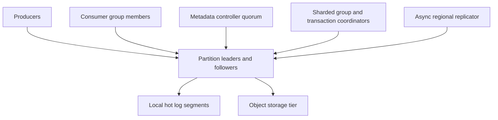
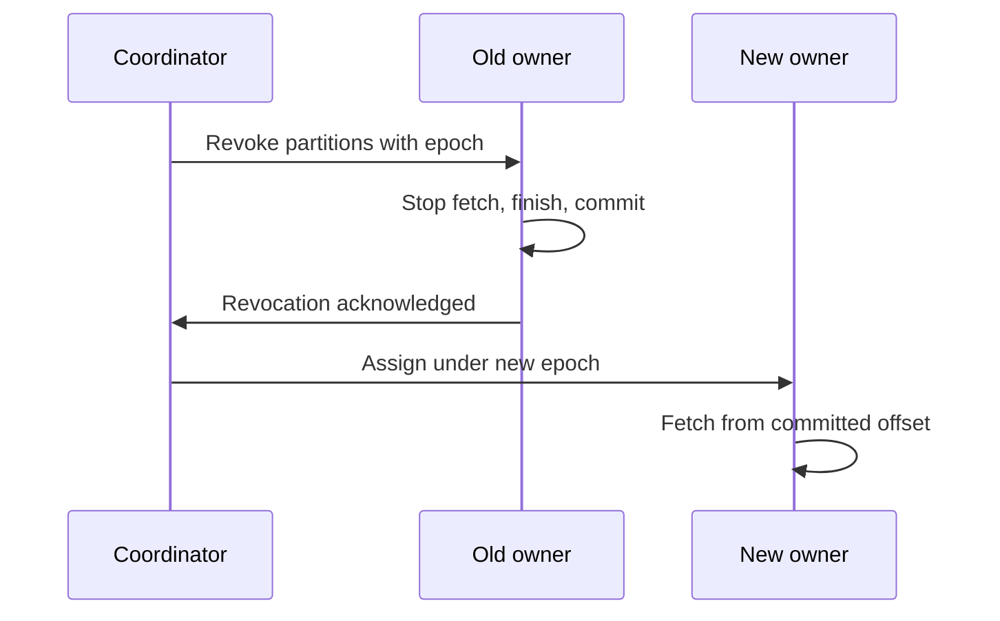

# System Design Interview Practice: Multi-Tenant Distributed Event Streaming Platform

**Difficulty:** Advanced / Infrastructure  
**Primary themes:** append-only logs, partitioning, replication, leader epochs, durability, producer idempotence, consumer groups, offset management, replay, batching, backpressure, hot partitions, tiered storage, and multi-region recovery

> **Interview timing vs. this walkthrough:** In a 45-minute interview, spend roughly 5 minutes on requirements, 2 minutes on entities, 5 minutes on producer/consumer/admin interfaces, 10–15 minutes building one durable partition and consumer group, and 10–15 minutes on replication, delivery semantics, and consumer/backpressure behavior. This educational walkthrough goes much deeper. In the room, first make one producer append a batch and one consumer fetch it safely; add transactions, tiered storage, and geo-replication only after that path is complete.

This walkthrough follows Hello Interview’s public delivery structure: prioritize requirements, define core entities and contracts, build the simplest complete system operation by operation, and then deepen the places where non-functional requirements break the baseline. Hello Interview’s Kafka guidance specifically recommends beginning with partition strategy and being explicit about ordering, consumer groups, retries, hot partitions, and exactly-once claims. genui{"citation":{"refs":["turn92search0","turn93search0","turn93search24"]}} The prompt, numbers, dialogue, APIs, and design below are original.

---

## Interviewer prompt

> Design a managed, multi-tenant event streaming platform similar to Kafka. Producers publish keyed events to named topics. Independent applications subscribe, process events in parallel through consumer groups, commit progress, and replay retained history. The system must preserve ordering within a partition, durably replicate acknowledged records, recover from broker and coordinator failures, isolate tenants, and scale to very high throughput.

## Targeted clarifying questions with assumed interviewer answers

**Candidate:** Is this a traditional destructive work queue or a retained stream?

**Interviewer:** A retained stream. Multiple independent consumer groups can read the same event, and a group may rewind to an older offset while data remains retained.

**Candidate:** What ordering guarantee is required?

**Interviewer:** Preserve total order within a partition. Events with the same routing key should normally enter the same partition. Global order across a topic is not required.

**Candidate:** What producer acknowledgement means success?

**Interviewer:** For the durable mode, success means the partition leader and a configured minimum of in-sync replicas have persisted the batch. Also offer a lower-latency leader-only mode with weaker durability.

**Candidate:** What delivery semantics must consumers get?

**Interviewer:** At-least-once is the default. Support idempotent producers. Explain how read-process-write can achieve exactly-once effects when outputs and consumed offsets are committed atomically inside this platform. Do not claim exactly once for arbitrary external databases.

**Candidate:** What scale should I design for?

**Interviewer:** Ten million events per second at peak, 20 GB/s of compressed ingress, 50 GB/s of aggregate egress because multiple groups reread data, 100,000 topics, one million partitions, and petabytes of retained data.

**Candidate:** What latency and availability targets matter?

**Interviewer:** For same-region durable writes, p99 under 50 ms for normal-sized batches. Hot-tail fetch should generally stay below 100 ms p99. The regional service should offer 99.99% availability.

**Candidate:** How long is data retained?

**Interviewer:** Default seven days, configurable from one hour to one year. Some compacted topics retain the latest value per key indefinitely. Recent data should remain on local broker disks; older data may use object storage.

**Candidate:** What record sizes are allowed?

**Interviewer:** Optimize for 1–10 KB events, allow batches up to 10 MB, and reject individual oversized records. Large blobs should live in object storage with a reference in the event.

**Candidate:** Is cross-region synchronous replication required?

**Interviewer:** No. Each topic has a home region for ordered writes. Asynchronously replicate selected topics for disaster recovery or local reads. Be explicit about RPO and failover fencing.

**Candidate:** What multi-tenancy controls are expected?

**Interviewer:** Authentication, topic ACLs, quotas, encryption, noisy-neighbor isolation, retention limits, and audit logs. Tenant-provided names and IDs must not be trusted as identity.

**Candidate:** Do we need SQL stream processing?

**Interviewer:** No. Design the storage and delivery substrate. Stateful stream processing may use it, but query language and processing engine internals are out of scope.

### Scope statement to say aloud

> “I’ll design a regional retained-log service. Topics are split into ordered partitions, each with one fenced leader and replicated followers. Producers discover leaders, choose partitions by key, batch records, and receive offsets only after the configured durability condition. Consumers pull sequential batches, while a replicated group coordinator assigns partitions and stores committed offsets. The default is at-least-once; producer sequencing removes duplicate log appends, and transactions can atomically publish platform outputs with consumed offsets. Recent segments stay on broker disks, older sealed segments move to object storage, and asynchronous cross-region replication has an explicit RPO.”

---

## 1. Requirements (~5 minutes)

### Three core functional requirements

1. **Publish an ordered event stream.** Authenticated producers append keyed record batches to topics and receive partition offsets after the selected durability level is satisfied.
2. **Consume, coordinate, and replay.** Independent consumer groups divide partitions among live members, fetch sequentially, commit progress, recover ownership, and rewind within retention.
3. **Manage durable topics.** Authorized users create/configure topics, retention/compaction, partition count, replication, ACLs, and quotas; operators repair, rebalance, and recover the cluster.

### Quantified non-functional requirements

| Property | Target | Design implication |
|---|---:|---|
| Peak ingress | 10M events/s; 20 GB/s compressed | Client/broker batching, sequential append, many partitions |
| Aggregate egress | 50 GB/s | Pull consumers, page cache, replicas/read isolation, quotas |
| Namespace | 100K topics; up to 1M partitions | Sharded metadata and coordinator load; avoid per-partition chatter |
| Durable produce latency | p99 < 50 ms in-region | Local-disk append, parallel follower replication, no WAN quorum |
| Tail fetch latency | p99 < 100 ms | Long polling and hot page-cache reads |
| Availability | 99.99% regionally | Replication across failure domains and automated leader failover |
| Durability | No loss after durable acknowledgement within assumed failures | Replication factor 3, `acks=all`, minimum in-sync replicas 2 |
| Ordering | Total order within a partition | Single active leader, leader epoch, monotonic offsets |
| Retention | 7 days default; 1 hour–1 year configurable | Segmented logs, tiered storage, lifecycle deletion |
| Disaster recovery | Default RPO < 5 min; RTO < 30 min for replicated topics | Async inter-region replication, checkpoints, fenced promotion |

### Consistency, durability, and availability contract

- **Partition order:** records successfully appended to one partition receive strictly increasing offsets and are returned in that order.
- **No global order:** offsets from different partitions are incomparable. A topic-wide sequence would serialize throughput and is deliberately excluded.
- **Durable acknowledgement:** `acks=all` succeeds only when the active leader and at least `min_in_sync_replicas` have persisted the batch. A later permitted failover must retain it.
- **Weaker acknowledgement is explicit:** leader-only acknowledgement may lose recently acknowledged records if that leader fails before replication.
- **Default consumption is at least once:** committing after processing can duplicate work after a crash; committing before processing can lose work. Consumers should make effects idempotent.
- **Idempotent append scope:** producer ID, epoch, partition, and sequence number prevent a retry from creating another record in that partition.
- **Exactly-once scope is narrow:** a transaction can atomically publish output records and consumed offsets within the platform. An email, payment provider, or arbitrary database needs its own idempotency or transaction/outbox boundary.
- **Consumer-group exclusivity:** at most one active member in a group owns a partition at a time under a valid generation/assignment epoch.
- **Retention is not consumption:** records expire by time/size policy, not because one group read them. Lagging consumers may fall behind the log start offset and require recovery.
- **Availability versus durability:** if in-sync replicas fall below the configured minimum, durable writes reject rather than silently weaken guarantees. Existing reads may remain available.
- **Cross-region consistency:** replication is asynchronous; failover may lose the most recent unreplicated tail within the published RPO.

### Out of scope

- A SQL stream-processing language and stateful operator runtime
- Arbitrary message priority or per-message scheduling
- Large blob storage inside records
- Globally synchronous multi-region ordering
- Producer business transactions before an event reaches the platform
- Consumer side effects in systems that do not participate in platform transactions

### Scale estimates that change design decisions

At 20 GB/s compressed ingress and seven-day retention:

```text
20 GB/s × 86,400 s/day × 7 days ≈ 12.1 PB primary retained bytes
```

With replication factor 3:

```text
12.1 PB × 3 ≈ 36.3 PB broker-side replicated bytes
```

That makes all-local retention expensive. Keep the hot tail on broker disks and move sealed older segments to cheaper object storage while preserving logical offsets.

If an efficiently configured partition sustains 50 MB/s of ingress:

```text
20 GB/s ÷ 50 MB/s ≈ 400 simultaneously busy partitions
```

The cluster has far more partitions for key distribution, consumer parallelism, tenant isolation, and burst headroom—not because each partition must be saturated. One million partitions also means controller metadata, leader election, file handles, and group assignments must be batched and sharded.

At 10 million events/s and an average of 500 events per compressed producer batch:

```text
10,000,000 ÷ 500 = 20,000 append requests/s
```

Batching reduces request, checksum, replication, and disk-operation overhead by roughly two orders of magnitude. Waiting forever for huge batches would hurt latency, so clients flush on either bytes or a short linger deadline.

At 50 GB/s egress, copying every payload repeatedly through user-space buffers is costly. Sequential reads, zero-copy/file-region transfer where available, compression preservation, and the OS page cache materially affect capacity.

**What to say aloud:**

> “The arithmetic tells me this is a batched sequential-log system, not a row-per-message database. Seven days at 20 gigabytes per second is about 12 petabytes before replication, so tiered storage is not optional at this scale. Batching 500 events turns ten million event writes into roughly twenty thousand append requests per second.”

---

## 2. Core entities (~2 minutes)

| Entity | Essential fields and purpose |
|---|---|
| `Tenant` | Tenant identity, plan, quotas, encryption key reference, status |
| `Topic` | Name/ID, tenant, partition count, replication factor, retention, cleanup mode, home region |
| `Partition` | Topic/number, leader broker, leader epoch, replicas, in-sync replicas, high watermark |
| `RecordBatch` | Base offset, record count, producer ID/epoch, first sequence, timestamps, compression, checksum, payload |
| `LogSegment` | Partition, base/end offsets, file/tier location, index files, size, creation/seal state |
| `ProducerSession` | Producer ID, epoch, transactional ID, per-partition last sequence |
| `ConsumerGroup` | Group ID, generation, protocol, state, subscribed topics, coordinator |
| `GroupMember` | Member/instance ID, lease/session, subscription, assignment, assignment epoch |
| `CommittedOffset` | Group, topic-partition, next offset, metadata, commit timestamp |
| `Transaction` | Transactional ID, producer epoch, touched partitions, pending offsets, state, timeout |

Offsets identify positions within a partition, not globally unique messages. A business event should also carry an application-level `event_id` for downstream idempotency and audit.

---

## 3. API and system interface (~5 minutes)

External requests authenticate with a service identity. Tenant identity and ACL scope are derived from the credential, never trusted from a request body. Data-plane protocols are normally binary and multiplexed; HTTP-like examples make the contract readable.

### 3.1 Create a topic

```http
POST /v1/topics
Authorization: Bearer <tenant-admin-token>
Idempotency-Key: create-orders-v3
Content-Type: application/json

{
  "name":"orders.events.v3",
  "partitions":96,
  "replication_factor":3,
  "min_in_sync_replicas":2,
  "retention_hours":168,
  "cleanup_policy":"DELETE",
  "home_region":"us-east"
}
```

```json
{
  "topic_id":"top_884",
  "name":"orders.events.v3",
  "state":"PROVISIONING",
  "metadata_version":19042
}
```

The control plane validates quotas and policy, commits metadata through a consensus-backed controller quorum, places replicas across failure domains, then marks the topic active.

### 3.2 Discover partition leaders

```http
GET /v1/topics/orders.events.v3/metadata
Authorization: Bearer <producer-token>
```

```json
{
  "topic_id":"top_884",
  "metadata_version":19042,
  "partitions":[
    {
      "partition":17,
      "leader":"broker-21.us-east.internal",
      "leader_epoch":884,
      "replicas":[21,34,55]
    }
  ]
}
```

Clients cache this metadata and refresh on expiry, topology version change, or `NOT_LEADER` response.

### 3.3 Produce a record batch

```http
POST /v1/data/topics/orders.events.v3/partitions/17:append
Authorization: Bearer <producer-token>
X-Leader-Epoch: 884
X-Acks: all
Content-Type: application/octet-stream

<compressed record batch:
 producer_id=711, producer_epoch=4,
 first_sequence=9200, record_count=500,
 records=[{key:"customer_42", event_id:"evt_...", value:...}]>
```

```json
{
  "partition":17,
  "base_offset":9910000,
  "last_offset":9910499,
  "leader_epoch":884,
  "durability":"QUORUM_COMMITTED"
}
```

The broker validates ACL, quota, batch checksum, sequence, size, and current epoch before appending.

### 3.4 Fetch records

```http
POST /v1/data/topics/orders.events.v3/partitions/17:fetch
Authorization: Bearer <consumer-token>
Content-Type: application/json

{
  "offset":9910000,
  "max_bytes":4194304,
  "min_bytes":65536,
  "max_wait_ms":100,
  "isolation":"READ_COMMITTED"
}
```

```json
{
  "partition":17,
  "leader_epoch":884,
  "log_start_offset":8000000,
  "high_watermark":9922000,
  "last_stable_offset":9921500,
  "batches":"<binary batches>"
}
```

`READ_COMMITTED` hides aborted and still-open transactional records. Consumers usually maintain persistent connections and pipeline fetches rather than issuing literal HTTP requests.

### 3.5 Join a consumer group

```http
POST /v1/consumer-groups/order-indexer:join
Authorization: Bearer <consumer-token>
Content-Type: application/json

{
  "member_id":null,
  "instance_id":"indexer-host-27",
  "subscribed_topics":["orders.events.v3"],
  "supported_assignors":["COOPERATIVE_STICKY","RANGE"]
}
```

```json
{
  "member_id":"member_332",
  "group_generation":81,
  "assignment_epoch":501,
  "assignments":[{"topic":"orders.events.v3","partitions":[17,18,44]}],
  "heartbeat_interval_ms":3000,
  "session_timeout_ms":30000
}
```

Static `instance_id` reduces unnecessary reassignment after a brief restart. The assignment epoch fences stale members.

### 3.6 Commit consumer progress

```http
POST /v1/consumer-groups/order-indexer/offsets:commit
Authorization: Bearer <consumer-token>
Content-Type: application/json

{
  "member_id":"member_332",
  "group_generation":81,
  "assignment_epoch":501,
  "offsets":[
    {"topic":"orders.events.v3","partition":17,"next_offset":9910500}
  ]
}
```

The committed value is the next record to consume. The coordinator rejects stale generation or ownership.

### 3.7 Reset/replay a group

```http
POST /v1/consumer-groups/order-indexer/offsets:reset
Authorization: Bearer <group-admin-token>
Idempotency-Key: replay-incident-2026-10-14
Content-Type: application/json

{
  "topic":"orders.events.v3",
  "target":{"timestamp":"2026-10-14T15:00:00Z"},
  "require_group_inactive":true
}
```

The service resolves a timestamp to per-partition offsets and audits the reset. Replaying a live group without coordination can duplicate effects unpredictably, so the default requires it to be stopped.

### Important errors

| Error | Meaning and client behavior |
|---|---|
| `NOT_LEADER` / `STALE_EPOCH` | Refresh metadata and retry correct leader |
| `NOT_ENOUGH_REPLICAS` | Durable contract cannot currently be met; back off |
| `OUT_OF_ORDER_SEQUENCE` | Producer state/ordering error; reinitialize safely |
| `PRODUCER_FENCED` | Newer producer epoch owns transactional identity; stop old process |
| `OFFSET_OUT_OF_RANGE` | Requested data expired or offset invalid; use recovery policy |
| `ILLEGAL_GENERATION` | Group rebalanced; stop processing revoked partitions and rejoin |
| `THROTTLED` | Tenant/broker quota exceeded; honor retry delay |
| `MESSAGE_TOO_LARGE` | Store blob elsewhere or reduce batch/record size |
| `AUTHORIZATION_FAILED` | Identity lacks topic/group action; do not retry blindly |

---

## 4. Data flow

### Produce flow

1. Producer authenticates, fetches topic metadata, and caches partition leaders.
2. A partitioner hashes the routing key; unkeyed records use a sticky batch-friendly partitioner.
3. Client accumulates records until batch bytes or linger deadline is reached, compresses once, and computes a checksum.
4. Client sends the batch to the partition leader with leader epoch and producer sequence metadata.
5. Leader validates, appends sequentially to its active segment, and followers pull/replicate the bytes.
6. Once the configured in-sync durability condition is satisfied, the high watermark advances.
7. Leader returns assigned offsets. On an ambiguous timeout, producer retries the identical sequence; the broker deduplicates it.

### Consume flow

1. A consumer discovers its group coordinator and joins with subscription and identity.
2. Coordinator calculates/cooperatively updates partition assignments and returns an assignment epoch.
3. Consumer fetches from each assigned partition starting at committed or locally tracked offset.
4. Broker long-polls until minimum bytes arrive or wait time expires, then returns sequential compressed batches.
5. Consumer processes records and writes idempotent effects.
6. Consumer commits the next offsets after effects are safely recorded.
7. Heartbeats renew membership. Failure or subscription change triggers reassignment.
8. A new owner resumes from the group’s last committed offset, so processed-but-uncommitted records may repeat.

---

## 5. High-level design (~10–15 minutes)

### Compact architecture



The diagram separates three responsibilities:

- **data plane:** append and fetch large batches;
- **coordination plane:** metadata, leadership, group membership, and transactions;
- **storage plane:** hot local segments plus cold sealed segments.

### Operation 1: build one ordered partition

Start with one broker and one append-only file:

1. receive a validated batch;
2. assign the next offset range;
3. append bytes sequentially;
4. update sparse offset/time indexes;
5. acknowledge;
6. fetch by translating an offset to a file position.

Data layout:

```text
partition_log(topic_id, partition_id,
              leader_epoch, log_start_offset,
              log_end_offset, high_watermark)

segment(base_offset, end_offset, created_at,
        sealed, local_path, remote_uri,
        bytes, checksum)

record_batch(base_offset, record_count,
             producer_id, producer_epoch, first_sequence,
             first_timestamp, max_timestamp,
             compression, crc, records)
```

The active segment accepts appends. Once it reaches a size/time threshold it becomes immutable, allowing safe caching, transfer, checksum validation, and tiering.

A sparse offset index maps every Nth relative offset to a byte position. Find the nearest lower entry, seek, then scan batches. A time index supports timestamp-based replay.

### Operation 2: split a topic into partitions

One log serializes all appends and supports only one active consumer in a group. Split a topic into partitions:

```text
partition = hash(record_key) mod partition_count
```

All records with the same stable key map to one partition and preserve relative order. Consumers in a group process different partitions concurrently.

Apache Kafka’s official introduction describes this same model: events append to topic partitions, same-key events can share a partition, and consumers observe a partition in append order. genui{"citation":{"ref":"turn93search1"}}

Partition-count caveat: increasing `N` changes `hash(key) mod N`, so a key may move and its old/new streams can overlap. Options:

- choose sufficient partitions initially;
- use a versioned virtual-bucket mapping;
- pause/cut over producers at a known boundary;
- accept that order is guaranteed per physical partition, not magically across repartitioning.

Do not promise transparent repartitioning with uninterrupted per-key total order unless you describe the migration protocol.

### Operation 3: replicate a partition

Assign each partition replica set across racks/availability zones:

```text
partition 17 replicas = [broker 21 leader, broker 34 follower, broker 55 follower]
```

Followers issue sequential replication fetches from the leader. The leader tracks which replicas are sufficiently caught up—the in-sync replica set. With `acks=all` and `min_in_sync_replicas=2`, it acknowledges only after the required replicated position is durable.

The **high watermark** is the largest offset safe for ordinary consumers. Records beyond it exist on the leader but are not yet committed and could disappear during a permitted failover.

Each leadership term has a monotonically increasing `leader_epoch`. Brokers and clients reject commands from an older epoch, preventing a former leader from accepting writes after partition or pause.

### Operation 4: add metadata discovery and placement

A small consensus-backed controller quorum owns:

- topic configuration and ACL references;
- partition replica assignments;
- current leaders and leader epochs;
- broker registrations and fenced broker epochs;
- reassignment plans and cluster metadata version.

It does not carry event payloads or update on every record. Brokers maintain sessions/heartbeats, and clients cache metadata. Controllers batch topology changes rather than emitting a million independent heartbeats.

Replica placement balances bytes, ingress, egress, leaders, and failure domains—not merely partition counts. Moving a replica copies sealed segments first, catches the active tail, joins the in-sync set, then changes leadership if required.

### Operation 5: add producer batching and idempotence

Producer behavior:

- accumulate per-partition batches;
- compress as a batch;
- preserve a few in-flight requests per partition while maintaining sequence order;
- retry transient failures with jitter;
- refresh metadata on epoch/leadership errors;
- respect broker throttle time.

Idempotent producer state:

```text
(producer_id, producer_epoch, topic_partition,
 last_accepted_sequence, last_offset_range)
```

If a response is lost, the producer retries the same batch and sequence. The leader recognizes it and returns the original offsets instead of appending a duplicate. A gap or conflicting payload is rejected.

Apache Kafka documents the same mechanism: the broker assigns a producer ID and deduplicates using producer sequence numbers; transactions extend this to atomic writes across partitions. genui{"citation":{"ref":"turn93search2"}}

### Operation 6: make consumers pull

Consumers pull rather than brokers pushing:

- each consumer controls its processing rate;
- the broker can return large sequential batches;
- slow consumers accumulate measurable lag instead of broker-side per-message delivery state;
- long polling avoids busy loops while keeping latency low.

Fetch parameters balance latency and throughput: return when `min_bytes` are available or `max_wait_ms` expires, capped by `max_bytes`. Preserve compressed batches through the network when clients understand the codec.

Recent segments are normally served from page cache. Lagging replay may read local disk or remote tier and has a different latency SLO.

### Operation 7: coordinate consumer groups

Hash `group_id` to a coordinator shard. Coordinator stores:

```text
group(group_id, generation, assignment_epoch,
      protocol, state, subscription_hash)

member(group_id, member_id, instance_id,
       session_deadline, subscription, assignment)

offset(group_id, topic_id, partition_id,
       next_offset, commit_timestamp, metadata)
```

For a topic with 96 partitions and 20 healthy members, each receives roughly 4–5 partitions. Adding consumers beyond partition count does not add parallelism.

Prefer cooperative/sticky rebalancing:

1. identify only partitions that must move;
2. old owners stop fetching and finish/commit safely;
3. coordinator revokes those assignments;
4. new owners receive them under a new epoch;
5. unchanged partitions continue processing.

Assignment epochs fence a zombie member that pauses through a rebalance and later resumes.

### Operation 8: retain, delete, and compact segments

For delete retention, a background cleaner deletes whole sealed segments whose time/size boundary is beyond policy and that are no longer needed by internal recovery constraints. It advances `log_start_offset`.

For compacted topics, retain at least the latest value for each key, plus tombstones long enough for consumers to observe deletion. Compaction is asynchronous: duplicates/older values may coexist until cleaning. It does not change surviving record offsets.

Use cases:

- `DELETE`: audit/event history with finite retention;
- `COMPACT`: latest configuration or changelog state;
- `COMPACT,DELETE`: latest-per-key plus bounded history.

### Operation 9: tier old data

Once a segment is sealed and safely replicated:

1. upload segment and indexes to object storage;
2. verify checksum and durable manifest;
3. mark remote copy authoritative for cold retention;
4. delete local copy after a hot-retention/grace period;
5. fetch cold data through broker cache/read path so authorization and offsets remain uniform.

Metadata maps logical offset ranges to local or remote segment objects. Consumers should not receive raw bucket credentials.

Tiering separates compute/hot-disk capacity from long retention, but introduces remote-fetch latency, cache eviction, object-store request cost, and new failure modes.

---

## 6. Deep dives (~10–15 minutes)

### Deep dive A: replication, leader failover, and acknowledged durability

#### Where the baseline breaks

A single broker loses acknowledged data and availability. Naively writing to three brokers independently can produce different orders. A stale leader may continue accepting records after isolation. Electing the replica with the longest-looking log can expose uncommitted data or discard committed data if epochs are ignored.

#### Replication options

| Approach | Strength | Limitation |
|---|---|---|
| Client writes every replica | Simple concept | Conflicting order, partial success, complex clients |
| Leader with synchronous followers | One order, strong committed prefix | Write availability depends on enough replicas |
| Leader with async followers | Low latency/high availability | Acknowledged tail can be lost |
| Consensus per record | Clear quorum semantics | More protocol overhead for high-throughput logs |

Choose one leader per partition with pipelined follower replication and a committed high watermark. A consensus-backed controller chooses/fences leadership; the data path remains optimized for sequential replication.

#### Acknowledgement modes

| Mode | Success condition | Tradeoff |
|---|---|---|
| `acks=0` | Client sends without broker response | Lowest latency; no confirmation |
| `acks=leader` | Leader appends locally | May lose acknowledged tail on leader failure |
| `acks=all` | Required in-sync replicas persist | Stronger durability; may reject during failures |

For high-value events, recommend replication factor 3, `acks=all`, and minimum in-sync replicas 2. Apache Kafka’s design exposes the same durability tradeoff: producers can wait for committed replication, only the leader, or send asynchronously. genui{"citation":{"ref":"turn93search2"}}

#### Failover protocol

1. Broker session expires or controller observes leader failure.
2. Controller chooses a caught-up in-sync replica.
3. It commits a new leader and incremented epoch in metadata quorum.
4. New leader truncates any divergent uncommitted tail to the valid epoch boundary.
5. Followers discover the epoch, truncate/fetch as needed, and resume.
6. Clients receive `NOT_LEADER`/epoch error, refresh metadata, and retry.
7. Idempotent producer sequences prevent ambiguous retries from duplicating batches.

Old leaders are fenced by broker and partition leader epochs. Without fencing, a network partition can create split-brain appends.

#### In-sync replica policy

A follower leaves ISR if it exceeds lag/time thresholds. Removing it preserves write latency, but shrinking below `min_in_sync_replicas` makes durable writes unavailable.

Do not silently acknowledge on one copy just to preserve availability. The topic owner explicitly chooses that weaker mode if acceptable.

Unclean leader election—promoting an out-of-sync replica—may restore availability by discarding acknowledged records. Keep it disabled for durable topics; an operator may choose it only with an explicit data-loss decision for a disposable topic.

#### Disk and power semantics

“Appended” must have a concrete durability definition. Options include page cache plus replicated copies, or forced stable storage before acknowledgement. Synchronous `fsync` on every record destroys throughput, so batch flushes and replication spread risk. The advertised guarantee must match filesystem, drive cache, power-loss protection, and cloud volume behavior.

A practical contract can require persisted append on two fault-domain-separated replicas before `acks=all`, with checksums and background scrubbing.

#### Corruption and repair

- CRC validates batches during replication/read;
- segment-level checksums validate tier upload/download;
- replicas compare end offsets and epoch histories;
- corrupt follower segment is replaced from a healthy replica/object copy;
- leader corruption triggers leadership transfer when possible;
- periodic scrub detects latent faults before another replica fails.

#### Observability

- under-replicated/offline partitions
- ISR shrink/expand and cause
- replication byte/offset lag and time lag
- leader elections, epoch changes, unclean-election attempts
- produce latency by acknowledgement mode
- `NOT_ENOUGH_REPLICAS`, timeout, and ambiguous retry rate
- disk flush latency, page-cache pressure, disk errors
- checksum failure, truncation, and repair bytes
- rack/AZ replica placement violations

**What to say aloud:**

> “One fenced leader defines partition order. Followers replicate the byte stream, and only the committed high watermark is visible in the normal path. For durable topics, `acks=all` plus a minimum of two in-sync replicas rejects writes rather than weakening the contract. Failover selects an in-sync replica under a new leader epoch and truncates only uncommitted divergence.”

### Deep dive B: producer ordering, duplicates, transactions, and hot partitions

#### Where the baseline breaks

Retrying after an ambiguous timeout can append the same batch twice. Multiple in-flight retries can reorder batches. Two processes may accidentally use the same transactional identity. A celebrity/customer key can overload one partition even while the rest are idle. Cross-partition transactions can turn a fast append path into coordination-heavy work.

#### Delivery semantics table

| Goal | Mechanism | Remaining boundary |
|---|---|---|
| At-most-once append attempt | Do not retry ambiguity | May lose events |
| At-least-once append | Retry until acknowledged | Duplicates possible |
| Idempotent append | Producer ID/epoch + per-partition sequence | Scope is broker log append |
| Atomic multi-partition publish | Transaction coordinator and commit markers | More latency/state |
| Exactly-once stream transform | Atomic output writes + input offset commit | Only participating platform state |
| Exactly-once external effect | Idempotency key/outbox/transaction at destination | Cannot be guaranteed by broker alone |

#### Idempotent producer

The producer obtains `(producer_id, producer_epoch)`. For each partition it numbers batches monotonically. Broker accepts the next expected sequence, recognizes an already accepted retry, and rejects gaps or old epochs.

The epoch fences an earlier incarnation after failover/restart. Store enough producer state in replicated snapshots/log data so a new leader preserves deduplication knowledge.

This solves duplicate **append**, not duplicate business events deliberately sent with new sequences. Applications should still include stable `event_id` and downstream idempotency.

#### Transactional read-process-write

For a processor consuming input and publishing platform output:

1. begin transaction under a unique transactional ID;
2. fetch/process input records;
3. publish outputs to one or more partitions as transactional batches;
4. add the group’s consumed offsets to the transaction;
5. coordinator writes a commit or abort decision;
6. partitions record markers;
7. `READ_COMMITTED` consumers expose only committed output;
8. committed offsets advance atomically with output visibility.

Kafka’s design documentation explains this same boundary: output records and consumer positions can be committed in one transaction, enabling exactly-once behavior for participating stream operations. genui{"citation":{"ref":"turn93search2"}}

If processing also charges a card, sends an email, or updates a non-transactional service, use a destination idempotency key or transactional outbox. Do not extend the claim beyond the actual atomic boundary.

#### Transaction failure modes

- producer crashes before commit: timeout and abort; output remains hidden;
- response lost after commit: new producer epoch recovers transaction state rather than blindly repeating side effects;
- coordinator fails: recover durable transaction metadata and resume/abort;
- old producer resumes: fenced by newer epoch;
- one partition unavailable: transaction cannot complete until recovery or timeout;
- long transactions: delay last-stable offset and therefore `READ_COMMITTED` consumers.

Bound transaction duration, touched partitions, and bytes.

#### Choosing partition keys

Good key properties:

- matches the entity whose events require order;
- high cardinality and reasonably even traffic;
- stable over the event’s lifecycle;
- not sensitive raw data if exposed in logs/metrics.

Examples:

- payment lifecycle → `payment_id`;
- device telemetry → `device_id`;
- account ledger → `account_id`, if per-account order is essential.

An arbitrary random key balances perfectly but destroys useful per-entity order. A low-cardinality region or celebrity ID causes hotspots.

#### Hot-key strategies

Options:

1. **Accept serialization:** if strict per-key order is truly required, one key has a finite throughput ceiling; isolate it on a dedicated partition/broker.
2. **Shard the logical key:** use `(key, subshard)` for associative/commutative workloads, then aggregate downstream; strict total order is lost.
3. **Split event classes:** keep ordered state transitions separate from high-volume unordered telemetry.
4. **Batch/coalesce:** combine compatible updates for the hot entity.
5. **Apply per-key admission limits:** protect other tenants/partitions.

Do not claim that adding partitions fixes a single hot key while preserving its total order.

#### Multi-tenant quotas

Enforce hierarchical token buckets for:

- produce bytes/requests by tenant and topic;
- fetch bytes by tenant/group;
- partition count and retention bytes;
- concurrent connections and requests;
- transaction rate/duration;
- controller/admin operations.

Throttle before memory/disk queues explode and return an explicit delay. Reserve capacity for replication and control traffic so tenant load cannot block recovery.

#### Observability

- batch size, compression ratio, linger, and request rate
- producer retry, duplicate sequence, gap, and fenced errors
- records by partition/key sketch and skew coefficient
- hottest partitions versus broker utilization
- transaction open count, age, commit/abort latency
- last-stable-offset distance from high watermark
- tenant quota utilization and throttle time
- large-record rejection and blob-reference adoption

**What to say aloud:**

> “Idempotence is based on producer epoch and per-partition batch sequence, so retrying an ambiguous send returns the original offset instead of appending again. Transactions can atomically commit output partitions and consumed offsets, but I would never claim they make an external email or payment exactly once. For a single hot key, strict order imposes a single-partition ceiling; the product must choose order, sharding, or isolation.”

### Deep dive C: consumer groups, rebalances, backpressure, and replay

#### Where the baseline breaks

A static partition-to-consumer map cannot react to scaling or crashes. Stop-the-world rebalances pause every partition. Consumers that commit before processing lose work; those that commit after processing repeat work on crash. One poison event can block a partition forever. Lagging consumers may request deleted segments. Large replays can evict hot page-cache data and harm real-time traffic.

#### Group coordination options

| Approach | Strength | Limitation |
|---|---|---|
| Client-side static assignment | Simple, no coordinator | Manual failure/scaling handling |
| Central coordinator | Clear membership and ownership | Must shard/replicate coordinator state |
| External lease store | Reusable primitive | Extra dependency and chatter |
| Broker-integrated group coordinator | Efficient offset/membership integration | More broker/control complexity |

Choose sharded broker-side coordinators. Hash group ID to a coordinator partition so state is replicated as an internal log and can fail over.

#### Membership and failure detection

Members heartbeat periodically. Session timeout trades failure detection against false eviction during GC pauses/network hiccups. Static membership lets a known process restart within a grace period without moving all its partitions.

Use three notions distinctly:

- **group generation:** membership/subscription version;
- **assignment epoch:** authority for partition ownership;
- **partition leader epoch:** broker authority for the log.

A consumer must stop processing a revoked partition before its successor starts authoritative work. Downstream writes should include partition/offset or fencing token where possible.

#### Cooperative rebalance sequence



Unchanged ownership continues, reducing pause time compared with revoking the whole group.

#### Offset commit timing

Suppose offset 100 is next:

- commit 101 before effect, then crash → record may be skipped;
- apply effect, crash before commit 101 → record repeats;
- atomically write effect and offset in destination DB → exactly-once effect for that DB transaction;
- use platform transaction for output stream and input offset → exactly-once stream transform.

For the default, commit after processing and require idempotent effects. Batch commits amortize overhead but enlarge the replay window.

#### Poison events and retries

Blocking a partition preserves order but one deterministic failure can stop all following records. Policy choices:

1. bounded immediate retries for transient errors;
2. delayed retry topic keyed to the same entity if temporary reordering is acceptable;
3. dead-letter topic with original topic/partition/offset, payload reference, error, attempts, and schema version;
4. operator quarantine and explicit skip after audit;
5. halt permanently for correctness-critical ledgers.

The platform provides primitives; the application chooses whether order or progress dominates. A DLQ is not success—monitor, secure, and redrive it.

#### Backpressure and lag

Because consumers pull, slow processing naturally becomes lag:

```text
lag_records = high_watermark - consumer_position
```

Record lag alone is misleading across traffic levels. Also measure oldest unprocessed event age, bytes lag, processing rate, and estimated catch-up time.

Responses:

- scale consumers up to partition count;
- increase per-consumer concurrency only if it preserves required per-key order;
- pause fetches when local work queues are full;
- reduce fetch size for memory pressure;
- isolate slow groups from broker cache pollution;
- throttle bulk replay separately from tail consumption;
- increase partitions through a deliberate migration when parallelism is structurally insufficient.

#### Retention overrun

When committed offset is less than `log_start_offset`, data is gone from the stream. Recovery policy may:

- fail loudly and restore from an external snapshot;
- reset to earliest retained offset;
- reset to latest and accept loss;
- bootstrap state from a compacted changelog/snapshot then resume.

Never silently reset. Emit an audit event and require configured policy.

#### Tiered replay isolation

Historical fetches read remote segments through a bounded cache and separate I/O/concurrency pool. Apply per-group replay quotas. Otherwise a one-year backfill can evict hot tail pages and saturate network for production consumers.

Prefetch sequential remote segments and preserve their compressed representation. Cache by immutable segment identity and checksum.

#### Observability

- group membership, rebalance count/duration/reason
- revoked-to-assigned handoff time and fenced stale commits
- offset commit latency/error and commit interval
- record/byte/time lag and catch-up ETA by partition/group
- consumer processing latency and local queue depth
- DLQ rate, poison-key recurrence, redrive outcomes
- offset-out-of-range and retention-overrun incidents
- tail versus replay fetch bytes/latency/cache hit ratio
- coordinator shard load and failovers

**What to say aloud:**

> “A consumer group is a replicated lease-and-offset system over partitions. Cooperative assignment moves only necessary partitions, and generation/assignment epochs fence paused members. The default commits after idempotent effects, so a crash can replay but not lose work. I measure time lag and catch-up ETA, not just record count, and isolate cold replay from latency-sensitive tail reads.”

---

## 7. Finish

### Concise final design

The platform separates a consensus-backed metadata controller quorum from the event data plane. Topics are divided into ordered partitions. Each partition has one epoch-fenced leader and replicas distributed across failure domains. Producers cache metadata, route stable keys, batch and compress records, and append to leaders. Leaders assign monotonic offsets, followers replicate sequentially, and durable `acks=all` completes only after the configured in-sync condition. The committed high watermark protects readers from uncommitted tails.

Idempotent producer IDs, epochs, and per-partition sequences make ambiguous retries safe. Optional transactions atomically publish across platform partitions and commit input offsets; exactly-once claims stop at that boundary. Tenant quotas, ACLs, encryption, and workload isolation protect the shared cluster, while explicit leader-only acknowledgements let less critical topics choose lower durability.

Consumers pull long-polled compressed batches. Sharded, replicated group coordinators maintain membership, cooperative assignments, generations, and committed next offsets. Processing is at least once by default; applications commit after idempotent effects. Lag, rebalances, poison records, retention overrun, and replay have explicit policies and telemetry.

Logs roll into immutable segments with sparse offset/time indexes. Recent segments remain on broker disks/page cache; verified sealed segments tier to object storage under the same logical offset namespace. Asynchronous regional replication copies selected topics and checkpoints, with a documented RPO and fenced promotion rather than pretending to provide global synchronous order.

### Requirements check

| Requirement | Design support |
|---|---|
| 10M events/s | Client batching, compression, sequential append, partition parallelism |
| 20 GB/s ingress | Distributed leaders, zero/low-copy path, adaptive quotas |
| 50 GB/s egress | Pull batches, page cache, read isolation, compression preservation |
| Per-key ordering | Stable-key partitioning and one epoch-fenced leader |
| Durable acknowledgement | RF=3, `acks=all`, minimum ISR 2, high watermark |
| Retry without duplicate append | Producer ID/epoch and per-partition sequence |
| Multiple subscribers | Independent consumer groups over retained logs |
| Group load balancing | Cooperative assignments, leases, generations, epochs |
| Replay | Explicit offsets/timestamps and retention-independent consumption |
| Seven-day+ retention | Segmented logs and object-storage tier |
| Compacted topics | Latest-per-key compaction with tombstones |
| Exactly-once stream transform | Atomic platform output plus input-offset transaction |
| Multi-tenant isolation | ACLs, hierarchical quotas, placement and workload pools |
| Broker failure | In-sync replica election and fenced leader epochs |
| Regional disaster | Async replication, checkpointed lag, fenced promotion |
| Operability | Lag, ISR, skew, rebalance, transaction, tier and quota telemetry |

## Realistic interviewer follow-up questions with strong sample answers

**Interviewer:** Why not store each message as a database row?

**Candidate:** The dominant access pattern is append and sequential range read, not arbitrary row lookup. Segmented files, large batches, sparse indexes, and page-cache-friendly sequential I/O provide much higher throughput and lower metadata overhead.

**Interviewer:** Why does each partition have one leader?

**Candidate:** One active leader establishes a single append order and offset sequence. Epoch fencing prevents a former leader from accepting writes. Followers replicate that ordered byte stream.

**Interviewer:** Why not guarantee global topic order?

**Candidate:** A global sequence would serialize all writes through one ordering point and eliminate partition parallelism. Most applications require order per entity, which stable-key partitioning provides.

**Interviewer:** What exactly does `acks=all` mean?

**Candidate:** The active leader accepts the batch and the configured minimum in-sync replicas persist it before success. The controller will only perform a normal failover to a replica containing that committed prefix.

**Interviewer:** Can replication factor three tolerate two failures?

**Candidate:** Three copies preserve data if the surviving copy is healthy, but write availability under `min ISR=2` is lost after two replicas are unavailable. Durability and write availability are different claims.

**Interviewer:** What happens if the producer times out after the broker committed?

**Candidate:** It retries the identical producer epoch and partition sequence. The new/current leader either appends it once or recognizes the accepted sequence and returns the original offset range.

**Interviewer:** Is that exactly-once delivery?

**Candidate:** It is idempotent log append. End-to-end exactly-once depends on consumption and side effects. We can atomically commit output stream records with input offsets, but arbitrary external effects still need destination idempotency or a shared transaction.

**Interviewer:** Why do consumers pull rather than receive pushes?

**Candidate:** Pull lets consumers control their rate, enables efficient large sequential batches and long polling, and turns slow processing into observable lag instead of unbounded broker delivery state.

**Interviewer:** Why commit the next offset rather than the last processed offset?

**Candidate:** It makes restart semantics direct: begin fetching at the committed value. After processing record 100, commit 101.

**Interviewer:** Why are duplicates expected with at-least-once consumption?

**Candidate:** If the effect succeeds and the consumer crashes before its offset commit, the new owner resumes from the older committed position. The record repeats, so the effect must use event or partition-offset idempotency.

**Interviewer:** What fences a consumer that pauses during a rebalance?

**Candidate:** Group generation and assignment epoch. Offset commits or ownership-sensitive operations from an older assignment are rejected; the old member must stop revoked work.

**Interviewer:** Can I add consumers forever to improve throughput?

**Candidate:** No. Within one group, useful parallelism is bounded by partition count. Extra members are idle. Adding partitions requires considering key remapping and ordering.

**Interviewer:** How do you handle one poison event?

**Candidate:** The application chooses between order and progress: bounded retry, delayed retry, audited DLQ/skip, or stopping the partition. The platform preserves original coordinates and monitors DLQ/redrive; it does not silently discard.

**Interviewer:** What happens when a consumer falls beyond retention?

**Candidate:** Fetch returns offset out of range with the new log start. A configured, audited policy restores from a snapshot, resets to earliest/latest, or fails. Silent reset would hide data loss.

**Interviewer:** How does tiered storage preserve offsets?

**Candidate:** Sealed immutable segments retain their base/end offsets and indexes in object storage. Partition metadata maps the same logical range to local or remote location, so the fetch API does not change.

**Interviewer:** How do you prevent a year-long replay from hurting current consumers?

**Candidate:** Separate remote-read concurrency/cache pools, give replay distinct quotas, prefetch sequentially, and prioritize hot-tail replication/fetch. Monitor replay bytes independently.

**Interviewer:** How do you split a hot key?

**Candidate:** If strict total order is required, I cannot split it transparently; isolate and batch it. If operations are mergeable, use subkeys and aggregate downstream, explicitly relaxing total order.

**Interviewer:** Why not synchronously replicate across regions?

**Candidate:** WAN quorum would threaten the 50 ms p99 target and couple regions. We keep one home-region writer and asynchronously mirror selected topics, publishing replication lag as RPO. Promotion uses fencing and accepts the documented tail-loss risk.

**Interviewer:** What should be protected during overload?

**Candidate:** Replication, controller/coordinator heartbeats, and committed-tail reads. Throttle tenant ingress and bulk replay before queues exhaust memory or recovery traffic stalls.

**Interviewer:** What would you build first?

**Candidate:** One regional cluster, partition leaders with RF=3, batched produce/fetch, `acks=all`, metadata discovery, a basic consumer coordinator, committed offsets, delete retention, ACLs, quotas, and core lag/ISR metrics. Then add idempotence, cooperative rebalance, transactions, compaction, tiering, and DR replication.

## Common pitfalls

1. Treating a retained stream as a destructive queue.
2. Promising global order while also promising high partition parallelism.
3. Saying same-key ordering without defining the partitioner.
4. Ignoring what happens when partition count changes.
5. Storing one event per random database row.
6. Sending individual 1 KB writes instead of batches.
7. Compressing every record separately rather than the batch.
8. Allowing arbitrary blobs in the log.
9. Acknowledging before the advertised durability condition.
10. Equating replication factor with write availability.
11. Allowing unclean election silently for durable topics.
12. Omitting leader and broker fencing epochs.
13. Letting consumers read an uncommitted leader tail by default.
14. Retrying ambiguous producer sends without idempotent sequence state.
15. Calling idempotent append end-to-end exactly once.
16. Claiming platform transactions cover email, payment, or arbitrary databases.
17. Reusing one transactional ID across live producer instances without fencing.
18. Allowing long transactions to stall `READ_COMMITTED` progress.
19. Picking a low-cardinality or celebrity partition key.
20. Claiming more partitions solve one strictly ordered hot key.
21. Centralizing every group on one coordinator.
22. Using stop-the-world rebalance for every minor membership change.
23. Omitting generation/assignment fencing for zombie consumers.
24. Committing offsets before effects without acknowledging loss risk.
25. Committing too infrequently without sizing the replay window.
26. Treating a DLQ as successful processing.
27. Retrying a deterministic poison record forever.
28. Monitoring record lag but not event age or catch-up ETA.
29. Silently resetting offsets after retention overrun.
30. Letting bulk replay evict the hot-tail page cache.
31. Keeping petabytes only on expensive local disks.
32. Exposing object-store credentials to consumers for cold reads.
33. Deleting a local segment before the remote manifest/checksum is durable.
34. Counting partitions without measuring bytes, leaders, or traffic skew.
35. Letting tenant data traffic starve replication/control traffic.
36. Making controller quorum carry every event append.
37. Performing synchronous WAN replication while promising low in-region latency.
38. Failing over regions without fencing the old writer.
39. Reporting broker averages while ignoring hot partitions and p99.
40. Starting with transactions and compaction before completing append-to-fetch flow.

## A polished 60-second close

> “I model the service as retained ordered partition logs. Producers discover an epoch-fenced partition leader, route stable keys, and send compressed idempotent batches. The leader assigns offsets and followers replicate the same byte stream; `acks=all` succeeds only after the minimum in-sync condition, and consumers read no further than the committed watermark. A consensus controller owns placement and epochs, while sharded coordinators own consumer groups, cooperative assignments, transactions, and committed next offsets. Consumers pull long-polled batches and process at least once, using idempotent effects; platform transactions can atomically publish outputs and input offsets but do not cover arbitrary external side effects. Immutable log segments enable sparse indexes, checksum repair, time/size retention, compaction, and tiering to object storage. Hierarchical quotas isolate tenants and reserve recovery capacity. Cross-region replication is asynchronous with measured lag, a stated RPO, and fenced promotion rather than a false claim of global order.”

## References

- [Hello Interview: System Design Delivery Framework](https://www.hellointerview.com/learn/system-design/in-a-hurry/delivery)
- [Hello Interview: Kafka Deep Dive](https://www.hellointerview.com/learn/system-design/deep-dives/kafka)
- [Hello Interview: Key Technologies](https://www.hellointerview.com/learn/system-design/in-a-hurry/key-technologies)
- [Apache Kafka: Introduction and Core Concepts](https://kafka.apache.org/documentation/)
- [Apache Kafka: Design](https://kafka.apache.org/documentation/#design)
