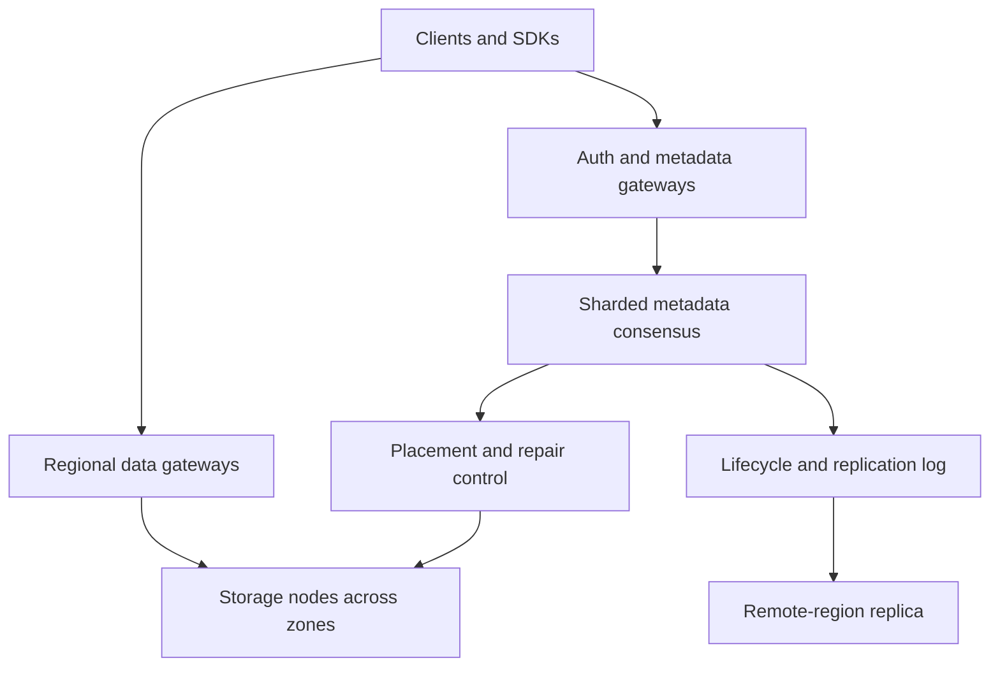

# System Design Interview Practice: Distributed Object Storage

**Difficulty:** Advanced / Infrastructure  
**Primary themes:** metadata/data-plane separation, multipart uploads, strong per-key consistency, immutable versions, quorum commits, checksums, replication, erasure coding, placement, degraded reads, repair, garbage collection, lifecycle tiers, and disaster recovery

> **Interview timing vs. this walkthrough:** In a 45-minute interview, spend about 5 minutes on requirements, 2 minutes on entities, 5 minutes on APIs, 10–15 minutes making one `PUT` and `GET` correct, and 10–15 minutes on durability/erasure coding, metadata consistency, and repair. This walkthrough is intentionally more detailed. In the interview, begin with replication across three zones; evolve cold data to erasure coding only after the complete write/read path is clear.

This answer follows Hello Interview’s public framework: clarify scope, identify entities and interfaces, build a complete baseline operation by operation, and reserve complexity for deep dives tied to explicit requirements. genui{"citation":{"ref":"turn95search22"}} Hello Interview’s large-blob guidance emphasizes direct multipart transfer, keeping bytes outside ordinary databases, and reasoning explicitly about metadata/blob consistency. genui{"citation":{"refs":["turn96search35","turn96search37","turn96search43"]}} The design, calculations, dialogue, and failure analysis below are original.

---

## Interviewer prompt

> Design a multi-tenant object storage service similar to Amazon S3. Clients create buckets and store immutable or versioned objects from bytes to multi-terabyte size. Support multipart upload, byte-range reads, listing by prefix, conditional writes, deletes, lifecycle policies, checksums, encryption, and optional cross-region replication. The service must provide extremely high durability, strong per-key consistency, high availability, and automatic recovery from disks, nodes, and availability-zone failures.

## Targeted clarifying questions with assumed interviewer answers

**Candidate:** What operations and object sizes are in scope?

**Interviewer:** Create/delete buckets; put, get, head, delete, and list objects; multipart upload; byte ranges; conditional requests; versioning; lifecycle transitions. Objects range from zero bytes to 5 TB, with a 1 MB median and 50 MB mean.

**Candidate:** What scale should I design for?

**Interviewer:** 100 exabytes stored, 10 trillion object versions, 5 million reads/s, 1 million writes/s, and 100 million requests/s at the edge for cached/public content.

**Candidate:** What consistency is required?

**Interviewer:** Within a region, successful PUT, overwrite, and DELETE must be strongly consistent for GET, HEAD, and LIST. A key update is atomic: readers see the old version or new version, never partial data. Multipart parts stay invisible until completion.

**Candidate:** What durability and availability targets matter?

**Interviewer:** Target eleven nines annual durability for committed objects, 99.99% availability for standard storage, and survival of one availability-zone failure without data loss. Acknowledged writes must already cross failure domains.

**Candidate:** Should we use replication or erasure coding?

**Interviewer:** Start with replication for the hot write path. Discuss erasure coding for cost efficiency, including degraded reads and repair. Very small objects may use a different packing policy.

**Candidate:** Do clients upload through application servers?

**Interviewer:** No. The control API authenticates and creates scoped upload capabilities; bytes go directly to storage gateways. The service itself is the blob store, so do not hand-wave to another object store.

**Candidate:** How does versioning work?

**Interviewer:** If enabled, overwrites create immutable versions and DELETE creates a delete marker. If disabled, the visible pointer changes atomically and old physical data is reclaimed asynchronously.

**Candidate:** Is global strong consistency required?

**Interviewer:** No. Each bucket has a home region with strong regional behavior. Optional cross-region replication is asynchronous with observable lag. A promoted region must be fenced.

**Candidate:** What security controls are expected?

**Interviewer:** Tenant-derived authorization, bucket policies, short-lived scoped capabilities, encryption in transit and at rest, tenant-managed keys where requested, audit logs, retention locks, and no raw credentials in URLs or logs.

**Candidate:** Are arbitrary metadata queries required?

**Interviewer:** No. Lookup by bucket/key/version and lexicographic listing by prefix are enough. Tags can feed asynchronous inventory/index jobs.

### Scope statement to say aloud

> “I’ll separate a strongly consistent metadata plane from an immutable data plane. A PUT receives an upload ID and scoped capabilities, streams checksummed parts directly to storage nodes across zones, then atomically commits an object-version manifest only after the durability policy is met. GET resolves the current manifest and streams healthy fragments, using range indexes and reconstruction only when necessary. Overwrites and deletes change metadata atomically; physical bytes are reclaimed later through reachability-based garbage collection. I’ll begin with three replicas, then move sealed cold objects to erasure coding while preserving version and checksum semantics.”

---

## 1. Requirements (~5 minutes)

### Three core functional requirements

1. **Store and retrieve objects.** Provide atomic PUT/GET/HEAD/DELETE, multipart upload, byte-range reads, checksums, conditional requests, versioning, and prefix listing.
2. **Manage durability and placement.** Distribute fragments across failure domains, verify integrity, repair loss/corruption, rebalance capacity, and support replicated or erasure-coded layouts.
3. **Manage lifecycle and recovery.** Transition objects between hot/cold tiers, expire data safely, support retention/object lock, asynchronous cross-region replication, inventory, and disaster recovery.

### Quantified non-functional requirements

| Property | Target | Design implication |
|---|---:|---|
| Stored logical data | 100 EB | Hierarchical placement and erasure coding |
| Object versions | 10T | Sharded metadata and compact manifests |
| Peak reads | 5M/s origin; far more through CDN | Stateless gateways, range reads, caches |
| Peak writes | 1M/s | Direct streaming, parallel fragments, batched metadata |
| Object size | 0 B–5 TB | Single-put plus resumable multipart |
| Standard durability | 99.999999999% annually | Cross-zone redundancy, scrubbing, repair, checksums |
| Standard availability | 99.99% | Multi-AZ gateways/metadata/data placement |
| PUT/GET latency | Small-object p99 < 100 ms regionally | Avoid WAN and synchronous cold-tier conversion |
| Consistency | Strong GET/HEAD/LIST after committed PUT/DELETE | Consensus-backed per-key metadata commit |
| Zone failure | No committed data loss | Ack only after independent failure-domain threshold |
| Cross-region RPO | Seconds/minutes depending policy | Async manifest/data replication with lag tracking |

Amazon documents strong read-after-write behavior for S3 PUT and DELETE, including atomic single-key updates where readers observe old or new data rather than partial content. genui{"citation":{"ref":"turn96search0"}} That is the regional contract modeled here, not evidence about our implementation.

### Consistency, durability, and availability contract

- A successful PUT means all required fragments are durably stored across the configured failure domains and one immutable object-version manifest is committed.
- GET/HEAD after success returns that version unless a later strongly consistent overwrite/delete won.
- Readers never see uncommitted multipart parts or a partially assembled version.
- Conditional writes (`If-Match`, `If-None-Match`) compare and commit in the same metadata transaction.
- LIST reflects committed key namespace mutations in the home region, including deletes, under the stated strong-consistency target.
- Object bytes are immutable. Overwrite publishes a new version/pointer; it never mutates fragments in place.
- A DELETE in a versioned bucket writes a delete marker. In an unversioned bucket it atomically hides the current object, then garbage collection reclaims bytes after safety horizons.
- Retention locks are enforced by the authoritative metadata state machine, not a cache or client flag.
- If the regional durability threshold cannot be met, PUT fails rather than acknowledging a weaker layout silently.
- Degraded reads may reconstruct from remaining fragments; availability can continue while repair restores redundancy.
- Cross-region replicas may lag. A remote read exposes its replication checkpoint; failover uses a higher bucket-writer epoch to fence the old home.

### Out of scope

- POSIX filesystem semantics, in-place block writes, file locking, or directories
- Arbitrary queries over object contents
- CDN implementation, though object responses can integrate with one
- Global synchronous consistency by default
- Editing multipart parts after object completion
- Treating replication as protection from authorized accidental deletion without versioning/backup policy

### Scale estimates that change design decisions

With 100 EB logical data, three full replicas require roughly:

```text
100 EB × 3 = 300 EB physical before operational headroom
```

A Reed–Solomon layout with 10 data and 4 parity fragments has:

```text
storage overhead = (10 + 4) / 10 = 1.4×
100 EB × 1.4 = 140 EB before headroom
```

That savings justifies erasure coding for sealed/cold objects, but it costs CPU, cross-node reads, and expensive repair. Hot objects can remain replicated until access cools.

At 10 trillion versions, even a compact 1 KB metadata record costs:

```text
10T × 1 KB ≈ 10 PB metadata before replication/indexes
```

Metadata is itself a massive distributed database. It must be partitioned by bucket and key range/hash; one relational primary cannot hold it.

At one million writes/s and 50 MB average object size, logical ingress would be an impossible sustained 50 TB/s if every write were average-sized. This tells us the workload distribution is heavy-tailed and QPS/bytes must be modeled separately. Suppose only 1% are 5 GB large objects while the other 99% average 1 MB:

```text
990K/s × 1 MB ≈ 990 GB/s
10K/s × 5 GB  ≈ 50 TB/s
```

Even this is enormous: the stated peak must represent a fleet-wide hyperscale service, requiring regional partitioning, admission quotas, and direct parallel transfer. No centralized proxy or checksum service can touch every byte.

For a 5 TB object with 128 MB parts:

```text
5 TB / 128 MB ≈ 40,960 parts
```

The upload manifest needs paginated part metadata and batched completion validation. A 10,000-part API limit would require larger parts, roughly 512 MB, for the maximum object.

**What to say aloud:**

> “Three copies would turn 100 exabytes into 300 exabytes, while a 10+4 code is about 1.4×, so hot replication plus cold erasure coding is economically meaningful. Ten trillion versions also means metadata alone is petabytes, so the namespace must be sharded. Finally, QPS and byte throughput are separate capacity dimensions; direct multipart streaming is mandatory.”

---

## 2. Core entities (~2 minutes)

| Entity | Essential fields |
|---|---|
| `Tenant` | Identity, quotas, billing class, encryption policy, status |
| `Bucket` | Owner, home region, versioning, policy, lifecycle, writer epoch |
| `ObjectKey` | Bucket, canonical key bytes, current visible version/delete marker |
| `ObjectVersion` | Version ID, size, checksum, content type, encryption info, manifest, timestamps |
| `UploadSession` | Upload ID, key, expected conditions, checksum mode, expiry, state |
| `Part` | Upload, part number, byte length, checksum, temporary fragment references |
| `Manifest` | Encoding/layout version, fragment IDs, offsets, placement generation |
| `Fragment` | Fragment ID, node/disk, zone, checksum, length, health |
| `StorageNode` | Failure domain, capacity, load, generation, health |
| `PlacementPolicy` | Replication/EC scheme, required domains, tier, constraints |
| `DeleteMarker` | Key/version, commit sequence, retention and GC horizons |
| `ReplicationRecord` | Source version, destination region, state, checkpoint |

An object key names a logical slot. An object version is immutable. A manifest maps that version to physical fragments. This indirection lets repair or tiering replace fragment placement without changing the user-visible version.

---

## 3. API and system interface (~5 minutes)

The gateway derives tenant identity, allowed buckets/actions, quota class, and encryption authorization from credentials. Clients never choose storage nodes, placement groups, fragment IDs, or internal encryption keys.

### 3.1 Initiate multipart upload

```http
POST /v1/buckets/media/objects:beginMultipart
Authorization: Bearer <service-token>
Idempotency-Key: video-771-upload-v1
Content-Type: application/json

{
  "key":"raw/2026/10/video-771.mov",
  "content_type":"video/quicktime",
  "expected_size":536870912000,
  "checksum":{"algorithm":"SHA256","type":"FULL_OBJECT"},
  "encryption":{"mode":"TENANT_MANAGED_KEY","key_id":"key_42"},
  "condition":{"if_none_match":"*"}
}
```

```json
{
  "upload_id":"upl_901",
  "part_size":134217728,
  "expires_at":"2026-10-15T06:05:00Z",
  "capability_endpoint":"/v1/uploads/upl_901/parts:authorize"
}
```

### 3.2 Authorize and upload parts

```http
POST /v1/uploads/upl_901/parts:authorize
Authorization: Bearer <service-token>
Content-Type: application/json

{"parts":[1,2,3],"lengths":[134217728,134217728,134217728]}
```

The response returns short-lived capabilities scoped to upload ID, exact part number, maximum length, checksum algorithm, destination gateway, and expiry.

```http
PUT /data/v1/uploads/upl_901/parts/1
Authorization: UploadCapability <opaque-token>
X-Checksum-SHA256: <base64-checksum>
Content-Length: 134217728

<bytes>
```

```json
{"part_number":1,"etag":"prt_1_7af...","checksum":"sha256:..."}
```

The gateway computes the checksum while streaming and requires storage-node acknowledgements before returning a part receipt. S3 likewise supports part-level and full-object checksums and independently verifies transmitted data. genui{"citation":{"refs":["turn96search1","turn96search2"]}}

### 3.3 Complete multipart upload

```http
POST /v1/uploads/upl_901:complete
Authorization: Bearer <service-token>
Idempotency-Key: complete-video-771-v1
Content-Type: application/json

{
  "parts":[
    {"number":1,"etag":"prt_1_7af..."},
    {"number":2,"etag":"prt_2_a21..."}
  ],
  "full_checksum":"sha256:..."
}
```

```json
{
  "bucket":"media",
  "key":"raw/2026/10/video-771.mov",
  "version_id":"ver_884",
  "etag":"obj_31b...",
  "size":268435456,
  "state":"COMMITTED"
}
```

Completion validates ownership, part ordering/lengths/checksums, upload state, key condition, and durability. It commits exactly one immutable manifest and visible namespace mutation. Retrying returns the same version/result.

### 3.4 Single PUT

```http
PUT /v1/buckets/config/objects/app.json
Authorization: Bearer <service-token>
Idempotency-Key: app-config-92
If-Match: "obj_old"
X-Checksum-SHA256: <checksum>
Content-Type: application/json

{"feature":true}
```

Small objects may stream through a gateway in one request, but use the same internal staged-data-then-manifest-commit protocol.

### 3.5 GET and range GET

```http
GET /v1/buckets/media/objects/raw/2026/10/video-771.mov
Authorization: Bearer <service-token>
Range: bytes=1048576-2097151
If-None-Match: "obj_31b..."
```

```http
HTTP/1.1 206 Partial Content
ETag: "obj_31b..."
X-Version-Id: ver_884
X-Checksum-SHA256: <full-object-checksum>
Content-Range: bytes 1048576-2097151/268435456

<bytes>
```

For public/cached content, a control-plane authorization service may issue a short-lived signed GET capability. The data gateway still validates bucket policy epoch, object/version scope, method, range limits, and expiry.

### 3.6 HEAD and conditional metadata

```http
HEAD /v1/buckets/media/objects/raw/2026/10/video-771.mov?version_id=ver_884
Authorization: Bearer <service-token>
```

Returns committed size, checksum, version, content type, last modified, retention state, and user metadata without object bytes.

### 3.7 DELETE

```http
DELETE /v1/buckets/media/objects/raw/2026/10/video-771.mov
Authorization: Bearer <service-token>
Idempotency-Key: delete-video-771
If-Match: "obj_31b..."
```

In a versioned bucket, this commits a delete marker. Deleting a particular version is a separate privileged API and is rejected while retention/legal hold applies.

### 3.8 LIST by prefix

```http
GET /v1/buckets/media/objects?prefix=raw/2026/10/&delimiter=/&limit=1000&cursor=<opaque>
Authorization: Bearer <service-token>
```

The signed cursor binds bucket, prefix, delimiter, last key, namespace shard/version, and expiry. It must not allow a caller to switch tenants or broaden the prefix.

### Important errors

| Error | Meaning |
|---|---|
| `400` | Invalid key, range, part order, checksum mode, or metadata |
| `403` | Policy/KMS/retention authorization failure |
| `404` | No visible key/version |
| `409` | Idempotency mismatch, upload state conflict, or bucket transition |
| `412` | Conditional ETag/version precondition failed |
| `413` | Object/part/metadata exceeds limit |
| `416` | Unsatisfiable byte range |
| `429` | Tenant/bucket/partition admission throttled |
| `CHECKSUM_MISMATCH` | Bytes do not match supplied integrity value |
| `DURABILITY_UNAVAILABLE` | Required failure-domain acknowledgements unavailable |
| `UPLOAD_EXPIRED` | Session can no longer accept/complete parts |

---

## 4. Data flow

### PUT/complete flow

1. Authenticate, authorize bucket/key/action, validate conditions and quotas.
2. Metadata service creates a pending upload session and placement plan generation.
3. Client streams parts to data gateways using scoped capabilities.
4. Gateways checksum and split/replicate bytes to selected storage nodes across zones.
5. Nodes fsync or meet the configured durable-media boundary and return signed receipts.
6. Completion verifies all part receipts and reconstructs/computes the full-object checksum.
7. Metadata shard atomically commits `ObjectVersion`, manifest, current-key pointer, idempotency result, and change/outbox event.
8. Only then is the version visible to GET/LIST.
9. Temporary part references become committed; unused parts expire through garbage collection.

### GET flow

1. Gateway authorizes request and resolves bucket/key/version from the metadata shard.
2. Manifest cache supplies fragment layout, checksum, encryption, and placement generation.
3. Range planner maps requested bytes to data/fragment offsets.
4. Gateway chooses nearby healthy replicas/fragments using latency/load.
5. Storage nodes return checksummed blocks; gateway verifies, decrypts if server-side, and streams.
6. On missing/corrupt fragments, degraded read fetches enough surviving fragments to reconstruct.
7. Corruption/missing evidence creates a high-priority repair event.

### DELETE/lifecycle flow

1. Metadata transaction checks ETag, retention, legal hold, and versioning.
2. Commit delete marker or hidden state atomically.
3. Emit namespace, replication, audit, and lifecycle events from an outbox.
4. GC later proves no live manifest, snapshot, replica obligation, or retention reference remains.
5. Fragment deletion is idempotent and audited.

---

## 5. High-level design (~10–15 minutes)

### Compact architecture



### Operation 1: one-node PUT and GET

Start with one server writing bytes to a local file and metadata to a local map. Use a temporary file, checksum it, fsync, then atomically rename/publish metadata. GET reads the file by key.

This illustrates the atomic-publication rule but fails every scale and failure requirement.

### Operation 2: separate metadata from bytes

Metadata operations are tiny and coordination-heavy. Data transfer is huge and bandwidth-heavy. Split them:

- **metadata plane:** buckets, namespace, versions, manifests, policies, upload sessions;
- **data plane:** streaming, fragment storage, range reads, checksums;
- **control plane:** placement, membership, balancing, repair, lifecycle.

Metadata sharding key can be `(bucket_id, hash_or_range(key))`. Prefix LIST prefers ordered ranges; pure hashing balances better. A practical design assigns each bucket to many ordered key-range tablets, splits hot/large tablets, and distributes tablets across metadata consensus groups.

Large single buckets therefore scale while retaining ordered prefix scans.

### Operation 3: replicate bytes across zones

For the baseline, placement chooses three storage nodes in distinct zones/power/network domains. A part becomes durable after all three or a policy-defined quorum that still guarantees the advertised zone-loss behavior.

```text
gateway → zone A replica
        → zone B replica
        → zone C replica
```

Acknowledging only one local copy and “replicating later” cannot satisfy no-loss-after-success under node/zone failure.

Placement avoids correlated risks:

- same rack/power domain;
- same node generation/firmware batch where practical;
- nearly full or repair-overloaded nodes;
- too many fragments from one object on one failure domain.

### Operation 4: atomically publish a version

Bytes are staged first and invisible. Each node receipt binds:

```text
(upload_id, part, fragment_id, length, checksum,
 node_generation, durable_sequence, placement_generation)
```

The metadata leader verifies receipts and commits a manifest under consensus. The same transaction checks conditional ETags and moves the current-key pointer. Therefore two concurrent `If-Match` writers cannot both win.

A successful data upload whose metadata commit fails leaves orphaned staged fragments, not a visible partial object. GC reclaims them after upload/session and metadata-replay safety windows.

### Operation 5: multipart and resumability

Parts upload independently and may arrive out of order. `ListParts` returns committed receipts; a client retries only missing parts. Completion specifies the ordered part list, preventing an attacker or race from silently substituting uploaded bytes.

Upload-session state is itself replicated. Expiration moves it to `ABORTED`; a concurrent completion wins only through a state-machine compare-and-set.

Multipart completion should not concatenate terabytes. The object manifest logically concatenates part fragment ranges. Background compaction/tiering may later rewrite the physical layout.

### Operation 6: range reads

Manifest contains part/object offsets and fragment-stripe indexes. For replication, range GET reads only the replicas covering requested blocks. For erasure coding, align object chunks into stripes so small range reads do not require reconstructing the entire object.

Gateway hedges a slow read only after a latency threshold and within a duplicate-I/O budget. Immediate hedging doubles load and worsens incidents.

Cache immutable manifests by `(bucket, key, version_id, manifest_generation)`. The current-key pointer needs version-aware invalidation; immutable object bytes can be cached indefinitely under versioned URLs.

### Operation 7: prefix LIST

Metadata tablets keep keys ordered within a bucket range. LIST performs a bounded ordered scan and merges only adjacent tablets needed by the prefix. A cursor records last key and tablet routing version.

Strong LIST requires namespace commits and scans to share a consistency mechanism. Options:

- read from leaders at a common snapshot timestamp;
- carry a bucket/read timestamp and serve MVCC snapshots;
- restrict one page to stable tablet epochs and restart on split.

Choose MVCC snapshot tokens for stable pagination, with an expiry to bound retained history.

### Operation 8: add erasure coding

After an object is sealed and cool, a background encoder reads replicated chunks and produces a `k+m` stripe, for example 10 data plus 4 parity fragments. Any 10 surviving fragments reconstruct the stripe.

Safe transition:

1. create new EC placement generation;
2. encode and durably store all required fragments;
3. verify checksums and failure-domain placement;
4. atomically switch manifest generation;
5. retain old replicas through a rollback/grace window;
6. garbage-collect old layout.

Azure’s Local Reconstruction Codes research explains the central tradeoff: erasure coding lowers storage overhead, while code design can reduce repair I/O/bandwidth compared with conventional schemes. genui{"citation":{"ref":"turn96search26"}}

### Operation 9: lifecycle tiers and cross-region replication

Lifecycle workers scan committed metadata changes/inventory, not the raw disk namespace. Rules may:

- transition replicas to EC hot/cool/cold layouts;
- migrate to slower media;
- expire current/noncurrent versions;
- abort stale multipart uploads;
- replicate selected prefixes/versions.

Every action is an idempotent state transition with a manifest generation. Cross-region replication sends immutable data first, then commits the remote manifest and checkpoint. A delete marker is replicated as a versioned namespace mutation; physical delete does not race ahead of required remote versions.

---

## 6. Deep dives (~10–15 minutes)

### Deep dive A: durability math, erasure coding, degraded reads, and repair

#### Where the baseline breaks

Three replicas are fast and simple but cost 3×. Erasure coding reduces cost but a failed fragment can require many reads, network transfers, and CPU. Correlated failures, latent sector errors, and slow repair dominate durability more than a simplistic independent-disk probability calculation.

#### Replication versus erasure coding

| Layout | Storage overhead | Read path | Repair behavior | Good fit |
|---|---:|---|---|---|
| 3 replicas | 3× | One healthy copy | Copy one full fragment | New/hot/small objects |
| 6+3 EC | 1.5× | Six data fragments normally | Read surviving set, encode | Medium objects |
| 10+4 EC | 1.4× | Ten data fragments normally | Higher fanout/repair cost | Large sealed/cold objects |

Do not choose one layout for every size. Packing thousands of tiny objects into larger immutable containers amortizes checksums, indexes, and fragment overhead, but needs an index and compaction/GC story.

#### Durability is an operational system

Eleven nines cannot be credibly derived from replication factor alone. The model includes:

- annual disk/node/zone failure distributions;
- correlated rack/firmware/operator events;
- latent corruption discovery interval;
- mean time to repair and repair bandwidth;
- placement violations and capacity pressure;
- checksum strength and end-to-end verification;
- control-plane bugs and deletion policy;
- regional disasters for policies claiming protection.

AWS states S3 is designed for eleven nines durability and 99.99% availability for its standard class; treat this as a product benchmark, not something automatically obtained by copying a replica count. genui{"citation":{"refs":["turn96search13","turn96search21"]}}

#### Integrity layers

Use checksums at multiple boundaries:

1. client-to-gateway part checksum;
2. gateway-to-node frame checksum;
3. fragment/block checksum on disk;
4. full-object or composite checksum in immutable metadata;
5. periodic scrub recomputation;
6. repair verification before manifest/layout changes.

Checksum mismatch never becomes “best effort.” Quarantine the copy, read another fragment set, compare authoritative checksums, and enqueue repair.

#### Degraded reads

When a fragment is missing:

- first try another replica/layout generation if available;
- for EC, fetch any `k` suitable fragments;
- reconstruct only necessary stripe/range;
- return data after checksum validation;
- emit repair evidence asynchronously.

Limit concurrent reconstructions per node/rack. Otherwise one disk loss causes a read-amplification storm that takes healthy disks down.

#### Repair scheduling

Prioritize by risk, not FIFO:

1. objects below minimum recoverable threshold;
2. objects with correlated-domain exposure;
3. popular degraded objects;
4. standard under-replication;
5. placement optimization/rebalance.

Repair planner chooses sources/destinations, reserves network/disk tokens, rebuilds a fragment, verifies checksum, and atomically publishes the new placement generation before deleting obsolete references.

Research on erasure-coded storage repeatedly identifies repair I/O and bandwidth as major practical costs. genui{"citation":{"refs":["turn96search24","turn96search27"]}} This is why repair capacity must be reserved during normal operation.

#### Scrubbing

Background scrubbing reads cold blocks before a second failure exposes latent corruption. Schedule by last-verified time, media age, error history, and object durability margin. Scrub traffic is rate-limited but never disabled indefinitely by foreground load.

#### Observability

- bytes/objects by layout, tier, and durability margin
- under-replicated/unrecoverable object count
- fragment loss and checksum mismatch rate
- time since last scrub and repair coverage
- repair queue by risk, oldest age, and bytes
- degraded-read rate, reconstruction CPU, and amplification
- cross-zone/rack repair traffic
- placement-rule violations
- mean time to detect and repair
- durability-model inputs versus observed failure distributions

**What to say aloud:**

> “Replication is the simplest hot path, while 10+4 coding cuts storage from 3× to about 1.4× for sealed objects. But durability comes from independent placement, end-to-end checksums, frequent scrubbing, risk-prioritized repair, and reserved rebuild bandwidth—not the code parameters alone. Degraded reads reconstruct only needed stripes and are concurrency-limited to prevent a failure cascade.”

### Deep dive B: metadata consistency, concurrency, LIST, and garbage collection

#### Where the baseline breaks

If data nodes publish namespace entries independently, readers can observe partial uploads. If metadata commits before fragments are durable, a manifest points to missing data. Concurrent overwrites can lose updates. GC can delete staged or old-layout data still referenced by a delayed transaction, snapshot, or remote replica.

#### Metadata architecture choices

| Approach | Benefit | Limitation |
|---|---|---|
| One relational primary | Simple transactions | Cannot hold 10T versions or global load |
| Hash-sharded KV | Excellent point lookup | Prefix LIST requires scatter/gather |
| Ordered range tablets + consensus | Point and prefix access, online splits | More reconfiguration/MVCC complexity |

Choose ordered bucket-key tablets, each replicated by a consensus group. Large buckets span many tablets; small buckets share tablets. A directory maps bucket/key ranges to tablet epochs and replica groups.

#### Atomic commit invariant

The only visibility point is a metadata transaction:

```text
verify durable receipts
verify upload/session/key condition
insert immutable ObjectVersion + Manifest
update current ObjectKey pointer
record idempotency response
append namespace/change event
commit
```

Data may exist without metadata temporarily; metadata must never reference data below its durability contract.

#### Concurrent writes

Unconditional PUTs are serialized by metadata commit order; last committed version becomes current. Conditional writes compare ETag/version within the same transaction.

Multipart completion races:

- complete vs. abort: one upload-state compare-and-set wins;
- two completes with same idempotency key/hash: same result;
- same key, different uploads with `If-None-Match:*`: only one commit wins;
- delete vs. overwrite: metadata log order determines visible current version/delete marker.

#### Strong LIST

LIST is not just a cache over asynchronous events if the contract is strong. Use MVCC:

1. first page obtains a namespace read timestamp/snapshot token;
2. tablets serve keys visible at that timestamp;
3. cursor carries last key plus snapshot;
4. tablet split preserves MVCC history/routing lineage;
5. token expires after a bounded duration.

Long scans use inventory jobs rather than holding an online snapshot forever.

#### Garbage collection by reachability

GC candidates include:

- expired/aborted multipart parts;
- noncurrent versions past lifecycle retention;
- old placement generations after repair/tiering;
- objects hidden by unversioned delete;
- failed upload fragments.

Before deletion, prove:

- no committed manifest references the fragment generation;
- no in-flight transaction can still commit its receipt;
- upload/session grace elapsed;
- retention/legal hold permits deletion;
- required remote replication acknowledged;
- backup/snapshot lease does not reference it.

Use mark/reconcile/sweep epochs or reference manifests plus conservative grace periods. Physical deletion is idempotent. Leaked bytes are cheaper than premature data loss, so uncertainty defers deletion.

#### Metadata disaster recovery

Consensus replicas protect availability, not operator mistakes. Maintain immutable metadata-log backups/snapshots, test point-in-time restore, and bind manifests to data inventories. A restore tool must reconcile namespace time with fragment availability and remote-replication state.

#### Observability

- metadata commit/read/LIST p99 by tablet
- consensus election and unavailable quorum
- conditional conflict and idempotent replay rate
- tablet size/QPS, split/move progress, stale-route errors
- multipart completion/abort races
- namespace snapshot age and cursor restart rate
- orphan bytes by reason and age
- GC candidates deferred by retention/replication/snapshot
- dangling-manifest count—should be zero
- metadata backup age and restore-drill RPO/RTO

**What to say aloud:**

> “Bytes are staged first; one consensus-backed metadata transaction is the only visibility point. It verifies durable receipts, evaluates the key condition, writes an immutable version and manifest, changes the current pointer, and records the outbox/idempotency result. Ordered MVCC tablets give strong prefix LIST. Garbage collection is conservative reachability analysis across manifests, uploads, retention, snapshots, and remote replication.”

### Deep dive C: hotspots, small objects, caching, and multi-region failover

#### Where the baseline breaks

Hashing or range partitioning balances ordinary keys but one viral object can overload its storage nodes and gateway path. Billions of tiny objects waste per-file metadata and IOPS. Cross-region asynchronous replication creates split-brain risk during failover. Caches can serve deleted private content if authorization and versioning are mixed incorrectly.

#### Viral reads

Serve immutable versioned objects through layered caches:

- gateway manifest cache;
- storage-node block cache;
- regional cache/origin shield;
- external CDN for eligible content.

Cache key includes bucket, key, immutable version ID, range, and content encoding. Authorization is evaluated separately or represented by a short-lived capability. Overwrite creates a new versioned cache key. DELETE revokes current namespace access but old version URLs remain governed by policy/versioning/retention.

Use request coalescing for cold misses: one upstream fetch serves concurrent identical ranges. Hedge slow fragment reads only after a percentile threshold.

#### Hot write prefixes and metadata tablets

Monotonic keys can hotspot one ordered tablet. Mitigations:

- split tablets by load before size threshold;
- use more initial bucket partitions;
- recommend entropy in high-write prefixes;
- internally salt the routing prefix while maintaining a secondary ordered listing structure, if LIST cost is acceptable;
- isolate whale buckets.

The tradeoff is point/write distribution versus cheap lexicographic LIST. State it rather than claiming both are free.

#### Small-object packing

Writing each 1 KB object as 14 separate EC files is disastrous. Pack small immutable objects into larger container segments:

```text
Container(segment_id, generation, fragment_layout)
Entry(object_version -> offset, length, checksum)
```

Metadata points to the container range. Deleted entries become holes; background compaction copies live entries to a new container generation and atomically updates manifests before reclaiming the old one.

Tradeoffs:

- better sequential I/O and lower inode/fragment overhead;
- read amplification for poorly indexed containers;
- compaction cost and shared-fate blast radius;
- need per-entry checksums and immutable generation indexes.

#### Multi-region replication

Home region commits a version, then replication workers copy immutable fragments/objects and metadata mutation to the destination. Destination commits the remote manifest only after its durability threshold.

Track per-bucket replication sequence and expose:

- latest source commit;
- latest data-durable remote sequence;
- latest metadata-visible remote sequence;
- bytes/objects pending;
- failed/permanently blocked versions.

Delete markers and retention changes travel through the same ordered stream. Never delete the source solely because an event was enqueued; require destination acknowledgement and lifecycle policy.

#### Failover fencing

To promote a replica region:

1. freeze or determine old-home reachability;
2. acquire a higher bucket writer epoch in a global consensus service;
3. identify the remote committed checkpoint and explicit RPO gap;
4. route writes with the new epoch;
5. reject older-epoch mutations everywhere;
6. reconcile the returning region before it can write.

DNS alone does not prevent two homes from accepting conflicting overwrites/deletes.

#### Cache security

- signed capabilities are short-lived, method/range/version scoped;
- policy epoch can revoke high-risk access before token TTL where required;
- private responses are not stored in shared caches without an authorization-safe cache key;
- encryption keys are not cached with broader scope than ciphertext access;
- object metadata avoids leaking tenant names or raw keys in shared logs;
- purge is a defense-in-depth operation, not the sole authorization mechanism.

#### Observability

- hottest object/key/prefix QPS and bandwidth share
- origin-shield/CDN/block/manifest cache hit rate
- coalesced and hedged request rate
- metadata tablet skew and split lag
- small-object container utilization and compaction debt
- read amplification per packed object
- cross-region replication time/bytes/checkpoint lag
- promotion writer epoch and RPO gap
- stale capability/policy rejection and private-cache incidents
- source deletion blocked on destination durability

**What to say aloud:**

> “Immutable version IDs make viral reads cacheable and safe to coalesce, while authorization remains separate and short-lived. Tiny objects are packed into immutable containers with per-entry checksums and generation-based compaction. Cross-region replication copies data before committing remote metadata, and promotion requires a globally fenced bucket epoch plus an explicit RPO checkpoint—not just DNS.”

---

## 7. Finish

### Concise final design

The service separates strongly consistent namespace metadata from immutable object bytes. Authenticated control gateways manage buckets, policies, upload sessions, conditions, and short-lived capabilities. Clients stream single or multipart data directly through regional data gateways to storage nodes selected across independent zones.

Gateways validate end-to-end checksums and collect durable receipts. A consensus-backed metadata tablet atomically verifies receipts and conditions, commits an immutable object-version manifest, changes the visible key pointer, stores the idempotency result, and appends lifecycle/replication events. Until that commit, staged bytes are invisible. GET resolves a manifest, plans byte ranges, streams nearby healthy fragments, verifies blocks, and reconstructs only necessary EC stripes during degradation.

New/hot objects begin with three replicas for low-latency writes and repairs. Lifecycle workers safely convert sealed/cold versions to erasure-coded layouts such as 10+4 by publishing a new verified manifest generation before retiring replicas. Checksums at transport, block, fragment, and object boundaries plus continuous scrubbing detect corruption. Risk-prioritized repair restores redundancy using reserved network/disk capacity.

Ordered, MVCC metadata tablets provide point operations and strong prefix LIST while splitting hot/large ranges. Versioning and delete markers make namespace changes atomic; conservative reachability GC waits for upload, retention, snapshot, repair-generation, and remote-replication horizons. Small objects may be packed into immutable containers.

Immutable version IDs support block/regional/CDN caching and request coalescing without confusing authorization. Optional cross-region replication copies bytes before remote manifest commit and exposes lag. Failover promotes a higher bucket-writer epoch, fences the old home, and states the RPO explicitly.

### Requirements check

| Requirement | Design support |
|---|---|
| PUT/GET/HEAD/DELETE | Metadata-controlled immutable versions and manifests |
| Multipart/resume | Durable sessions, independent part receipts, atomic complete |
| 5 TB objects | Large bounded parts and logical manifest concatenation |
| Range GET | Offset/stripe indexes and selective fragment reads |
| Checksums | Client, transport, block, fragment, and full-object layers |
| Strong per-key consistency | Consensus metadata commit and conditional CAS |
| Strong LIST | Ordered MVCC tablets and snapshot cursors |
| Atomic overwrite/delete | New version/delete marker pointer transaction |
| Zone-loss durability | Cross-zone receipt threshold before acknowledgement |
| Eleven-nines target | Placement, redundancy, scrubbing, repair, monitoring |
| 100 EB efficiency | Hot replication plus cold erasure coding |
| Small objects | Immutable container packing and compaction |
| Viral reads | Versioned caches, origin shield, request coalescing |
| Lifecycle/retention | Idempotent manifest transitions and lock-aware GC |
| Cross-region | Data-first async replication and observable checkpoints |
| Regional failover | Globally fenced bucket writer epoch |
| Security | Derived identity, scoped capabilities, encryption, audit |

## Realistic interviewer follow-up questions with strong sample answers

**Interviewer:** Why separate metadata and data planes?

**Candidate:** Metadata needs tiny strongly coordinated transactions and ordered namespace access; data needs enormous streaming bandwidth and mostly immutable storage. Separating them lets each scale and fail independently while manifests connect them.

**Interviewer:** Why upload data before committing metadata?

**Candidate:** It is safe to have temporarily orphaned invisible bytes. It is unsafe to publish a manifest before enough durable fragments exist. The metadata commit is the sole visibility point.

**Interviewer:** What if data upload succeeds but completion crashes?

**Candidate:** Retrying completion with the same idempotency key and part manifest returns the same committed version or safely attempts the same transaction. If never completed, upload expiry and conservative GC reclaim staged fragments.

**Interviewer:** What if completion commits but the response is lost?

**Candidate:** The idempotency record is committed with the object version. Retry returns the original version ID, ETag, and checksum rather than publishing another version.

**Interviewer:** Why are object bytes immutable?

**Candidate:** Immutability makes checksums, caching, replication, repair, and concurrent reads tractable. An overwrite publishes a new manifest/version atomically instead of mutating blocks readers may be using.

**Interviewer:** Why not store metadata in one SQL database?

**Candidate:** Ten trillion versions can mean petabytes of metadata and millions of operations per second. We need sharded range tablets with replication and online splitting, while preserving per-key transactions and prefix scans.

**Interviewer:** Why not hash all keys for perfect balance?

**Candidate:** Pure hashing makes prefix LIST a scatter/gather across all shards. Ordered ranges make LIST efficient but can hotspot monotonic prefixes. I choose ordered tablets with load-based splits and documented key-distribution guidance.

**Interviewer:** How is a multipart object assembled without copying 5 TB?

**Candidate:** Completion writes a logical manifest that concatenates ordered part ranges. Reads follow offsets across part fragments. Background tiering may later rewrite it into larger EC stripes.

**Interviewer:** When is a PUT acknowledged?

**Candidate:** Only after required data fragments are durable across the configured failure domains and the object-version manifest is consensus committed. If that threshold is unavailable, the PUT fails.

**Interviewer:** Why start with replication before erasure coding?

**Candidate:** Replication has simple low-latency writes, reads, and repairs. Erasure coding saves major capacity for sealed data but adds encoding, fanout, degraded-read, and repair costs. It is an optimization after correctness.

**Interviewer:** What does 10+4 erasure coding mean?

**Candidate:** Split a stripe into ten data fragments and compute four parity fragments. Any ten of the fourteen reconstruct the stripe, yielding about 1.4× storage overhead before other headroom.

**Interviewer:** Does 10+4 automatically give eleven nines?

**Candidate:** No. Durability also depends on correlated placement, failure rates, latent corruption detection, repair time/capacity, software/operator errors, and regional policy. Coding parameters are only one model input.

**Interviewer:** How do you detect silent corruption?

**Candidate:** End-to-end immutable checksums, per-block/fragment checksums, validation on read/repair, and background scrubbing. A mismatch quarantines the copy and triggers reconstruction from independently verified fragments.

**Interviewer:** What prevents a repair from corrupting an object?

**Candidate:** Reconstruct into a new fragment/generation, verify against immutable stripe/object checksums, then atomically update placement metadata. Never overwrite the last known-good fragment in place.

**Interviewer:** How does strong LIST work?

**Candidate:** Keys live in ordered MVCC tablets. The first page obtains a bounded snapshot timestamp; subsequent cursors retain it and the last key, so committed namespace state is stable across pages and tablet splits.

**Interviewer:** How do deletes work with versioning?

**Candidate:** DELETE commits a new delete-marker version, hiding prior versions from unversioned GET. Older versions remain directly addressable until an authorized, retention-compliant version delete/lifecycle action removes them.

**Interviewer:** Why is garbage collection dangerous?

**Candidate:** A fragment may still be referenced by an in-flight completion, old manifest generation, snapshot, retention rule, or lagging remote replica. Uncertainty must defer deletion; leaked bytes are safer than irreversible loss.

**Interviewer:** How do you serve a viral object?

**Candidate:** Immutable versioned URLs allow regional/CDN caching, block caches, and request coalescing. The cache key includes version and range; authorization remains short-lived and independently validated.

**Interviewer:** How do you store billions of tiny objects?

**Candidate:** Pack them into immutable container segments with per-entry offsets and checksums. Deletes create holes; compaction writes a new generation and atomically repoints live manifests before reclaiming the old container.

**Interviewer:** Can remote regions serve strong reads?

**Candidate:** Not under the default asynchronous contract. They can expose a replication checkpoint or route strong reads to the home region. Promotion fences the old writer and accepts an explicit RPO gap.

**Interviewer:** What would you build first?

**Candidate:** One region, sharded consensus metadata, direct single/multipart gateways, three cross-zone replicas, atomic manifests, checksums, GET/range/LIST, and basic repair. Then add lifecycle EC, small-object packing, retention, inventory, and cross-region replication.

## Common pitfalls

1. Uploading multi-terabyte objects through application servers.
2. Saying “use S3” when the interview asks you to design object storage.
3. Mixing metadata coordination and byte streaming in one service.
4. Publishing metadata before fragments meet durability.
5. Exposing multipart parts before completion.
6. Concatenating a multi-terabyte object synchronously at completion.
7. Retrying completion without idempotency.
8. Evaluating `If-Match` separately from metadata commit.
9. Mutating object bytes in place during overwrite.
10. Acknowledging one local copy and replicating later despite a zone-durability promise.
11. Placing replicas/fragments in correlated failure domains.
12. Claiming eleven nines from replica/code count alone.
13. Using three replicas for all 100 EB without cost discussion.
14. Using erasure coding for every tiny/hot write without latency discussion.
15. Ignoring degraded-read and repair amplification.
16. Letting repair consume all foreground disk/network capacity.
17. Disabling scrubbing indefinitely during load.
18. Trusting disk checksums without end-to-end object checksums.
19. Replacing the last good fragment in place during repair.
20. Hash-sharding metadata while claiming cheap ordered prefix LIST.
21. Range-sharding metadata while ignoring hot sequential prefixes.
22. Keeping ten trillion versions in one primary database.
23. Caching mutable current-key pointers without version invalidation.
24. Treating a cache purge as authorization.
25. Sharing private cached responses under incomplete cache keys.
26. Deleting physical bytes synchronously with namespace DELETE.
27. Garbage-collecting without upload/snapshot/replication horizons.
28. Treating live replicas as backup against accidental deletion.
29. Ignoring retention/legal hold during lifecycle and repair cleanup.
30. Deleting a source after merely enqueueing remote replication.
31. Replicating delete events ahead of the object version they reference.
32. Promoting a region with DNS only and no writer fencing.
33. Hiding the cross-region RPO gap.
34. Failing to distinguish object version from placement generation.
35. Storing one tiny object per EC fragment/file.
36. Packing small objects without compaction or per-entry checksums.
37. Hedging every read immediately and doubling load.
38. Monitoring capacity but not durability margin and repair age.
39. Backing up metadata without testing manifest/data reconciliation.
40. Designing lifecycle tiers before a correct PUT/GET path.

## A polished 60-second close

> “I split strongly consistent namespace metadata from immutable object bytes. Clients receive short-lived upload capabilities and stream checksummed parts directly to regional gateways, which place replicas across zones. Completion verifies durable receipts and conditions, then one consensus transaction publishes an immutable object version and manifest; that commit is the only visibility point. GET resolves the manifest, performs selective range reads, validates blocks, and reconstructs degraded EC stripes when necessary. Hot data begins with three replicas; lifecycle workers safely publish verified 10+4 erasure-coded generations for cold data, reducing overhead from 3× to about 1.4×. End-to-end checksums, scrubbing, risk-prioritized repair, and reserved rebuild bandwidth provide the durability system. Ordered MVCC metadata tablets support strong LIST, while conservative reachability GC respects uploads, versions, locks, snapshots, and remote replication. Immutable versions enable safe caches and tiny objects can be container-packed. Cross-region replication is asynchronous and failover requires a higher fenced bucket-writer epoch with an explicit RPO.”

## References

- [Hello Interview: System Design Delivery Framework](https://www.hellointerview.com/learn/system-design/in-a-hurry/delivery)
- [Hello Interview: Handling Large Blobs](https://www.hellointerview.com/learn/system-design/patterns/large-blobs)
- [AWS: Amazon S3 Data Consistency Model](https://docs.aws.amazon.com/AmazonS3/latest/userguide/Welcome.html)
- [AWS: Checking Object Integrity for Uploads](https://docs.aws.amazon.com/AmazonS3/latest/userguide/checking-object-integrity-upload.html)
- [AWS: Multipart Upload Overview](https://docs.aws.amazon.com/AmazonS3/latest/userguide/mpuoverview.html)
- [AWS: Amazon S3 Data Protection and Durability](https://docs.aws.amazon.com/AmazonS3/latest/userguide/DataDurability.html)
- [USENIX: Erasure Coding in Windows Azure Storage](https://www.usenix.org/conference/atc12/technical-sessions/presentation/huang)
- [USENIX: Boosting Full-Node Repair in Erasure-Coded Storage](https://www.usenix.org/conference/atc21/presentation/lin)
- [USENIX: Repair Pipelining for Erasure-Coded Storage](https://www.usenix.org/conference/atc17/technical-sessions/presentation/li-runhui)
