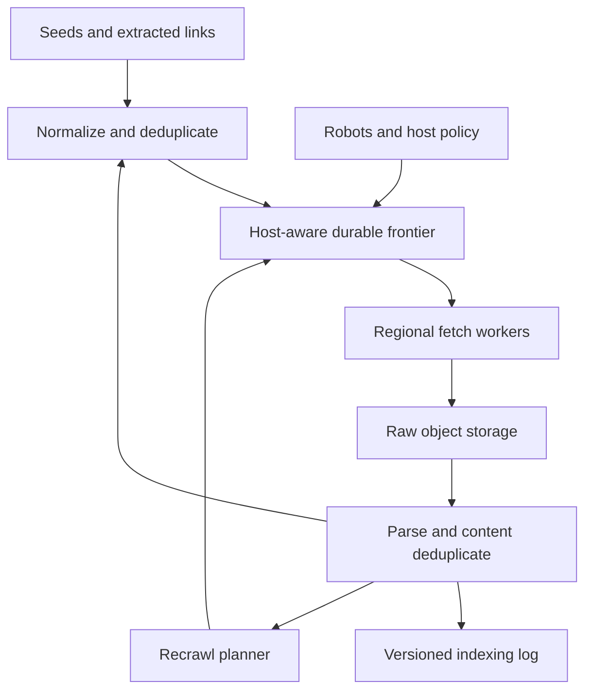

# System Design Interview Practice: Distributed Web Crawler and Fresh Indexing Pipeline

**Difficulty:** Senior / Advanced  
**Primary themes:** distributed queues, host-aware scheduling, deduplication, caching, reliability, eventual consistency, storage pipelines, security, and freshness

> **Interview timing vs. this walkthrough:** In a 45-minute interview, spend about 5 minutes on requirements, 2 minutes on entities, 5 minutes on interfaces and data flow, 10–15 minutes building a complete crawler, and 10–15 minutes on the URL frontier, duplicate/trap defense, and freshness/reliability. This study version is intentionally more detailed. In the room, first make one polite crawl loop work end to end; then evolve it at the bottlenecks.

This walkthrough uses Hello Interview’s delivery sequence: narrow the requirements, name the core entities, define system interfaces, build a simple working design one requirement at a time, and spend the remaining time on the non-functional requirements that actually stress it. genui{"citation":{"ref":"turn85search2"}} Hello Interview categorizes the web crawler problem as hard and emphasizes reasoning through the crawl loop rather than guessing one uniquely correct architecture. genui{"citation":{"ref":"turn85search1"}} The scenario, scale, dialogue, and design below are original.

---

## Interviewer prompt

> Design a distributed web crawler for a public-web search engine. Starting from seed URLs and discovered links, it should fetch pages without overwhelming sites, retain raw content, extract useful documents and links, and continuously refresh a search index. The crawler must operate at Internet scale and behave safely when pages, hosts, workers, or regions fail.

## Targeted clarifying questions with assumed interviewer answers

**Candidate:** Is the output only a raw corpus, or do we need a searchable index?

**Interviewer:** Include the crawl and indexing pipeline. Query serving and ranking are out of scope; your output is a versioned document stream ready for an inverted-index builder.

**Candidate:** Which content and protocols are in scope?

**Interviewer:** Public HTTP and HTTPS. Prioritize HTML and text-like documents. Store metadata for redirects and unsupported types. JavaScript rendering, authenticated pages, images, and video are out of scope for the baseline.

**Candidate:** How much of the web and what traffic should I design for?

**Interviewer:** Track five billion canonical URLs. Fetch one billion pages per day on average, with 100,000 fetches per second at peak. An ordinary response averages 100 KB after transfer compression; reject bodies over 10 MB unless an allowlist says otherwise.

**Candidate:** What freshness matters?

**Interviewer:** Ninety percent of high-priority news pages should be fetched and available to indexing within five minutes of discovery or predicted change. Popular pages should refresh within an hour. Stable long-tail pages may refresh weekly or monthly.

**Candidate:** What does “polite” mean?

**Interviewer:** Honor `robots.txt`, identify the crawler, apply per-host concurrency and delay limits, back off on `429` and `5xx`, and adapt to host latency. Never let fleet size multiply pressure on one host.

**Candidate:** Is duplicate fetching acceptable?

**Interviewer:** At-least-once work delivery is fine, so duplicate fetch attempts can occur. Duplicate URLs and duplicate content should be suppressed before they create major cost. Index publication must be idempotent by document version.

**Candidate:** Do we crawl every discovered URL?

**Interviewer:** No. Prioritize useful, fresh, reachable public pages. Defend against calendars, faceted navigation, session IDs, generated paths, and other crawl traps.

**Candidate:** What regional behavior should I assume?

**Interviewer:** Fetch from several geographic regions, but one region owns scheduling for a host at a time. A region failure can delay a host briefly, but must not lose durable frontier state or create two unfenced owners.

**Candidate:** What availability and durability targets matter?

**Interviewer:** The control plane and frontier should be 99.99% available. An acknowledged seed or discovered URL must not be lost. Raw content may have a 15-minute RPO because it can be refetched. Search publication is eventually consistent.

### Scope statement to say aloud

> “I’ll design a continuous public-web crawler whose durable source of truth is a canonical URL record plus a host-aware frontier. Scheduling ownership is by host so every worker fleet shares one politeness budget. Fetches are at least once, raw bodies are written before queue acknowledgement, and parsing, deduplication, and indexing are idempotent. I’ll optimize freshness by priority and predicted change rate, while treating robots compliance, SSRF defense, and crawl-trap control as correctness requirements.”

---

## 1. Requirements (~5 minutes)

### Three core functional requirements

1. **Discover and schedule URLs.** Accept seeds, extract links from fetched pages, canonicalize them, suppress duplicates, score them, and place eligible URLs in a durable recrawl frontier.
2. **Fetch pages politely and safely.** Resolve and retrieve public HTTP/S URLs while honoring cached robot rules, one host-wide concurrency/delay budget, redirects, size limits, timeouts, and network safety policy.
3. **Process and publish documents.** Durably store fetch metadata and raw content, extract text/links/canonical hints, detect duplicate content, and publish idempotent document versions to an indexing pipeline.

### Quantified non-functional requirements

| Property | Target | Design implication |
|---|---:|---|
| Known URL inventory | 5 billion canonical URLs | Partitioned metadata store and compact exact IDs |
| Fetch throughput | 1B/day average; 100K/s peak | Distributed workers, queues, batching, connection reuse |
| Freshness | 90% high-priority changes indexable in 5 min; popular pages in 1 hr | Priority frontier, fast lane, adaptive recrawl |
| Politeness | Host-wide concurrency/delay enforced; robots checked before ordinary fetch | Host is the scheduling and ownership unit |
| Frontier durability | No acknowledged seed/discovery loss | Transactional metadata + outbox or durable log |
| Control-plane availability | 99.99% | Replicated shards, leases, takeover, replay |
| Processing semantics | At-least-once fetch; idempotent document publication | Stable attempt and document-version keys |
| Content safety | 10 MB normal cap; public HTTP/S only | Streaming limits, IP validation, redirect revalidation |

### Consistency and availability contract

- **URL identity is deterministic.** A normalization policy version maps a fetch URL to a stable `url_id`. Changing that policy is a migration, not an invisible reinterpretation.
- **The URL record is durable; queues are delivery mechanisms.** If a queue message disappears, a sweeper reconstructs runnable work from authoritative `next_fetch_at` state.
- **One fenced scheduler owns a host at a time.** All URLs for that host share the same politeness state. A stale owner cannot dispatch after its lease epoch changes.
- **Fetch is at least once.** Worker death or acknowledgement loss may refetch a page. Content storage and downstream processing deduplicate by stable attempt/document keys.
- **Robots policy is read before ordinary content is dispatched.** When policy is unknown or expired, ordinary URLs wait behind a robots refresh. Ambiguous policy failure uses an explicitly conservative state rather than silent allow.
- **Latest document publication is monotonic.** A late old fetch cannot overwrite a newer indexed version; consumers compare `(url_id, fetched_at, content_version)`.
- **The index is eventually consistent.** Crawl success is committed before index refresh; search may lag according to the freshness SLO.
- **During a partition, safety beats maximum crawl volume.** A region may continue only for hosts whose unexpired fenced ownership and robot policy it holds.

### Out of scope

- Search query serving, ranking, PageRank computation, and snippet generation
- Browser-grade JavaScript rendering in the baseline
- Authenticated/private content and paywall bypass
- Images, video, and large binary indexing
- Legal policy for every jurisdiction; the design exposes enforceable policy hooks
- Adversarial CAPTCHA solving

### Scale estimates that change the design

One billion fetches per day means:

```text
average fetch rate = 1,000,000,000 / 86,400 ≈ 11,600 requests/s
peak-to-average ratio = 100,000 / 11,600 ≈ 8.6×
```

The large peak headroom argues for elastic fetch workers. But workers cannot pull indiscriminately from one global FIFO: 100,000 available workers could all hit the same popular host. Scheduling must first select eligible hosts and only then release a bounded number of that host’s URLs.

At 100 KB compressed average:

```text
raw transfer/day = 1B × 100 KB ≈ 100 TB/day
30-day raw retention ≈ 3 PB before replication and metadata
```

Raw bodies belong in inexpensive object storage, not a transactional database. With content compression, duplicate suppression, and tiered retention, physical storage can be lower, but the architecture must tolerate petabyte scale.

If each page exposes 50 links on average:

```text
candidate links/day = 1B × 50 = 50B links/day
average candidates/s ≈ 579,000
```

Most will already be known. Performing one synchronous database write per extracted link would dominate the system. Normalize and batch links, use a Bloom filter as a negative/positive hint, then perform batched exact inserts for uncertain IDs. A Bloom filter may produce false positives, so it cannot be the sole source of truth when missing a URL is unacceptable.

Five billion URL records at even 200 bytes of compact metadata are roughly 1 TB before indexes and replication. That is sharded-database territory but not exotic. The much larger cost is repeated content and link processing.

**What to say aloud:**

> “The arithmetic tells me the hard parts are not generating HTTP calls; they are preventing a huge fleet from concentrating on one host, avoiding 50 billion duplicate link writes per day, and putting 100 terabytes per day into blob storage without coupling fetch success to indexing.”

---

## 2. Core entities (~2 minutes)

| Entity | Essential fields and purpose |
|---|---|
| `URLRecord` | `url_id`, normalized URL, host ID, discovery source/time, state, priority, `next_fetch_at`, last result, normalization version |
| `HostRecord` | Host ID/name, assigned region/shard, ownership epoch, next eligible time, active count, error/backoff state |
| `RobotsPolicy` | Host ID, user-agent policy, allow/disallow rules, fetched/expiry times, ETag, status, parse version |
| `FrontierItem` | URL ID, host ID, priority class, due time, reason, scheduling generation |
| `FetchAttempt` | Attempt ID, URL ID, host epoch, start/end, resolved IP, HTTP status, headers, bytes, error class |
| `ContentBlob` | Content hash, object key, media type, compressed size, encryption/checksum metadata |
| `DocumentVersion` | URL ID, version, fetched time, content hash, canonical URL ID, language, indexability, parser version |
| `LinkEdge` | Source URL ID/version, destination URL ID, relation/nofollow metadata |
| `IndexTask` | URL ID, document version, operation (`UPSERT`/`DELETE`), reason, idempotency key |
| `CrawlPolicy` | Scope, allowed schemes/types, size limit, priority weights, retention, legal/manual blocks |

Do not turn this into a schema recital. Introduce the fields when the component that needs them appears. The conceptual split is: URL/frontier state controls future work, attempts and blobs record what happened, and document versions control what downstream consumers may publish.

---

## 3. System interfaces (~5 minutes)

Most interfaces are internal because the product is a pipeline. Identity and authorization still matter: admin scope comes from the authenticated operator token, not a submitted owner field; worker and scheduler identities come from workload credentials.

### 3.1 Submit seeds

```http
POST /v1/crawl-jobs/search-web/seeds
Authorization: Bearer <operator-token>
Idempotency-Key: seed-batch-2026-10-14-001
Content-Type: application/json

{
  "urls": [
    "https://example.com/news/",
    "https://docs.example.org/sitemap.xml"
  ],
  "priority_class": "HIGH",
  "crawl_policy_id": "public-search-v7"
}
```

Response:

```json
{
  "batch_id":"seed_93f",
  "accepted":2,
  "duplicates":0,
  "rejected":0
}
```

The service derives the operator and permitted crawl policy from authentication. It never accepts arbitrary network exemptions from this request.

### 3.2 Inspect URL status

```http
GET /v1/urls/by-hash/7d8c.../status
Authorization: Bearer <operator-token>
```

```json
{
  "normalized_url":"https://example.com/news/",
  "state":"SCHEDULED",
  "next_fetch_at":"2026-10-14T06:05:00Z",
  "last_http_status":200,
  "last_fetched_at":"2026-10-14T05:04:31Z",
  "document_version":87,
  "robots_policy":"ALLOW",
  "scheduling_reason":"predicted_change"
}
```

This is diagnostic. It is not on the crawl hot path.

### 3.3 Scheduler leases work to a fetcher

```protobuf
message LeaseFetchBatchRequest {
  string worker_id = 1;       // from workload identity
  string region = 2;          // from infrastructure identity
  int32 max_items = 3;
  repeated string capabilities = 4;
}

message FetchLease {
  string attempt_id = 1;
  string url_id = 2;
  string url = 3;
  string host_id = 4;
  int64 host_epoch = 5;
  int64 lease_deadline_ms = 6;
  int64 max_body_bytes = 7;
  map<string,string> conditional_headers = 8;
}
```

The scheduler only emits work after checking due time, robots policy, host concurrency, and backoff. The worker cannot ask for a particular private target.

### 3.4 Fetch result

```protobuf
message CommitFetchResultRequest {
  string attempt_id = 1;
  string url_id = 2;
  int64 host_epoch = 3;
  int32 http_status = 4;
  string final_url = 5;
  string object_key = 6;
  string body_sha256 = 7;
  int64 compressed_bytes = 8;
  int64 duration_ms = 9;
  map<string,string> selected_headers = 10;
  string error_class = 11;
}
```

The result service validates that the attempt was leased, the blob checksum exists, and the host epoch is acceptable. Duplicate commits return the previously stored result.

### 3.5 Document publication

```json
{
  "event_type":"DocumentReady",
  "idempotency_key":"url_7d8c:v87:parser_12",
  "url_id":"url_7d8c",
  "document_version":87,
  "fetched_at":"2026-10-14T06:05:12Z",
  "canonical_url_id":"url_7d8c",
  "content_hash":"sha256:4af...",
  "text_object_key":"text/4a/f...zst",
  "language":"en",
  "indexability":"INDEX",
  "outgoing_link_count":42
}
```

Index builders upsert only if this version is newer than the version already applied.

### Important errors

| Error | Meaning and response |
|---|---|
| `INVALID_URL` | Unsupported scheme, malformed authority, disallowed credentials/port |
| `ROBOTS_BLOCKED` | Record outcome; do not fetch content |
| `DNS_PRIVATE_ADDRESS` | Security block; do not follow or retry normally |
| `HOST_EPOCH_STALE` | Old scheduler/worker lost ownership; discard dispatch/result mutation |
| `BODY_TOO_LARGE` | Stop streaming, record metadata, apply policy-specific recrawl |
| `LEASE_EXPIRED` | Result may still be accepted idempotently, but active-count accounting is reconciled |
| `TRANSIENT_FETCH` | Backoff with jitter and retry budget |
| `PERMANENT_FETCH` | Long recrawl or terminal state depending on status/policy |

---

## 4. Data flow

1. A seed or parser emits candidate URLs in batches.
2. The discovery service resolves relative references, strips fragments, normalizes safe syntax, computes stable IDs, and batches exact deduplication.
3. Newly eligible URLs update durable `URLRecord` state and an outbox event. The frontier ingester places them into a host queue at `next_fetch_at`.
4. A host scheduler selects a due host whose robots policy is valid and whose concurrency/delay budget permits work.
5. The scheduler leases one or more URLs with a fenced host epoch and increments the host’s active count.
6. A fetch worker resolves DNS, validates the public IP, connects with strict limits, revalidates redirects, streams the body to object storage, and commits metadata.
7. A parser reads the committed blob, extracts text, canonical hints, robot meta directives, and outgoing links.
8. Content deduplication chooses a representative document or near-duplicate cluster. Discovery loops extracted URLs back to step 2.
9. A versioned `DocumentReady` or delete event enters the indexing log.
10. A recrawl planner updates change estimates, priority, and `next_fetch_at`; failures and conditional `304` responses also feed this calculation.

---

## 5. High-level design (~10–15 minutes)

### Compact architecture



### Operation 1: add a seed and discover links

Start with `https://Example.com:443/a/../news#top`.

Normalization can safely:

- lowercase the scheme and hostname;
- remove the default HTTPS port;
- remove the fragment because it is not sent to the server;
- resolve dot segments;
- normalize percent-encoding where semantics are unambiguous;
- preserve the path/query where reordering could change server behavior.

It becomes `https://example.com/news`, then:

```text
url_id  = hash(normalization_version || normalized_url)
host_id = hash(scheme || hostname || effective_port)
```

Do not blindly sort query parameters or drop parameters called `id`; those may change the resource. Parameter classification is a learned/policy layer applied after conservative identity normalization.

The discovery service checks a memory-resident Bloom filter. “Definitely absent” bypasses an expensive read and attempts a batched conditional insert. “Possibly present” still uses an exact database lookup/conditional write. This keeps false positives from permanently hiding pages.

The exact insert and durable scheduling intent must not be two unrelated writes. In a transactional store, update `URLRecord` and an outbox row together; an outbox publisher feeds the frontier. If publication fails, it retries. A sweeper additionally scans records whose `next_fetch_at` is due but have no live frontier generation.

Relevant fields introduced here:

```text
URLRecord(url_id, normalized_url, host_id, state,
          discovered_at, source_url_id, priority,
          next_fetch_at, schedule_generation, normalization_version)
```

**What to say aloud:**

> “The database record is authoritative and the queue is reconstructable. I use a Bloom filter only to save exact lookups; I never let its false positives decide that a URL does not exist.”

### Operation 2: schedule politely with a host-aware frontier

A plain Kafka topic of URLs is a poor complete frontier. It gives durable throughput, but arbitrary consumers cannot easily enforce “no more than two concurrent requests to this hostname and wait 500 ms between starts” across the whole fleet.

Use two levels:

1. **Per-host queues** ordered by priority and due time.
2. **A global eligible-host structure** ordered by `host.next_eligible_at` and priority class.

Conceptually:

```text
HostRecord(host_id, owner_shard, owner_epoch,
           next_eligible_at, active_count, concurrency_limit,
           min_delay_ms, backoff_until, robots_version)
```

The scheduler atomically pops an eligible host, leases up to its available concurrency, and computes:

```text
available = concurrency_limit - active_count
dispatch  = min(available, ready_url_count, per_turn_cap)
next_eligible_at = max(now + min_delay, backoff_until)
```

Then it reinserts the host if more work remains. A per-turn cap prevents a giant domain from monopolizing dispatch.

Partition the frontier by `host_id`, not `url_id`, so one scheduler shard owns all host timing. A consensus-backed lease gives that shard an `owner_epoch`. Every dispatch carries the epoch; storage rejects stale state changes after reassignment.

Before ordinary URLs are eligible, `RobotsPolicy` must be present and fresh. RFC 9309 standardizes the Robots Exclusion Protocol, which lets service owners control crawler access to URIs. genui{"citation":{"ref":"turn84search21"}} Fetch `/robots.txt` in a special bounded lane, parse rules for our declared user agent, cache the result with expiry/validators, and attach its policy version to dispatch decisions.

`crawl-delay` is not part of RFC 9309 and is not supported by every major crawler, so do not present it as a universal standard. genui{"citation":{"ref":"turn84search36"}} Our crawler can honor it as an extension when configured, while always applying its own conservative delay and adaptive host budget.

### Operation 3: fetch safely and commit raw content

Fetch workers are stateless and elastic. Each lease follows this path:

1. Verify scheme, port, host epoch, lease deadline, and robot decision.
2. Resolve DNS through a controlled resolver.
3. Reject loopback, link-local, RFC1918/private, metadata-service, multicast, and internal ranges.
4. Pin the validated address for the connection to resist DNS rebinding.
5. Send an identifiable user agent and conditional headers such as `If-None-Match` or `If-Modified-Since`.
6. Apply connect, header, idle, total-time, redirect-count, and byte limits.
7. Re-run URL normalization, DNS, IP, robots, and scope validation on every redirect.
8. Stream the response to object storage while hashing; do not buffer 10 MB in worker memory.
9. Commit `FetchAttempt` metadata referencing the durable object.
10. Acknowledge the work message only after the blob and attempt record are durable.

This ordering matters. Hello Interview’s Kafka guidance uses web crawling to illustrate that an offset should not be committed before raw HTML is safely stored. genui{"citation":{"ref":"turn85search30"}} If the worker dies after the blob write but before acknowledgement, the next attempt may fetch again, but object keys/checksums and idempotent attempt commits prevent corrupt duplication.

Use a staging object key such as `attempts/{attempt_id}` and commit its checksum in metadata. A lifecycle rule deletes unreferenced staging objects. Content-addressed durable keys make byte-identical bodies shareable where policy allows.

HTTP outcomes:

- `200`: store/process body and validators.
- `304`: no body; create a freshness observation referencing the previous document.
- `301/308`: record durable redirect edge and cautiously update canonical hints.
- `404/410`: publish a newer tombstone after policy thresholds.
- `429`: respect `Retry-After`, sharply reduce host rate.
- `5xx`/timeouts: exponential host backoff with jitter; do not hammer retries.
- oversized/unsupported content: stop body download and retain metadata only.

### Operation 4: parse, deduplicate, and feed discovery

Parser workers consume committed fetch events. They are isolated by content type and parser version so malformed pages cannot crash the fetch path.

For HTML they extract:

- visible text and language;
- title and selected metadata;
- base URL, links, canonical hints, and `nofollow`;
- meta robots such as `noindex`;
- a cryptographic content hash;
- a similarity fingerprint such as SimHash/MinHash shingles;
- parsing quality and spam/trap signals.

Exact content duplicates share the same hash. Near duplicates enter a similarity-cluster service. The system chooses one representative canonical document but retains URL-specific fetch and redirect metadata. A declared HTML canonical is a hint, not unquestioned authority; malicious pages can point anywhere.

Extracted links are batched by destination host and sent back to discovery. The source document version is included so link graphs can be rebuilt idempotently.

`noindex` and robots have different effects: `robots.txt` controls fetching, while a page-level directive can control indexing only after the page is fetched and parsed. If crawling is blocked, the crawler cannot rely on seeing page-level directives—an important distinction reflected in Google’s documentation. genui{"citation":{"ref":"turn84search28"}}

### Operation 5: publish a fresh document version

For every processed outcome, a transaction stores `DocumentVersion` and an outbox event:

```text
DocumentVersion(url_id, version, fetched_at, content_hash,
                canonical_url_id, blob_key, parser_version,
                indexability, change_score)
```

The version may be a monotonic per-URL counter allocated by the metadata shard, or an ordered tuple `(fetch_time, attempt_id)` with explicit comparison. The indexer stores `last_applied_version[url_id]` and applies only newer events.

The pipeline supports:

- `UPSERT` for a new indexable version;
- `NO_CONTENT_CHANGE` for a successful `304` or same hash;
- `DELETE` for a sufficiently confirmed removal or new `noindex`;
- `CANONICAL_REMAP` when deduplication changes the representative.

Search index refresh can batch ordinary documents but gives the news/high-priority stream smaller batches and more frequent segment publication. Crawl success does not wait for indexing; freshness telemetry measures each stage.

### Operation 6: schedule the next crawl

The recrawl planner estimates change probability from history and signals:

```text
priority_score =
    business_or_public_value
  × predicted_change_probability
  × freshness_urgency
  × fetch_success_probability
  × uniqueness_quality
  / expected_fetch_cost
```

Signals include past change intervals, sitemap `lastmod`, HTTP validators, inbound-link/popularity signals, document type, discovery source, previous errors, and host health. Google’s public crawl-budget explanation similarly separates host capacity from crawl demand and identifies popularity, staleness, and duplicates as important demand factors. genui{"citation":{"ref":"turn85search3"}}

If a page changes every few minutes, schedule it quickly. If repeated fetches are unchanged, exponentially increase the interval up to a policy ceiling. `304` still proves freshness at very low bandwidth cost. A `404` gets a few decreasing-frequency confirmations before deletion; a `410` can accelerate retirement.

---

## 6. Deep dives (~10–15 minutes)

### Deep dive A: a frontier that is both polite and globally efficient

#### Where the baseline breaks

A global FIFO optimizes neither politeness nor freshness. A viral domain can produce millions of adjacent URLs, causing a burst against one host. Conversely, a strict per-host queue can underuse the fleet if the scheduler scans many sleeping hosts. Regional failover can briefly create two owners.

#### Plausible approaches

| Approach | Strength | Failure at our requirements |
|---|---|---|
| Global FIFO topic | Simple, durable, high throughput | No host-wide timing/concurrency; popular hosts burst |
| Topic partition by host | Co-locates host order | Delayed scheduling and priority changes are awkward; hot partition |
| Database query for due URLs | Durable, easy first version | Repeated scans/locks become expensive at billions of rows |
| Two-level host frontier | Direct politeness and fairness model | More scheduler state and recovery logic |

Choose the two-level frontier, backed by durable URL/host records and a replayable scheduling log.

#### Hierarchical scheduling

Maintain separate eligible-host lanes such as `BREAKING`, `HIGH`, `NORMAL`, and `BULK`. Within a lane, use a timing wheel or partitioned ordered set by `next_eligible_at`. Across lanes, weighted fair scheduling reserves most capacity for normal work while guaranteeing fast-lane latency and preventing bulk starvation.

For each eligible host:

1. verify the host ownership lease and epoch;
2. refresh robots if required;
3. calculate available concurrency from active leases;
4. pop a small URL batch from its priority queue;
5. create attempt leases transactionally with active-count changes;
6. return the host to the timing structure at its next eligible time.

The active count is a lease-derived materialization, not sacred truth. A sweeper expires attempts and repairs counts after worker loss.

#### Adaptive politeness

Begin conservatively, for example one connection and one-second spacing for an unknown host. Increase slowly when latency is stable and responses are healthy; decrease rapidly on `429`, `503`, connection errors, or rising latency. The exact algorithm can resemble additive increase/multiplicative decrease:

```text
healthy window: concurrency += small step, up to policy cap
overload signal: concurrency = max(1, floor(concurrency × 0.5))
429 Retry-After: backoff_until = at least advertised time
```

Google describes crawl capacity as a function of parallel connections and delay, reducing crawl when a site slows or returns server errors. genui{"citation":{"ref":"turn85search3"}} That supports the principle, though our algorithm and thresholds are our own.

Treat a hostname as the baseline unit. Operators may configure a shared site budget across related subdomains or resolved infrastructure, but automatic IP-only grouping can unfairly throttle unrelated virtual hosts behind a CDN.

#### Multi-region ownership

Assign each host to a home region using rendezvous hashing plus policy/geography constraints. A replicated directory stores:

```text
(host_id, region, owner_epoch, lease_expiry)
```

Failover increments the epoch. Old workers may finish network activity, but their result cannot release new work or mutate current host counters under the stale epoch. Results can still be retained as observations if idempotency and version ordering make that safe.

Do not move hosts casually: connection pools, DNS cache, robots cache, and frontier locality make reassignment expensive. Move only after a sustained region failure or controlled rebalance.

#### Failure modes and recovery

| Failure | Response |
|---|---|
| Scheduler dies after leasing | Lease expires; sweeper requeues with same scheduling generation |
| Queue event lost | Due-record reconciler republishes from authoritative metadata |
| Duplicate dispatch | Attempt/result idempotency; host concurrency is conservatively leased |
| Host owner partition | Only unexpired fenced owner dispatches; otherwise pause host |
| Robots cache unavailable | Keep unexpired signed/cache entry; otherwise fetch policy or pause ordinary URLs |
| Clock skew | Use shard/server time for eligibility; monitor and fence large skew |
| Massive domain backlog | Per-turn cap, weighted fairness, dedicated host bucket if justified |

#### Observability

- eligible-host count and frontier lag by priority
- discovery-to-dispatch latency histogram
- per-host concurrency, QPS, latency, `429`, and `5xx`
- robots freshness, fetch failures, and blocked URL count
- ownership transitions and stale-epoch rejections
- expired attempts, reconciled active counts, and duplicate dispatch rate
- share of fleet idle because no host is safely eligible

**What to say aloud:**

> “Politeness is a global invariant per host, so host ownership—not URL ownership—is my partition key. The frontier schedules eligible hosts, then releases a small batch from that host. Fenced epochs keep a failed region from becoming a second scheduler.”

### Deep dive B: URL explosion, duplicates, crawl traps, and network safety

#### Where the baseline breaks

The web is effectively unbounded. Calendars can generate a URL for every future day; faceted search can permute filters; session IDs create one URL per visitor; redirects loop; a malicious page can emit billions of links or point the crawler at cloud metadata. Exact storage alone does not prevent wasting bandwidth before discovering duplicates.

#### URL deduplication layers

1. **Syntactic normalization:** safe scheme/host/port/path cleanup.
2. **Exact URL ID:** durable conditional insert on the normalized string/hash, with collision verification.
3. **Parameter intelligence:** per-host rules identify tracking/session parameters but do not alter identity without evidence.
4. **Redirect/canonical graph:** consolidates aliases while retaining observed relationships.
5. **Exact content hash:** catches different URLs with identical bytes/text.
6. **Near-duplicate fingerprint:** catches templates, mirrors, printer pages, and minor variations.

A Bloom filter belongs in front of the exact store. With 5 billion known URL IDs and an illustrative 1% false-positive target, the theoretical bit requirement is approximately:

```text
m ≈ -n ln(p) / (ln 2)^2
  ≈ -5B × ln(0.01) / 0.480
  ≈ 48 billion bits ≈ 6 GB
```

Replicated/sharded filters of this order are practical. Lower false-positive rates cost more memory. Because false positives exist, use it to avoid obvious misses/hits and batch exact checks—not to permanently discard “present” candidates.

#### Crawl-trap scoring

Maintain per-host guardrails:

- maximum URL depth and redirect chain;
- maximum new URLs per fetched page and per host/time window;
- repeated path-pattern detection (`/calendar/2026/10/14/...`);
- query-parameter count and permutation explosion;
- low unique-content yield;
- high soft-404 or duplicate ratio;
- path segment entropy and unbounded numeric sequences;
- maximum crawl share/cost budget for a host.

When a pattern becomes suspicious, quarantine or sample it rather than immediately banning the entire host. Allow operator overrides and log the rule that suppressed a URL. This makes false-positive crawl decisions explainable.

Google publicly warns that faceted navigation, session identifiers, duplicate content, soft errors, hacked pages, and infinite spaces can waste crawl resources. genui{"citation":{"ref":"turn85search6"}} Those examples motivate the defensive categories; our scoring is implementation-specific.

#### SSRF and hostile-response defense

A web crawler is intentionally an SSRF engine unless tightly sandboxed. Required controls:

- allow only configured HTTP/S ports and reject URL credentials;
- use an egress proxy/network namespace with no route to internal services;
- validate every resolved address before connect and pin it;
- repeat validation after redirects and DNS refresh;
- block cloud metadata, localhost, private, link-local, multicast, and internal DNS suffixes;
- cap redirects, headers, body bytes, decompressed bytes, compression ratio, time, and parser CPU;
- parse untrusted content in isolated workers with patched libraries and no credentials;
- reject archive bombs and recursive container expansion;
- sanitize logs to prevent control-character/log injection;
- keep fetched bytes away from operator browsers without safe rendering.

DNS cache improves latency, but cache keys include host and record type, respect bounded TTLs, and never let a formerly public validation authorize a new private answer. Connection reuse is safe only while tied to the previously validated endpoint and host policy.

#### Duplicate-content trade-off

Cryptographic hashes are exact but only after a body arrives. Similarity hashes can cluster near duplicates but are approximate. Index only a representative, yet preserve URL-specific metadata because redirects, freshness, language, and link authority can differ. Recompute clusters asynchronously; do not block fetch acknowledgement on a global similarity search.

#### Observability

- candidates extracted vs. exact new URLs
- Bloom filter hit and measured false-positive rates
- normalization collisions and policy-version distribution
- bytes saved by `304`, exact dedup, and near-dedup
- new-URL rate and unique-content yield per host/pattern
- trap quarantines, overrides, redirect loops, and soft-404 rate
- blocked private-address attempts and redirect revalidation failures
- decompression ratio, parser crashes, timeouts, and sandbox violations

**What to say aloud:**

> “I separate URL identity from content identity. Conservative normalization and an exact conditional insert prevent URL repeats; hashes and similarity fingerprints consolidate content later. Bloom filters save database work but never become truth. The fetch network is isolated because every discovered URL is attacker-controlled input.”

### Deep dive C: freshness, backpressure, and end-to-end reliability

#### Where the baseline breaks

A fixed recrawl interval wastes capacity on stable pages and misses fast-changing ones. If parsers or indexers slow down, fetchers can continue generating 100 TB/day until storage or queues fail. At-least-once delivery creates duplicate and out-of-order versions. A page fetch SLO can look healthy while index freshness is terrible.

#### Recrawl alternatives

| Approach | Advantage | Drawback |
|---|---|---|
| Fixed interval by tier | Simple and explainable | Poor fit for actual change rates |
| Sitemap/`lastmod` only | Cheap publisher signal | Missing, stale, or untrusted |
| Historical change model | Learns per-page behavior | Cold-start and feedback bias |
| Priority score combining signals | Best capacity use | Requires calibration and safeguards |

Choose a combined score with hard policy bounds. Sitemap and validators are signals, not authority. A new high-value page enters a fast lane; repeated unchanged results lengthen its interval; a known event can temporarily raise host demand.

Use conditional requests whenever validators exist. A `304` saves bandwidth and parsing, but still consumes a host request and politeness budget.

Google describes crawl budget as both what a crawler can fetch without overwhelming a host and what it wants to fetch based on demand; not every crawled page is ultimately indexed. genui{"citation":{"ref":"turn85search3"}} That is a useful separation: host capacity is a constraint, while document value/change likelihood is a priority.

#### Backpressure

Track each stage independently:

```text
frontier → fetch → raw blob → parse → dedup → index log → index publish
```

When downstream lag grows:

1. keep robots and critical freshness lanes alive;
2. reduce or pause bulk/long-tail dispatch;
3. shrink speculative recrawls with low change probability;
4. preserve already fetched raw blobs and durable events;
5. scale the bottleneck if capacity exists;
6. enforce per-stage disk/queue budgets and alert before exhaustion.

Backpressure should reach the frontier, not merely cause fetch workers to retry writes. The scheduler can use a global “crawl admission multiplier” plus lane-specific budgets. Never solve indexer lag by dropping committed documents silently.

#### Idempotency and ordering

Use stable keys at boundaries:

| Boundary | Idempotency key |
|---|---|
| Seed batch | Operator scope + idempotency key + request hash |
| Frontier schedule | URL ID + scheduling generation |
| Fetch attempt commit | Attempt ID |
| Raw blob | Attempt ID staging key + content checksum |
| Parse output | Attempt ID + parser version |
| Document version | URL ID + monotonic version |
| Index mutation | URL ID + document version + operation |

Exactly-once end-to-end delivery is not claimed. Instead, every consumer records or compares its idempotency/version key before producing externally visible state.

If version 88 is indexed before delayed version 87, the latter is ignored. If version 89 is a delete and 88 later retries, the delete remains. Reprocessing with parser version 13 can create a new derived version even from an old raw blob, with lineage preserved.

#### Failure matrix

| Failure | Selected behavior |
|---|---|
| Worker dies mid-download | Lease expires; staged partial object is lifecycle-deleted |
| Worker dies after blob write | Retry may occur; checksum/attempt commit deduplicates |
| Object store unavailable | Stop new content dispatch; keep frontier durable |
| Parser poison document | Isolate, retry bounded times, quarantine with reason |
| Index log unavailable | Persist outbox; slow/pause fetch via backpressure |
| Metadata shard fails | Promote replica; use consensus/fencing before dispatch resumes |
| Region fails | Reassign host after lease expiry with incremented epoch |
| DNS/Internet outage | Classify by scope; jitter retries and avoid global retry storm |
| Robots response unavailable | Use unexpired policy; otherwise conservative pause/backoff |
| Accidental bad parser release | Version outputs; roll back and replay retained raw blobs |

#### End-to-end freshness SLO

Measure timestamps across the critical path:

```text
discovered_at
scheduled_at
fetch_started_at
fetch_committed_at
parsed_at
index_event_at
index_visible_at
```

Then decompose:

```text
freshness lag = frontier wait
              + fetch duration
              + parse lag
              + index queue lag
              + index publication lag
```

Alerting only on fetch QPS is dangerous: the fleet can fetch at full speed while the searchable index becomes hours stale.

Additional signals:

- SLO attainment by priority and content class
- bytes/fetch, `304` ratio, and change yield
- queue age, not just queue length, per stage
- retries and duplicate work by boundary
- object-store write latency/error budget
- poison/quarantine age and replay success
- index version regressions rejected
- cost per changed/indexable document
- regional imbalance and host reassignment time

#### Capacity-aware degradation

If capacity drops 40%, do not slow every page equally. Preserve, in order:

1. robot refresh and safety control traffic;
2. newly discovered high-value/news URLs;
3. popular pages predicted to change;
4. ordinary due recrawls;
5. stable long-tail and speculative exploration.

This maintains the user-visible freshness SLO while making the trade-off explicit.

**What to say aloud:**

> “My availability unit is not just the fetcher. I measure discovery-to-index visibility. Every stage is replayable and idempotent, and downstream queue age feeds back into frontier admission so a parser or index outage cannot turn into an uncontrolled storage outage.”

---

## 7. Finish

### Concise final design

Seeds and extracted links enter a conservative normalization and batched exact-dedup service. A durable URL record and transactional outbox make scheduling reconstructable. The frontier is partitioned by host: per-host priority queues hold URLs, while a timing structure selects eligible hosts. A fenced owner enforces one shared robots, concurrency, delay, and adaptive-backoff budget across all regions and workers.

Stateless fetchers receive bounded leases, validate public DNS/IPs and every redirect, stream limited bodies to object storage, and commit attempt metadata before acknowledging work. Parsers isolate untrusted content, extract text and links, respect page-level index directives, and calculate exact and near-duplicate fingerprints. Versioned, idempotent document events feed the search indexing pipeline; late events cannot overwrite newer versions.

An adaptive planner schedules recrawls using value, predicted change, freshness urgency, host capacity, and fetch cost. Conditional requests reduce bandwidth. Priority lanes protect news freshness, while long-tail work yields under pressure. Durable outboxes, replay, lease sweepers, fenced regional takeover, per-stage backpressure, and discovery-to-index observability make the at-least-once pipeline recoverable without pretending it is exactly once.

### Requirements check

| Requirement | Design support |
|---|---|
| Crawl from seeds and links | Discovery loop with normalization and exact conditional insert |
| One billion fetches/day | Elastic workers, host-sharded frontier, batched processing |
| Host politeness | Per-host queue, shared budget, adaptive backoff, fenced ownership |
| Robots compliance | Versioned cache and robots-first scheduling gate |
| Avoid duplicate URL work | Stable IDs, Bloom hint, exact store, scheduling generation |
| Avoid duplicate content | Cryptographic hash plus asynchronous near-duplicate clustering |
| Fresh news/popular pages | Priority lanes and adaptive recrawl scoring |
| Durable raw content | Stream to object storage before message acknowledgement |
| Safe public-web access | Egress isolation, DNS/IP/redirect validation, strict resource caps |
| Reliable processing | At-least-once delivery with boundary-specific idempotency |
| Correct index ordering | Monotonic document versions and tombstones |
| Regional failure tolerance | Host home region, lease expiry, incremented fencing epoch |
| Controlled overload | Stage-aware backpressure and priority degradation |
| Operational visibility | Per-stage queue age and discovery-to-index freshness decomposition |

## Realistic interviewer follow-up questions with strong sample answers

**Interviewer:** Why not just put every URL in Kafka and let consumers fetch?

**Candidate:** Kafka gives durable throughput, but arbitrary consumers cannot enforce one host-wide delay and concurrency limit. I use it for event transport, while a host-aware frontier owns eligibility and leases. The durable URL record lets me reconstruct either layer.

**Interviewer:** Why partition by host instead of URL?

**Candidate:** Politeness state is shared by every URL on a host. Co-locating those URLs lets one scheduler atomically enforce active count, next eligible time, robots version, and backoff without distributed locking on every dispatch.

**Interviewer:** Does `robots.txt` authorize access?

**Candidate:** No. It is a crawler control convention, not authentication or a security boundary. I honor it, but I still restrict the network to public HTTP/S and apply legal/manual policy.

**Interviewer:** What if `robots.txt` cannot be fetched?

**Candidate:** An unexpired cached policy can continue. Otherwise I enter an explicit conservative failure state, back off, and pause ordinary URLs rather than silently treating failure as allow. The exact retry/retention policy is configurable.

**Interviewer:** Why is a Bloom filter not enough for URL deduplication?

**Candidate:** It has false positives. If I discard every “possibly present” URL, I permanently miss some new pages. It is a cost-saving hint before batched exact conditional writes, not the source of truth.

**Interviewer:** How do you normalize query parameters?

**Candidate:** Conservatively. I normalize syntax but do not reorder or drop arbitrary parameters because servers may assign them meaning. Per-host learned rules can identify tracking/session parameters later, with metrics and rollback.

**Interviewer:** How do you stop a calendar trap?

**Candidate:** I cap depth and new-URL rate, detect repeated numeric/date path families and parameter permutations, measure unique-content yield, and quarantine suspicious patterns. I sample rather than banning the whole host immediately.

**Interviewer:** How do you prevent SSRF?

**Candidate:** Fetchers run in a credential-free egress sandbox. They allow only public HTTP/S, validate and pin resolved IPs, block internal/metadata ranges, and repeat the entire check after each redirect. Resource and parser limits contain hostile responses.

**Interviewer:** What happens if a worker dies after downloading but before acknowledging?

**Candidate:** The lease expires and the URL may be fetched again. The staged blob is keyed by attempt and hashed; commit is idempotent. This is safe at-least-once execution, not exactly once.

**Interviewer:** Why store raw pages at all?

**Candidate:** It decouples network acquisition from parser/index releases. I can replay after parser bugs, derive new fields, audit decisions, and prevent a temporary index outage from forcing refetches. Retention can be tiered to control cost.

**Interviewer:** How do you handle a page that changes every minute?

**Candidate:** Its observed change rate, priority, and freshness target shorten `next_fetch_at`, bounded by the host budget. Validators make unchanged checks cheap. A fast lane reduces batching delay through parsing and indexing too.

**Interviewer:** How do you know when a page was deleted?

**Candidate:** A single transient `404` may not be enough. I record the result and confirm according to policy; `410` can retire faster. Publication is a newer tombstone version, so older retries cannot resurrect it.

**Interviewer:** How do you avoid two regions crawling the same host after failover?

**Candidate:** Host ownership is a time-bounded lease with a monotonically increasing epoch. Every dispatch and state mutation carries the epoch. The new region increments it; stale owners are fenced even if they still have network connectivity.

**Interviewer:** Is HTML canonical authoritative?

**Candidate:** No, it is a hint. I combine redirects, exact/near content similarity, link signals, and policy. I retain URL-specific observations even when one representative is indexed.

**Interviewer:** What if indexing is six hours behind but fetching is healthy?

**Candidate:** That violates the end-to-end freshness SLO. I alert on queue age at every stage and push back to frontier admission, preserving critical lanes while slowing bulk fetches. Fetch QPS alone is not success.

**Interviewer:** How would you add JavaScript rendering?

**Candidate:** As a separate expensive capability pool. Static fetch/parser heuristics decide when rendering is necessary. It gets tighter CPU/time/network limits, a smaller crawl budget, and the same URL, robots, versioning, and idempotency contracts.

**Interviewer:** What would you build first?

**Candidate:** One region, conservative normalization, exact URL table, database-backed due queue, robots cache, one host scheduler, safe fetchers, object storage, an HTML parser, and a versioned indexing topic. Then add a timing-wheel frontier, Bloom hints, adaptive recrawl, near-duplicate clustering, backpressure, and fenced multi-region ownership.

## Common pitfalls

1. Treating the crawler as only a pool of HTTP clients.
2. Using a global FIFO and ignoring host-wide politeness.
3. Partitioning by URL when the invariant is per host.
4. Letting each worker maintain an independent host delay.
5. Claiming every `crawl-delay` directive is part of the robots standard.
6. Fetching ordinary content before robot policy is known.
7. Treating robots as authentication or permission to access private networks.
8. Trusting DNS once and following redirects without revalidation.
9. Giving fetch/parser workers cloud credentials or internal network access.
10. Buffering full bodies in memory.
11. Omitting compressed/decompressed size and parser CPU limits.
12. Acknowledging queue work before the raw blob is durable.
13. Claiming exactly-once fetching.
14. Making the queue the sole record of frontier work.
15. Writing URL metadata and enqueue intent independently.
16. Using a Bloom filter as exact truth.
17. Aggressively sorting/dropping query parameters during normalization.
18. Deduplicating URLs but ignoring duplicate content.
19. Trusting HTML canonical tags without corroboration.
20. Dropping URL-specific metadata after content consolidation.
21. Crawling every discovered URL with equal priority.
22. Ignoring calendars, facets, session IDs, and infinite generated spaces.
23. Banning an entire host on one trap signal with no sampling or override.
24. Using a fixed recrawl interval for every page.
25. Trusting sitemap timestamps as authoritative.
26. Treating `304` as free—it still consumes a request and politeness budget.
27. Letting an old fetch overwrite a newer index version.
28. Treating one `404` as permanent deletion in all cases.
29. Having two active regional owners with no fencing epoch.
30. Failing over hosts so frequently that caches and connection locality vanish.
31. Allowing fetchers to outrun a failing parser/indexer indefinitely.
32. Dropping committed documents to relieve queue pressure.
33. Measuring fetch QPS but not discovery-to-index freshness.
34. Watching queue length but not the age of the oldest high-priority item.
35. Ignoring robots cache age, ownership transitions, trap yield, and duplicate cost.
36. Starting with near-duplicate ML and multi-region machinery before a correct single-host crawl loop.

## A polished 60-second close

> “Candidates enter through seeds and parsed links, get conservatively normalized, exactly deduplicated, and durably recorded with a transactional scheduling outbox. The frontier is host-aware: one fenced owner manages that host’s robots version, concurrency, delay, adaptive backoff, and per-priority URL queues, so fleet size never multiplies pressure on a site. Stateless fetchers run in an isolated public-only network, revalidate DNS and redirects, stream bounded responses to object storage, and commit metadata before acknowledging. Versioned parsers extract text and links, detect exact and near duplicates, and publish idempotent document mutations that reject stale versions. An adaptive recrawl planner balances value, predicted change, freshness urgency, host capacity, and cost; priority lanes preserve news freshness. At-least-once delivery, outbox replay, lease sweepers, fencing, and per-stage backpressure make failures recoverable, while end-to-end timestamps show whether discovery actually becomes searchable on time.”

## References

- [Hello Interview: System Design Delivery Framework](https://www.hellointerview.com/learn/system-design/in-a-hurry/delivery)
- [Hello Interview: Design a Web Crawler](https://www.hellointerview.com/learn/system-design/problem-breakdowns/web-crawler)
- [Hello Interview: Kafka Deep Dive](https://www.hellointerview.com/learn/system-design/deep-dives/kafka)
- [RFC 9309: Robots Exclusion Protocol](https://www.rfc-editor.org/rfc/rfc9309.html)
- [Google Search Central: Crawl Budget Management](https://developers.google.com/search/docs/crawling-indexing/large-site-managing-crawl-budget)
- [Google Search Central: What Crawl Budget Means for Googlebot](https://developers.google.com/search/blog/2017/01/what-crawl-budget-means-for-googlebot)
- [Google Search Central: Robots Refresher](https://developers.google.com/search/blog/2025/03/robots-future)
- [Google Search Central: Block Search Indexing with `noindex`](https://developers.google.com/search/docs/crawling-indexing/block-indexing)
