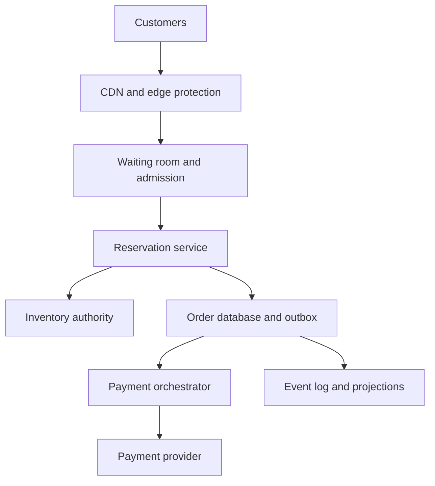
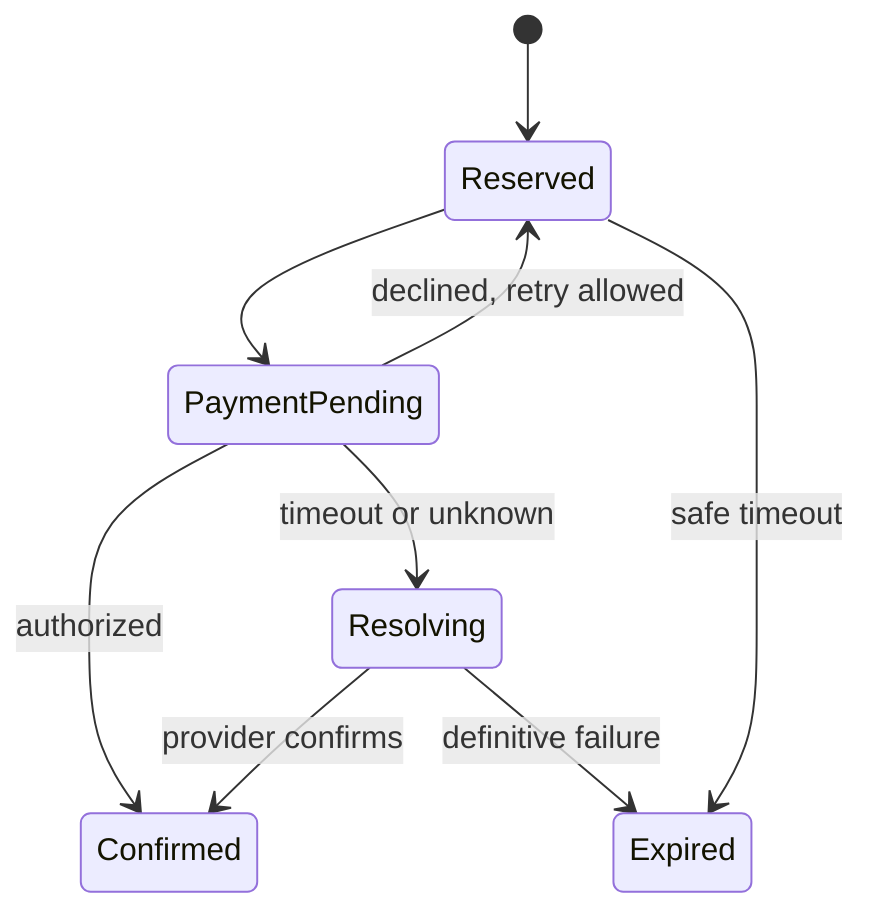

# System Design Interview Practice: Flash Sale Inventory and Reservation System

**Difficulty:** Senior / Advanced  
**Primary themes:** extreme write contention, admission control, transactional inventory, queues, reservations, idempotency, payment ambiguity, fairness, reliability, and observability

> **Interview timing vs. this walkthrough:** In a 45-minute interview, spend about 5 minutes on requirements, 2 minutes on entities, 5 minutes on interfaces, 10–15 minutes building the basic purchase path, and 10–15 minutes on hot inventory, waiting-room fairness, and payment/recovery. This study version is deliberately fuller. In the interview, first make one SKU impossible to oversell with an ordinary database transaction; then evolve the bottleneck only after it is visible.

This walkthrough follows Hello Interview’s recommended delivery sequence: constrain the requirements, identify core entities, define interfaces, build a complete design requirement by requirement, and reserve time for the non-functional requirements that create the hardest trade-offs. genui{"citation":{"ref":"turn86search0"}} Hello Interview currently lists Flash Sale as a hard system-design practice problem, and its recent materials describe the central challenge as selling scarce inventory under extreme demand without overselling. genui{"citation":{"refs":["turn86search1","turn86search14"]}} The scenario, dialogue, numbers, and solution below are original.

---

## Interviewer prompt

> Design the purchase system for a global flash sale, such as a limited sneaker drop. Millions of authenticated customers may arrive at the same second, but only a small amount of inventory exists. Customers should enter fairly, reserve at most one unit, complete payment within a short window, and receive a trustworthy order result. The system must not oversell.

## Targeted clarifying questions with assumed interviewer answers

**Candidate:** Are we designing the whole commerce site or only the flash-sale path?

**Interviewer:** Focus on event configuration, admission, reservation, payment coordination, and order status. Product discovery, recommendations, warehouse fulfillment, and returns are out of scope.

**Candidate:** What scale should I assume?

**Interviewer:** Ten million customers may join the waiting room. At release, traffic can peak at two million HTTP requests per second globally. The event has 50,000 units split across five size SKUs. Normal checkout throughput after admission is around 10,000 reservation attempts per second.

**Candidate:** Is inventory global?

**Interviewer:** Yes. Every SKU has one authoritative available count for this event. A unit must never be committed to two orders.

**Candidate:** How strict is the per-customer limit?

**Interviewer:** One successful reservation across all size variants per verified customer and one per payment instrument/address risk identity where feasible. Anti-bot classification itself is provided by another service, but integrate its decision.

**Candidate:** Is the sale first-come, first-served?

**Interviewer:** Customers present before the start enter a randomized waiting-room cohort at launch. Customers arriving afterward join behind that cohort in arrival order. Exact queue position can be approximate, but admitted capacity and purchase correctness cannot be.

**Candidate:** How long does a reservation last?

**Interviewer:** Five minutes. A customer who reaches checkout gets a temporary hold. If payment is not successfully authorized in time, inventory returns to the sale.

**Candidate:** What should happen if payment times out?

**Interviewer:** A timeout is unknown, not failure. Reuse the same provider idempotency key, query the provider, process signed webhooks, and reconcile later. Never charge twice or release inventory while a successful payment may still exist.

**Candidate:** What latency and availability targets matter?

**Interviewer:** Waiting-room pages should load in under 200 ms p99 from the edge. Reservation responses should be under one second p99 after admission. The public entry layer should be 99.99% available. It is acceptable to pause new admissions rather than risk overselling.

**Candidate:** What result should a client receive after a timeout or retry?

**Interviewer:** The same authenticated customer and idempotency key must observe the same reservation/order identity and outcome. Clients can poll status if the synchronous result is uncertain.

### Scope statement to say aloud

> “I’ll separate edge traffic absorption from the scarce-inventory transaction. A waiting room admits only the rate the checkout path can safely process. Inside that boundary, authenticated identity and a request-bound idempotency key feed one authoritative reservation transaction that enforces both stock and one-per-customer. Payment is a state machine with durable attempts, not part of a long database lock. Catalog and queue estimates can be eventually consistent, but stock, reservation ownership, and order transitions are strongly consistent.”

---

## 1. Requirements (~5 minutes)

### Three core functional requirements

1. **Join and progress through the sale fairly.** Authenticated customers can join a waiting room, receive a stable queue token, poll approximate status, and be admitted at a bounded rate when the event opens.
2. **Reserve scarce inventory exactly once.** An admitted customer can request one size, receive at most one active/successful reservation across the event, and never cause stock to go negative.
3. **Complete or recover checkout.** The customer pays during a five-minute hold; the system confirms the order, expires safely, or resolves an ambiguous provider outcome through retry, webhook ingestion, and reconciliation.

### Quantified non-functional requirements

| Property | Target | Design implication |
|---|---:|---|
| Waiting-room population | 10M customers | Edge caching, compact queue state, polling control |
| Arrival peak | 2M HTTP requests/s | CDN/static page, admission tokens, request coalescing |
| Reservation load | ~10K attempts/s after admission | Bounded gateway, partitioned single-SKU mutation path |
| Inventory correctness | Zero committed oversell | Strong transaction/serialization per inventory shard |
| Customer limit | At most one active or purchased unit per event | Unique constraint in the same authority as reservation |
| Reservation latency | p99 < 1 second after admission | No payment call or cross-region consensus in reservation transaction |
| Edge latency | p99 < 200 ms | CDN and regional waiting-room services |
| Public availability | 99.99% | Multi-region edge; pause admission if authority is unhealthy |
| Hold duration | 5 minutes | Durable expiry index, sweeper, explicit state machine |
| Recovery | Stable outcome under retries and provider ambiguity | Request hash, idempotency, inbox/outbox, reconciliation |

### Consistency and availability contract

- **Inventory is strongly consistent per SKU.** A reservation commits only if the authoritative transaction can atomically claim stock and enforce the customer limit.
- **No negative inventory is allowed.** We prefer rejecting or pausing new reservations over admitting an unverified sale during a partition.
- **One customer, one event purchase is strongly enforced.** This is a database uniqueness invariant, not only a cache/rate-limit rule.
- **Queue position is approximate and monotonic enough for UX.** It does not authorize purchase. Only a signed, short-lived admission grant does.
- **Reservation creation is idempotent.** Reusing a key with identical parameters returns the original result; reusing it with a different SKU or event is rejected.
- **Order state is monotonic.** Late messages cannot move `CONFIRMED` back to `PAYMENT_PENDING` or resurrect an expired unpaid reservation.
- **Payment timeout is `UNKNOWN`.** The system retains the reservation in a protected resolving state until provider status or a safety deadline is known.
- **Catalog counts are advisory.** Cached “remaining” numbers may lag; only the reservation authority decides availability.
- **Events and analytics are at least once.** Consumers deduplicate by event ID and entity version.

### Out of scope

- Product search, recommendations, reviews, and standard shopping carts
- Warehouse allocation, shipping, returns, and refunds after fulfillment
- Building the bot-detection model
- Tax calculation beyond accepting a precomputed quote
- Multi-item atomic carts
- Marketplace sellers and dynamic pricing

### Scale estimates that change the design

Two million requests per second cannot reach the transactional backend. Even a small 1 KB dynamic response would be:

```text
2,000,000 requests/s × 1 KB ≈ 2 GB/s before protocol overhead
```

Most entry traffic must terminate at the CDN/edge. The waiting-room page is static; poll responses are tiny, jittered, cacheable for short intervals where safe, and rate-limited per token. Admission grants reduce the inner system from millions of refreshes to roughly the checkout capacity.

If 10 million customers each poll every second, that is 10M requests/s. Polling every 10 seconds with random jitter reduces the average to 1M/s, still large but edge-manageable. Server-sent events to all users would require 10 million concurrent connections and is unnecessary for approximate progress; controlled polling is simpler.

Fifty thousand items across five sizes create very hot rows:

```text
50,000 units / 5 SKUs = 10,000 units per SKU on average
10,000 reservation attempts/s / 5 ≈ 2,000 attempts/s per hot SKU
```

A database row lock may serialize this if transactions are tiny, but retries and connection limits can still collapse it. The correct first design is a conditional transactional update. The evolved design assigns each hot SKU to one ordered command partition, batches commands, and remains backed by a durable inventory ledger.

Reservation storage is modest:

```text
50,000 successful holds × ~1 KB ≈ 50 MB/event
```

The challenge is contention and correctness, not reservation volume. Queue entries are larger in count: 10M × roughly 100 bytes of compact state is about 1 GB before replication and indexes—comfortable in a partitioned key-value store.

**What to say aloud:**

> “The outer load is four or five orders of magnitude larger than the number of successful purchases. I will shed and queue work at the edge, then expose the inventory authority only to a controlled admission rate. The scarce row—not total storage—is the scaling bottleneck.”

---

## 2. Core entities (~2 minutes)

| Entity | Essential fields and purpose |
|---|---|
| `SaleEvent` | Event ID, start/end, queue policy, purchase limit, status, configuration version |
| `SKUInventory` | Event/SKU ID, total, reserved, sold, available, version, owner partition |
| `QueueEntry` | Event/customer ID, cohort, randomized rank or sequence, join time, status |
| `AdmissionGrant` | Grant ID, customer/event, issue/expiry, allowed operations, nonce, signature |
| `Reservation` | Reservation ID, event/customer/SKU, state, expiry, idempotency key/hash, version |
| `Order` | Order ID, reservation ID, customer, amount/currency, state, version |
| `PaymentAttempt` | Attempt ID, order, provider key, state, provider reference, timestamps |
| `InventoryLedgerEntry` | SKU, delta/reason, reservation/order reference, sequence, resulting balance |
| `OutboxEvent` | Event ID, aggregate/version, type, payload, publish state |
| `InboxReceipt` | Source/event ID, payload hash, processed state |
| `RiskDecision` | Customer/event, decision, score band, policy version, expiry |

Keep three identities separate: the authenticated customer, the queue/admission token, and the idempotency key. The admission token proves temporary access to checkout; it does not replace customer identity or make a mutation idempotent.

---

## 3. API and system interface (~5 minutes)

### 3.1 Join the waiting room

```http
POST /v1/sales/drop_2026_10_14/queue:join
Authorization: Bearer <customer-session>
Idempotency-Key: join-72d
Content-Type: application/json

{
  "client_nonce":"browser-install-8f1",
  "risk_attestation":"<opaque-proof>"
}
```

Identity comes from the authenticated session. The body cannot nominate a different `customer_id`.

```json
{
  "queue_entry_id":"qe_814",
  "status":"WAITING",
  "poll_after_ms":10000,
  "approximate_ahead":184000,
  "event_config_version":42
}
```

Repeated joins return the same active entry for `(event_id, customer_id)`.

### 3.2 Poll queue status

```http
GET /v1/sales/drop_2026_10_14/queue/me
Authorization: Bearer <customer-session>
If-None-Match: "qe_814:v19"
```

Waiting response:

```json
{
  "status":"WAITING",
  "approximate_ahead":92000,
  "estimated_wait_seconds":110,
  "poll_after_ms":12000
}
```

Admitted response:

```json
{
  "status":"ADMITTED",
  "admission_token":"<signed-short-lived-token>",
  "expires_at":"2026-10-14T08:03:00Z"
}
```

The position is informational. The signed token contains the event, authenticated customer, grant ID, expiry, nonce, and policy version. It is single-customer and cannot be transferred.

### 3.3 Reserve inventory

```http
POST /v1/sales/drop_2026_10_14/reservations
Authorization: Bearer <customer-session>
X-Admission-Token: <signed-token>
Idempotency-Key: reserve-44c
Content-Type: application/json

{
  "sku_id":"shoe_blue_size_10",
  "quote_id":"quote_aa7"
}
```

Success:

```json
{
  "reservation_id":"res_931",
  "order_id":"ord_931",
  "state":"RESERVED",
  "expires_at":"2026-10-14T08:07:31Z",
  "checkout_url":"/checkout/ord_931"
}
```

Sold out:

```http
HTTP/1.1 409 Conflict
```

```json
{
  "error":"sku_sold_out",
  "alternatives":["shoe_blue_size_9","shoe_blue_size_11"]
}
```

The server stores a hash of `(event_id, sku_id, quote_id, authenticated_customer_id)`. Reusing `reserve-44c` with another size returns `409 idempotency_key_reused` rather than silently changing the request.

### 3.4 Start payment

```http
POST /v1/orders/ord_931/payment-attempts
Authorization: Bearer <customer-session>
Idempotency-Key: pay-ord_931-v1
Content-Type: application/json

{
  "payment_method_token":"pm_tok_...",
  "return_url":"https://shop.example/order/ord_931"
}
```

```json
{
  "payment_attempt_id":"pa_551",
  "state":"ACTION_REQUIRED",
  "provider_action":"<opaque-provider-payload>"
}
```

The API accepts only a tokenized payment method. Price, currency, order owner, and inventory are server-side state.

### 3.5 Read order status

```http
GET /v1/orders/ord_931
Authorization: Bearer <customer-session>
```

```json
{
  "order_id":"ord_931",
  "state":"CONFIRMED",
  "sku_id":"shoe_blue_size_10",
  "amount":{"currency":"USD","minor_units":18000},
  "reservation_state":"CONSUMED",
  "updated_at":"2026-10-14T08:04:11Z"
}
```

Authorization checks ownership derived from the session; knowing an order ID is insufficient.

### Important errors

| Status | Meaning |
|---|---|
| `400` | Invalid SKU/quote or malformed request |
| `401` | Authentication missing/expired |
| `403` | Invalid admission grant, wrong customer, failed policy/risk check |
| `409` | Sold out, purchase limit reached, state conflict, or idempotency mismatch |
| `410` | Admission grant or reservation definitively expired |
| `425` | Event not open yet; client should not retry aggressively |
| `429` | Poll/admission/checkout rate limit exceeded |
| `503` | Reservation authority unavailable; no purchase was accepted |

---

## 4. Data flow

### Before launch

1. Operators publish an immutable event configuration and inventory allocation.
2. Static product/event content is preloaded into the CDN.
3. Customers authenticate and join the waiting room.
4. Risk checks attach a decision to each queue entry.
5. Entries present before launch are assigned a verifiable randomized rank within the launch cohort.

### Reservation and checkout

1. An admission controller observes reservation-service latency, error rate, and remaining inventory.
2. It promotes a bounded number of eligible queue entries and issues signed short-lived grants.
3. The client submits a reservation with authenticated identity, grant, and idempotency key.
4. The inventory authority atomically enforces one-per-customer, decrements available stock, creates the reservation/order, consumes the grant, and writes an outbox event.
5. The client starts payment. The order service durably creates a provider attempt before calling the provider.
6. Synchronous provider results or signed webhooks move the order state forward idempotently.
7. Success consumes the reservation and converts reserved stock to sold. Definitive failure keeps the hold available for another attempt until expiry.
8. Expiry workers release safe unpaid reservations through the same inventory authority.
9. Reconciliation compares internal attempts, provider records, inventory ledger, and orders.

---

## 5. High-level design (~10–15 minutes)

### Compact architecture



### Operation 1: configure and open the sale

Operators create a draft `SaleEvent` with SKU allocations, start/end time, hold duration, customer limit, admission policy, price quote version, and risk policy version. Activation is an optimistic, audited transition:

```text
DRAFT → SCHEDULED → QUEUE_OPEN → SALE_OPEN → SOLD_OUT/CLOSED
```

At activation, inventory initialization is transactional:

```text
SKUInventory(event_id, sku_id, total, available, reserved, sold, version)
```

Invariant:

```text
total = available + reserved + sold
available >= 0
reserved >= 0
sold >= 0
```

The event service writes an outbox event so CDN invalidation, waiting-room configuration, dashboards, and notifications receive the same version. A bad event configuration can be more damaging than a server failure, so activation supports validation, two-person approval for inventory/price, canary preview, and rollback before `SALE_OPEN`.

### Operation 2: absorb launch traffic in a waiting room

The CDN serves the product page, countdown, JavaScript, and sold-out banner. Requests do not continuously hit catalog or inventory databases.

The queue service stores one compact entry per authenticated customer:

```text
QueueEntry(event_id, customer_id, cohort_id,
           rank_or_sequence, joined_at, status, version)
```

For customers present before start:

1. close the launch cohort at a configured cutoff;
2. compute a deterministic pseudorandom score such as `HMAC(event_secret, queue_entry_id)`;
3. order by score;
4. publish a commitment/checksum for audit;
5. admit in that order.

This prevents the fastest network or last-millisecond refresh from being the only determinant. Customers arriving after the cutoff receive an increasing sequence behind the launch cohort.

Polling uses `ETag`, recommended `poll_after_ms`, randomized jitter, per-token limits, and compact responses. Approximate position is derived from admitted sequence and cohort statistics; it does not require rewriting millions of rows each second.

The admission controller calculates a safe release rate:

```text
admit_rate = min(
    checkout_capacity,
    inventory-aware_limit,
    payment_capacity,
    configured_safety_cap
)
```

It reduces admission quickly when reservation p99, error rate, database lock wait, or payment backlog rises, and increases slowly after recovery. This is closed-loop admission control, not a fixed “let 10,000 users in” guess.

The signed `AdmissionGrant` includes:

```text
grant_id, event_id, customer_id, issued_at, expires_at,
policy_version, nonce, permitted_operation, signature
```

The inventory transaction marks `grant_id` consumed. A copied or replayed token therefore cannot create a second hold.

### Operation 3: reserve one unit with a database transaction

Start simple. One relational inventory shard owns the five SKU rows and reservation/customer constraints for this event. The reservation transaction:

1. claims the idempotency record or returns its existing response;
2. validates the grant/customer/event and atomically marks the grant consumed;
3. inserts an `EventCustomerClaim(event_id, customer_id)` protected by a unique constraint;
4. conditionally decrements stock only if `available > 0`;
5. creates `Reservation` and `Order` rows;
6. appends an inventory ledger row and outbox event;
7. stores the stable API response;
8. commits, then replies.

Illustrative SQL shape:

```sql
UPDATE sku_inventory
SET available = available - 1,
    reserved = reserved + 1,
    version = version + 1
WHERE event_id = :event_id
  AND sku_id = :sku_id
  AND available > 0
RETURNING version, available;
```

If no row returns, the SKU is sold out. The conditional update serializes conflicting modifications on that inventory row; the database—not a cached read—decides whether stock exists.

PostgreSQL documents that `FOR UPDATE`-style row locks prevent conflicting modification or deletion until the transaction ends. genui{"citation":{"ref":"turn86search8"}} The design depends on transactional conditional mutation and uniqueness, not specifically PostgreSQL.

Possible tables:

```text
event_customer_claim(event_id, customer_id, reservation_id, state)
  UNIQUE(event_id, customer_id)

reservation(reservation_id, event_id, sku_id, customer_id,
            state, expires_at, version, request_hash)

idempotency_record(scope, key, request_hash, state, response_blob)
  UNIQUE(scope, key)
```

The transaction is intentionally short. It does not call payment, risk, email, Kafka, or another region while holding inventory locks.

**What to say aloud:**

> “My first correctness boundary is one short database transaction. A conditional decrement prevents negative stock, a unique event/customer claim prevents multiple sizes, and the idempotency result commits beside them. I will scale that authority only after measuring the hot-row limit.”

### Operation 4: return an idempotent response

Network failure after commit is unavoidable: the client may see a timeout even though the reservation exists. Therefore the `Idempotency-Key` maps to a request hash and a stable result.

State:

```text
(customer_id, endpoint, idempotency_key)
→ request_hash, reservation_id, HTTP status, response body
```

Retry cases:

- same key, same hash, completed: return identical response;
- same key, same hash, in progress: wait briefly or return `202` with status URL;
- same key, different hash: `409` misuse;
- new key but customer already claimed: return the existing active/purchased reservation rather than create another.

Idempotency prevents duplicate effects under retries. It does not make arbitrary distributed work “exactly once.”

### Operation 5: coordinate payment without holding inventory locks

The reservation and order begin as:

```text
Reservation: RESERVED, expires_at = now + 5 minutes
Order: PAYMENT_PENDING
```

Before a provider call, the payment orchestrator transaction creates:

```text
PaymentAttempt(attempt_id, order_id, provider_idempotency_key,
               state=CREATED, amount, currency, request_hash)
```

and commits it. Only then does it call the provider using a stable provider idempotency key derived from the attempt/order. Results move through:

```text
CREATED → SUBMITTED → ACTION_REQUIRED → AUTHORIZED
                         └────────────→ DECLINED
SUBMITTED/ACTION_REQUIRED → UNKNOWN → AUTHORIZED/DECLINED
```

On authorization, an order transaction stores the provider reference and writes `PaymentAuthorized`. A consumer sends an idempotent inventory command that changes:

```text
reservation RESERVED → CONSUMED
inventory reserved -1, sold +1
order PAYMENT_PENDING → CONFIRMED
```

For the simplest same-shard implementation, reservation, order, and inventory can finalize in one local transaction. If payment orchestration is separated, an outbox/inbox and a monotonic state machine bridge the services.

Payment decline does not immediately release inventory if time remains; the user may retry with another method. Timeout becomes `UNKNOWN`. A resolver queries the provider with the same reference, accepts signed deduplicated webhooks, and protects the reservation until the ambiguity deadline.

### Operation 6: expire and release reservations safely

A delayed queue or indexed table finds reservations near `expires_at`. Delivery is at least once. Each expiry command is conditional:

```text
release only if:
  reservation.state = RESERVED
  now >= expires_at
  no AUTHORIZED/UNKNOWN-protected payment attempt exists
```

Then one inventory transaction performs:

```text
Reservation RESERVED → EXPIRED
SKUInventory reserved -= 1
SKUInventory available += 1
EventCustomerClaim ACTIVE → RELEASED
append ledger + outbox
```

An expiry queue is a wake-up hint, not the source of truth. A periodic sweeper scans the durable expiry index for overdue `RESERVED` rows. If a message is lost, inventory is delayed but not lost.

Use `SELECT ... FOR UPDATE SKIP LOCKED` to let many sweepers claim different due rows when a relational database is used. PostgreSQL notes that `SKIP LOCKED` provides an inconsistent general-purpose view but is useful for queue-like tables where workers should avoid lock contention. genui{"citation":{"ref":"turn86search16"}}

### Operation 7: expose status and asynchronous side effects

The order read API may use a strongly consistent primary read for the customer’s immediate post-payment status or a version-aware projection with read-your-write token. Email, analytics, sold-count dashboards, and most queue estimates consume outbox events asynchronously.

Every event includes:

```text
event_id, aggregate_id, aggregate_version, event_type, occurred_at
```

Consumers store an inbox receipt before/apply-with side effects. Kafka’s own design documentation cautions that broad “exactly once” claims have fine print and often rely on idempotent keyed updates outside Kafka. genui{"citation":{"ref":"turn86search26"}} We therefore use at-least-once transport plus versioned/idempotent consumers.

---

## 6. Deep dives (~10–15 minutes)

### Deep dive A: eliminate hot-row collapse without weakening stock correctness

#### Where the baseline breaks

One conditional-update row per SKU is correct, but thousands of concurrent transactions can queue on the same lock. Most requests are destined to lose after the 10,000 units disappear. Connection pools fill, lock wait grows, timeouts cause retries, and retry storms amplify the load.

#### Options

| Approach | Advantages | Problems |
|---|---|---|
| Direct row transaction | Simple, auditable, strong correctness | Hot-row lock and connection contention |
| Optimistic version/CAS | No waiting when uncontended | Many conflicts and retries under a flash crowd |
| Redis decrement | Very fast atomic operation | Dual-write/recovery problem if separate from orders |
| Preallocated regional stock | Local latency and availability | Stranded inventory, rebalancing, bounded not global immediacy |
| Single ordered command owner per SKU | No lock race; batching and fairness | Partition owner must be durable and fail over safely |

Choose an ordered command owner per SKU once the baseline saturates. Keep the database ledger as the recoverable authority.

#### SKU command partitions

Hash `(event_id, sku_id)` to a small set of inventory partitions. One active processor per partition consumes reservation, release, and consume commands in order. Since there are only five hot SKUs, explicitly spread them across partitions rather than accepting an unlucky hash collision.

For each micro-batch, the processor:

1. deduplicates command IDs;
2. loads current inventory/claims;
3. applies commands in deterministic order;
4. persists reservations, customer claims, inventory balances, ledger rows, idempotency results, and outbox rows in one database transaction;
5. advances its durable input position only with the state transaction or via a replay-safe checkpoint;
6. fulfills waiting RPC promises or leaves clients to poll.

The serialized owner converts lock contention into an explicit queue. Batching amortizes database commits:

```text
2,000 commands/s for one SKU
batch 100 commands or 5 ms
≈ up to 20 commits/s at full batches
```

Actual batch size is bounded by the one-second p99 target. Once local `available` reaches zero, the processor can reject later commands without touching the database except for required stable idempotency/customer results.

#### Why not make Redis the only source of truth?

An atomic Redis decrement prevents a local negative counter, but if the process crashes after decrement and before the order database write, inventory disappears. If it writes the order first and crashes before decrement, oversell becomes possible. A distributed transaction would restore coupling and complexity.

Redis remains useful for advisory remaining counts, admission budgets, and negative sold-out caching. The durable ledger/order transaction remains authoritative. A carefully designed Redis-first system can work with reservations and reconciliation, but it is not the simplest interview answer.

#### Regional allocation alternative

For much larger catalog events, allocate inventory chunks to regions:

```text
global total = sum(regional available + regional reserved + regional sold) + reserve pool
```

Each region sells only its fenced allocation; unused stock can be returned/rebalanced. This removes inter-region latency but can strand units. For five globally hot SKUs and a one-second budget, a home inventory region with global edge admission is simpler and stricter. We can add regional allocations if product availability requires continued sales during inter-region partitions.

#### Correctness checks

Continuously verify:

```text
inventory.total = available + reserved + sold
count(active reservations for SKU) = inventory.reserved
count(confirmed orders for SKU) = inventory.sold
at most one active/consumed claim per customer/event
ledger-derived balance = materialized inventory balance
```

Invariant mismatch freezes new admission for the affected SKU and pages an owner. It does not trigger an automatic guess that invents stock.

#### Observability

- commands/s and queue age by SKU partition
- batch size, commit rate, and database write latency
- row-lock wait and serialization retries in baseline mode
- available/reserved/sold plus invariant drift
- duplicate command and idempotency replay rates
- sold-out decision latency and negative-cache hit rate
- processor ownership epoch and failover duration
- accepted reservations per admission grant

**What to say aloud:**

> “I start with a transactional conditional update because it proves correctness. If the row becomes the bottleneck, I do not weaken the invariant—I move contention into one durable ordered command stream per SKU and batch the same ledger transaction.”

### Deep dive B: make the waiting room fair, secure, and load-aware

#### Where the baseline breaks

A simple rate limiter protects servers but does not create fairness. A raw timestamp rewards low-latency clients and synchronized botnets. A client-visible queue number can be modified or traded. Fixed admission can overload a degraded backend or waste capacity when healthy. Millions of status refreshes can become the outage.

#### Queue ordering choices

| Policy | Benefit | Trade-off |
|---|---|---|
| Strict arrival time | Easy to explain | Network advantage, refresh race, timestamp disputes |
| Random lottery | Fair opportunity before launch | Less predictable; requires auditable randomness |
| Weighted lottery | Supports membership rules | Harder to explain and govern |
| Hybrid cohort + FIFO | Fair launch and intuitive late arrivals | Two ordering regimes |

Choose the hybrid: randomize everyone present before the cutoff, then append later users by durable sequence.

#### Auditable randomization

Generate the launch rank from a secret committed before the draw:

```text
score = HMAC_SHA256(event_secret, event_id || queue_entry_id)
```

Before launch, publish a hash commitment of the secret. After the event, reveal it to internal auditors or publicly if policy permits. Deterministic recomputation proves the ordering was not manually changed after seeing customers.

The rank is stored server-side. The client gets an opaque entry ID/cookie bound to the authenticated account. Device proof and risk signals raise friction, but the database unique key `(event_id, customer_id)` is the decisive one-entry constraint.

#### Admission control

Control admission by measured inner capacity. Signals include:

- reservation p95/p99 and error rate;
- inventory command queue age;
- database commit/replication latency;
- payment-attempt backlog;
- number of live, unused admission grants;
- remaining inventory by SKU and observed size selection;
- client abandonment rate.

Issue short-lived grants in small batches. A grant is signed but also has server-side state or nonce consumption for replay prevention. Limit outstanding grants:

```text
outstanding grants ≤ checkout capacity × expected checkout window × safety factor
```

Do not admit 100,000 people for 100 remaining units. As inventory nears zero, shrink grants and reserve some capacity for in-flight holds/payment resolution.

#### Polling and edge behavior

- CDN serves immutable/static event assets.
- Queue status is regionally read and compact.
- `ETag`/`304` avoids unchanged bodies.
- `poll_after_ms` grows for distant users and shrinks near admission.
- Jitter prevents synchronized waves.
- Edge rejects requests before the advised time when safe.
- A tiny status response is cached only by customer-specific token key, never shared across users.
- A sold-out event version is pushed to the edge, but authoritative in-flight status remains available.

#### Abuse controls

- derive customer ID from authentication;
- one queue entry and one active claim per event/customer;
- admission token bound to customer, event, nonce, operation, expiry;
- proof-of-work/CAPTCHA/device attestation only when risk policy requests it;
- velocity limits by account, device, IP prefix, instrument, and address signals;
- do not expose exact risk rules or raw inventory mutation endpoints;
- protect queue APIs from token enumeration and high-cardinality memory attacks;
- maintain an accessible path so anti-bot controls do not exclude legitimate users by design.

Anti-bot decisions can be probabilistic; inventory invariants cannot. A bot that passes risk may buy one unit, but it still cannot create two claims for the same enforced identity.

#### Failure behavior

| Failure | Behavior |
|---|---|
| Queue read store degraded | Serve last safe estimate; lengthen polling; stop new grants if uncertain |
| Admission controller loses metrics | Fall back to a conservative cap, not last peak rate |
| Signing key rotation | Accept overlapping valid key IDs; short expiries limit exposure |
| Region fails | Queue identity remains global; route to another region without rejoining |
| Risk provider unavailable | Apply configured conservative policy; do not bypass limits silently |
| Inventory unhealthy | Pause grants and explain delay; preserve queue order |
| Event sold out | Stop new grants, retain order/status access, expire unused grants |

#### Observability

- joins, unique customers, and rejected duplicate entries
- poll RPS, cache/`304` rate, advised-vs-actual poll interval
- admitted/s, outstanding grants, expiry, and conversion rate
- fairness distribution by cohort/region/network class
- queue abandonment and estimated-wait error
- token replay/wrong-customer/signature failures
- risk challenge and false-positive appeal rates
- backend signal that caused admission reduction

**What to say aloud:**

> “The waiting room is both a fairness mechanism and a feedback controller. Prelaunch users get an auditable random rank, late arrivals get a sequence, and only short-lived customer-bound grants reach checkout. Admission follows measured reservation capacity, not page traffic.”

### Deep dive C: reservation expiry, payment ambiguity, and recovery

#### Where the baseline breaks

If payment occurs before reservation, thousands of customers can be charged for unavailable stock. If the inventory lock stays open during payment, slow provider calls serialize the database. If every timeout is treated as failure, a late authorization can produce a charge without an order. If every timeout protects stock forever, inventory leaks.

#### Selected saga

Use a durable state machine whose local transitions are transactional:



This is a saga: a sequence of local transactions connected by durable messages, with a compensating release if the business operation cannot complete. “Compensation” does not erase history; it appends a release ledger entry.

#### Race: expiry vs. authorization

Both commands must meet at one serialized order/reservation authority. Use row locks or the SKU command partition plus state/version checks.

Cases:

1. Authorization wins before expiry: transition to `CONFIRMED`; expiry sees non-releasable state.
2. Safe expiry wins before provider submission: release and reject later payment start.
3. Provider request was submitted but outcome is unknown: transition to `RESOLVING`, extend a bounded protection deadline, and query provider.
4. Late webhook says authorized after internal release: do not silently allocate negative stock. Enter an exception workflow—attempt a void/refund and notify support/customer. Reconciliation must surface it.

The goal is to make case 4 rare by recording `SUBMITTED` durably before the provider call and preventing expiry from releasing `UNKNOWN` attempts.

#### Webhook inbox

For each provider event:

1. verify signature and timestamp;
2. persist raw event and unique provider event ID;
3. compare payload hash on duplicates;
4. locate the payment attempt by provider reference;
5. lock the order/attempt and apply only a valid forward transition;
6. write resulting outbox event in the same transaction;
7. acknowledge the webhook.

Webhooks can be duplicated, delayed, and out of order. The state machine, not delivery order, determines validity.

#### Reconciliation

Run several reconcilers:

- **Payment attempts:** internal `SUBMITTED/UNKNOWN` vs. provider status.
- **Financial totals:** authorized/captured/refunded provider amounts vs. confirmed/cancelled orders.
- **Inventory:** ledger-derived balances vs. materialized SKU rows.
- **Reservation age:** overdue active holds and protected unknown payments.
- **Outbox/inbox:** unpublished events and received-but-unapplied provider events.

Every mismatch has an owner, severity, age, and safe repair command. Reconciliation does not mutate balances with ad hoc SQL; it issues the same idempotent business transition used online.

#### Failure matrix

| Failure | Selected behavior |
|---|---|
| Client times out after reservation commit | Retry returns stable reservation/order |
| Reservation response store unavailable | Poll by idempotency key/customer; do not create a second hold |
| Payment provider times out | Mark `UNKNOWN/RESOLVING`; reuse provider key and query |
| Webhook duplicated/out of order | Inbox dedup + valid state-transition check |
| Expiry queue loses message | Durable expiry-index sweeper recovers it |
| Payment consumer crashes after applying | Inbox/event version makes replay harmless |
| Outbox publisher fails | Transaction is committed; publisher retries from outbox |
| Database primary fails | Admission pauses; fenced promotion completes before mutations resume |
| Cross-region partition | Edge/queue stay available; new reservations pause or route to inventory home |
| Ledger invariant fails | Freeze affected SKU admission and reconcile; never invent stock |

#### Observability

- reservation creation p99 and idempotency replay rate
- active holds by age and seconds to expiry
- expiry queue age and sweeper recovery count
- payment attempt state/age, provider latency, and unknown rate
- authorization-after-release exceptions
- webhook signature failure, duplicate rate, and processing lag
- outbox age and consumer version-conflict rate
- reconciliation mismatch count, value, and oldest age
- confirmed orders vs. inventory sold and provider authorizations

**What to say aloud:**

> “I never hold the inventory transaction open across payment. A durable reservation buys five minutes; a recorded provider attempt makes timeout an explicit unknown state. Expiry and authorization are serialized through versioned transitions, and reconciliation closes the gap when messages or providers behave ambiguously.”

---

## 7. Finish

### Concise final design

Static event content and countdown traffic terminate at the CDN. Authenticated customers join a global waiting room with one entry per event. Prelaunch customers receive a deterministic randomized rank, later arrivals a sequence. A feedback controller issues signed, short-lived, customer-bound admission grants only at the rate the reservation and payment paths can safely sustain.

An admitted request carries authentication, a consumable grant, and a request-hash-bound idempotency key. The baseline inventory authority performs one short transaction that enforces the unique event/customer claim, conditionally decrements available stock, creates the hold/order, appends the inventory ledger and outbox event, and stores the stable response. When hot-row contention appears, each SKU moves behind one durable ordered command processor that batches the same transaction rather than weakening correctness.

Payment is an asynchronous state machine. Provider attempts and stable provider idempotency keys are recorded before external calls. Timeouts enter `UNKNOWN/RESOLVING`; signed webhooks and provider queries resolve them. Expiry workers release only safely unpaid reservations through the same inventory authority, while a durable index and sweeper recover missed timers. Inbox/outbox processing, monotonic versions, invariant scans, reconciliation, and explicit admission pause behavior make the system recoverable without overselling.

### Requirements check

| Requirement | Design support |
|---|---|
| Absorb 2M requests/s | CDN, static event page, controlled polling, edge protection |
| Fair launch | Randomized committed prelaunch cohort plus FIFO late arrivals |
| Bound backend load | Feedback-based admission and capped outstanding grants |
| No oversell | Conditional inventory mutation/serialized SKU owner and ledger invariants |
| One per customer | Unique `(event_id, customer_id)` claim in reservation transaction |
| Retry safety | Request-hash-bound idempotency record and stable response |
| Five-minute hold | Durable reservation expiry plus queue and sweeper |
| Payment safety | Recorded attempts, provider idempotency, explicit unknown state |
| Correct late events | Monotonic state/version checks and inbox deduplication |
| Fast status | Edge queue reads and versioned order projections/primary read |
| Regional resilience | Global edge, home inventory authority, fenced failover, paused admission |
| Operational recovery | Outbox/inbox, reconciliation, invariant scans, replay |

## Realistic interviewer follow-up questions with strong sample answers

**Interviewer:** Why not let every request directly compete for inventory?

**Candidate:** Almost all requests must lose, so direct competition only turns scarcity into connection and lock exhaustion. The waiting room limits contenders to the capacity of the serialized reservation path and improves fairness.

**Interviewer:** Does the queue guarantee inventory?

**Candidate:** No. Queue position and admission only grant an opportunity to attempt reservation. Inventory is guaranteed only after the authoritative reservation transaction commits.

**Interviewer:** Why is cached remaining inventory unsafe for purchase decisions?

**Candidate:** It can be stale under concurrency and replication lag. It is useful for UI and admission hints, but the conditional mutation against authoritative stock decides whether a unit exists.

**Interviewer:** How exactly do you prevent oversell?

**Candidate:** The inventory authority applies a conditional decrement only when `available > 0`, in the same serialized transaction that creates the reservation and ledger entry. Every later transition preserves `total = available + reserved + sold`.

**Interviewer:** Why not use optimistic retries?

**Candidate:** They work well with low contention. During a flash crowd nearly every writer conflicts, so retries amplify load. A single ordered owner per hot SKU turns implicit lock contention into a visible bounded queue and enables batching.

**Interviewer:** Is a single SKU processor a single point of failure?

**Candidate:** It is a single active owner, not a single machine. The input log and inventory ledger are replicated. Ownership uses a fenced epoch; a standby replays committed state and resumes only after the old owner is fenced.

**Interviewer:** Why not split 10,000 units equally among regions?

**Candidate:** That reduces latency but can strand inventory where demand is low. For five SKUs and a one-second target I prefer a home authority. At larger scale I can allocate regional chunks plus a reserve pool, accepting bounded underutilization and rebalancing complexity.

**Interviewer:** Can a customer reserve two sizes using concurrent requests?

**Candidate:** Both transactions contend on the unique `(event_id, customer_id)` claim. Only one can commit, even if they use different idempotency keys or SKU partitions. For partitioned SKU owners, route the customer claim through a common event/customer authority or pre-claim it before the SKU command.

**Interviewer:** You just introduced two authorities for customer and SKU. Is that atomic?

**Candidate:** For this five-SKU event, I keep all event inventory and customer claims on one database shard, so the ordered SKU processors share one transactional authority. If we later split them, I would reserve the customer entitlement first with a fenced token and compensate it on SKU failure, accepting more complexity.

**Interviewer:** What happens if the client times out after reservation?

**Candidate:** It retries with the same key. The idempotency record contains the committed reservation ID and response. Even a new key hits the customer claim and returns the existing active reservation instead of decrementing again.

**Interviewer:** Why not call payment inside the reservation transaction?

**Candidate:** Provider latency and user authentication can take seconds or minutes. Holding the stock row lock would serialize the sale and make database recovery depend on an external provider. A durable reservation separates the local atomic claim from the payment saga.

**Interviewer:** What does payment timeout mean?

**Candidate:** Unknown. I persist that state, reuse the same provider key, query status, accept signed idempotent webhooks, and protect inventory for a bounded resolution window. Treating timeout as decline risks a late charge without an order.

**Interviewer:** How do reservation expiry and payment authorization race safely?

**Candidate:** They meet at one versioned reservation/order state transition. Authorization moves to confirmed; expiry only releases `RESERVED` holds with no submitted/unknown protected payment. A stale command fails its expected-state check.

**Interviewer:** What happens to customers whose grants expire while checkout is unhealthy?

**Candidate:** The admission controller stops issuing new grants first. Depending on policy it extends already issued grants centrally or lets them rejoin at a protected priority, rather than trusting clients to edit expiry.

**Interviewer:** How do you prove the lottery was fair?

**Candidate:** Rank is a deterministic HMAC of the queue-entry ID using a secret committed before selection. Auditors can later recompute ordering from the revealed secret and entry set.

**Interviewer:** How do you prevent refresh storms?

**Candidate:** The response gives a jittered next-poll time, the edge rate-limits early polls, `ETag` avoids bodies, and far-away users poll less frequently. Position is derived, so I do not rewrite all queue entries continuously.

**Interviewer:** What would you build first?

**Candidate:** CDN event page, authenticated queue with conservative fixed admission, one relational event shard, conditional inventory updates, unique customer claims, idempotency records, durable reservations, one payment provider, expiry sweeper, outbox, and invariant dashboard. Then add adaptive admission, randomized cohorts, SKU command batching, multi-region queue reads, and full reconciliation.

## Common pitfalls

1. Sending launch traffic directly to the transactional backend.
2. Treating a rate limiter as a complete fairness mechanism.
3. Using client timestamps to determine queue order.
4. Promising that queue position guarantees inventory.
5. Trusting a client-supplied customer ID, price, or event state.
6. Making admission tokens transferable or long lived.
7. Signing a grant but never preventing replay.
8. Polling every second without jitter or edge enforcement.
9. Rewriting millions of exact queue positions continuously.
10. Using a cached inventory number to authorize purchase.
11. Performing `SELECT available` followed by an unguarded update.
12. Enforcing one-per-customer only in Redis or application memory.
13. Forgetting concurrent attempts across different size SKUs.
14. Using optimistic retries under extreme contention without a retry budget.
15. Moving inventory to Redis without solving the order dual-write gap.
16. Introducing regional inventory before defining the allocation invariant.
17. Allowing the materialized available count to diverge from the ledger silently.
18. Calling payment while holding an inventory database lock.
19. Creating the provider call before durably recording the attempt.
20. Generating a new provider idempotency key for every retry.
21. Treating provider timeout as definitive failure.
22. Releasing inventory while an unknown payment can still authorize.
23. Trusting webhook order or uniqueness.
24. Applying a webhook before verifying its signature and reference.
25. Letting an old event move order state backward.
26. Relying only on a delayed queue for reservation expiry.
27. Releasing a reservation without a conditional state/version check.
28. Claiming Kafka makes the database side effect exactly once.
29. Publishing an event separately from the state transaction.
30. Keeping no stable response for post-commit client timeouts.
31. Reusing an idempotency key without binding it to request parameters.
32. Continuing admission when the inventory authority is uncertain.
33. Failing open during a cross-region partition and risking oversell.
34. Monitoring request rate but not SKU queue age or lock wait.
35. Ignoring reservation age, payment unknown age, and webhook lag.
36. Logging reconciliation mismatches without an owner and safe repair path.
37. Automatically “fixing” an inventory mismatch by inventing available units.
38. Designing regional allocation, lotteries, and sagas before proving one correct local reservation transaction.

## A polished 60-second close

> “The CDN absorbs the launch, while authenticated customers enter one durable waiting-room entry. A committed randomized cohort handles prelaunch fairness, and a feedback controller issues short-lived customer-bound grants only at the rate checkout can sustain. Inside that gate, the reservation authority consumes the grant and performs one short transaction: claim the idempotency key, enforce the unique event/customer limit, conditionally move one unit from available to reserved, create the reservation and order, append the ledger and outbox, and store the stable response. If hot rows saturate, one fenced ordered processor per SKU batches those same transactions. Payment happens afterward through durable provider attempts and a monotonic saga; timeout is unknown, webhooks are deduplicated, and expiry releases only safely unpaid holds. Outbox/inbox replay, expiry sweepers, ledger invariants, reconciliation, and paused admission during uncertainty prevent oversell and make every unit explainable.”

## References

- [Hello Interview: System Design Delivery Framework](https://www.hellointerview.com/learn/system-design/in-a-hurry/delivery)
- [Hello Interview: Flash Sale Guided Practice](https://www.hellointerview.com/community/questions/flash-sale-system/cmq6f6u941iyn09ad4z9lpgmz)
- [Hello Interview: Dealing with Contention](https://www.hellointerview.com/learn/system-design/patterns/dealing-with-contention)
- [PostgreSQL: Explicit Locking](https://www.postgresql.org/docs/current/explicit-locking.html)
- [PostgreSQL: `SELECT` Locking and `SKIP LOCKED`](https://www.postgresql.org/docs/current/sql-select.html)
- [Apache Kafka: Design and Delivery Semantics](https://kafka.apache.org/documentation/#design)
