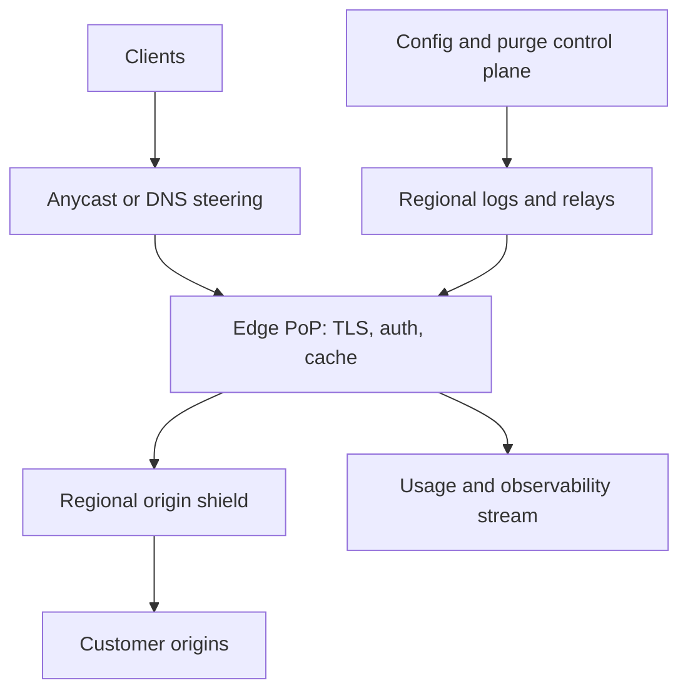

# Design a Global Content Delivery Network (CDN)

**Difficulty:** Senior / Staff-level  
**Primary themes:** caching, global traffic routing, consistency, queues, reliability, multi-tenancy, security, and overload control

> **Interview timing vs. this walkthrough:** In a 45-minute interview, spend roughly 5 minutes on requirements, 2 minutes on entities, 5 minutes on interfaces, 10–15 minutes building cacheable GET end to end, and 10–15 minutes on cache correctness, miss storms, and global purge. This document is deliberately more detailed for study. In the interview, first make one edge cache correct; add shields and a distributed purge plane only after the hit, miss, revalidation, and failure paths are explicit.

This answer uses Hello Interview’s public delivery framework: establish requirements, identify entities and interfaces, build a complete baseline one operation at a time, and reserve complexity for requirement-driven deep dives. genui{"citation":{"ref":"turn97search0"}} The system and explanations below are original.

---

## Interviewer prompt

> Design a multi-tenant global content delivery network. Customers configure hostnames and origins, then the CDN serves cacheable HTTP content from edge points of presence near users. Support static and moderately dynamic objects, cache-control semantics, conditional revalidation, byte ranges, signed private content, request collapsing, purge by URL/tag/prefix, origin shielding, traffic steering, and safe behavior during origin or regional failures. The design should sustain tens of millions of requests per second while preventing one tenant or viral object from overwhelming shared infrastructure.

## Targeted clarifying questions with assumed interviewer answers

**Candidate:** Are we designing both the control plane and the request-serving data plane?

**Interviewer:** Yes. Cover tenant configuration, certificate and origin setup, cache policy, purge, routing, edge request handling, observability, and failure recovery.

**Candidate:** What content and methods are in scope?

**Interviewer:** Focus on `GET` and `HEAD`. Cache static files and origin-declared cacheable API responses. Pass other methods through but do not cache them by default. Support objects from bytes to 20 GB and byte ranges.

**Candidate:** What scale should I target?

**Interviewer:** 50 million requests/s globally at peak, 100 Tb/s egress, 10 million customer hostnames, 100 billion cached objects, 300 edge points of presence, and 1 million purge requests/s during bursts.

**Candidate:** What latency and availability matter?

**Interviewer:** Cached responses should add under 10 ms p99 processing latency within an edge; overall cacheable-request availability should be 99.99%. A single edge, region, or control-plane outage must not take down global serving.

**Candidate:** What consistency does a purge require?

**Interviewer:** Purges are asynchronous but observable. Target p99 global application within 5 seconds for URL and tag purges. The API must return a purge ID and progress. Emergency revocation should stop authorization at the edge faster than waiting for content eviction.

**Candidate:** Must we implement HTTP caching faithfully?

**Interviewer:** Yes. Discuss freshness, validators, `Vary`, private/no-store behavior, revalidation, stale serving, and range requests. Customers may override policies within safe bounds.

**Candidate:** Can edges serve stale objects during origin failure?

**Interviewer:** Only if policy explicitly permits it, such as a bounded stale-if-error window. Security-sensitive or `must-revalidate` objects must fail closed.

**Candidate:** How is private content protected?

**Interviewer:** Support signed URLs or cookies, tenant-scoped verification keys, short expiration, optional session revocation, and cache keys that do not leak one viewer’s response to another.

**Candidate:** Is edge compute in scope?

**Interviewer:** No general-purpose compute runtime. Small deterministic request/response rules are acceptable, but focus on CDN caching and delivery.

**Candidate:** Do we need billing and analytics?

**Interviewer:** Produce usage events asynchronously and support near-real-time dashboards. Exact invoices can be computed later from durable aggregates.

### Scope statement to say aloud

> “I’ll design a CDN with a highly available control plane and an independently survivable edge data plane. DNS or anycast routes a request to a healthy nearby point of presence. The edge authenticates the hostname and optional private-content token, canonicalizes a bounded cache key, and either serves a fresh object or collapses concurrent misses into one shield/origin fetch. Responses are admitted only if policy allows, stored with validators and freshness metadata, and streamed to waiters. I’ll then evolve the design for safe stale serving, hot-key isolation, and a versioned global purge log with observable progress.”

---

## 1. Requirements (~5 minutes)

### Three core functional requirements

1. **Serve cacheable content globally.** Route users to healthy nearby edges; implement GET/HEAD, freshness, conditional revalidation, ranges, compression variants, and private-content authorization.
2. **Manage cache behavior.** Let tenants configure origins and policies, derive safe cache keys, collapse misses, use origin shields, and purge by exact URL, tag, hostname, or prefix.
3. **Operate reliably at shared scale.** Isolate tenants, protect origins, survive edge/control-plane failures, meter usage, expose logs/metrics, and roll out configuration safely.

### Quantified non-functional requirements

| Property | Target | Design consequence |
|---|---:|---|
| Peak requests | 50M requests/s | Stateless edge workers and local lookups |
| Peak egress | 100 Tb/s | Distributed edge capacity; bytes bypass central services |
| Edge locations | 300 | Hierarchical configuration and purge fanout |
| Customer hostnames | 10M | Sharded authoritative configuration and certificate lifecycle |
| Cached objects | 100B | Memory + SSD tiers, approximate eviction, local indexes |
| Edge processing latency | p99 < 10 ms on hits | No synchronous control-plane dependency |
| Availability | 99.99% for cacheable requests | Multi-site steering, stale policy, shields, graceful degradation |
| Purge propagation | p99 < 5 s globally | Ordered regional logs, acknowledgements, anti-entropy |
| Origin protection | Bound concurrency and RPS per origin | Collapsing, shielding, token buckets, backpressure |
| Isolation | Tenant fairness under noisy neighbors | Per-tenant quotas and admission controls |

### Consistency and availability contract

- Edge configuration is **versioned and eventually propagated**. A request can report the configuration version used. Security-critical revocations use a separate rapidly distributed deny/epoch channel.
- Cached objects are not globally coherent replicas. Each edge independently stores a representation plus freshness metadata.
- Within an edge, a fresh hit returns without origin contact. A stale entry is revalidated or served only under an explicit bounded stale policy.
- A successful exact-URL purge means the command is durably accepted and assigned a monotonic purge sequence; it does not mean all edges have applied it yet.
- Purge status exposes regional and global watermarks. Target p99 application under 5 seconds; lagging sites are removed from traffic or fail closed for security-sensitive namespaces.
- Purges are idempotent. Repeating the same idempotency key and selector returns the same purge operation.
- Private authorization is checked on every request, even when bytes are cached. Cached ciphertext or shared representations are not evidence of permission.
- The edge may favor availability by serving stale-if-error content within a customer-defined bound. It must obey `no-store`, `private`, `must-revalidate`, authorization, and revocation rules.
- Analytics and billing are at-least-once event streams. Dashboards can be eventually consistent; invoices deduplicate using stable event IDs or aggregated sequence ranges.

RFC 9111 defines the core HTTP caching model, including freshness, validators, `Vary`, revalidation, and the fact that `must-revalidate` cannot simply be ignored during disconnection. genui{"citation":{"refs":["turn97search14","turn97search29"]}} RFC 5861 defines bounded stale-while-revalidate and stale-if-error extensions; stale service must be an explicit policy rather than an accidental fallback. genui{"citation":{"ref":"turn97search21"}}

### Out of scope

- General-purpose edge functions
- Full DDoS scrubbing internals, though admission controls are included
- Origin object storage internals
- Video transcoding or live streaming protocols
- Browser caching implementation
- Strong global transactions across edge disks
- Caching personalized responses unless the customer explicitly defines a safe partitioned key

### Scale estimates that change the design

Average request rate per point of presence is:

```text
50M requests/s ÷ 300 PoPs ≈ 167K requests/s per PoP
```

Traffic is highly skewed, so design for perhaps 10× at major sites: roughly 1.7M requests/s. A remote metadata lookup per request is impossible; cache indexes, config, keys, and policy must be local.

Average response size implied by the workload is:

```text
100 Tb/s ÷ 50M requests/s
= 2,000,000 bits/request
≈ 250 KB/request
```

At 100 Tb/s, sending bytes through a central regional proxy would require an enormous and fragile network choke point. Only misses and revalidations travel upstream.

Suppose a 70% global hit ratio:

```text
origin-bound requests = 50M/s × 30% = 15M/s
```

That is still too high for typical origins. Raising the hit ratio to 95% yields 2.5M/s, while origin shields and request collapsing reduce duplicate miss traffic further. Hit ratio is therefore a reliability and cost control, not just a performance statistic.

If the 100 billion cached objects average 250 KB:

```text
100B × 250 KB ≈ 25 PB logical cached bytes
```

Edges do not all store every object. Each site stores its local working set; large sites might have tens to hundreds of TB of SSD, with memory reserved for metadata and hottest bodies. Demand-driven replication and eviction are mandatory.

One million purge requests/s fanned directly to 300 PoPs becomes:

```text
1M × 300 = 300M command deliveries/s
```

We need batching, hierarchical fanout, selector compaction, and watermark-based anti-entropy rather than one synchronous RPC per purge per edge.

**What to say aloud:**

> “At 50 million requests per second and about 100 terabits per second, every hit decision must be local and payload bytes cannot traverse a central service. Even a 70% hit ratio leaves 15 million origin requests per second, so shields and request coalescing are origin-safety mechanisms. A million purges per second also rules out direct fanout to 300 sites; I need an ordered, batched distribution log.”

---

## 2. Core entities (~2 minutes)

| Entity | Essential fields |
|---|---|
| `Tenant` | Tenant ID, plan, quotas, status, billing dimensions |
| `Distribution` | Hostnames, origin pool, cache policy, security policy, config version |
| `Hostname` | Canonical name, tenant, certificate ID, verification state |
| `Origin` | Scheme/host/port, health, weights, timeouts, mTLS, shield region |
| `CachePolicy` | Allowed methods/statuses, TTL bounds, key recipe, stale windows, size limits |
| `CacheKey` | Tenant/distribution, canonical URL, selected headers/cookies/query, encoding |
| `CacheEntry` | Key hash, status, headers, body pointer, size, stored time, freshness lifetime |
| `Validator` | ETag, Last-Modified, response version or origin generation |
| `TagIndexEntry` | Tenant tag, local key hash/body reference, generation |
| `PurgeOperation` | Purge ID, tenant, selector, sequence, creation time, state |
| `PurgeWatermark` | Region/PoP, partition, highest contiguous applied sequence |
| `FetchLease` | Cache key, leader request, expiry, waiter count, generation |
| `UsageEvent` | Event ID, tenant, PoP, bytes, result class, timestamp |

The important distinction is between a **resource**, a **representation**, and a **cache entry**. One URL can have multiple representations selected by content encoding or approved `Vary` headers. Each entry has independent freshness and validators.

---

## 3. API and system interface (~5 minutes)

Identity is derived from authenticated control-plane credentials. Tenant ID, plan, permissions, and allowable hostnames come from the token and server-side records, never from a client-supplied `tenant_id` field.

### 3.1 Create or update a distribution

```http
PUT /v1/distributions/dist_42
Authorization: Bearer <tenant-admin-token>
If-Match: "cfg_108"
Idempotency-Key: config-rollout-109
Content-Type: application/json

{
  "hostnames":["static.example.com"],
  "origins":[{
    "id":"primary",
    "url":"https://origin.example.com",
    "connect_timeout_ms":1000,
    "response_timeout_ms":10000
  }],
  "cache_policy":{
    "default_ttl_s":300,
    "min_ttl_s":0,
    "max_ttl_s":86400,
    "stale_while_revalidate_s":30,
    "stale_if_error_s":120,
    "query":"ALLOWLIST",
    "query_names":["lang","version"],
    "vary_headers":["Accept-Encoding"]
  }
}
```

```json
{
  "distribution_id":"dist_42",
  "config_version":109,
  "state":"PROPAGATING",
  "deployment_id":"dep_771"
}
```

The API uses optimistic concurrency. A conflicting update receives `412 Precondition Failed` rather than silently overwriting a newer configuration.

### 3.2 Fetch content through the CDN

```http
GET /images/hero.jpg?version=7&utm_source=mail
Host: static.example.com
Accept-Encoding: br,gzip
Range: bytes=0-1048575
```

The configured key recipe ignores `utm_source`, includes `version`, normalizes the host/path safely, selects a Brotli representation, and includes range handling state where necessary.

```http
HTTP/1.1 206 Partial Content
Content-Type: image/jpeg
Content-Range: bytes 0-1048575/8388608
Age: 43
ETag: "asset-v7"
Cache-Status: cdn; hit; ttl=257
X-CDN-Request-Id: req_sfo_91
X-CDN-Config-Version: 109
```

RFC 9211 standardizes the `Cache-Status` response field for reporting hit, forwarding, and revalidation behavior. genui{"citation":{"ref":"turn97search44"}}

### 3.3 Purge cached content

```http
POST /v1/distributions/dist_42/purges
Authorization: Bearer <tenant-operator-token>
Idempotency-Key: deploy-2026-10-14-hero
Content-Type: application/json

{
  "selectors":[
    {"type":"URL","value":"https://static.example.com/images/hero.jpg?version=7"},
    {"type":"TAG","value":"release:2026-10-14"}
  ],
  "mode":"INVALIDATE"
}
```

```json
{
  "purge_id":"purge_884",
  "accepted_at":"2026-10-15T01:58:00Z",
  "state":"PROPAGATING",
  "target_p99_s":5
}
```

Cloudflare’s public cache API exposes URL and cache-tag purging, illustrating why a purge selector is broader than a raw object key. genui{"citation":{"refs":["turn97search17","turn97search20"]}}

### 3.4 Read purge status

```http
GET /v1/distributions/dist_42/purges/purge_884
Authorization: Bearer <tenant-operator-token>
```

```json
{
  "purge_id":"purge_884",
  "state":"PROPAGATING",
  "regions_applied":17,
  "regions_total":18,
  "lagging":[{"region":"oceania-south","lag_ms":1430}],
  "sequence":99182711
}
```

“Completed” means every currently serving PoP has applied at least the purge sequence for the relevant partition. Offline PoPs must catch up before rejoining.

### 3.5 Issue private-content signing metadata

```http
POST /v1/distributions/dist_42/signing-keys/key_9:rotate
Authorization: Bearer <tenant-security-admin-token>
Idempotency-Key: rotate-key-9-oct
```

Private delivery request:

```http
GET /premium/report.pdf?exp=1792030200&kid=key_9&sig=<signature>
Host: downloads.example.com
```

The edge derives the tenant from the verified hostname, retrieves local key material by key ID, checks method/path/expiry/IP or session restrictions, and verifies a distribution authorization epoch. The signature itself is excluded from the content cache key, but its authorization scope is checked separately.

### 3.6 Origin health and configuration rollout interface

Internal edge agents pull signed versioned snapshots plus deltas:

```text
WatchConfig(site_id, current_version) -> stream<ConfigDelta>
AckConfig(site_id, applied_version, validation_hash)
```

Snapshots are content-addressed and signed. An edge keeps the last known-good version if a new snapshot fails schema, signature, or local safety validation.

### Important errors

| Error | Meaning |
|---|---|
| `400` | Invalid policy, purge selector, or hostname |
| `403` | Tenant permission or private-token failure |
| `409` | Idempotency key reused with a different payload |
| `412` | Configuration version conflict |
| `421` | Hostname is not bound to this distribution/site |
| `429` | Tenant/control-plane quota exceeded |
| `502` | Invalid or failed origin response |
| `503` | Edge/shield/origin capacity unavailable and stale forbidden |
| `504` | Origin timeout with no eligible stale object |
| `PURGE_LAGGING` | One or more serving sites have not reached the purge watermark |

---

## 4. Data flow

### Cache hit

1. Anycast BGP or latency-aware DNS sends the client to a healthy nearby PoP.
2. TLS terminator selects the certificate using SNI and maps the host to a distribution.
3. Edge worker authenticates optional private-content credentials and loads local policy.
4. It canonicalizes the request and computes a bounded cache key.
5. Local metadata index finds a fresh entry; memory or SSD supplies the body.
6. The edge updates `Age`/cache diagnostics, streams bytes, and emits a sampled usage event.

### Cache miss or revalidation

1. Edge acquires a short local fetch lease for the cache key; concurrent requests become bounded waiters.
2. The leader requests the configured regional origin shield.
3. The shield repeats lookup/collapse; only its leader contacts a healthy origin.
4. For stale content with a validator, it sends `If-None-Match` or `If-Modified-Since`.
5. A `304` refreshes metadata; a cacheable `200/206` streams to the first client while writing a temporary cache body.
6. Only after headers, length, checksum, and policy validation does the entry become visible.
7. Waiters stream from the shared in-progress buffer or newly committed entry.

### Purge

1. API authenticates tenant and normalizes selectors.
2. The purge service commits an idempotency record and ordered command to a partitioned durable log.
3. Regional relays consume, batch, and fan commands to PoPs.
4. Each PoP updates an exact tombstone or selector generation, then asynchronously deletes bodies/index entries.
5. PoP acknowledges its highest contiguous applied sequence.
6. Status aggregates watermarks; an offline PoP must replay the log or obtain a compacted snapshot before serving.

---

## 5. High-level design (~10–15 minutes)

### Compact architecture



### Operation 1: one edge, one origin

Start with a reverse proxy and a local cache. A request maps hostname to origin, computes `(host, path, normalized query)`, fetches on a miss, stores a cacheable response with expiry, and serves hits.

This baseline teaches the request path but is incorrect at scale: it ignores `Vary`, validators, partial writes, concurrent misses, private data, disk limits, purges, and edge failures.

### Operation 2: correct cache admission and publication

The edge parses the origin response and decides whether it may store it:

- method is cacheable (`GET` or `HEAD` by default);
- response status is allowed by policy;
- `no-store` forbids storage;
- `private` forbids shared storage unless an explicit safe tenant policy transforms it;
- `Set-Cookie` defaults to non-shared caching;
- object size and TTL are within limits;
- `Vary` fields are allowlisted and bounded;
- headers are syntactically safe;
- tenant quota and local admission policy allow the object.

Write the body to a temporary content file/chunks while streaming to the leader client. Verify content length and optional digest, fsync or meet the cache’s local durability boundary, then atomically publish the metadata pointer. A client disconnect should not necessarily cancel a popular shared fill; the fill owns its own bounded context.

Unlike origin storage, losing a cache copy is acceptable. Therefore the edge can favor throughput with replicated index journals and rebuildable SSD bodies instead of strong per-object replication.

### Operation 3: freshness and conditional revalidation

Each entry stores:

```text
(stored_at, response_date, freshness_lifetime,
 age_at_store, etag, last_modified,
 stale_while_revalidate_until, stale_if_error_until)
```

For a fresh entry, serve locally. For a stale entry with ETag, request:

```http
If-None-Match: "origin-etag"
```

`304 Not Modified` updates freshness metadata without downloading the body. A changed `200` creates a new local entry generation, which is published atomically. During configured stale-while-revalidate, one request revalidates in the background while others receive bounded stale content.

### Operation 4: safe cache keys

The key begins with an unforgeable internal tenant/distribution ID, not only a public host:

```text
hash(distribution_id,
     canonical_scheme_host_path,
     allowed_query_pairs,
     selected_vary_values,
     representation_encoding,
     policy_key_version)
```

Canonicalization must be identical at edge and purge API: case rules, percent encoding, dot segments, default ports, duplicate query parameters, Unicode/IDNA, and query ordering. Ambiguity can cause cache poisoning or a purge that misses its target.

Never allow arbitrary request headers into the key. Attackers can create unlimited variants and exhaust storage. Policy restricts header/cookie/query dimensions and caps total key length.

### Operation 5: request collapsing

On a miss, use an in-process or same-node fetch table keyed by cache key. The first request becomes leader; later requests wait or stream from a bounded shared buffer.

The fetch lease includes a generation and expiry. If the leader stalls, one replacement can take over; fencing prevents both leaders from publishing. Cap waiters and per-key buffer memory. Extra callers receive a controlled 503, stale response, or are sent to a different node—not unlimited queue growth.

### Operation 6: add an origin shield

Every edge miss going directly to an origin still produces a global thundering herd. Assign each origin/distribution to one or a few regional shields. Edge misses go to the shield, whose larger cache and cross-PoP coalescing reduce origin traffic.

Shield selection balances:

- network latency to the origin;
- regional failure independence;
- tenant data-residency rules;
- current shield capacity;
- cache affinity.

Use rendezvous hashing on `(distribution, cache key)` across a small healthy shield set to preserve affinity while allowing failover. During shield failure, edges use the next ranked shield with jitter and concurrency limits.

### Operation 7: tiered storage and eviction

Use:

- RAM for metadata, small hot bodies, TLS/config/key state;
- NVMe/SSD for the site working set;
- optional shield-only larger storage for warm objects.

Eviction can approximate frequency and recency, for example segmented LRU or TinyLFU-style admission. The point is not naming an algorithm; it is preventing one-hit scans from evicting frequently reused objects.

Partition disks and indexes by key hash. If a disk fails, remove its partitions, rebuild the local index, and refill on demand. Cache loss reduces hit ratio but should not corrupt tenant origin data.

### Operation 8: byte ranges

Three plausible choices:

1. Cache only complete objects and slice ranges locally—simple but poor for 20 GB objects.
2. Cache each requested range—efficient on sparse access but risks variant explosion and overlap.
3. Store fixed-size chunks under an object/version manifest—more metadata but supports reuse.

Choose complete-object caching for small bodies and chunked caching above a threshold. A manifest binds chunks to one validator/version. Never combine chunks fetched under different ETags. A changed validator invalidates the manifest generation.

### Operation 9: global routing

Anycast lets multiple PoPs advertise the same IP; Internet routing usually sends clients to a topologically nearby site. DNS steering offers explicit health, geography, and capacity choices but adds resolver caching and TTL lag. A practical CDN uses both: DNS selects a service/region or policy, while anycast reaches a nearby healthy edge.

Health has layers:

- process and host health;
- site ingress/cache capacity;
- transit and packet-loss health;
- shield/origin reachability;
- configuration and purge watermark safety.

A site below a security purge/config watermark can withdraw or reject affected distributions even if its servers are otherwise healthy.

### Operation 10: configuration and certificates

The global configuration database is strongly consistent for each distribution update. Compilers validate policy and produce a signed, immutable snapshot plus deltas. Regional relays distribute them. Edge agents stage, validate, then atomically switch the active version.

TLS certificate issuance requires domain validation, secure private-key storage, renewal, and staged rollout. Edges keep encrypted keys locally so an ordinary control-plane outage does not break existing hostnames. Revoked certificates and signing keys use a high-priority channel and short safety deadlines.

---

## 6. Deep dives (~10–15 minutes)

### Deep dive A: cache correctness, poisoning, and private content

#### Where the baseline breaks

A naive key such as `host + path` mixes query variants, content encodings, languages, devices, or user-specific responses. An attacker can seed a shared cache with a response another user receives. Incorrect `Vary` handling can serve gzip to a client that cannot decode it. A cached 206 from one object version can be combined with ranges from another.

#### Compare key strategies

| Strategy | Benefit | Failure mode |
|---|---|---|
| Include every request field | Semantically safe in theory | Near-zero hit ratio; unbounded cardinality |
| Host + URL only | High reuse and simple purge | Wrong personalized/variant responses |
| Policy allowlist + bounded `Vary` | Controlled reuse and cardinality | Requires validation and versioning |

Choose a tenant-configured allowlist constrained by platform safety rules. The origin’s `Vary` can only select approved dimensions. `Vary: *` is not stored in a shared cache.

RFC 9111 requires stored responses with `Vary` to match the nominated request fields before reuse. genui{"citation":{"ref":"turn97search48"}}

#### Private content design

Separate two questions:

1. **May this caller receive the resource?** Verify signature/session, expiry, method, path scope, key ID, and revocation epoch.
2. **Which representation bytes are reusable?** Compute the content key without per-request signatures, but only after policy proves all authorized callers receive identical bytes.

For per-user watermarking or entitlements that change representation, include a coarse authorization group or user/version in the key—or bypass shared caching.

Do not put secrets in logs. Redact signature parameters before access-log emission. Keys are distributed encrypted, rotated with overlapping verify windows, and selected by `kid`.

#### Negative caching

Caching `404`, `410`, or some `5xx` responses can protect origins, but mistakes persist outages. Use status-specific short TTLs. Never cache authentication failures across users. A temporary origin `500` should have a much shorter or zero TTL unless explicitly configured.

#### Range integrity

For chunked large objects, the manifest stores the origin validator, total length, chunk size, and content generation. Each chunk key includes that generation. If a range response omits a trustworthy validator, either fetch the whole object or avoid stitching across responses.

#### Observability

- hit ratio by tenant, status, object size, and representation
- cache-key cardinality and variant count per URL
- rejected `Vary` dimensions and no-store/private bypasses
- signature failures by reason, key ID, and edge config epoch
- suspected cache-poisoning anomalies
- partial-object validator mismatches
- negative-cache hit rate and origin-error masking
- canonicalization mismatch tests between purge and edge

**What to say aloud:**

> “Authorization and cache identity are separate. I verify every private request, then reuse bytes only when policy guarantees authorized callers share the same representation. The cache key includes tenant identity, a rigorously canonical URL, allowlisted query/header dimensions, encoding, and policy version. I reject unbounded Vary behavior and never stitch ranges across validators.”

### Deep dive B: thundering herds, origin protection, and overload

#### Where the baseline breaks

When a viral item expires simultaneously at hundreds of sites, millions of requests can miss together. Even with per-node collapsing, each node and PoP may send one fetch. A purge or deployment can deliberately create the same storm. Slow origins hold sockets and waiter memory, causing retries that amplify load.

#### Layered controls

| Layer | Mechanism | Purpose |
|---|---|---|
| Edge process | Single-flight/fetch lease | Collapse same-key local misses |
| Edge PoP | Consistent key ownership | Concentrate collapse for hot keys |
| Regional shield | Shared cache and collapse | Bound origin fan-in across PoPs |
| Origin pool | Token bucket + concurrency cap | Enforce safe tenant/origin load |
| Client response | Stale, retry-after, backoff | Degrade predictably |

#### TTL jitter and probabilistic refresh

Do not let a million entries created in one deploy expire at the exact same second. Apply bounded deterministic jitter to effective expiry. For hot objects, begin refresh probabilistically before hard expiry so one edge request refreshes while the object remains fresh for others.

This reduces synchronized misses without violating the maximum freshness policy: the refresh starts earlier; it does not extend freshness silently.

#### Backpressure and retry budgets

Each origin receives:

- maximum concurrent connections/requests;
- requests/second and bytes/second token buckets;
- queue length and maximum wait;
- per-try and total deadlines;
- retry budget as a fraction of successful traffic;
- circuit-breaker state.

When an origin slows, reduce admission. Do not queue without bounds. Retries use exponential backoff with jitter and generally choose only idempotent GET/HEAD. A retry budget prevents every layer—edge, shield, load balancer—from multiplying attempts.

#### Serving stale

Order of preference during origin failure:

1. fresh cache entry;
2. successful conditional or normal shield/origin fetch;
3. eligible `stale-if-error` entry within its bound;
4. customer-defined synthetic fallback;
5. controlled error.

`must-revalidate`, private policy, revocation, and legal/security constraints override stale availability. This is a per-object contract, not a universal “CDNs stay up by serving old data” rule.

#### Hot-key isolation

A single object can exceed one server or NIC. Consistent hashing normally gives affinity, but detect hot keys and replicate them across a bounded fanout group. The router uses power-of-two choices among replicas. Replicate immutable bodies; coordinate only freshness/validator state.

Protect shared tenants with hierarchical fairness:

- global site capacity;
- per-tenant bandwidth/RPS share;
- per-distribution and per-origin limits;
- per-key waiter/fill limits.

#### Failure modes

- **Leader fill dies:** lease expires; one fenced successor resumes or restarts.
- **Shield fails:** next rendezvous-ranked shield takes over with jittered traffic ramp.
- **Origin returns inconsistent validators:** do not merge generations; shorten cacheability and alert.
- **Purge storm:** prioritize invalidation metadata, rate-limit physical deletion, preserve origin tokens.
- **Retry storm:** enforce hop-by-hop attempt counters and end-to-end retry budgets.
- **Site overload:** shed low-priority tenants/requests according to plan, steer new connections away, preserve control traffic.

#### Observability

- request-collapse ratio and waiter count
- origin requests avoided by edge and shield
- per-origin concurrency, queue delay, timeout, and circuit state
- retry amplification per end-user request
- stale responses by directive, age, and cause
- hot-key bandwidth share and replica fanout
- eviction/admission rate and SSD latency
- tenant throttling and fairness error
- purge-correlated miss/origin spikes

**What to say aloud:**

> “Single-flight at one process is insufficient because every edge can still miss. I collapse locally, route misses through a cache-affine regional shield, and enforce origin token buckets, concurrency caps, deadlines, and a retry budget. TTL jitter and early refresh prevent synchronized expiry. During failures I serve stale only within explicit policy; security and must-revalidate rules fail closed.”

### Deep dive C: global purge, control-plane independence, and disaster recovery

#### Where the baseline breaks

Synchronous RPC fanout to every PoP is slow and unavailable whenever one site is offline. Fire-and-forget pub/sub can lose commands or let a recovered site serve purged data. Physically scanning billions of cache entries for a tag is too slow. A compromised signing key cannot wait seconds for terabytes of cached bodies to be deleted.

#### Purge representation choices

| Selector | Edge representation | Tradeoff |
|---|---|---|
| Exact URL/key | Key tombstone or generation | Precise and cheap |
| Tag | Tag generation + optional local inverted index | Fast logical invalidation; index/storage cost |
| Prefix/hostname | Namespace generation/rule trie | Broad invalidation; may lower hit ratio |
| Purge all | Distribution cache epoch | O(1) logical invalidation; cold-cache storm |

Prefer **logical invalidation first**. Each entry records distribution epoch and relevant tag generations at insertion. A purge increments or publishes a selector generation. Lookup rejects entries with older generations immediately; body deletion happens lazily. This makes purge latency independent of object-body scan time.

For exact URLs, local tombstones prevent a race where an old in-flight fetch publishes after the purge. A fill captures the selector epochs when it starts and rechecks them before publication. If any advanced, discard or revalidate the result.

#### Ordered distribution log

Partition the global purge log by tenant/distribution hash. The purge API writes:

```text
(partition, sequence, purge_id, tenant, selector,
 selector_generation, created_at, auth_context_hash)
```

Regional relays consume contiguous batches and persist them locally. PoP agents apply commands in sequence per partition and report watermarks. Parallel partitions scale throughput; per-distribution ordering prevents an old purge/config event from undoing a newer generation.

Use periodic compacted snapshots containing current distribution epochs, tag generations, security epochs, and a log checkpoint. A site that has been offline too long installs a snapshot and replays the tail. It cannot serve affected traffic until the checkpoint is safe.

Cloudflare has publicly described moving toward active, distributed purge processing and reports sub-second goals/latencies for broad global invalidation, showing that purge is a dedicated distributed system rather than a cache-side afterthought. genui{"citation":{"refs":["turn97search15","turn97search24"]}}

#### Why not purge everything?

It is operationally simple but creates a cold-cache and origin-load event. Prefer versioned asset URLs for deployments and targeted URL/tag/prefix purge for mistakes. Cloudflare’s documentation similarly recommends targeted purges over clearing everything because they have less origin impact. genui{"citation":{"ref":"turn97search30"}}

#### Security revocation

Content eviction and authorization revocation are separate:

- distribution authorization epoch invalidates old signed tokens;
- key revocation list disables a compromised `kid`;
- hostname disable prevents routing/serving;
- cache purge prevents reuse of bytes after corrected content appears.

Security epochs are tiny, high-priority, held in memory, and distributed on an independent channel with short token TTL as defense in depth. A site that cannot prove a current security watermark fails closed for private content.

#### Control-plane outage

Edges continue serving with the last signed, validated configuration. Existing cache hits, revalidation, and origin fetches continue. Configuration changes and purges may be unavailable for acceptance if the consensus write path is down, but already accepted commands continue from regional durable relays.

Never make every request call the global configuration database. The desired dependency direction is control plane → snapshots/logs → edge, not edge → synchronous control plane.

#### Disaster recovery

- Replicate authoritative tenant/config/purge state across regions using consensus or a single-writer failover protocol.
- Back up immutable configuration history and certificate metadata; separately protect private keys in HSM-backed systems.
- Regional relays retain enough purge/config history for expected outages.
- Run restore drills that bring up a clean PoP from snapshot + log tail.
- Verify that a recovered site blocks serving until config, certificate, and purge/security watermarks are mutually consistent.
- Test route withdrawal and gradual reentry to avoid shifting a full region onto a cold site instantly.

#### Observability

- purge acceptance, regional receipt, and PoP application latency percentiles
- highest contiguous watermark per partition/site
- sites withheld from serving due to stale state
- tombstone/generation memory and compaction age
- in-flight fills discarded by purge races
- logical invalidation versus physical reclamation lag
- config version skew and rejected snapshots
- security epoch/key-revocation propagation
- control-plane availability independent of edge serving SLO
- clean-site restore RTO and replay throughput

**What to say aloud:**

> “A purge is an ordered metadata operation, not a synchronous delete of every body. The API commits an idempotent command; regional logs batch it to PoPs; edges advance exact or selector generations and acknowledge watermarks. Lookup rejects old generations immediately, while disk cleanup is lazy. Offline sites must install a compacted snapshot and replay the tail before rejoining. Authorization epochs use a faster fail-closed channel because security revocation cannot depend on cache deletion.”

---

## 7. Finish

### Concise final design

Global DNS and anycast route requests to a nearby healthy PoP. The edge terminates TLS, maps the verified hostname to a locally cached signed distribution configuration, authorizes private content, canonicalizes a bounded tenant-scoped cache key, and checks a RAM/SSD cache. Fresh hits are completely local and add under 10 ms p99 edge processing latency.

On a stale entry or miss, a generation-fenced fetch lease collapses concurrent requests. The leader contacts a cache-affine regional origin shield, which collapses misses again before a health-selected customer origin. Conditional requests use ETag or Last-Modified. The response streams to clients while a temporary cache entry is written; it becomes visible only after headers, body length/integrity, cacheability, quota, and purge-generation checks pass.

Cache keys include internal distribution identity, canonical URL components, bounded allowlisted query/header/cookie dimensions, representation encoding, and policy version. Private authorization is verified independently on every request. Large objects use validator-bound chunk manifests; small objects can be cached whole. RAM stores hot metadata/bodies and SSD stores the working set, with scan-resistant admission and local rebuild after disk loss.

Origin protection is layered: TTL jitter and early refresh, local and shield request collapsing, origin token buckets, concurrency caps, deadlines, circuit breakers, and end-to-end retry budgets. Explicit stale-while-revalidate and stale-if-error policies improve availability, while `no-store`, `private`, `must-revalidate`, and security revocation fail closed.

The control plane stores strongly ordered per-distribution configurations, compiles signed snapshots, and distributes them asynchronously. Edges survive control-plane loss with the last known-good snapshot. Global purges enter a partitioned ordered log, flow through regional relays, and apply as tombstones or selector generations. Watermarks make completion observable; recovered sites catch up before serving. Physical deletion is lazy. Security epochs and key revocations use a separate high-priority channel.

Usage and request telemetry enter durable at-least-once streams. Aggregators deduplicate, produce tenant dashboards and billing records, and monitor hit ratio, origin load, stale service, purge lag, config skew, and tenant fairness.

### Requirements check

| Requirement | Design support |
|---|---|
| Global low-latency delivery | Anycast/DNS steering and local hit path |
| 50M requests/s | Independent PoPs, local metadata, no central byte path |
| 100 Tb/s | Edge egress; only misses travel upstream |
| Correct HTTP caching | Freshness, validators, bounded `Vary`, directives |
| Byte ranges | Whole-object threshold plus validator-bound chunks |
| Private content | Per-request signatures/epochs separate from byte identity |
| Origin protection | Collapsing, shields, quotas, deadlines, retry budgets |
| Viral objects | Hot-key detection and bounded replication |
| 99.99% availability | Site steering, shields, controlled stale/fallback |
| Global purge | Ordered logs, logical generations, site watermarks |
| Purge under 5 s p99 target | Regional fanout, batching, in-memory generations |
| Offline PoP safety | Snapshot + replay before reentry |
| Tenant isolation | Hierarchical quotas and fair shedding |
| Control-plane failure | Last known-good signed edge snapshots |
| Observability/billing | Durable usage events and deduplicated aggregates |

## Realistic interviewer follow-up questions with strong sample answers

**Interviewer:** Why can’t the edge query the control plane on every request?

**Candidate:** At 50 million requests per second, it would add latency, cost, and a global dependency to every hit. Edges need signed local configuration, key material, and purge/security watermarks so data-plane serving survives control-plane failure.

**Interviewer:** What exactly is the cache key?

**Candidate:** It starts with internal distribution identity, then a rigorously canonical URL, allowlisted query/header/cookie dimensions, selected representation encoding, and a cache-policy key version. Arbitrary client headers are excluded to prevent unbounded variants.

**Interviewer:** How do you support `Vary`?

**Candidate:** The policy permits a bounded set such as `Accept-Encoding` or language. At insertion I store selected values, and at lookup I require them to match. I reject `Vary:*` and unapproved high-cardinality fields from shared storage.

**Interviewer:** Why not include every header and cookie to be safe?

**Candidate:** That destroys reuse and lets attackers create effectively infinite variants. Safe shared caching requires an explicit bounded equivalence class; otherwise the response bypasses the shared cache.

**Interviewer:** Can signed URLs share cached bytes?

**Candidate:** Yes if authorization is checked independently and every authorized caller receives identical bytes. The signature is excluded from the byte key, but path, expiry, method, key ID, and revocation epoch are verified on every request.

**Interviewer:** How do you prevent a cache stampede?

**Candidate:** One fenced fetch leader per key at the edge, bounded waiters, a regional shield that collapses across PoPs, TTL jitter, early refresh for hot objects, and strict origin concurrency/RPS budgets.

**Interviewer:** What if the fetch leader crashes?

**Candidate:** Its lease expires. A single successor with a higher generation can fetch; publication checks the generation so a late old leader cannot overwrite the newer result.

**Interviewer:** Why use an origin shield?

**Candidate:** Local collapse still allows one miss from every server and PoP. A shield concentrates the warm cache and coalescing point near the origin, dramatically bounding fan-in while preserving edge delivery.

**Interviewer:** Doesn’t the shield become a single point of failure?

**Candidate:** Each distribution has an ordered healthy shield set selected with rendezvous hashing. On failure, edges choose the next candidate with jitter and reduced admission. Shields are replicated by capacity, not one singleton process.

**Interviewer:** When may you serve stale content?

**Candidate:** Only within an explicit stale-while-revalidate or stale-if-error window and only if authorization and directives permit it. `must-revalidate`, revocation, or security-sensitive policy forces revalidation or an error.

**Interviewer:** How does conditional revalidation help?

**Candidate:** ETag or Last-Modified lets the origin return 304, refreshing freshness metadata without retransmitting the body. It reduces bandwidth but still consumes an origin request, so shields and early refresh remain useful.

**Interviewer:** How do you cache a 20 GB object and ranges?

**Candidate:** Above a threshold I store fixed-size chunks referenced by a manifest containing the full length and one validator generation. I never combine chunks from different validators. Sparse ranges fill only needed chunks.

**Interviewer:** How is a purge different from deleting files?

**Candidate:** Purge makes old entries ineligible immediately through tombstones or generation changes. Deleting bodies can happen later. Lookup correctness—not disk reclamation—defines purge latency.

**Interviewer:** How do tag purges avoid scanning all entries?

**Candidate:** Entries record tag generations at insertion. A tag purge advances that tag’s generation, so lookup rejects older entries in O(1)-like local metadata time. A local inverted index can accelerate physical cleanup but is not on the correctness path.

**Interviewer:** What if a fill started before a purge and finishes afterward?

**Candidate:** It captured selector generations at start and rechecks before publish. If a relevant generation advanced, it discards the fill or revalidates, so purged content cannot reappear through an in-flight race.

**Interviewer:** What if a PoP was offline during purges?

**Candidate:** It cannot immediately rejoin. It installs a compacted generation snapshot, replays log entries after the snapshot checkpoint, proves current watermarks, and only then advertises or accepts affected traffic.

**Interviewer:** Why partition the purge log?

**Candidate:** One global sequence would limit write throughput. Partition by distribution hash for scale while preserving ordering within a distribution, which is the scope where generation order matters.

**Interviewer:** How do you revoke a compromised signing key quickly?

**Candidate:** Distribute a high-priority key revocation and increment the distribution authorization epoch. Edges reject the old key/tokens even if content bytes remain cached. Short token TTL limits exposure further.

**Interviewer:** What happens if the control plane is down?

**Candidate:** Edges continue with the last signed configuration. Existing caches and origin fetches work. New config writes may pause, while already accepted purge commands continue from durable regional relays.

**Interviewer:** How do you keep one tenant from evicting everyone else?

**Candidate:** Apply tenant-aware admission, reserved/fair cache partitions where needed, bandwidth and RPS quotas, per-origin concurrency limits, and plan-aware shedding. Track both bytes and request cost.

**Interviewer:** How do you measure hit ratio correctly?

**Candidate:** Split fresh hit, stale hit, revalidated 304, shield hit, origin fetch, bypass, and error. Report both request hit ratio and byte hit ratio; a CDN can have high request hits but poor byte offload.

**Interviewer:** What would you build first?

**Candidate:** One region with several PoPs, signed local config, correct cache keys/directives, atomic fill publication, conditional revalidation, exact URL purge, request collapse, and an origin shield. Then add tag generations, global watermarks, private signing, chunked ranges, sophisticated routing, and multi-region disaster recovery.

## Common pitfalls

1. Treating a CDN as only DNS plus a hash map.
2. Making hits synchronously depend on a global control plane.
3. Keying only by URL and ignoring tenant identity.
4. Including every header/cookie and creating unbounded variants.
5. Ignoring `Vary` or `Accept-Encoding`.
6. Caching `private`, `no-store`, or `Set-Cookie` responses by default.
7. Treating cached bytes as proof of authorization.
8. Logging signed URL secrets.
9. Publishing a partially downloaded body.
10. Combining range chunks from different validators.
11. Letting a disconnected client always cancel a valuable shared fill.
12. Doing request collapse only inside one process.
13. Sending every global miss directly to the origin.
14. Making the shield a singleton.
15. Omitting waiter, queue, and buffer bounds.
16. Retrying at every hop without a total retry budget.
17. Serving stale universally during failure.
18. Ignoring `must-revalidate` and security revocation.
19. Giving all objects identical expiration times after a deploy.
20. Using LRU alone without considering one-hit scans.
21. Replicating every object to every PoP.
22. Assuming average traffic describes major PoPs or viral keys.
23. Monitoring request hit ratio but not byte hit ratio.
24. Caching origin errors too long.
25. Purging by scanning and deleting bodies synchronously.
26. Sending one purge RPC to every PoP.
27. Forgetting the in-flight fill versus purge race.
28. Letting an offline PoP rejoin without log catch-up.
29. Declaring purge complete without explicit watermarks.
30. Using purge-all for normal deployments.
31. Conflating cache eviction with authorization revocation.
32. Allowing tag names or key dimensions to grow without tenant quotas.
33. Ignoring canonicalization differences between lookup and purge.
34. Routing solely by geography without capacity/network health.
35. Withdrawing a large site instantly without planning load transfer.
36. Reintroducing a cold recovered site at full traffic.
37. Treating cache disks as durable origin storage.
38. Losing config/certificate capability during a control-plane outage.
39. Billing directly in the response path.
40. Adding complex eviction algorithms before making cache semantics correct.

## A polished 60-second close

> “Requests reach a healthy nearby PoP through DNS and anycast. The edge terminates TLS, uses a signed local distribution snapshot, verifies private authorization, and computes a bounded tenant-scoped key from the canonical URL, approved variants, encoding, and policy version. Fresh hits stay local. A miss acquires a fenced fetch lease, then goes through a cache-affine regional shield; responses stream to clients while a temporary entry is validated and atomically published. ETags drive revalidation, and validator-bound chunks support large ranges. TTL jitter, early refresh, two-layer collapse, token buckets, concurrency caps, circuit breakers, and retry budgets protect origins. Explicit stale policies improve availability without overriding must-revalidate or revocation. Purges enter a partitioned ordered log and apply at edges as tombstones or selector generations, so lookup becomes correct before disk deletion; site watermarks make propagation observable, and offline sites catch up before rejoining. The edge data plane survives control-plane outages using last known-good signed config, while high-priority authorization epochs handle security revocation independently.”

## References

- [Hello Interview: System Design Delivery Framework](https://www.hellointerview.com/learn/system-design/in-a-hurry/delivery)
- [Hello Interview: How to Prepare for System Design Interviews](https://www.hellointerview.com/learn/system-design/in-a-hurry/how-to-prepare)
- [RFC 9111: HTTP Caching](https://www.rfc-editor.org/rfc/rfc9111.html)
- [RFC 5861: HTTP Cache-Control Extensions for Stale Content](https://www.rfc-editor.org/rfc/rfc5861.html)
- [RFC 9211: The Cache-Status HTTP Response Header Field](https://www.rfc-editor.org/rfc/rfc9211.html)
- [Cloudflare: Purge Cached Content API](https://developers.cloudflare.com/api/resources/cache/methods/purge/)
- [Cloudflare: Invalidate Cached Content](https://developers.cloudflare.com/cache/guides/invalidate-cache/)
- [Cloudflare: Rethinking Cache Purge, Part 1](https://blog.cloudflare.com/part1-coreless-purge/)
- [Cloudflare: Instant Purge Architecture](https://blog.cloudflare.com/instant-purge/)
- [Cloudflare: Purge Everything Guidance](https://developers.cloudflare.com/cache/how-to/purge-cache/purge-everything/)
