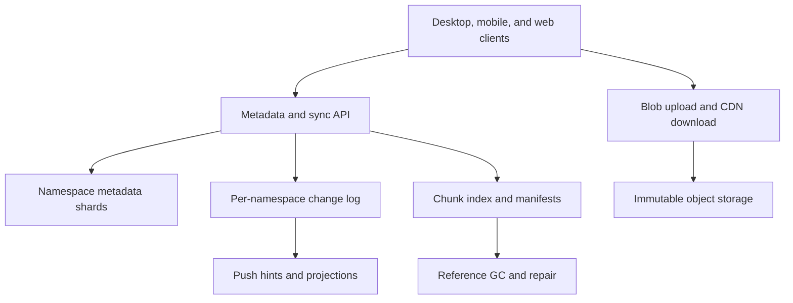

# System Design Interview Practice: Global File Sync and Versioning Service

**Difficulty:** Senior / Advanced  
**Primary themes:** large-object transfer, content-addressed chunks, metadata transactions, offline synchronization, versioning, conflict resolution, change logs, garbage collection, caching, multi-region reliability, and security

> **Interview timing vs. this walkthrough:** In a 45-minute interview, spend about 5 minutes on requirements, 2 minutes on entities, 5 minutes on APIs, 10–15 minutes building upload/download/sync, and 10–15 minutes on chunking, offline conflicts, and durability/garbage collection. This educational version goes deeper. In the room, first make a whole-file upload and a namespace change log work; introduce chunking and conflict machinery only when the requirements demand them.

This walkthrough follows Hello Interview’s delivery framework: prioritize requirements, name the entities, define concrete interfaces, construct a working system operation by operation, and use the remaining time on requirement-driven bottlenecks. genui{"citation":{"ref":"turn87search0"}} Hello Interview’s Dropbox breakdown identifies upload, download, sharing, and automatic device synchronization as the core product surface, with large blobs and sync as the central technical work. genui{"citation":{"ref":"turn87search3"}} The prompt, scale, dialogue, and design below are original.

---

## Interviewer prompt

> Design a global file-storage and synchronization service similar to Dropbox. Users can organize files and folders, upload large files, access them from multiple devices, work offline, share content, and restore older versions. Changes should propagate quickly without corrupting concurrent edits or losing acknowledged data.

## Targeted clarifying questions with assumed interviewer answers

**Candidate:** Are users editing documents collaboratively in real time?

**Interviewer:** No. Treat files as opaque byte sequences. Multiple devices may independently replace, move, or delete a file, but character-level collaborative editing is out of scope.

**Candidate:** Which operations are required?

**Interviewer:** Create folders; upload, download, move, rename, and delete files; sync changes across devices; share files/folders with users; and restore a previous version.

**Candidate:** What file sizes and scale should I assume?

**Interviewer:** One hundred million registered users, twenty million daily active users, and five petabytes of logical user data. Typical files are 1 MB, but a file may be as large as 1 TB. Expect 200,000 metadata mutations per second and 20 GB/s aggregate upload at peak.

**Candidate:** How quickly should sync happen?

**Interviewer:** For online devices, 99% of metadata changes should be discoverable within five seconds. Large file content may take longer to transfer. Offline devices catch up when they reconnect.

**Candidate:** What consistency do users expect?

**Interviewer:** After an upload is acknowledged, the uploader must see the committed version immediately. Within a folder namespace, operations such as create/rename/delete should have a single authoritative order. Other regions and devices may lag briefly. Concurrent content edits should preserve both versions rather than silently lose one.

**Candidate:** Should we deduplicate identical data?

**Interviewer:** Yes, split large files into chunks for resumability and delta sync. Deduplicate safely within a tenant or security domain. Cross-tenant deduplication is not required because it can leak content equality.

**Candidate:** How long do old versions and deleted files remain?

**Interviewer:** Keep thirty days by default. Enterprise policies may require longer retention or legal hold. Users can restore a retained version.

**Candidate:** Can clients upload directly to object storage?

**Interviewer:** Yes. Use scoped, short-lived upload/download capabilities so application servers do not proxy large bodies.

**Candidate:** What durability and availability targets matter?

**Interviewer:** Committed metadata has RPO 0 within its home region and 99.99% availability. File data should target eleven-nines annual durability. Losing a region must not lose acknowledged versions, though writes to an affected namespace may pause during failover.

**Candidate:** Are end-to-end encryption and public links required?

**Interviewer:** Encrypt in transit and at rest. Customer-managed or end-to-end encryption can be discussed as an extension. Sharing is authenticated user-to-user; public anonymous links are out of scope.

### Scope statement to say aloud

> “I’ll separate strongly ordered namespace metadata from immutable file chunks. Clients upload content directly to blob storage, then atomically commit a manifest into a namespace change log. Devices synchronize by durable cursors, not by repeatedly listing entire folders. A base-version precondition detects concurrent edits; opaque files preserve both sides as conflict copies. Chunk hashes provide resumability and tenant-scoped deduplication, while acknowledgement occurs only after the metadata commit references durable chunks.”

---

## 1. Requirements (~5 minutes)

### Three core functional requirements

1. **Store and manage files.** Users create folders and upload, download, move, rename, delete, and restore versioned files, including resumable 1 TB transfers.
2. **Synchronize devices.** Each device efficiently receives an ordered stream of namespace changes from a durable cursor and uploads local changes made while online or offline.
3. **Share safely.** Owners grant and revoke user/group access to a file or folder; authorization applies consistently to metadata and chunk download capabilities.

### Quantified non-functional requirements

| Property | Target | Design implication |
|---|---:|---|
| Registered / daily active users | 100M / 20M | Horizontally partitioned metadata and notification tiers |
| Metadata mutation rate | 200K/s peak | Namespace sharding, batched logs, no global transaction |
| Upload bandwidth | 20 GB/s peak | Direct multipart/chunk transfer to object storage |
| Maximum file size | 1 TB | Resumable sessions, parallel chunks, manifests |
| Online sync freshness | 99% discoverable within 5 s | Change log plus push hint and cursor pull |
| Metadata availability | 99.99% | Replicated home-region shards and fenced failover |
| Metadata durability | RPO 0 for acknowledged commits | Consensus/local synchronous replication plus remote copy |
| Content durability | 99.999999999% annual target | Multi-AZ object storage, checksums, repair, regional policy |
| Version retention | 30 days default | Tombstones, reference counting, delayed garbage collection |

### Consistency and availability contract

- **A namespace has one authoritative order.** Mutations to entries in the same namespace receive monotonically increasing change sequence numbers.
- **A committed version references only durable chunks.** The completion transaction never publishes a manifest before object storage verifies every required chunk.
- **The writer gets read-your-write consistency.** The commit response includes the new entry/version and change cursor; subsequent primary reads with that cursor observe it.
- **Remote replicas and other devices are eventually consistent.** Healthy online devices discover 99% of metadata changes within five seconds.
- **Mutations use optimistic preconditions.** A client sends the base entry/version it edited. If the authoritative version moved, the service returns a conflict rather than overwriting silently.
- **Opaque content conflicts preserve data.** Concurrent file replacements produce a deterministic winner plus a conflict copy; deletes, moves, and ACL changes use explicit rules.
- **Chunk identity is immutable.** A hash-addressed chunk never changes bytes. Corruption or collision is handled by checksum verification and a stronger identity/incident path, not in-place mutation.
- **Sync delivery is at least once.** Clients apply changes idempotently by namespace sequence and stable entity/version IDs.
- **Authorization is checked at capability issuance and metadata mutation.** Short-lived blob capabilities cannot outlive revocation indefinitely.

### Out of scope

- Real-time character/operation collaboration
- Full-text search, previews, and media transcoding
- Anonymous public share links
- Filesystem kernel driver details for every operating system
- Designing the underlying object store itself
- Unlimited version history for every plan

### Scale estimates that change the design

Twenty gigabytes per second through application servers would require thousands of high-bandwidth instances and double network transfer because each byte enters and leaves the service tier. Direct client-to-object-storage upload removes that data-plane hop; control servers exchange only manifests, checksums, and short-lived capabilities.

At 200,000 metadata changes per second:

```text
changes/day = 200,000 × 86,400 ≈ 17.3 billion
```

Even a 300-byte compact change record is about 5.2 TB/day before replication. Retain the operational log long enough for offline catch-up, compact old segments into namespace snapshots, and archive audit history separately. Devices cannot scan all changes globally; logs and cursors must be partitioned by namespace.

If a 1 TB file uses 4 MB fixed chunks:

```text
1 TB / 4 MB ≈ 262,144 chunks
```

One API call per chunk from the metadata service is inefficient. Upload sessions batch missing-chunk negotiation and issue capabilities for ranges/groups. Manifests may be stored as a tree or paged object rather than one oversized database row.

For a typical 1 MB file, 4 MB chunking gives no delta benefit but only one chunk. For large changing files, fixed chunk boundaries suffer from insertion shift: inserting bytes near the front changes hashes for every later fixed block. Content-defined chunking can find boundaries based on rolling content and preserve downstream chunks, at the cost of more client CPU and variable chunk sizes.

If five petabytes are replicated three ways:

```text
physical bytes ≈ 15 PB before erasure coding, versions, and metadata
```

Erasure coding for cold durable chunks, replication for hot/new chunks, tenant-scoped deduplication, lifecycle tiers, and correct garbage collection materially affect cost.

**What to say aloud:**

> “Bandwidth forces the data plane directly to blob storage, while seventeen billion daily metadata changes force a namespace-partitioned change log. The one-terabyte limit forces resumable chunk manifests, but I will not make every tiny file pay the full large-file complexity.”

---

## 2. Core entities (~2 minutes)

| Entity | Essential fields and purpose |
|---|---|
| `Namespace` | Personal/shared-root ID, home shard/region, latest sequence, policy version |
| `Entry` | Stable entry ID, namespace, parent ID, name, type, current version, state, revision |
| `FileVersion` | Version ID, entry ID, manifest ID, parent/base version, size, hash, author/device, time |
| `Manifest` | Ordered chunk descriptors, file checksum, total size, chunking algorithm/version |
| `Chunk` | Tenant/security-domain ID, strong hash, size, object key, integrity/encryption metadata |
| `UploadSession` | Session ID, target entry/path, base revision, expected manifest, state, expiry |
| `ChangeRecord` | Namespace sequence, mutation ID, entry/version, operation, actor, server time |
| `DeviceCursor` | Device and namespace, last applied sequence, snapshot generation |
| `ShareGrant` | Resource/namespace, principal, role, inheritance, version, revocation state |
| `Tombstone` | Entry ID, deleted sequence/time, previous parent/name/version, retention deadline |
| `ChunkReference` | Security-domain/chunk to manifest/version reference or aggregated count |

The stable `entry_id` is distinct from its path. A rename changes parent/name metadata but not the entry identity or file contents. This distinction prevents a folder rename from rewriting every descendant object.

---

## 3. API and system interface (~5 minutes)

Identity is always derived from the authenticated session or device credential. Clients submit entry IDs and revisions, never an authoritative owner ID.

### 3.1 Start an upload

```http
POST /v1/namespaces/ns_123/uploads
Authorization: Bearer <device-token>
Idempotency-Key: upload-laptop-884
Content-Type: application/json

{
  "parent_entry_id":"dir_91",
  "name":"model-checkpoint.bin",
  "base_entry_revision":418,
  "size_bytes":12884901888,
  "file_sha256":"sha256:...",
  "chunking":{"algorithm":"FIXED","target_bytes":4194304},
  "chunks":[
    {"ordinal":0,"hash":"sha256:a1...","size":4194304},
    {"ordinal":1,"hash":"sha256:b7...","size":4194304}
  ],
  "manifest_page_count":12
}
```

For huge manifests, the client first uploads manifest pages, then starts/finalizes the session with the root hash.

```json
{
  "upload_session_id":"up_778",
  "expires_at":"2026-10-15T10:00:00Z",
  "missing_chunks":["sha256:b7..."],
  "upload_capabilities":[
    {"chunk_hash":"sha256:b7...","url":"https://blob.example/...","expires_at":"..."}
  ]
}
```

The service checks deduplication only within the caller’s tenant/security domain. A returned “already present” result must not reveal whether another tenant owns the same plaintext.

### 3.2 Upload a chunk directly

```http
PUT <scoped-object-storage-url>
Content-Length: 4194304
X-Checksum-SHA256: b7...

<binary bytes>
```

The capability permits one expected object key, length/checksum, method, and short time window. Object storage validates integrity. Amazon S3, for example, supports part-level and full-object checksum validation during multipart uploads. genui{"citation":{"ref":"turn87search1"}}

### 3.3 Complete the upload

```http
POST /v1/uploads/up_778:complete
Authorization: Bearer <device-token>
Idempotency-Key: complete-up-778
Content-Type: application/json

{
  "manifest_root":"sha256:manifest...",
  "expected_base_revision":418,
  "client_mutation_id":"mut_mac_991"
}
```

```json
{
  "entry_id":"file_55",
  "entry_revision":419,
  "file_version_id":"fv_9001",
  "namespace_cursor":"ns_123:8800442",
  "conflict":false
}
```

If the base revision is stale, the service returns a structured conflict or creates a server-designated conflict entry according to policy. It never silently overwrites the new current version.

### 3.4 Read incremental changes

```http
GET /v1/namespaces/ns_123/changes?cursor=ns_123:8800400&limit=1000
Authorization: Bearer <device-token>
```

```json
{
  "changes":[
    {
      "sequence":8800442,
      "operation":"FILE_VERSION_COMMITTED",
      "entry_id":"file_55",
      "entry_revision":419,
      "version_id":"fv_9001",
      "parent_entry_id":"dir_91",
      "name":"model-checkpoint.bin"
    }
  ],
  "next_cursor":"ns_123:8800442",
  "has_more":false
}
```

The cursor is opaque and bound to namespace/snapshot generation. A push channel only says “changes may be available”; the durable cursor API supplies truth.

### 3.5 Download a file version

```http
POST /v1/file-versions/fv_9001:download-plan
Authorization: Bearer <device-token>
Content-Type: application/json

{
  "have_chunks":["sha256:a1..."],
  "preferred_region":"us-east"
}
```

```json
{
  "manifest_root":"sha256:manifest...",
  "file_sha256":"sha256:...",
  "missing_chunks":[
    {"ordinal":1,"hash":"sha256:b7...","url":"https://cdn.example/..."}
  ]
}
```

Authorization is evaluated before issuing short-lived signed CDN/blob URLs.

### 3.6 Move or rename with precondition

```http
PATCH /v1/entries/file_55
Authorization: Bearer <device-token>
Idempotency-Key: move-104
If-Match: "revision-419"
Content-Type: application/json

{
  "parent_entry_id":"dir_102",
  "name":"checkpoint-final.bin"
}
```

The namespace transaction checks write access on source and destination, sibling-name uniqueness, cycle prevention for folders, and the revision precondition.

### 3.7 Share a folder

```http
POST /v1/entries/dir_102/grants
Authorization: Bearer <user-session>
Idempotency-Key: share-alex-editor
Content-Type: application/json

{
  "principal_id":"user_alex",
  "role":"EDITOR"
}
```

The caller identity and owner/admin role come from authentication and metadata. Revocation increments an authorization epoch so capability issuance and caches converge quickly.

### Important errors

| Status | Meaning |
|---|---|
| `400` | Invalid path/name, malformed manifest, unsupported chunking version |
| `403` | Insufficient permission or capability outside its scope |
| `404` | Entry/version absent or hidden from caller |
| `409` | Name collision, stale base, conflict, or idempotency mismatch |
| `410` | Upload session/version retention expired |
| `412` | `If-Match` revision precondition failed |
| `413` | File, manifest, or chunk exceeds policy |
| `422` | Chunk/manifest checksum or size mismatch |
| `429` | Mutation, bandwidth, or sharing quota exceeded |
| `503` | Namespace authority unavailable; mutation not accepted |

---

## 4. Data flow

### Upload and commit

1. The desktop client detects a stable local file change and computes a file hash plus chunk manifest.
2. It starts an upload session with the authoritative namespace service.
3. The chunk index identifies tenant-scoped chunks already durable and returns scoped capabilities for missing chunks.
4. The client uploads missing chunks directly and can resume/retry each independently.
5. Object storage verifies checksums and reports durable chunk metadata.
6. The client completes the session with its base entry revision.
7. One namespace transaction verifies chunks, resolves/conflicts the base revision, creates the immutable `FileVersion`, advances the `Entry`, appends `ChangeRecord`, creates chunk references, and stores the idempotent response.
8. A push service notifies connected devices that their namespace cursor is behind.
9. Devices pull ordered changes, download only missing chunks, reconstruct to a temporary file, verify the whole-file checksum, and atomically replace the local path.

### Delete and restore

1. Delete writes a tombstone and change record; it does not immediately erase chunks.
2. Devices apply the tombstone by moving/removing the local entry without forgetting the server revision.
3. Restore creates a new current entry revision referencing a retained `FileVersion`.
4. After retention, legal-hold checks and reference accounting permit asynchronous chunk garbage collection.

---

## 5. High-level design (~10–15 minutes)

### Compact architecture



### Operation 1: upload a small file—the simplest complete design

Start with a file small enough for one object.

1. Client asks metadata service for an upload session.
2. Service issues one scoped object-storage capability.
3. Client uploads and supplies SHA-256.
4. Client calls complete with parent, name, and base revision.
5. Metadata service verifies the object exists with expected size/checksum.
6. A transaction creates the file version/entry and appends the namespace change.
7. Client receives the committed cursor.

Do not write metadata before bytes are durable: otherwise other devices may see a file they cannot download. Do not expose uncommitted uploads: abandoned objects are staging data removed by lifecycle policy.

Tables for the first version:

```text
entry(namespace_id, entry_id, parent_id, normalized_name,
      display_name, type, current_version_id, revision, state)

file_version(version_id, entry_id, blob_key, size,
             file_hash, base_version_id, created_by, created_at)

namespace_change(namespace_id, sequence, mutation_id,
                 entry_id, entry_revision, operation, payload)
```

Within a namespace shard, allocate `sequence` and mutate metadata in the same transaction. The transaction’s commit is the synchronization linearization point.

Directory child-name uniqueness uses a normalized comparison key:

```text
UNIQUE(namespace_id, parent_id, normalized_name) WHERE state = 'ACTIVE'
```

Case and Unicode normalization policy must be explicit because Windows, macOS, and Linux disagree. Preserve display spelling but reject or conflict names that cannot coexist on supported clients.

### Operation 2: download without proxying bytes

The client requests a download plan for an authorized version. Metadata service verifies effective access and returns a short-lived signed CDN/blob URL plus checksum. The CDN caches immutable versioned objects safely because a version ID never changes bytes.

For private data:

- cache keys include immutable object identity, not user-visible path;
- signed URL/cookie expiry is short;
- CDN origin access is private;
- authorization service never places long-lived secrets in URLs;
- clients verify the file checksum after download;
- revocation stops new capabilities, while already issued capabilities expire quickly.

Range requests help media and partial downloads, but chunk manifests give better retry/delta behavior for sync.

### Operation 3: synchronize with a change cursor

A device stores:

```text
(namespace_id, last_applied_sequence, snapshot_generation)
```

When local file monitoring or a push hint triggers sync:

1. fetch changes after the cursor;
2. validate strict sequence continuity;
3. coalesce redundant changes where safe—for example several versions of a file when only latest is required;
4. apply metadata changes to the local sync database;
5. schedule downloads/uploads;
6. advance the durable local cursor only after changes are locally recorded;
7. acknowledge push hint implicitly by catching up.

Push is not the source of truth. Mobile push, WebSocket, or long-poll messages can be duplicated or lost. They carry namespace/latest-sequence hints; cursor pull repairs missed notifications.

If the requested cursor is older than retained change-log history, the server returns `CURSOR_RESET_REQUIRED` with a snapshot generation. The device downloads a compact namespace snapshot, reconciles it against local state, then resumes incremental changes.

### Operation 4: support folders, rename, move, and delete

Paths are derived by walking parent IDs; entries are stable objects. A rename changes `parent_id`, `display_name`, `normalized_name`, and revision. Descendants do not need new IDs or object keys.

For folder moves, validate:

- actor has write access to source and destination;
- destination name is unique;
- destination is not the folder or one of its descendants;
- namespace boundary rules permit the move;
- expected source revision still matches.

Cycle checks can use ancestor labels/materialized paths for speed, then confirm transactionally. Cross-namespace moves are not one cheap metadata update because ACL, ownership, encryption, quotas, and sequence logs differ. Implement them as copy plus delete saga, exposing progress and preserving the source until destination commit succeeds.

Delete creates:

```text
Tombstone(entry_id, deleted_sequence, deleted_at,
          prior_parent_id, prior_name, retained_version_id,
          purge_after, policy_epoch)
```

It remains in change history so offline clients learn the deletion. A device must not interpret “missing from a page” as deletion.

### Operation 5: add chunked resumable upload

For larger files, the client creates a manifest:

```text
Manifest(version, algorithm, ordered chunks[ordinal, hash, size],
         total_size, whole_file_hash)
```

The chunk index is tenant/security-domain scoped:

```text
(security_domain_id, chunk_hash, size) → object_key, durability_state
```

The server returns which chunks are missing. The client uploads them in parallel with bounded concurrency and retries only failed chunks. Completion verifies every referenced chunk is durable and that ordered sizes match total size before the namespace transaction publishes the version.

Dropbox has publicly described a block-data service addressed by block hashes and a pipeline that hashes, stores, retrieves, and reconstructs blocks in parallel. genui{"citation":{"ref":"turn87search26"}} That supports the general content-addressed-block pattern; our exact block sizes and services are independent choices.

For manifests with hundreds of thousands of chunks, store paged manifest objects as a Merkle tree:

- leaves list ordered chunks;
- internal nodes hash child page hashes and cumulative lengths;
- root identifies the entire manifest;
- changed ranges replace only affected pages;
- clients verify pages through the root.

Chunk upload acknowledgement alone does not make the file visible. Only manifest commit creates a `FileVersion`.

### Operation 6: share a folder

Use access-control grants rather than copying file bytes:

```text
ShareGrant(resource_entry_id, principal_id, role,
           inherited, grant_version, state)
```

Roles might be `VIEWER`, `EDITOR`, and `OWNER`. Folder grants inherit to descendants. Effective permission calculation can be expensive, so cache it by `(namespace, entry, principal, acl_epoch)` and invalidate/version it when grants change.

For scalable shared folders, model the shared tree as its own namespace with members. This avoids duplicating change records into every user’s personal namespace. Each member maintains a cursor for the shared namespace.

Revocation transaction advances the ACL epoch and emits a change. New metadata reads and download capabilities fail immediately at the authority. Regional authorization caches key by epoch or have a very short TTL. Previously downloaded bytes cannot be remotely erased from an uncontrolled device; the product contract must be honest about that.

### Operation 7: restore a retained version

Restore does not mutate old immutable content. It creates a new `FileVersion` whose manifest references the retained chunks and whose `restored_from_version_id` records lineage. Then it advances the entry and appends a normal change record.

This gives a monotonic history:

```text
v7 current → user restores v3 → v8 current (manifest same as v3)
```

Other devices see a new version rather than time moving backward. Reference counts keep v3/v8 chunks alive according to both histories and retention policy.

---

## 6. Deep dives (~10–15 minutes)

### Deep dive A: chunking, resumability, delta sync, and integrity

#### Where the baseline breaks

Uploading a 1 TB object as one request means one network interruption may waste hours. Replacing a 10 GB virtual-machine image after changing a few megabytes should not resend 10 GB. Fixed-size chunking helps retries, but an insertion near the start shifts every later boundary. Deduplication can also create privacy and reference-lifecycle risks.

#### Chunking options

| Approach | Advantages | Drawbacks |
|---|---|---|
| Whole object | Simplest; best for small files | Poor resume/delta behavior |
| Fixed-size chunks | Easy parallelism and indexing | Insertions shift later boundaries |
| Content-defined chunks | Stable boundaries under insertions | More CPU, variable sizes, more complex limits |
| Application-aware deltas | Excellent for known formats | Format-specific and unsafe as universal baseline |

Choose a hybrid:

- files below a threshold use one chunk/object;
- ordinary large files use fixed 4–8 MB chunks;
- eligible very large, frequently modified files can negotiate content-defined chunking;
- server policy caps minimum/maximum chunk sizes and manifest entries.

Content-defined chunking uses a rolling fingerprint. A boundary occurs when fingerprint bits match a pattern, subject to minimum and maximum size. Inserted bytes disturb a local area, but later boundaries realign, so unchanged downstream chunks retain hashes.

Hello Interview’s February 2026 Dropbox update specifically highlights content-defined chunking for delta sync and clarifies multipart completion and chunked download flow. genui{"citation":{"ref":"turn87search39"}}

#### Deduplication security boundary

Global dedup can leak whether a victim owns known content: an attacker submits hashes and observes which chunks need no upload. Restrict dedup to a tenant or encryption/security domain and make responses indistinguishable where needed. Rate-limit chunk-existence probes, require proof of ownership such as uploading random challenged ranges for sensitive workflows, and never expose raw global reference counts.

If encryption uses random per-file keys, identical plaintext chunks produce different ciphertext and cannot deduplicate globally. Convergent encryption restores equality but creates confirmation attacks. Prefer tenant-scoped keys/dedup and explicit security trade-offs.

#### Integrity hierarchy

Verify at multiple levels:

1. TLS protects transfer in motion.
2. Object storage validates supplied chunk checksum and size.
3. Chunk key includes a cryptographic digest.
4. Manifest root authenticates ordered chunk identities and lengths.
5. Whole-file checksum verifies reconstruction.
6. Background scrubbing reads stored chunks and compares checksums.
7. Replication/erasure repair replaces corrupt fragments from healthy copies.

Never use an object-store `ETag` as a universal content hash; multipart and encryption semantics may differ. Request an explicit checksum. AWS documents explicit checksum verification for upload and download, including multipart choices. genui{"citation":{"refs":["turn87search1","turn87search2"]}}

#### Upload-session recovery

The session records expected manifest root, base revision, expiry, and uploaded/durable chunk set. It is idempotent:

- repeating a chunk upload with the same hash/size is harmless;
- a mismatching body is rejected;
- repeating complete with the same request returns the committed version;
- completing with a different manifest under the same key is rejected;
- expired staging chunks are garbage-collected only after a safety delay.

Use short-lived capabilities in pages rather than issuing 262,144 URLs at once. The client requests the next batch as it progresses. Limit parallel uploads per user/device/region so one 1 TB file cannot monopolize the service.

#### Delta download

The client maintains a local chunk cache indexed by `(security_domain, hash, size)`. It compares the new manifest with chunks already present, downloads only missing chunks, reconstructs into a temporary file, verifies the whole-file hash, fsyncs according to durability policy, then atomically renames over the target.

Do not modify the live file in place chunk by chunk. A crash would leave a mixture of versions.

#### Observability

- logical vs. physical bytes and dedup ratio by security domain
- average chunks/manifest and manifest service latency
- upload resume rate and bytes avoided by retry/delta
- missing-chunk negotiation accuracy
- checksum mismatch, corruption, and repair counts
- capability issuance/use/expiry and existence-probe abuse
- chunk upload/download p95/p99 by region and size
- staging bytes/age and abandoned-session cleanup lag
- client reconstruction/checksum failure rate

**What to say aloud:**

> “Chunks solve transfer and delta efficiency, but the file becomes visible only when an atomic metadata commit references verified durable chunks. I scope deduplication to a security domain, use explicit cryptographic checksums, and reconstruct to a temporary file so partial sync never corrupts the live path.”

### Deep dive B: offline synchronization and conflict semantics

#### Where the baseline breaks

Polling full directory trees is expensive and races with concurrent moves/deletes. Push notifications are lossy. Two offline devices may edit the same file, rename a folder differently, or delete an item another device modifies. “Last write wins” based on device clocks can silently destroy content and clocks are not trustworthy.

#### Sync approaches

| Approach | Strength | Limitation |
|---|---|---|
| Periodic full tree diff | Simple recovery | Expensive at millions of entries |
| Push-only invalidation | Low latency | Notifications can be lost/duplicated |
| Ordered change log + cursor | Efficient and recoverable | Needs retention, snapshots, idempotent apply |
| Peer-to-peer sync | Can reduce server bandwidth | Complex trust/NAT/consistency; not authoritative |

Choose a durable per-namespace change log plus push hints. Full snapshots are the recovery path for expired cursors.

#### Mutation protocol

Every client mutation includes:

```text
device_id
client_mutation_id
entry_id or parent+name for create
base_entry_revision
base_file_version_id when content changes
operation payload
```

The server assigns authoritative sequence and server time. `(device_id, client_mutation_id)` is unique, so retry returns the same result.

For a file content replacement:

- base version equals current: commit normally;
- base version is an ancestor but current changed independently: conflict;
- base entry was deleted: create a conflict/recovered entry or return structured resolution according to policy;
- identical content hash: coalesce the redundant version while recording mutation acknowledgement.

#### Conflict policies by operation

| Concurrent operations | Selected behavior |
|---|---|
| Edit vs. edit | Preserve both; current winner plus named conflict copy |
| Rename vs. rename | Choose authoritative sequence; retain other name in conflict metadata/notification |
| Edit vs. rename | Apply content to stable entry ID and rename; usually no conflict |
| Delete vs. edit | Do not silently discard edit; restore as conflicted/recovered copy |
| Move vs. move | First authoritative move wins; later stale move conflicts/rebases |
| Create same sibling name | One wins uniqueness; other gets deterministic conflict suffix |
| ACL revoke vs. content edit | Authorization epoch decides whether mutation was valid when accepted |

For opaque bytes, the service cannot safely merge. A conflict filename might be:

```text
report (Rahul's laptop conflicted copy 2026-10-14).docx
```

The server chooses a deterministic unique normalized name; clients display human-friendly context. Original content on both sides remains available.

#### Why not use device timestamp last-write-wins?

Laptop clocks drift and can be changed. More importantly, “latest” is not necessarily “intended.” Server sequence can pick a deterministic current version for convergence, but preserving the losing content is the user-safe policy.

#### Apply algorithm on a device

For each ordered change:

1. if sequence ≤ last applied, skip as replay;
2. ensure sequence is next or fetch the gap;
3. record server metadata in a local transactional sync database;
4. compare against uncommitted local mutations;
5. enqueue downloads/deletes/renames or conflict handling;
6. apply filesystem changes via temporary files and atomic rename where supported;
7. persist the new cursor after local intent is durable.

Filesystem watchers often emit duplicates and temporary editor files. Debounce changes, wait for files to stabilize, ignore internal sync temp paths, and detect renames using file IDs/inodes plus heuristics. The server protocol remains idempotent because watcher events are not reliable transactions.

Dropbox has described using merge-base concepts in sync testing to determine whether content changed locally or remotely. genui{"citation":{"ref":"turn87search37"}} The broader lesson is to track ancestry/base versions explicitly instead of inferring conflicts from timestamps.

#### Log retention and compaction

Keep recent ordered changes, for example 90 days. Produce periodic immutable namespace snapshots at sequence `S`. Once all policy constraints allow, compact changes before `S` from the hot log while archiving audit records.

An offline device with cursor before the floor receives:

```text
snapshot_id, snapshot_sequence, snapshot_checksum,
incremental_cursor_after_snapshot
```

It downloads the snapshot, builds a new local metadata database, compares local unsynced mutations using stored base revisions, then resumes incremental pull. Never instruct it to delete every local item merely because the server snapshot fetch was incomplete.

#### Observability

- discovery-to-device-visible sync latency by region/platform
- push hint delivery, duplicate rate, and pull-after-push conversion
- change-log oldest/newest sequence and cursor lag distribution
- snapshot resets and resync duration
- conflicts per operation/file type/device pair
- duplicate client mutation rate
- gap detection and replay count
- local apply failure, disk-full, path incompatibility, and checksum error
- number and age of unsynced local mutations

**What to say aloud:**

> “Push is only a latency hint; the durable per-namespace cursor is the recovery contract. Clients send the base revision they edited, the server assigns order, and conflicting opaque edits preserve both bytes. That gives convergence without trusting device clocks or silently losing work.”

### Deep dive C: metadata sharding, durability, sharing, and safe garbage collection

#### Where the baseline breaks

A global metadata database cannot serve 200,000 mutations per second with low tail latency. Sharding by user fails when a large shared folder spans thousands of users. Deleting a version cannot immediately delete its chunks because other versions, users in the same domain, legal holds, or in-flight uploads may reference them. Cross-region active-active writes can fork namespace order.

#### Shard by namespace

Assign each personal root or shared workspace a `namespace_id` and one home metadata shard. All entries, versions, grants, and ordered changes for that namespace transact locally. Large enterprise namespaces can be partitioned further by subtree only after defining cross-subtree move semantics.

Directory service:

```text
namespace_id → home_region, shard_id, ownership_epoch
```

Clients may connect to any edge, which forwards mutations to the home authority. Reads use nearby replicas/caches when staleness is acceptable; a read-after-write cursor routes to or waits for a replica that has applied the required sequence.

#### Multi-region strategy

Use one active writer per namespace with synchronous multi-AZ replication in its home region and asynchronous or policy-dependent synchronous replication to a disaster-recovery region. This avoids conflict at the metadata database level; user content conflicts still arise from offline base versions.

Failover process:

1. prove/fence the old writer using consensus directory lease;
2. ensure the target has all acknowledged log records, or keep writes paused if RPO 0 cannot be proven;
3. increment ownership epoch;
4. route new mutations to the target;
5. reject stale-epoch writers and outbox publishers.

We sacrifice write availability for an affected namespace during ambiguous partition rather than accepting two rename/delete histories.

#### Content durability

Chunks are immutable, simplifying replication and repair. Newly committed chunks require durable copies/fragments across failure domains before manifest commit. Background systems:

- replicate or erasure-code chunks according to age/access policy;
- scrub checksums and repair corrupt/missing fragments;
- audit manifests for missing chunk references;
- replicate critical metadata/manifests to the DR region;
- test restore from backups and object inventory, not merely replication.

Dropbox’s Magic Pocket write-up describes immutable block storage and durable block writes before acknowledgement, illustrating why immutability and explicit durability state are useful at scale. genui{"citation":{"ref":"turn87search33"}}

#### Safe reference accounting

Naive distributed reference counts can undercount when a manifest commit races with GC. Use one of these approaches:

1. transactional reference rows on the same shard as manifest commit plus asynchronously aggregated counts;
2. mark-and-sweep from authoritative retained manifests;
3. epoch-based hybrid: counts for efficiency, periodic mark audit for correctness.

Choose the hybrid. Manifest commit writes immutable `ChunkReference` rows transactionally. Deletion marks versions no longer retained but does not immediately remove references. GC runs after a grace period:

```text
eligible chunk =
  no live ChunkReference
  AND no legal hold
  AND no active upload-session lease
  AND created_at < safety_cutoff
  AND mark generation confirms unreachable
```

GC first writes a deletion candidate/tombstone, then deletes object copies, then records completion. Repeated steps are idempotent. A failed delete retries; a newly discovered reference cancels an unexecuted candidate.

Storage usage/quota is based on logical or policy-defined bytes, not necessarily physical deduplicated bytes. Otherwise one user’s bill can change when another deletes a duplicate.

#### Sharing and authorization consistency

For a shared namespace, membership and root grants live with namespace metadata. Each mutation transaction checks the current ACL epoch. Capability issuance does the same. Cache entries include epoch, so a revocation makes old cache results ineligible even before TTL.

Confused-deputy protection:

- blob keys are never sufficient authorization;
- capability scope includes principal/security domain, exact chunk/version, method, and expiry;
- metadata APIs verify resource belongs to the namespace in the request path;
- server derives caller tenant and roles from trusted authentication;
- audit records include actor, effective principal, device, IP/risk context, and ACL version.

#### Failure matrix

| Failure | Selected behavior |
|---|---|
| Metadata leader fails | Promote replica with fenced epoch; retry idempotent mutation |
| Home region partitioned | Reads may continue; pause writes until single owner/RPO is proven |
| Object storage region fails | Download from replica; stop commits if durability quorum unavailable |
| Chunk uploaded but completion lost | Retry complete by key; staging lifecycle cleans abandoned data |
| Change-log publisher fails | Change committed with metadata; publisher/replayer resumes |
| Push service fails | Devices poll cursor; freshness degrades but correctness holds |
| Authorization cache stale | ACL epoch mismatch forces authoritative refresh |
| GC worker crashes | Candidate state is replayed; immutable reference truth remains |
| Refcount bug suspected | Halt GC, run mark audit, preserve bytes |
| Corrupt chunk | Quarantine copy, repair from healthy fragment, alert if redundancy low |

#### Observability

- metadata mutation p99, abort/conflict rate, and shard saturation
- namespace hot spots, size, and change-log write rate
- replica sequence lag and read-after-write routing rate
- failover epoch changes and paused-write duration
- chunk durability-state age and under-replicated bytes
- scrub throughput, corruption, and repair success
- live/logical/physical/staging bytes and retention distribution
- GC candidate age, bytes reclaimed, canceled deletes, and audit mismatches
- ACL cache hit, epoch mismatch, revoke-to-enforcement latency
- restore drills and unrecoverable-object count

**What to say aloud:**

> “The namespace is my consistency and sharding boundary: one writer orders metadata, while immutable chunks scale independently. Deletion is a retained tombstone, not immediate byte removal. GC requires transactional references, a grace period, legal-hold checks, and a mark audit because an undercount would be irreversible data loss.”

---

## 7. Finish

### Concise final design

Clients monitor local files and communicate with the authoritative metadata service using stable entry IDs, base revisions, mutation IDs, and namespace cursors. Large bytes bypass application servers: clients hash and chunk files, negotiate tenant-scoped missing chunks, upload them through short-lived capabilities, and complete only after object storage verifies durability and integrity. A single namespace transaction creates the immutable file version/manifest reference, advances the entry revision, appends the ordered change record, and stores the idempotent result.

Each personal or shared root is a namespace with one fenced home writer, synchronously replicated across availability zones and copied to a disaster-recovery region. Online devices receive push hints and pull the durable change log; expired cursors recover from snapshots. Base-version checks distinguish normal updates from concurrent offline edits. Because files are opaque, concurrent content changes preserve both versions using deterministic conflict entries rather than relying on device timestamps.

Immutable content-addressed chunks support resume, parallel transfer, CDN download, integrity verification, and delta sync. Sharing changes grants and ACL epochs rather than copying bytes. Deletes create retained tombstones; restores append new versions. Transactional chunk references, retention/legal-hold checks, delayed mark-and-sweep garbage collection, checksum scrubbing, repair, inbox/outbox replay, and tested regional failover make acknowledged data durable and recoverable.

### Requirements check

| Requirement | Design support |
|---|---|
| Upload from any device | Resumable direct chunk upload and atomic manifest completion |
| Download from any device | Authorized immutable download plan via CDN/blob storage |
| 1 TB files | Paged/Merkle manifests and bounded parallel chunks |
| Fast sync | Push hint plus per-namespace ordered cursor pull |
| Offline catch-up | Retained change log, snapshots, base revisions |
| No silent lost edits | Structured conflict detection and preserved conflict copy |
| Rename/move/delete | Stable entry IDs and transactional namespace metadata |
| Sharing | Shared namespace, grants, inherited roles, ACL epoch |
| Version restore | Immutable retained versions; restore creates a new revision |
| Read your writes | Commit cursor and sequence-aware reads |
| Global reliability | Home writer, multi-AZ replication, fenced DR failover |
| Content durability | Immutable chunks, checksum verification, redundancy, scrub/repair |
| Efficient storage | Tenant-scoped dedup, tiering, safe delayed GC |
| Security | Trusted identity, scoped capabilities, encryption, audit, revocation epoch |

## Realistic interviewer follow-up questions with strong sample answers

**Interviewer:** Why separate metadata from file content?

**Candidate:** Their workloads differ. Metadata needs small strongly ordered transactions and path/ACL queries; content is large, immutable, bandwidth-heavy, and fits object storage/CDN. Coupling them would make metadata servers proxy petabytes.

**Interviewer:** Why not upload through the API servers?

**Candidate:** At 20 GB/s, proxying doubles network traffic and ties compute autoscaling to byte volume. The API validates intent and issues a scoped capability; the client moves bytes directly, then the API commits metadata.

**Interviewer:** What is the exact commit point of a file?

**Candidate:** The namespace transaction that verifies all chunks are durable, writes the immutable file version and references, advances the entry, appends its change sequence, and stores the idempotent response. Uploaded chunks before that are staging, not visible files.

**Interviewer:** What if completion succeeds but the response is lost?

**Candidate:** The client retries with the same idempotency key and request hash. The committed result returns the same version and cursor. A different manifest under that key is rejected.

**Interviewer:** Why use chunks rather than object-store multipart upload alone?

**Candidate:** Multipart upload makes one transfer resumable, but reusable content-addressed chunks also support cross-version delta sync and client chunk caches. I can still implement chunk objects using multipart internally when a chunk/object is large.

**Interviewer:** Fixed-size or content-defined chunking?

**Candidate:** Fixed is simpler and sufficient for many large files. Content-defined boundaries save much more bandwidth when insertions shift a large file. I use a negotiated hybrid so small/common files do not pay unnecessary CPU and manifest cost.

**Interviewer:** Why not deduplicate globally?

**Candidate:** Observing that a hash already exists can reveal another tenant’s content, and encryption boundaries complicate equality. I deduplicate within a tenant/security domain and avoid making chunk existence a public oracle.

**Interviewer:** How do you prevent a manifest from referencing data the user never uploaded?

**Candidate:** Completion verifies every chunk belongs to the same security domain and is in a durable state. For stronger proof-of-possession, the server can challenge random byte ranges rather than trusting only supplied hashes.

**Interviewer:** Why is push not enough for sync?

**Candidate:** Mobile pushes and sockets can be lost, duplicated, or disconnected. Push tells the client to look; an ordered cursor log tells it exactly what it missed and supports replay.

**Interviewer:** What if a device is offline longer than log retention?

**Candidate:** The server returns a snapshot reset. The client installs a checksummed namespace snapshot, compares unsynced local mutations using their stored base revisions, then continues from the snapshot sequence.

**Interviewer:** How do two offline edits merge?

**Candidate:** The clients submit the base file version they edited. If both descend from the same old base and one is already current, the second is a conflict. Since bytes are opaque, I preserve both and choose a deterministic current/conflict filename rather than fabricate a merge.

**Interviewer:** Why not last-write-wins?

**Candidate:** Device clocks are unreliable, and even a reliable later timestamp does not justify deleting someone’s work. Server sequence chooses convergence, but the losing content remains as a conflict copy.

**Interviewer:** What happens when one device deletes while another edits offline?

**Candidate:** The edit cannot overwrite the tombstone silently. Depending on product policy it becomes a recovered/conflicted copy, while the original entry remains deleted. Both intents are represented in history.

**Interviewer:** How does a folder rename avoid rewriting millions of descendants?

**Candidate:** Entries use stable IDs and parent pointers. Rename updates the folder’s parent/name metadata. Descendant paths are derived or cached projections; file chunks and IDs do not change.

**Interviewer:** How do you shard shared folders?

**Candidate:** A shared root is its own namespace with one ordered change stream and member list. Users maintain a cursor for that namespace rather than duplicating every shared change into personal shards.

**Interviewer:** Can the system be active-active across regions?

**Candidate:** Reads and blob transfer can be multi-region, but namespace writes have one fenced home authority. Active-active arbitrary metadata writers would need conflict-free semantics for rename/delete/ACL and still face uniqueness. I prefer brief write unavailability during ambiguous failover.

**Interviewer:** How do you delete chunks safely?

**Candidate:** Deletes first create retained tombstones. After retention, GC requires no live reference, legal hold, or active upload lease, plus a safety cutoff and mark-generation confirmation. Deletion is candidate-based and idempotent; suspected accounting errors halt GC.

**Interviewer:** What would you build first?

**Candidate:** Whole-file direct upload, one metadata region, stable entry IDs, relational namespace transactions, an ordered change table, device cursors, small-file download URLs, tombstones, and basic sharing. Then add chunks/resume, conflict copies, snapshots, tenant dedup, DR failover, and audited garbage collection.

## Common pitfalls

1. Proxying all file bytes through application servers.
2. Writing visible metadata before content is durable.
3. Treating an uploaded staging object as a committed file.
4. Using user-visible paths as immutable file identity.
5. Rewriting all descendants when a folder is renamed.
6. Ignoring case and Unicode differences across operating systems.
7. Putting a 1 TB file or 262,000-entry manifest in one database row.
8. Issuing hundreds of thousands of presigned URLs in one response.
9. Assuming multipart upload alone provides cross-version delta sync.
10. Using object-store `ETag` as a universal content checksum.
11. Skipping whole-file verification after chunk reconstruction.
12. Modifying the live local file in place during sync.
13. Performing global dedup without considering equality leakage.
14. Letting clients probe arbitrary chunk hashes.
15. Trusting a client-supplied owner, tenant, or ACL role.
16. Giving blob capabilities broad prefixes or long expirations.
17. Using push notification delivery as sync truth.
18. Polling/listing the full filesystem for every update.
19. Advancing a cursor before local change intent is durable.
20. Applying duplicate change records non-idempotently.
21. Assuming clients stay online within log retention forever.
22. Resyncing from a partial snapshot and deleting valid local files.
23. Using client clock last-write-wins for concurrent edits.
24. Silently overwriting opaque concurrent content.
25. Treating every filesystem watcher event as a stable file mutation.
26. Forgetting editor temp files, rename bursts, and watcher duplicates.
27. Sharding shared folders independently by every member user.
28. Attempting a cross-namespace move as one ordinary row update.
29. Caching ACL decisions without a revocation/version epoch.
30. Promising revocation deletes bytes already downloaded to unmanaged devices.
31. Allowing active writers in two regions without fencing.
32. Failing over before proving all acknowledged metadata is present.
33. Deleting content immediately when a user deletes a path.
34. Trusting distributed reference counts without grace or mark audit.
35. Garbage-collecting chunks referenced by active upload sessions or legal holds.
36. Equating replication with a tested backup/restore plan.
37. Monitoring upload QPS but not end-to-end sync visibility.
38. Ignoring cursor lag, conflict rate, corrupt-chunk repair, and GC safety.
39. Starting with content-defined chunking and global dedup before a correct whole-file commit.

## A polished 60-second close

> “I separate strongly ordered namespace metadata from immutable content. A client hashes and chunks a file, negotiates tenant-scoped missing blocks, uploads them directly through short-lived capabilities, and completes only after storage verifies every required chunk. One namespace transaction creates the immutable version and manifest references, advances the stable entry revision, appends the ordered change, and saves the idempotent response. Devices use push only as a hint and recover through durable namespace cursors or snapshots. Every mutation names its base revision, so normal edits serialize and concurrent opaque edits preserve both versions instead of trusting clocks. Personal and shared roots are home-sharded namespaces with fenced writers and sequence-aware replicas. Deletes become retained tombstones; restores append new versions. Checksums, immutable chunks, multi-AZ/DR copies, scrub and repair, ACL epochs, transactional references, legal-hold-aware delayed mark-and-sweep GC, and restore drills keep acknowledged data secure and recoverable.”

## References

- [Hello Interview: System Design Delivery Framework](https://www.hellointerview.com/learn/system-design/in-a-hurry/delivery)
- [Hello Interview: Design a File Storage Service Like Dropbox](https://www.hellointerview.com/learn/system-design/problem-breakdowns/dropbox)
- [Hello Interview: Dropbox Breakdown Update, February 2026](https://www.hellointerview.com/learn/changelog?page=2)
- [Dropbox Engineering: Streaming File Synchronization](https://dropbox.tech/infrastructure/streaming-file-synchronization)
- [Dropbox Engineering: Inside the Magic Pocket](https://dropbox.tech/infrastructure/inside-the-magic-pocket)
- [Dropbox Engineering: Testing the New Sync Engine](https://dropbox.tech/infrastructure/-testing-our-new-sync-engine)
- [Amazon S3: Checking Object Integrity for Uploads](https://docs.aws.amazon.com/AmazonS3/latest/userguide/checking-object-integrity-upload.html)
- [Amazon S3: Multipart Upload Overview](https://docs.aws.amazon.com/AmazonS3/latest/userguide/mpuoverview.html)
