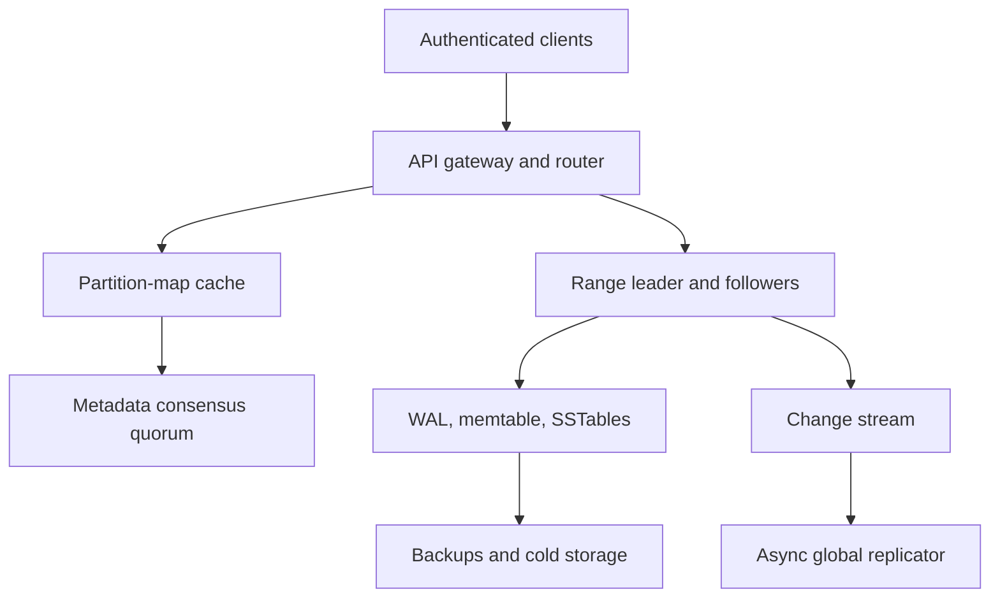
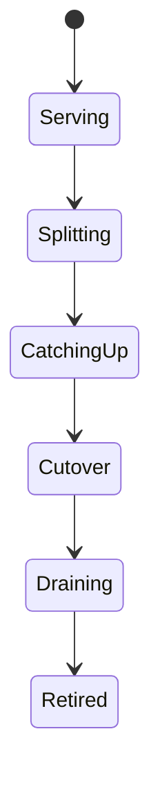

# System Design Interview Practice: Globally Replicated Key-Value Store

**Difficulty:** Advanced / Infrastructure  
**Primary themes:** partition maps, hash-range sharding, replication quorums, leader epochs, tunable consistency, conditional writes, hot keys, LSM trees, caches, compaction, tombstones, anti-entropy repair, change streams, and multi-region conflict handling

> **Interview timing vs. this walkthrough:** In a 45-minute interview, spend about 5 minutes on requirements, 2 minutes on entities, 5 minutes on the data API, 10–15 minutes building single-item reads/writes and sharding, and 10–15 minutes on consistency, hot partitions, and storage/repair. This educational walkthrough goes deeper. In the interview, first make `Put` and `Get` work correctly on one replicated partition; introduce global replication and storage-engine detail only after the end-to-end path is clear.

This walkthrough follows Hello Interview’s public delivery framework: prioritize a few requirements, name the essential entities, define the system contract, build a complete baseline one operation at a time, and use deep dives to harden the design against explicit non-functional requirements. genui{"citation":{"ref":"turn94search41"}} Hello Interview’s DynamoDB, Cassandra, consistent-hashing, and sharding guidance emphasizes access-pattern-driven keys, hash-space partitioning, replication, and an honest treatment of hot keys and consistency rather than using “NoSQL” as a black box. genui{"citation":{"refs":["turn94search4","turn94search25","turn94search26","turn94search33"]}} The prompt, assumptions, dialogue, APIs, arithmetic, and complete design below are original.

---

## Interviewer prompt

> Design a managed, multi-tenant key-value database for internet-scale applications. Clients create tables, write and read items by primary key, perform conditional mutations, query ordered items that share a partition key, and consume a change stream. The database must shard automatically, replicate durably across availability zones, offer both strongly and eventually consistent regional reads, survive node failures, and optionally replicate tables across regions.

## Targeted clarifying questions with assumed interviewer answers

**Candidate:** Is this only a simple opaque key/value API, or should it support a composite key and range queries?

**Interviewer:** Support a required partition key and optional sort key. Point operations use the full key. A query may scan an ordered sort-key range within one partition key. No arbitrary joins or cross-partition SQL.

**Candidate:** Which write operations are required?

**Interviewer:** Put, update, delete, compare-and-set conditions, and idempotent requests. Support atomic batches or transactions only when all items share one physical partition. Explain what would be needed for cross-partition transactions, but keep them out of the core design.

**Candidate:** What scale should I assume?

**Interviewer:** Five billion items averaging 1 KB, ten million reads per second, two million writes per second at peak, tens of thousands of tables, and millions of client connections across many tenants.

**Candidate:** What latency and availability targets matter?

**Interviewer:** Within the home region, point reads and writes should stay below 10 ms p99 under normal load. Reads need 99.999% availability; durable writes need 99.99%. Range queries can be slower but should be bounded and paginated.

**Candidate:** What consistency is required?

**Interviewer:** A successful regional strong write followed by a strong read must return that write. Eventual reads may be stale. Conditional writes must serialize per item. Globally replicated tables may default to asynchronous eventual consistency; discuss a single-writer/home-region option and multi-writer conflict resolution.

**Candidate:** What does a successful durable write mean?

**Interviewer:** The mutation is persisted by a quorum of replicas in different availability zones and will survive a single-node or single-zone failure within the regional model.

**Candidate:** Do we support secondary indexes?

**Interviewer:** Allow asynchronous global secondary indexes as a follow-up. They may lag. The primary design should optimize primary-key access and same-partition range queries.

**Candidate:** What item and partition limits should I use?

**Interviewer:** Maximum item size is 400 KB, but normal items are 1 KB. A single logical partition key cannot grow without bound: use an item-collection size limit and teach users to bucket very large collections.

**Candidate:** How long are deletes retained?

**Interviewer:** Deletes use tombstones long enough to reach every replica and backup/repair path. Support TTL expiration as an asynchronous delete, not as a real-time scheduler guarantee.

**Candidate:** Are scans required?

**Interviewer:** A paginated table scan may exist for administration/backfill, but it has no low-latency guarantee and must be heavily isolated from production traffic.

**Candidate:** How should identity and multi-tenancy work?

**Interviewer:** Authenticate the caller and derive tenant/table permissions from credentials. Enforce per-tenant storage, read, write, connection, and administrative quotas. Encrypt traffic and storage.

### Scope statement to say aloud

> “I’ll build an access-pattern-driven store with a partition key and optional sort key. A partition map sends the hash of the partition key to a range replica set. One epoch-fenced leader per range serializes regional writes, appends a WAL entry, replicates to a quorum, updates an LSM-backed memtable, and returns a version. Strong reads go through the leader or a quorum-safe lease; eventual reads may use followers. Range queries stay inside one logical partition key and use signed cursors. Hot ranges split online. Cross-region replication is asynchronous: a home-region policy avoids conflicts, while optional multi-writer tables use versioned deterministic resolution with documented anomalies.”

---

## 1. Requirements (~5 minutes)

### Three core functional requirements

1. **Primary-key data operations.** Create, read, update, conditionally mutate, and delete items by `(partition_key, optional_sort_key)` with idempotency and version metadata.
2. **Bounded same-partition queries.** Return an ordered sort-key range for one partition key using cursor pagination; provide TTL and change-stream events.
3. **Managed distribution and recovery.** Create/configure tables, automatically split/move partitions, replicate across failure domains, repair divergent copies, and optionally replicate across regions.

### Quantified non-functional requirements

| Property | Target | Design implication |
|---|---:|---|
| Stored items | 5B × 1 KB average ≈ 5 TB logical values | Horizontal partitioning and compressed replicated storage |
| Peak reads | 10M/s | Direct routing, follower/eventual reads, caches, admission control |
| Peak writes | 2M/s | Partitioned leaders, batched WAL, LSM sequential writes |
| Point latency | p99 < 10 ms in home region | In-memory routing, local quorum, no WAN on critical path |
| Read availability | 99.999% | Multi-AZ replicas, failover, stale-read option |
| Durable-write availability | 99.99% | RF=3, quorum=2, automated leader election |
| Regional durability | No loss after strong acknowledgement for one node/AZ failure | WAL persisted on quorum across zones |
| Item size | 400 KB maximum; 1 KB typical | Reject oversized values; blob references for large objects |
| Query result | ≤1 MB or configured item count per page | Cursor pagination and bounded server work |
| Global replication | Typical propagation <1 s; documented regional RPO | Async change log, conflict policy, lag metrics |

### Consistency and availability contract

- **Regional strong write:** the leader commits a mutation only after a majority of the replica set durably records it.
- **Regional strong read:** a read through the current leader/read-index or quorum-safe mechanism observes every previously acknowledged regional strong write.
- **Eventual read:** may use a nearby follower and return an older version, but replicas converge through replication and repair.
- **Per-item linearizable conditions:** compare-and-set evaluates and commits at the item’s current leader under one replicated log position.
- **Single-partition atomic batch:** mutations mapped to one physical partition commit as one replicated log entry/transaction.
- **No implicit cross-partition transaction:** independent partition leaders cannot atomically commit without a transaction coordinator and recovery protocol.
- **Delete dominance:** a versioned tombstone is a mutation, not immediate physical erasure. An older replica value cannot resurrect after repair.
- **TTL is approximate:** expired items are hidden at read time after expiry and removed asynchronously; clients must not rely on exact deletion time.
- **Home-region global table:** one write authority per key/table provides simple ordering; remote regions serve local stale reads and route writes home.
- **Multi-writer global table:** accepts local writes with lower latency but resolves concurrent versions deterministically. It does not provide global linearizability.
- **Availability policy is explicit:** if quorum is unavailable, strong writes fail rather than silently becoming one-copy writes. Eventual reads may continue from a surviving replica if policy permits.

### Out of scope

- Arbitrary joins, ad hoc predicates, and distributed SQL query optimization
- Unbounded range scans across the whole table on the latency-critical path
- Cross-partition ACID transactions in the baseline
- Search, vector similarity, or analytics aggregations
- Large object storage inside item values
- Global synchronous linearizability in the default multi-region mode

### Scale estimates that change design decisions

Raw logical value size:

```text
5,000,000,000 items × 1 KB ≈ 5 TB
```

Keys, indexes, metadata, tombstones, write amplification, free-space headroom, and replication can produce several times that footprint. With replication factor 3 and an estimated 2× storage-engine overhead/headroom:

```text
5 TB × 3 × 2 ≈ 30 TB regional physical footprint
```

That is manageable only as a distributed store and also shows why 400 KB should be a hard ceiling rather than the norm.

At two million 1 KB logical writes per second:

```text
2M/s × 1 KB ≈ 2 GB/s logical write ingress
```

Replication factor 3, WAL, compaction, and metadata amplify internal network/disk traffic. Random in-place disk updates would struggle; append WAL plus LSM memtables turns foreground writes into sequential I/O and pushes reorganization to background compaction.

Suppose one physical partition safely handles 5,000 writes/s under the 10 ms p99 target:

```text
2,000,000 ÷ 5,000 = 400 busy write partitions minimum
```

We need far more for read load, item count, tenant isolation, failure headroom, and skew. The key design is dynamic hash ranges, not a fixed `hash % node_count` that remaps nearly everything when capacity changes.

Ten million reads per second with a 70% eventual-read/follower-or-cache hit rate leaves:

```text
10M × 30% = 3M reads/s on authoritative leader/quorum paths
```

This directly motivates consistency selection, caches, and follower reads. It does not justify caching strong conditional decisions.

**What to say aloud:**

> “Five billion one-kilobyte items is only about five terabytes of logical values, but replication, LSM amplification, tombstones, and headroom push the real footprint much higher. Two gigabytes per second of logical writes makes an append-WAL/LSM design natural. Dynamic hash ranges let us add capacity without remapping the entire database, while explicit eventual reads and caches remove most traffic from leader paths.”

---

## 2. Core entities (~2 minutes)

| Entity | Essential fields and purpose |
|---|---|
| `Tenant` | Authenticated owner, plan, quotas, encryption key, status |
| `Table` | Schema/key definition, consistency options, TTL, change stream, global mode |
| `Item` | Partition key, optional sort key, attributes/value, version, expiry |
| `HashRange` | Token start/end, table, range epoch, replica set, leader, state |
| `Replica` | Node/AZ, role, applied/committed log position, health |
| `Mutation` | Request ID, key, operation, condition, version, timestamp, payload |
| `Tombstone` | Key/range, delete version, deletion time, GC-safe horizon |
| `SSTable` | Immutable sorted file, key/token bounds, bloom filter, sparse index, checksum |
| `ChangeRecord` | Table/key, old/new version reference, operation, sequence, source region |
| `GlobalVersion` | Origin region, hybrid logical time, writer epoch, conflict metadata |

The user-visible logical partition key is not the same as a physical database shard. Many logical keys share a hash range; hot physical ranges can split without changing the client’s key.

---

## 3. API and system interface (~5 minutes)

The gateway derives tenant, roles, table permissions, and quota class from authenticated credentials. The caller never supplies an authoritative tenant ID, replica destination, leader epoch, or billing class.

### 3.1 Create a table

```http
POST /v1/tables
Authorization: Bearer <tenant-admin-token>
Idempotency-Key: create-user-sessions-v2
Content-Type: application/json

{
  "name":"user_sessions",
  "partition_key":{"name":"user_id","type":"STRING"},
  "sort_key":{"name":"created_at_id","type":"STRING"},
  "default_ttl_seconds":2592000,
  "change_stream":true,
  "regional_replication_factor":3,
  "global_mode":"HOME_REGION",
  "home_region":"us-east"
}
```

```json
{
  "table_id":"tbl_771",
  "state":"CREATING",
  "schema_version":1,
  "routing_version":4001
}
```

### 3.2 Put or replace an item

```http
PUT /v1/tables/user_sessions/items
Authorization: Bearer <service-token>
Idempotency-Key: session-write-884
Content-Type: application/json

{
  "key":{"user_id":"usr_42","created_at_id":"2026-10-14T19:00:00Z#s_9"},
  "value":{"device":"ios","status":"ACTIVE"},
  "condition":{"attribute_not_exists":"version"},
  "ttl_seconds":2592000,
  "return":"VERSION"
}
```

```json
{
  "committed":true,
  "version":"r884:l991220",
  "expires_at":"2026-11-13T19:00:00Z"
}
```

`Idempotency-Key` is scoped to tenant, operation, and table. Reusing it with different content returns a conflict.

### 3.3 Get an item

```http
POST /v1/tables/user_sessions/items:get
Authorization: Bearer <service-token>
Content-Type: application/json

{
  "key":{"user_id":"usr_42","created_at_id":"2026-10-14T19:00:00Z#s_9"},
  "consistency":"STRONG",
  "projection":["device","status","version"]
}
```

```json
{
  "item":{"device":"ios","status":"ACTIVE","version":"r884:l991220"},
  "read_consistency":"STRONG",
  "served_region":"us-east"
}
```

Projection avoids reading/returning unused large attributes when the storage layout supports it.

### 3.4 Conditional update

```http
PATCH /v1/tables/user_sessions/items
Authorization: Bearer <service-token>
Idempotency-Key: revoke-s_9
Content-Type: application/json

{
  "key":{"user_id":"usr_42","created_at_id":"2026-10-14T19:00:00Z#s_9"},
  "set":{"status":"REVOKED"},
  "condition":{"version_equals":"r884:l991220"}
}
```

If the version changed, return `412 Precondition Failed` with no mutation. Conditional evaluation and mutation occur at the same range leader/log entry.

### 3.5 Delete an item

```http
DELETE /v1/tables/user_sessions/items
Authorization: Bearer <service-token>
Idempotency-Key: delete-s_9
Content-Type: application/json

{
  "key":{"user_id":"usr_42","created_at_id":"2026-10-14T19:00:00Z#s_9"},
  "condition":{"version_equals":"r885:l991400"}
}
```

Deletion commits a tombstone version. Physical bytes disappear after repair/backup/replication safety horizons.

### 3.6 Query one logical partition

```http
POST /v1/tables/user_sessions:query
Authorization: Bearer <service-token>
Content-Type: application/json

{
  "partition_key":{"user_id":"usr_42"},
  "sort_key":{"between":["2026-10-01","2026-10-31￿"]},
  "order":"DESC",
  "limit":100,
  "consistency":"EVENTUAL",
  "cursor":null
}
```

```json
{
  "items":[{"created_at_id":"...","device":"ios","status":"ACTIVE"}],
  "next_cursor":"eyJyYW5nZV9lcG9jaCI6...",
  "read_consistency":"EVENTUAL"
}
```

The signed cursor binds table, logical partition, sort bounds, last key, range/routing version, consistency, and expiry.

### 3.7 Same-partition atomic batch

```http
POST /v1/tables/user_sessions:transact
Authorization: Bearer <service-token>
Idempotency-Key: rotate-session-42
Content-Type: application/json

{
  "partition_key":{"user_id":"usr_42"},
  "operations":[
    {"update":{"sort_key":"old","set":{"status":"REVOKED"}}},
    {"put":{"sort_key":"new","value":{"status":"ACTIVE"}}}
  ]
}
```

The router verifies every key maps to the same physical range at the request’s routing epoch. One leader appends a single atomic mutation entry.

### Important errors

| Status/error | Meaning |
|---|---|
| `400` | Invalid key, condition, item size, projection, or range |
| `403` | Identity lacks table/action permission |
| `409` | Idempotency payload mismatch or table/range transition conflict |
| `412` | Conditional expression/version failed |
| `413` | Item or batch exceeds policy |
| `429` / `THROTTLED` | Tenant, table, logical key, or physical range quota exceeded |
| `MOVED` / `STALE_ROUTE` | Refresh routing map and retry new owner |
| `NOT_LEADER` / `STALE_EPOCH` | Refresh leader metadata and retry safely |
| `QUORUM_UNAVAILABLE` | Requested durability/consistency cannot be met |
| `410` | Cursor expired or incompatible after migration; restart query |

---

## 4. Data flow

### Strong write flow

1. Gateway authenticates, authorizes, validates size/schema, and charges quota.
2. Router hashes the partition key and finds a `HashRange` in its cached versioned partition map.
3. Request reaches the range leader with routing/range epoch and idempotency identity.
4. Leader checks duplicate request state and evaluates any condition against the current item version.
5. Leader appends one mutation to its write-ahead log and replicates the ordered entry to followers in other zones.
6. A quorum persists and acknowledges; the leader marks the log position committed.
7. Replicas apply the mutation to memtables and change-stream buffers in log order.
8. Leader returns the committed version. A lost response can be retried with the same idempotency key.

### Strong/eventual read flow

1. Router locates the current range.
2. Strong read uses the current leader under a valid lease/read index, or a quorum mechanism that proves freshness.
3. Eventual read chooses a nearby healthy follower or cache.
4. Replica checks memtable, immutable memtables, block cache, Bloom-filter-pruned SSTables, and remote tier if necessary.
5. It reconciles visible versions/tombstones and applies TTL filtering.
6. Result includes consistency level and version metadata.

### Range query flow

1. Hash the logical partition key to one physical range.
2. Seek to `(partition_key, sort_key_start)` in the sorted storage layout.
3. Merge memtable and SSTable iterators, discard shadowed versions/tombstones/expired items.
4. Stop at item/byte/time limit.
5. Return a signed cursor containing the last full key and routing/range epoch.

---

## 5. High-level design (~10–15 minutes)

### Compact architecture



### Operation 1: store one item on one node

Start with a single-node map:

```text
key = encode(partition_key, sort_key)
value = attributes + version + expiry
```

For durability:

1. append mutation to a WAL;
2. update an ordered in-memory memtable;
3. acknowledge after the chosen durability boundary;
4. flush a full memtable into an immutable sorted table;
5. compact sorted tables in the background.

This gives a complete single-node `Put`/`Get` baseline but no high availability or horizontal scale.

### Operation 2: partition the hash space

Hash only the partition key:

```text
token = H(table_id || canonical_partition_key)
```

The metadata service maps contiguous token ranges to replica sets:

```text
[0000, 1fff] -> range A, replicas [n1,n4,n9]
[2000, 3fff] -> range B, replicas [n2,n5,n8]
...
```

Sort keys remain ordered inside the logical partition because the on-disk key is:

```text
(token, raw_partition_key, sort_key)
```

A centralized versioned partition map is easier to rebalance deliberately than exposing a peer-to-peer ring to clients. Hello Interview notes that modern DynamoDB-like systems conceptually use hash partitioning with a centralized partition/placement map rather than requiring an exposed classic ring. genui{"citation":{"refs":["turn94search4","turn94search33"]}}

Routers cache the map. Every request carries routing/range epoch. An old owner returns a signed/validated `MOVED` or stale-route error rather than forwarding indefinitely.

### Operation 3: replicate one range

Each range has three replicas in distinct failure domains. One leader owns an epoch and ordered replication log.

Write path:

```text
client → current leader → follower A and follower B
                     ← quorum acknowledgements
client ← committed version
```

With three replicas, quorum two tolerates one unavailable replica for durable writes. Followers catch up through log replication; a lagging follower may require a snapshot/SSTable transfer if history is truncated.

The metadata quorum elects and fences leaders. It does not carry item data. Range leaders periodically checkpoint applied/committed log positions.

### Operation 4: serve strong and eventual reads

Strong options:

- leader read after confirming leadership/commit index;
- follower read with a valid leader-granted lease and applied position;
- quorum read comparing versions.

Choose leader/read-index for the baseline because it gives clear linearizable semantics without merging every read. Lease reads may lower latency but require bounded clock assumptions and careful revocation.

Eventual reads can go to any healthy replica and may return stale data. Amazon’s DynamoDB documentation similarly distinguishes cheaper eventually consistent reads from optional strongly consistent reads that reflect successful prior writes in the supported scope. genui{"citation":{"ref":"turn94search1"}}

Never serve a “strong” result from a follower solely because it looks healthy; prove it holds the required committed position under a valid epoch.

### Operation 5: add conditional writes and idempotency

The leader serializes an item’s mutations through its replicated log. For compare-and-set:

1. read current version in the leader state machine;
2. evaluate condition;
3. if true, append condition result plus mutation atomically;
4. quorum commit;
5. cache `(idempotency_key, request_hash, response)` for the retry horizon.

Followers apply the already decided log entry; they do not reevaluate a condition against possibly different local timing.

For a same-range atomic batch, encode all writes in one log entry and apply all-or-none. Cross-range atomicity would require prepare/commit records, coordinator recovery, locks/intents, timeouts, and participant fencing—a major extension with higher tail latency.

### Operation 6: build the LSM read/write path

Foreground write:

```text
replicated WAL append → mutable memtable → immutable memtable → SSTable flush
```

Read:

```text
memtables → block/row cache → Bloom filters → sparse indexes → SSTable blocks
```

A Bloom filter can say “definitely absent” or “maybe present,” avoiding disk reads for SSTables that cannot contain the key. It never proves a value exists.

Compaction merges overlapping sorted files, keeps the newest visible version, and eventually drops obsolete values/tombstones only after the GC-safe horizon. More aggressive compaction lowers read amplification but increases write amplification and I/O.

### Operation 7: query by partition and sort key

Because all items for one logical partition key share a token and are ordered by sort key, the server can seek and stream a contiguous range. Bound each page by bytes, item count, and server time.

Do not let one logical partition key contain billions of items indefinitely. Enforce an item-collection size/throughput limit and teach clients to bucket:

```text
partition_key = user_id#YYYY-MM
sort_key      = event_time#event_id
```

This trades one unbounded hotspot for multiple predictable buckets. Cross-bucket reads fan out at the application/service layer with explicit bounds.

### Operation 8: expose change streams

Every committed mutation produces an ordered record associated with its source range/log position:

```text
change(table_id, key, operation,
       old_version?, new_version?,
       range_id, log_position, source_region)
```

Publish after the database mutation commits, from the replicated commit log or transactional outbox inside the storage engine. Do not synchronously dual-write to an external queue before acknowledging.

Consumers checkpoint per stream shard. Split/merge events include parent-child sequence boundaries so consumers can drain parents before children without gaps.

### Operation 9: cache safely

Cache layers:

1. routing metadata cache keyed by table/routing version;
2. per-node block cache for hot SSTable blocks;
3. optional item cache keyed by `(table, full_key, version)`;
4. client-side eventual cache for application-approved workloads.

Strong reads cannot blindly trust a TTL cache because a newer committed write may exist. Options include leader-owned cache updated synchronously with apply, version validation, or bypass. Negative caches need short TTL/versioning because a new item may be created.

Cache admission should resist scan pollution. Separate administrative scans and backfills from latency-sensitive caches/I/O pools.

---

## 6. Deep dives (~10–15 minutes)

### Deep dive A: hot keys, range splits, and online rebalancing

#### Where the baseline breaks

Uniform hashing balances many independent keys, but it cannot spread one extremely hot partition key because same-key range ordering must remain together. Fixed modulo sharding remaps nearly every key when node count changes. A split can serve stale owners or double-apply writes if routing epochs and handoff are vague.

#### Partitioning approaches

| Approach | Strength | Limitation |
|---|---|---|
| `hash(key) % N` | Very simple | Massive remap when `N` changes |
| Consistent-hash ring/vnodes | Limited movement, decentralized | Operational balancing/routing complexity |
| Centralized hash-range map | Explicit placement and online range split | Metadata service and versioned routing required |
| Range on raw key | Efficient adjacent scans | Skew from monotonic/tenant keys |

Choose hash ranges over the partition key with a replicated centralized placement map. It keeps client distribution uniform while permitting a specific physical range to split or move.

#### Online range split

Suppose range `[A,Z)` becomes hot and splits at `M`:

1. metadata marks parent `SPLITTING` under range epoch 44;
2. leader chooses a committed log barrier `B`;
3. snapshot/SSTable references are divided or logically shared for `[A,M)` and `[M,Z)`;
4. mutations after `B` are replayed/routed into child logs while parent remains authoritative;
5. children catch up and verify counts/checksums;
6. metadata atomically publishes children under routing version 4002 and new epochs;
7. parent rejects new traffic with `STALE_ROUTE` and forwards only during a bounded grace if desired;
8. old parent data remains until requests, snapshots, and repair references drain.



The exact implementation may physically rewrite SSTables later. Immutable file references can make logical splitting cheap at cutover.

#### Moving a replica

To rebalance without losing quorum:

1. add destination as a learner/non-voting replica;
2. copy a snapshot of immutable files;
3. stream log tail after snapshot position;
4. validate and catch up to commit index;
5. promote destination into replica set;
6. update metadata and, if needed, transfer leadership;
7. remove source only after safe quorum and grace.

Do not remove before adding: temporary under-replication turns routine balancing into a durability incident.

#### One hot logical partition key

Physical splitting cannot divide a single logical key if all its sort-key items must be co-located and strongly ordered. Choices:

- cache/read-replicate the key if read hot;
- reserve/adapt extra capacity for its range;
- serialize writes at the leader and publish the throughput ceiling;
- require a sharded/bucketed application key;
- relax ordering so subkeys can distribute writes;
- isolate a whale tenant/key on dedicated capacity.

AWS’s partition-key guidance similarly emphasizes high-cardinality keys and notes finite per-partition throughput, while adaptive capacity helps only within physical/table limits. genui{"citation":{"ref":"turn94search5"}}

#### Admission and fairness

Use hierarchical budgets:

- tenant/table read and write units;
- per-logical-key burst limit;
- per-physical-range queue/bytes;
- background compaction/repair budget;
- node/zone failover reserve.

Throttle before a range queue destroys p99. Return retry-after/backoff hints. Fair-queue across tenants so one range owner cannot monopolize node threads.

#### Observability

- read/write QPS and bytes by table/range/key sketch
- hottest-key share and skew coefficient
- throttle time by tenant/table/key/range
- range size, item count, and split recommendation age
- split/move snapshot bytes, catch-up lag, validation failures
- stale-route and routing-refresh rate
- leader distribution and AZ/node capacity imbalance
- p99 queue time versus storage/replication time

**What to say aloud:**

> “Hash ranges distribute ordinary keys and let us split only the overloaded part of the token space. A split uses a committed barrier, versioned routing, child catch-up, and an atomic metadata cutover. But no physical split can save one strictly ordered hot logical key; that requires caching, reserved capacity, or an application-visible bucket key that relaxes one-key ordering.”

### Deep dive B: regional consistency and global conflict semantics

#### Where the baseline breaks

A single copy loses data. Independent multi-leader replicas can accept concurrent writes to the same key. Wall-clock last-write-wins is vulnerable to skew. Quorum formulas are often quoted without defining which replicas participate, whether membership changed, or how stale leaders are fenced. Cross-region synchronous quorum can violate the 10 ms target.

#### Regional replication choices

| Model | Benefit | Cost/limitation |
|---|---|---|
| Leader + majority replication | Clear order and linearizable reads/writes | Leader failover and hotspot ceiling |
| Leaderless `R/W/N` quorums | High availability and flexible reads | Version reconciliation and sibling/conflict complexity |
| Chain replication | High throughput and clear head/tail roles | Reconfiguration complexity |

Choose leader + majority per physical range for a simple, strong regional contract. Leaderless quorum is plausible for an availability-first store, but then vector/version reconciliation, read repair, and concurrent siblings become central rather than optional.

#### Regional leader protocol

- controller assigns replica membership and leader epoch;
- leader orders mutations in a replicated log;
- quorum commit establishes a stable version/log index;
- old leaders are fenced by epoch;
- new leader must contain the committed prefix;
- strong reads prove leadership and committed position;
- eventual follower reads advertise that they may lag.

With RF=3, quorum writes survive one replica/AZ loss. If only one replica remains, eventual reads may be available, but strong writes fail.

#### Conditional writes

A compare-and-set such as `version == v7` is not a client-side read followed by an unconditional write. Both condition evaluation and mutation happen in the leader state machine and are quorum committed as one decision. Two concurrent writers cannot both win the same expected version.

#### Global option 1: home-region authority

Each table or key has a home region:

- writes route to home and use the regional strong protocol;
- committed changes replicate asynchronously outward;
- remote reads are local and eventual, or route home for strong freshness;
- failover promotes a new home under a global fencing epoch after checking replication position/RPO.

This is the recommended default when per-key correctness matters. It avoids concurrent conflicts but adds WAN latency for remote writes.

#### Global option 2: multi-writer eventual

Any region accepts local writes. Each mutation carries:

```text
global_version(origin_region,
               hybrid_logical_timestamp,
               writer_epoch,
               mutation_id)
```

Conflict policy options:

- deterministic last-writer-wins using HLC plus tie-breaker;
- application-provided merge for maps/sets/counters;
- preserve siblings and force application resolution;
- field-level CRDT semantics for supported types.

Plain wall-clock LWW is easy but can lose a valid concurrent write due to skew. HLC preserves causal-ish ordering better, but deterministic resolution still discards information unless the data type merges.

Amazon documents a similar distinction: eventually consistent multi-region tables asynchronously replicate changes, while stronger global modes pay synchronous replication costs. genui{"citation":{"refs":["turn94search1","turn94search8","turn94search14"]}}

#### Global delete conflicts

A tombstone must participate in the same conflict rules. Never treat “missing” as older than every value by accident. If region A deletes and region B concurrently updates:

- LWW chooses by global version;
- remove-wins policy lets deletion dominate concurrent updates;
- add-wins keeps update;
- application merge decides.

Document the table policy. Retain tombstones until all regions/replicas are beyond the mutation plus a safety window; premature garbage collection can resurrect old values.

#### Failover fencing

Async replication creates a dangerous period where old and new homes might both accept writes. Promotion requires a global table/key writer epoch stored in a small strongly consistent control plane:

1. acquire/promote new epoch;
2. revoke/reroute old writer credentials;
3. choose recovery position and quantify missing tail;
4. new region rejects mutations with older global writer epoch;
5. repair/reconcile returning region before rejoining.

Failover is not just DNS.

#### Observability

- regional quorum latency and unavailable-quorum rate
- leader election/fencing and term changes
- strong versus eventual read traffic and follower staleness
- conditional failure/contention rate by key
- cross-region change lag in time/bytes/versions
- conflict count, type, winner origin, discarded siblings
- tombstone replication horizon and premature-GC guard
- home-region failover epoch, RPO gap, recovery duration
- clock/HLC anomaly metrics

**What to say aloud:**

> “Inside a region I use an epoch-fenced range leader and majority replication, so conditional writes and strong reads have a clean linearizable contract. Across regions, the default is asynchronous home-region authority. Multi-writer mode is an explicit weaker product: every mutation has a global version, conflicts use a documented LWW/merge policy, deletes are versioned tombstones, and failover requires a globally fenced writer epoch—not just traffic rerouting.”

### Deep dive C: LSM storage, deletes, repair, and backups

#### Where the baseline breaks

An in-memory map loses data. Updating random on-disk rows at two million writes/s creates poor write locality. LSM trees defer work, but unchecked compaction consumes I/O and causes read amplification. A tombstone deleted too early can resurrect data from an offline replica. Replication protects availability but does not protect against software bugs, operator deletion, or latent corruption.

#### Write path

1. validate mutation and version at leader;
2. append/checksum replicated WAL entry;
3. after commit, update mutable memtable;
4. rotate full memtable to immutable;
5. flush sorted SSTable with metadata, Bloom filter, sparse/block index, checksum;
6. advance durable checkpoint so old WAL can be recycled after replica/recovery constraints.

The WAL provides crash recovery; SSTables provide durable sorted state. A follower applies the same committed log order but may flush/compact into different physical files while preserving logical versions.

#### Read path and reconciliation

1. check row/item cache where consistency permits;
2. search mutable/immutable memtables;
3. consult Bloom filters for candidate SSTables;
4. use sparse indexes to load relevant blocks;
5. merge versions by full key/version sequence;
6. honor tombstones and TTL;
7. stop after newest visible committed version is proven.

Block caches should use scan-resistant admission. A table scan must not evict the working set for point reads.

#### Compaction strategies

| Strategy | Good for | Tradeoff |
|---|---|---|
| Size-tiered | Write-heavy workloads | Higher read/space amplification |
| Leveled | Point reads and bounded space | Higher write amplification |
| Time-window | Time-bucketed/TTL data | Poor fit for arbitrary updates |

Choose per-table workload policy, with leveled as a reasonable point-read default. Rate-limit compaction and reserve I/O for foreground reads, WAL, and replication.

#### Tombstones and TTL

Delete writes a tombstone with a logical version and deletion timestamp. Reads suppress older values. Compaction may drop both tombstone and shadowed values only when:

- every replica/region has passed the delete version or repair horizon;
- backup/PITR semantics no longer require it in live files;
- the configured GC grace elapsed;
- no snapshot references the file version.

TTL expiration behaves similarly. A read hides expired data immediately according to safe time semantics; background expiry/compaction removes bytes later. TTL is not an exact callback scheduler.

#### Hinted handoff and repair

In a leader-based regional design, the replication log is the first catch-up mechanism. If a follower is offline beyond retained log history, install a snapshot/SSTable set and tail changes.

For an availability-first or global multi-writer path, add:

- **hints:** temporarily retain mutations for an unavailable replica;
- **read repair:** detect mismatched versions while reading and update stale copies;
- **anti-entropy repair:** compare Merkle-tree hashes by range and stream differences.

Cassandra’s documentation stresses that hints and read repair reduce inconsistency windows but are best-effort; full/incremental anti-entropy repair is what guarantees convergence. genui{"citation":{"refs":["turn94search0","turn94search2","turn94search3"]}}

Do not call replication “backups,” and do not call hints a replacement for repair.

#### Backup and point-in-time recovery

Recovery layers:

1. replicated live copies for hardware/AZ failure;
2. immutable SSTable snapshots/manifests in object storage;
3. retained mutation log/change stream after snapshot point;
4. table metadata/schema/routing history;
5. tested restore workflow into an isolated table/cluster.

PITR chooses snapshot `S` and replays committed mutations through target time `T`. The restored table gets new identity/routing until explicitly promoted, preventing accidental overwrite of production.

#### Corruption handling

- per-block/file checksum verification;
- background scrub of local and object copies;
- replica version/hash comparison;
- quarantine corrupted files/nodes;
- repair from healthy replica or backup;
- audit every data-loss or manual-skip decision;
- measure backup restore, not just backup creation.

#### Observability

- WAL append/fsync and quorum latency
- memtable bytes, flush queue, stalled writes
- SSTable count and read amplification per request
- Bloom-filter false-positive rate
- block/item cache hit and scan pollution
- compaction pending bytes, throughput, write amplification, tombstone density
- disk free space and failure-watermark time
- replica applied/commit lag and snapshot-install rate
- repair coverage age, Merkle mismatch, streamed bytes
- TTL backlog and tombstone GC-safe horizon
- backup age, checksum failures, restore-drill RPO/RTO

**What to say aloud:**

> “The foreground path is replicated WAL plus memtable; immutable SSTables and compaction make storage efficient later. Deletes are versioned tombstones and cannot be garbage-collected until every replica and region is safely beyond them, or old values can resurrect. Replication handles live failures; anti-entropy catches silent divergence; immutable snapshots plus log replay provide real backup and point-in-time restore.”

---

## 7. Finish

### Concise final design

The database exposes an access-pattern-driven API over a required partition key and optional sort key. An authenticated gateway applies ACLs/quotas, hashes the partition key, and uses a versioned metadata map to route directly to the current hash-range replica set. The sort key remains ordered within the logical partition, enabling bounded cursor-based range queries without global scans.

Each physical range has three replicas across availability zones and one epoch-fenced leader. The leader deduplicates requests, evaluates item conditions, appends an ordered WAL mutation, replicates it to a quorum, and returns a version only after commit. Strong reads prove current leadership/commit position; eventual reads may use followers and caches. Same-range batches use one atomic log entry; cross-range transactions are excluded from the baseline.

Replicas apply committed mutations to memtables and flush immutable SSTables. Bloom filters, sparse indexes, block caches, and compaction optimize point/range reads while keeping foreground writes sequential. Deletes and TTLs become versioned tombstones; garbage collection waits for replication, repair, region, snapshot, and grace horizons. Change streams derive from the committed mutation log.

The control plane splits hot/large ranges using committed barriers, child catch-up, versioned routing, and atomic cutover. It moves replicas by add/catch-up/promote/remove. One truly hot ordered logical key still needs caching, dedicated capacity, or application bucketing. Home-region global tables asynchronously replicate a single write authority; optional multi-writer tables use explicit HLC/versioned conflict semantics and globally fenced regional promotion. Hints/read repair reduce inconsistency windows, anti-entropy verifies convergence, and snapshots plus log replay provide point-in-time recovery.

### Requirements check

| Requirement | Design support |
|---|---|
| Point get/put/delete | Direct hash-range routing and replicated leader |
| Conditional update | Leader state-machine compare-and-set |
| Same-partition transaction | One atomic replicated mutation entry |
| Ordered range query | Co-located partition key and sorted sort key |
| 5B items | Dynamic hash ranges and distributed SSTables |
| 10M reads/s | Caches, direct routing, replicas, eventual read option |
| 2M writes/s | Range parallelism, WAL batching, LSM sequential writes |
| p99 < 10 ms regionally | In-memory route, local quorum, bounded operations |
| Durable write | RF=3, majority commit across zones |
| Strong read | Leader/read-index or proven fresh lease |
| Eventual read | Nearby follower with explicit stale semantics |
| Hot range | Online split/move and adaptive admission |
| Hot logical key | Cache, isolate, or application bucketing |
| Delete/TTL safety | Versioned tombstones and GC-safe horizon |
| Change stream | Committed-log-derived records and split lineage |
| Global tables | Home-region async default; explicit multi-writer conflicts |
| Repair | Log catch-up, snapshot install, hints/read repair/anti-entropy where needed |
| Recovery | Replicas, immutable snapshots, mutation replay, restore drills |

## Realistic interviewer follow-up questions with strong sample answers

**Interviewer:** Why hash only the partition key?

**Candidate:** It co-locates every sort-key item for one logical partition, enabling ordered range queries and same-partition atomic mutations. Hashing the full composite key would distribute those items and require fan-out.

**Interviewer:** Why not use `hash(key) % number_of_nodes`?

**Candidate:** Adding or removing a node remaps almost every key. A versioned hash-range map moves or splits only selected ranges and makes placement across zones explicit.

**Interviewer:** Why use a centralized partition map instead of consistent hashing?

**Candidate:** Both minimize movement. A centralized map lets a managed service make deliberate split, merge, placement, and tenancy decisions. The metadata quorum must be highly available, but clients cache versions so it is not on every data operation.

**Interviewer:** What happens when a router has stale metadata?

**Candidate:** Requests carry routing/range epoch. The old owner rejects with `STALE_ROUTE` or bounded forwarding information; the client refreshes and retries with the same idempotency key.

**Interviewer:** How do you split without losing writes?

**Candidate:** Pick a committed barrier, bootstrap child ranges from a snapshot, replay post-barrier mutations, validate/catch up, atomically publish the new routing version, and fence/drain the parent.

**Interviewer:** Can a split solve a single celebrity key?

**Candidate:** Not while keeping all its sort-key items co-located and strictly ordered. I must cache reads, give it dedicated capacity, or change the application key to buckets/subshards and accept different ordering/query semantics.

**Interviewer:** What does a successful strong write guarantee?

**Candidate:** The current range leader ordered it and a majority of replicas in distinct failure domains durably recorded it. A valid future leader contains that committed prefix.

**Interviewer:** How can a follower serve a strong read?

**Candidate:** Only if it proves it has applied the required commit index under a still-valid leader lease/epoch. Health alone is insufficient. Otherwise route to the leader/read-index path.

**Interviewer:** Why not use quorum reads for everything?

**Candidate:** They increase fan-out and tail latency. A leader-based log already establishes the latest committed state, so a proven leader read is simpler. Quorum reads fit a leaderless design where reconciliation is central.

**Interviewer:** How does compare-and-set avoid a race?

**Candidate:** The leader evaluates the expected version and appends the result/mutation as one serialized state-machine operation. It is not a client-side read followed by a separate write.

**Interviewer:** What if the write commits but the response is lost?

**Candidate:** Retry with the same idempotency key and request hash. The leader or recovered state returns the stored result/version; a different payload under that key is rejected.

**Interviewer:** Why an LSM tree?

**Candidate:** It converts random item updates into sequential WAL and sorted-file writes, which supports high write throughput. The tradeoff is compaction, read amplification, and tombstone management.

**Interviewer:** What does a Bloom filter do?

**Candidate:** It cheaply rules out SSTables that definitely do not contain the key. A positive is only “maybe,” so the engine still checks the file/index.

**Interviewer:** Why not physically erase a delete immediately?

**Candidate:** An offline replica or old SSTable might later return the prior value. A versioned tombstone must propagate and suppress older versions until the repair/replication/backup safety horizon passes.

**Interviewer:** Is TTL exact?

**Candidate:** No. Reads hide expired items after expiry, while storage cleanup is asynchronous. It is data lifecycle, not a precise scheduler.

**Interviewer:** How are global concurrent writes resolved?

**Candidate:** The default avoids them through a home-region authority. Optional multi-writer tables attach HLC/origin/epoch versions and use a documented LWW, merge, sibling, or CRDT policy. That is eventual convergence, not global linearizability.

**Interviewer:** Why is regional failover more than DNS?

**Candidate:** The old writer must be fenced through a higher global writer epoch, the promoted region chooses a known replication position, and we quantify/reconcile the missing tail. Otherwise split brain creates conflicting authorities.

**Interviewer:** Aren’t three replicas a backup?

**Candidate:** No. Replicas can copy corruption, bugs, or accidental deletes. Backups are immutable snapshots plus retained mutations, separate failure domains, and regularly tested restores.

**Interviewer:** What would you build first?

**Candidate:** One region, a versioned hash-range map, RF=3 range leaders, WAL/memtable/SSTable storage, point operations, conditional versions, same-partition query, quotas, and core latency/replication metrics. Then add online splits, change streams, repair, PITR, and global replication.

## Common pitfalls

1. Choosing a database before defining access patterns.
2. Claiming arbitrary queries from a partition-key store.
3. Hashing the full composite key and losing same-partition range locality.
4. Using fixed modulo sharding and ignoring remapping.
5. Saying “consistent hashing” without a routing or rebalancing protocol.
6. Treating the logical partition key as identical to a physical shard.
7. Assuming physical range splitting fixes one hot logical key.
8. Moving a replica by removing the old copy before the new one catches up.
9. Omitting routing and leader epochs during split/failover.
10. Forwarding stale-routed requests forever and creating chains.
11. Acknowledging a strong write before quorum durability.
12. Serving “strong” reads from arbitrary healthy followers.
13. Silently weakening strong writes when quorum is unavailable.
14. Implementing compare-and-set as a client read plus write.
15. Retrying ambiguous writes without idempotency identity.
16. Claiming cross-partition atomicity from per-partition logs.
17. Putting cross-region WAN quorum on a 10 ms default path.
18. Calling multi-writer LWW globally strongly consistent.
19. Using raw wall-clock timestamps without skew/conflict discussion.
20. Ignoring delete-versus-update conflict semantics.
21. Failing over a global writer without fencing the old region.
22. Storing 400 KB values as the normal case.
23. Treating TTL as an exact scheduled callback.
24. Deleting tombstones before replicas/regions/repairs pass them.
25. Ignoring LSM read, write, and space amplification.
26. Letting compaction starve foreground replication or reads.
27. Misstating Bloom filters as proof that a key exists.
28. Letting scans pollute the production block cache.
29. Caching strong reads without version/freshness validation.
30. Negative-caching absent keys for too long.
31. Emitting change events with a non-atomic application dual write.
32. Losing stream ordering/lineage during range split.
33. Treating hinted handoff as guaranteed repair.
34. Relying only on read repair for cold data.
35. Calling live replicas a backup.
36. Creating backups without performing restore drills.
37. Monitoring average latency but not hot-range queue time and p99.
38. Applying quotas only after memory and disk queues are saturated.
39. Failing to reserve capacity for repair and failover.
40. Starting with CRDTs or two-phase commit before completing basic `Put`/`Get`.

## A polished 60-second close

> “I expose a partition-key and optional sort-key API, derive tenant identity from authentication, and hash the partition key through a versioned range map. Each range has three cross-zone replicas and one epoch-fenced leader. The leader deduplicates retries, serializes conditional mutations, appends a WAL record, and acknowledges only after majority durability; strong reads prove current commit position, while eventual reads use followers and caches. Committed data enters memtables and immutable SSTables, with Bloom filters, sparse indexes, compaction, and versioned tombstones. Hot physical ranges split online at a committed barrier with child catch-up and atomic routing cutover; one hot logical key still requires caching, isolation, or application bucketing. Change streams derive from the commit log. Global tables default to asynchronous home-region authority; multi-writer mode has explicit HLC/version conflict semantics and fenced promotion. Replication handles live faults, anti-entropy repairs divergence, and immutable snapshots plus mutation replay provide real point-in-time recovery.”

## References

- [Hello Interview: System Design Delivery Framework](https://www.hellointerview.com/learn/system-design/in-a-hurry/delivery)
- [Hello Interview: DynamoDB Deep Dive](https://www.hellointerview.com/learn/system-design/deep-dives/dynamodb)
- [Hello Interview: Cassandra Deep Dive](https://www.hellointerview.com/learn/system-design/deep-dives/cassandra)
- [Hello Interview: Consistent Hashing](https://www.hellointerview.com/learn/system-design/core-concepts/consistent-hashing)
- [Hello Interview: Sharding](https://www.hellointerview.com/learn/system-design/core-concepts/sharding)
- [AWS DynamoDB: Read Consistency](https://docs.aws.amazon.com/amazondynamodb/latest/developerguide/HowItWorks.ReadConsistency.html)
- [AWS DynamoDB: Partition-Key Design](https://docs.aws.amazon.com/amazondynamodb/latest/developerguide/bp-partition-key-design.html)
- [AWS DynamoDB: Global Tables](https://docs.aws.amazon.com/amazondynamodb/latest/developerguide/globaltables-CoreConcepts.html)
- [Apache Cassandra: Dynamo Architecture](https://cassandra.apache.org/doc/latest/cassandra/architecture/dynamo.html)
- [Apache Cassandra: Hinted Handoff](https://cassandra.apache.org/doc/latest/cassandra/managing/operating/hints.html)
