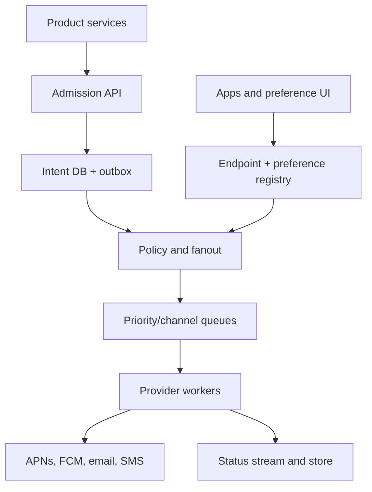

# System Design Interview Practice: Multichannel Notification System

**Difficulty:** Medium–Advanced  
**Primary themes:** event-driven fanout, priority queues, user preferences, scheduling, idempotency, provider adapters, retries, rate limits, backpressure, delivery semantics, observability, and regional reliability

> **Interview timing vs. this walkthrough:** In a 45-minute interview, spend about 5 minutes on requirements, 2 minutes on entities, 5 minutes on interfaces, 10–15 minutes building single-recipient delivery before bulk fanout, and 10–15 minutes on retries/backpressure, preference correctness, and reliability. This educational version is deliberately more complete. In the interview, get one notification from producer to provider first; only then add campaigns, scheduling, and multi-region operation.

This answer uses Hello Interview’s public delivery structure: establish requirements, entities, and interfaces before building the high-level design one requirement at a time, then use deep dives for the load-bearing non-functional requirements. genui{"citation":{"refs":["turn95search22","turn95search41"]}} The APIs, estimates, dialogue, failure analysis, and design choices below are original.

---

## Interviewer prompt

> Design a managed notification platform that product services can use to send transactional and promotional notifications through mobile push, email, SMS, and an in-app inbox. It should support individual recipients and large audiences, user preferences and quiet hours, scheduling, templates, retries, provider failover, delivery-status tracking, and protection against duplicates and overload.

## Targeted clarifying questions with assumed interviewer answers

**Candidate:** Which channels are required, and does the platform own the last mile?

**Interviewer:** Support push, email, SMS, and in-app. The platform calls providers such as APNs, FCM, email vendors, and SMS vendors; it does not control the handset or carrier.

**Candidate:** What notification classes exist?

**Interviewer:** Transactional notifications such as security alerts, order updates, and direct-message alerts; and promotional campaigns. Security-critical messages may bypass ordinary marketing preferences when legally and contractually allowed.

**Candidate:** What scale should I assume?

**Interviewer:** 200 million users, 500 million registered devices/endpoints, 10 billion notification attempts per day, 1 million accepted notifications per second during bursts, and campaigns targeting up to 100 million users.

**Candidate:** What latency targets matter?

**Interviewer:** For high-priority transactional traffic, p99 time from accepted request to first provider attempt should be below five seconds. Normal traffic should usually begin within one minute. Scheduled campaigns may have a one-minute start-time tolerance.

**Candidate:** What delivery guarantee should the API promise?

**Interviewer:** Once accepted durably, do not silently lose the notification before its expiry. Internal processing may be at least once. Minimize user-visible duplicates with idempotency and channel-specific collapse/deduplication. Do not claim exactly-once delivery to devices.

**Candidate:** Do clients specify user contact information?

**Interviewer:** No. Identity comes from authentication, and recipient IDs resolve through an endpoint registry. This avoids leaking phone numbers, email addresses, and device tokens through every producer.

**Candidate:** How should preferences work?

**Interviewer:** Support global/channel/category opt-outs, quiet hours, locale, frequency caps, and endpoint status. A preference change should affect newly evaluated promotional notifications within seconds. Transactional policy varies by category.

**Candidate:** Do we need per-user ordering?

**Interviewer:** Preserve order for notifications in the same product-defined ordering key when practical, but availability and expiry matter more than global ordering. Campaign notifications do not need a global total order.

**Candidate:** What counts as delivered?

**Interviewer:** Distinguish accepted by our platform, attempted, accepted by provider, device/app acknowledged where available, opened, and failed. Provider acceptance is not proof the user saw it.

**Candidate:** What happens when a provider is throttling or down?

**Interviewer:** Apply bounded exponential backoff, honor provider retry guidance, shift to another provider only when semantics allow it, and prevent promotional traffic from starving transactional traffic.

**Candidate:** What is out of scope?

**Interviewer:** Building an email/SMS carrier, composing arbitrary marketing journeys, ad targeting, and guaranteeing handset display.

### Scope statement to say aloud

> “I’ll separate acceptance from delivery. The API durably stores a notification intent and outbox event, then an orchestrator resolves recipients, policy, template, and eligible endpoints. It emits one channel task per attempt into priority-isolated queues. Provider workers use idempotent attempt records, token-bucket rate limits, circuit breakers, and bounded retries. Status events update an append-oriented delivery history. Bulk campaigns expand incrementally, not in one transaction. The contract is at-least-once internal processing with user-visible deduplication where possible—not exactly-once display.”

---

## 1. Requirements (~5 minutes)

### Three core functional requirements

1. **Send and schedule notifications.** Accept single-user, multi-user, and campaign intents with template data, priority, TTL, requested channels, ordering/collapse keys, and idempotency.
2. **Resolve policy and deliver through multiple channels.** Apply preferences, quiet hours, frequency caps, locale, endpoint health, channel fallback, provider rate limits, retries, and expiry.
3. **Track and inspect outcomes.** Expose lifecycle status from platform acceptance through provider response and optional client acknowledgement/open; support campaign aggregates and replay of safe failures.

### Quantified non-functional requirements

| Property | Target | Design consequence |
|---|---:|---|
| Registered users | 200M | Sharded user/preference registry |
| Endpoints | 500M | Partitioned endpoint store; token invalidation pipeline |
| Attempts/day | 10B ≈ 116K/s average | Durable streams and horizontally scaled workers |
| Burst acceptance | 1M notifications/s | Fast durable admission; no synchronous provider call |
| Campaign size | Up to 100M recipients | Chunked audience snapshots and resumable fanout |
| Critical latency | p99 < 5 s to first provider attempt | Dedicated high-priority capacity and queues |
| Normal latency | Usually < 60 s | Weighted fairness and backlog SLO |
| Acceptance availability | 99.99% | Multi-AZ stateless API and replicated intent log |
| Accepted-intent durability | No silent loss within TTL after success response | Transactional outbox/replicated log |
| Preference propagation | < 5 s for new promotional evaluations | Versioned cache invalidation plus authoritative check |
| Status retention | 30 days detailed; longer aggregates | Time-partitioned event storage and compaction |

### Delivery, consistency, and availability contract

- `202 Accepted` means the intent and its dispatch event are durably committed, not that a provider or device accepted it.
- Internal queues and workers are **at least once**. Every side effect uses a stable `notification_id` and `attempt_id` to make retries idempotent where the downstream provider permits.
- A provider acknowledgement means the provider accepted responsibility; it does not mean device display or human attention.
- Preference enforcement is strongly correct at the policy decision boundary for promotional sends: workers must not rely indefinitely on a stale cache.
- Preference changes do not retract a message already handed to an external provider unless that provider exposes cancellation.
- In-app inbox creation is idempotent and can provide effectively-once visibility using a unique `(user_id, notification_id)` constraint.
- Ordering is scoped to an `ordering_key` and channel shard. Retries can delay later ordered messages; unordered traffic favors throughput.
- Expired notifications are terminal and must not be retried.
- Critical transactional traffic may use a policy-defined exception to quiet hours or marketing opt-out, but authorization is server-side and audited.
- When capacity is scarce, degrade promotional timeliness before transactional durability.

### Out of scope

- Implementing APNs, FCM, an SMTP network, or a telecom carrier
- Rich marketing workflow authoring and audience ML
- Cross-channel exactly-once user perception
- Guaranteeing handset connectivity, OS display, or email inbox placement
- Arbitrary global ordering across users
- Storing sensitive provider credentials in application payloads

### Scale estimates that change the design

Average attempt rate:

```text
10,000,000,000 attempts / 86,400 seconds ≈ 116,000 attempts/s
```

At a 10× diurnal/event burst, workers and queues should tolerate roughly 1.2 million attempts/s. Because the acceptance target is already 1 million notifications/s and one notification may fan out to several channels, the delivery plane must be independently elastic.

If one campaign targets 100 million users and emits two eligible channel attempts per user:

```text
100M users × 2 attempts = 200M delivery tasks
```

Materializing all tasks in one database transaction is impossible. At a controlled expansion rate of 500,000 recipients/s:

```text
100M / 500K = 200 seconds to expand the audience
```

The scheduler therefore starts near the requested time, partitions an immutable audience snapshot, and advances durable cursors. “Campaign started” is a window, not an instantaneous blast.

Assume a compact delivery-status event averages 300 bytes. Ten billion events/day is:

```text
10B × 300 B ≈ 3 TB/day before replication and indexes
```

This rules out keeping every event in one OLTP table with many secondary indexes. Use an append stream, time-partitioned status store, and pre-aggregated campaign counters.

If 0.5% of attempts need delayed retry:

```text
10B × 0.005 = 50M delayed retry records/day
```

A durable timing-wheel or bucketed retry topic is justified; per-message database timers are not.

**What to say aloud:**

> “The average is only about 116 thousand attempts per second, but burst acceptance and channel fanout push the delivery plane above a million per second. A 100-million-user campaign must be cursor-based and rate-shaped. Status alone can be terabytes per day, so I’ll separate append-only attempt events from OLTP intent state and aggregate campaign reporting.”

---

## 2. Core entities (~2 minutes)

| Entity | Essential fields |
|---|---|
| `NotificationIntent` | Tenant, producer, recipients/audience, category, priority, template/version, data, channels, TTL, schedule, idempotency key |
| `Recipient` | Internal user ID, locale, timezone, policy segment |
| `Endpoint` | User, channel, encrypted address/token, provider, app/topic, status, last validation |
| `Preference` | User/category/channel allow state, quiet hours, timezone, version |
| `Template` | Tenant, channel, locale, immutable version, subject/body schema |
| `Campaign` | Audience snapshot, schedule, rate, state, expansion cursors, counters |
| `DeliveryTask` | Notification, user, endpoint/channel, priority, expiry, ordering/collapse key |
| `DeliveryAttempt` | Stable attempt ID, provider, attempt number, state, provider request/response ID, next retry |
| `StatusEvent` | Lifecycle event, time, reason code, provider metadata, client acknowledgement |
| `FrequencyCounter` | User/category/window count and expiry |

The notification is the user-facing logical message. A delivery task targets one channel or endpoint. A delivery attempt is one provider call. Keeping these separate prevents retries from creating new logical notifications.

---

## 3. API and system interface (~5 minutes)

Authentication supplies the tenant, producer service, allowed categories, and maximum priority. A producer cannot claim another tenant, bypass preference policy, or mark arbitrary marketing content as a security alert.

### 3.1 Send to one user

```http
POST /v1/notifications
Authorization: Bearer <service-token>
Idempotency-Key: order-829-shipped-v1
Content-Type: application/json

{
  "recipient":{"user_id":"usr_42"},
  "category":"ORDER_UPDATE",
  "priority":"HIGH",
  "template":{"id":"order_shipped","version":7},
  "data":{"order_id":"ord_829","eta":"2026-10-16"},
  "channels":["PUSH","EMAIL","IN_APP"],
  "fallback":"PUSH_THEN_EMAIL",
  "collapse_key":"order:ord_829:state",
  "ordering_key":"order:ord_829",
  "ttl_seconds":86400
}
```

```json
{
  "notification_id":"ntf_01J...",
  "state":"ACCEPTED",
  "accepted_at":"2026-10-14T22:01:10Z",
  "status_url":"/v1/notifications/ntf_01J..."
}
```

The idempotency scope is `(tenant, producer, operation, idempotency_key)`. Reuse with a different request hash returns `409`.

### 3.2 Send to an explicit small recipient set

```http
POST /v1/notifications:batch
Authorization: Bearer <service-token>
Idempotency-Key: incident-771-update-3
Content-Type: application/json

{
  "recipients":["usr_1","usr_2","usr_3"],
  "category":"SERVICE_INCIDENT",
  "priority":"CRITICAL",
  "template":{"id":"incident_update","version":3},
  "data":{"incident_id":"inc_771","state":"RESOLVED"},
  "channels":["PUSH","SMS","EMAIL"],
  "ttl_seconds":1800
}
```

Bound this endpoint, for example to 1,000 recipients. Larger audiences use campaigns.

### 3.3 Create and schedule a campaign

```http
POST /v1/campaigns
Authorization: Bearer <campaign-admin-token>
Idempotency-Key: fall-newsletter-2026-v1
Content-Type: application/json

{
  "audience_snapshot_id":"aud_991",
  "category":"MARKETING",
  "template":{"id":"fall_newsletter","version":12},
  "channels":["PUSH","EMAIL"],
  "scheduled_at":"2026-10-15T14:00:00Z",
  "max_recipient_rate_per_second":250000,
  "ttl_seconds":21600
}
```

```json
{
  "campaign_id":"cmp_551",
  "state":"SCHEDULED",
  "audience_version":"aud_991:v4"
}
```

Use an immutable audience snapshot/version so a resumable expansion does not silently change membership halfway through.

### 3.4 Register or rotate an endpoint

```http
PUT /v1/me/endpoints/push
Authorization: Bearer <user-token>
Idempotency-Key: ios-install-7-token-rotation-4
Content-Type: application/json

{
  "platform":"IOS",
  "app_id":"com.example.shop",
  "provider":"APNS",
  "token":"<opaque-device-token>",
  "environment":"PRODUCTION"
}
```

User identity comes from the token. Store endpoint values encrypted and redact them from logs.

### 3.5 Update preferences

```http
PATCH /v1/me/notification-preferences
Authorization: Bearer <user-token>
If-Match: "pref-v18"
Content-Type: application/json

{
  "timezone":"America/New_York",
  "quiet_hours":{"start":"22:00","end":"07:00"},
  "categories":{
    "MARKETING":{"push":false,"email":false,"sms":false},
    "ORDER_UPDATE":{"push":true,"email":true,"sms":false}
  }
}
```

```json
{"version":19,"etag":"pref-v19","effective_at":"2026-10-14T22:01:13Z"}
```

Optimistic concurrency prevents two devices from silently overwriting each other.

### 3.6 Read status

```http
GET /v1/notifications/ntf_01J...
Authorization: Bearer <service-token>
```

```json
{
  "state":"PARTIALLY_DELIVERED",
  "channels":[
    {"channel":"IN_APP","state":"VISIBLE"},
    {"channel":"PUSH","state":"PROVIDER_ACCEPTED","attempts":1},
    {"channel":"EMAIL","state":"SUPPRESSED_BY_FALLBACK"}
  ],
  "updated_at":"2026-10-14T22:01:15Z"
}
```

### 3.7 Client acknowledgement

```http
POST /v1/notifications/ntf_01J.../events
Authorization: Bearer <user-token>
Idempotency-Key: ntf_01J-delivered-device7
Content-Type: application/json

{"event":"DISPLAYED","endpoint_id":"ep_7","occurred_at":"2026-10-14T22:01:16Z"}
```

Authorize that the notification belongs to the authenticated user. Treat client timestamps as evidence, not trusted ordering clocks.

### Important errors

| Error | Meaning |
|---|---|
| `400` | Invalid template data, TTL, schedule, channel, or audience |
| `403` | Producer lacks category/priority/campaign permission |
| `409` | Idempotency mismatch or stale preference ETag |
| `413` | Batch or payload exceeds limit |
| `429` | Tenant admission quota exceeded; retry with backoff |
| `TEMPLATE_NOT_READY` | Referenced immutable version is unavailable |
| `AUDIENCE_NOT_READY` | Snapshot has not completed |
| `EXPIRED` | TTL passed before delivery |

---

## 4. Data flow

### Transactional notification

1. Gateway authenticates the producer, validates category/priority/schema, and applies admission quotas.
2. Acceptance service writes `NotificationIntent` and an outbox record in one transaction.
3. Outbox relay publishes the stable `notification_id` to the orchestration stream.
4. Orchestrator resolves recipient, current preferences, locale/timezone, template version, endpoint health, quiet hours, caps, and fallback policy.
5. It writes a decision record and emits eligible `DeliveryTask`s to priority/channel queues.
6. Provider worker acquires provider/tenant rate-limit capacity, creates or resumes a stable attempt, and calls the provider.
7. Provider response becomes a `StatusEvent`; invalid endpoints are disabled.
8. Retryable failures enter a delayed-retry structure; permanent failures are terminal.
9. Status projector builds queryable notification state and aggregates metrics.

### Campaign

1. Scheduler claims a due campaign with a lease/fencing token.
2. Expansion coordinators enumerate immutable audience partitions from durable cursors.
3. Each recipient passes current policy/frequency evaluation close to send time.
4. Tasks enter rate-shaped bulk queues.
5. Cursors and counts advance idempotently; crashes resume from the last checkpoint.
6. Campaign aggregation consumes task/attempt events rather than scanning all rows.

---

## 5. High-level design (~10–15 minutes)

### Compact architecture



### Operation 1: accept and deliver one notification

The simplest complete system could accept a request, look up one endpoint, and call one provider synchronously. It fails the burst and availability requirements: provider latency is now API latency, a timeout creates an ambiguous result, and producer retries may duplicate sends.

Move the external side effect off the request path:

1. store the intent;
2. atomically create an outbox record;
3. return `202`;
4. relay to a durable queue;
5. worker sends and records result.

The outbox avoids the dual-write bug where the database commit succeeds but queue publication fails, or vice versa.

**State introduced:**

```text
NotificationIntent(notification_id, tenant_id, category, priority,
                   template_id, template_version, data_ref,
                   scheduled_at, expires_at, state, request_hash)

Outbox(event_id, notification_id, payload, published_at?)
```

### Operation 2: make retries safe

Queues redeliver after worker crashes. The worker creates a deterministic attempt identity:

```text
attempt_id = hash(notification_id, user_id, channel, endpoint_id, attempt_generation)
```

Before calling the provider, persist attempt state or use a compare-and-set lease. Send the stable provider idempotency key/request ID where supported. If the worker crashes after provider acceptance but before recording success, retry may still duplicate at the last mile; collapse keys and client deduplication reduce impact.

Apache Kafka’s design documentation warns that “exactly once” depends on the boundary: idempotent production can prevent duplicate log entries, but arbitrary external side effects still need idempotency and reconciliation. genui{"citation":{"ref":"turn95search23"}}

### Operation 3: resolve preferences and endpoints

Keep a sharded authoritative registry keyed by `user_id`. Cache preference and endpoint records by version, but consume invalidation events after updates.

Policy evaluation order:

1. verify category and tenant policy;
2. load current preference version;
3. remove disabled/unverified endpoints;
4. apply category/channel opt-out;
5. apply quiet hours and timezone;
6. apply frequency caps;
7. choose primary/fallback channels;
8. render locale-specific template;
9. record the decision version and reason.

For promotional traffic, perform an authoritative or bounded-staleness recheck immediately before provider send if the queued task waited longer than the preference freshness budget. This closes the race where a user opts out while a campaign is backlogged.

### Operation 4: add channel queues and provider adapters

Use separate logical queues for:

- channel: push/email/SMS/in-app;
- priority: critical/high/normal/bulk;
- region or provider pool;
- optionally tenant fairness class.

Each provider adapter translates the canonical task into provider-specific payloads and classifies responses:

| Class | Examples | Action |
|---|---|---|
| Success | Provider accepted | Record provider ID; await optional callback/client event |
| Permanent endpoint failure | Invalid/unregistered token, hard bounce | Disable endpoint; no retry |
| Permanent request failure | Invalid payload/template | Terminal failure; alert producer/platform |
| Retryable | Timeout, 429, 5xx | Bounded jittered retry within TTL |
| Ambiguous | Connection lost after write | Reconcile or retry with same provider ID |

Provider credentials are isolated per tenant/application and rotated through a secret manager. Workers never log raw tokens, email addresses, phone numbers, or rendered sensitive content.

### Operation 5: add in-app inbox

In-app is under our control. Create:

```text
InboxItem(user_id, notification_id, category, rendered_ref,
          created_at, expires_at, read_at?, version)
```

A unique `(user_id, notification_id)` constraint makes reprocessing idempotent. Store inbox items before or independently of ephemeral push. Push can merely signal “new state available”; the app fetches durable content. This is safer for sensitive content than embedding it in lock-screen payloads.

### Operation 6: schedule notifications

Near-term schedules can live in time-bucketed durable queues; long-term schedules live in a schedule table partitioned by time bucket plus tenant hash.

Schedulers lease due buckets, emit intents, and checkpoint progress. Use fencing tokens so two scheduler instances cannot both own the same bucket. Scheduling is at least once; acceptance idempotency prevents duplicate logical notifications.

Avoid one database timer per notification. A hierarchical timing wheel or minute buckets make due work discoverable in batches.

### Operation 7: expand large campaigns

Audience service writes an immutable, partitioned snapshot:

```text
AudiencePartition(snapshot_id, partition_id, object_ref,
                  member_count, checksum)
```

Campaign coordinator creates expansion shards. Each shard holds `(snapshot_partition, cursor, lease_epoch, state)`. Expand incrementally and publish recipients with deterministic task IDs. On crash, replay from an earlier cursor safely.

Campaign rate control considers:

- requested send rate;
- per-tenant quota;
- provider quota and health;
- current transactional backlog;
- expiry/start window;
- recipient timezone policy.

Never enqueue all 200 million channel tasks without capacity awareness; backlog itself consumes storage and can outlive TTL.

### Operation 8: model status honestly

Use an append-only lifecycle:

```text
ACCEPTED → POLICY_EVALUATED → QUEUED → ATTEMPTING
         → PROVIDER_ACCEPTED → DISPLAYED? → OPENED?
         → RETRY_SCHEDULED | FAILED | EXPIRED | SUPPRESSED
```

Not every channel supports every transition. Status projection must be monotonic according to a state/version rule because callbacks and retries can arrive out of order.

Store detailed events by `(notification_id, event_time)` for point inspection and stream them into time-series/OLAP aggregates. Do not update one hot campaign counter transactionally for every recipient; use sharded counters and stream aggregation.

### Operation 9: use provider-native semantics

Push providers expose useful but limited controls. FCM documents TTL, priority, and collapse keys; when a device is offline, a newer message with the same collapse key can replace an older queued message. genui{"citation":{"refs":["turn95search0","turn95search2","turn95search3"]}} APNs likewise supports a collapse identifier for coalescing related notifications. genui{"citation":{"ref":"turn95search5"}}

Map product semantics explicitly:

- chat messages may be non-collapsible if every message matters;
- “latest score” or “order state” may collapse;
- low-value sync prompts use normal priority;
- security alerts use high priority under strict authorization;
- TTL must match business usefulness.

FCM does not guarantee delivery order, so the app should fetch authoritative state or use sequence numbers rather than assuming push order. genui{"citation":{"ref":"turn95search2"}}

---

## 6. Deep dives (~10–15 minutes)

### Deep dive A: retries, duplicates, provider failure, and backpressure

#### Where the baseline breaks

External providers throttle, time out, return partial success, invalidate endpoints, and sometimes acknowledge ambiguously. Blind immediate retries amplify an outage. One shared queue allows a 100-million-user campaign to block password-reset alerts. Retrying after TTL delivers stale or harmful content.

#### Delivery-semantics choices

| Model | Advantage | Problem |
|---|---|---|
| At most once | No retry duplicates | Loses notifications on transient failure |
| At least once | Avoids silent loss | Requires idempotency/deduplication |
| Exactly once end-to-end | Attractive phrase | Impossible to guarantee across provider, OS, device, and human display |

Choose at-least-once internal processing plus stable identities, provider idempotency when available, collapse keys for replaceable messages, and client-side dedupe by `notification_id`.

#### Retry policy

For retryable failures:

```text
delay = min(base × 2^attempt, max_delay) + random_jitter
```

Cap by:

- notification expiry;
- category maximum attempts;
- provider `Retry-After`;
- campaign send window;
- tenant retry budget.

Move retries to delayed buckets/topics instead of sleeping worker threads. A dead-letter record is not the end: it needs a reason, ownership, dashboards, and a safe replay procedure.

#### Circuit breaking and provider failover

Maintain circuit state per provider, region, channel, app credential, and major error class. When error/latency thresholds trip:

1. stop or probe-limit new calls;
2. continue accepting within durable capacity;
3. slow bulk expansion;
4. retry through half-open probes;
5. fail over only if the alternate provider can address the same endpoint and policy permits it.

Email or SMS may have interchangeable vendors. APNs tokens cannot be sent through FCM arbitrarily; provider failover is channel- and endpoint-specific.

#### Backpressure hierarchy

Reserve capacity for critical/high queues. Use weighted fair scheduling:

```text
critical  : reserved floor + burst
high      : reserved floor
normal    : shared capacity
bulk      : scavenger capacity, first to slow
```

Layer rate limits:

- provider credential/app;
- destination domain/carrier where relevant;
- tenant;
- campaign;
- recipient/category;
- worker/node.

Use token buckets for burst allowance and queue-age feedback to reduce upstream expansion. Reject new bulk work or delay campaigns before memory/disk exhaustion; continue accepting critical traffic if reserved durable capacity exists.

#### Poison messages

A malformed payload that always crashes a worker can loop forever. Limit attempts, isolate by reason, redact sensitive content, preserve the schema/template version, and route to a quarantine stream. Alert on a shared template causing widespread permanent failure.

#### Observability

- queue depth and oldest age by priority/channel/tenant
- accepted-to-first-attempt p50/p95/p99
- provider request latency, status code, throttle, timeout, and circuit state
- retry amplification and attempts per logical notification
- duplicate/collapse/client-dedupe rate
- expired-before-attempt and retry-after-expiry prevention
- invalid-token, bounce, and complaint rates
- reserved-capacity consumption and fairness violations
- dead-letter volume, age, reason, and replay result

**What to say aloud:**

> “I won’t promise exactly-once device display. Internally I use at-least-once queues, stable notification and attempt IDs, provider idempotency where supported, collapse keys for replaceable state, and client dedupe. Priority-isolated queues, token buckets, jittered retries, and circuit breakers ensure a provider outage or campaign cannot starve critical traffic.”

### Deep dive B: preference correctness, quiet hours, caps, and races

#### Where the baseline breaks

If preferences are checked only when a campaign is created, a later opt-out is ignored. If every task synchronously reads one preference database, a large campaign overloads it. Quiet hours cross midnight and depend on user timezone/DST. Frequency counters become hot. Category exceptions can become an abuse path.

#### Preference architecture

Authoritative store is partitioned by user. Each record has a monotonically increasing version. Updates:

1. compare ETag/version;
2. commit new preferences;
3. append an invalidation/change event transactionally;
4. update regional caches;
5. expose the effective version in audit logs.

Orchestrators cache aggressively for normal traffic. A task records `evaluated_preference_version` and evaluation time. If promotional work waits beyond, say, five seconds or crosses quiet-hour boundaries, the sender revalidates before the irreversible provider call.

#### Quiet hours

Store local-time policy plus IANA timezone, not a fixed UTC offset. Compute the next permitted instant using timezone rules. Define ambiguous/nonexistent DST times deterministically. Critical categories may bypass only through an immutable server-side category policy.

Options when a message enters quiet hours:

- transactional and non-urgent: delay until quiet hours end if TTL permits;
- promotional: delay and recheck preference/cap;
- urgent security: bypass with audit;
- expired before wake time: suppress.

#### Frequency caps

Exact global counters on every message are expensive. Use windowed counters keyed by `(user, category, window)` in a partitioned store. For promotional traffic, slightly conservative approximate/local reservations are acceptable if the product contract allows under-sending but not spamming.

One scalable approach:

1. central counter grants small per-region/user-category budgets;
2. local workers spend reservations;
3. unused grants expire;
4. near the cap, fall back to authoritative conditional increment.

For strict legal caps, use authoritative conditional writes and accept lower throughput.

#### Race analysis

**Opt-out vs. queued task:** revalidate at irreversible-send boundary; if provider already accepted it, record the race and do not claim cancellation.

**Endpoint rotation vs. send:** endpoint versions make old-token tasks detectable; invalid-token responses disable only the matching endpoint version.

**Template update vs. send:** intents reference immutable template versions, so retry renders the same content. Emergency revocation is a separate kill switch.

**Campaign cancellation vs. expansion:** campaign epoch/state is checked by expanders and senders. Cancellation stops future attempts but cannot recall provider-accepted messages.

#### Security and compliance

- encrypt endpoint addresses/tokens and sensitive template data;
- minimize payload content on lock screens;
- authorize transactional-category exceptions centrally;
- maintain consent source/time/version;
- support deletion/retention policies without destroying aggregate accounting;
- audit who created, approved, cancelled, or replayed campaigns;
- require dual approval for very large or sensitive broadcasts.

#### Observability

- preference-cache age/version lag
- opt-out-to-effective latency
- suppressed counts by reason/category/channel
- quiet-hour delayed, bypassed, and expired counts
- cap decisions and reservation drift
- stale-endpoint send attempts
- immutable-template render failures
- policy exception use by producer
- opt-out/send race rate

**What to say aloud:**

> “Preference correctness belongs near the irreversible provider call, not just campaign creation. I use versioned authoritative preferences with cache invalidations, then revalidate stale promotional tasks before send. Quiet hours use an IANA timezone, frequency caps are windowed and can use conservative reservations, and only audited server-side category policy can bypass consent or quiet hours.”

### Deep dive C: campaign fanout, scheduling, ordering, and multi-region reliability

#### Where the baseline breaks

A single coordinator cannot enumerate 100 million users quickly or recover cleanly. Creating every task at once floods queues and provider quotas. Two schedulers may launch the same campaign. Active-active regions may duplicate expansion. Strict per-user ordering conflicts with retries and availability.

#### Fanout approaches

| Approach | Strength | Limitation |
|---|---|---|
| Fanout on write to every recipient | Fast downstream delivery | Huge instantaneous write/backlog burst |
| Fanout on read | Cheap campaign creation | Does not proactively send push/email/SMS |
| Incremental partitioned fanout | Bounded, resumable, rate-shaped | More coordinator state |

Choose incremental partitioned fanout. The immutable audience snapshot is divided into thousands of partitions. Leased expanders emit deterministic recipient tasks and checkpoint every bounded chunk.

#### Scheduling and ownership

Store campaigns by due-time bucket and tenant hash. A regional scheduler obtains a lease with epoch. Emitted tasks include `(campaign_id, campaign_epoch, audience_partition, member_id)` as a deterministic key.

For multi-region operation, assign each campaign a home region. A small global control plane stores the campaign owner epoch. On failover:

1. promote a higher owner epoch;
2. fence old expanders;
3. resume from durable snapshot cursors;
4. tolerate replay through deterministic task IDs;
5. reconcile aggregate counts asynchronously.

Do not let both regions actively expand the same campaign without fencing.

#### Ordering

Global ordering is unnecessary. For product-defined ordering keys, hash the key to one ordered queue partition. Worker processes one key serially or uses sequence checks.

Tradeoff: a failed earlier message can head-of-line block later messages. Policies:

- strict categories block/retry until TTL;
- state-update categories collapse to newest version;
- unordered categories skip independently;
- client fetches authoritative state when sequences have gaps.

The notification system should carry sequence/version metadata, but the underlying product database remains the source of truth.

#### Status aggregation at campaign scale

Do not update one `Campaign` row per attempt. Stream status events into sharded counters:

```text
(campaign_id, channel, status, shard) -> count
```

Periodically merge shards into a materialized summary. Counts are eventually consistent and may temporarily violate simple equations because events arrive late/out of order; reconciliation jobs compare task manifests, provider results, and terminal states.

#### Disaster recovery

- replicate intent/outbox and campaign metadata across zones;
- retain queues long enough for provider outages but enforce TTL;
- asynchronously replicate campaign snapshots/cursors to recovery region;
- use home-region fencing to prevent double expansion;
- rebuild status projections from immutable events;
- back up preference/endpoint registries and test restore;
- reserve surge capacity for regional failover.

Define separate RPOs: accepted transactional intents may require near-zero regional RPO; campaign analytics can tolerate minutes because they are rebuildable.

#### Observability

- campaign scheduled-to-start skew
- audience partitions complete/leased/stuck
- expansion recipients/s and cursor checkpoint age
- estimated completion time vs. send window
- queue storage forecast and TTL-at-risk count
- campaign owner epoch and duplicate-task suppression
- ordered-key head-of-line delay
- aggregate counter lag/reconciliation delta
- regional replication lag and failover RPO/RTO

**What to say aloud:**

> “A campaign is an incremental, resumable scan of an immutable audience snapshot. Thousands of leased expansion shards emit deterministic task IDs at a rate shaped by queue age and provider capacity. Each campaign has one fenced home-region owner. Ordering is only per declared key; strict ordering can block, while replaceable state collapses to the newest version.”

---

## 7. Finish

### Concise final design

An authenticated admission API validates tenant/category permissions, template schema, priority, TTL, and quotas. It transactionally stores the notification intent plus an outbox record and returns `202` after replicated durability. An outbox relay publishes stable IDs to an orchestration stream, preventing database/queue dual-write loss.

The orchestrator resolves the recipient’s versioned preferences, timezone, frequency caps, locale, healthy endpoints, immutable template version, and fallback policy. It records policy decisions and emits idempotent channel tasks to priority-isolated queues. Promotional tasks revalidate stale preferences immediately before the irreversible provider call.

Provider workers use stable attempt IDs, per-provider and per-tenant token buckets, circuit breakers, bounded jittered retries, TTL checks, and response classification. Permanent endpoint failures disable only the matching endpoint version. At-least-once processing is made user-safe with idempotency, provider request IDs, collapse keys, client dedupe, and unique inbox rows; the platform does not claim exactly-once display.

Large campaigns enumerate immutable audience snapshots through leased, checkpointed expansion shards and shape output according to reserved transactional capacity and provider health. Schedules use durable time buckets and fenced ownership. A home region owns each campaign; failover raises the epoch and safely replays deterministic tasks.

Every lifecycle transition enters an append-only status stream. Query projectors expose per-notification state; sharded stream aggregates provide campaign metrics. Detailed events are time-partitioned, while durable inbox items and product state remain authoritative when push order or display is uncertain.

### Requirements check

| Requirement | Design support |
|---|---|
| Individual send | Durable intent/outbox and orchestration |
| Bulk campaign | Immutable audience snapshot and resumable fanout |
| Push/email/SMS/in-app | Channel queues and provider adapters |
| Preferences | Versioned authoritative registry plus revalidation |
| Quiet hours | Timezone-aware delay/bypass/expiry policy |
| Frequency caps | Windowed conditional counters/reservations |
| p99 < 5 s critical attempt | Reserved priority queues and capacity |
| Burst 1M/s | Fast durable admission; asynchronous elastic delivery |
| No silent loss after acceptance | Replicated intent/outbox and retained queues |
| Duplicate protection | Stable IDs, unique constraints, collapse/client dedupe |
| Retry/provider outage | Delayed retry, circuit breaker, backpressure |
| Status tracking | Append events, projectors, sharded aggregates |
| Scheduling | Time buckets, leases, fencing, idempotent emission |
| Ordering | Optional per-key partitioning and sequence policy |
| Multi-region | Fenced campaign home, replicated metadata/cursors |
| Security | Derived identity, encrypted endpoints, redacted logs, audit |

## Realistic interviewer follow-up questions with strong sample answers

**Interviewer:** Why return `202` instead of waiting for provider success?

**Candidate:** Provider latency and availability should not control producer latency. `202` has a precise contract: the intent and dispatch event are durably committed. Delivery proceeds asynchronously and is visible through status.

**Interviewer:** Why use a transactional outbox?

**Candidate:** A database write plus queue publish is otherwise a non-atomic dual write. The outbox is committed with the intent, then relayed idempotently, so a crash cannot silently strand an accepted notification.

**Interviewer:** Can you guarantee exactly-once notification delivery?

**Candidate:** Not through provider, operating system, offline device, and UI. I guarantee durable accepted intent and at-least-once internal processing, then minimize visible duplicates with stable IDs, provider idempotency, collapse keys, unique inbox rows, and client dedupe.

**Interviewer:** What if the worker times out after the provider accepted the push?

**Candidate:** The outcome is ambiguous. Retry with the same provider request/idempotency identity where supported; otherwise a duplicate is possible. The payload carries the logical notification ID so the client can deduplicate, and replaceable updates share a collapse key.

**Interviewer:** Why separate notification, task, and attempt?

**Candidate:** One logical message can target several channels/endpoints, and each target can be retried. Separating them makes lifecycle, billing, dedupe, and fallback explicit without inventing a new notification on every retry.

**Interviewer:** How do you stop a campaign from delaying password resets?

**Candidate:** Separate priority queues and worker pools, reserved high-priority capacity, weighted fairness, provider token buckets, and feedback that slows campaign expansion when queue age rises.

**Interviewer:** How do you honor an opt-out made after campaign creation?

**Candidate:** Audience membership and send eligibility are separate. I evaluate current preferences during expansion and revalidate stale promotional tasks just before the provider call. Already provider-accepted messages generally cannot be recalled.

**Interviewer:** How do quiet hours work across DST?

**Candidate:** Store an IANA timezone and local-time interval. Resolve each occurrence using timezone rules with defined behavior for ambiguous or missing local times, then delay only if TTL still makes the notification useful.

**Interviewer:** How do you expand 100 million recipients safely?

**Candidate:** Freeze a partitioned audience snapshot, lease many expansion shards, emit deterministic task IDs in bounded chunks, checkpoint cursors, and shape the rate based on quotas, provider health, transactional backlog, and TTL risk.

**Interviewer:** Why not enqueue the whole campaign immediately?

**Candidate:** It creates hundreds of millions of tasks regardless of downstream capacity, consumes queue storage, increases expiry, and hides cancellation. Incremental expansion is resumable and creates only work the delivery plane can absorb.

**Interviewer:** How do you avoid duplicate campaign expansion during failover?

**Candidate:** The campaign has one home-region owner epoch. A promoted region acquires a higher epoch, old expanders are fenced, and deterministic recipient task IDs make replay safe.

**Interviewer:** How do you preserve order?

**Candidate:** Only for a declared ordering key. Hash that key to one ordered queue partition and carry sequence numbers. Strict categories may block behind a retry; replaceable state can collapse, and clients fetch authoritative state if a sequence is missing.

**Interviewer:** What does `PROVIDER_ACCEPTED` mean?

**Candidate:** Only that the provider accepted the request. Device receipt, display, and open are distinct optional signals. The API and dashboards must not rename provider acceptance as user delivery.

**Interviewer:** How do you handle invalid device tokens?

**Candidate:** Classify the provider response as permanent, conditionally disable that exact endpoint version, and stop retries. A later token rotation creates or activates a newer endpoint version.

**Interviewer:** How do you retry without a giant timer table?

**Candidate:** Put retry records into durable time buckets or a hierarchical timing wheel keyed by due time. Workers drain due buckets in batches; no thread sleeps and no per-message database scheduler is required.

**Interviewer:** Would you send the full message in a push payload?

**Candidate:** Only non-sensitive display data. For sensitive or mutable content, push a notification ID/version and let the authenticated app fetch authoritative state or its durable inbox.

**Interviewer:** How are campaign counters maintained?

**Candidate:** Status events feed sharded counters keyed by campaign/channel/state. A projector merges them. The summary is eventually consistent and periodically reconciled against task and terminal-event manifests.

**Interviewer:** What would you build first?

**Candidate:** Single-user transactional push with durable intent/outbox, endpoint lookup, one priority queue, idempotent attempts, retry classification, and status events. Then preferences/in-app, other channels, bulk expansion, scheduling, and multi-region fencing.

## Common pitfalls

1. Calling the provider synchronously from the product API.
2. Returning success before intent/outbox durability.
3. Dual-writing the database and queue without an outbox.
4. Claiming provider acceptance means the user saw the notification.
5. Claiming exactly-once delivery to a device.
6. Creating a new logical notification for every retry.
7. Omitting producer idempotency keys and request hashes.
8. Retrying permanent invalid-token or malformed-payload failures.
9. Retrying after TTL expiry.
10. Immediate retries without jitter during provider outage.
11. One queue for critical alerts and bulk marketing.
12. Allowing campaign expansion to ignore downstream capacity.
13. Expanding 100 million users in one transaction.
14. Using a mutable audience query without snapshot/version semantics.
15. Keeping expansion progress only in worker memory.
16. Running active-active campaign expansion without fencing.
17. Checking preferences only when the campaign is created.
18. Trusting an arbitrarily stale preference cache.
19. Promising recall after a provider already accepted the message.
20. Treating quiet hours as a fixed UTC interval.
21. Forgetting DST ambiguity and timezone changes.
22. Allowing producers to self-declare consent-bypass categories.
23. Implementing a single hot global frequency counter.
24. Updating one campaign counter for every attempt.
25. Assuming APNs/FCM preserve application order.
26. Collapsing notifications where every event matters.
27. Failing to collapse replaceable state updates.
28. Embedding sensitive data in lock-screen payloads.
29. Logging raw device tokens, emails, phone numbers, or bodies.
30. Disabling a newly rotated endpoint because an old-version send failed.
31. Treating all provider 4xx/5xx responses identically.
32. Failing over to a provider that cannot address the endpoint.
33. Letting poison messages loop forever.
34. Creating a dead-letter queue with no owner or replay process.
35. Ignoring queue age while watching only queue depth.
36. Scaling workers without respecting provider quotas.
37. Losing template version consistency across retries.
38. Letting administrative replay bypass preferences or TTL.
39. Monitoring average latency instead of priority-specific p99.
40. Building campaign sophistication before one notification is reliable.

## A polished 60-second close

> “The API authenticates the producer, validates category and priority, and atomically writes a notification intent plus outbox before returning `202`. The orchestrator resolves versioned preferences, quiet hours, caps, locale, endpoints, immutable templates, and fallback policy, then emits idempotent tasks into priority- and channel-isolated queues. Provider workers enforce layered token buckets, circuit breakers, TTL, and bounded jittered retries. We use at-least-once processing with stable notification and attempt IDs, collapse keys, unique inbox rows, and client dedupe rather than claiming exactly-once display. Campaigns incrementally scan immutable audience snapshots through leased, checkpointed shards, and a fenced home-region epoch makes failover safe. Append-only status events distinguish provider acceptance from display/open and feed point projections plus sharded aggregates. Preference revalidation near the irreversible send boundary, reserved critical capacity, and honest delivery semantics are the key correctness choices.”

## References

- [Hello Interview: System Design Delivery Framework](https://www.hellointerview.com/learn/system-design/in-a-hurry/delivery)
- [Hello Interview: Real-Time Updates Pattern](https://www.hellointerview.com/learn/system-design/patterns/realtime-updates)
- [Firebase Cloud Messaging: Understanding Message Delivery](https://firebase.google.com/docs/cloud-messaging/understand-delivery)
- [Firebase Cloud Messaging: Collapsible Messages](https://firebase.google.com/docs/cloud-messaging/customize-messages/collapsible-message-types)
- [Firebase Cloud Messaging: Message Lifespan](https://firebase.google.com/docs/cloud-messaging/customize-messages/setting-message-lifespan)
- [Apple: Sending Notification Requests to APNs](https://developer.apple.com/documentation/usernotifications/sending-notification-requests-to-apns)
- [Apache Kafka: Design and Delivery Semantics](https://kafka.apache.org/42/design/design/)
