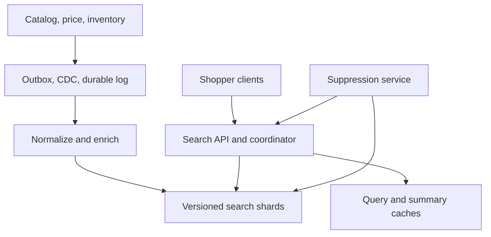
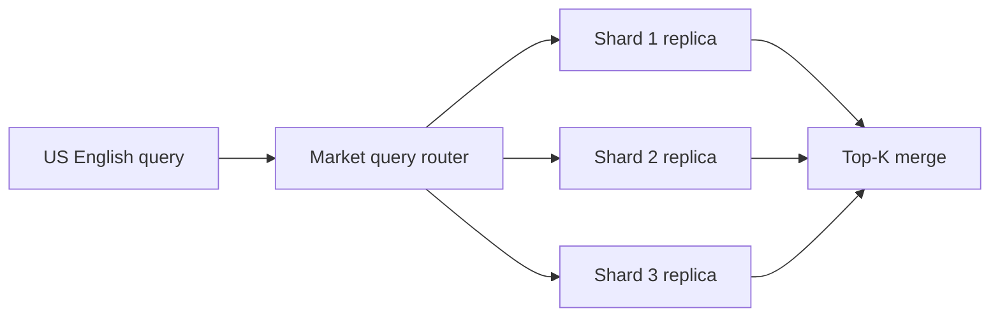
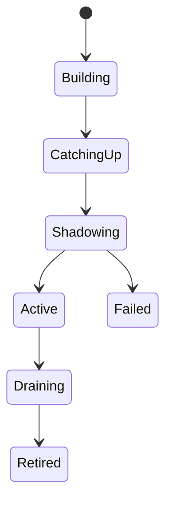

# System Design Interview Practice: Global Product Search and Indexing Platform

**Difficulty:** Hard / Senior  
**Primary themes:** inverted indexes, change data capture, asynchronous indexing, sharding, near-real-time freshness, ranking, caching, cursor pagination, consistency, rebuilds, multi-region reliability, and observability

> **Interview timing vs. this walkthrough:** In a 45-minute interview, spend about 5 minutes on requirements, 2 minutes on entities, 5 minutes on interfaces and data flow, 10–15 minutes building catalog ingestion and query serving, and 10–15 minutes on indexing correctness, tail latency, and zero-downtime rebuilds. This study version is intentionally deeper. In the room, first make one catalog update become searchable and one query return ranked results; evolve that complete path only where scale or correctness breaks it.

This walkthrough follows Hello Interview’s public delivery framework: identify a small set of functional and non-functional requirements, name the core entities, define the system contract, build the simplest complete design one operation at a time, and then use the remaining time for targeted deep dives. genui{"citation":{"ref":"turn92search0"}} Hello Interview’s search guidance expects both ingestion and query paths, a proper inverted index, and an explicit caching strategy; its Elasticsearch deep dive also emphasizes that search is normally a projection fed from an authoritative database rather than the system of record. genui{"citation":{"refs":["turn91view2","turn91view1"]}} The prompt, assumptions, dialogue, arithmetic, and design below are original.

---

## Interviewer prompt

> Design the search platform for a global e-commerce marketplace. Sellers create and update products in a transactional catalog. Shoppers search by free text, apply filters such as category, brand, price, availability, and delivery region, sort results, and paginate. Catalog changes should become searchable quickly. The platform must remain responsive during traffic spikes, tolerate index-node failures, support ranking changes, and rebuild an index without downtime.

## Targeted clarifying questions with assumed interviewer answers

**Candidate:** Is search the source of truth for product details, price, and inventory?

**Interviewer:** No. The catalog owns descriptive product state, the pricing service owns current price, and inventory owns sellable quantity. Search is a denormalized discovery projection. Product detail and checkout revalidate authoritative state.

**Candidate:** Which shopper capabilities are required?

**Interviewer:** Text search, structured filters, sort by relevance or price, facets, and stable cursor pagination. Autocomplete, image search, ads, recommendations, and natural-language answering are out of scope.

**Candidate:** What writes enter the system?

**Interviewer:** Sellers and internal services create, update, hide, or delete products. Search must consume those changes; you do not need to redesign the seller catalog UI.

**Candidate:** What scale should I assume?

**Interviewer:** Five hundred million active product offers, 200,000 catalog change events per second at peak, one million search requests per second at peak, 30 regions, and 20 supported language analyzers.

**Candidate:** What latency and freshness targets matter?

**Interviewer:** Search p95 under 200 ms and p99 under 500 ms. Ninety-nine percent of ordinary catalog changes should be visible within 30 seconds. Safety takedowns should disappear from new search responses within 5 seconds.

**Candidate:** May results be stale?

**Interviewer:** Search may be eventually consistent. A shopper can briefly see an old title or price, but the product page and checkout must revalidate. Hidden, deleted, unsafe, or legally restricted products need a stricter suppression path.

**Candidate:** Must pagination be perfectly stable while the catalog changes?

**Interviewer:** A browsing session should not duplicate or skip many items. A short-lived snapshot/cursor is acceptable; unlimited deep offset pagination is not required.

**Candidate:** How should ranking work?

**Interviewer:** Start with lexical relevance plus business signals. Treat model training as external, but support versioned ranking configurations, online features, experiments, and rollback.

**Candidate:** What availability target should I use?

**Interviewer:** 99.99% for search reads. In a partial failure, stale or slightly less personalized results are preferable to an error, but do not show suppressed products.

**Candidate:** Should every query search the entire global catalog?

**Interviewer:** No. Products have market, locale, category, and eligibility metadata. You may route to a relevant regional/market index and filter further.

### Scope statement to say aloud

> “I’ll keep authoritative writes in the catalog, price, and inventory systems. A durable change stream will build a denormalized, versioned search document. Query coordinators will route to a market index, use an inverted index for text and column-oriented fields for filters and sorting, merge shard-local top candidates, then apply a bounded reranker. Search is eventually consistent, while a separate suppression overlay and authoritative detail/checkout validation protect correctness-sensitive state.”

---

## 1. Requirements (~5 minutes)

### Three core functional requirements

1. **Index product changes.** Consume creates, updates, hides, and deletes from authoritative systems; normalize text and structured fields; make changes searchable within the freshness target.
2. **Search and browse.** Execute free-text queries with market/locale eligibility, filters, facets, sort, and cursor pagination; return ranked product summaries.
3. **Operate and evolve the index.** Support urgent suppression, ranking/config rollout, observability, repair, and full index rebuild/cutover without read downtime.

### Quantified non-functional requirements

| Property | Target | Concrete design consequence |
|---|---:|---|
| Active documents | 500M offers | Partitioned search index; no database table scan |
| Catalog updates | 200K events/s peak | Durable log, bulk indexing, backpressure, idempotency |
| Search traffic | 1M requests/s peak | Market routing, replicas, caching, bounded fan-out |
| Search latency | p95 < 200 ms; p99 < 500 ms | Parallel shard query, time budgets, candidate limits |
| Ordinary freshness | 99% visible within 30 s | Near-real-time refresh with measured end-to-end lag |
| Urgent suppression | < 5 s for new searches | Small strongly propagated deny overlay plus index update |
| Availability | 99.99% reads | Multi-AZ replicas, graceful degradation, regional isolation |
| Pagination | Stable for a short session | Signed cursor over a point-in-time generation and sort tuple |
| Recovery | RPO 0 from authoritative log; RTO < 60 min per regional index | Replayable change log, snapshots, generation rebuild |

### Consistency and availability contract

- **Catalog state is authoritative.** Search never authoritatively confirms price, inventory, or purchase eligibility.
- **Indexing is ordered per product and idempotent.** A document version derived from authoritative change order prevents stale retries from overwriting newer state.
- **Ordinary fields are eventually consistent.** New titles, descriptions, prices, and inventory buckets can lag within the freshness SLO.
- **Suppression is stricter.** Every query coordinator checks a rapidly distributed deny overlay for product, seller, market, and policy identifiers before returning hits.
- **Search pagination is snapshot-like, not transactional.** A cursor pins a short-lived index generation/point-in-time and sort tuple. After expiry, the client restarts.
- **Read availability wins for discovery.** If reranking, personalization, or facets fail, return lexical results with explicit degradation metrics.
- **Safety wins over availability for restricted content.** If the suppression overlay cannot be validated, fail closed for affected markets or policy classes.
- **Read-your-write is not promised to every shopper.** A seller-facing status endpoint reports the indexed version; the seller may request an authoritative product preview separately.

### Out of scope

- Seller catalog authoring, payments, checkout, and inventory reservation
- Learning-to-rank training and feature-pipeline internals
- Autocomplete, spell-correction model training, image/vector search, recommendations, ads
- Fraud/moderation classifier internals
- Cross-market tax or shipping computation

### Scale estimates that change design decisions

Assume an average indexed product document is 2 KB after denormalization, before search-engine structures:

```text
500M documents × 2 KB ≈ 1 TB raw searchable document data
```

Inverted indexes, stored fields, doc values, segment metadata, tombstones, and headroom can multiply this several times. With one replica, budget roughly 6–10 TB across a market generation rather than pretending the raw JSON size is the cluster size. This requires sharding and makes full rebuilds an object-storage and network planning problem.

At 200,000 peak updates per second with a 1 KB normalized change payload:

```text
200,000 × 1 KB ≈ 200 MB/s ≈ 17 TB/day of change traffic
```

The exact payload varies, but a durable partitioned log and bulk writers are necessary. Per-document synchronous writes from catalog request handlers would couple seller latency to search health and amplify overhead.

A naive search that fans every request to 100 primary shards creates:

```text
1M searches/s × 100 shards = 100M shard requests/s
```

That is the crucial routing decision. First narrow by market/locale and optionally category family, keep shard counts per query bounded—say 8–20—and use replicas plus caches. With 12 shards per typical query, the internal rate is still 12M shard searches/s before cache hits.

If each of 12 shards returns 100 candidates to a coordinator:

```text
12 × 100 = 1,200 candidates to merge per request
```

Reranking all 1,200 with a heavy model at 1M QPS is unreasonable. Retrieve a generous lexical top set, merge globally, and run expensive features only on perhaps the top 50–200 under a strict budget.

**What to say aloud:**

> “The scale estimates change three choices: a search index instead of SQL scans, a durable bulk indexing pipeline instead of synchronous dual writes, and market/category routing to avoid a hundred-shard fan-out. The query path should retrieve cheaply, merge a bounded candidate set, and reserve expensive ranking for the final few hundred.”

---

## 2. Core entities (~2 minutes)

| Entity | Essential fields and purpose |
|---|---|
| `Product` | Authoritative catalog ID, seller, lifecycle state, title/description, category, attributes, version |
| `CatalogChange` | Event ID, product ID, source version, change type, source position, timestamp |
| `SearchDocument` | Denormalized searchable representation, eligibility, ranking features, source versions |
| `IndexGeneration` | Market/locale, schema/analyzer version, ranking compatibility, state, high-water mark |
| `IndexShard` | Generation, shard/routing range, replicas, health, applied stream offsets |
| `SuppressionRule` | Target product/seller/policy, scope, epoch, reason, expiry |
| `RankingConfig` | Version, retrieval weights, reranker/model version, feature schema, experiment allocation |
| `SearchRequest` | Normalized query, filters, sort, market, locale, context, page size |
| `SearchCursor` | Generation/PIT, normalized-query hash, last sort tuple, expiry, signature |

Keep `Product` and `SearchDocument` distinct. The first reflects normalized ownership and transactions; the second intentionally duplicates fields so a search shard can answer without joins.

---

## 3. API and system interface (~5 minutes)

The authenticated principal supplies seller/admin identity. The client cannot claim an owner, trust level, policy exemption, market entitlement, or ranking experiment directly. Shopper market and locale come from validated account/session context with a permitted request override.

### 3.1 Authoritative catalog write

```http
PATCH /v1/seller/products/prod_742
Authorization: Bearer <seller-token>
Idempotency-Key: seller-edit-991
If-Match: "product-version-84"
Content-Type: application/json

{
  "title":"Trail Running Shoe",
  "description":"Water-resistant shoe for technical trails",
  "brand":"Northstar",
  "category_id":"running-shoes",
  "attributes":{"color":["blue"],"size":["9","10","11"]},
  "visibility":"ACTIVE"
}
```

```json
{
  "product_id":"prod_742",
  "catalog_version":85,
  "catalog_state":"ACTIVE",
  "search_state":"PENDING",
  "search_status_url":"/v1/seller/products/prod_742/search-status"
}
```

The catalog transaction updates the product and records an outbox/CDC-visible change. It does not synchronously call the search cluster.

### 3.2 Search products

```http
POST /v1/search/products
Authorization: Bearer <shopper-or-anonymous-session>
Content-Type: application/json

{
  "query":"waterproof trail shoe",
  "filters":{
    "category_ids":["running-shoes"],
    "brands":["Northstar","Alpine"],
    "price":{"min_minor":5000,"max_minor":18000,"currency":"USD"},
    "in_stock":true
  },
  "sort":"RELEVANCE",
  "page_size":24,
  "cursor":null
}
```

```json
{
  "results":[
    {
      "product_id":"prod_742",
      "title":"Trail Running Shoe",
      "price_display":"$129.00",
      "thumbnail_url":"https://cdn.example/...",
      "score":18.42,
      "badges":["FAST_DELIVERY"]
    }
  ],
  "facets":{
    "brand":[{"value":"Northstar","count":832}],
    "color":[{"value":"blue","count":414}]
  },
  "next_cursor":"eyJnZW4iOi...",
  "ranking_version":"rank_57",
  "is_partial":false
}
```

Use POST because the structured query can be large; it remains logically read-only. Do not expose internal shard IDs or unsigned engine cursors.

### 3.3 Continue pagination

The client sends the same normalized query and returned cursor. The cursor contains or references:

```json
{
  "generation_id":"us-en-gen-184",
  "pit_id":"opaque-short-lived-handle",
  "query_hash":"sha256:...",
  "last_sort":[18.42,"prod_742"],
  "expires_at":"2026-10-14T16:10:00Z"
}
```

The service verifies signature, expiry, query hash, market, and principal/session scope. A unique product ID is the final tiebreaker.

### 3.4 Seller search-index status

```http
GET /v1/seller/products/prod_742/search-status
Authorization: Bearer <seller-token>
```

```json
{
  "catalog_version":85,
  "indexed_version":84,
  "state":"PENDING",
  "regions":{"us-east":"APPLIED","us-west":"PENDING"},
  "last_error":null
}
```

This is an operational/read-your-write status, not a promise that every cache has already expired.

### 3.5 Urgent suppression

```http
POST /v1/internal/search-suppressions
Authorization: Bearer <policy-service-token>
Idempotency-Key: takedown-case-551
Content-Type: application/json

{
  "target_type":"PRODUCT",
  "target_id":"prod_742",
  "markets":["US","CA"],
  "reason_code":"SAFETY_RECALL",
  "expires_at":null
}
```

The policy service is separately authorized. The write updates a durable rule store, increments an epoch, pushes the small deny overlay to query nodes, and also emits a normal index tombstone/update.

### Important errors

| Status | Meaning |
|---|---|
| `400` | Invalid filters, sort, query syntax, or page size |
| `401/403` | Invalid identity or unauthorized seller/internal action |
| `409` | Idempotency payload mismatch or incompatible catalog transition |
| `410` | Cursor/PIT/generation expired; restart search |
| `412` | Optimistic catalog version mismatch |
| `422` | Unsupported locale, market, filter combination, or malformed cursor |
| `429` | Tenant/client query or write quota exceeded |
| `503` | Search unavailable; response may include retry guidance |

---

## 4. Data flow

### Indexing flow

1. Catalog/pricing/inventory services commit authoritative changes.
2. A transactional outbox or CDC reader publishes changes to a durable partitioned log.
3. Stream processors deduplicate, order by product key, join slow-changing reference data, and build a versioned `SearchDocument`.
4. Market fan-out emits only to indexes where the product is eligible.
5. Bulk indexers group writes by destination shard and apply version-guarded upserts or tombstones.
6. A refresh publishes new immutable search segments so queries can see the writes.
7. Applied source positions and document versions update freshness/status telemetry.
8. Reconciliation compares catalog snapshots/high-water marks with index state and repairs drift.

### Query flow

1. Gateway authenticates or creates an anonymous session and enforces abuse/rate limits.
2. Search API derives market, locale, policy, and experiment context; normalizes query and filters.
3. Query planner selects an index generation and a bounded shard set.
4. Result cache is checked for safe high-frequency queries.
5. Relevant shard replicas evaluate text, filters, and cheap scoring in parallel and return local top `K` plus facet sketches/counts.
6. Coordinator merges candidates, checks suppression, and reranks a small final set.
7. Document summaries are fetched from stored fields or a small product-summary cache.
8. Response includes results, facets, version metadata, and a signed continuation cursor.
9. Query telemetry is sampled/batched asynchronously.

---

## 5. High-level design (~10–15 minutes)

### Compact architecture



### Operation 1: make one product searchable

Start simply:

1. Seller writes product to a relational catalog database.
2. Catalog commits a durable `Product` row and outbox event in one transaction.
3. Relay publishes `PRODUCT_CHANGED(product_id, version)`.
4. Indexer reads authoritative fields and writes one search document.
5. Search engine refreshes and exposes it to queries.

Relevant fields appear when their owners need them:

```text
product(product_id, seller_id, catalog_version, lifecycle_state,
        title, description, brand_id, category_id, attributes,
        created_at, updated_at)

outbox(event_id, aggregate_id=product_id, aggregate_version,
       event_type, payload_ref, created_at, published_at)

search_document(product_id, source_versions,
                market_ids, locale, visibility,
                title_tokens, description_tokens,
                brand_id, category_path, attribute_keywords,
                price_minor, currency, stock_bucket,
                quality_score, popularity_features,
                updated_at)
```

Why outbox/CDC instead of application dual writes? A catalog commit can succeed while a search call times out, or vice versa. Reading a committed log gives replay and recovery. Hello Interview’s CDC guidance uses the catalog-to-search-index example to show precisely this dual-write failure. genui{"citation":{"ref":"turn91view3"}}

### Operation 2: support text retrieval

A relational `LIKE '%trail shoe%'` scan fails at this scale and provides weak linguistic relevance. Build an inverted index:

```text
token "trail" -> [(doc 7, title, positions 1), (doc 42, description, positions 9,31), ...]
token "shoe"  -> [(doc 7, title, positions 3), (doc 99, title, positions 2), ...]
```

During analysis, normalize case, Unicode, punctuation, language-specific stems, and selected synonyms. Preserve exact keyword subfields for brand/SKU. Index positions where phrase matching matters.

A shard evaluates postings lists, intersects/merges them, and computes a lexical score such as BM25. Title matches can receive more weight than description matches. Filters exclude ineligible documents before or during scoring.

An inverted index maps terms to matching documents; column-oriented doc values provide the reverse access pattern needed for sorting and aggregation. Elastic’s documentation describes both roles directly. genui{"citation":{"ref":"turn91view0"}}

### Operation 3: add filters, sort, and facets

Map field types intentionally:

| Product field | Search representation | Used for |
|---|---|---|
| Title/description | analyzed text with positions | lexical retrieval/phrases |
| Brand/category/color | keyword + global ordinals/bitsets | exact filter and facets |
| Price | integer minor units + currency partition/filter | range filter and sort |
| Availability | coarse stock/eligibility enum | discovery filter only |
| Rating/popularity | numeric doc values | scoring and sort |
| Market/locale | routing + keyword filter | shard/index reduction |
| Product ID | keyword | lookup, dedupe, stable tiebreak |

Do not index every volatile inventory count change if a coarse `IN_STOCK` bucket is enough for discovery. Extremely frequent fields cause segment churn. Search may carry a coarse snapshot while detail/checkout owns exact quantity.

Facets can be exact for the matched set when cheap, approximate for very broad queries, or omitted under pressure. The API should expose approximation if it matters to UX.

### Operation 4: shard and replicate

Partition first by operational boundaries such as market/locale generation, then hash `product_id` across shards within that boundary. Market routing prevents every query from touching the globe; hash distribution prevents one popular category from placing all documents on one storage shard.

Each shard has a primary indexing owner and replicas in separate availability zones. Query coordinators choose healthy replicas using queue depth and latency. A request fans out in parallel, not serially.



Avoid a shard per category if products span categories, categories are skewed, or queries cross them. A routing hint may prune category families, but the base distribution remains balanced.

### Operation 5: merge and rerank

Each shard returns its local top `K`, score components, and facet data. Coordinator performs a heap merge and deduplicates product IDs. It then reranks a bounded set using features such as:

- lexical score and exact phrase/brand match;
- catalog quality and seller trust;
- popularity/conversion priors;
- freshness;
- delivery promise by shopper region;
- personalization when available;
- business constraints such as diversity and duplicate suppression.

Use a two-stage architecture:

```text
Stage 1: cheap high-recall retrieval on every selected shard
Stage 2: expensive high-precision reranking on merged top candidates
```

If the reranker times out, return stage-one order. Search is still useful and the timeout is observable.

### Operation 6: paginate safely

Offset pagination forces every shard to produce and discard `offset + page_size` results. Page 10,000 is expensive and unstable as refreshes reorder documents.

Use `search_after` semantics with:

```text
(score or explicit sort value, product_id tie-breaker)
```

Bind the cursor to a short-lived point-in-time view or immutable generation. Elastic’s official pagination guidance notes that refreshes can otherwise change ordering and recommends `search_after` plus a point in time for deep, stable paging. genui{"citation":{"ref":"turn91view4"}}

The cursor is signed and includes a normalized-query hash so it cannot be replayed against different filters.

### Operation 7: cache without returning unsafe data

Use distinct cache layers:

1. **Query-result cache:** keyed by market, locale, normalized query, filters, sort, ranking config, index generation, and coarse experiment context. Store product IDs/scores, not authoritative checkout state.
2. **Shard/request cache:** caches repeated filter/facet work within the search engine and invalidates with refresh semantics.
3. **Product-summary cache:** thumbnails and display metadata keyed by product/version.
4. **Suppression cache/overlay:** tiny, aggressively updated, checked even on query-cache hits.

Do not cache personalized queries per user unless reuse justifies it. Cache anonymous/head queries and common filter combinations. Apply TTL jitter and request coalescing to avoid stampedes.

A cached list is still passed through suppression and optionally a lightweight eligibility check. Missing items are removed; do not backfill from an arbitrary stale page if that could violate ranking guarantees.

### Operation 8: handle deletes and suppression

Ordinary delete:

1. catalog moves product to hidden/deleted with a new version;
2. change stream emits a tombstone;
3. indexer writes a versioned delete;
4. refresh removes it from new searches;
5. segment merge eventually reclaims physical bytes.

Urgent takedown additionally enters `SuppressionRule`. Query nodes receive an epoch-bearing push and periodically reconcile the full rule set. Before response serialization, coordinator removes any hit matching the local current overlay.

This small overlay closes the gap between a strict five-second takedown target and a larger bulk-index refresh/backlog. It should not become a second product database.

---

## 6. Deep dives (~10–15 minutes)

### Deep dive A: correct, fresh, high-throughput indexing

#### Where the baseline breaks

A single consumer performing one write per event cannot handle 200K updates/s. Network retries reorder events. Price and catalog changes arrive on different streams. Replaying an old event can resurrect deleted data. Frequent refreshes improve visibility but consume CPU/I/O and fragment segments. A pipeline outage can build hours of lag.

#### Ingestion approaches

| Approach | Strength | Failure/limitation |
|---|---|---|
| Synchronous catalog → search write | Immediate in happy path | Dual-write inconsistency and coupled latency |
| Periodic full scan | Simple recovery | Poor freshness and huge repeated work |
| CDC from replication log | Faithful copy, replayable position | May not encode business intent; joins still needed |
| Transactional outbox | Intent and catalog commit atomic | Relay and event schema must be operated |

Choose an outbox for semantic product lifecycle events, supplemented by CDC/snapshot reconciliation. For simple field copying, CDC is sufficient; for “why” and policy transitions, explicit events are clearer.

#### Partitioning and ordering

Partition the change log by stable `product_id`, ensuring per-product order in a partition. Every event carries:

```text
(product_id, catalog_version, price_version,
 inventory_version, event_id, source_position)
```

The materializer maintains the latest component versions and emits a document version tuple. The destination applies only a write newer than its stored version. Late or duplicate events become no-ops.

For a product delete at catalog version 90, a delayed update at version 89 cannot recreate it. Tombstones retain enough version state until the replay horizon has passed.

#### Joining multiple owners

Options:

- query each service while processing every event—simple but creates a thundering herd and inconsistent snapshots;
- consume compacted streams/materialized tables from each owner—more infrastructure but scalable;
- index only stable catalog fields and fetch live price/inventory during query—fresh but too expensive for thousands of candidates.

Select materialized component state for index construction. Coalesce rapid changes per product over a short window, then emit a complete document. For example, 20 inventory ticks in one second need not create 20 new search segments.

#### Bulk writes and backpressure

Indexers batch by destination shard using size and time bounds, such as 5–20 MB or 50 ms. They adapt concurrency to observed rejection, queue depth, and merge pressure. On throttling:

1. pause affected partitions;
2. retry with exponential backoff and jitter;
3. continue unrelated shards;
4. never drop the durable source position;
5. expose lag by market/shard/event class.

Elastic recommends bulk requests and explicit randomized backoff on `429` rather than blindly increasing workers. It also notes the indexing/freshness tradeoff of the refresh interval. genui{"citation":{"ref":"turn91view5"}}

#### Refresh and segment lifecycle

Writes first enter an in-memory buffer/translog and immutable segment files. A refresh exposes new segments to search; later merges combine small segments and discard deleted documents.

Tradeoff:

| Frequent refresh | Less frequent refresh |
|---|---|
| Better visibility latency | Higher bulk throughput |
| More tiny segments and cache churn | Longer search staleness |
| Greater merge pressure | Larger batches and better compression |

Choose a refresh interval and adaptive policy consistent with the 30-second end-to-end SLO, not simply the lowest supported value. If CDC lag is already 20 seconds, a one-second refresh does not solve freshness.

#### Freshness accounting

Track timestamps/positions at each stage:

```text
source commit
→ log publish
→ materializer receive
→ bulk enqueue
→ shard apply
→ refresh visible
→ query observed
```

Measure event age, not only queue depth. A quiet partition with one hour-old event is more important than a large queue of one-second-old events.

#### Failure recovery

- consumer crash: resume from last committed source position;
- bulk response partially succeeds: retry only failed items with same versions;
- poison document: quarantine with reason while advancing partition under policy;
- lost index shard: promote replica, rebuild from snapshot plus log;
- prolonged outage: retain log long enough or bootstrap a new generation from catalog snapshot;
- stream gap: halt affected partition, repair/replay, never silently skip;
- drift: periodic reconciliation hashes/counts by key range and re-emits mismatches.

#### Observability

- end-to-end freshness p50/p95/p99 by market and change type
- oldest unindexed event age and high-water mark gap
- bulk success, partial failure, `429`, retry, and dead-letter rates
- segment count, refresh duration, merge debt, disk watermarks
- stale-version rejection and tombstone resurrection attempts
- document counts/checksums versus catalog snapshot
- suppression propagation/apply latency
- seller-visible catalog versus indexed version gap

**What to say aloud:**

> “I assume at-least-once delivery and make effects monotonic. Events are ordered by product where possible, every destination write carries an authoritative version, and stale retries cannot beat a newer update or tombstone. Bulk writers adapt to shard backpressure, while end-to-end event age—not consumer QPS—is the freshness SLI.”

### Deep dive B: query tail latency, hot traffic, and caching

#### Where the baseline breaks

Scatter/gather latency is determined by the slowest selected shard. At 12 shards per query, a single busy replica can dominate p99. Head queries such as “shoes” produce huge posting lists and facets. One million searches per second can turn harmless per-shard work into millions of internal requests. Deep offsets and unbounded aggregations create memory pressure.

#### Reduce work before adding machines

1. Route by market/locale and category family when semantically safe.
2. Normalize query once and reject pathological Boolean/filter complexity.
3. Apply selective filters early.
4. Bound shard count, local candidate `K`, facet cardinality, and total-hit accuracy.
5. Use block-max/WAND-style skipping or equivalent score upper bounds to avoid scoring documents that cannot enter top `K`.
6. Fetch full stored fields only for final results.
7. Rerank only a bounded merged set.

The retrieval structure matters: inverted indexes answer token-to-document lookup, while doc values support efficient sort/facet access. Hello Interview’s Elasticsearch deep dive calls out these two structures and the coordinator’s responsibility to plan and merge distributed work. genui{"citation":{"ref":"turn91view1"}}

#### Replica selection and hedging

Choose among shard replicas using recent latency, queue depth, node health, and zone cost. Avoid random routing when one replica is overloaded.

For a small fraction of requests nearing the tail budget, send a hedged request to a second replica and accept the first valid response. Hedge only after a delay and under a budget; immediate duplication would double normal load and worsen incidents.

#### Time budget

Example 200 ms p95 allocation:

```text
gateway/auth/normalization       15 ms
cache/routing                    10 ms
shard retrieval                 90 ms
merge and suppression           20 ms
reranking                       35 ms
summary fetch/serialization     15 ms
network reserve                 15 ms
```

Deadlines propagate to every subrequest. A shard does not keep consuming CPU after the coordinator has abandoned the request.

#### Graceful degradation ladder

When budget or dependencies fail:

1. disable personalization/online features;
2. use cached or lexical-only ranking;
3. omit expensive high-cardinality facets;
4. accept partial shard results only if product policy allows and mark `is_partial=true`;
5. serve a short-lived stale head-query cache after suppression recheck;
6. return error rather than bypass suppression.

Never silently mix incomparable scores from missing shards without a declared partial-results policy.

#### Cache design

Query-cache key:

```text
hash(market, locale, normalized_query, normalized_filters,
     sort, ranking_config_version, index_generation,
     experiment_bucket_class)
```

Including generation/config prevents results from one schema or ranker leaking into another. A short TTL plus generation versioning avoids per-product invalidation storms. The suppression overlay is always applied afterward.

Cache admission should favor repeated queries rather than letting a one-hit long tail evict useful head entries. Use TinyLFU-like frequency admission or a probation/protected policy. Add TTL jitter and single-flight fill.

Negative “no results” caches receive a shorter TTL because fresh catalog additions should appear promptly.

#### Hot shards and skew

A popular query stresses all shards, while a skewed routing key may stress a subset. Responses:

- add read replicas for affected market generation;
- replicate hot immutable segments to search-only nodes;
- cache head queries and filter bitsets;
- split oversized shards during a new generation, not ad hoc without planning;
- isolate batch indexing/merges from latency-sensitive query pools;
- shed abusive clients per identity/IP/session before they enter shard fan-out.

#### Pagination details

The cursor contains the last result’s sort tuple and a stable unique tiebreaker. For relevance order:

```text
(normalized_score, product_id)
```

Floating scores must be serialized deterministically. Ranking config, query hash, index generation, market, and PIT belong in cursor scope. Expired or incompatible cursor returns `410`, causing restart.

Do not promise an exact total hit count for every broad query. Return a capped relation such as `10,000+` or an estimate; counting hundreds of millions can exceed the latency budget.

#### Observability

- end-to-end and per-stage latency p50/p95/p99
- shard fan-out, slowest-shard contribution, timeout, cancellation
- cache hit/admission/eviction and coalesced requests
- query distribution and top hot keys
- postings visited, candidates scored, candidates reranked
- facet cardinality and aggregation memory
- partial-result and degradation mode rate
- replica queue depth, GC/page-cache miss, CPU, disk latency
- relevance guardrails such as zero-result rate, click-through, reformulation

**What to say aloud:**

> “At scale, search p99 is the maximum of several shard latencies, so I reduce fan-out first, route to the best replica, bound candidates and facets, and propagate deadlines. Caching targets anonymous head queries and is versioned by generation and ranker, but every cache hit still passes the urgent suppression overlay.”

### Deep dive C: zero-downtime rebuilds, consistency, and multi-region failure

#### Where the baseline breaks

Analyzer and mapping changes often cannot be applied safely in place. Ranking features change document shape. Rebuilding 500M documents can take hours. If new writes are missed during backfill, the new index is stale at cutover. An active regional failure must not create two divergent indexing histories or point queries at a half-built generation.

#### Generation-based rebuild

Treat indexes as immutable-ish named generations:

```text
us-en-gen-184  ACTIVE
us-en-gen-185  BUILDING
```

Rebuild protocol:

1. choose a source snapshot position `P0`;
2. snapshot/scan authoritative products as of `P0` into `gen-185`;
3. record progress by deterministic key range;
4. concurrently retain or replay changes after `P0`;
5. catch `gen-185` up to a target high-water mark;
6. validate counts, hashes, sampled queries, latency, and relevance;
7. shadow a small percentage of production queries without serving results;
8. atomically switch a logical read alias/config from `gen-184` to `gen-185`;
9. keep old generation for cursor/session grace and rollback;
10. retire it only after references and rollback window expire.



#### Dual indexing versus replay

During rebuild, either:

- dual-consume new events into old and new generations; or
- keep one durable log and let each generation consumer advance independently.

Prefer independent consumers over application dual writes. Both generations record source offsets, and replay is deterministic. The active generation remains untouched by rebuild failure.

#### Validation before cutover

Validate more than document count:

- per-key-range count and commutative content hash;
- newest source position and version distribution;
- tombstone/suppression parity;
- schema/analyzer compatibility;
- top-query result overlap and intentional differences;
- zero-result, facet, latency, and error deltas;
- canary product searches across languages/markets;
- resource headroom at expected production QPS.

Ranking changes may intentionally change order, so use relevance judgments and guardrail metrics rather than demanding identical results.

#### Ranking configuration rollout

Separate retrieval/index schema version from ranking configuration where possible. `RankingConfig` is immutable and versioned. Rollout:

1. offline evaluation on labeled/replay queries;
2. shadow scoring for cost and feature correctness;
3. small online experiment with guardrails;
4. ramp by market/client cohort;
5. one-click revert to previous version.

If the new ranker requires a new indexed feature, the generation declares that compatibility. Coordinator never applies `rank_58` to a generation missing its required feature schema.

#### Multi-region architecture

Use region-local query clusters for low latency and fault isolation. The authoritative change log is replicated or delivered to each serving region. Each region builds the same logical market generation but tracks its own applied high-water mark.

Writes remain owned by authoritative catalog systems; search clusters do not accept shopper mutations. This avoids multi-master index conflict.

Routing policy:

- prefer nearest healthy region whose generation and suppression epoch meet minimum requirements;
- fail over to another region if local read health degrades;
- allow bounded ordinary freshness lag;
- require current suppression epoch for restricted markets;
- keep cursor pinned to a compatible generation/region or restart cleanly.

#### Regional disaster behavior

| Failure | Response |
|---|---|
| One shard replica lost | Route to another replica; rebuild in background |
| Shard primary lost | Promote in-sync replica; pause writes briefly if needed |
| Query cluster overloaded | Shed abuse, degrade facets/reranker, route some traffic away |
| Indexing cluster unhealthy | Continue serving last visible segments; lag alarms grow |
| Region lost | Geo-route to compatible region; preserve generation contract |
| Change log unavailable | Serve stale search, retain offsets, recover and replay |
| Suppression distribution uncertain | Fail closed for affected policy scope |
| Bad generation cutover | Atomically restore previous alias/config |

#### Source of truth and repair

The search index is disposable in principle, expensive in practice. Recovery assets:

- authoritative catalog snapshot;
- retained change log after snapshot position;
- search-engine snapshots for faster restore;
- generation manifest containing schema, analyzer, rank compatibility, offsets;
- reproducible enrichment/config versions.

Never rely solely on opaque search snapshots if the index cannot be reproduced from business data and versioned transformations.

#### Observability

- generation build throughput, remaining ranges, and catch-up ETA
- high-water mark comparison across regions/generations
- shadow query latency, error, result-overlap, and relevance deltas
- alias/config propagation and rollback time
- old-generation cursor/reference counts
- cross-region failover rate and latency
- snapshot success, restore drill duration, replay throughput
- suppression epoch convergence by query fleet

**What to say aloud:**

> “Schema and analyzer changes create a new generation. I backfill from a known snapshot position, replay the retained log, shadow and validate, then atomically move a logical alias. The old generation remains for cursor grace and rollback. Region-local clusters consume the authoritative stream; they do not become competing sources of truth.”

---

## 7. Finish

### Concise final design

Authoritative catalog, pricing, and inventory systems commit business state and expose it through transactional outbox/CDC streams. Partitioned materializers order by product, combine versioned component state, normalize language-specific text, and emit a denormalized `SearchDocument`. Adaptive bulk indexers apply monotonic upserts/tombstones to market- and locale-scoped search generations. Refresh makes immutable segments visible; replicas across availability zones serve queries. Reconciliation repairs drift from catalog snapshots and source positions.

The search API derives identity, market, locale, and experiments from trusted context, normalizes the request, selects a compatible active generation, and routes to a bounded shard set. Shards use inverted indexes for text and doc values/bitsets for filters, sorting, and facets. They return local top candidates; the coordinator merges, applies a mandatory suppression overlay, reranks a small final set, and returns cached or stored summaries. Signed `search_after` cursors pin a short-lived point-in-time/generation and stable tiebreaker.

Head-query caches, shard caches, replica-aware routing, strict deadlines, bounded facets, and graceful fallback protect p99. Urgent safety/legal takedowns propagate through a small epoch-bearing deny overlay as well as the ordinary index stream. Analyzer/schema changes build a new generation from snapshot plus replay, shadow production, validate, atomically cut over, and retain the prior generation for rollback. Multi-region read clusters consume the same authoritative stream and fail over only to compatible generations with an acceptable suppression epoch.

### Requirements check

| Requirement | Design support |
|---|---|
| Text search | Language-aware analysis and inverted indexes |
| Filters/facets/sort | Keyword/range structures, bitsets, doc values |
| 500M products | Market-scoped, hash-sharded generations |
| 200K updates/s | Durable partitioned log, coalescing, bulk writers |
| 1M searches/s | Bounded routing, replicas, caches, two-stage ranking |
| p95 < 200 ms | Parallel shards, deadlines, top-K bounds, cheap fallback |
| 99% visible < 30 s | Refresh SLO and end-to-end freshness measurement |
| Takedown < 5 s | Durable epoch-bearing suppression overlay |
| Stable pagination | Signed `search_after` cursor plus PIT/generation |
| No stale overwrite | Per-product monotonic versions and tombstones |
| Ranking evolution | Versioned compatible configs, shadow/A-B rollout |
| Zero-downtime schema change | Snapshot + replay generation and atomic alias cutover |
| 99.99% reads | Multi-AZ replicas, region-local clusters, degradation ladder |
| Recovery | Authoritative snapshot, retained log, index snapshots, drills |

## Realistic interviewer follow-up questions with strong sample answers

**Interviewer:** Why not query the catalog database with indexes?

**Candidate:** B-tree indexes are good for known structured predicates, but free-text relevance, language analysis, phrases, facets, and multi-field scoring need different access patterns. A denormalized inverted index makes token-to-document retrieval efficient while the catalog remains transactional truth.

**Interviewer:** Why not make the search engine the product database?

**Candidate:** Search optimizes retrieval and accepts near-real-time visibility and denormalization. Product ownership, lifecycle transitions, and exact price/inventory consistency need transactional authoritative systems. Search is reproducible projection state.

**Interviewer:** Why not write catalog and search synchronously?

**Candidate:** It is a distributed dual write. Either side can succeed alone, and seller latency becomes dependent on search. A catalog transaction plus outbox/CDC gives one commit, replay, ordering, and recovery.

**Interviewer:** How do retries avoid reverting a newer document?

**Candidate:** Every write carries authoritative component versions. The destination conditionally applies only a newer version. Deletes retain tombstone versions, so a delayed pre-delete update cannot resurrect a product.

**Interviewer:** Does partition ordering guarantee correctness by itself?

**Candidate:** No. Repartitioning, replay, multi-source joins, and retries can still reorder effects. Per-product monotonic version checks at the destination are the final guard.

**Interviewer:** Why not update exact inventory on every unit change?

**Candidate:** That can produce extreme index churn for a field whose discovery semantics may only need `IN_STOCK` or an availability bucket. Checkout always revalidates exact quantity. I would publish transitions between meaningful buckets, not every counter tick.

**Interviewer:** What determines shard routing?

**Candidate:** First route by market/locale generation because those are strong eligibility boundaries. Within it, hash product ID for balance. Category can be a pruning hint when the query is constrained, but making category the sole shard key risks skew and cross-category fan-out.

**Interviewer:** Why is one million QPS not just one million operations?

**Candidate:** Distributed search amplifies each request by shard fan-out. One million queries touching 12 shards becomes roughly 12 million shard searches per second before replicas and retries, so routing and caching are core design choices.

**Interviewer:** How do shard scores compare?

**Candidate:** Shards compute compatible lexical scores using generation-consistent analyzers/statistics. Each returns more than the final page size, the coordinator merges, then a global bounded reranker reduces sensitivity to shard-local scoring. Exact implementation may use global statistics or approximation depending latency.

**Interviewer:** How do you avoid the slowest shard ruining latency?

**Candidate:** Limit fan-out, pick replicas using load/latency, propagate deadlines, isolate merges from queries, bound work, and optionally hedge only tail requests after a delay. Under pressure I drop expensive facets or reranking before core retrieval.

**Interviewer:** How do you cache results when products change constantly?

**Candidate:** Cache IDs/scores for repeated head queries with short TTLs and keys that include generation and ranking version. Avoid per-product invalidation storms. Always reapply urgent suppression; detail and checkout revalidate mutable truth.

**Interviewer:** What happens to a cached query after a safety takedown?

**Candidate:** The cache entry may still contain the ID, but response assembly checks the current suppression overlay and removes it. The normal tombstone and generation-versioned TTL clean up the underlying cache/index later.

**Interviewer:** Why not use offset pagination?

**Candidate:** Every shard must generate and discard all preceding results, so deep pages become expensive. Concurrent refreshes also reorder offsets. A signed `search_after` cursor with a PIT/generation and unique tiebreaker gives bounded continuation work and better session stability.

**Interviewer:** What if the cursor’s generation is retired?

**Candidate:** Keep old generations through a cursor grace window. After expiry return `410` and restart rather than silently mixing generations and producing duplicates or gaps.

**Interviewer:** How do you change tokenization or synonyms?

**Candidate:** Changes that affect indexed tokens build a new generation. Backfill from a snapshot, replay changes, validate and shadow, then atomically move the read alias. Query-time-only synonym changes can be versioned more cheaply but still need relevance testing.

**Interviewer:** How do you know a rebuild did not miss data?

**Candidate:** Compare source high-water marks, key-range counts and hashes, latest-version distributions, tombstones, and samples. Replay from the exact snapshot position, run shadow queries, and reconcile against authoritative catalog ranges before cutover.

**Interviewer:** Can search stay up if indexing is down?

**Candidate:** Yes. Immutable visible segments keep serving stale results while indexing catches up. Freshness alerts fire. Urgent suppression uses a separate small path; if that path is uncertain for restricted content, affected scope fails closed.

**Interviewer:** What do you return if one shard times out?

**Candidate:** Product policy decides. For ordinary discovery I can return explicitly marked partial results after suppression checks, perhaps without exact facets. For sensitive or narrow queries I may fail and retry. I never pretend partial results are complete.

**Interviewer:** How would you add semantic/vector search?

**Candidate:** Add a parallel candidate source keyed to the same product IDs and eligibility filters, retrieve bounded lexical and vector candidates, fuse them, then use the same suppression and reranking pipeline. I would not replace lexical retrieval because exact brand/SKU queries and filters remain important.

**Interviewer:** What would you build first?

**Candidate:** One market, catalog outbox, keyed change stream, deterministic search documents, a small replicated lexical cluster, filters, top-K merge, seller status, and basic monitoring. Then add market routing, caches, reranking, suppression overlay, generation rebuilds, and multi-region serving.

## Common pitfalls

1. Treating the search index as authoritative product storage.
2. Writing to catalog and search synchronously without a recovery protocol.
3. Saying “use Elasticsearch” without explaining ingestion and query paths.
4. Omitting the inverted index and what it accelerates.
5. Using analyzed text fields for exact brand/category filtering.
6. Using raw floating price without currency and minor-unit semantics.
7. Indexing every exact inventory tick without considering churn.
8. Assuming queue delivery is exactly once.
9. Omitting per-product version checks at the destination.
10. Allowing an old retry to resurrect a deleted product.
11. Dropping poison events while silently advancing offsets.
12. Measuring consumer QPS but not oldest-event freshness.
13. Refreshing constantly without discussing segment/merge cost.
14. Fanning every query to every global shard.
15. Choosing category as the sole shard key despite skew.
16. Ignoring internal QPS amplification from scatter/gather.
17. Returning only page-size candidates from each shard before global merge.
18. Reranking thousands of candidates with an expensive model.
19. Fetching full documents before the final top results are known.
20. Computing exact unbounded facets and total counts for every query.
21. Using deep offset pagination.
22. Omitting a deterministic unique sort tiebreaker.
23. Letting a cursor cross index generations silently.
24. Exposing unsigned internal engine cursors to clients.
25. Caching without market, locale, generation, and ranker in the key.
26. Allowing one-hit long-tail queries to evict useful head-query cache entries.
27. Serving cached results without rechecking urgent suppression.
28. Claiming eventual consistency is sufficient for safety takedowns.
29. Making the deny overlay a second unbounded product database.
30. Treating replicas as a substitute for snapshots and replay.
31. Reindexing in place for an incompatible analyzer change.
32. Cutting over a rebuild before it reaches the source high-water mark.
33. Validating a generation only by document count.
34. Deleting the old generation while valid cursors reference it.
35. Rolling out ranker and feature schema independently without compatibility.
36. Hedging every request immediately and doubling normal load.
37. Letting canceled queries continue consuming shard CPU.
38. Hiding partial results or degradation from telemetry.
39. Reporting API latency without slowest-shard and stage breakdowns.
40. Starting with ML ranking details before completing catalog-to-query flow.

## A polished 60-second close

> “I keep product truth in transactional catalog, price, and inventory systems and build search as a reproducible projection. An outbox/CDC stream feeds product-keyed materializers, which combine versioned state and bulk-write denormalized documents into market-scoped, hash-sharded index generations. Monotonic versions and tombstones make at-least-once retries safe; refresh exposes immutable segments within the freshness SLO. On reads, trusted context selects market, locale, experiment, and generation. Shards use inverted indexes for text and doc values for filters, facets, and sort, return bounded local top candidates, and a coordinator merges, applies the mandatory suppression overlay, and reranks only the final set. Head-query caches, replica-aware routing, deadlines, cursor-based PIT pagination, and graceful ranking/facet degradation protect p99. Urgent takedowns travel through a small epoch-bearing deny overlay. Schema or analyzer changes build a new generation from snapshot plus replay, shadow production, validate, atomically cut over, and preserve the old generation for rollback and cursor grace.”

## References

- [Hello Interview: System Design Delivery Framework](https://www.hellointerview.com/learn/system-design/in-a-hurry/delivery)
- [Hello Interview: Design Facebook’s Post Search](https://www.hellointerview.com/learn/system-design/problem-breakdowns/fb-post-search)
- [Hello Interview: Elasticsearch Deep Dive](https://www.hellointerview.com/learn/system-design/deep-dives/elasticsearch)
- [Hello Interview: Change Data Capture](https://www.hellointerview.com/learn/system-design/deep-dives/change-data-capture)
- [Elastic: Doc Values](https://www.elastic.co/docs/reference/elasticsearch/mapping-reference/doc-values)
- [Elastic: Paginate Search Results](https://www.elastic.co/docs/reference/elasticsearch/rest-apis/paginate-search-results)
- [Elastic: Tune for Indexing Speed](https://www.elastic.co/guide/en/elasticsearch/reference/current/tune-for-indexing-speed.html)
