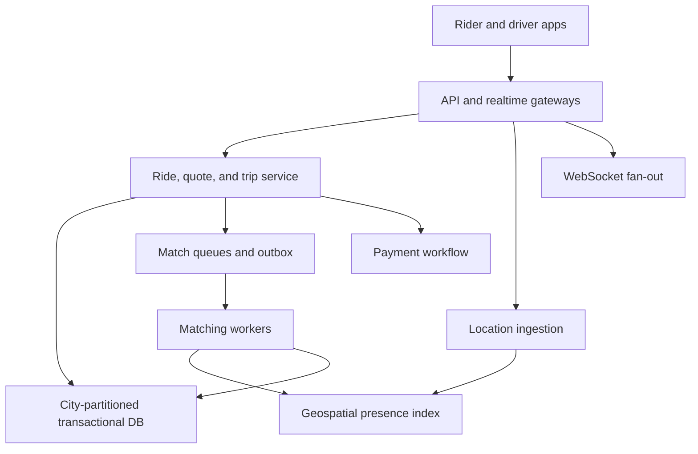
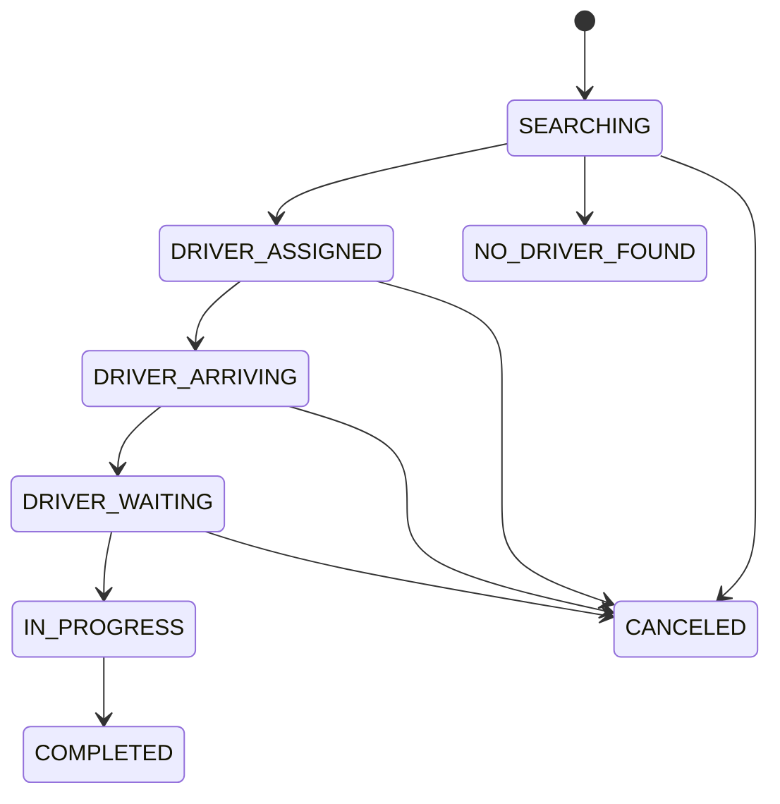

# System Design Interview Practice: Real-Time Ride-Sharing Dispatch

**Difficulty:** Hard / Senior  
**Primary themes:** geospatial indexing, high-frequency location updates, matchmaking, expiring offers, queues, leases, single-assignment consistency, WebSockets, hotspot control, multi-region reliability, and observability

> **Interview timing vs. this walkthrough:** In a 45-minute interview, spend about 5 minutes on requirements, 2 minutes on entities, 5 minutes on interfaces, 10–15 minutes building fare estimation, ride creation, matching, and trip updates, then 10–15 minutes on geospatial search, assignment correctness, and surge/failure behavior. This study version is deliberately fuller. In the room, first make one rider match safely with one nearby driver; introduce expanding rings, offer leases, and marketplace optimization only after that path works.

This walkthrough follows Hello Interview’s public delivery framework: narrow the requirements, identify essential entities, define the system contract, construct a complete design operation by operation, and spend the remaining time on requirement-driven bottlenecks. genui{"citation":{"ref":"turn88search0"}} Hello Interview’s Uber breakdown classifies the problem as hard and emphasizes nearby-driver search, ride-request locking, and queueing as the senior-level deep dives. genui{"citation":{"ref":"turn88search1"}} The dialogue, scale assumptions, interfaces, failure semantics, and design below are original.

---

## Interviewer prompt

> Design the backend for an on-demand ride-sharing service. A rider enters pickup and destination, receives a fare estimate, requests a ride, gets matched with a nearby available driver, watches the driver approach, completes the trip, and is charged. Drivers continuously publish location and availability. The design must work during ordinary traffic and stadium-scale demand spikes without assigning a driver to two active rides.

## Targeted clarifying questions with assumed interviewer answers

**Candidate:** Which user journeys are above the line?

**Interviewer:** Fare estimate, request ride, match a nearby driver, driver accept/decline, live status/location during pickup and trip, cancellation, completion, and final charge.

**Candidate:** Are scheduled rides, pooling, ratings, incentives, and food delivery required?

**Interviewer:** No. Mention them as extensions, but focus on immediate single-rider, single-driver trips.

**Candidate:** What scale should I use?

**Interviewer:** Fifty million daily riders, five million online drivers at peak, 500,000 ride requests per minute globally at peak, and up to 100,000 requests concentrated around one stadium or district. An online driver sends location every four seconds.

**Candidate:** What latency matters?

**Interviewer:** Fare estimates should return in under 500 ms at p95. A normal request should receive a driver or a clear no-driver result within 30 seconds at p99. Driver location should appear to the rider within roughly two seconds while pickup is active.

**Candidate:** What is the correctness contract for assignment?

**Interviewer:** One driver must never be committed to two active rides, and one ride must never have two committed drivers. Duplicate requests and retries are expected. Offers may be sent speculatively, but only one acceptance can commit.

**Candidate:** Is driver location strongly consistent?

**Interviewer:** No. It is ephemeral and may be a few seconds stale. Assignment and trip-state transitions need stronger consistency than map animation.

**Candidate:** Do we design routing and maps?

**Interviewer:** Treat road routing, geocoding, and baseline ETA as an external or separately owned mapping service. Explain caching and failure behavior around it.

**Candidate:** How should surge pricing behave?

**Interviewer:** Compute a bounded price multiplier from recent supply and demand in a geographic cell. The quote is valid for 60 seconds. Do not redesign the pricing model itself.

**Candidate:** Is payment authorization in the critical path?

**Interviewer:** Validate a payment method and optionally authorize a hold before matching. Final capture is asynchronous after trip completion. Payment failure must not roll back a completed physical trip.

**Candidate:** What availability and regional requirements apply?

**Interviewer:** Target 99.99% availability for active trips and 99.95% for creating new rides. A city normally has one write-owning region, with a warm failover region. During ambiguous failover, prefer briefly pausing new assignments over double-booking.

### Scope statement to say aloud

> “I’ll separate ephemeral driver-location state from durable ride and assignment state. Location updates feed a sharded geospatial index. A ride request enters a city-local matching queue, which searches nearby cells and issues short-lived offers. Accepting an offer runs a strongly consistent compare-and-set that atomically binds one available driver to one requested ride. WebSockets provide low-latency updates, while durable ride versions and event logs recover from lost connections and retries.”

---

## 1. Requirements (~5 minutes)

### Three core functional requirements

1. **Estimate and request.** A rider submits pickup/destination, receives an ETA and time-bounded fare quote, and creates a ride from that quote.
2. **Match exactly once.** The system finds nearby eligible drivers, sends expiring offers, and commits at most one driver to the ride while preventing that driver from serving another active ride.
3. **Run the trip.** Rider and driver receive live status/location updates through arrival, pickup, in-progress travel, completion, cancellation, and asynchronous charging.

### Quantified non-functional requirements

| Property | Target | Design implication |
|---|---:|---|
| Peak ride requests | 500K/min ≈ 8.3K/s globally | City/cell partitioning and queue-backed matching |
| Hotspot burst | 100K requests in one district | Admission control, virtual waiting, adaptive batching |
| Online drivers | 5M | Distributed presence and geospatial index |
| Driver location cadence | Every 4 s | ≈1.25M updates/s before riders’ location streams |
| Fare estimate latency | p95 < 500 ms | Cached road/market inputs and bounded dependency calls |
| Match outcome latency | p99 < 30 s | Expanding-ring search, short offers, no unbounded scans |
| Pickup tracking freshness | p95 < 2 s | WebSocket/SSE push with sequence-based recovery |
| Assignment correctness | No double-committed ride/driver | Transaction or conditional write over authoritative records |
| Active-trip availability | 99.99% | Durable state, multi-AZ replication, reconnect/replay |
| New-request availability | 99.95% | Regional isolation, load shedding, explicit unavailable response |

### Consistency and availability contract

- **Ride and driver assignment is strongly consistent.** Committing an acceptance atomically verifies `ride.status = SEARCHING`, `offer` is valid, and `driver.status = AVAILABLE` before changing both to assigned state.
- **Ride state is monotonic.** Legal transitions follow a state machine; stale clients cannot move `IN_PROGRESS` back to `ARRIVING`.
- **Location is eventually consistent and freshness-bounded.** A dropped sample is acceptable; a location older than the eligibility threshold removes a driver from matching.
- **Fare quotes are immutable and expiring.** Creating a ride references a signed quote ID; the client does not submit an authoritative price.
- **Client mutations are idempotent.** Create, accept, cancel, start, complete, and payment commands use stable keys and return the original result on retry.
- **Push is a latency mechanism, not durable truth.** Clients reconnect with the last observed ride version or event sequence and fetch missed state.
- **City ownership favors consistency during partitions.** If two regions cannot prove a single assignment owner, new matches pause; existing trips continue from durable state where possible.

### Out of scope

- Scheduled rides, pooling, multi-stop trips, rentals, delivery
- Building turn-by-turn routing or geocoding algorithms
- Driver onboarding, background checks, and vehicle document workflows
- Ratings, promotions, loyalty, and driver incentives
- Detailed fraud, safety, and machine-learning model design
- Regulatory data residency beyond noting regional boundaries

### Scale estimates that change the design

Five million online drivers sending one update every four seconds produce:

```text
5,000,000 / 4 ≈ 1.25 million driver-location updates/second
```

At roughly 100 bytes of normalized location data before protocol and replication overhead, that is 125 MB/s of raw ingestion. Writing every sample synchronously to a relational ride database is unnecessary and would dominate it. Keep the newest matchable location in an in-memory/geospatial state tier; stream samples asynchronously to durable analytics storage.

At 500,000 ride requests per minute:

```text
500,000 / 60 ≈ 8,333 ride requests/second
```

The global average is manageable, but the 100,000-request hotspot is the real constraint. Matching must partition by locality and impose bounded work per request. A query that scans every driver in a city fails precisely when the marketplace is busiest.

If each searching ride evaluates 50 candidates over several rounds:

```text
8,333 × 50 ≈ 416,650 candidate evaluations/second globally
```

Candidate evaluation is feasible when lookups are in memory and local to a city shard. Expensive route ETAs for every candidate are not. First prune by H3 cell, availability, vehicle class, freshness, and straight-line distance; compute road ETA only for a small shortlist.

If active-trip clients receive one update every two seconds and two parties subscribe:

```text
1,000,000 active trips × 2 clients / 2 s ≈ 1 million push messages/second
```

That motivates a separately scaled real-time gateway, compact payloads, coalescing, and last-known-state recovery rather than polling the primary database.

**What to say aloud:**

> “The dominant volume is not ride creation; it is more than a million disposable location updates per second. I will keep those out of the transactional ride store. The hard invariant lives in a much smaller path: one conditional assignment must bind one ride and one driver exactly once.”

---

## 2. Core entities (~2 minutes)

| Entity | Essential fields and purpose |
|---|---|
| `Rider` | Identity, status, payment profile reference, safety flags |
| `Driver` | Identity, vehicle/class, capabilities, eligibility, durable status/version |
| `DriverPresence` | Driver ID, current cell/location, heading, timestamp, availability lease |
| `FareQuote` | Quote ID, pickup/destination, route snapshot, amount/range, multiplier, expiry |
| `Ride` | Ride ID, rider, assigned driver, quote, pickup/destination, state, version, city |
| `RideOffer` | Offer ID, ride, driver, round, expiry, state, score, attempt |
| `RideEvent` | Ride sequence, transition, actor, server time, idempotency key, payload |
| `MatchJob` | Ride, city/cell, search radius/round, deadline, retry state |
| `PaymentIntent` | Ride, authorization/capture state, provider reference, idempotency key |
| `MarketCell` | H3 cell/time bucket, available supply, demand, ETA stats, price multiplier |

`DriverPresence` is hot and replaceable; `Driver` and `Ride` are durable and authoritative. Keeping them separate prevents high-rate GPS writes from contending with assignment transactions.

---

## 3. API and system interface (~5 minutes)

Identity comes from the rider/driver access token and registered device session. A driver cannot accept on behalf of another `driver_id`; a rider cannot choose an authoritative price or assigned driver.

### 3.1 Publish driver presence

```http
PUT /v1/drivers/me/presence
Authorization: Bearer <driver-device-token>
Content-Type: application/json

{
  "sequence":88410,
  "latitude":42.3601,
  "longitude":-71.0589,
  "accuracy_m":8,
  "heading_deg":220,
  "speed_mps":4.2,
  "availability":"AVAILABLE",
  "observed_at":"2026-10-14T12:00:04Z"
}
```

```json
{
  "accepted_sequence":88410,
  "server_time":"2026-10-14T12:00:04.180Z",
  "next_update_within_ms":4000
}
```

The server authenticates the driver, rejects replayed sequence numbers, validates plausible timestamps/speeds, maps the coordinate to a city and H3 cell, and refreshes a short availability lease.

### 3.2 Request a fare quote

```http
POST /v1/fare-quotes
Authorization: Bearer <rider-token>
Idempotency-Key: quote-phone-184
Content-Type: application/json

{
  "pickup":{"latitude":42.3601,"longitude":-71.0589},
  "destination":{"latitude":42.3496,"longitude":-71.0997},
  "service_class":"STANDARD"
}
```

```json
{
  "quote_id":"fq_702",
  "currency":"USD",
  "estimated_amount_minor":1840,
  "estimated_pickup_seconds":310,
  "estimated_trip_seconds":1080,
  "expires_at":"2026-10-14T12:01:10Z",
  "pricing_version":91
}
```

### 3.3 Create a ride request

```http
POST /v1/rides
Authorization: Bearer <rider-token>
Idempotency-Key: ride-phone-551
Content-Type: application/json

{
  "quote_id":"fq_702",
  "payment_method_id":"pm_14"
}
```

```json
{
  "ride_id":"ride_9001",
  "status":"SEARCHING",
  "version":1,
  "event_cursor":"ride_9001:1",
  "match_deadline":"2026-10-14T12:01:40Z"
}
```

The service derives `rider_id`, verifies quote ownership/expiry, prevents multiple incompatible active rides, persists the ride, and enqueues a match job through a transactional outbox.

### 3.4 Send and accept an offer

The driver receives a WebSocket event:

```json
{
  "type":"RIDE_OFFER",
  "offer_id":"off_331",
  "ride_public_id":"rp_77",
  "pickup":{"latitude":42.3601,"longitude":-71.0589},
  "pickup_eta_seconds":240,
  "estimated_earnings_minor":1320,
  "expires_at":"2026-10-14T12:00:25Z"
}
```

The driver accepts:

```http
POST /v1/ride-offers/off_331:accept
Authorization: Bearer <driver-device-token>
Idempotency-Key: accept-driver-222
If-Match: "offer-version-1"
```

Success:

```json
{
  "ride_id":"ride_9001",
  "status":"DRIVER_ASSIGNED",
  "ride_version":2,
  "pickup_navigation_token":"nav_..."
}
```

If another offer already committed, the response is `409 OFFER_NO_LONGER_AVAILABLE`; accepting twice with the same idempotency key returns the first result.

### 3.5 Transition the ride

```http
POST /v1/rides/ride_9001:transition
Authorization: Bearer <driver-device-token>
Idempotency-Key: trip-start-991
If-Match: "ride-version-4"
Content-Type: application/json

{
  "transition":"START_TRIP",
  "location":{"latitude":42.3600,"longitude":-71.0590}
}
```

The server validates actor, expected version, allowed prior state, and optional location/geofence policy. It returns the new durable state and event sequence.

### 3.6 Recover live state

```http
GET /v1/rides/ride_9001/events?after_sequence=7&limit=100
Authorization: Bearer <participant-token>
```

```json
{
  "ride_id":"ride_9001",
  "current_status":"IN_PROGRESS",
  "current_version":8,
  "events":[
    {"sequence":8,"type":"TRIP_STARTED","server_time":"..."}
  ],
  "next_sequence":8
}
```

### Important errors

| Status | Meaning |
|---|---|
| `400` | Invalid coordinate, transition, service class, or payload |
| `401/403` | Unauthenticated or caller is not an authorized participant |
| `404` | Quote, offer, or ride absent/hidden |
| `409` | Duplicate active ride, stale offer, driver busy, state conflict |
| `410` | Quote or offer expired |
| `412` | Ride/offer version precondition failed |
| `422` | Payment method ineligible or location implausible |
| `429` | Rider/driver/cell overload or abuse threshold |
| `503` | Matching unavailable; request was not committed or is explicitly queued |

---

## 4. Data flow

### Location-to-match flow

1. Driver app sends a sequenced GPS sample to the nearest location gateway.
2. Gateway authenticates, validates, computes H3 cell, and publishes to a partition keyed by city/cell.
3. Presence workers update the in-memory driver record and cell membership with a short TTL.
4. A durable stream asynchronously feeds fraud, analytics, ETA training, and recent-history storage.
5. Matching queries nearby cells for fresh, available, eligible drivers, then shortlists candidates.

### Ride-to-assignment flow

1. Rider accepts an unexpired fare quote.
2. Ride service transaction creates `Ride(SEARCHING)` and an outbox record.
3. Outbox publisher emits a `MatchJob` to the city queue.
4. Matcher queries the geospatial index, scores candidates, and writes expiring `RideOffer` records.
5. Real-time gateway pushes offers to drivers.
6. A driver accepts; assignment transaction conditionally claims both driver and ride.
7. Winner receives navigation details; rider receives assigned driver/vehicle; other offers are canceled asynchronously.
8. If every offer declines/expires, the matcher expands the radius or ends with `NO_DRIVER_FOUND` at the deadline.

### Trip and payment flow

1. Driver emits arrival/start/complete commands; each transition appends a durable event and increments ride version.
2. Location streams remain ephemeral for map animation while sampled trip telemetry persists asynchronously.
3. Completion fixes final distance/time inputs and writes `PaymentIntent(CAPTURE_PENDING)` through the ride transaction/outbox.
4. Payment worker captures idempotently with the provider.
5. Failure marks the account/receivable for recovery; the already completed ride is not reverted.

---

## 5. High-level design (~10–15 minutes)

### Compact architecture



### Operation 1: fare estimate—the simplest read path

The quote service:

1. validates pickup/destination and resolves the operating city;
2. requests route distance and duration from a mapping service;
3. reads the current cell-level multiplier and ETA summary;
4. applies versioned pricing rules;
5. persists an immutable quote with a 60-second expiry;
6. returns price and pickup/trip estimates.

Cache route estimates by coarse origin/destination cells, time bucket, and service class for a short TTL. Exact routes can vary with traffic, so cache results are estimates, not billing truth. Cache current market-cell inputs locally for hundreds of milliseconds to a few seconds; bound staleness and multiplier change to prevent surprising oscillation.

If routing is slow, use a circuit breaker and a conservative cached/coarse estimate if product policy allows; otherwise fail the quote clearly. Do not let dependency retries consume the entire 500 ms budget.

Essential quote fields:

```text
fare_quote(quote_id, rider_id, city_id, pickup, destination,
           service_class, route_distance, route_duration,
           amount_minor, multiplier, pricing_version,
           created_at, expires_at)
```

### Operation 2: create a durable ride

Start with one transactional database shard per city or city group.

```text
ride(ride_id, city_id, rider_id, driver_id, quote_id,
     status, version, pickup, destination,
     match_deadline, created_at, updated_at)

ride_event(ride_id, sequence, event_type, actor_id,
           idempotency_key, server_time, payload)

outbox(event_id, aggregate_id, type, payload, published_at)
```

In one transaction:

- verify the quote is valid and belongs to the authenticated rider;
- enforce at most one incompatible active ride per rider;
- insert `Ride(SEARCHING, version=1)`;
- append `RIDE_REQUESTED`;
- insert `MATCH_REQUESTED` into the outbox;
- save the idempotent response.

The outbox closes the “database commit succeeded but queue publish failed” gap. A relay repeatedly publishes unpublished records; consumers deduplicate by `event_id`.

### Operation 3: index available drivers by geography

Latitude/longitude is not efficiently searchable with a normal key-value lookup. Map each point to a hierarchical cell such as H3. Uber describes H3 as a hexagonal hierarchical spatial index built for uses including ride pricing and dispatch. genui{"citation":{"ref":"turn88search22"}}

Store:

```text
driver_presence[driver_id] = {
  city_id, h3_cell, lat, lon, heading,
  observed_at, availability, vehicle_class,
  presence_version, lease_expiry
}

cell_members[(city_id, h3_cell, service_class)] = set(driver_id)
```

Updates remove the driver from the old cell and add it to the new cell. Because duplicate/out-of-order samples occur, apply only a higher driver sequence. TTL automatically removes disconnected drivers. A sweeper and stream replay repair membership inconsistencies.

This is a derived candidate index, not assignment truth. A driver appearing available here can still lose the final conditional assignment because the index is stale.

### Operation 4: find candidates with expanding rings

For a ride pickup cell:

1. query the pickup cell and immediate neighbor ring;
2. filter stale, busy, incompatible, or policy-ineligible drivers;
3. rank cheaply by cell distance, straight-line distance, heading, idle time, acceptance probability, and fairness constraints;
4. request accurate road ETA only for the top small set;
5. create offers for one or a bounded batch;
6. after decline/expiry, expand to another ring until deadline/radius limit.

Never scan the entire city. Put strict limits on candidates, route calls, rounds, and wall-clock deadline.

Sequential offers reduce driver distraction and contention but add latency. Broad broadcast reduces latency but creates a thundering herd and poor driver experience. Select a small adaptive batch—often one driver in balanced markets, a few under sparse supply—then expand.

### Operation 5: push expiring offers

Matching writes an authoritative offer before pushing:

```text
ride_offer(offer_id, ride_id, driver_id, round,
           status, version, score, created_at, expires_at)
```

The real-time gateway maintains device connections partitioned by user ID. Offer notification is at least once. The driver UI uses `offer_id` and expiry; a lost WebSocket does not create a ghost assignment because the acceptance transaction checks server state.

An expiry scheduler or delayed queue marks stale offers `EXPIRED` and emits the next-match attempt. Correctness cannot rely only on a timer firing: acceptance also compares authoritative server time with `expires_at`.

### Operation 6: atomically assign the winner

Baseline implementation: keep ride and driver durable records in the same city database partition and run one transaction:

```sql
BEGIN;

SELECT ride
  WHERE ride_id = :ride_id
    AND status = 'SEARCHING'
  FOR UPDATE;

SELECT driver
  WHERE driver_id = :driver_id
    AND status = 'AVAILABLE'
  FOR UPDATE;

SELECT offer
  WHERE offer_id = :offer_id
    AND status = 'PENDING'
    AND expires_at > now()
  FOR UPDATE;

UPDATE ride
  SET driver_id = :driver_id,
      status = 'DRIVER_ASSIGNED',
      version = version + 1;

UPDATE driver
  SET status = 'RESERVED',
      active_ride_id = :ride_id,
      version = version + 1;

UPDATE ride_offer SET status = 'ACCEPTED';
INSERT ride_event(... 'DRIVER_ASSIGNED' ...);
INSERT outbox(... 'ASSIGNMENT_COMMITTED' ...);

COMMIT;
```

Equivalent conditional writes are acceptable if the storage system supports a transaction across the authoritative ride/driver items. Unique constraints such as one active assignment per driver provide defense in depth.

The service responds only after commit. Losing the response is safe: the driver retries with the same idempotency key and retrieves the committed assignment. Other offers are canceled after commit; they cannot win because the ride is no longer `SEARCHING`.

### Operation 7: maintain live trip state

Legal ride states:



Every transition validates actor and expected version, updates current state, appends `RideEvent`, and inserts outbox messages in one transaction. WebSocket messages contain the new ride version. A client missing version 8 after seeing 7 fetches state/events rather than trusting push delivery.

Map animation can consume the latest ephemeral driver point directly from the real-time stream. Important points—acceptance, arrival, pickup, completion, and sampled evidence—are durably recorded.

### Operation 8: complete and charge asynchronously

Completion freezes the final trip measurements and emits `PAYMENT_CAPTURE_REQUESTED`. A payment worker uses a provider idempotency key derived from ride/payment intent. Outcomes:

- success: mark `CAPTURED` and issue receipt;
- timeout: query provider before retrying;
- decline: create a receivable and restrict account according to policy;
- duplicate webhook: apply idempotently;
- refund: separate compensating transaction, never delete ledger history.

The physical trip remains `COMPLETED` even if payment capture is pending or failed.

---

## 6. Deep dives (~10–15 minutes)

### Deep dive A: geospatial freshness and hotspot scaling

#### Where the baseline breaks

A relational `WHERE distance(...) < radius` query over millions of rapidly moving drivers creates expensive spatial-index churn and hot database pages. A citywide in-memory set still requires too much filtering. Stadium exits concentrate riders and drivers into a handful of cells, making one partition and route service hot.

#### Candidate approaches

| Approach | Strength | Limitation |
|---|---|---|
| Database spatial index | Simple authoritative query | High write churn; difficult at 1.25M updates/s |
| Geohash/H3 cell sets | Fast locality and neighbor expansion | Boundary effects and derived-state repair |
| Quadtree service | Adaptive density | More complex repartitioning/ownership |
| Full stream join | Flexible batch matching | Operational complexity and time-window semantics |

Choose hierarchical H3 cells for candidate generation, with density-aware resolution and city-local ownership. Hexagonal cells have more uniform adjacency than square grids, and hierarchy supports coarse/fine aggregation; exact road ETA still determines final ranking. Uber’s public description notes H3’s use for marketplace pricing and dispatch, while its matching overview says nearby riders and drivers may be evaluated in batches within seconds. genui{"citation":{"refs":["turn88search22","turn88search31"]}}

#### Freshness rules

A driver is eligible only if:

```text
availability = AVAILABLE
AND lease_expiry > server_now
AND observed_at >= server_now - freshness_threshold
AND location_accuracy <= policy_limit
AND durable driver eligibility is current
```

Use server receipt time for leases; device time is telemetry only. If updates stop, TTL removes the driver. The final assignment transaction remains authoritative, so a stale cell entry causes a failed candidate, not double booking.

#### Hot-cell techniques

- split one dense cell into child cells;
- shard membership within a cell by driver hash;
- sample or cap candidate lists before scoring;
- batch nearby ride requests for short windows, such as 100–300 ms;
- cache route-time matrices for popular pickup zones;
- use a virtual pickup zone or venue gate rather than raw GPS where product allows;
- enforce per-cell match-work budgets and fairness;
- degrade road-ETA ranking to coarse ETA when mapping capacity is saturated;
- admit requests into a transparent waiting state instead of allowing retries to amplify load.

Batch matching can improve global outcomes: greedily giving the nearest driver to the first request may leave later riders with terrible pickups. A short micro-batch constructs a candidate graph and approximately optimizes pickup time, acceptance probability, fairness, and marketplace constraints. Keep the computation bounded; a near-optimal match within 200 ms is better than an optimal result after the rider cancels.

#### Backpressure and load shedding

Each city queue exposes lag and deadline. When lag threatens the 30-second contract:

1. stop low-value candidate expansion;
2. reduce expensive ETA calls;
3. reject abusive duplicates through idempotency/rate limits;
4. place excess legitimate riders into a visible waiting state;
5. preserve active-trip and accept/transition capacity ahead of new quotes.

Do not silently accept a ride that will sit indefinitely. Return a committed queue state or a clear unavailable response.

#### Observability

- location ingest rate, validation drops, and end-to-index latency
- presence TTL expirations and stale-candidate rate
- cell size/skew, partition CPU, and hot-cell split frequency
- candidates scanned and route calls per match round
- match p50/p95/p99 and no-driver rate by cell/time
- queue lag versus match deadline
- acceptance, decline, timeout, and cancellation rates
- pickup ETA prediction error and fairness distribution

**What to say aloud:**

> “The geospatial index is a fast, stale candidate generator. H3 rings bound the search, freshness leases remove disconnected drivers, and the final database compare-and-set protects correctness. At a stadium I split hot cells, cap work, micro-batch briefly, and admit excess demand explicitly rather than letting retries collapse the city.”

### Deep dive B: offers, races, retries, and single-assignment consistency

#### Where the baseline breaks

If matching instances keep locks in process memory, crashes strand rides and separate instances can offer the same driver concurrently. If the first driver to click merely sends `ride.driver_id = me`, simultaneous accepts can overwrite one another. If a queue claims to provide “exactly once,” network retries still create ambiguity at the database boundary.

#### Approaches

| Approach | Strength | Limitation |
|---|---|---|
| In-process mutex/timer | Easy prototype | No coordination across replicas or crashes |
| Redis lock per ride/driver | Fast | Lease expiry and DB commit can diverge |
| Queue single consumer | Orders one partition | Does not atomically protect driver across rides |
| Database transaction/CAS | Authoritative and recoverable | Requires locality and contention control |

Select a database transaction or transactional conditional write for the commit point. Queues and caches reduce work but do not own the invariant. Hello Interview’s Uber breakdown similarly identifies a database status update with timeout handling as the robust direction after explaining why process-local locks fail. genui{"citation":{"ref":"turn88search1"}}

#### Offer leases versus assignment

An offer is permission to attempt acceptance until an expiry; it is not a reservation of the driver and ride unless product policy explicitly makes it one. Two safe policies:

1. **Sequential reservation:** temporarily reserve one driver, send one offer, release on expiry. Fewer races, slower matching.
2. **Speculative offers:** send a bounded batch, let the first transactional acceptance win. Faster, but more losing accepts and driver frustration.

Choose adaptive bounded speculation. In normal supply, offer sequentially or to a tiny batch. During sparse supply, modestly widen. Never broadcast to hundreds of drivers.

#### Idempotency and fencing

Every command stores `(actor_id, idempotency_key, request_hash, result)`. A repeated key with the same hash returns the stored result; a different payload is rejected.

Use record versions/epochs:

- `ride.version` fences stale transitions;
- `driver.version` fences stale availability updates;
- `offer.version` and server expiry fence late accepts;
- `city_ownership_epoch` fences an old regional matcher after failover.

Presence updates must not change a durable `RESERVED` or `ON_TRIP` driver back to `AVAILABLE`. The location tier may display the client’s requested availability, but candidate eligibility joins or caches the authoritative driver state/version.

#### Failure scenarios

| Failure | Correct behavior |
|---|---|
| Offer push duplicated | Driver UI deduplicates by offer ID; accept is idempotent |
| Driver accepts after expiry | Transaction rejects using server time |
| Two drivers accept one ride | First commit wins; second sees ride not searching |
| One driver accepts two rides | Driver conditional state/unique active assignment lets one win |
| Commit succeeds, response lost | Retry returns stored assignment result |
| Matcher crashes after offers | Offer expiry and durable match job resume the flow |
| Queue delivers match job twice | Consumers deduplicate; offer uniqueness prevents harmful duplicate |
| DB commit succeeds, outbox publish fails | Outbox relay republishes assignment event |
| Cancel races with accept | Same ride row/version serializes; one transition wins by policy |
| Region failover starts two matchers | Ownership epoch rejects stale-region commits |

#### Cancellation policy

Define the race explicitly:

- cancel before assignment commit: ride becomes `CANCELED`; accept loses;
- assignment commits first: rider cancellation transitions from assigned state and may incur policy fee;
- driver cancellation releases the driver and either rematches the same ride with incremented generation or creates a new match job;
- every rematch generation invalidates earlier offers.

#### Observability

- conditional-write conflicts by ride and driver
- late/losing accept rate and driver-visible error rate
- offer delivery latency and expiry scheduler lag
- idempotency replay and payload-mismatch rate
- duplicate match jobs/offers and outbox age
- double-assignment invariant audit count—target zero
- canceled-versus-assigned race outcomes
- ownership-epoch rejection and failover metrics

**What to say aloud:**

> “I do not claim exactly-once delivery. I use at-least-once messages plus idempotent commands, and I put exactly one authoritative commit behind them. That transaction checks ride, driver, offer expiry, and ownership epoch together. Everything else—WebSockets, queues, and geospatial caches—may duplicate or lag without violating the assignment invariant.”

### Deep dive C: state recovery, pricing consistency, and regional failure

#### Where the baseline breaks

Mobile devices roam, lose sockets, and retry old commands. A push-only state machine can leave rider and driver disagreeing. Surge based on instantaneous counters oscillates and is easy to overload. Active-active city writers can produce divergent assignment histories during a network partition.

#### Durable ride state plus event replay

The current `Ride` row is the fast snapshot. `RideEvent` is an ordered audit/recovery log written in the same transaction. It supports:

- reconnect after the last event sequence;
- dispute and safety investigation;
- rebuilding projections and notifications;
- diagnosing which actor caused a transition;
- compensating workflows such as rematch or payment retry.

Do not rely on event sourcing for every GPS point. Persist only meaningful transitions and sampled telemetry; raw location belongs in a high-volume stream/object store with its own retention policy.

Realtime delivery choices:

| Method | Use |
|---|---|
| WebSocket | Bidirectional active-trip updates and offers |
| SSE | Simpler one-way rider status stream |
| Mobile push | Wake/background hint, not ordered truth |
| Polling | Fallback and recovery |

Gateways keep connection metadata in an ephemeral registry. A ride event fan-out consumer routes to current sessions. Failed delivery is acceptable because reconnect fetches by durable version/sequence.

#### Stable surge inputs

For each H3 cell and short time window, stream processors maintain:

```text
available_supply
new_request_rate
unmatched_queue_depth
predicted_pickup_eta
completion/cancellation signals
```

Use event time and watermarks for slightly late updates, exponential smoothing, minimum sample thresholds, bounded step changes, and hysteresis. Publish a versioned multiplier snapshot. A fare quote stores that version and remains fixed until expiry.

The transactional assignment path must not wait for the entire pricing pipeline. If the stream is delayed, serve the last safe multiplier within a freshness bound or fall back to 1.0/market policy. Alert on stale pricing rather than inventing a multiplier from partial data. Uber has publicly described using H3 cells and recent supply/demand inputs for marketplace analytics and surge-related queries. genui{"citation":{"ref":"turn88search27"}}

#### Regional ownership

Partition by operating city. Each city has:

- one active transactional write region and ownership epoch;
- synchronous multi-AZ replication;
- a warm DR region receiving database/log replication;
- location gateways in multiple edges, forwarding normalized events to the active city stream;
- globally available routing to the city owner.

Failover:

1. fence the old city epoch through a consensus control plane;
2. confirm the target has all acknowledged assignment/ride commits, or pause new matching;
3. increment epoch and resume match workers;
4. clients reconnect and fetch durable current state;
5. old workers’ writes fail their epoch condition.

During a partition, existing drivers can continue navigation from cached trip details, and clients buffer telemetry. Safety/status transitions may be accepted only by the region that owns the durable state. If ownership is unclear, preserve active-trip communication where safe but stop new assignments.

#### Dependency degradation

| Dependency failure | Degraded behavior |
|---|---|
| Mapping/ETA service | Cached/coarse quote or clear quote failure; bounded match ranking fallback |
| Pricing stream stale | Last safe multiplier or policy fallback; no unbounded surge |
| Location stream lag | Stop matching stale drivers; active trip uses last point/reconnect |
| WebSocket gateway down | Mobile push hint and polling/event recovery |
| Match queue overloaded | Waiting state, bounded work, priority for older deadlines |
| Payment provider down | Trip completes; capture remains pending and retries later |
| Analytics sink down | Buffer/drop by policy; never block assignment |
| DR lag uncertain | Pause new assignments until RPO/owner is proven |

#### Observability and SLOs

- quote p95 and dependency budget breakdown
- ride-create success and outbox publication delay
- request-to-first-offer and request-to-assignment distributions
- end-to-end rider/driver state-version lag
- WebSocket connections, delivery delay, reconnects, and replay gaps
- illegal/stale transition attempts
- active trips without recent participant heartbeat
- pricing watermark lag, multiplier age, and oscillation
- city DB replica/DR lag and ownership epoch
- match availability, active-trip availability, and error-budget burn
- payment pending age, ambiguous-provider results, and reconciliation mismatches

**What to say aloud:**

> “The durable ride row and event sequence let mobile clients recover after any socket loss. Marketplace counters are eventually consistent and smoothed, while an accepted quote is immutable. Each city has one fenced writer; during an ambiguous regional partition I pause new assignments instead of allowing two authorities to bind the same driver.”

---

## 7. Finish

### Concise final design

Rider and driver apps connect through regional API and real-time gateways. Drivers publish sequenced GPS samples every four seconds. A location pipeline validates them, maps them to H3 cells, refreshes short availability leases in a sharded in-memory presence index, and streams telemetry asynchronously to analytics storage. This high-volume derived state is deliberately separate from the city-partitioned transactional database holding rides, drivers, offers, events, and idempotency records.

The quote service combines cached/coarse routing with recent cell-level marketplace inputs and stores a signed, expiring quote. Accepting it creates a durable `SEARCHING` ride and outbox event. City-local matching workers consume the queue, search bounded H3 rings, prune candidates cheaply, obtain precise ETAs for a shortlist, and send short-lived offers through WebSockets. A single database transaction or equivalent transactional CAS is the assignment commit point: it checks the ride is searching, the driver is available, the offer is pending and unexpired, and the city epoch is current before assigning both. Idempotency makes ambiguous retries safe; losing offers cannot commit.

Ride transitions use a versioned state machine and append ordered events in the same transaction. Push delivers low latency, while version/event recovery supplies correctness after disconnects. Completion emits an asynchronous, idempotent payment capture workflow. Surge uses smoothed supply/demand windows and publishes bounded versioned multipliers; a quote freezes the price for its validity period. Each city has one fenced write region, multi-AZ replication, and a warm disaster-recovery owner. Hot cells split, candidate work is capped, match queues apply backpressure, and active trips receive priority over new marketplace work.

### Requirements check

| Requirement | Design support |
|---|---|
| Fare estimate under 500 ms p95 | Cached routing/market inputs and strict dependency budgets |
| Request a quoted ride | Immutable quote ID, idempotent ride transaction, outbox |
| Nearby-driver search | H3 cell index, expanding rings, shortlist ETA |
| Match under 30 seconds p99 | Bounded offer rounds, deadlines, queue/backpressure metrics |
| No driver double booking | Atomic ride/driver/offer conditional transaction |
| No ride with two committed drivers | Ride status/version condition and one winning commit |
| Retry safety | Per-actor idempotency keys and stored results |
| Live pickup tracking | Sequenced location stream and WebSocket fan-out |
| Mobile reconnect | Durable ride version and ordered event replay |
| Stadium burst handling | Cell subdivision, micro-batching, capped work, waiting state |
| Stable surge | Windowed/smoothed metrics and versioned bounded multiplier |
| Trip lifecycle correctness | Validated monotonic state machine |
| Payment ambiguity | Asynchronous idempotent capture and reconciliation |
| Regional reliability | City owner, multi-AZ database, fenced DR failover |

## Realistic interviewer follow-up questions with strong sample answers

**Interviewer:** Why not keep driver locations in the ride database?

**Candidate:** Five million drivers updating every four seconds create roughly 1.25 million writes per second. Those points are ephemeral and tolerate loss, while assignment rows require transactions and durability. Mixing them creates contention and cost without improving correctness.

**Interviewer:** Is the geospatial index authoritative?

**Candidate:** No. It produces candidates and may be stale. The assignment transaction checks the durable driver state. A stale index entry causes a failed candidate, not a double booking.

**Interviewer:** Why H3 rather than exact distance queries?

**Candidate:** Cells bound the search and partition work. I expand neighboring rings, then compute exact distance or road ETA for a shortlist. H3 is hierarchical, so dense areas can use finer cells and sparse areas coarser ones.

**Interviewer:** What happens near a cell boundary?

**Candidate:** Search the pickup cell plus neighboring rings. The cell is only a candidate filter; final ranking uses actual position and route ETA.

**Interviewer:** Why not broadcast a request to every nearby driver?

**Candidate:** That lowers initial latency but creates notification storms, many losing accepts, and poor driver experience. I use sequential or small adaptive batches with expiring offers.

**Interviewer:** Can a distributed lock solve assignment?

**Candidate:** A lock separate from the database can expire or succeed while the database commit fails, creating two sources of truth. I use the transactional ride/driver records as the commit point; a short lease may reduce contention but cannot replace the invariant.

**Interviewer:** Two drivers accept at exactly the same time. What happens?

**Candidate:** Both reach the same ride condition. One transaction changes it from `SEARCHING`; the other observes the changed status and returns `409`. Each driver record is also conditional, protecting against that driver winning another ride concurrently.

**Interviewer:** The acceptance committed but the driver saw a timeout. What next?

**Candidate:** The driver retries with the same idempotency key. The service returns the stored successful assignment. It must not create another transition.

**Interviewer:** The rider cancels while a driver accepts. Which wins?

**Candidate:** Both serialize on ride state/version. If cancellation commits first, acceptance fails. If assignment commits first, cancellation follows the assigned-state policy and may produce a fee. The event log records the exact order.

**Interviewer:** How do you keep surge pricing from oscillating?

**Candidate:** Use time-windowed cell metrics, exponential smoothing, bounded multiplier steps, hysteresis, and minimum samples. Publish versioned snapshots; a quote freezes one version for 60 seconds.

**Interviewer:** What if the route service is down?

**Candidate:** Use a strict timeout and circuit breaker. Quotes may use recent/coarse estimates only if policy permits; matching can rank by cell/straight-line distance and a bounded cached ETA. I do not let the dependency backlog block assignment workers.

**Interviewer:** Why keep both a ride row and ride events?

**Candidate:** The row makes current-state reads fast; ordered events provide reconnect recovery, auditability, projection rebuilds, and debugging. Both are written in the same transaction.

**Interviewer:** How do disconnected clients catch up?

**Candidate:** WebSocket is a hint channel. The client sends its last ride sequence/version, fetches missed events/current state, applies idempotently, then resumes streaming.

**Interviewer:** How do you prioritize during overload?

**Candidate:** Active-trip transitions and safety communication come first, then accepts/cancels near deadlines, then older match jobs, then new requests and quotes. I cap candidate work and expose a waiting or unavailable state instead of allowing retries to multiply load.

**Interviewer:** Can two regions actively match the same city?

**Candidate:** Not in this design. Each city has one write-owning epoch. Edges can ingest everywhere, but assignment commits require the current city epoch. Ambiguous failover pauses new matches until the old owner is fenced.

**Interviewer:** How would pooling change the design?

**Candidate:** A ride becomes a route with capacity and stop constraints; matching searches feasible insertion positions and updates the route transactionally. The optimization and cancellation semantics become substantially harder, so I kept pooling below the line.

**Interviewer:** What would you build first?

**Candidate:** One city, a relational ride/driver transaction, a basic cell index, sequential offers, transactional outbox, WebSocket updates, and versioned trip transitions. Then add adaptive batching, hot-cell splitting, richer scoring, surge streaming, and regional failover.

## Common pitfalls

1. Writing every GPS point synchronously to the primary ride database.
2. Treating the geospatial cache as assignment truth.
3. Scanning every driver in a city for each request.
4. Computing expensive road ETA for hundreds of candidates.
5. Ignoring cell-boundary neighbors.
6. Never expiring drivers whose apps disconnect.
7. Trusting client timestamps for availability leases.
8. Allowing an old location sequence to overwrite a new one.
9. Using an in-process mutex in a replicated matcher.
10. Assuming a queue gives end-to-end exactly-once behavior.
11. Separately updating ride and driver without an atomic invariant.
12. Using a Redis lock as the only double-booking protection.
13. Treating an offer as a committed assignment.
14. Accepting an offer based only on client-visible expiry.
15. Broadcasting each request to hundreds of drivers.
16. Forgetting idempotency on ride creation and acceptance.
17. Reusing an idempotency key with a different payload silently.
18. Letting driver presence mark an on-trip driver available.
19. Publishing to the queue outside an outbox/atomic boundary.
20. Depending on WebSocket delivery for durable trip truth.
21. Allowing stale clients to reverse ride state.
22. Persisting every map-animation point as a ride event.
23. Letting a slow mapping service consume the entire match deadline.
24. Calculating surge from one instantaneous counter.
25. Changing the accepted quote when the multiplier changes.
26. Hiding overload behind an indefinitely spinning searching screen.
27. Allowing client retries to amplify a stadium hotspot.
28. Giving quotes equal priority to active-trip transitions during failure.
29. Rolling back a completed physical trip because payment capture failed.
30. Retrying an ambiguous payment without querying/idempotency.
31. Making a cross-region active-active assignment claim without fencing.
32. Failing over before proving acknowledged ride state is present.
33. Forgetting data locality and city ownership in partition design.
34. Monitoring queue QPS but not request-to-assignment latency.
35. Ignoring losing accepts, stale candidates, and invariant-audit metrics.
36. Starting with sophisticated marketplace optimization before a safe single match.

## A polished 60-second close

> “I split the system by consistency need. More than a million GPS updates per second flow through a disposable, TTL-backed H3 presence index, while durable city-local ride and driver records own assignment. A quote freezes a versioned price. Accepting it creates a ride and outbox event; matching workers search bounded cell rings, shortlist with cheap filters, calculate a few precise ETAs, and push expiring offers. The first acceptance whose transaction finds the ride searching, driver available, offer valid, and city epoch current atomically binds both; retries return the stored result and every other offer loses safely. Ride transitions use a monotonic versioned state machine and ordered event log, with WebSockets for latency and sequence-based recovery for correctness. Hot cells split and micro-batch, queues apply explicit backpressure, active trips outrank new demand, payment captures asynchronously, and a single fenced regional owner prevents divergent city assignments.”

## References

- [Hello Interview: System Design Delivery Framework](https://www.hellointerview.com/learn/system-design/in-a-hurry/delivery)
- [Hello Interview: Design a Ride-Sharing Service Like Uber](https://www.hellointerview.com/learn/system-design/problem-breakdowns/uber)
- [Hello Interview: API Design for System Design Interviews](https://www.hellointerview.com/learn/system-design/core-concepts/api-design)
- [Hello Interview: Temporal Deep Dive](https://www.hellointerview.com/learn/system-design/deep-dives/temporal)
- [Uber Engineering: H3 Hexagonal Hierarchical Spatial Index](https://www.uber.com/us/en/blog/h3/)
- [Uber: Marketplace Matching](https://www.uber.com/ug/en/marketplace/matching/)
- [Uber Engineering: Gairos Real-Time Data Intelligence at Scale](https://www.uber.com/us/en/blog/gairos-scalability/)

