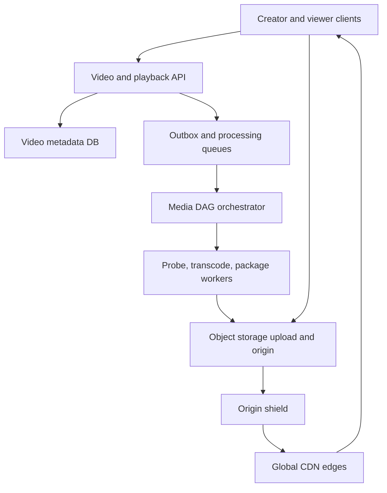
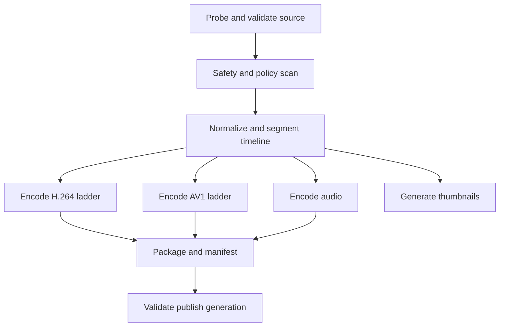

# System Design Interview Practice: Video Upload and Adaptive Streaming Platform

**Difficulty:** Medium–Hard  
**Primary themes:** resumable uploads, object storage, asynchronous media pipelines, DAGs, idempotent queues, adaptive bitrate streaming, manifests, CDNs, hot-object protection, caching, reliability, and observability

> **Interview timing vs. this walkthrough:** In a 45-minute interview, spend about 5 minutes on requirements, 2 minutes on entities, 5 minutes on APIs, 10–15 minutes building upload, processing, and playback, then 10–15 minutes on transcoding reliability, adaptive bitrate delivery, and viral-read scaling. This learning version goes deeper. In the room, first make one uploaded video reach a playable state, then evolve the design around large uploads, device/network diversity, and read hotspots.

This walkthrough follows Hello Interview’s public delivery framework: clarify and prioritize requirements, identify core entities, define client-facing contracts, build a complete design one operation at a time, and then deepen the areas where scale breaks the baseline. genui{"citation":{"ref":"turn89search1"}} Hello Interview’s YouTube breakdown frames upload and watch as the core requirements and highlights resumable large-file transfer, segment-based adaptive bitrate streaming, asynchronous processing, and CDN-backed read scaling as the main technical work. genui{"citation":{"ref":"turn89search0"}} The prompt, dialogue, scale assumptions, and detailed solution below are original.

---

## Interviewer prompt

> Design a global video platform where authenticated creators upload recorded videos and viewers stream them on phones, browsers, and TVs. Uploads must resume after network failures. A video should become playable after asynchronous validation and transcoding. Playback should start quickly and adapt to changing bandwidth without downloading the entire file. The system must survive worker failures and viral traffic.

## Targeted clarifying questions with assumed interviewer answers

**Candidate:** Is this live streaming or uploaded video on demand?

**Interviewer:** Focus on uploaded video on demand. Discuss how live streaming would differ only as a follow-up.

**Candidate:** Which product features are required?

**Interviewer:** Creators upload videos and check processing state. Viewers fetch metadata and stream published videos. Owners may delete videos. Search, recommendations, comments, subscriptions, and monetization are out of scope.

**Candidate:** What file limits and formats should I assume?

**Interviewer:** Source files can be up to 100 GB and six hours long. Accept common containers and codecs. Produce a standard ladder such as 240p through 4K when the source supports it.

**Candidate:** What scale should we design for?

**Interviewer:** Two million completed uploads per day, one billion playback starts per day, 50 million peak concurrent viewers, and a catalog of ten billion videos. The average source is 2 GB, while a small percentage are much larger.

**Candidate:** What playback targets matter?

**Interviewer:** Playback should start within two seconds at p95 when the CDN has content. Rebuffering should remain below 1% of watch time at p95. Seek should usually resume within one second. Support low-bandwidth clients by switching rendition.

**Candidate:** When is an upload acknowledged?

**Interviewer:** Acknowledge individual parts after durable object-store receipt. Mark the upload complete after all parts and source checksum are verified. Publishing happens later, after required renditions and manifests are ready.

**Candidate:** What consistency is required?

**Interviewer:** The creator needs read-your-write status. Viewers must never receive a manifest referencing missing segments. Metadata such as title may be eventually consistent globally. Deletion should stop new playback authorizations quickly, while cached URLs expire shortly.

**Candidate:** Is every rendition required before publishing?

**Interviewer:** No. Publish once a minimum playable ladder—for example audio, 360p, and 720p—is valid. Higher resolutions may appear later. Existing manifest versions must remain immutable.

**Candidate:** Is content moderation in scope?

**Interviewer:** Include a validation/moderation gate and quarantine semantics, but treat classifiers and human-review tooling as external systems.

**Candidate:** Can clients transfer bytes directly to object storage and CDN?

**Interviewer:** Yes. The application tier should control sessions and authorization, not proxy video bytes.

### Scope statement to say aloud

> “I’ll separate metadata/control traffic from the video data plane. The creator uploads source parts directly to object storage through a resumable session. Completing the source emits an idempotent media-processing DAG that probes, validates, segments, and transcodes into an adaptive bitrate ladder. Publication is an atomic metadata change to an immutable manifest generation that references only durable segments. Viewers fetch a signed playback session and then stream manifests and segments primarily from a CDN.”

---

## 1. Requirements (~5 minutes)

### Three core functional requirements

1. **Resumable upload.** An authenticated creator creates an upload, transfers a source as durable parts, resumes after failure, and observes processing progress.
2. **Process and publish.** The system validates the source, generates multiple codec/bitrate renditions and aligned segments, builds manifests, and atomically publishes a playable generation.
3. **Adaptive playback.** An authorized viewer starts, seeks, and continues playback through CDN-delivered manifests and segments while the client adapts quality to bandwidth and device capability.

### Quantified non-functional requirements

| Property | Target | Design implication |
|---|---:|---|
| Completed uploads | 2M/day ≈ 23/s average; 10× peak | Direct multipart upload and queue-backed processing |
| Source volume | 2 GB average ≈ 4 PB/day logical ingest | Object storage, lifecycle policy, no API proxying |
| Playback starts | 1B/day ≈ 11.6K/s average; much higher peak | Cached metadata and CDN-first delivery |
| Concurrent viewers | 50M peak | Globally distributed edge delivery and origin shielding |
| Maximum source | 100 GB / 6 hours | Multipart resume, bounded manifests, parallel processing |
| Startup latency | p95 < 2 s on CDN hit | Small initial segments, nearby edge, cached manifests |
| Rebuffer ratio | p95 < 1% watch time | ABR ladder, aligned segments, client buffer feedback |
| Seek latency | p95 < 1 s on hot content | Independent segments/keyframes and range-friendly storage |
| Availability | 99.99% playback; 99.9% upload control | Edge serving independent from processing/control failures |
| Durability | No acknowledged source/segment loss within storage target | Checksums, multi-AZ object storage, repair/audit |

### Consistency and availability contract

- **Upload-part acknowledgement means durable receipt.** Retrying the same part number and checksum is idempotent; a different body under the same identity is rejected.
- **Upload completion is immutable.** Once the verified source object is finalized, processing jobs reference its content/version ID rather than a mutable path.
- **Processing is at least once and idempotent.** Duplicate queue delivery may repeat work but cannot publish corrupt or conflicting outputs.
- **A published manifest generation is immutable and complete.** It references only durable, checksum-verified segments. Viewers never observe half-written manifests.
- **The creator gets read-your-write status.** The upload/processing API reads the authoritative metadata region or a replica caught up to the returned version.
- **Playback prioritizes availability.** Immutable manifests and segments may be served from edge caches even if metadata or processing services are impaired, subject to authorization expiry and deletion policy.
- **Metadata edits may propagate eventually.** Title/description changes can lag globally, but visibility, entitlement, and deletion epochs receive stricter invalidation.
- **Deletion is a state transition before physical erasure.** New playback sessions fail quickly; CDN capabilities expire; asynchronous retention/GC removes unreferenced objects later.

### Out of scope

- Search, recommendation, comments, subscriptions, advertisements
- Detailed codec mathematics or building an encoder
- Live ingest and ultra-low-latency streaming
- Content-classifier internals and human moderation tooling
- View-count accuracy and creator analytics
- DRM license-server internals beyond where authorization fits

### Scale estimates that change the design

At two million uploads per day with a 2 GB average source:

```text
2,000,000 × 2 GB = 4 PB/day of source ingest
```

Proxying this through application servers doubles network traversal and couples API compute to petabytes of traffic. The client must upload directly to object storage using short-lived, part-scoped capabilities.

Assume each source yields six renditions averaging 35% of source bytes each after compression and segmentation:

```text
derived bytes/day ≈ 4 PB × 6 × 0.35 = 8.4 PB/day
```

The actual factor varies by content and ladder. It makes rendition selection, codec adoption, source retention, and lifecycle tiering material cost decisions. Do not automatically create 4K from a 720p source or unpopular expensive codecs without policy.

At one billion playback starts per day:

```text
1,000,000,000 / 86,400 ≈ 11,574 starts/second average
```

Starts are only control requests; segment traffic is far larger. With 50 million concurrent viewers averaging 3 Mbps:

```text
50,000,000 × 3 Mb/s = 150 Tb/s egress
```

No centralized origin can serve this. CDN edge delivery is foundational, with origin shielding and request coalescing to protect storage during a viral miss.

For a six-hour video using four-second segments:

```text
6 × 3,600 / 4 = 5,400 segments per rendition
```

With six renditions, that is roughly 32,400 media objects plus manifests and thumbnails. The metadata database should not store every segment row for every video. Store compact rendition/manifest metadata; manifests or segment indexes live as immutable objects.

**What to say aloud:**

> “Four petabytes of daily source ingest forces direct object-store upload, and roughly 150 terabits per second of peak playback forces CDN-first delivery. The transactional database stores video and processing state—not video bytes and not tens of thousands of segment rows per long video.”

---

## 2. Core entities (~2 minutes)

| Entity | Essential fields and purpose |
|---|---|
| `Video` | Video ID, owner, title, visibility, lifecycle state, current generation, version |
| `UploadSession` | Session ID, owner/video, source format hints, part size/count, expiry, state |
| `UploadPart` | Session, part number, size, checksum, object-store receipt/version |
| `SourceAsset` | Immutable source object/version, size, media checksum, probe metadata |
| `ProcessingRun` | Source, pipeline version, state, attempt, progress, error, timestamps |
| `ProcessingTask` | DAG node, dependency set, input/output identities, lease, state, attempt |
| `Rendition` | Generation, codec/container, resolution, bitrate, segment duration, manifest URI |
| `ManifestGeneration` | Immutable generation ID, master/media manifest URIs, checksum, publish state |
| `PlaybackSession` | Viewer/video entitlement, device capabilities, allowed generation, expiry |
| `AssetReference` | Video/generation-to-object references used for retention and garbage collection |

The stable `video_id` is separate from an immutable `manifest_generation_id`. Updating the ladder or reprocessing produces a new generation; viewers already streaming the old generation keep a coherent segment graph.

---

## 3. API and system interface (~5 minutes)

Identity is derived from the authenticated session. The client never supplies an authoritative owner ID, storage bucket, output key, processing state, or visibility bypass.

### 3.1 Create a resumable upload

```http
POST /v1/videos/uploads
Authorization: Bearer <creator-token>
Idempotency-Key: upload-phone-771
Content-Type: application/json

{
  "title":"Systems at Scale",
  "source_filename":"talk.mov",
  "size_bytes":12884901888,
  "content_type":"video/quicktime",
  "source_sha256":"sha256:...",
  "visibility":"PRIVATE"
}
```

```json
{
  "video_id":"vid_501",
  "upload_session_id":"up_884",
  "part_size_bytes":67108864,
  "part_count":192,
  "expires_at":"2026-10-15T14:00:00Z",
  "next_capabilities_url":"/v1/uploads/up_884/parts:authorize"
}
```

The server chooses part size within object-store and manifest limits. It returns capabilities in bounded pages rather than thousands of URLs at once.

### 3.2 Authorize and upload parts

```http
POST /v1/uploads/up_884/parts:authorize
Authorization: Bearer <creator-token>
Content-Type: application/json

{"part_numbers":[1,2,3,4]}
```

```json
{
  "parts":[
    {"part_number":1,"url":"https://object.example/...","expires_at":"..."}
  ]
}
```

The client uploads directly:

```http
PUT <part-scoped-url>
Content-Length: 67108864
X-Checksum-SHA256: ...

<binary bytes>
```

### 3.3 Inspect and complete upload

```http
GET /v1/uploads/up_884
Authorization: Bearer <creator-token>
```

```json
{
  "state":"UPLOADING",
  "received_parts":[1,2,3,4,7],
  "missing_ranges":[[5,6],[8,192]]
}
```

```http
POST /v1/uploads/up_884:complete
Authorization: Bearer <creator-token>
Idempotency-Key: complete-up-884
Content-Type: application/json

{
  "parts":[
    {"part_number":1,"receipt":"...","checksum":"sha256:..."}
  ],
  "source_sha256":"sha256:..."
}
```

```json
{
  "video_id":"vid_501",
  "state":"PROCESSING",
  "version":2,
  "processing_run_id":"run_220",
  "status_url":"/v1/videos/vid_501"
}
```

Completion verifies ownership, every expected part, size, checksums, and final source object before committing `PROCESSING` plus an outbox event.

### 3.4 Read processing status

```http
GET /v1/videos/vid_501
Authorization: Bearer <creator-token>
```

```json
{
  "video_id":"vid_501",
  "state":"PROCESSING",
  "progress":{
    "stage":"TRANSCODING",
    "completed_renditions":["360p-h264","720p-h264"],
    "pending_renditions":["1080p-h264","1080p-av1"]
  },
  "version":5
}
```

### 3.5 Create a playback session

```http
POST /v1/videos/vid_501/playback-sessions
Authorization: Bearer <viewer-token-or-anonymous-session>
Content-Type: application/json

{
  "device":{
    "codecs":["av01","vp09","avc1"],
    "max_width":3840,
    "hdr":false
  },
  "network_hint":"WIFI"
}
```

```json
{
  "playback_session_id":"ps_778",
  "video_id":"vid_501",
  "generation_id":"gen_7",
  "master_manifest_url":"https://cdn.example/v/vid_501/gen_7/master.m3u8?...",
  "expires_at":"2026-10-14T16:10:00Z",
  "heartbeat_interval_seconds":30
}
```

The service checks visibility/entitlement and deletion epoch, selects a published generation compatible with the device, and returns a short-lived signed manifest capability or cookie.

### 3.6 Delete a video

```http
DELETE /v1/videos/vid_501
Authorization: Bearer <creator-token>
Idempotency-Key: delete-vid-501
If-Match: "video-version-9"
```

Deletion immediately changes metadata state and authorization epoch, then asynchronously purges CDN keys and schedules retained asset deletion.

### Important errors

| Status | Meaning |
|---|---|
| `400` | Invalid metadata, part list, device capability, or transition |
| `403` | Caller lacks ownership or playback entitlement |
| `404` | Video/session absent or hidden |
| `409` | Session already completed, idempotency mismatch, state conflict |
| `410` | Upload or playback capability expired; video deleted |
| `412` | Video version precondition failed |
| `413` | Source, part, duration, or resolution exceeds policy |
| `415` | Unsupported or invalid media format |
| `422` | Missing part, checksum failure, or corrupt media |
| `429` | Upload/processing/playback abuse or quota exceeded |
| `503` | Control service temporarily unavailable; durable transfers may continue |

---

## 4. Data flow

### Upload and processing flow

1. Creator creates an upload session; metadata service writes `Video(UPLOADING)`.
2. Client uploads parts directly to a staging namespace using short-lived scoped capabilities.
3. Object storage durably records parts and validates explicit checksums.
4. Client completes the session; upload service finalizes the immutable source object.
5. One metadata transaction writes `SourceAsset`, changes video to `PROCESSING`, creates `ProcessingRun`, and inserts an outbox event.
6. Orchestrator materializes a media-processing DAG and queues runnable tasks.
7. Workers probe/validate, scan, normalize, transcode, segment, generate audio/thumbnails/captions, and build manifests.
8. A publication validator checks required outputs and segment references.
9. Publication transaction creates immutable `ManifestGeneration(gen_N)` and changes `Video.current_generation_id` atomically.
10. CDN pulls manifests/segments lazily or receives selective prewarming for expected popular content.

### Playback flow

1. Viewer requests video metadata/playback session.
2. Playback service verifies visibility/entitlement and chooses a generation/device-compatible master manifest.
3. Client downloads the manifest from a nearby CDN edge.
4. The adaptive bitrate algorithm selects a rendition using bandwidth estimate, buffer level, viewport, and codec support.
5. Client requests a short sequence of media segments from CDN and begins playback.
6. As conditions change, the client switches rendition only at aligned segment boundaries.
7. CDN misses go to an origin shield, then immutable object storage.
8. Playback telemetry is batched asynchronously; it never blocks media delivery.

---

## 5. High-level design (~10–15 minutes)

### Compact architecture



### Operation 1: upload one source file

Begin with a single direct object upload:

1. API authenticates owner and creates `Video` plus upload session.
2. It returns a scoped object-store URL.
3. Creator uploads the source directly.
4. Creator calls complete.
5. API verifies object size/checksum and moves metadata to `PROCESSING`.

This is a complete small-file baseline, but a 100 GB upload cannot safely be one request. Evolve it to multipart:

- fixed or negotiated 32–256 MB parts;
- parallel uploads with bounded client concurrency;
- server API to list received parts;
- independent retry per failed part;
- final source checksum in addition to part checksums;
- session expiry and staging cleanup;
- idempotent completion.

Data model introduced here:

```text
video(video_id, owner_id, title, visibility, state,
      current_generation_id, auth_epoch, version,
      created_at, updated_at)

upload_session(session_id, video_id, expected_size,
               source_checksum, part_size, state, expires_at)

source_asset(source_id, video_id, object_version,
             size, checksum, media_probe, state)
```

Staging object keys include unpredictable session identifiers. The capability limits method, exact part, maximum size/checksum, and expiry. Knowing an object key is not authorization.

### Operation 2: trigger processing reliably

Do not synchronously transcode in the upload-complete request. It could take minutes or hours, tie up connections, and fail independently.

The completion transaction writes an outbox row:

```text
outbox(event_id, aggregate_id=video_id,
       type=SOURCE_READY, payload, published_at)
```

A relay publishes to the processing stream at least once. The orchestrator deduplicates by `(source_id, pipeline_version)` and creates a `ProcessingRun` only once.

The creator receives `202 Accepted` with a status URL. Polling is sufficient initially; WebSocket/mobile push may announce final readiness but is not the authoritative status.

### Operation 3: execute a media DAG

Processing is not one monolithic job. Model dependencies explicitly:



Not all branches are required for initial publication. Define a policy such as:

```text
minimum publish set = validated audio + 360p H.264 + 720p H.264
```

Higher H.264, VP9/AV1, HDR, thumbnails, and captions can backfill. This reduces time-to-first-playable while preserving an upgrade path.

Task table:

```text
processing_task(run_id, task_id, task_type,
                input_ids, output_prefix, state,
                attempt, lease_owner, lease_expiry,
                required_for_publish, error_code)
```

Workers claim tasks with leases, heartbeat, and checkpoint where the encoder permits. A lease expiry makes the task runnable again. Output names include source hash, pipeline version, rendition spec, and segment ordinal, so duplicate execution writes the same immutable identity or a temporary attempt prefix later committed by compare-and-set.

### Operation 4: produce aligned segments and manifests

Encode each rendition with aligned keyframes and segment boundaries, for example every 2–6 seconds. Alignment lets the client switch from 720p to 360p at segment `N` without changing playback time.

Outputs:

```text
/video/vid_501/gen_7/h264/360p/init.mp4
/video/vid_501/gen_7/h264/360p/segment-000001.m4s
/video/vid_501/gen_7/h264/720p/segment-000001.m4s
/video/vid_501/gen_7/audio/en/segment-000001.m4s
/video/vid_501/gen_7/master.m3u8
/video/vid_501/gen_7/h264-720p.m3u8
```

The master manifest lists available variants; media manifests list ordered segments. Hello Interview’s YouTube walkthrough explains that segmenting and storing multiple playable formats is what enables efficient adaptive streaming instead of downloading one giant file. genui{"citation":{"ref":"turn89search0"}}

Publication validator checks:

- required renditions exist;
- segment timelines and keyframes align;
- durations are monotonic and within tolerance;
- every manifest reference resolves to a durable object;
- checksums and sizes match;
- codec/container metadata is internally consistent;
- sample decoding succeeds;
- moderation state permits publication.

It then writes manifests to a temporary generation prefix, verifies them, and commits the immutable generation in metadata. Never overwrite a live manifest in place.

### Operation 5: start playback

Viewer requests a playback session. The API:

1. reads cached video metadata;
2. verifies `PUBLISHED` state, visibility, entitlement, geography, and authorization epoch;
3. filters renditions by device codec/resolution/HDR support;
4. returns a short-lived signed master-manifest URL or CDN cookie;
5. records a lightweight asynchronous playback-start event.

The client downloads only the manifest and first few small segments before starting. It does not wait for the whole file.

For public videos, segment URLs may be broadly cacheable but still use opaque immutable keys and abuse controls. Private/paid videos require signed cookies/URLs or edge authorization. Cache authorization decisions only for short periods and key them by entitlement/auth epoch.

### Operation 6: adaptive bitrate playback

The player estimates throughput from recent segment downloads and tracks buffered media. A simplified policy:

```text
safe_bitrate = estimated_throughput × safety_factor

choose highest compatible rendition where:
  rendition_bitrate <= safe_bitrate
  AND buffer policy permits upgrade
```

Downgrade aggressively when buffer is low; upgrade conservatively to avoid oscillation. Initial quality may use network/device hints but should start modestly for fast startup.

Segment duration tradeoff:

| Shorter segments | Longer segments |
|---|---|
| Faster startup/seek and quicker quality switching | Better compression and fewer requests |
| More manifests/objects/request overhead | Slower adaptation and larger retry unit |

Choose roughly four seconds as a general baseline, then tune by content/device. The exact number is not the key interview decision; explaining the tradeoff is.

### Operation 7: scale delivery through CDN

Immutable segment URLs are ideal CDN objects:

- very long cache TTL;
- content/version in the path;
- no in-place mutation;
- safe retries and edge replication;
- popular content served near viewers.

Metadata and playback-session responses use shorter TTLs. The manifest can be immutable per generation, so it also caches well. CDN misses flow through regional shields that collapse simultaneous requests before reaching object storage.

For a viral new video, optionally prewarm the master manifest, first segments, and popular renditions in predicted regions. Do not push every rendition of every upload globally; most catalog videos are cold.

### Operation 8: delete without broken references

Deletion transaction:

1. verifies owner and expected version;
2. changes video to `DELETED`;
3. increments authorization epoch;
4. appends audit/outbox events;
5. stops new playback sessions.

Then:

- purge critical manifest cache keys where supported;
- rely on short signed-capability expiry for already issued private sessions;
- retain assets for policy/legal hold or grace period;
- decrement generation references;
- run mark-and-sweep before irreversible deletion.

Already downloaded public bytes cannot be recalled. The user-facing contract should distinguish preventing new access from physically erasing every copy immediately.

---

## 6. Deep dives (~10–15 minutes)

### Deep dive A: reliable transcoding DAGs and exactly-once effects

#### Where the baseline breaks

A single “transcode video” queue task may run for hours. A worker crash restarts everything; duplicate delivery creates duplicate objects; one corrupt rendition blocks all publication; retries can repeat deterministic failures forever. If a worker updates `PUBLISHED` before every segment is durable, viewers receive broken manifests.

#### Processing options

| Approach | Strength | Limitation |
|---|---|---|
| One monolithic job | Simple orchestration | Poor retry granularity and parallelism |
| Queue per rendition | Easy horizontal scale | Dependency/publication coordination needed |
| Explicit DAG orchestrator | Clear dependencies, partial retry, progress | More state and recovery logic |
| External workflow engine | Durable timers/retries built in | Operational dependency; still need idempotent activities |

Choose an explicit durable DAG, implemented by a workflow engine or database-backed orchestrator. The interview value is the semantics, not the brand.

#### Idempotent task contract

Each task has deterministic identity:

```text
task_key = hash(source_id, pipeline_version,
                task_type, rendition_spec, segment_range)
```

Execution rules:

1. claim with a renewable lease;
2. write outputs to an attempt-scoped temporary prefix;
3. checksum and validate outputs;
4. atomically record output identity and `SUCCEEDED` if task is still owned;
5. promote/reference immutable outputs;
6. duplicate attempts discover the committed result and discard temporary output.

Messages are at least once. Effects become exactly-once-like through deterministic keys, compare-and-set state, immutable objects, and idempotent publication.

#### Retry classification

- **Transient:** worker loss, storage timeout, queue outage → exponential retry with jitter.
- **Capacity:** no GPU/encoder slot → requeue or admission wait without counting as media failure.
- **Input-specific:** corrupt frames, unsupported codec → bounded retries, then terminal/quarantine.
- **Systematic pipeline bug:** many videos fail same pipeline version → circuit-break that version and halt rollout.
- **Output validation:** checksum/duration mismatch → discard attempt, retry elsewhere, escalate after threshold.

Dead-lettering alone is insufficient. Store a human-readable failure category and remediation action; creators need `FAILED_UNSUPPORTED_FORMAT` rather than “queue error.”

#### Partial publication and generations

Suppose the minimum H.264 ladder finishes but AV1 is still encoding. Publish `gen_7` with the complete minimum set. When AV1 completes, either:

- publish `gen_8` containing all old and new renditions; or
- update a mutable control record that selects immutable variant manifests.

Prefer a new immutable generation for simple CDN correctness. New playback sessions receive `gen_8`; sessions already on `gen_7` finish safely. Reference both until session TTL/grace permits GC.

#### Pipeline rollout

Version the encoder, packaging settings, and policy. Roll out through:

- synthetic/canary videos;
- small percentage of new uploads;
- compare quality, bitrate, encode cost, failure rate, and device compatibility;
- automatic rollback/circuit breaker;
- optional lazy backfill for popular catalog items.

YouTube has publicly discussed transcoding new uploads into additional formats and prioritizing catalog work, illustrating why codec evolution is an ongoing background process rather than a one-time upload step. genui{"citation":{"ref":"turn89search27"}}

#### Observability

- source-ready-to-first-playable p50/p95/p99
- queue wait versus processing duration by task/rendition
- worker utilization, lease expiry, retries, and speculative duplicate work
- failure rate by source format, encoder, and pipeline version
- output validation/checksum mismatch
- bytes read/written and compute-minutes per finished minute
- minimum-ladder publication success
- generation promotion latency and orphan temporary bytes
- canary quality/compatibility regressions

**What to say aloud:**

> “I assume at-least-once task delivery. Deterministic task keys, attempt-scoped outputs, checksums, leases, and a compare-and-set commit make retries safe. Publication is a separate atomic step after a validator proves the minimum immutable generation is complete.”

### Deep dive B: adaptive bitrate, manifests, and playback reliability

#### Where the baseline breaks

Serving one 10 GB MP4 forces long startup, expensive retry, poor seeking, and one quality that cannot fit both fiber and cellular users. Producing different complete files helps compatibility but still adapts slowly. Unaligned rendition segments can make quality switches glitch or change timestamps.

#### Delivery approaches

| Approach | Strength | Limitation |
|---|---|---|
| Whole-file download | Simplest storage | Not practical streaming |
| HTTP range on one rendition | Seek/resume support | No bandwidth adaptation |
| Multiple segmented renditions | ABR, retry, seek, CDN cache | Processing and manifest complexity |
| Per-title encoding | Better quality/byte efficiency | Extra analysis and encode policy complexity |

Select segmented HLS/DASH-style adaptive streaming. The manifest advertises available codecs, resolution, bitrate, audio, and segment paths. Clients choose dynamically.

#### Startup, steady-state, and seek

Startup path:

1. fetch metadata/playback authorization;
2. fetch master and chosen media manifest;
3. download initialization data and first segment(s);
4. start after a small safe buffer;
5. continue filling buffer while playing.

To meet two-second startup:

- keep manifests and initial segments hot at edges;
- use compact manifests and connection reuse/HTTP/2 or HTTP/3;
- pick a conservative first rendition;
- colocate authorization at the edge where possible;
- avoid sequential control-plane round trips;
- measure time-to-first-frame, not merely API latency.

Seeking maps requested time to a segment/keyframe. Independent segments reduce decode dependencies. The player may request a lower rendition first to resume quickly, then upgrade.

#### Cache correctness

Use immutable paths containing generation and object identity. Responses can carry long `max-age, immutable`. Never publish a manifest that names a segment before that segment is durably readable from origin.

Negative caching requires care. If an edge caches a `404` for a segment during a publication race, playback remains broken after the object exists. Avoid the race through publish validation and use short/disabled negative TTLs for media origins.

#### Client adaptation telemetry

Useful events:

- startup request and first frame;
- selected rendition over time;
- segment download bytes/duration/status;
- buffer level and rebuffer begin/end;
- seek and seek recovery;
- fatal decode/manifest error;
- CDN point-of-presence and network type.

Batch and sample telemetry. It must never sit on the playback critical path. High-cardinality raw events feed streaming aggregates and object storage; dashboards use pre-aggregated metrics.

#### Failure handling

| Failure | Player/system behavior |
|---|---|
| Segment request timeout | Retry another edge/origin and/or lower rendition |
| Manifest fetch fails | Retry with backoff; refresh playback authorization if expired |
| One rendition corrupt | Remove in next generation; client switches to another |
| CDN edge unhealthy | Anycast/DNS moves traffic; shield/origin fallback |
| Bandwidth collapse | Aggressive bitrate downgrade before buffer empties |
| Decoder unsupported | Playback session filters codecs; client falls back |
| Manifest references missing segment | Treat as publication invariant breach, alert and roll back generation |

#### Observability

- time to first frame by device/network/region/CDN
- rebuffer ratio and rebuffer events per hour
- average delivered bitrate and quality-switch frequency
- seek latency and failure
- manifest/segment CDN hit ratios
- origin/shield request and byte rates
- HTTP error/timeout by segment, rendition, and edge
- decode failures by codec/device/app version
- playback success by manifest generation

**What to say aloud:**

> “Adaptive streaming is a closed loop between aligned rendition segments and the player’s bandwidth/buffer estimate. Immutable generation paths make CDN caching safe. The publication invariant is that every referenced segment already exists and validates; otherwise a single bad manifest can break millions of sessions.”

### Deep dive C: viral-read scaling, origin protection, and deletion

#### Where the baseline breaks

A new celebrity upload may create millions of nearly simultaneous misses before CDN caches fill. Direct misses to object storage amplify egress and request load. Metadata rows for hot videos can also overload one shard. Deletion conflicts with long edge TTLs and in-flight playback sessions.

#### Read hierarchy

```text
viewer
  → edge CDN
    → regional origin shield
      → immutable object storage
```

The shield provides:

- request coalescing: one upstream fetch for many identical misses;
- a larger regional cache than each edge;
- controlled origin concurrency;
- retry/circuit-break behavior;
- observability of fill storms.

For metadata:

```text
viewer → edge/API cache → regional cache/read replica → metadata DB
```

Cache immutable or slowly changing fields separately from entitlement and deletion state. A viral video’s title/thumbnail can have a long cached representation keyed by video version, while authorization uses short-lived epoch-aware data.

#### Viral release strategy

- prewarm master manifest and first segments in expected regions;
- prioritize common H.264 renditions, then efficient codecs;
- collapse concurrent misses at shield;
- use stale-if-error for public immutable metadata where safe;
- bound origin concurrency per object/prefix;
- apply token buckets to abusive clients without punishing CDN cache hits;
- retain enough regional origin capacity for long-tail misses and edge failover.

The CDN hit ratio, not metadata QPS alone, determines whether the design survives. Hello Interview’s YouTube breakdown specifically identifies scaling reads through CDN caching because a viral video may be watched millions of times after one upload. genui{"citation":{"ref":"turn89search0"}}

#### Multi-region control plane

Assign each video a metadata home region for writes. Replicate metadata globally for reads and keep object data multi-region according to durability and demand policy. Upload can enter the nearest supported region, but completion establishes one immutable source identity and home processing run.

Playback remains available from CDN for already authorized, immutable public content even if the home metadata region is impaired. New private playback sessions may fail closed if entitlement cannot be verified. Creator edits route to the home authority and use optimistic version checks.

#### Deletion and garbage collection

Deletion has three clocks:

1. **Authorization clock:** stop issuing new sessions and increment epoch immediately.
2. **Cache clock:** purge manifests where possible and wait for signed URL/cookie expiry.
3. **Storage clock:** after retention/legal hold and reference grace, delete unreferenced source/rendition objects.

Reference state:

```text
asset_reference(video_id, generation_id, object_prefix,
                state, retention_until, legal_hold)
```

Use transactionally created references plus periodic mark-and-sweep audit. A generation is eligible only when no published/current session policy references it, retention expired, no legal hold exists, and a safety generation confirms it unreachable.

#### Disaster and corruption handling

- object inventory compares manifests with stored segment sets;
- background scrubbing validates checksums;
- corrupt replicas repair from healthy copies/erasure fragments;
- metadata backups and restore drills rebuild generation pointers;
- pipeline outputs can be regenerated from retained source when possible;
- source deletion policy must account for whether regeneration is still promised.

#### Observability

- edge and shield hit ratio by object type/region
- origin requests, bytes, concurrency, throttling, and fill latency
- request-coalescing efficiency and stampede suppression
- hottest video/object distribution
- metadata cache hit and hot-partition load
- purge latency and deleted-video playback attempts
- signed-capability lifetime and post-delete access window
- live versus retained versus orphaned bytes
- scrub/inventory mismatch and repair success
- regional playback/error rate during control-plane failure

**What to say aloud:**

> “A CDN alone is not enough during a cold viral miss. A regional shield collapses identical fetches and bounds object-store concurrency. Immutable versioned paths make long caching safe, while deletion uses an immediate authorization epoch, cache purge/expiry, and delayed reference-audited storage GC.”

---

## 7. Finish

### Concise final design

Creators create resumable upload sessions through the video API, then transfer checksummed parts directly to a staging area in object storage. Upload completion verifies every part and the final immutable source, atomically changes the video to `PROCESSING`, records a processing run, and emits an outbox event. A durable DAG orchestrator schedules idempotent leased tasks for media probing, validation, moderation, transcoding, audio, thumbnails, segmentation, and manifest generation. Workers write attempt-scoped outputs and commit deterministic immutable results only after checksum and media validation.

The platform publishes once a minimum adaptive bitrate ladder is complete. Publication creates a new immutable manifest generation referencing only durable aligned segments, then atomically advances the video’s current generation. Higher-quality or newer-codec renditions can produce another generation later without breaking active viewers.

Viewers request a playback session that checks visibility and entitlement, filters variants by device capability, and returns a short-lived signed master-manifest URL. The player downloads small segments from nearby CDN edges and adapts bitrate using measured throughput and buffer health. Regional origin shields coalesce viral misses before immutable multi-region object storage. Metadata is cached separately from short-lived authorization state. Deletes immediately change metadata and the authorization epoch, purge critical caches, and later remove unreferenced assets through retention-aware, audited garbage collection.

### Requirements check

| Requirement | Design support |
|---|---|
| Upload up to 100 GB | Multipart direct upload with bounded parallelism |
| Resume interrupted upload | Durable part receipts and missing-range API |
| Integrity | Per-part and whole-source checksums, output validation, scrubbing |
| Async processing | Outbox, durable DAG, leases, idempotent tasks |
| Fast first publication | Minimum required ladder; optional renditions backfill |
| Multi-device playback | Codec/container ladder and capability filtering |
| Startup under 2 s p95 | Cached manifests/initial segments, conservative first quality |
| Low rebuffering | Segment-based ABR using throughput and buffer |
| Fast seeking | Keyframe-aligned independent segments |
| 50M concurrent viewers | CDN edges, shield cache, immutable origin objects |
| Viral traffic | Prewarming, request coalescing, origin concurrency controls |
| Processing failure recovery | Retry classification, task leases, deterministic outputs |
| No broken published manifest | Generation validator and atomic publication |
| Creator read-your-write | Authoritative/sequence-aware status reads |
| Delete and retention | Authorization epoch, purge, expiry, delayed audited GC |

## Realistic interviewer follow-up questions with strong sample answers

**Interviewer:** Why not upload through application servers?

**Candidate:** At roughly four petabytes of daily source ingest, proxying doubles data-plane traffic and makes API capacity scale with bytes. The API should authenticate and issue narrowly scoped capabilities; object storage receives the parts directly.

**Interviewer:** When exactly is an upload complete?

**Candidate:** After object storage has every expected part, verifies their checksums and sizes, finalizes an immutable source object, and the metadata transaction records that source plus `PROCESSING`. Receiving the last part alone is not completion.

**Interviewer:** What if upload completion commits but the response is lost?

**Candidate:** The creator retries with the same idempotency key. The service returns the existing source and processing run. A different part manifest under that key is rejected.

**Interviewer:** Why not transcode synchronously?

**Candidate:** It can take minutes or hours and fails independently. Upload completion should return after durable source commit; a background DAG provides parallelism, granular retry, progress, and capacity control.

**Interviewer:** Why use a DAG instead of one job?

**Candidate:** Probe and scan gate later work, renditions can run in parallel, manifests depend on completed outputs, and one failed optional codec should not restart or block the entire pipeline. DAG nodes give explicit dependencies and retry granularity.

**Interviewer:** How do duplicate task deliveries stay safe?

**Candidate:** Tasks have deterministic keys, leased ownership, attempt-specific temporary outputs, checksums, and a conditional commit. A duplicate either loses the commit or reads the already committed output.

**Interviewer:** Can you publish before 4K and AV1 finish?

**Candidate:** Yes. Publish an immutable generation once the required audio and basic H.264 ladder validate. Later outputs create a new generation. Existing viewers remain on their coherent old generation.

**Interviewer:** Why segment the video?

**Candidate:** Segments allow playback to start before the whole file downloads, small retry units, seeking, parallel CDN caching, and quality changes as bandwidth varies.

**Interviewer:** Why must rendition boundaries align?

**Candidate:** The player needs to switch at the same presentation timestamp. Misaligned keyframes or durations can cause gaps, repeated frames, or decoder failure.

**Interviewer:** How does adaptive bitrate selection work?

**Candidate:** The player estimates recent throughput, considers buffer and device limits, and selects the highest safe rendition. It downgrades quickly as buffer falls and upgrades conservatively to avoid oscillation.

**Interviewer:** Why not store each segment as a database row?

**Candidate:** A six-hour video may have tens of thousands of rendition segments. They are immutable blobs best described by manifests in object storage. The database stores compact generation/rendition state and pointers.

**Interviewer:** What protects origin during a viral cold start?

**Candidate:** CDN edges sit behind a regional shield that coalesces identical misses. I prewarm manifests and first/common segments when popularity is predictable and bound origin concurrency.

**Interviewer:** What can still work if the metadata region is down?

**Candidate:** Already authorized playback of immutable cached content can continue until capability expiry. New private entitlement checks fail closed; public cached content may remain available according to policy. Creator writes wait for home-region recovery/failover.

**Interviewer:** How do you delete a video cached with a long TTL?

**Candidate:** Stop new playback sessions and bump an authorization epoch immediately, purge manifest keys where supported, use short-lived signed capabilities for protected content, then wait for cache/session expiry before reference-audited storage deletion.

**Interviewer:** What if a manifest references a missing segment?

**Candidate:** That is a publication invariant breach. The validator should prevent it; at runtime the player retries/falls back, monitoring alerts on the exact generation, and control plane rolls back to a previously valid generation if possible.

**Interviewer:** How would live streaming differ?

**Candidate:** Replace completed-source processing with continuous ingest, real-time encoding, rolling manifests, much shorter segments/chunks, producer failover, and tight glass-to-glass latency. The manifest becomes append/update oriented rather than immutable until the broadcast ends.

**Interviewer:** What would you build first?

**Candidate:** Direct multipart upload, one durable source, a simple queue, H.264 360p/720p workers, four-second aligned segments, immutable HLS manifests, metadata publication, signed playback, and a CDN. Then add DAG sophistication, AV1, partial publication, origin shields, multi-region, and audited GC.

## Common pitfalls

1. Proxying all source/video bytes through API servers.
2. Treating the final uploaded part as a completed source.
3. Omitting part and whole-source checksums.
4. Issuing unbounded numbers of upload URLs in one response.
5. Allowing upload capabilities to write arbitrary object prefixes.
6. Performing transcoding synchronously in an HTTP request.
7. Modeling hours of processing as one non-checkpointed queue task.
8. Assuming queues provide exactly-once execution.
9. Writing duplicate task attempts directly into a live output prefix.
10. Retrying corrupt inputs forever.
11. Failing to version the pipeline and rendition specification.
12. Generating resolutions higher than the useful source without policy.
13. Waiting for every optional codec before first publication.
14. Mutating a manifest already cached by viewers.
15. Publishing a manifest before all referenced segments are durable.
16. Using unaligned segments/keyframes across renditions.
17. Serving one complete video file as “streaming.”
18. Using one quality for every network and device.
19. Upgrading bitrate too aggressively and causing oscillation.
20. Measuring API latency but not time to first frame.
21. Storing every segment as a metadata database row.
22. Sending segment traffic through the playback API.
23. Assuming CDN edges alone prevent a cold-miss stampede.
24. Omitting an origin shield or request coalescing.
25. Prewarming every rendition of every catalog video globally.
26. Caching mutable authorization as long as immutable media.
27. Using long-lived private playback URLs that defeat revocation.
28. Negative-caching publication-race `404` responses for a long time.
29. Blocking playback on telemetry ingestion.
30. Mixing raw high-cardinality telemetry with dashboard queries.
31. Physically deleting assets immediately on user delete.
32. Garbage-collecting an old generation while sessions still reference it.
33. Treating replication as a substitute for checksum scrubbing and restore drills.
34. Ignoring hot metadata rows for viral videos.
35. Failing to monitor CDN hit ratio and origin byte rate.
36. Starting with codec minutiae before completing upload-to-playback flow.

## A polished 60-second close

> “The control plane owns metadata, sessions, processing state, publication, and authorization; large bytes move directly among clients, object storage, workers, and CDN. A creator uploads checksummed parts resumably and completes one immutable source. An outbox starts an at-least-once media DAG whose leased, deterministic tasks probe, scan, transcode, align segments, and build manifests safely under retry. A validator publishes a minimum immutable generation only after every referenced segment is durable, while optional codecs create later generations. Viewers obtain a short-lived authorized manifest and stream small segments from CDN, with the client adapting bitrate using throughput and buffer. Regional shields collapse viral misses, versioned paths make long caching safe, and deletion combines an immediate authorization epoch with purge/expiry and delayed reference-audited garbage collection.”

## References

- [Hello Interview: System Design Delivery Framework](https://www.hellointerview.com/learn/system-design/in-a-hurry/delivery)
- [Hello Interview: Design a Video Streaming Platform Like YouTube](https://www.hellointerview.com/learn/system-design/problem-breakdowns/youtube)
- [Hello Interview: System Design Common Patterns](https://www.hellointerview.com/learn/system-design/in-a-hurry/patterns/quick-reference)
- [YouTube Blog: 60fps Live Streaming and Transcoding](https://blog.youtube/news-and-events/60fps-live-streaming-on-youtube-in-html5/)
- [YouTube Blog: Serving Videos in WebM](https://blog.youtube/news-and-events/mmm-mmm-good-youtube-videos-now-served/)

