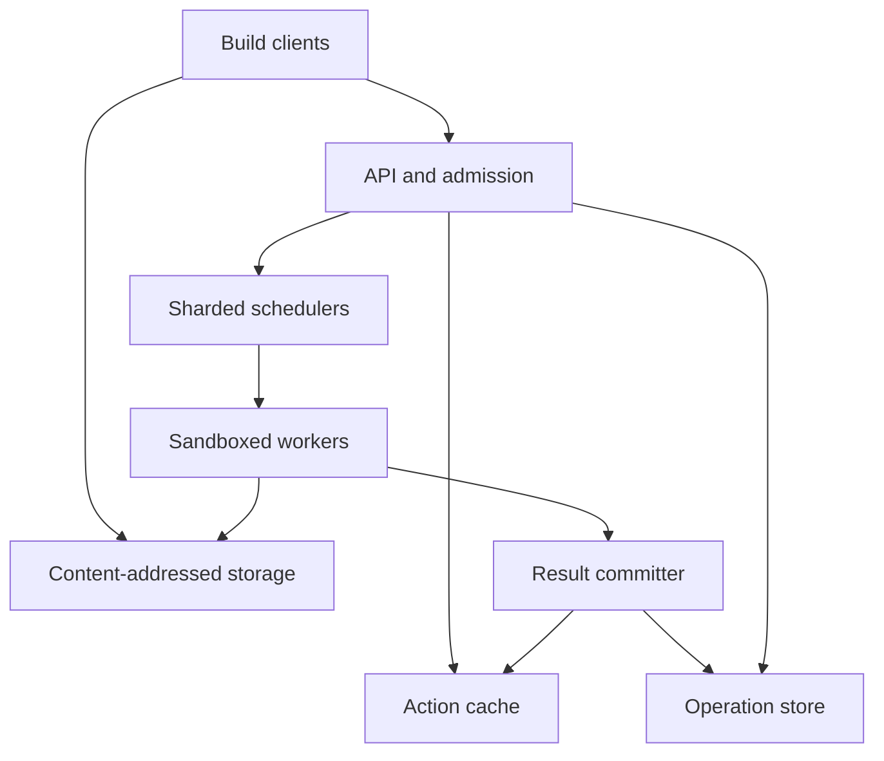

# Design a Distributed Build and Test Execution Platform

**Difficulty:** Senior / Staff  
**Primary themes:** content-addressed storage, remote caching, queues, fair scheduling, leases, speculative execution, hermeticity, reliability, and sandbox security

This is a detailed educational walkthrough. In a real 45-minute interview, use the time boxes to navigate rather than trying to say everything below. The structure follows Hello Interview's public delivery framework: clarify requirements, name the entities, define interfaces, build a complete design one operation at a time, and use the remaining time for load-bearing deep dives. The design and dialogue are original. See the [Hello Interview System Design Delivery Framework](https://www.hellointerview.com/learn/system-design/in-a-hurry/delivery).

## Interviewer prompt

> Design a distributed build and test execution service for a large engineering organization. Developers and CI should reuse cached work and run independent compile or test actions across a remote worker fleet. Support multiple platforms, isolate untrusted builds, and remain useful during partial failures.

## Targeted clarifying questions and assumed answers

**Candidate:** Does the service parse source code and construct the build graph?

**Interviewer:** No. Bazel-like clients construct the DAG locally and submit ready actions. The service stores inputs, caches results, schedules actions, and returns outputs.

**Candidate:** What actions are supported?

**Interviewer:** Compilation, linking, code generation, and bounded tests. An action specifies a command, declared inputs and outputs, platform, resources, and timeout.

**Candidate:** What scale should I design for?

**Interviewer:** Assume 100,000 concurrent build invocations, five million submitted actions per second at peak, 500,000 simultaneously running actions, and 50 PB of logically referenced artifacts before deduplication.

**Candidate:** What latency and reliability matter?

**Interviewer:** Cache lookup p99 under 50 ms. An interactive runnable action should start within two seconds at p95 when compatible capacity exists. API availability is 99.99%; acknowledged artifacts survive a zone failure.

**Candidate:** Are actions deterministic and side-effect free?

**Interviewer:** They should be hermetic: declared inputs plus command and platform determine outputs. Some real actions read time, network, undeclared files, or randomness. Detect and quarantine those problems.

**Candidate:** May an action execute more than once?

**Interviewer:** Yes. At-least-once execution and speculation are acceptable for hermetic actions. Only one valid result becomes canonical.

**Candidate:** How should tenants be isolated?

**Interviewer:** Teams share infrastructure, but authorization, quotas, scheduling fairness, cache visibility, secrets, and worker isolation matter. Sensitive release builds use private namespaces and dedicated trusted pools.

**Candidate:** Is arbitrary Internet access allowed?

**Interviewer:** No. Network is denied by default. A controlled dependency proxy may be declared. Actions cannot become long-running services.

**Candidate:** What happens if remote execution is unavailable?

**Interviewer:** Permitted developer builds may fall back locally and still use remote cache. Attested release builds fail closed.

**Candidate, summarizing aloud:**

> “The client owns build-graph analysis. I’ll design an action-level service with immutable content-addressed storage, cached action results, and leased at-least-once execution. Correctness depends on hermetic action identity; availability comes from safe duplicate work, not pretending execution is exactly once.”

---

## 1. Requirements (~5 minutes)

### Core functional requirements

1. **Store and retrieve build inputs and outputs.** Clients address files and directory trees by cryptographic digest and upload only missing content.
2. **Execute ready actions remotely.** The service schedules compatible workers, exposes progress and logs, enforces deadlines, and returns output references.
3. **Reuse prior results.** A deterministic action key maps to a successful result so later builds skip execution.

Secondary functions include cancellation, worker-pool management, quotas, provenance, retention, cache debugging, and usage reporting.

### Quantified non-functional requirements

| Goal | Target |
|---|---:|
| Peak submissions | 5 million actions/second |
| Concurrent builds | 100,000 |
| Concurrent execution | 500,000 actions |
| Cache lookup | p99 < 50 ms regionally |
| Runnable interactive queueing | p95 < 2 seconds when capacity exists |
| API availability | 99.99% |
| Artifact durability | no acknowledged loss after one zone failure |
| Cache correctness | no output for a different action or authorization namespace |
| Isolation | actions cannot access host state, other tenants, or unrestricted network |

### Consistency and execution contract

- A blob digest covers its bytes and size. After successful installation, a digest is immutable.
- An action key digests a canonical action containing command digest, Merkle input root, outputs, relevant environment, timeout semantics, and execution platform.
- An action-cache result is published only after every referenced output is durable in content-addressed storage.
- Cache replication may be eventually consistent. A stale miss wastes execution; it must never produce a wrong hit.
- Execution is **at least once**. A worker lease can expire and another worker can execute the action.
- One logical operation can own multiple attempts. The first valid result wins a fenced compare-and-swap.
- Cancellation is best effort. Queued work stops immediately; a running action may race to valid completion.
- Shared reuse requires both identical action digest and compatible namespace/provenance policy.
- Client disconnect does not imply cancellation.

**What I would say aloud:**

> “Content addressing proves byte identity, not that the action declared every real input. CAS consistency and build hermeticity are separate correctness problems.”

### Scale estimates that change the design

At five million submissions per second, even 100 microseconds of serial scheduler work would require:

\[
5{,}000{,}000 \times 100\mu s = 500\text{ CPU-seconds per second}
\]

Scheduling therefore must be partitioned by platform and worker pool.

If 60% of submissions hit cache, two million actions per second remain. At a mean runtime of 250 ms:

\[
2{,}000{,}000 \times 0.25 = 500{,}000
\]

actions run concurrently. Improving hit rate from 60% to 70% avoids 500,000 executions per second, so cache correctness and effectiveness are capacity features.

A logical input tree may be 100 MB while an edit changes 100 KB. Uploading tarballs would dominate builds. Merkle trees let clients reuse unchanged files and subtrees and upload only absent digests.

If 50 PB of logical content achieves 4× deduplication/compression, physical content is still about 12.5 PB before replication. This requires sharded object storage, regional caches, tiering, retention, and garbage collection—not one cache server.

Five million 1-KB cache-metadata lookups per second is about 5 GB/s before replication. Cache metadata needs partitioning and memory acceleration; artifact bytes must bypass schedulers and stream directly between clients/workers and CAS.

### Out of scope

- Parsing every build language or constructing the DAG
- Source-control hosting and code review
- Package-registry implementation
- Interactive development containers
- Deployment workflows with external side effects
- Making fundamentally non-hermetic commands reproducible

---

## 2. Core entities (~2 minutes)

| Entity | Essential fields and purpose |
|---|---|
| `Digest` | algorithm, hash, byte size |
| `Blob` | immutable bytes for a file, command, directory, log, or output |
| `Directory` | sorted files, symlinks, child-directory digests; forms a Merkle tree |
| `Command` | arguments, canonical environment, working directory, output paths, platform |
| `Action` | command digest, input-root digest, timeout, platform, cache policy, compatibility salt |
| `ActionResult` | exit code, output digests, stdout/stderr digests, execution metadata |
| `BuildInvocation` | tenant, caller, repository/revision, priority, operations |
| `Operation` | action digest, state, attempts, deadline, cancellation |
| `Attempt` | worker, lease/fencing token, timing, status, result candidate |
| `Worker` | pool, capabilities, free resources, health, local-cache summary |
| `WorkerPool` | platform/security class, capacity, queues, autoscaling policy |
| `CacheNamespace` | visibility, trust, encryption, retention |

**What I would say aloud:**

> “The blob digest and action digest are the two key identities. Directory nodes form a Merkle tree, so unchanged subtrees are reusable. An action result contains output references rather than duplicate bytes.”

---

## 3. API or system interface (~5 minutes)

Production systems typically use gRPC. The JSON-shaped examples are for interview readability. Bazel's public Remote Execution APIs define CAS, action-cache, execution, and long-running-operation services for this model ([Bazel Remote APIs](https://github.com/bazelbuild/remote-apis)).

Authentication uses workload identity or developer SSO. Tenant, namespace, pool access, and priority ceiling come from verified claims—not request fields.

### Find missing blobs

```http
POST /v2/cas/blobs:findMissing
Authorization: Bearer <workload-token>

{
  "digests": [
    {"hash": "9c31...", "size_bytes": 8421},
    {"hash": "60ad...", "size_bytes": 981233}
  ]
}
```

```json
{
  "missing": [
    {"hash": "60ad...", "size_bytes": 981233}
  ]
}
```

Small blobs use batch upload; large blobs use resumable streams. The server recomputes digest and size rather than trusting the caller.

### Read or write a blob

```http
PUT /v2/cas/blobs/60ad.../981233
Authorization: Bearer <workload-token>
Content-Type: application/octet-stream

<bytes>
```

Upload success means the configured replicas or erasure-coded fragments are durable. Reads support range/resume and checksum verification.

### Query the action cache

```http
GET /v2/action-cache/actions/2f7b.../431
Authorization: Bearer <workload-token>
```

```json
{
  "hit": true,
  "result": {
    "exit_code": 0,
    "output_files": [
      {"path": "bin/app", "digest": {"hash": "88af...", "size_bytes": 4938172}}
    ],
    "stdout_digest": {"hash": "c10e...", "size_bytes": 802},
    "worker_platform": "linux-x86_64-clang18"
  }
}
```

A dangling result is treated as a miss and repaired; partial output must never be returned.

### Execute an action

```http
POST /v2/executions
Authorization: Bearer <workload-token>
Idempotency-Key: invocation_71:node_884

{
  "action_digest": {"hash": "2f7b...", "size_bytes": 431},
  "skip_cache_lookup": false,
  "priority": "INTERACTIVE",
  "client_deadline_seconds": 180
}
```

```json
{
  "operation_id": "op_01JAF...",
  "state": "QUEUED",
  "attempt": 0
}
```

The action's canonical platform plus identity policy determines eligible pools. Callers cannot select arbitrary privileged worker labels.

### Observe and cancel

```http
GET /v2/operations/op_01JAF...
Authorization: Bearer <workload-token>
```

```json
{
  "state": "EXECUTING",
  "queue_ms": 83,
  "attempt": 1,
  "worker_pool": "linux-x86_64-large"
}
```

Clients normally watch a server stream. Final stdout/stderr digests are durable evidence; live log streaming is only a usability feature.

---

## 4. Data flow

### Client preparation

1. The client analyzes targets and discovers ready actions.
2. It canonicalizes command/platform data, builds a Merkle tree, and computes digests bottom-up.
3. It asks CAS for missing blobs and uploads only those.
4. It computes the action digest and checks the action cache.
5. On a hit it downloads requested outputs; on a miss it submits execution.

### Remote execution

1. Gateway authenticates the caller, derives namespace and quotas, and verifies that the action, command, and input root exist.
2. Admission creates a durable operation and reserves tenant budget.
3. A platform-specific scheduler grants a compatible worker a short lease with fencing token.
4. The worker downloads missing inputs into its local CAS, materializes a read-only sandbox, and executes under resource/network limits.
5. It hashes declared outputs, uploads missing blobs, and proposes an `ActionResult`.
6. A result committer validates lease token, output paths, CAS reachability, and provenance, then completes the operation and publishes the action-cache entry.
7. Other speculative attempts are cancelled.

---

## 5. High-level design (~10–15 minutes)



Control traffic—operations, leases, queues, and cache metadata—uses small replicated services. Large artifact traffic goes directly through CAS endpoints.

### Step 1: Begin with remote cache

Clients build locally, upload output blobs, and publish action results. A later identical action downloads those outputs. This delivers value without distributed scheduling and forces correct content/action identity first.

The stores are:

- **CAS:** immutable digest → bytes;
- **action cache:** namespace + action digest → output references.

Write blobs first, then publish the result. A crash in between leaves unreachable content that GC may reclaim. Reversing the order creates corrupt hits.

**What I would say aloud:**

> “I first make remote caching correct. It establishes canonical keys and safe publication ordering before remote execution adds leases, failures, and untrusted workers.”

### Step 2: Add leased remote execution

On a miss, enqueue the action. A worker leases it, downloads its Merkle tree, runs inside a clean sandbox, uploads outputs, and proposes a result.

The filesystem contains only declared inputs and a content-addressed execution image. Environment, working directory, time, CPU, memory, disk, processes, and network are constrained.

If the worker disappears, the lease expires and a new attempt begins. Completion must carry the active fencing token, so an expired slow worker cannot overwrite later state.

### Step 3: Scale CAS

Route digests by fixed hash prefix or consistent hashing. Keep metadata across zones and bytes in replicated or erasure-coded object storage. Regional and worker-local CAS tiers hold hot toolchains and headers.

Write flow:

1. stream to a temporary object;
2. calculate hash and size server-side;
3. reject mismatch;
4. replicate/encode durably;
5. atomically install immutable mapping;
6. acknowledge.

Concurrent identical uploads safely collapse to one mapping. Corrupt replicas are quarantined and repaired from verified copies.

### Step 4: Partition scheduling

First route on hard constraints:

- OS, architecture, toolchain image;
- CPU, memory, disk, GPU;
- security and network class;
- residency and dedicated-pool policy.

Within a compatible pool, use hierarchical weighted fair queues:

1. priority class: release, interactive, presubmit, batch;
2. tenant fair share;
3. invocation fairness;
4. estimated-cost ordering with aging.

FIFO lets giant batch builds block edits. Pure shortest-job-first starves links and long tests. Weighted shares with aging balance responsiveness and progress.

Workers advertise free resources, health, and a locality summary. Locality is a preference, not a correctness requirement.

### Step 5: Separate operations from attempts

One operation may have:

- attempt 1 die;
- attempt 2 run slowly;
- speculative attempt 3 finish first.

The first valid candidate wins a compare-and-swap. Late valid bytes can remain in CAS, but late attempts cannot rewrite terminal evidence. If successful attempts produce different output digests for one action key, poison the cache key and retain both manifests for diagnosis.

### Step 6: Autoscale with useful demand

Scale each pool from queued resource-seconds, oldest runnable age, active leases, startup time, and historical size—not raw queue length. Keep warm interactive capacity because VM boot time may exceed the two-second SLO. Batch workloads may use elastic or preemptible workers.

Reserve release capacity and cap tenant bursts. Unused quota may be borrowed, but fairness debt ensures eventual repayment.

### Step 7: Design client degradation

Client policy independently controls cache reads, cache writes, remote execution, and local fallback. Developers may execute locally after admission failure and upload results. Release builds requiring trusted provenance fail closed.

If downstream actions remain remote, keep intermediate outputs in CAS and download only final outputs or requested logs. Otherwise network transfer can erase execution gains.

---

## 6. Deep dives (~10–15 minutes)

### Deep dive A: Cache correctness, hermeticity, and garbage collection

#### Where the baseline breaks

Hidden inputs include wall-clock time, locale, hostname, undeclared environment variables, absolute paths, directory iteration order, system headers, network downloads, and randomness. A fast wrong hit is worse than a slow build.

Bazel describes hermetic builds as isolated from host-system differences and notes remote execution/cache behavior can expose non-hermetic actions ([Bazel hermeticity](https://bazel.build/versions/8.0.0/basics/hermeticity)).

#### Canonical key

The action digest covers deterministic serialization of:

```text
command digest
input-root Merkle digest
declared outputs
relevant environment and working directory
timeout semantics and platform requirements
OS/architecture/toolchain image digest
rule implementation and protocol compatibility version
```

Sort maps/directories, normalize paths/encodings, and distinguish absent from empty. Do not include queue priority or caller identity if they cannot affect output. Use image digests, never mutable tags.

#### Detect non-hermeticity

- block undeclared filesystem and network access;
- allowlist environment variables;
- provide deterministic time/randomness interfaces where supported;
- sample double execution on different workers;
- compare result digests for one action key;
- trace unexpected file opens in diagnostic mode;
- expose action-key churn and miss reasons.

Disagreement poisons the cache entry. Release builds fail closed. Reproducible-build practices such as `SOURCE_DATE_EPOCH` reduce timestamp variability but do not replace declared inputs ([specification](https://reproducible-builds.org/specs/source-date-epoch/)).

Do not cache infrastructure failures. Timeouts, lost workers, OOM, cancellation, and dependency outages are not reusable results. Cache successful results by default; deterministic failures require explicit policy.

#### Garbage collection

| Approach | Benefit | Problem |
|---|---|---|
| Exact reference counts | Precise in theory | enormous update load and race complexity |
| Last-access TTL | Simple | roots may stay hot while children look cold |
| Mark-and-sweep | Graph-correct | expensive global traversal |
| Generational hybrid | Practical scale | operational complexity |

Choose a hybrid:

1. pins protect releases and active operations;
2. action-cache roots have TTL/approximate access time;
3. marker walks live result and directory roots by digest partition;
4. sweep removes old unmarked blobs after a safety horizon;
5. regional caches independently evict because durable CAS remains authoritative.

Protect new uploads with a grace period. Tombstone deletion before physical removal to avoid replica oscillation.

#### Stampede control

After a miss, register an in-flight operation by namespace/action digest. Later compatible callers subscribe rather than submit duplicates. Do not coalesce across trust namespace, credentials, platform policy, or explicit no-cache mode.

**What I would say aloud:**

> “CAS immutability solves byte identity. Canonicalization, sandboxing, double execution, and poisoning defend action identity. Results reference blobs only after durability, and conservative pins plus generational marking make GC safe.”

### Deep dive B: Fair scheduling, locality, and stragglers

#### Where the baseline breaks

A global FIFO ignores compatibility and fairness. Aggressive locality leaves CPUs idle. Runtime estimates are uncertain. A few slow actions dominate the build's critical path.

#### Scheduling sequence

1. admission verifies tenant quota and overload policy;
2. hard pool matching filters platform, trust, residency, and resource constraints;
3. weighted deficit selects priority/tenant/invocation;
4. resource fit bin-packs CPU, memory, disk, GPU;
5. bounded locality preference chooses among eligible workers.

Use dominant-resource fairness because actions consume different ratios. Charge estimated resource-seconds, not action count. Allow bursts from idle capacity but record fairness debt. Aging prevents starvation.

Estimate runtime/resources by mnemonic, toolchain, input size, target, and recent quantiles. Separate statistics by platform and version. Sandboxes enforce hard limits even when estimates are wrong.

#### Locality tradeoff

Workers report compact Bloom-filter-like summaries of local CAS/image content. A conceptual score is:

```text
fair-share priority
- predicted queue delay
- missing-input transfer time
- resource-fragmentation cost
```

If transfer takes 300 ms but a cached worker is busy for 10 seconds, use the idle worker. Correctness always comes from CAS.

#### Speculation

When an eligible deterministic attempt exceeds its historical p95 and spare capacity exists, launch one duplicate. First valid result wins.

Exclude scarce pools, non-hermetic actions, very large jobs, saturated periods, and tenants over speculative budget. Track speculation win rate and wasted resource-seconds; diagnose slow workers instead of permanently masking them.

#### Scheduler recovery

Queue and operation state is durable or log-backed. Assignment grants an expiring lease with increasing fencing token. Workers heartbeat; expiry requeues the operation.

The result committer, not the worker, owns the terminal compare-and-swap. Scheduler partition failover obtains a higher ownership epoch, fencing the old leader.

### Deep dive C: Worker isolation, provenance, and reliability

#### Where the baseline breaks

Repository-controlled commands can read host credentials, attack the control plane, exfiltrate source, persist across tenants, or poison artifacts. Containers share a kernel and are not always a sufficient hostile-tenant boundary.

| Mechanism | Cost | Isolation | Typical use |
|---|---|---|---|
| Process + cgroups | Lowest | Weak | trusted internal actions |
| Container/user namespace | Low | Moderate | same-trust workloads |
| User-space kernel sandbox | Medium | Stronger | general builds |
| MicroVM/VM | Highest | Strongest practical | cross-tenant/release work |

Trust class is a hard scheduling constraint. Release pools use ephemeral microVMs and dedicated hosts where required.

Worker credentials are short-lived and scoped to one lease: read authorized inputs, write temporary outputs, heartbeat, and submit one result. They cannot enumerate tenant CAS or call control APIs.

Sandbox lifecycle:

1. verify worker image/attestation;
2. create a fresh identity and filesystem;
3. mount inputs read-only with scratch space;
4. deny network except declared proxies;
5. apply CPU, memory, disk, PID, syscall, and time limits;
6. run unprivileged;
7. collect declared outputs only;
8. destroy sandbox and ephemeral keys.

Reject output path escapes, unsafe symlinks, devices, sockets, and privileged bits.

#### Provenance

Release results store signed evidence:

- authenticated source revision;
- action/input/command digests;
- platform image digest;
- worker security class and attestation;
- output digests;
- service version and timestamps.

Cache reuse checks provenance policy. A developer result from a weaker pool cannot silently become a release artifact.

#### Failure modes

- **Client disconnects:** operation continues; authorized watchers may reconnect.
- **Worker dies:** lease expires and a new attempt starts.
- **Worker uploads then dies:** unattached blobs remain safe and are later referenced or collected.
- **Completion response is lost:** retry/watch reads terminal operation.
- **CAS corruption:** checksum verification quarantines and repairs a replica.
- **Dangling cache entry:** treat as miss and repair; never return partial result.
- **Scheduler fails:** ownership epoch moves; fencing rejects stale assignment/completion.
- **Region fails:** reroute, upload only missing inputs, and safely re-execute misses.
- **Duplicate outputs disagree:** poison action key and preserve evidence.
- **Malicious worker lies:** digest verifies bytes, while trusted pool policy, double execution, attestation, and provenance address computation trust.

#### Multi-region

Replicate or lazily copy CAS across regions. Schedulers and workers remain regional. Action-cache entries may replicate asynchronously: losing ephemeral hits costs compute, whereas wrong results violate correctness.

Cross-region routing weighs compatible capacity against input transfer. Durable release pins, provenance, and critical control state receive stronger replication than ordinary cache metadata.

#### Observability

- hit rate by mnemonic, tenant, platform, and client version;
- digest mismatch, corruption, dangling hits, poisoned actions;
- upload/download bytes avoided by deduplication;
- queue, execution, and build critical-path latency;
- fair-share debt, quota rejection, starvation age, fragmentation;
- utilization, startup time, lost leases, sandbox failure;
- CAS hot keys, replication lag, GC age, retained/live bytes;
- speculation win rate and wasted resource-seconds;
- fallback rate and remote-service error budget;
- nondeterminism and undeclared-input violations.

Fleet utilization alone is misleading. Running at 99% may destroy interactive latency. Optimize build completion time subject to cost, fairness, and trust.

**What I would say aloud:**

> “Workers are an adversarial compute boundary, not normal app pods. Trust class is a hard constraint. Leases and fencing make duplicate execution safe; signed provenance decides whether an output is acceptable for release.”

---

## 7. Final design and interview close

### Concise final design

The client constructs the DAG, canonicalizes each ready action, builds a Merkle input tree, uploads only missing blobs, and checks a namespaced action cache. A valid hit returns output digests; a miss creates a durable operation.

Admission enforces authenticated quota and routes to a platform/security-specific scheduler. Hierarchical fair queues and resource-aware matching grant a short fenced lease to a sandboxed worker. The worker materializes declared inputs, runs with bounded resources and no network by default, uploads content-addressed outputs, and proposes a result.

A separate committer verifies the active lease, output paths, provenance, and CAS durability before atomically completing the operation and publishing the cache entry. Execution is at least once, but immutable content and terminal compare-and-swap make duplicate attempts safe. Disagreeing outputs poison the action key.

CAS uses regional/worker caches over durable hash-sharded storage. Pins, safety horizons, and generational marking bound retention. Multi-region stale misses may waste work but never create wrong hits. Attested microVM pools and signed provenance protect release workloads.

### Requirements check

| Requirement | Design support |
|---|---|
| Upload/retrieve content | Hash-verified CAS, Merkle trees, missing-blob discovery |
| Remote compile/test | Durable operations, sharded schedulers, leased workers |
| Reuse work | Namespaced action cache after output durability |
| Massive submission rate | Cache and scheduler partitioning by namespace/platform |
| Low cache latency | Memory metadata caches and direct regional CAS |
| Fair queueing | Hierarchical weighted fairness, quotas, aging |
| Failure recovery | Durable state, leases, fencing, retries |
| Safe duplicates | Hermetic contract and terminal compare-and-swap |
| Cache correctness | Canonical keys, reachability checks, poisoning |
| Storage efficiency | Deduplication, tiering, conservative GC |
| Isolation | Auth-derived namespaces and trust-specific pools |
| Untrusted code | Sandboxes/microVMs, network/resource/path controls |
| Regional failure | Replicated/lazy CAS and safe re-execution |
| Release trust | Attestation and signed provenance |

## Realistic interviewer follow-up questions with strong sample answers

**Interviewer:** Why is the build graph client-side?

**Candidate:** “Language-specific analysis belongs to the build tool and repository rules. The remote service accepts ready actions through a stable protocol, so scheduling remains generic.”

**Interviewer:** What exactly is the cache key?

**Candidate:** “A digest of deterministic action serialization: command, Merkle input root, outputs, relevant environment, platform/toolchain image, timeout semantics, and compatibility version. Namespace and provenance are additional lookup boundaries.”

**Interviewer:** Why a Merkle tree instead of a tarball?

**Candidate:** “Changing one file changes only its digest and ancestor directory digests. Unchanged files and subtrees remain reusable, so the client uploads only missing content.”

**Interviewer:** What if different bytes are uploaded under one digest?

**Candidate:** “The server recomputes hash and size and rejects mismatches. Concurrent identical uploads collapse to one immutable mapping.”

**Interviewer:** Must the action cache be strongly consistent?

**Candidate:** “No. A stale miss wastes execution but is correct. A hit must be namespace-correct and reference present immutable blobs. Blob-first publication preserves that asymmetry.”

**Interviewer:** How do you prevent a cache stampede?

**Candidate:** “Register in-flight execution by compatible namespace and action digest. Later callers subscribe. Physical attempts may still duplicate after failure or speculation.”

**Interviewer:** How is at-least-once execution safe?

**Candidate:** “Actions are hermetic and side-effect free. Attempts write immutable blobs, and only the result committer can win terminal state with a current fencing token.”

**Interviewer:** What if duplicate attempts disagree?

**Candidate:** “Suppress caching, poison the key, retain both manifests, and alert the owner. It indicates nondeterminism, a missing input, or worker corruption. Release builds fail closed.”

**Interviewer:** Why not always wait for a worker with cached inputs?

**Candidate:** “Locality is a bounded optimization. Compare transfer time with predicted wait while preserving fairness. CAS makes any compatible worker correct.”

**Interviewer:** How do you schedule a 100-GB link?

**Candidate:** “Declare high memory/disk requirements, reserve a fitting worker, give locality more weight, and use aging so it eventually runs. Resource constraints prevent OOM-inducing co-placement.”

**Interviewer:** How is CAS garbage-collected safely?

**Candidate:** “Pin releases/active operations, protect new uploads with a grace period, mark digests reachable from live results and directory roots, and sweep only old unmarked content.”

**Interviewer:** Could a digest leak another tenant's source?

**Candidate:** “Knowledge of a hash is not authorization. CAS reads and missing-blob queries are namespace-gated. Sensitive tenants use private namespaces or encryption domains; cross-trust deduplication is optional.”

**Interviewer:** How do tests receive secrets?

**Candidate:** “Prefer fakes. Otherwise mount short-lived secrets into an authorized sandbox, redact logs, restrict egress, and mark the action non-cacheable unless policy proves the secret cannot affect output.”

**Interviewer:** What would you build first?

**Candidate:** “A correct single-region remote cache, then one leased worker pool and durable operations, followed by fair partitioned scheduling, local CAS tiers, hardened sandboxes, nondeterminism detection, conservative GC, and multi-region recovery.”

## Common pitfalls

1. Building the language-specific DAG on the server.
2. Treating a source commit as the complete cache key.
3. Omitting environment, platform, toolchain, or rule versions.
4. Using mutable image tags.
5. Uploading full archives instead of Merkle trees.
6. Trusting client digests.
7. Publishing results before outputs are durable.
8. Returning dangling cache entries.
9. Assuming content addressing guarantees hermeticity.
10. Caching timeouts, OOMs, cancellations, or infrastructure failures.
11. Sharing sensitive cache entries across namespaces.
12. Letting missing-blob queries leak cross-tenant existence.
13. Using one global FIFO queue.
14. Charging quota by action count rather than resources.
15. Letting locality leave workers idle.
16. Using shortest-job-first without aging.
17. Autoscaling from queue count alone.
18. Treating heartbeat loss as proof no result exists.
19. Accepting completion from an expired lease.
20. Conflating a logical operation with one attempt.
21. Speculating scarce or non-hermetic work.
22. Caching one of two disagreeing results.
23. Running repository code directly on shared hosts.
24. Giving workers broad credentials.
25. Allowing unrestricted network.
26. Accepting output path escapes or unsafe symlinks.
27. Persisting secrets in logs, keys, or shared outputs.
28. Garbage-collecting new blobs before publication can reference them.
29. Downloading every intermediate output.
30. Falling back locally for attested release builds.

## A polished 60-second close

> “The client builds the DAG and represents each ready action as a canonical digest over command, platform, and Merkle inputs. It uploads only missing blobs to an immutable verified CAS and checks a namespaced action cache. On a miss, admission places a durable operation in a platform and trust-specific fair queue. A scheduler grants a fenced lease to a sandboxed worker, which runs declared inputs with bounded resources and no network by default, then uploads content-addressed outputs. A separate committer verifies lease, outputs, provenance, and durability before completing the operation and publishing the cache result. Execution is at least once, but immutable content and terminal compare-and-swap make duplicates safe; differing results poison the key. Regional caches sit over durable sharded CAS, with pins and conservative GC. Release work uses attested microVM pools and signed provenance.”

## References

- [Hello Interview — System Design Delivery Framework](https://www.hellointerview.com/learn/system-design/in-a-hurry/delivery)
- [Bazel — Remote Execution Overview](https://bazel.build/remote/rbe)
- [Bazel — Hermeticity](https://bazel.build/versions/8.0.0/basics/hermeticity)
- [Bazel — Remote Caching](https://bazel.build/versions/7.1.0/remote/caching)
- [Bazel Remote APIs](https://github.com/bazelbuild/remote-apis)
- [Bazel Remote Execution API Protocol](https://github.com/bazelbuild/remote-apis/blob/main/build/bazel/remote/execution/v2/remote_execution.proto)
- [Reproducible Builds — SOURCE_DATE_EPOCH](https://reproducible-builds.org/specs/source-date-epoch/)
