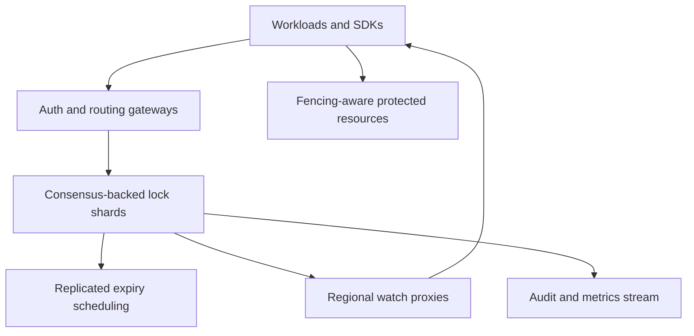

# Design a Distributed Lock and Lease Service

**Difficulty:** Senior / Staff-level  
**Primary themes:** consensus, linearizability, leases, fencing tokens, failure detection, fair queues, partitions, reliability, and observability

> **Interview timing vs. this walkthrough:** In a 45-minute interview, spend about 5 minutes on requirements, 2 minutes on entities, 5 minutes on APIs, 10–15 minutes making acquire/renew/release correct, and 10–15 minutes on fencing, partitions, fairness, and recovery. This walkthrough is intentionally more detailed. In the interview, begin with one consensus-backed shard and exclusive locks; add queues, watches, and multi-region routing only after the safety invariant is clear.

This answer follows Hello Interview’s public delivery approach: clarify scope, identify core entities and interfaces, build the simplest complete design operation by operation, and deepen the parts tied to explicit non-functional requirements. genui{"citation":{"ref":"turn97search0"}} The problem, dialogue, calculations, and design are original.

---

## Interviewer prompt

> Design a multi-tenant distributed lock and lease service used by databases, schedulers, controllers, and deployment systems. Clients can acquire an exclusive lock on a named resource, renew it, release it, wait fairly, and observe ownership changes. The service must remain safe through client crashes, long pauses, packet loss, leader changes, clock skew, and network partitions. It should scale to millions of live locks while making stale owners harmless to protected resources.

## Targeted clarifying questions with assumed interviewer answers

**Candidate:** Are locks advisory, or must the service physically prevent writes to arbitrary databases and files?

**Interviewer:** Advisory. The lock service grants ownership and fencing tokens. Protected systems must validate those tokens for strong safety.

**Candidate:** Which primitives are required?

**Interviewer:** Exclusive locks first. Support try-acquire, queued acquire with timeout, renew, release, inspect, and watch. Discuss shared locks and leader election as extensions.

**Candidate:** What are the safety and availability expectations?

**Interviewer:** At most one valid owner per lock according to the service’s linearizable history. Never grant two overlapping valid leases. Under a partition, the minority must stop granting or renewing. Prefer safety over write availability.

**Candidate:** What scale should I design for?

**Interviewer:** 10 million active leases, 2 million acquire/release operations per second at peak, 5 million renewals per second, 100 million watches, and up to 100,000 waiters on a hot lock.

**Candidate:** What latency targets matter?

**Interviewer:** Same-region uncontended acquire p99 under 50 ms, renew p99 under 30 ms, and ownership-change notification p99 under 1 second. The API should be available 99.99% within a region when a majority of replicas are healthy.

**Candidate:** How long are leases?

**Interviewer:** Configurable from 5 seconds to 10 minutes. Recommend defaults and account for client pauses and network delay. A lease may expire even if its holder still believes it is working.

**Candidate:** Is strict FIFO fairness required?

**Interviewer:** FIFO among healthy waiters is desired, but safety and bounded recovery take priority. Avoid the herd effect when a lock is released.

**Candidate:** Are multi-lock atomic transactions required?

**Interviewer:** No. One lock name is the atomicity boundary. Explain deadlock risks and how clients can coordinate multiple locks if necessary.

**Candidate:** Is global active-active ownership required?

**Interviewer:** No. A lock belongs to one home-region shard. Remote clients can pay WAN latency. Disaster recovery may promote another region using a fenced shard epoch.

**Candidate:** What authentication and isolation are expected?

**Interviewer:** Mutual TLS or workload identity, namespace-level authorization, tenant quotas, audit records, and no client-supplied tenant identity.

### Scope statement to say aloud

> “I’ll build a sharded, consensus-backed lock service. Each lock’s state transitions are linearized by one shard leader. Acquire creates a time-bounded lease and returns a monotonically increasing fencing token; renew extends the current lease only if owner, lease ID, token, and shard epoch still match. Release or expiry promotes at most one queued waiter. The protected resource rejects operations carrying a fencing token older than the largest it has accepted, which makes a paused or partitioned former owner harmless.”

---

## 1. Requirements (~5 minutes)

### Three core functional requirements

1. **Manage exclusive ownership.** Acquire, renew, release, inspect, and expire a lock with linearizable semantics and an increasing fencing token.
2. **Coordinate contention.** Queue waiters with deadlines, notify only the eligible successor, support cancellation, and expose watches without creating a herd.
3. **Operate as critical infrastructure.** Partition locks across replicated shards, recover after leader/node failures, enforce tenant quotas, audit mutations, and support fenced regional disaster recovery.

### Quantified non-functional requirements

| Property | Target | Design implication |
|---|---:|---|
| Active leases | 10M | Partitioned state and efficient expiry indexes |
| Acquire/release peak | 2M/s | Many consensus groups and batched replication |
| Renew peak | 5M/s | Keepalive streams, renewal coalescing, write reduction |
| Watches | 100M | Multiplexed streams and regional fanout proxies |
| Hot-lock waiters | 100K | Durable ordered queue with predecessor notification |
| Uncontended acquire | p99 < 50 ms in-region | Regional quorum and direct shard routing |
| Renew | p99 < 30 ms | Persistent connections and compact commands |
| Notification | p99 < 1 s | Log-driven watches with revision checkpoints |
| Availability | 99.99% with quorum | Multi-zone replicas; minority rejects writes |
| Safety | No overlapping valid grants | Linearizable shard state machine |

### Safety, consistency, and availability contract

- **Linearizable per-lock mutations:** acquire, renew, release, cancellation, and expiry appear in one total order for a lock.
- **At most one service-valid owner:** the state machine never has overlapping current lease intervals for the same lock.
- **Fenced external effects:** every successful acquisition returns a token larger than all earlier grants for that lock. Protected resources reject smaller tokens.
- **Lease uncertainty:** a client that cannot renew before its safety deadline must stop acting. A response timeout does not prove whether acquire or release committed; request IDs make retries idempotent.
- **CP behavior:** a shard without a consensus majority cannot grant or renew. Reads that claim current ownership are linearizable; diagnostic stale reads are explicitly marked.
- **Server-authoritative expiry:** clients do not decide that another owner expired. The shard leader proposes expiry after the replicated deadline and a conservative time policy.
- **Fairness:** healthy queued requests are considered in sequence order. Expired, canceled, disconnected, or quota-evicted waiters can be skipped.
- **Watches are resumable notifications, not the source of truth.** Events have revisions; after gaps or compaction, clients re-read state.
- **At-least-once event delivery:** clients deduplicate by revision/event ID. A watch notification is not permission to act without a successful grant.
- **Single-lock transaction boundary:** multi-lock atomicity is not promised.

The Chubby paper describes a distributed lock service built on consensus and emphasizes coarse-grained locks, long-lived availability, and client sessions rather than high-frequency fine-grained transaction locking. genui{"citation":{"ref":"turn98search50"}} etcd’s official API similarly exposes linearizable reads by default, atomic compare-and-swap transactions, leases, keepalives, and revisioned watches. genui{"citation":{"refs":["turn98search29","turn98search32"]}} These are useful precedents, not substitutes for our reasoning.

### Out of scope

- Replacing database row locks or high-frequency in-process mutexes
- Enforcing writes on resources that ignore fencing tokens
- Arbitrary multi-lock ACID transactions
- Exactly-once notification delivery
- Byzantine clients or replicas
- Cross-region synchronous quorums for every lock by default
- Using wall-clock timestamps as fencing tokens

### Scale estimates that change the design

With 10 million active leases and an average 30-second TTL, naive per-lease renewals every TTL/3 produce:

```text
10M ÷ 10 seconds = 1M renewals/s average
```

The 5M/s peak is plausible during bursts. Every renewal cannot cause multiple random disk writes and individual notifications. We need persistent keepalive streams, compact replicated commands, group commit, and possibly renewal coalescing.

If each active lease record, indexes, and replicated metadata consume 512 bytes:

```text
10M × 512 B ≈ 5.1 GB logical state
3 replicas ≈ 15.4 GB, before logs and queues
```

Capacity is manageable, but write rate and timers dominate. State should be memory-resident with durable replicated logs and snapshots.

Two million mutations/s divided across 1,000 shards is:

```text
2M ÷ 1,000 = 2,000 mutations/s per shard average
```

Renewals add perhaps 5,000/s per shard at peak. This is feasible for consensus groups with batching, while hot lock names need admission control because one lock remains serialized regardless of shard count.

For 100 million watches, even 10 KB of connection state each would require 1 TB of RAM. Edges or regional watch proxies must multiplex client streams onto shard watches and keep per-watch state compact—closer to a few hundred bytes plus transport buffers.

A 5-second lease with 500 ms p99 network delay and a 2-second runtime pause leaves almost no safe work window. Default leases should be longer—perhaps 30 seconds—with renewals around every 10 seconds and a client stop deadline comfortably before nominal expiry.

**What to say aloud:**

> “Storage is not the hard dimension: ten million compact leases fit in memory. The hard parts are millions of renewals, 100 million watches, and one hot key that remains sequential. I’ll shard by lock name, batch consensus writes, multiplex watches, and recommend a 30-second default lease with renewals well before expiry. Five-second leases are only appropriate for tightly controlled clients.”

---

## 2. Core entities (~2 minutes)

| Entity | Essential fields |
|---|---|
| `Namespace` | Tenant, name, authorization policy, quotas, shard policy |
| `Lock` | Namespace, canonical name, current lease, next fencing token, revision |
| `Lease` | Lease ID, owner principal/session, token, deadline, state, acquired revision |
| `Session` | Session ID, authenticated workload, connection epoch, expiry, metadata |
| `Waiter` | Request ID, session, enqueue revision, deadline, priority class, state |
| `Shard` | Key range/hash range, epoch, replicas, leader, applied revision |
| `Watch` | Prefix/key, start revision, filters, stream/checkpoint state |
| `IdempotencyRecord` | Principal, request ID, request hash, result, expiry |
| `AuditEvent` | Revision, actor, operation, lock, result, token, timestamp |
| `ResourceFence` | Protected resource, highest accepted token or compound epoch/token |

A lease ID identifies one ownership interval. A fencing token orders ownership intervals. A session groups client liveness and keepalive transport. They are related but not interchangeable.

---

## 3. API and system interface (~5 minutes)

The gateway derives tenant, workload identity, namespaces, roles, and quotas from authenticated credentials. A caller supplies only the lock name and operation data; it cannot claim another tenant or owner.

### 3.1 Try to acquire immediately

```http
POST /v1/namespaces/prod/locks/orders-db/acquire
Authorization: Bearer <workload-token>
Idempotency-Key: deploy-771-acquire-1
Content-Type: application/json

{
  "mode":"TRY",
  "lease_ttl_ms":30000,
  "client_session_id":"sess_91",
  "metadata":{"deployment":"deploy_771"}
}
```

```json
{
  "state":"GRANTED",
  "lock":"orders-db",
  "lease_id":"lease_884",
  "fencing_token":73019,
  "lease_ttl_ms":30000,
  "renew_after_ms":10000,
  "shard_epoch":42,
  "revision":9918201
}
```

If held:

```json
{
  "state":"BUSY",
  "retry_after_ms":900,
  "observed_revision":9918201
}
```

The service does not reveal the owner’s sensitive metadata unless policy permits it.

### 3.2 Queue for a lock

```http
POST /v1/namespaces/prod/locks/orders-db/acquire
Authorization: Bearer <workload-token>
Idempotency-Key: deploy-772-acquire-1
Content-Type: application/json

{
  "mode":"WAIT",
  "lease_ttl_ms":30000,
  "wait_timeout_ms":120000,
  "client_session_id":"sess_92"
}
```

```json
{
  "state":"QUEUED",
  "waiter_id":"wait_551",
  "enqueue_revision":9918202,
  "watch_from_revision":9918202
}
```

The client waits on a multiplexed stream or polls with the waiter ID. A later `GRANTED` event contains the lease ID and token. Merely seeing that the previous owner disappeared is not a grant.

### 3.3 Renew a lease

```http
POST /v1/leases/lease_884:renew
Authorization: Bearer <workload-token>
Idempotency-Key: renew-lease-884-17
Content-Type: application/json

{
  "fencing_token":73019,
  "shard_epoch":42,
  "requested_ttl_ms":30000
}
```

```json
{
  "state":"RENEWED",
  "lease_id":"lease_884",
  "fencing_token":73019,
  "remaining_ttl_ms":30000,
  "renew_after_ms":10000,
  "revision":9919001
}
```

Renewal does not increment the fencing token because ownership did not change. It succeeds only for the current lease, owner principal/session, shard epoch, and token.

### 3.4 Release

```http
POST /v1/leases/lease_884:release
Authorization: Bearer <workload-token>
Idempotency-Key: release-lease-884-1
Content-Type: application/json

{
  "fencing_token":73019,
  "shard_epoch":42
}
```

```json
{
  "state":"RELEASED",
  "revision":9919010
}
```

Release is idempotent. An old owner cannot release a newer owner’s lease because the lease ID and token must match current state.

### 3.5 Cancel a waiter

```http
POST /v1/waiters/wait_551:cancel
Authorization: Bearer <workload-token>
Idempotency-Key: cancel-wait-551
```

Cancellation races with grant in the replicated state machine. The response states whether cancellation won or the lease was already granted and must be released.

### 3.6 Inspect current state

```http
GET /v1/namespaces/prod/locks/orders-db?consistency=LINEARIZABLE
Authorization: Bearer <workload-token>
```

```json
{
  "state":"HELD",
  "fencing_token":73019,
  "remaining_ttl_ms":18340,
  "waiter_count":12,
  "revision":9919001
}
```

This is diagnostic. A caller cannot infer that it owns the lock without its matching grant.

### 3.7 Watch changes

```text
WatchLocks(namespace="prod",
           prefix="orders-",
           start_revision=9918000)
  -> stream<LockEvent>
```

```json
{
  "revision":9919010,
  "type":"RELEASED",
  "lock":"orders-db",
  "fencing_token":73019
}
```

If the requested revision has been compacted, the server returns `COMPACTED` with a safe snapshot revision. The client lists current state and resumes from that revision.

### 3.8 Protected-resource write

The lock service alone cannot stop a paused old process. The database/object/controller being protected must enforce fencing:

```http
POST /internal/orders/rebuild-index
X-Lock-Name: prod/orders-db
X-Fencing-Token: 73019
X-Lock-Shard-Epoch: 42
```

The resource atomically checks:

```text
incoming fence > highest fence previously accepted
```

or, for multiple operations within one ownership interval:

```text
incoming fence >= current accepted owner fence
and request sequence is valid/idempotent
```

### Important errors

| Error | Meaning |
|---|---|
| `BUSY` | Lock held and caller requested try-acquire |
| `QUEUED` | Wait request durably enqueued |
| `LEASE_LOST` | Lease expired, released, superseded, or epoch changed |
| `STALE_FENCE` | Token/epoch older than current state |
| `NOT_CURRENT_OWNER` | Principal/session/lease mismatch |
| `WAIT_TIMEOUT` | Deadline passed before grant |
| `COMPACTED` | Watch revision no longer retained; snapshot required |
| `NO_QUORUM` | Shard cannot safely mutate or renew |
| `429` | Tenant, session, waiter, or hot-lock quota exceeded |
| `409` | Idempotency key reused with a different request |

---

## 4. Data flow

### Acquire

1. Gateway authenticates workload, derives tenant/namespace, canonicalizes the lock name, and checks quotas.
2. Router hashes `(tenant, namespace, lock_name)` to a shard and uses cached leader metadata.
3. Shard leader deduplicates the request ID and evaluates current lock state.
4. If free, leader increments `next_fencing_token`, creates a lease deadline, and appends `GRANT` to consensus.
5. A majority durably acknowledges; the state machine applies the grant.
6. Response returns lease ID, token, shard epoch, revision, TTL, and renew guidance.
7. Audit and watch events derive from the committed log.

### Renew

1. Client sends keepalive well before its local safety deadline.
2. Leader verifies current lease ID, owner/session, token, epoch, and non-expired state.
3. Leader proposes a deadline extension; majority commit makes it authoritative.
4. Client updates its local stop deadline using conservative elapsed time, not by trusting synchronized wall clocks.
5. On uncertainty beyond the deadline, client stops protected work.

### Release or expiry

1. Explicit release or leader-driven expiry becomes a replicated state-machine command.
2. Current lease transitions to terminal state exactly once.
3. State machine skips invalid queue heads and selects at most one eligible waiter.
4. It increments the fencing token and atomically commits the successor grant.
5. Watch proxies notify the selected waiter and observers from the committed revision.
6. If the selected client never receives the event, its lease still expires unless renewed.

---

## 5. High-level design (~10–15 minutes)

### Compact architecture



### Operation 1: one-server compare-and-set

Begin with a table:

```text
Lock(name PRIMARY KEY, owner, lease_id, token, deadline)
```

Acquire uses a transaction: if absent or expired, increment token and insert the new owner. Renew and release compare lease ID/token.

This baseline establishes atomicity but fails on server crash, split brain, timer correctness, and scale.

### Operation 2: replicate one shard with consensus

Run 3 or 5 replicas across availability zones. One leader orders commands; a majority must commit before success. Consensus provides one replicated sequence of grants, renewals, releases, cancellations, and expiries.

Why not asynchronous primary/replica failover? A partitioned old primary could keep granting while a promoted replica grants another owner. Consensus ensures only a majority partition can choose and operate a leader.

Every response includes:

```text
(shard_id, shard_epoch, commit_revision)
```

The epoch changes when ownership/routing authority changes materially. It forms part of the compound fence during regional promotion or shard migration.

### Operation 3: leases and sessions

Locks must not survive crashed clients forever. A lease has a server-owned deadline and is attached to a session. Clients keep sessions alive over long-lived streams.

Use monotonic elapsed time within a leader term, but replicate enough logical deadline information for a new leader to reconstruct conservative expiry. After leadership change, the new leader waits out uncertainty or uses a replicated safe-time mechanism; it never expires leases early merely because its wall clock differs.

The client receives TTL and `renew_after`, then maintains a stricter local stop deadline. If GC pause, VM suspension, or network loss consumes the safety margin, it stops work even before hearing `LEASE_LOST`.

### Operation 4: fencing tokens

Suppose client A receives lock token 41, pauses for 60 seconds, and its lease expires. Client B receives token 42 and updates the resource. A resumes and still believes it owns the lock.

Without fencing, both can write. With fencing, the protected resource stores 42 and rejects A’s 41.

Tokens must be generated by the authoritative state machine and monotonically increase per lock. Do not use timestamps: clocks can move backward, collide, or be manipulated. During shard migration or regional promotion, compare `(shard_epoch, token)` lexicographically, or allocate fencing space from an epoch that is itself consensus-fenced.

### Operation 5: idempotency and ambiguous responses

The client may time out after a grant committed but before receiving the response. Retrying with a new request ID could enqueue or acquire again. Therefore each mutation carries a stable idempotency key and request hash.

The shard commits the idempotency result with the state change. A retry returns the original lease ID/token. Records live at least through the request retry horizon and lease lifetime.

### Operation 6: queue waiters fairly

When held, a wait request appends a `Waiter` with an enqueue revision and deadline. On release/expiry, the state machine chooses the earliest eligible waiter.

Do not wake all 100,000 waiters. Notify the chosen waiter only. Alternatively, in a ZooKeeper-style recipe, each waiter observes its immediate predecessor rather than the lock root; Apache ZooKeeper’s recipes explicitly discuss avoiding herd effects in lock queues. genui{"citation":{"refs":["turn98search28","turn98search49"]}}

The grant is committed before notification. If notification is lost, the client resumes its watch from a revision or queries its waiter ID. If it remains absent, the granted lease expires and the next waiter progresses.

### Operation 7: sharding

Hash `(tenant, namespace, canonical_lock_name)` across many virtual shards. Each physical consensus group hosts several shard ranges. A directory maps range to replica group and epoch.

Hashing balances ordinary names but cannot split one hot lock: its operations require one serial order. For that case:

- rate-limit acquisition attempts;
- encourage longer critical sections only when justified, otherwise reduce work under lock;
- collapse client polling into watches;
- batch read-only inspection;
- redesign the application to partition the resource.

### Operation 8: watches

Each shard emits events from its committed log with increasing revisions. Regional watch proxies maintain a small number of upstream shard streams, then multiplex filtered events to many clients.

Clients checkpoint the last processed revision. On reconnect:

- resume if retained;
- if compacted, fetch a consistent snapshot and resume after its revision;
- deduplicate repeated events;
- never treat a watch event as an ownership grant unless it contains the matching committed waiter/request result.

### Operation 9: shard movement

To move a shard safely:

1. add new replicas as non-voting learners;
2. stream snapshot and log tail;
3. promote replicas through consensus membership change;
4. update routing directory with a higher epoch;
5. drain old replicas;
6. retain forwarding hints briefly.

Never copy state, flip DNS, and hope the old group stops. Epoch fencing and joint consensus prevent two groups from independently granting the same lock.

### Operation 10: multi-region recovery

Keep a home region for each shard. Asynchronously replicate snapshots/logs to a disaster-recovery region. Promotion requires a global shard-ownership service to allocate a higher regional epoch and fence the old home. If the old region cannot be proven fenced, prefer unavailability to split-brain grants.

Because replication is asynchronous, define RPO. For critical coordination state, a promoted region may intentionally wait for or obtain the latest quorum-backed log from surviving replicas rather than promote a stale copy.

---

## 6. Deep dives (~10–15 minutes)

### Deep dive A: leases, clocks, pauses, and fencing

#### Where the baseline breaks

A TTL appears to solve crashed clients, but distributed time is uncertain. Servers have clock skew; clients pause for garbage collection, VM suspension, CPU starvation, or debugger stops. Packets can be delayed beyond lease expiry. A client can complete renewal locally after the server has already reassigned ownership.

#### Lease safety model

The service’s consensus state determines ownership. A client’s timer only tells it when it must stop; it cannot extend server state.

For a 30-second granted TTL, a client might:

```text
renew every 10 s
consider the lease unsafe after 20 s without confirmed renewal
reserve the remaining 10 s for delay, pause, and stop propagation
```

Exact margins depend on measured network and pause distributions. Shorter margins reduce false loss but increase stale-owner risk.

#### Leader expiry choices

| Approach | Benefit | Risk |
|---|---|---|
| Replicated wall-clock timestamp | Easy recovery | Clock jumps/skew can expire early or late |
| Leader monotonic timer only | Stable within term | New leader lacks continuous clock basis |
| Replicated TTL + conservative failover wait | Simple safety | Slower availability after election |
| Bounded clock uncertainty/safe time | Faster precise expiry | Operational and implementation complexity |

Choose replicated TTL/deadline metadata plus conservative leader-change handling for the baseline. Early expiry violates safety; late expiry hurts availability but is safer. A mature service can introduce bounded uncertainty with disciplined clocks.

#### Why fencing is still mandatory

Even perfect lease bookkeeping cannot instantly stop a paused process or revoke a packet already in flight. Therefore lease safety inside the lock service is insufficient for external side effects.

The protected resource maintains the highest accepted fence in the same transaction as the guarded mutation:

```sql
UPDATE resource
SET value = :new_value,
    fence = :incoming_fence
WHERE id = :id
  AND fence <= :incoming_fence;
```

For compound epochs, compare epoch first and token second. The check and mutation must be atomic.

If the protected system cannot enforce a fence—an external email send, for example—the application needs an idempotency key/outbox or must accept that a lease alone cannot guarantee exactly-once effects.

#### Failure examples

**Renew response lost:** The renewal may have committed. Client retries with the same request ID. Until confirmation arrives before its stop deadline, it must behave conservatively.

**Client pauses after grant:** Lease can expire and a successor can acquire. The resumed client’s external writes fail because its token is lower.

**Old leader isolated:** It cannot commit renewals without a majority. Clients receiving timeouts stop by their local safety deadlines.

**New leader elected:** It reconstructs leases and delays uncertain expiries; it never invents a lower fencing token.

#### Observability

- renew latency and failures by reason
- time between confirmed renewal and client stop deadline
- leases expired after lost clients versus explicit releases
- leader-change expiry delay
- stale-fence rejections at protected resources
- client pause/clock anomaly telemetry
- renew amplification per active lease
- leases acting beyond reported client safety deadline—should be zero

**What to say aloud:**

> “The server’s replicated state decides ownership; the client timer only decides when the client must stop. I renew well before expiry and treat uncertainty as loss. A conservative election may delay expiry rather than expire early. Fencing remains mandatory because no lease can stop a paused process or an in-flight packet; the protected resource atomically rejects older tokens.”

### Deep dive B: consensus, partitions, and shard recovery

#### Where the baseline breaks

A primary with asynchronous replicas can split brain. A lease cache can serve stale ownership. Blind shard migration can create two authorities. Aggressive automatic failover can trade a brief outage for concurrent owners—the exact failure a lock service exists to prevent.

#### Replica count and quorum

With 3 replicas, tolerate 1 failure; with 5, tolerate 2. Five replicas increase cost and write latency. Use 3 across independent zones for ordinary shards and 5 for especially critical namespaces if the availability model justifies it.

A write is successful only after majority replication and state-machine application. Linearizable reads use the leader after confirming current leadership, such as a quorum/read-index mechanism. Follower-local reads may be offered only as explicitly stale diagnostics.

#### Network partition behavior

| Partition | Behavior |
|---|---|
| Majority side | Elect/retain leader; continue safely |
| Minority side | Reject acquire, renew, release-as-success |
| Client isolated from quorum | Stop work before local safety deadline |
| Protected resource reachable from stale client | Reject old fence after newer token accepted |

There is a subtle interval before a newer fence reaches a protected resource: an old holder may still perform operations while the lease service considers it expired. If strict exclusion is required, the resource must validate a current lease/fence or ensure every mutation is ordered by the fence. Merely storing “highest seen” prevents old-after-new writes, not all old writes before the new owner’s first operation.

For critical databases, use a fence-bearing transaction that establishes the new owner before protected work begins.

#### Snapshot and log compaction

Consensus logs grow continuously due to renewals. Periodically snapshot:

- current locks and next tokens;
- sessions and leases;
- waiter queues;
- idempotency records still in horizon;
- watch compaction revision;
- shard epoch and membership.

Compact only after replicas durably install the snapshot. Watch clients behind compaction must resnapshot.

#### Overload and quorum stability

Coordination services fail badly when CPU/disk stalls trigger elections, which add more load. Isolate:

- consensus traffic from client traffic;
- renewals from expensive list/watch fanout;
- per-tenant quotas;
- audit export from commit acknowledgement;
- snapshot I/O from latency-critical log fsync.

Reserve headroom. Shed new waiters and diagnostic reads before renewals for current leases. Still do not acknowledge a renewal that failed to commit.

#### Disaster recovery

Backups protect against operator bugs, not live availability. Restore must preserve or advance fencing epochs and tokens. Reusing old token counters after restore is catastrophic.

A DR promotion procedure:

1. stop or fence the old region through an external quorum/epoch authority;
2. determine the highest durable shard state and explicit RPO gap;
3. allocate a new regional shard epoch greater than every prior epoch;
4. restore/promote replicas;
5. invalidate prior sessions and leases;
6. require clients to reacquire;
7. reconcile the returning region before it can vote or serve.

#### Observability

- quorum availability and leader-election frequency
- commit p50/p99, fsync, replication lag
- rejected minority writes and stale routes
- shard QPS/state size and hot-key concentration
- snapshot age, duration, and log size
- membership-change progress
- current shard/regional epoch
- restore drills, RPO, and RTO
- token monotonicity invariant checks

**What to say aloud:**

> “A lock service is deliberately CP: only a majority partition may grant or renew. Linearizable reads confirm current leadership; follower reads are diagnostic. Shard movement uses consensus membership changes and a higher epoch, not a copied database plus DNS. On regional promotion I invalidate all old leases and advance the compound epoch so restored token counters can never collide with history.”

### Deep dive C: fairness, hot locks, watches, and tenant isolation

#### Where the baseline breaks

Polling creates read storms. Waking every waiter causes a herd. Strict FIFO can let a dead or throttled head block everyone. One tenant can create millions of lock names or watches. One extremely hot lock cannot be scaled by hashing.

#### Queue design choices

| Design | Benefit | Limitation |
|---|---|---|
| Clients retry with jitter | Simple server | Unfair; high load; starvation |
| Notify all on release | Easy | Herd and reacquire storm |
| Durable FIFO, grant head | Fair and explicit | Queue state and cleanup complexity |
| Predecessor watches | Distributed notifications | More recipe/client complexity |

Choose a durable ordered queue managed by the lock shard, plus proxy-based notification of only the selected waiter. Enqueue revision gives stable ordering. Wait deadlines, session loss, cancellation, and quotas make an entry ineligible.

Strict priority can starve normal clients. If priorities are required, use a few bounded classes plus aging, not arbitrary client values.

#### Grant versus notification

Promotion is one atomic replicated transition:

```text
old lease -> RELEASED/EXPIRED
selected waiter -> GRANTED
lock current lease -> new lease
next fencing token -> incremented
revision -> incremented
```

Notification happens afterward. This guarantees that two proxies cannot grant independently and that a lost notification merely delays the owner until reconnect/expiry.

#### Hot-lock limits

One lock’s grants are inherently serial, but most requests while held need not enter consensus:

- gateways can reject excess `TRY` attempts using short, revision-aware busy hints;
- queued waiters are admitted under per-lock caps;
- inspect traffic can use coalesced linearizable reads;
- watch proxies fan one upstream event to many clients;
- cancellation and expired-waiter cleanup are batched.

Be careful: a gateway cache cannot grant or declare expiry. It can only reduce obviously redundant load.

#### Tenant quotas

Enforce limits on:

- active leases;
- lock-name cardinality;
- acquire/renew QPS;
- waiters per lock and tenant;
- watches and watched prefixes;
- metadata size;
- audit/log bandwidth.

Use hierarchical admission: cluster → shard → tenant → lock/session. Reserve capacity for renewals and releases so overload does not trap owners or cause mass expiry.

#### Watch correctness and backpressure

Each client stream has a bounded outbound buffer. A slow consumer is disconnected with its last delivered revision rather than consuming unbounded memory. On reconnect it resumes or snapshots.

Regional watch proxies are disposable. They do not decide ownership. Their upstream checkpoints and client revisions allow recovery without storing every event forever.

#### Observability

- queue length and wait-time percentiles per lock/tenant
- starvation/skip reasons and priority aging
- notification delay and reconnect recovery
- watch fanout ratio and slow-consumer disconnects
- compaction-induced resnapshots
- per-lock attempt-to-grant ratio
- tenant quota rejects and renewal reservations
- top hot locks by QPS, waiters, and serialized time
- abandoned grants that expire without first renewal

**What to say aloud:**

> “I durably order waiters by enqueue revision and atomically grant only one eligible head when ownership ends. Notification is downstream of the grant, so losing it cannot create a second owner. Watch proxies multiplex fanout and disconnect slow consumers with resumable revisions. Quotas cap lock names, waiters, and watches, while capacity is reserved for current-owner renewals and releases.”

---

## 7. Finish

### Concise final design

Authenticated gateways derive tenant and namespace, canonicalize lock names, enforce quotas, and route each lock to a home shard. Every shard is a three- or five-replica consensus state machine distributed across zones. Its leader linearly orders acquire, renew, release, cancellation, and expiry commands; a response is successful only after majority commit.

An uncontended acquire increments the lock’s monotonically increasing fencing token and creates a server-authoritative lease bound to the caller’s session. The response contains lease ID, token, shard epoch, revision, TTL, and renew guidance. Clients renew early over persistent streams and stop protected work before a conservative local deadline if confirmation is uncertain.

The protected resource atomically validates the compound fencing value `(shard_epoch, token)` with each guarded mutation. Thus a paused, partitioned, or superseded former owner cannot overwrite work after a newer owner establishes its fence. Operations that cannot validate fences require separate idempotency/outbox designs; a lease alone cannot promise exactly-once side effects.

Contended acquires enter a durable queue ordered by enqueue revision. Release or replicated expiry atomically terminates the old lease, selects one eligible waiter, increments the token, and grants the successor. Regional watch proxies multiplex revisioned shard events to clients. Notifications are resumable and at least once; ownership comes only from a committed grant.

Hash sharding scales independent locks, while hot-lock admission controls, coalesced inspection, and proxy fanout contain indivisible hot keys. Snapshots compact renewal-heavy logs without losing current tokens, queues, sessions, or idempotency horizons. Shard migration uses consensus membership changes and a higher routing epoch.

The service chooses consistency over availability: minority partitions reject grants and renewals. Edges may cache routing and busy hints but never ownership authority. Regional disaster recovery requires an externally fenced higher shard epoch, invalidates all old leases, preserves monotonically ordered fences, and makes any RPO gap explicit.

### Requirements check

| Requirement | Design support |
|---|---|
| Exclusive acquire | Linearizable shard command |
| Renew/release | Owner, lease, token, epoch compare-and-set |
| Crash cleanup | Server-authoritative lease expiry |
| Stale-owner safety | Resource-enforced fencing tokens |
| FIFO-like waiting | Durable enqueue revisions and head promotion |
| No herd | Notify selected waiter; multiplexed watches |
| Idempotent retries | Request result committed with mutation |
| 10M leases | Sharded in-memory state plus snapshots |
| 5M renewals/s | Keepalive streams, batching, many shards |
| 100M watches | Regional fanout proxies and compact state |
| Zone failure | Multi-zone consensus replicas |
| Network partition | Majority only; client stops on uncertainty |
| Hot-lock safety | Serialized shard state and admission caps |
| Tenant isolation | Hierarchical quotas and reserved renewal capacity |
| Regional DR | Higher fenced epoch and forced reacquisition |
| Auditability | Revision-derived asynchronous audit stream |

## Realistic interviewer follow-up questions with strong sample answers

**Interviewer:** Why is compare-and-set in Redis not enough?

**Candidate:** A single Redis node is a failure point, and asynchronous failover can promote a replica missing the lock write while the old primary still operates. For strong lock safety I need one consensus-ordered authority and fencing at the protected resource.

**Interviewer:** What is linearizability here?

**Candidate:** Every completed operation appears to occur atomically at one point between invocation and response, and later operations observe that order. For a lock, grant, renew, release, and expiry share one authoritative sequence.

**Interviewer:** Why do we need leases rather than locks with explicit release?

**Candidate:** A crashed or partitioned client may never release. A lease bounds how long ownership can remain without successful renewal, restoring liveness.

**Interviewer:** Why are leases insufficient by themselves?

**Candidate:** The service cannot stop a paused process or delayed packet. After its lease expires, it may resume and write. A monotonically increasing fencing token lets the protected resource reject that stale owner.

**Interviewer:** Why not use a timestamp as the fencing token?

**Candidate:** Wall clocks can skew, jump backward, and collide. The consensus state machine can allocate an unambiguous monotonically increasing integer per lock; regional/shard epochs extend it across authority changes.

**Interviewer:** Does the fencing check use `>` or `>=`?

**Candidate:** Establishing a new owner uses a strictly greater fence. Multiple idempotent operations by the current owner may use the same fence, so the resource can allow equality while separately deduplicating request sequence IDs.

**Interviewer:** What happens if acquire commits but the response is lost?

**Candidate:** The client retries with the same idempotency key. Because the result was committed atomically, it receives the same lease ID and fencing token rather than another queue entry or grant.

**Interviewer:** Can a client renew after its lease expired?

**Candidate:** No. Renewal compares against the current active lease in the state machine. After expiry or successor grant it returns `LEASE_LOST`; the client must reacquire and receive a newer token.

**Interviewer:** How do clocks affect expiry?

**Candidate:** Clients never decide server expiry. Leaders use monotonic elapsed time and replicated lease metadata. After election, a conservative design delays uncertain expiry rather than expiring early. Clients keep independent earlier stop deadlines.

**Interviewer:** What does the minority partition do?

**Candidate:** It cannot commit, so it rejects grants and renewals. Its clients eventually stop by their safety deadlines. This sacrifices availability to preserve single ownership.

**Interviewer:** Could the old owner still write before the new owner writes its first fence?

**Candidate:** Yes, if the resource only remembers the highest token it has seen. For strict handoff, the new owner must first atomically establish its fence or the resource must validate current ownership on every mutation.

**Interviewer:** Why not wake every waiter on release?

**Candidate:** That creates a herd and wasted consensus traffic. The state machine grants one selected waiter, and proxies notify that waiter. Others remain queued.

**Interviewer:** What if the selected waiter is dead?

**Candidate:** Its session/deadline may make it ineligible before grant. If it dies immediately after grant, the short lease expires because it never renews, then the next waiter is promoted.

**Interviewer:** Is fairness perfectly FIFO?

**Candidate:** FIFO among eligible healthy waiters by enqueue revision. Canceled, expired, disconnected, or quota-invalid entries are skipped. Safety and bounded recovery outrank absolute fairness.

**Interviewer:** How do watches recover from disconnects?

**Candidate:** Events have committed revisions. The client resumes from its last checkpoint, deduplicates repeats, and if the revision was compacted, reads a consistent snapshot before resuming.

**Interviewer:** Can watch delivery be exactly once?

**Candidate:** Not practically across failures. It is at least once with revision-based deduplication. More importantly, a watch is only notification; a committed acquire result establishes ownership.

**Interviewer:** How do you scale one hot lock?

**Candidate:** You cannot parallelize its ownership transitions without weakening semantics. Limit attempts and waiters, collapse observation traffic, multiplex notifications, and redesign the protected resource into independent partitions if higher concurrency is required.

**Interviewer:** How do you move a shard safely?

**Candidate:** Add new replicas as learners, catch them up, change voting membership through consensus, then publish a higher routing epoch. Old replicas cannot remain an independent authority.

**Interviewer:** What happens during regional failover?

**Candidate:** An external global authority fences the old home and allocates a higher regional shard epoch. The promoted service invalidates all old sessions/leases, preserves token history, and forces reacquisition. If fencing is uncertain, remain unavailable.

**Interviewer:** What should be prioritized during overload?

**Candidate:** Current lease renewals and releases, then expiry/consensus health. Shed new waiters, broad watches, list operations, and low-priority acquisitions first. Never report a renewal successful unless it commits.

**Interviewer:** When should an application not use this service?

**Candidate:** Not for microsecond mutexes, database row transactions, or huge volumes of fine-grained short locks. Use local synchronization or the database’s transactional concurrency control instead.

## Common pitfalls

1. Saying “use Redis SETNX” without failover analysis.
2. Treating replica failover as safe without consensus.
3. Using client clocks to decide expiry.
4. Using wall-clock timestamps as fencing tokens.
5. Believing a lease can stop a paused process.
6. Omitting resource-side fencing.
7. Checking a fence separately from the protected mutation.
8. Resetting token counters after restore.
9. Reusing tokens after shard migration or regional promotion.
10. Allowing a minority partition to renew.
11. Serving authoritative ownership from a stale follower.
12. Retrying timed-out acquire with a new request ID.
13. Letting an old lease release a newer lease.
14. Renewing a lease after expiry instead of reacquiring.
15. Choosing a TTL shorter than realistic pauses and delays.
16. Renewing exactly at expiry with no safety margin.
17. Waking all waiters on release.
18. Treating “owner disappeared” as a grant.
19. Delivering notification before committing the grant.
20. Promising exactly-once watches.
21. Keeping unbounded watch buffers for slow consumers.
22. Dropping compacted-watch gaps without resnapshot.
23. Claiming sharding solves one hot lock.
24. Allowing unlimited waiters on a hot lock.
25. Allowing unlimited lock-name cardinality per tenant.
26. Starving normal work with arbitrary priorities.
27. Letting a dead queue head block everyone forever.
28. Running audit export synchronously in the commit path.
29. Allowing snapshot I/O to destabilize consensus.
30. Ignoring renewal storms after client reconnect.
31. Failing over regions using DNS alone.
32. Restoring an old snapshot without a higher fence epoch.
33. Assuming backups provide live quorum availability.
34. Supporting multi-lock acquisition without a deadlock story.
35. Holding locks during slow external calls unnecessarily.
36. Using the lock service for database row-level concurrency.
37. Exposing sensitive owner metadata to unrelated tenants.
38. Failing to reserve capacity for renewals and releases.
39. Monitoring uptime but not stale-fence rejections and token monotonicity.
40. Optimizing queues before proving the single-lock safety invariant.

## A polished 60-second close

> “I shard canonical lock names across multi-zone consensus groups. Each shard leader linearly orders grants, renewals, releases, cancellations, and expiries, and only majority-committed operations succeed. Acquire returns a time-bounded lease plus a monotonically increasing fencing token and shard epoch. Clients renew early and stop on uncertainty, but the real stale-owner defense is at the protected resource, which atomically rejects older compound fences. Contended requests enter a durable revision-ordered queue; ending a lease atomically grants at most one eligible successor, and regional watch proxies notify it using resumable revision streams. Idempotency records resolve ambiguous responses. Hash sharding scales independent locks, while quotas and fanout proxies contain hot keys and noisy tenants. Minority partitions reject mutations, shard movement uses consensus membership and higher epochs, and regional disaster recovery fences the old home, invalidates prior leases, preserves token monotonicity, and forces reacquisition.”

## References

- [Hello Interview: System Design Delivery Framework](https://www.hellointerview.com/learn/system-design/in-a-hurry/delivery)
- [Google: The Chubby Lock Service for Loosely-Coupled Distributed Systems](https://www.cs.princeton.edu/courses/archive/fall09/cos518/papers/chubby.pdf)
- [etcd API Overview](https://etcd.io/docs/v3.7/learning/api/)
- [etcd v3.6 API: Transactions, Leases, and Linearizable Reads](https://etcd.io/docs/v3.6/learning/api/)
- [Apache ZooKeeper: Recipes and Solutions](https://zookeeper.apache.org/doc/current/recipes.html)
- [Apache ZooKeeper](https://zookeeper.apache.org/)
