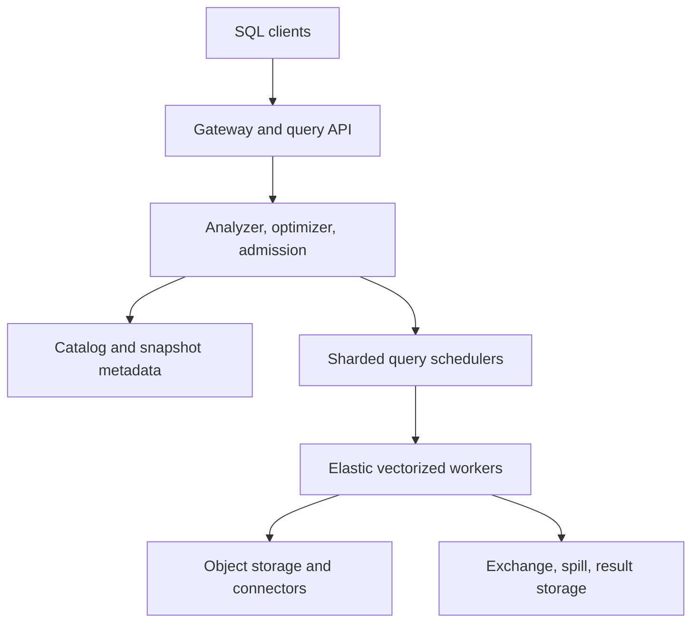

# Design a Multi-Tenant Distributed SQL Query Engine

**Difficulty:** Senior / Staff-level  
**Primary themes:** distributed databases, columnar execution, query optimization, shuffle, caching, queues, workload isolation, snapshot consistency, and fault tolerance

> **Interview timing vs. this walkthrough:** In a 45-minute interview, spend roughly 5 minutes on requirements, 2 minutes on entities, 5 minutes on interfaces, 10–15 minutes building one query end to end, and 10–15 minutes on the two highest-value deep dives. This walkthrough is deliberately longer for study. In the interview, prove `SELECT ... FROM ... WHERE ... GROUP BY` over one catalog before discussing adaptive joins, durable exchanges, or multi-region disaster recovery.

This answer follows Hello Interview’s public delivery framework: establish functional and non-functional requirements, identify core entities and interfaces, build a complete baseline operation by operation, and then use the remaining time for requirement-driven deep dives. genui{"citation":{"ref":"turn100search28"}} The prompt, dialogue, estimates, and design are original.

---

## Interviewer prompt

> Design a serverless, multi-tenant distributed SQL query engine. Users submit ad hoc analytical SQL over petabytes of data stored in object storage and external databases. The system should return small interactive results quickly, support long-running batch queries, isolate tenants, provide snapshot-consistent reads, survive worker failures, and expose explainability, cost, and query history.

## Targeted clarifying questions with assumed interviewer answers

**Candidate:** Is this an OLTP database or an analytical engine?

**Interviewer:** Analytical. Tables already live in object storage or external systems. We need federated reads and may write query results or create new tables, but low-latency row transactions are out of scope.

**Candidate:** Which SQL features matter most?

**Interviewer:** Filters, projections, aggregations, joins, sorts, windows, CTEs, and `CREATE TABLE AS SELECT`. Start with reads, then explain writes briefly.

**Candidate:** What scale should I design for?

**Interviewer:** 20,000 tenants, 100,000 submitted queries per minute at peak, 10,000 concurrent running queries, 50 PB of addressable data, and individual queries scanning from kilobytes to 5 PB.

**Candidate:** What latency targets apply?

**Interviewer:** Admission decision under 200 ms p99. Metadata-only queries under 1 second p95. Selective interactive queries under 5 seconds p95. Batch jobs may run for hours.

**Candidate:** What availability and failure semantics are expected?

**Interviewer:** Query submission should be 99.99% available. An admitted batch query should survive ordinary worker loss without restarting from the beginning. Duplicate execution is acceptable internally, but the client must see one terminal outcome.

**Candidate:** What consistency do users expect while tables are changing?

**Interviewer:** Each query should read one pinned snapshot per table. It must not observe a mixture of old and new files for the same table. Cross-catalog transactions are not required.

**Candidate:** Do we own storage?

**Interviewer:** No. Data sits in object storage using a snapshot-capable table format where available, plus connectors to databases and streams. The engine owns query metadata, temporary shuffle/spill data, result storage, and caches.

**Candidate:** How should tenants share compute?

**Interviewer:** Small interactive queries should not wait behind huge batch scans. Support quotas, priorities, per-tenant queues, memory/CPU/scan budgets, cancellation, and optional reserved capacity.

**Candidate:** Is exact cost estimation required?

**Interviewer:** No. Provide an estimate before execution and actual scanned bytes, CPU, memory, shuffle, spill, and cost afterward. Estimates may be wrong when statistics are stale.

**Candidate:** What security matters?

**Interviewer:** Identity comes from authentication. Enforce catalog/schema/table/column/row policies, use short-lived connector credentials, encrypt temporary data, and audit queries without leaking sensitive literals.

### Scope statement to say aloud

> “I’ll design a disaggregated coordinator-and-worker engine over external storage. A gateway authenticates the caller, a control plane parses and authorizes SQL, pins table snapshots, builds and costs a distributed plan, and admits it through tenant-aware resource groups. Ephemeral workers execute vectorized scan, join, aggregate, and exchange stages; intermediate data can spill to local disk or durable object storage. Results go to a result store and are streamed by page. I’ll deep-dive on planning and data reduction, shuffle/skew/memory, and fault tolerance plus workload isolation.”

---

## 1. Requirements (~5 minutes)

### Three core functional requirements

1. **Plan and execute analytical SQL.** Parse, validate, authorize, optimize, and run federated queries over object-store tables and external sources.
2. **Manage asynchronous query lifecycle.** Submit, queue, observe, cancel, retry eligible work, page results, and retain history and metrics.
3. **Share compute safely.** Isolate tenants with quotas, resource groups, priorities, admission control, and auditable access policies.

### Quantified non-functional requirements

| Property | Target | Design implication |
|---|---:|---|
| Submissions | 100K/min peak (~1,667/s) | Stateless gateways; durable query records |
| Running queries | 10K | Sharded schedulers and elastic worker pools |
| Data footprint | 50 PB | Compute/storage disaggregation; metadata pruning |
| Largest scan | 5 PB | Split-based scans, checkpointed stages, hard budgets |
| Admission latency | p99 < 200 ms | Admission uses cached policy/capacity state |
| Interactive latency | p95 < 5 s for selective queries | Columnar/vectorized execution and aggressive pruning |
| Submission availability | 99.99% | Multi-zone control plane and idempotent submission |
| Batch recovery | Survive ordinary worker loss | Retry tasks from durable inputs/exchanges |
| Snapshot semantics | One snapshot per table/query | Pin snapshot IDs during analysis |
| Isolation | Noisy tenant cannot starve peers | Hierarchical queues and resource accounting |

### Consistency and availability contract

- `POST /queries` durably creates one logical query for an idempotency key before returning its ID.
- Query state moves monotonically through `QUEUED → PLANNING → RUNNING → SUCCEEDED | FAILED | CANCELED`.
- Every table reference resolves to a catalog-specific snapshot or read token during planning. Retries reuse it.
- A query is snapshot-consistent **per table**, not transactionally consistent across unrelated catalogs.
- Workers may retry a task, so exchange writes and final table commits need attempt IDs and idempotent publication.
- A successful read result is immutable and addressable by a manifest until its retention expires.
- Cancellation is cooperative and eventually stops new work; the API never claims canceled until schedulers have fenced or expired active attempts.
- Control-plane outage may delay new planning/admission while already-running tasks continue from cached plans and credentials.
- External connector failure may fail or retry affected stages; the system cannot exceed the source’s own availability or semantics.
- `CREATE TABLE AS SELECT` writes private files first, then atomically publishes one table snapshot. Orphan files are garbage-collected.

Snapshot-based table formats make the per-table contract practical: Iceberg snapshots define table contents through metadata and manifest lists, while commits validate against the current table state. genui{"citation":{"refs":["turn101search25","turn101search35"]}}

### Out of scope

- Row-level OLTP transactions and millisecond point writes
- A new object store or table format
- Perfect cost estimates with missing statistics
- Global transactions across connectors
- Arbitrary untrusted UDF runtimes in the first version
- Exactly-once execution of every internal operator
- Automatic correctness for a connector that cannot provide a stable snapshot

### Scale estimates that change the design

At 100,000 submissions/minute:

```text
100,000 / 60 ≈ 1,667 query submissions/s
```

If a query record plus events, plan reference, and metrics averages 20 KiB:

```text
1,667 × 20 KiB ≈ 33 MiB/s
≈ 2.8 TiB/day before retention and compression
```

Query history needs partitioning, compaction, and colder archival; it should not live forever in the scheduler’s transactional database.

Suppose 10,000 queries run concurrently and average 40 tasks, while the p99 query has thousands:

```text
10,000 × 40 = 400,000 active task attempts
```

One coordinator process cannot heartbeat and schedule all attempts. Query ownership and task scheduling must be sharded, and workers should receive batches of splits rather than one RPC per file.

A 1 PB scan completed in 5 minutes requires:

```text
1 PB / 300 s ≈ 3.3 TB/s aggregate scan throughput
```

At 500 MB/s effective decompressed scan per worker, that is roughly 6,700 workers before headroom. The decision is not that every query gets this capacity; it is that pruning, elastic split scheduling, scan quotas, and admission control dominate architecture.

A repartition join with 100 TB on each side can move roughly 200 TB across exchange boundaries. Over a 100 Gb/s link (~12.5 GB/s theoretical), one worker cannot finish that transfer reasonably. Hash-partitioned parallel exchange and early filtering are mandatory.

If a selective query projects 5 of 100 equal-width columns and row-group statistics eliminate 99% of files:

```text
logical table size × 5% columns × 1% row groups
= 0.05% of logical bytes
```

This is why columnar layout and metadata pruning can matter more than raw CPU. Apache Parquet is explicitly a column-oriented format for efficient storage and retrieval. genui{"citation":{"ref":"turn101search23"}}

**What to say aloud:**

> “The largest query cannot be solved by a bigger coordinator. A petabyte in five minutes implies terabytes per second of aggregate scan, so I need pruning first and elastic parallelism second. Ten thousand concurrent queries imply hundreds of thousands of tasks, so I shard query ownership and batch split assignment. Finally, a join may shuffle both inputs; data reduction before exchange is a first-class optimization.”

---

## 2. Core entities (~2 minutes)

| Entity | Essential fields |
|---|---|
| `Query` | ID, principal, tenant, SQL hash/encrypted text, state, priority, timestamps |
| `QueryAttempt` | Attempt ID, coordinator epoch, retry policy, terminal reason |
| `Session` | Catalog/schema, timezone, variables, limits, client tags |
| `Catalog` | Connector type, endpoints, credential policy, capabilities |
| `TableHandle` | Catalog table ID, schema version, pinned snapshot/read token |
| `LogicalPlan` | Relational operators, expressions, required columns, policy filters |
| `PhysicalPlan` | Stages, partitions, operators, join/exchange choices |
| `Stage` | Dependencies, partitioning, retry boundary, state |
| `TaskAttempt` | Stage/partition/attempt, worker lease, progress, output manifest |
| `Split` | One scan unit: file/range/partition plus locality and statistics |
| `ExchangePartition` | Producer attempt, partition, chunks, checksum, durable location |
| `ResourceGroup` | Queue, concurrency, memory, CPU, scan, spill, priority policy |
| `ResultManifest` | Schema, pages/files, checksums, row count, expiry |
| `TableCommit` | Target, base snapshot, new files, commit token, state |

A **split** is the smallest independently schedulable scan unit, such as a Parquet row-group range. An **exchange** moves intermediate rows between stages—usually repartitioning them by a hash key for joins or aggregations.

---

## 3. API and system interface (~5 minutes)

Authentication supplies the principal, tenant, and groups. The server derives authorization and billing identity; it never trusts caller-provided ownership fields.

### 3.1 Submit a query

```http
POST /v1/queries
Authorization: Bearer <workload-token>
Idempotency-Key: finance-dashboard-20261015-0400
Content-Type: application/json

{
  "sql":"SELECT region, SUM(amount) AS revenue FROM lake.sales WHERE sale_date = DATE '2026-10-14' GROUP BY region ORDER BY revenue DESC LIMIT 20",
  "session":{"catalog":"lake","schema":"analytics","timezone":"America/New_York"},
  "workload":{"class":"INTERACTIVE","priority":70},
  "limits":{"max_scan_bytes":500000000000,"timeout_s":30},
  "result":{"format":"ARROW","retention_s":3600}
}
```

```json
{
  "query_id":"q_01JAZ9...",
  "state":"QUEUED",
  "status_url":"/v1/queries/q_01JAZ9...",
  "estimated":{"scan_bytes":81200000000,"cost_usd":0.41}
}
```

Reusing the idempotency key with identical canonical request data returns the same query. Reusing it with different SQL or limits returns `409`.

### 3.2 Inspect lifecycle and progress

```http
GET /v1/queries/q_01JAZ9...
Authorization: Bearer <workload-token>
```

```json
{
  "state":"RUNNING",
  "queue_ms":37,
  "elapsed_ms":1840,
  "snapshot_ids":{"lake.analytics.sales":"918337"},
  "progress":{"splits_done":8412,"splits_total":10920,"input_bytes":62700000000},
  "resources":{"cpu_ms":192400,"peak_memory_bytes":8100000000,"shuffle_bytes":64000000,"spill_bytes":0}
}
```

### 3.3 Fetch result pages

```http
GET /v1/queries/q_01JAZ9.../results?page_token=eyJwYWdlIjoyfQ
Authorization: Bearer <workload-token>
Accept: application/vnd.apache.arrow.stream
```

Small results may stream through the gateway; large results return signed short-lived URLs from the result store. Tokens bind query, principal, snapshot of the result manifest, and page position.

Arrow provides a language-independent in-memory columnar format suited to moving tabular batches without row-by-row conversion. genui{"citation":{"refs":["turn100search0","turn100search17"]}}

### 3.4 Explain without execution

```http
POST /v1/queries:explain
Authorization: Bearer <workload-token>
Content-Type: application/json

{"sql":"SELECT ...", "mode":"COST_AND_DISTRIBUTION"}
```

```json
{
  "snapshots":{"lake.analytics.sales":"918337"},
  "estimated":{"rows":210000000,"scan_bytes":81200000000},
  "plan":[
    {"stage":0,"operators":["TableScan[date predicate, 3 columns]","PartialAggregate"]},
    {"stage":1,"exchange":"HASH(region)","operators":["FinalAggregate","TopN[20]"]}
  ],
  "warnings":["statistics for region are 9 days old"]
}
```

Explain still performs authorization because plans, schemas, predicates, and statistics can reveal protected metadata.

### 3.5 Cancel a query

```http
POST /v1/queries/q_01JAZ9...:cancel
Authorization: Bearer <workload-token>
If-Match: "state-version-18"
```

```json
{"query_id":"q_01JAZ9...","state":"CANCELING"}
```

### 3.6 Important errors

| Error | Meaning |
|---|---|
| `ACCESS_DENIED` | Policy rejected a catalog, column, row, or function |
| `SNAPSHOT_UNAVAILABLE` | A stable read token could not be pinned or expired |
| `SCAN_LIMIT_EXCEEDED` | Planned or actual scan crossed the request limit |
| `RESOURCE_GROUP_FULL` | Queue capacity is exhausted |
| `SOURCE_THROTTLED` | Connector source rejected or throttled reads |
| `QUERY_PREEMPTED` | Lower-priority work was stopped according to policy |
| `RESULT_EXPIRED` | Immutable result retention ended |
| `COMMIT_CONFLICT` | Write target changed after the query’s base snapshot |

---

## 4. Data flow

### Read query

1. Gateway authenticates the caller, canonicalizes the request, and creates an idempotent query record.
2. Analyzer parses SQL, resolves names/types/functions, expands views, and injects row/column policies.
3. Snapshot resolver pins each table handle and retrieves schemas, statistics, manifests, and connector capabilities.
4. Optimizer produces a logical plan, pushes filters/projections/aggregations, chooses join order/strategy, and fragments it into stages separated by exchanges.
5. Admission controller places the query into a hierarchical resource group. When budgets allow, it grants a lease to a query scheduler.
6. Stage scheduler enumerates splits lazily and assigns batches to workers.
7. Workers scan columnar batches, run vectorized operators, and publish exchange partitions or a final result manifest.
8. Downstream stages consume committed exchange partitions. On success, the coordinator atomically marks the result manifest visible and the query `SUCCEEDED`.
9. The client pages results while history/metrics stream asynchronously to durable analytics storage.

### `CREATE TABLE AS SELECT`

1. Pin all input snapshots and the output table’s base metadata.
2. Execute the read plan; writers create uniquely named private data files.
3. Collect checksummed file manifests from successful task attempts.
4. A single commit coordinator validates the base snapshot and atomically publishes the new table snapshot.
5. A retry with the same commit token returns the committed outcome; abandoned attempt files are later garbage-collected.

---

## 5. High-level design (~10–15 minutes)

### Compact architecture



### Operation 1: execute one scan on one machine

Start with one coordinator/worker. Parse SQL, request a snapshot from the catalog, list matching files, read only referenced columns, apply filters, aggregate, and return rows.

This proves semantics. It fails on capacity, tail latency, joins, failures, and tenant isolation—but it gives us the operator contract.

### Operation 2: split planning from execution

The coordinator owns query semantics and durable state. Workers are stateless across queries except for bounded caches and local spill. The plan is serialized with immutable table handles, expression bytecode, and policy version.

Do not put raw long-lived connector secrets in the plan. Workers exchange workload identity for short-lived, scope-limited credentials.

### Operation 3: enumerate scan splits

For a snapshot table, the metadata service reads manifest lists and file statistics. It prunes partitions/files using predicates, then creates splits sized for useful parallelism—perhaps 128–512 MiB of compressed input, adjusted for source latency and decompression cost.

The scheduler lazily enumerates splits so a 5 PB query does not allocate millions of in-memory task objects at once. Workers pull batches under leases; expired leases may be reassigned.

### Operation 4: vectorized columnar operators

Workers process column batches instead of materializing objects per row:

```text
Scan → Decode required columns → Filter → Project
     → Local aggregate/join → Exchange sink
```

Columnar adjacency improves cache locality and permits SIMD-friendly loops. Operators pass batches with selection vectors, so filtering can avoid copying unchanged columns.

### Operation 5: fragment the plan into stages

An exchange creates a retry and distribution boundary. For example:

```text
Stage 0: scan sales → filter → partial SUM → hash exchange by region
Stage 1: final SUM → local TopN → gather exchange
Stage 2: global TopN → result writer
```

Partial aggregation reduces rows before network movement. The root stage is intentionally small; gathering raw data to one coordinator would be a bottleneck.

### Operation 6: support joins

Use two baseline strategies:

- **Broadcast hash join:** replicate a small build side to every probe worker. Fast and avoids repartitioning the large side, but duplicates memory/network.
- **Partitioned hash join:** hash both sides by join key so matching rows meet. Scales larger joins but creates shuffle and skew.

The optimizer chooses using statistics and a memory safety threshold. If confidence is low, choose a recoverable partitioned plan or insert an adaptive boundary.

### Operation 7: add a metadata and data cache

Cache immutable items by versioned identity:

- catalog schemas and policy-independent metadata;
- table snapshot/manifests and file footers;
- connector capability/statistics responses with bounded TTL;
- hot object ranges or decoded dictionaries where economics justify it;
- final results keyed by normalized query, snapshots, principal policy context, and session semantics.

Never key a result cache by SQL text alone. Timezone, nondeterministic functions, row policies, session variables, and table snapshots all affect correctness.

### Operation 8: asynchronous query state

Persist query identity, state version, owner epoch, pinned snapshots, plan location, and terminal result in a transactional metadata store. Append high-volume events and metrics to a log for history.

A coordinator holds a renewable lease on the query. On coordinator loss, another scheduler claims a higher epoch and reconstructs state from durable stage/task manifests. Workers reject commands from older epochs.

### Operation 9: isolate workloads

Route every query into a resource-group tree such as:

```text
global
├── interactive
│   └── tenant/project
└── batch
    └── tenant/project
```

Each node can cap queued/running queries, memory, CPU, scan bytes, spill, and task slots. Weighted fair scheduling shares unused capacity while preserving minimum/reserved shares. Trino’s resource groups similarly support query queues, concurrency limits, memory limits, and hierarchical subgroups. genui{"citation":{"ref":"turn101search0"}}

### Operation 10: write results and tables

Final workers write immutable result pages and produce checksummed descriptors. The coordinator publishes one manifest atomically; clients never discover partial output.

For table writes, successful tasks produce private files, but only a single snapshot commit makes them visible. Attempt IDs prevent duplicate files from appearing twice. Conflict policy is explicit: fail, or rebase/retry when the table operation allows it.

---

## 6. Deep dives (~10–15 minutes)

### Deep dive A: optimizer, pruning, and adaptive execution

#### Where the baseline breaks

A syntactically valid plan can be catastrophically expensive. Scanning unused columns, listing every file, joining large tables in the wrong order, broadcasting a misestimated build side, or applying row policies after a join can turn a five-second query into hours or leak data.

#### Planning pipeline

1. **Parse and bind:** build an AST, resolve names/functions, infer types.
2. **Authorize and rewrite:** expand views, mask columns, inject row filters before cost-based reordering.
3. **Logical optimization:** constant folding, predicate simplification, projection pruning, decorrelation, redundant operator removal.
4. **Connector pushdown:** ask the connector which predicates, projections, limits, and aggregations it can execute safely.
5. **Cost-based planning:** use row counts, null fraction, distinct counts, min/max, histograms, and file sizes to choose joins and distribution.
6. **Fragmentation:** create stages at exchanges and assign retry semantics.
7. **Validation:** enforce scan/memory limits and verify that policies remain in the plan.

Trino documents connector-specific pushdown of predicates, projections, aggregations, joins, and limits to reduce data movement and source load. genui{"citation":{"ref":"turn101search4"}}

#### Join choices

| Strategy | Best when | Main risk |
|---|---|---|
| Broadcast hash | Build side is safely small | Every worker duplicates it; OOM if estimate is wrong |
| Partitioned hash | Both sides large | Shuffle cost and skew |
| Sort-merge | Inputs sorted or range work helps | Sort CPU, spill, latency |
| Index/nested-loop pushdown | Source has selective indexed lookup | Many remote calls; connector dependence |

Choose broadcast only when estimated bytes plus confidence margin fit every worker. For uncertain estimates, materialize the build side first, measure it, and then select broadcast or repartition.

#### Dynamic filtering

Suppose `sales` joins a filtered `date_dim`. Once the engine learns the surviving date keys, it can construct a runtime filter and stop scheduling irrelevant sales partitions/row groups. This reduces scan and network, but waiting forever for the filter would delay the probe side.

Use a bounded wait, size caps, and degrade from a value set to a Bloom filter or min/max range. Trino’s current documentation describes collecting build-side join values and pushing dynamic filters into split enumeration and scans; it also caps collection size. genui{"citation":{"ref":"turn101search1"}}

#### Stale or missing statistics

- attach freshness and sample rate to each statistic;
- expose estimate confidence in `EXPLAIN`;
- use conservative memory thresholds;
- collect runtime cardinalities at materialization boundaries;
- adapt join order/distribution only before dependent work becomes irreversible;
- feed actuals into statistics repair, but keep tenant data isolated.

Current Trino supports adaptive plan optimizations that use runtime statistics under fault-tolerant execution. genui{"citation":{"ref":"turn101search3"}}

#### Plan and result cache correctness

A prepared logical plan can be reused if schemas, functions, policies, and connector capabilities remain compatible; table snapshots are rebound per execution unless explicitly pinned.

A result-cache key needs:

```text
normalized SQL + typed parameters + session semantics
+ pinned snapshot IDs + principal/policy fingerprint
+ function/UDF versions + engine semantic version
```

Disable reuse for nondeterministic functions such as `random()` or unpinned current time, external mutable functions, and sources without stable read tokens.

#### Observability

- estimated versus actual rows/bytes per operator
- files/row groups/columns pruned
- connector pushdown success and rejection reason
- dynamic-filter arrival time, size, and bytes avoided
- join strategy changes and confidence
- plan-cache/result-cache hit and rejection reason
- planning latency by catalog and policy engine

**What to say aloud:**

> “My optimizer’s first job is data reduction: inject policy filters, prune columns and files, push work into capable connectors, partially aggregate, and only then choose join distribution. Statistics carry confidence and freshness. If the build size is uncertain, I materialize and measure it before deciding broadcast versus repartition. Runtime filters can prune the probe scan, but their wait and memory are bounded.”

### Deep dive B: shuffle, memory pressure, and skew

#### Where the baseline breaks

Hash joins, `GROUP BY`, sorts, and windows create blocking or stateful operators. A single hot key can send half the data to one partition. A broadcast misestimate can OOM every worker. A fast producer can overwhelm a slow consumer. Local disk spill may save memory but is lost with the worker.

#### Memory model

Track memory by query, stage, task, and operator:

- **revocable:** buffers/hash partitions that may spill;
- **non-revocable:** operator state needed for forward progress;
- **system:** RPC, decoder, and exchange overhead.

Workers grant memory through reservations, not optimistic malloc. When pressure crosses thresholds, they revoke/spill low-priority revocable memory before killing tasks. Admission includes a cluster safety margin rather than summing optimistic estimates to 100%.

#### Exchange design

Each producer hashes rows into downstream partitions and writes chunked, checksummed batches. Consumers acknowledge durable chunks or read them from exchange storage. Per-channel credits provide backpressure:

```text
consumer grants N bytes → producer sends up to N → waits for more credit
```

Use compression when CPU cost is lower than network savings. Preserve sequence/chunk IDs so retries deduplicate output.

#### Pipelined versus materialized exchange

| Mode | Benefit | Limitation |
|---|---|---|
| Pipelined in-memory/network | Lowest latency | Producer/consumer failures are coupled |
| Local disk spill | Cheap and fast | Lost with worker; retry may restart upstream |
| Durable object-store exchange | Retry stages independently | Higher latency, storage calls, cleanup cost |

Use pipelined exchange for short interactive queries where restarting is cheaper. Use durable, materialized exchange for long batch queries and large retry boundaries. A hybrid can stream while asynchronously sealing durable chunks.

#### Spill strategy

For a hash join whose build side exceeds memory:

1. partition the build side into many buckets;
2. keep some buckets in memory and spill others;
3. partition the probe side identically;
4. process bucket pairs one at a time;
5. recursively repartition an oversized bucket.

Sort uses external merge: create sorted runs under a memory budget, spill them, then k-way merge. Aggregate spills partial maps and merges them later.

Spill data is encrypted, tenant-scoped, checksummed, TTL-bound, and garbage-collected by a manifest rather than directory listing.

#### Skew handling

Detect skew from sampled keys and runtime partition histograms. Compare the largest partition with median/total. Responses include:

- split oversized exchange partitions into subpartitions;
- salt known hot keys and add a second combine stage;
- broadcast the small side for hot keys only;
- use partial aggregation before exchange;
- assign more consumers to splittable partitions;
- isolate an intrinsically huge single group and apply a limit or specialized operator.

Salting changes the plan: `(hot_key, salt)` is aggregated/joined first, then results are merged by `hot_key`. It cannot blindly apply to every join, especially outer joins, without preserving semantics.

#### Stragglers and speculation

If a task is much slower than peer tasks with similar input, launch a speculative attempt on another worker. The first complete, validated output wins; the scheduler fences the loser. Do not speculate tasks dominated by a throttled source because duplicate reads worsen the bottleneck.

#### Observability

- peak/revocable/non-revocable memory by operator
- spill bytes, partitions, encryption overhead, and readback time
- exchange throughput, compression ratio, credit stalls
- max/median partition size and hot-key samples
- blocked time: input, output, memory, source, scheduler
- speculative attempts and duplicate source load
- orphan exchange/spill bytes and cleanup age

**What to say aloud:**

> “Every stateful operator has an explicit memory reservation and spill algorithm. Exchange uses chunk IDs, checksums, and credit-based backpressure. Interactive queries favor pipelining; long batch stages can seal durable exchange partitions so worker failure retries only the failed task. Runtime partition histograms detect skew, after which I split buckets, salt hot keys with a second combine, or use hybrid broadcast for hot keys.”

### Deep dive C: retries, coordinator failover, and tenant fairness

#### Where the baseline breaks

With hundreds of thousands of tasks, worker loss is normal. Blindly restarting a multi-hour query wastes work. Retrying non-idempotent connectors may duplicate side effects. Meanwhile, FIFO scheduling lets a few 5 PB scans block dashboards, and unconstrained retries can amplify an outage.

#### Retry hierarchy

| Failure | Recovery |
|---|---|
| Transient split read | Retry split with backoff if connector permits |
| Worker/task loss | New task attempt consumes same inputs |
| Stage loss with durable inputs/exchange | Retry failed partitions/stage |
| Coordinator loss | Claim higher query epoch; reconstruct from manifests |
| Source snapshot expired | Fail explicitly; never silently bind newer data |
| Deterministic data/code error | Fail fast; retries waste capacity |

Trino’s fault-tolerant execution similarly supports retrying a whole query or individual tasks after failure. genui{"citation":{"ref":"turn100search20"}}

#### Attempt and commit protocol

Every output is named by `(query, stage, partition, attempt)`. Finishing a task does not itself publish the output. The scheduler atomically selects one successful attempt and records its manifest. Downstream stages consume only selected manifests.

For final table writes:

```text
private files → task manifests → chosen attempts
→ commit manifest → compare base snapshot → atomic publish
```

If the coordinator times out during commit, it reads the table metadata using the stable commit token before deciding whether to retry. It never assumes timeout means failure.

#### Coordinator failover

Query metadata contains `owner_epoch`. A scheduler acquires a lease by compare-and-set to a higher epoch. Workers include the epoch on status/output publication; stale owners cannot cancel or commit newer attempts.

Durable state is compact: plan, pinned snapshots, admitted budgets, completed stage manifests, and final result. High-frequency progress is reconstructable from workers/exchange metadata and may be slightly stale after failover.

#### Admission and fairness

Admission is two-level:

1. **Global safety:** enough worker slots, memory headroom, source concurrency, and exchange capacity.
2. **Hierarchical fairness:** tenant/workload resource groups decide which eligible query starts.

Use weighted deficit or dominant-resource fairness across CPU, memory, and scan. Cap per-tenant queued/running queries and reject beyond bounded queues. Preserve a small emergency/admin lane.

Interactive queries get a separate concurrency pool and small-query bypass only below strict predicted/actual byte and CPU thresholds. If a supposedly small query grows, reclassify, throttle, or cancel it; otherwise every tenant labels work interactive.

#### Preemption

Prefer not admitting work over killing it. When preemption is required:

- pause new splits first;
- reclaim revocable memory and spill;
- checkpoint/materialize a stage boundary;
- cancel lowest-priority work only if the policy permits;
- charge wasted work to retry/preemption budgets.

Never preempt during an unresolvable external commit. Protect control-plane, cleanup, and result-publication capacity from tenant exhaustion.

#### Retry storms

- exponential backoff with jitter;
- per-source and per-query retry budgets;
- circuit breakers for failing connectors;
- distinguish deterministic from transient errors;
- reduce concurrency on throttling;
- reserve capacity for cleanup and completion;
- do not retry after cancellation or deadline expiry.

#### Availability and regional strategy

Run gateways, metadata databases, and schedulers across zones. Workers are replaceable. Query IDs and durable storage are region-scoped by default.

For regional disaster recovery, replicate query metadata and durable exchange/result objects, but do not promise transparent continuation unless every source snapshot, credential scope, and exchange object is available in the failover region. Otherwise preserve query history, mark affected work `FAILED_REGION`, and let the client resubmit against the same explicit snapshots when possible.

#### Observability

- queue time by tenant/resource group/priority
- admitted versus rejected and rejection reason
- CPU, memory, scan, shuffle, spill, and cost by tenant
- worker loss and successful retry recovery rate
- lost work bytes/CPU per failure
- coordinator failovers and stale-epoch rejections
- retry budget exhaustion and connector circuit state
- preemption victim count and checkpoint effectiveness
- snapshot expiry/failover incompatibility

**What to say aloud:**

> “Execution is at-least-once internally but publication is once per logical partition. Attempt-scoped outputs remain private until the scheduler selects a winner. Durable exchanges let long queries retry tasks instead of restarting. Query ownership uses epochs so an old coordinator cannot commit. Admission first protects cluster safety, then a hierarchical fair queue separates interactive and batch work; retry and preemption budgets prevent overload amplification.”

---

## 7. Finish

### Concise final design

The system separates a durable multi-zone control plane from elastic execution. Gateways authenticate clients and create idempotent query records. The analyzer parses SQL, resolves types and catalogs, injects authorization policies, and pins one snapshot/read token per table. A cost-based optimizer prunes files and columns, pushes connector operations, chooses join distribution, and fragments the plan into retryable stages.

Hierarchical resource groups queue and admit work using tenant, workload class, priority, concurrency, memory, CPU, scan, spill, and source budgets. Sharded query schedulers own queries through epochs and lazily issue scan splits to workers. Ephemeral workers process Arrow-like columnar batches with vectorized filters, projections, joins, aggregations, sorts, and windows.

Stage exchanges hash, broadcast, or gather chunked intermediate data with checksums and backpressure. Interactive queries favor pipelining; long batch queries materialize durable exchange partitions so failed tasks can retry independently. Operators reserve memory and spill through partitioned hash or external-merge algorithms. Runtime statistics enable dynamic filters, adaptive join decisions, skew splitting, salting, and selective speculation.

Attempt outputs are private until a scheduler selects a winner. Final results become visible through one immutable manifest and are paged as columnar data. Table writes create private files and atomically publish one new snapshot using a commit token and base-snapshot validation. Query history, estimates versus actuals, lineage, snapshots, policies, resource use, and terminal reasons are auditable.

### Requirements check

| Requirement | Design support |
|---|---|
| Analytical SQL | Parser, analyzer, optimizer, vectorized operators |
| Federated sources | Capability-aware connectors and pushdown |
| 50 PB addressable data | Disaggregated storage/compute and metadata pruning |
| 10K concurrent queries | Sharded query ownership and elastic workers |
| Interactive latency | Column pruning, data skipping, cache, partial aggregation |
| Long batch recovery | Durable exchange and task retry |
| Snapshot-consistent reads | Pinned table handles reused across retries |
| Tenant isolation | Hierarchical resource groups and hard budgets |
| Memory safety | Reservations, backpressure, spill, admission headroom |
| Skew handling | Runtime histograms, split, salt, hybrid strategies |
| Coordinator failure | Durable state, leases, and owner epochs |
| Exactly one visible result | Attempt fencing and atomic result manifest |
| Safe table writes | Private files and atomic snapshot commit |
| Explainability/cost | Explain plan, estimates, operator actuals |
| Security | Derived identity, policy rewrite, short-lived credentials, audit |

## Realistic interviewer follow-up questions with strong sample answers

**Interviewer:** Why separate compute and storage?

**Candidate:** Analytical demand is bursty and tables already live in shared storage. Disaggregation lets compute scale independently and keeps workers replaceable, at the cost of network I/O and a need for caching, pruning, and durable metadata.

**Interviewer:** What is a split?

**Candidate:** The smallest independently scheduled scan unit, such as a file range or row-group set. Splits expose enough parallelism without making one task per row group or loading millions of task objects eagerly.

**Interviewer:** Why not list all files on every query?

**Candidate:** Large tables may contain millions of files. Snapshot manifests plus partition and file statistics let us prune and enumerate lazily. Listing object storage directly can be slow and may not represent one consistent table state.

**Interviewer:** What is vectorized execution?

**Candidate:** Operators process column batches in tight loops rather than creating an object per row. That improves cache locality, reduces virtual-call/allocation overhead, and enables SIMD-friendly evaluation.

**Interviewer:** Where do you put exchange boundaries?

**Candidate:** Where distribution changes—hash repartition, broadcast, gather—or where I want a retry/materialization boundary. Too many boundaries add storage and latency; too few couple failures and increase memory pressure.

**Interviewer:** Broadcast or partitioned join?

**Candidate:** Broadcast when the measured or confidently estimated build side fits every worker with safety margin. Partition both sides when it does not. If confidence is low, materialize and measure the build side before choosing.

**Interviewer:** How does dynamic filtering help?

**Candidate:** Build-side join keys become a runtime predicate that prunes probe partitions, row groups, or rows. It saves scan and shuffle, but I bound collection size and wait time so a slow build does not stall the entire query.

**Interviewer:** What if statistics are wrong?

**Candidate:** Carry confidence/freshness, choose conservative memory thresholds, collect runtime cardinalities at stage boundaries, and adapt join order/distribution before downstream work starts. Record actuals to repair statistics.

**Interviewer:** How do you avoid coordinator overload?

**Candidate:** Shard query ownership, enumerate splits lazily, assign them in batches, aggregate heartbeats hierarchically, store large plans externally, and push local scheduling decisions to workers where safe.

**Interviewer:** How do you handle a hot join key?

**Candidate:** Detect it from runtime partition histograms. Salt that key into subkeys, process them in parallel, then combine; or use a hybrid strategy that broadcasts the small-side rows for hot keys. Preserve join semantics carefully.

**Interviewer:** What happens when a worker dies?

**Candidate:** Its lease expires. The scheduler creates a new attempt using the same splits or committed upstream exchange partitions. Attempt-scoped outputs prevent duplicates from becoming visible.

**Interviewer:** What if the coordinator dies?

**Candidate:** A replacement claims a higher owner epoch, reads pinned snapshots, plan, and completed manifests, then reschedules incomplete partitions. Workers reject stale-epoch commands.

**Interviewer:** Why is exactly-once execution unnecessary?

**Candidate:** Tasks can execute more than once as long as outputs are attempt-scoped, a single winner is selected, reads are pinned, and external commits are idempotent. Exactly-once publication is the useful guarantee.

**Interviewer:** How do you make `CREATE TABLE AS SELECT` safe?

**Candidate:** Workers write private unique files; selected attempts contribute to one commit manifest. A coordinator validates the base snapshot and atomically publishes a new snapshot with an idempotent commit token. Orphans are collected later.

**Interviewer:** What is the result cache key?

**Candidate:** Normalized SQL and typed parameters plus session semantics, table snapshots, principal/policy fingerprint, function versions, and engine semantics. SQL text alone is unsafe.

**Interviewer:** How do you keep dashboards responsive during batch jobs?

**Candidate:** Separate resource-group pools, weighted fairness, small-query limits, reserved interactive capacity, and split-level throttling. A query that exceeds the small threshold is reclassified rather than monopolizing the bypass lane.

**Interviewer:** Would you preempt batch queries?

**Candidate:** Prefer admission control. If necessary, stop assigning splits, reclaim/spill revocable memory, checkpoint at a durable stage, then cancel only according to explicit priority policy. Protect commits and cleanup from preemption.

**Interviewer:** How do you secure connector credentials?

**Candidate:** Workers use workload identity to obtain short-lived credentials scoped to the pinned catalog objects. Plans contain handles, not reusable secrets. Temporary data is encrypted and access is audited.

**Interviewer:** What do you build first?

**Candidate:** One snapshot catalog, read-only scan/filter/aggregate, a coordinator, vectorized workers, hash exchange, basic joins, result paging, and simple admission. Then add spill, durable exchange/retry, statistics/CBO, skew adaptation, more connectors, and writes.

## Common pitfalls

1. Designing an OLTP database instead of an analytical engine.
2. Starting with every SQL feature before one query runs end to end.
3. Letting the coordinator scan data or merge huge results.
4. Creating one task per file eagerly.
5. Listing object storage instead of pinning table snapshots.
6. Retrying against a newer snapshot silently.
7. Claiming cross-catalog transactional consistency.
8. Reading all columns from a columnar file.
9. Ignoring file and row-group statistics.
10. Applying authorization filters after joins or aggregation.
11. Trusting connector pushdown without capability/semantic checks.
12. Using SQL text alone as a result-cache key.
13. Caching nondeterministic queries.
14. Assuming optimizer estimates are exact.
15. Broadcasting a build side without a safety margin.
16. Repartitioning huge inputs before filtering/partial aggregation.
17. Ignoring dynamic-filter wait and memory limits.
18. Hash partitioning without a skew story.
19. Salting keys without preserving outer-join semantics.
20. Holding every hash table entirely in memory.
21. Spilling without encryption, checksums, quotas, or cleanup.
22. Using local spill as if it survives worker loss.
23. Allowing producers to overwhelm exchange consumers.
24. Retrying every failure, including deterministic errors.
25. Letting retries amplify source outages.
26. Publishing output directly from task attempts.
27. Reusing file names across attempts.
28. Treating timeout during table commit as definite failure.
29. Allowing an old coordinator to commit after failover.
30. Keeping all query history in the scheduler database.
31. Using one global FIFO queue.
32. Allowing unlimited queued queries per tenant.
33. Trusting caller-declared “interactive” class indefinitely.
34. Reserving 100% of memory with no safety margin.
35. Preempting work during an external commit.
36. Speculating tasks against a throttled source.
37. Returning huge results through coordinator memory.
38. Logging raw SQL literals containing secrets or PII.
39. Embedding long-lived source credentials in plans.
40. Monitoring query success but not pruning, skew, spill, queueing, and lost work.

## A polished 60-second close

> “I separate a durable multi-zone control plane from elastic vectorized workers. The gateway creates an idempotent query, then the analyzer resolves SQL, injects policy filters, and pins one snapshot per table. A cost-based optimizer prunes files and columns, pushes safe work into connectors, chooses join distribution, and fragments the plan at exchanges. Hierarchical resource groups admit queries using tenant, priority, concurrency, memory, CPU, scan, and spill budgets. Sharded schedulers lazily assign scan splits to workers, which operate on column batches and produce checksummed exchange partitions. Interactive queries pipeline; long batch queries can materialize durable exchanges so worker loss retries only failed tasks. Operators reserve memory, spill with external algorithms, use credit-based backpressure, and adapt to runtime filters and skew. Every output is attempt-scoped until one winner is selected, so internal execution is at-least-once while results and table snapshots publish once. Query-owner epochs fence failed coordinators, and immutable result manifests provide safe paging, audit, and reproducibility.”

## References

- [Hello Interview: System Design Delivery Framework](https://www.hellointerview.com/learn/system-design/in-a-hurry/delivery)
- [Google Research: Dremel—Interactive Analysis of Web-Scale Datasets](https://research.google/pubs/dremel-interactive-analysis-of-web-scale-datasets/)
- [Google Research: Dremel—A Decade of Interactive SQL Analysis at Web Scale](https://research.google/pubs/dremel-a-decade-of-interactive-sql-analysis-at-web-scale/)
- [Trino: Query Optimizer](https://trino.io/docs/current/optimizer.html)
- [Trino: Pushdown](https://trino.io/docs/current/optimizer/pushdown.html)
- [Trino: Dynamic Filtering](https://trino.io/docs/current/admin/dynamic-filtering.html)
- [Trino: Adaptive Plan Optimizations](https://trino.io/docs/current/optimizer/adaptive-plan-optimizations.html)
- [Trino: Fault-Tolerant Execution](https://trino.io/docs/current/admin/fault-tolerant-execution.html)
- [Trino: Resource Groups](https://trino.io/docs/current/admin/resource-groups.html)
- [Apache Parquet: Overview](https://parquet.apache.org/docs/overview/)
- [Apache Arrow: Columnar Format](https://arrow.apache.org/docs/format/Columnar.html)
- [Apache Iceberg: Table Specification](https://iceberg.apache.org/spec/)
