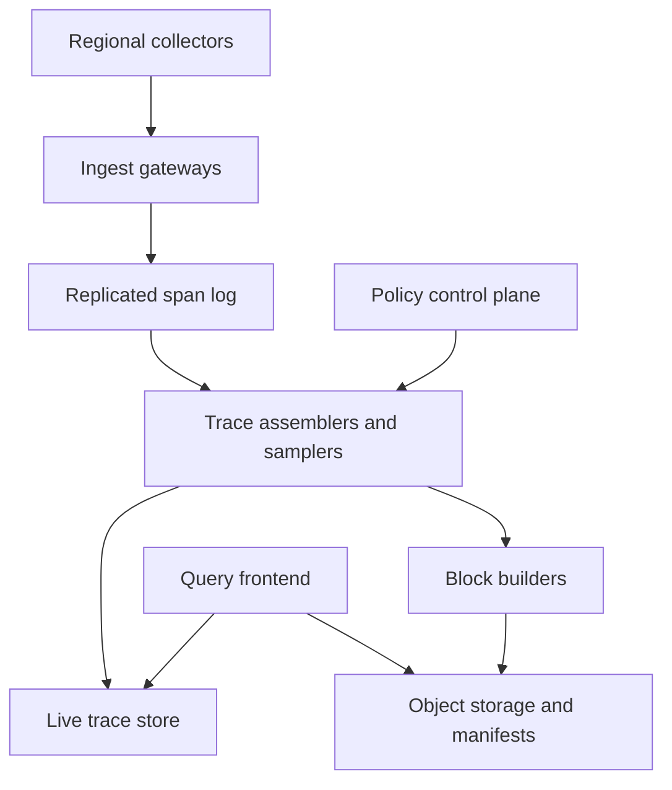
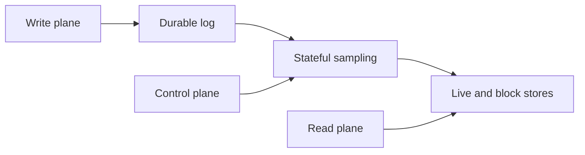

# Design a Distributed Tracing Backend

**Difficulty:** Senior / Staff  
**Primary themes:** high-throughput ingestion, streaming state, queues, columnar storage, indexing, caching, multi-tenancy, eventual consistency, reliability  
**Interview time budget:** requirements 5 minutes, entities 2 minutes, interface 5 minutes, high-level design 10–15 minutes, deep dives 10–15 minutes.  
**Learning note:** the walkthrough is intentionally more detailed than what you would say in a 45-minute interview.

This follows Hello Interview's public [delivery framework](https://www.hellointerview.com/learn/system-design/in-a-hurry/delivery): establish requirements, name core entities, define the interface, build the high-level design one requirement at a time, then use the remaining time on the most important scale and correctness risks. The design itself and dialogue below are original.

## Interviewer prompt

> Design a multi-tenant distributed tracing backend. Applications already emit spans through OpenTelemetry-compatible collectors. Your system must ingest those spans, let engineers retrieve a trace by ID, search for traces by attributes such as service, time, duration, and error status, and retain important traces using tail-based sampling.

## Targeted clarifying questions

**Candidate:** Are we designing application instrumentation too, or does our boundary start at the tracing backend?

**Interviewer:** Start at regional collectors. Assume applications propagate valid trace context and collectors send batches of spans to us.

**Candidate:** What are the traffic and retention targets?

**Interviewer:** Peak input is 20 million spans per second globally. An encoded span averages 1 KB before compression. Keep accepted, sampled traces for 30 days; the newest 24 hours should be especially fast to query.

**Candidate:** Which queries matter most?

**Interviewer:** First, fetch a trace by its trace ID. Second, search a tenant's traces over a time range using service name, operation, duration, status, and selected attributes. Return trace summaries first; users can open a result to fetch all spans.

**Candidate:** Do spans arrive in order, and how do we know a trace is complete?

**Interviewer:** They can be duplicated, out of order, or minutes late. There is no perfect completion signal. Most traces finish within 10 seconds, but a small fraction last longer.

**Candidate:** What should tail sampling retain?

**Interviewer:** Keep every error and very slow trace, retain rare services or routes at higher rates, and probabilistically sample ordinary healthy traffic within a per-tenant budget. Existing upstream head-sampling decisions must be respected.

**Candidate:** What latency and durability targets should I design for?

**Interviewer:** Acknowledge ingestion within 500 ms at p99. Once acknowledged, do not lose a span during a single availability-zone failure. Fetch a recent trace by ID within 2 seconds at p99 and complete a typical 24-hour search within 5 seconds at p99. Target 99.99% ingest availability and 99.9% query availability.

**Candidate:** What is the consistency contract?

**Interviewer:** Ingestion acknowledgement must mean durable acceptance. Search can be eventually consistent within two minutes. Trace-by-ID should expose recent spans within seconds and may explicitly say a trace is partial. Tenant isolation is mandatory.

**Candidate:** Are dashboards, metrics generation, alerting, and a tracing UI in scope?

**Interviewer:** The backend API is in scope. Treat the UI, alerts, and derived metrics as downstream consumers.

## 1. Requirements (~5 minutes)

### Functional requirements

1. **Ingest span batches** from authenticated regional collectors, validating tenant identity and basic schema.
2. **Retrieve and search traces:** fetch all known spans by trace ID; search trace summaries by time, service, operation, duration, status, and an allowlisted set of attributes.
3. **Apply tail-based retention policies:** assemble enough of a trace to keep errors, slow or rare traces, plus a budgeted sample of ordinary traffic.

### Non-functional requirements

- Sustain **20 million spans/s peak** globally and acknowledge accepted batches in **under 500 ms p99**.
- After acknowledgement, survive **one availability-zone failure without data loss**; ingest availability is **99.99%**.
- Return recent trace-ID lookups in **under 2 seconds p99** and normal 24-hour searches in **under 5 seconds p99**; query availability is **99.9%**.
- Make newly sampled traces searchable within **two minutes** and retain them for **30 days**, with a 24-hour hot tier.
- Enforce hard **tenant isolation, quotas, encryption, and deletion boundaries**.

### Scope and contract

The system accepts OpenTelemetry-style spans. A trace is a group of spans sharing a trace ID; each span represents one timed operation and normally references a parent span. W3C [Trace Context](https://www.w3.org/TR/trace-context/) standardizes the `traceparent` and `tracestate` headers applications use to carry this identity across service calls. We preserve those identifiers but do not design propagation itself.

**Durability contract:** a successful ingest response means the batch is replicated in a durable regional log. It does not mean the spans are already searchable or will survive the tenant's sampling policy.

**Read contract:** trace-by-ID returns the latest materialized version and a `completeness` field. Search is eventually consistent. Neither endpoint pretends that an open distributed trace has an objectively knowable end.

**Availability versus consistency:** ingestion favors availability after durable regional acceptance. Sampling decisions for one trace need consistency: every worker that sees that trace must converge on one decision. Search favors availability and bounded staleness over synchronous indexing.

> **Say aloud:** “I want to separate durable acceptance, sampling, and search visibility. That prevents us from putting expensive trace assembly and indexing on the ingest acknowledgement path.”

### Scale estimates that change the design

At peak:

\[
20\text{M spans/s} \times 1\text{ KB} \approx 20\text{ GB/s}
\]

That is roughly **1.7 PB/day uncompressed**. Keeping all raw spans for 30 days would be about 52 PB before replication. If compression gives 4:1 and tail sampling retains 5%, the long-term payload becomes roughly:

\[
1.7\text{ PB/day} \times 0.05 / 4 \approx 21\text{ TB/day}
\]

or about **630 TB for 30 days**, plus indexes and metadata. The exact factor depends on attribute entropy, but the decision is clear: durable streaming storage must absorb the full short-term rate, while cheap object storage holds compressed immutable blocks after sampling. A primary database row per span is economically and operationally unattractive.

Assume 20 spans per trace on average. Peak trace starts are approximately:

\[
20\text{M spans/s} / 20 = 1\text{M traces/s}
\]

With a 30-second sampling decision window, as many as **30 million traces** may be active. Even a compact 2 KB summary per active trace is 60 GB, before storing span payloads. This rules out one global in-memory sampler. We need partitioned trace ownership, local disk or a replayable log, bounded in-memory summaries, and explicit overload behavior.

> **Say aloud:** “The arithmetic is not decorative: it forces a log in front of processing, partitioned tail-sampling state, and object storage rather than a conventional OLTP database for span bodies.”

## 2. Core entities (~2 minutes)

Keep this part conceptual; introduce fields only when a component needs them.

| Entity | Purpose |
|---|---|
| **Tenant** | Security, quota, retention, and encryption boundary |
| **Span** | One timed operation, identified by `(tenant_id, trace_id, span_id)` |
| **Trace** | Logical collection of spans with one `trace_id` |
| **SamplingPolicy** | Versioned rules and budgets deciding which traces to retain |
| **TraceDecision** | Durable keep/drop result for one trace and policy version |
| **TraceSummary** | Searchable trace-level facts: services, root operation, start time, duration, error flag |
| **TraceBlock** | Immutable compressed columnar bundle stored for a tenant and time range |
| **BlockManifest** | Block location, time bounds, schema, checksum, and indexing metadata |

> **Say aloud:** “The distinction between Span, TraceDecision, and TraceSummary is important: payload, retention decision, and search projection have different lifecycles.”

## 3. API or system interface (~5 minutes)

Identity comes from mTLS or an OAuth token validated at the gateway. The server derives `tenant_id`; clients cannot supply another tenant in the request body.

### Ingest a batch

Use OTLP over gRPC for collector-to-backend traffic because it supports compact protobuf batches and long-lived connections. OpenTelemetry describes its Collector as a vendor-neutral component that receives, processes, and exports telemetry; our regional gateway is the backend-facing receiver after that boundary ([OpenTelemetry components](https://opentelemetry.io/docs/concepts/components/)).

```protobuf
rpc Export(ExportTraceServiceRequest) returns (ExportTraceServiceResponse)

// Identity: tenant_id from authenticated connection
ExportTraceServiceRequest {
  resource_spans: [...]
  request_id: "01J..."       // batch retry identity
}

ExportTraceServiceResponse {
  accepted_spans: 512
  rejected_spans: 0
  receipt_id: "r_7f..."
}
```

The gateway returns success only after the durable log acknowledges the batch. A retry with the same `request_id` is safe. Individual span deduplication later uses `(tenant_id, trace_id, span_id)`.

### Fetch a trace by ID

```http
GET /v1/traces/4bf92f3577b34da6a3ce929d0e0e4736
Authorization: Bearer <token>
```

```json
{
  "traceId": "4bf92f3577b34da6a3ce929d0e0e4736",
  "completeness": "partial",
  "lastUpdatedAt": "2026-10-15T17:02:14.812Z",
  "spans": [
    {
      "spanId": "00f067aa0ba902b7",
      "parentSpanId": null,
      "service": "checkout",
      "operation": "POST /orders",
      "startTimeUnixNano": "1792083734000000000",
      "durationNanos": 183000000,
      "status": "ERROR",
      "attributes": {"region": "us-east-1"}
    }
  ]
}
```

If the trace is still in the live tier, the query service merges live spans with any already-published block. `partial` means more spans may arrive; it does not mean data loss.

### Search trace summaries

```http
POST /v1/traces/search
Authorization: Bearer <token>
Content-Type: application/json

{
  "startTime": "2026-10-15T16:00:00Z",
  "endTime": "2026-10-15T17:00:00Z",
  "service": "checkout",
  "status": "ERROR",
  "minDurationMs": 500,
  "attributes": {"deployment.environment": "prod"},
  "limit": 100,
  "cursor": null
}
```

```json
{
  "traces": [
    {
      "traceId": "4bf92f3577b34da6a3ce929d0e0e4736",
      "startTime": "2026-10-15T16:51:29.120Z",
      "durationMs": 1834,
      "rootService": "checkout",
      "rootOperation": "POST /orders",
      "services": ["checkout", "payments"],
      "hasError": true
    }
  ],
  "nextCursor": "eyJ0aW1lLi4u"
}
```

The cursor encodes the last sort key and query snapshot, not an offset. Offset pagination becomes unstable and expensive across many time partitions.

### Update a sampling policy

```http
PUT /v1/sampling-policy
If-Match: "policy-version-41"

{
  "decisionWaitSeconds": 30,
  "rules": [
    {"name": "errors", "match": {"status": "ERROR"}, "sampleRate": 1.0},
    {"name": "slow", "match": {"durationMsGte": 2000}, "sampleRate": 1.0},
    {"name": "baseline", "sampleRate": 0.02}
  ],
  "maxKeptSpansPerSecond": 200000
}
```

This is a control-plane operation. Optimistic concurrency through `If-Match` prevents two administrators from silently overwriting each other. Data-plane workers consume versioned policy snapshots.

## 4. Data flow

1. Applications propagate a trace ID and send completed spans to nearby collectors.
2. A regional ingest gateway authenticates the tenant, validates limits, and appends the batch to a replicated log.
3. The log acknowledges; only then does the gateway acknowledge the collector.
4. Partitions are keyed by a hash of `(tenant_id, trace_id)`, so every span for a trace reaches one logical assembler partition.
5. The assembler deduplicates spans, updates a compact trace summary, and evaluates a policy when the trace appears complete or its decision timer expires.
6. Kept traces go to both the live store and block builders. Dropped traces retain only small aggregate accounting, not payload.
7. Block builders write immutable columnar blocks and indexes to object storage, then atomically publish a manifest.
8. Query fan-out reads recent traces from live stores and historical traces from published blocks, merging and deduplicating results.

## 5. High-level design (~10–15 minutes)



### Operation 1: durably ingest spans

The regional gateway terminates mTLS, derives the tenant, decompresses within a strict size limit, checks field and attribute limits, and enforces a token-bucket quota. It stamps `ingest_region`, `received_at`, and a monotonically increasing log offset, then appends the original encoded batch to a replicated log across three availability zones.

The partition key is `hash(tenant_id || trace_id)`. The tenant prevents cross-tenant collisions; the trace ID keeps one trace on one logical partition. Ordering is only guaranteed within a partition and collector retries can still duplicate data, so consumers cannot assume exactly-once delivery.

Useful span fields at this point are:

```text
tenant_id, trace_id, span_id, parent_span_id
start_time, end_time, status
service_name, operation_name
resource_attributes, span_attributes, events
request_id, received_at
```

We acknowledge after a quorum of log replicas confirms the append. We deliberately do not wait for sampling or object storage.

**Failure trace:** if an assembler crashes after the ingest acknowledgement, another consumer acquires its partition and replays from the last committed offset. If a whole zone fails, the replicated log still has the record. If quorum is unavailable, the gateway fails closed with a retryable error rather than claiming durability it did not achieve.

> **Say aloud:** “At-least-once delivery plus idempotent consumers is simpler than claiming end-to-end exactly once. The durable log is the source of truth until blocks are committed.”

### Operation 2: assemble and sample a trace

Each assembler partition owns a map keyed by `(tenant_id, trace_id)`. For every span it:

- deduplicates by `span_id`, recording a conflict metric if the same ID has different content;
- appends or references the span payload in local spill storage;
- updates a compact summary: earliest start, latest end, services, operations, maximum duration, error flag, root-seen flag, span count, and last-arrival time;
- schedules a decision deadline using the applicable `policy_version`.

The root span ending is helpful but not authoritative: child spans may still arrive. The system decides after the earliest of “root ended plus a grace period,” “trace idle for the configured interval,” or a hard maximum wait. A decision record is then written durably:

```text
TraceDecision(
  tenant_id, trace_id, decision = KEEP | DROP,
  reason, decided_at, policy_version,
  decision_epoch
)
```

`decision_epoch` fences stale workers. Once a trace is kept, a late span for it is also kept and patched into a later block. Once dropped, late spans are dropped unless a configurable exception—for example a late error—promotes the trace. Promotion is useful but costs complexity because the earlier payload may already be gone; the default is therefore a sticky decision.

OpenTelemetry distinguishes head sampling, decided when a trace begins, from tail sampling after spans complete ([sampling concepts](https://opentelemetry.io/docs/concepts/sampling/)). We preserve an upstream “not sampled” decision: the backend cannot reconstruct spans that were never emitted. For received traffic, tail sampling exploits error and latency information unavailable at trace start.

### Operation 3: make recent traces queryable

Kept traces enter a live trace store partitioned by the same tenant and trace hash. It stores span payloads on replicated local SSD with a write-ahead log and keeps trace summaries plus recent trace-ID locations in memory. A 24-hour requirement does not mean all 24 hours fit in RAM; immutable blocks can be uploaded frequently while a cache keeps the hottest IDs and index pages.

The trace-ID endpoint first checks a distributed cache keyed by `(tenant_id, trace_id, trace_version)`, then queries the responsible live partition and any historical block locations. A short negative-cache TTL protects against repeated lookups for missing IDs without hiding newly arrived traces for long.

The response includes a watermark such as `lastUpdatedAt` and `partial|quiescent|expired`. A query at time T may not include a span arriving at T+1; this makes the real contract visible.

### Operation 4: build durable searchable blocks

Block builders consume kept spans from the sampling output. They sort spans primarily by tenant, time bucket, and trace ID, then create compressed immutable columnar blocks. Columnar layout lets a search read columns such as service, status, or duration without scanning every attribute payload. Grafana Tempo's official architecture similarly separates write and read paths and stores trace data in columnar blocks in object storage; that is useful public precedent, not a requirement to copy its implementation ([Tempo architecture](https://grafana.com/docs/tempo/latest/introduction/architecture/)).

For each block, builders generate:

- a trace-ID index mapping trace hash prefixes to row groups;
- min/max time and duration statistics;
- dictionaries and postings for indexed attributes;
- Bloom filters for trace IDs and selected attributes;
- a checksum, schema version, tenant, block ID, and covered log offsets.

The builder uploads data and index files under a unique block ID, verifies checksums, then publishes `BlockManifest` with a conditional create. Queries ignore uncommitted files. After the manifest is visible and the covered offsets are checkpointed, the log may expire that segment according to its safety window.

### Operation 5: search

The query frontend authenticates the tenant, normalizes the predicate, rejects an excessive time range or unsupported attribute, and builds a plan. It fans out to:

- live-store partitions for the recent not-yet-blocked interval;
- object-store blocks whose manifests overlap the requested tenant and time range.

Workers use block statistics and Bloom filters to skip impossible blocks, then scan only needed columns. They return bounded, sorted trace summaries. The frontend performs a k-way merge, deduplicates by trace ID, and returns the top page plus a signed cursor.

Cache keys include tenant, normalized query, time buckets, index generation, and policy-visible schema version. Historical closed buckets can have long TTLs; the current bucket gets a short TTL. We cache block metadata, Bloom filters, footers, and popular trace results before caching arbitrary search responses because metadata has better reuse.

Search fields are not unlimited. Every arbitrary user tag cannot become a global inverted index: cardinality and write amplification would explode. Each tenant gets a small indexed-attribute allowlist. Other attributes remain available when retrieving a known trace and may be scanned only for constrained forensic queries.

### Regional layout

Collectors write to a nearby regional ingest plane. Each tenant has a home region for trace assembly, selected by policy and data residency. Gateways outside the home region either forward over an authenticated stream or durably buffer and replicate log segments. Queries route to the home region; a global catalog knows tenant placement, not trace contents.

For disaster recovery, block objects replicate asynchronously to a second region and manifest checkpoints are copied. The stated contract covers a zone failure, so regional loss may have a documented recovery point unless the product pays for synchronous cross-region log replication. Say this explicitly rather than accidentally promising zero-RPO global durability.

## 6. Deep dives (~10–15 minutes)

### Deep dive A: tail sampling without melting the sampler

#### Where the baseline breaks

Holding every active trace and all its spans in memory for 30 seconds is unsafe. Our estimate was 30 million concurrent traces at peak. Large traces can contain thousands of spans, and a hot tenant or trace hash can overload one partition.

#### Plausible approaches

| Approach | Advantages | Problems |
|---|---|---|
| Head sample in SDK | Cheapest; no backend assembly | Cannot preferentially retain a trace based on a later error or final latency |
| Buffer every trace fully in RAM | Simple, fast decisions | Unbounded memory; loses state on crash |
| Buffer summaries plus payload on local disk | Bounded RAM; efficient common case | Requires replay, spill management, and sticky ownership |
| Persist each trace mutation in a database | Easy recovery model | 20M writes/s and payload cost are prohibitive |
| Replayable log + partitioned summary state + disk spill | Scalable, recoverable, isolates partitions | Operationally more complex; decisions have delay |

#### Selection and evolution

Choose the replayable log with partitioned assembler state. Keep only decision-relevant fields in memory; payload remains in the log cache or append-only local spill until a decision. Periodically checkpoint summaries and committed offsets to replicated state storage. On failover, a replacement loads the checkpoint and replays the suffix.

Sampling rules run in priority order:

1. honor mandatory legal or debugging rules within hard safety caps;
2. keep errors and traces above a latency threshold;
3. keep rare route/service combinations through a bounded reservoir;
4. apply deterministic probabilistic sampling to normal traces;
5. enforce a tenant token budget and shed lower-priority classes first.

Deterministic sampling hashes `(tenant_id, trace_id, policy_version)` into a fixed range. Retries and workers therefore reach the same result. A reservoir is a fixed-size representative sample from a stream; stratifying it by service or route prevents the busiest route from crowding out rare ones.

The policy service distributes immutable versions. A trace pins the version seen at its first span, so a configuration rollout cannot split one trace across two decisions. Workers report decision counts by rule, budget denials, active traces, spill bytes, and decision age.

**Overload ladder:** first reduce baseline healthy sampling, then disable expensive rare-attribute rules, then shorten decision waits, and only finally reject ingress above the contractual quota. Errors get reserved capacity. This makes degradation intentional instead of letting an out-of-memory crash drop everything.

**Bias warning:** tail sampling makes retained data excellent for debugging but statistically biased for traffic analysis. The system records each rule's effective probability and exports unsampled aggregate counters separately. Do not compute fleet-wide request rates from retained trace counts without weighting.

> **Say aloud:** “Tail sampling is a stateful stream processor, not a filter. My partition key co-locates a trace, the log makes state rebuildable, and the overload policy protects error traces first.”

### Deep dive B: trace storage and high-cardinality search

#### Where the baseline breaks

A key-value store keyed only by trace ID handles direct reads but not searches like “slow checkout errors in the last hour.” Indexing every attribute value creates enormous postings, allows one tenant to create unbounded cardinality, and multiplies storage writes. Scanning 24 hours of span payloads cannot meet five seconds.

#### Plausible approaches

| Approach | Trace-ID lookup | Attribute search | Cost profile |
|---|---:|---:|---|
| KV row per trace | Excellent | Poor without secondary indexes | Expensive at retained volume |
| Search engine for every span | Good | Excellent initially | High indexing/storage amplification; mapping explosion |
| Columnar object blocks only | Good with block index | Good for selective scans | Cheap storage; more query CPU and metadata work |
| Hybrid summaries in search index + payload blocks | Excellent UX | Fast common filters | Duplicated summary data and another system to operate |

#### Selection and evolution

Start with columnar blocks plus a compact trace-ID index and allowlisted attribute indexes. Add a separate summary search tier only if measured query volume or latency demands it. This is a disciplined evolution: object storage is the durable truth, while indexes are rebuildable projections.

Partition blocks by tenant and coarse time, not service name. A trace can cross services, and service-based physical partitioning would duplicate or fragment it. Within a block, cluster by trace ID so fetching all spans requires few row groups. Compaction combines many small blocks into larger blocks after the time window closes, reducing metadata and object-store requests.

For search:

1. the manifest catalog prunes by tenant and time;
2. per-block statistics prune by service, status, and duration;
3. postings identify candidate trace IDs for indexed attributes;
4. the columnar scan verifies predicates and constructs trace summaries;
5. full payload is fetched only when the user opens a trace.

This is a two-phase query: cheap candidate selection, then exact verification. Bloom filters can say “definitely absent” or “possibly present”; false positives cost extra reads but never omit a real match.

**High-cardinality controls:** cap attribute key/value lengths, reject excessive attributes per span, reserve dedicated columns for commonly queried keys, give tenants an index-byte budget, and expose cardinality estimates before enabling a key. Hashes can accelerate equality checks, but the original value remains encrypted in the payload.

**Consistency:** a block becomes queryable only after its manifest commits. If data is uploaded but manifest publication fails, a sweeper eventually deletes the orphan. If manifest commits but a derived index is missing, queries can fall back to a slower block scan or mark the block degraded. Indexes carry a generation and covered-offset range, making gaps observable.

**Deletion:** tenant or time-range deletion first writes a tombstone consulted by queries, then compaction rewrites affected blocks and removes old encrypted objects. Per-tenant envelope-encryption keys enable crypto-erasure, but shared blocks would make that difficult—another reason to keep tenants physically separated.

> **Say aloud:** “I’m treating indexes as rebuildable accelerators and immutable blocks as truth. That gives cheap retention without making search correctness depend on a fragile secondary index.”

### Deep dive C: reliability, isolation, and observability

#### Failure modes and responses

| Failure | Result | Mitigation |
|---|---|---|
| Collector retries after timeout | Duplicate batch or span | `request_id` receipt cache; downstream dedupe by span ID |
| Gateway dies before log quorum | Client receives no success | Collector retries; no false durability acknowledgement |
| Assembler crashes | Active state temporarily unavailable | Partition lease moves; checkpoint plus log replay |
| Stale assembler continues writing | Conflicting decisions | Lease epoch and fenced `decision_epoch` writes |
| Block upload succeeds, manifest fails | Orphan object | Queries ignore it; lifecycle sweeper deletes later |
| Manifest visible before all objects | Broken reads | Upload/checksum all files first; conditional manifest is commit point |
| Search worker is slow | Tail latency spike | Per-shard deadlines, hedged metadata reads, bounded partial response |
| One tenant floods traffic | Noisy-neighbor outage | Per-tenant quotas, weighted fair queues, partition and query concurrency caps |
| Malicious attributes explode cardinality | Index/storage pressure | Schema limits, allowlisted indexes, index budgets |

The system offers at-least-once processing. Deduplication is bounded by retention: a span key seen again within a trace's lifetime is ignored if identical. If content conflicts, keep the first accepted value, record both content hashes in an audit event, and increment a producer-bug metric.

Backpressure must reach collectors. Gateways return retryable resource-exhausted responses with a delay hint when the tenant exceeds quota or the durable log approaches its limit. Collectors should batch and retry with jitter. Server queues are bounded; an unbounded “temporary” buffer is delayed failure.

Tenant isolation exists at every layer:

- authenticated tenant identity is attached before partitioning;
- authorization is rechecked at the query frontend and storage worker;
- cache, log, block, and encryption keys include `tenant_id`;
- fair schedulers isolate ingest bytes, active traces, block scans, and concurrent queries;
- audit logs capture policy changes and sensitive trace access.

Sensitive attributes can contain secrets or personal data. Gateways apply configurable redaction and deny rules before durable acceptance where policy requires it. Data is encrypted in transit and at rest with per-tenant envelope keys. A strict deployment avoids logging raw span attributes in the tracing backend's own operational logs.

#### Observability of the observability system

Monitor service-level indicators at boundaries rather than only CPU:

- ingest accepted/rejected spans, acknowledgement latency, and log quorum errors;
- per-partition lag, active trace count, decision age, spill use, and replay time;
- keep/drop rate by policy reason and effective sampling probability;
- time from durable receipt to live visibility and block visibility;
- manifest gaps, corrupt checksums, orphan objects, and index coverage;
- query latency split into planning, live scan, block pruning, object reads, and merge;
- cache hit rates, scanned bytes per result, partial results, and tenant throttles.

Use synthetic canary traces with known topology in every region. A canary verifies ingestion, sampling, publication, search, and retrieval end to end. The tracing system should also emit metrics and logs to a separately isolated monitoring path so it can be diagnosed when its own tracing path is unhealthy.

> **Say aloud:** “My reliability story is a chain of explicit commit points: log quorum for acceptance, fenced decision for sampling, and manifest publication for durable query visibility.”

## 7. Final design

### Concise summary

Regional gateways authenticate collectors, enforce tenant limits, and acknowledge only after a replicated log durably accepts each batch. The log partitions by tenant and trace ID. Stateful assemblers rebuild from log plus checkpoints, deduplicate spans, maintain bounded summaries with disk spill, and write a fenced tail-sampling decision after a completion heuristic. Kept traces are served immediately from a live store and compacted into tenant-separated immutable columnar blocks in object storage. A manifest is the block commit point. The query frontend merges live and historical results, using trace-ID indexes, time metadata, Bloom filters, and a controlled set of attribute postings. Versioned policies, deterministic decisions, quotas, encryption, backpressure, and explicit partial-trace semantics make the system operable.



### Requirements check

| Requirement | Design response |
|---|---|
| Ingest 20M spans/s | Stateless regional gateways, batching, partitioned replicated log |
| Durable acknowledgement under zone failure | Return success only after multi-zone log quorum |
| Tail sampling | Co-located trace partitions, summary state, spill, versioned policy, fenced decision |
| Trace-by-ID under 2s p99 | Live store, trace-ID index, metadata/page cache, parallel historical lookup |
| 24-hour search under 5s p99 | Time pruning, allowlisted postings, columnar projection, bounded fan-out |
| Search visibility within 2 minutes | Live-store indexing plus frequent immutable block publication |
| 30-day retention | Compressed object blocks, compaction, lifecycle expiration |
| Tenant isolation | Auth-derived identity, physical block separation, quotas, fair queues, per-tenant keys |
| Honest consistency | Durable acceptance, eventual search, version/watermark, explicit partial traces |

## Realistic interviewer follow-ups

### 1. Why not tail-sample in each regional collector?

**Strong answer:** “Local collectors may see only spans from their host or cluster, so they lack the whole trace. They could head-sample cheaply, but a tail decision based on cross-service error or end-to-end latency needs all received spans for a trace routed to one logical owner. A hierarchical design is possible: collectors pre-filter impossible or low-value traffic, while the backend makes the final tail decision.”

### 2. What if one trace has a million spans?

**Strong answer:** “Treat trace size as adversarial. Cap in-memory summary growth, spill payload immediately, and maintain only bounded sets such as a service sketch rather than every distinct attribute. Enforce per-trace span and byte limits. If a trace exceeds them, mark it truncated, preserve the root, errors, and a bounded reservoir, and emit a producer-health signal. One trace must not monopolize its partition.”

### 3. How do you reshard without splitting active traces?

**Strong answer:** “Use virtual partitions and lease epochs. Stop assigning new traces in a moving virtual partition to the old owner, drain or checkpoint active state, then transfer the lease and offset. During the transition, the log remains authoritative, and fenced epochs prevent both owners from committing decisions. Consistent hashing reduces movement, but coordinated ownership is still required.”

### 4. Can two different traces share a trace ID?

**Strong answer:** “A valid 128-bit trace ID collision is extraordinarily unlikely, but buggy producers can reuse IDs. We scope by tenant and detect suspicious cases such as multiple roots with incompatible time ranges or excessive duration. We should surface a malformed-trace warning rather than silently inventing a second identifier that breaks propagation semantics.”

### 5. How would you support arbitrary tag search?

**Strong answer:** “Not by indexing everything synchronously. I would offer tiers: dedicated indexed attributes for predictable fast search; constrained columnar scans for non-indexed tags over short ranges; and an asynchronous export to a search or analytics system for broader exploration. Tenant budgets and cardinality estimates keep the contract honest.”

### 6. What happens when search times out on some shards?

**Strong answer:** “For an interactive diagnostic product, I would return a structured partial result only if the client opts into it, with failed shard ranges and a retry token. Otherwise return a retryable error. Trace-by-ID should normally require all known locations, while broad search can often tolerate explicitly labeled partial coverage. Metrics must separate full success from partial success.”

### 7. Why retain the full-rate durable log if most traces are dropped?

**Strong answer:** “Because the sampling decision needs later spans, and acknowledgement promises durability before that decision. The log retention can be short—hours, not 30 days—and compression plus batching help. If cost still dominates, we can move some head sampling upstream, but that changes the product's ability to retain unexpected errors, so I would quantify that tradeoff with the interviewer.”

### 8. How would you calculate an unbiased error rate from sampled traces?

**Strong answer:** “A policy that keeps all errors and 2% of successes biases raw counts. Attach the effective inclusion probability to each retained trace and use inverse-probability weighting only where assumptions hold. For authoritative rates, generate unsampled aggregate counters before dropping traces. Traces are for exemplars and diagnosis; metrics are the safer source for fleet-wide rates.”

### 9. How do you roll out a new block schema?

**Strong answer:** “Put a schema version in every manifest, make readers support old and new versions, and canary dual-write a small percentage. Writers switch only after readers deploy. Compaction can gradually rewrite old blocks. The manifest catalog lets the planner select the correct reader, so migration does not require rewriting 30 days synchronously.”

### 10. Would you synchronously replicate across regions?

**Strong answer:** “Only if the business requires zero regional RPO. It adds latency and inter-region cost to every ingest acknowledgement. Our stated contract covers a zone failure, so I would synchronously replicate within the region and asynchronously copy blocks plus checkpoints to a disaster-recovery region. I would state the regional RPO explicitly.”

## Common pitfalls

- Saying “a trace is complete when the root span ends.” Child spans can arrive later.
- Acknowledging before durable log quorum, then claiming no loss after acknowledgement.
- Routing by service instead of trace ID, which scatters one trace across samplers.
- Claiming exactly-once processing instead of designing at-least-once plus idempotency.
- Holding every active trace payload in memory without doing the concurrency estimate.
- Indexing every arbitrary attribute and ignoring cardinality or noisy tenants.
- Using object storage as if new objects and derived indexes become visible atomically.
- Returning silently incomplete traces or search results without a watermark or partial flag.
- Applying a new sampling policy halfway through a trace without version pinning.
- Letting sampling bias contaminate fleet-wide metrics.
- Building multi-region synchronous replication without connecting it to an explicit RPO need.
- Describing boxes but not tracing acknowledgement, state changes, failures, and responses.

## A strong 60-second close

> “The write path authenticates and rate-limits collectors, then acknowledges only after a multi-zone log quorum. Trace-ID partitioning sends all spans for a trace to one logical assembler. That assembler deduplicates, keeps a bounded summary with disk spill, pins a policy version, and makes a fenced tail-sampling decision after a completion heuristic. Kept traces enter a live store for immediate reads and immutable columnar blocks for 30-day storage. Manifests commit blocks; trace-ID indexes, time metadata, Bloom filters, and allowlisted attribute postings accelerate queries. The read path merges live and historical data and exposes partialness rather than pretending distributed traces have a perfect completion signal. The main tradeoffs are tail-sampling state and delay, cheap object storage versus query work, and regional durability versus cross-region latency.”

## Public references

- [Hello Interview: System Design Delivery Framework](https://www.hellointerview.com/learn/system-design/in-a-hurry/delivery)
- [Hello Interview: API Design for System Design Interviews](https://www.hellointerview.com/learn/system-design/core-concepts/api-design)
- [W3C Trace Context Recommendation](https://www.w3.org/TR/trace-context/)
- [OpenTelemetry: Components](https://opentelemetry.io/docs/concepts/components/)
- [OpenTelemetry: Sampling](https://opentelemetry.io/docs/concepts/sampling/)
- [Grafana Tempo: Architecture](https://grafana.com/docs/tempo/latest/introduction/architecture/)
- [Grafana Tempo: Object storage](https://grafana.com/docs/tempo/latest/reference-tempo-architecture/object-storage/)
