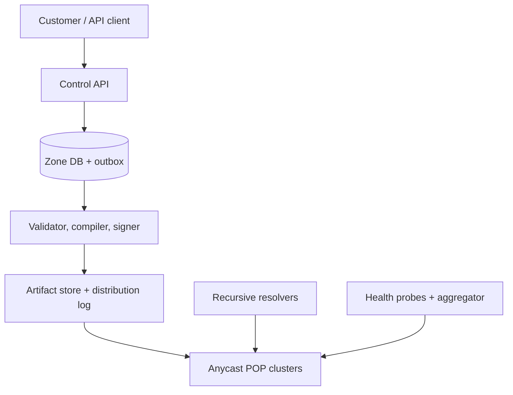

# Design a Global Authoritative DNS Service

**Difficulty:** Senior/Staff  
**Primary themes:** global read path, anycast, caching, control-plane/data-plane separation, consistency, DNSSEC, overload protection  
**Interview time budget:** requirements 5 minutes, entities 2 minutes, interface 5 minutes, high-level design 10–15 minutes, deep dives 10–15 minutes. The walkthrough below is intentionally more detailed than what you would say in 45 minutes.

This problem is useful because “read-heavy” understates it. The read path is a public Internet protocol, responses are cached outside our control, and stale data can be correct according to protocol. The strongest answer therefore begins with the consistency contract, not with a database choice.

The delivery order follows Hello Interview’s public framework: narrow the requirements, name the core entities, define the interface, build a complete design requirement by requirement, and spend the remaining time on the hardest constraints. Their guidance also recommends doing estimates only when they change a design decision and treating API design as a short mapping from requirements to operations rather than an extended exercise ([Delivery framework and core concepts](https://www.hellointerview.com/learn/system-design/in-a-hurry/core-concepts), [API design](https://www.hellointerview.com/learn/system-design/core-concepts/api-design)). The DNS design and dialogue here are original.

## Interviewer prompt

> Design a managed, globally distributed authoritative DNS service. Customers should be able to host DNS zones and update records through an API. Recursive resolvers around the world should receive low-latency, highly available answers.

## Targeted clarifying questions and assumed answers

**Candidate:** Are we authoritative only, or are we also building a recursive resolver and a registrar?  
**Interviewer:** Authoritative only. Domain registration, parent-zone delegation, and recursive resolution are outside scope.

**Candidate:** Which customer operations and record types matter?  
**Interviewer:** Create/delete zones and atomically change RRsets. Support A, AAAA, CNAME, MX, TXT, NS, SOA, CAA, and weighted or failover policies.

**Candidate:** What scale should I design for?  
**Interviewer:** Five million hosted zones, 500 million records, 15 million DNS queries per second globally on average, five times that during attacks or traffic spikes, and about 10,000 record mutations per second.

**Candidate:** What are the latency, availability, and propagation goals?  
**Interviewer:** p99 authoritative processing plus nearby network time under 30 ms, 99.999% monthly query availability, and 99% of accepted zone versions active at every healthy point of presence within 30 seconds. We would like an emergency path under five seconds, but do not promise that cached clients see it immediately.

**Candidate:** What consistency is required for writes and reads?  
**Interviewer:** Writes to one zone must be serialized and an entire submitted change set must be atomic. The query plane may be eventually consistent across locations during publication, but each location must serve one complete zone version, never a mixture.

**Candidate:** Do we need DNSSEC?  
**Interviewer:** Yes. Offer managed signing and safe key rotation.

**Candidate:** Should we support traditional secondary-DNS transfers?  
**Interviewer:** Mention AXFR/IXFR and NOTIFY as an extension, but focus on our API and internal distribution path.

**Candidate:** What can I exclude?  
**Interviewer:** Billing, UI, registrar workflows, arbitrary DNS scripting, and a full DDoS-scrubbing implementation. Explain the boundary with network mitigation.

### What I would say aloud

> “I’ll separate the customer-facing control plane from the Internet-facing query plane. The control plane gives serializable, atomic writes per zone. The query plane remains available from a last-known-good immutable zone image and converges within 30 seconds. A separate TTL clock governs how long recursive resolvers may legally retain an old answer, so global publication does not imply instant end-user freshness.”

That statement fixes the most important ambiguity before any boxes are drawn.

## 1. Requirements (~5 minutes)

### Core functional requirements

1. **Manage zones and RRsets.** An authenticated customer can create a zone and atomically upsert or delete one or more resource-record sets (RRsets). An RRset is all records with the same owner name, type, and class; updating it as a unit avoids nonsensical partial answers.
2. **Answer authoritative queries.** Serve correct authoritative UDP and TCP DNS responses, including positive answers, referrals, CNAMEs, wildcards, NXDOMAIN, and NODATA.
3. **Publish safe global changes.** Validate, optionally sign, distribute, activate, monitor, and roll back versioned zone images. Weighted and health-based policies select from eligible answers.

### Quantified non-functional requirements

| Dimension | Target | Design consequence |
|---|---:|---|
| Query traffic | 15M QPS average; 75M QPS burst | No control-plane or remote-database call on the query path; horizontally scaled edge nodes |
| Query latency | p99 under 30 ms from a nearby resolver | Anycast to many POPs; in-memory local lookup |
| Query availability | 99.999% monthly | Data plane survives control-plane, WAN, and regional failures using last-known-good data |
| Publication | 99% of versions active at every healthy POP within 30 s | Versioned asynchronous fan-out with acknowledgements and lag alarms |
| Durability | No accepted zone version lost; RPO 0 for committed writes | Synchronously replicated source of truth plus immutable artifacts |
| Zone consistency | Serializable writes per zone; atomic activation per POP | Optimistic concurrency and one pointer swap from version N to N+1 |

### Explicit consistency and availability contract

There are two freshness clocks:

1. **Authoritative publication clock:** after a write is accepted as version `v`, healthy POPs asynchronously install exactly version `v`. During propagation, different POPs may serve `v-1` or `v`, but no POP serves half of either.
2. **Resolver cache clock:** a recursive resolver may continue serving a previously fetched RRset until its TTL expires. NXDOMAIN/NODATA can also be negatively cached using the zone’s SOA-derived negative TTL.

Thus a status of `ACTIVE_GLOBAL` means the authoritative fleet converged; it does not mean every client sees the new data. [RFC 1034](https://www.rfc-editor.org/rfc/rfc1034.html) defines TTL as the caching time limit and explicitly notes that planned changes can lower TTL beforehand. [RFC 2308](https://www.rfc-editor.org/rfc/rfc2308.html) specifies negative caching.

For availability, an isolated POP continues serving its last valid version. We prefer bounded staleness over returning `SERVFAIL` for otherwise valid zones. We fail closed only when an artifact is corrupt or a DNSSEC version is internally inconsistent.

### Scope boundaries

- In scope: authoritative DNS, zone authoring, publication, managed DNSSEC, edge query handling, health-based policies, observability.
- Out of scope: recursive caching, registration, parent-zone DS/NS automation, billing, customer UI, and transport-encrypted recursive DNS such as DoH.

## Scale estimates that change the design

Assume an average wire response of 250 bytes, acknowledging that DNSSEC and TXT answers can be much larger:

\[
15{,}000{,}000 \times 250 \approx 3.75\ \text{GB/s} \approx 30\ \text{Gb/s}
\]

At a five-times burst, payload alone is about 150 Gb/s before IP/UDP/Ethernet overhead. This justifies many anycast POPs, kernel-bypass or highly optimized UDP processing, and upstream DDoS capacity. It also tells us that a centralized load balancer is not credible.

For stored data, 500 million compact record entries at an estimated 200 bytes each is about 100 GB raw. With names, indexes, DNSSEC material, multiple versions, and allocator overhead, budget 300–500 GB. Replicating that onto every process is wasteful, but keeping a full regional copy across a sharded edge cluster is practical. Within each POP, consistent hashing assigns each zone to several nodes, with a small hot-answer cache on every serving node.

Ten thousand mutations per second is tiny compared with the read path but significant for signing and fan-out. That asymmetry motivates immutable compiled artifacts and batching rather than invalidating individual cache entries worldwide.

### What I would say aloud

> “The estimate changes two choices. Thirty gigabits per second average means the query plane must terminate in many anycast locations, not one global service. A few hundred gigabytes of indexed zone data is manageable per POP cluster but not per process, so I’ll shard zones locally and replicate each shard.”

## 2. Core entities (~2 minutes)

Name the nouns before expanding the schema:

| Entity | Essential fields and role |
|---|---|
| `Account` | `account_id`, quotas, policy; ownership comes from authentication |
| `Zone` | `zone_id`, `account_id`, canonical `name`, state, current committed version, DNSSEC mode |
| `RRset` | `owner_name`, `type`, `ttl`, canonical values, optional `policy_id`; atomic DNS data unit |
| `ChangeSet` | idempotency key, base version, ordered mutations, status, validation errors |
| `ZoneVersion` | monotonic version/SOA serial, content hash, artifact URI, signature window, publish state |
| `RoutingPolicy` | weighted/failover rule, endpoint IDs, health requirements |
| `HealthState` | endpoint, region, observations, aggregate state, epoch |
| `EdgeManifest` | zone/version to artifact hash mapping, signed publisher metadata |

Avoid designing twenty tables now. Fields should appear when a component needs them.

### What I would say aloud

> “The core consistency boundary is a ZoneVersion containing RRsets. ChangeSet captures an idempotent atomic mutation, and EdgeManifest lets a POP prove which immutable artifact it activated. I’ll introduce routing and signing fields where those components enter the design.”

## 3. API and system interface (~5 minutes)

### Control-plane HTTP API

Identity is derived from the authenticated principal, not trusted from a request-body `account_id`.

#### Create a zone

```http
POST /v1/zones
Authorization: Bearer <token>
Idempotency-Key: 6b30...
Content-Type: application/json

{
  "name": "example.com.",
  "dnssec_mode": "MANAGED"
}
```

```json
{
  "zone_id": "zn_7K3",
  "name": "example.com.",
  "version": 1,
  "name_servers": ["ns1.dns.example.", "ns2.dns.example."],
  "publish_status": "PUBLISHING"
}
```

The API canonicalizes the fully qualified name, verifies ownership policy, creates required SOA and NS RRsets, and returns assigned nameservers.

#### Apply an atomic change set

```http
POST /v1/zones/zn_7K3/changes
Authorization: Bearer <token>
Idempotency-Key: 8104...
If-Match: "zone-version-41"
Content-Type: application/json

{
  "changes": [
    {
      "op": "UPSERT",
      "name": "api.example.com.",
      "type": "A",
      "ttl": 60,
      "values": ["203.0.113.10", "203.0.113.11"]
    },
    {
      "op": "DELETE",
      "name": "old.example.com.",
      "type": "A"
    }
  ]
}
```

```json
{
  "change_id": "chg_93P",
  "zone_version": 42,
  "status": "VALIDATING"
}
```

`If-Match` prevents two administrators from silently overwriting each other. A stale base version receives `412 Precondition Failed`; a retried idempotency key returns the original result. Validation rejects an apex CNAME, malformed RDATA, duplicate canonical values, invalid delegation, excessive TTL, quota breaches, or a CNAME coexisting with prohibited data.

#### Read publication status

```http
GET /v1/zones/zn_7K3/versions/42
```

```json
{
  "version": 42,
  "state": "ACTIVE_GLOBAL",
  "committed_at": "2026-10-15T23:10:04Z",
  "healthy_pops_active": 87,
  "healthy_pops_total": 87,
  "min_ttl_seconds": 60
}
```

The response should explain that caches may retain the previous answer until its prior TTL expires.

### DNS wire interface

The public interface is DNS on UDP and TCP port 53:

```text
Question:  QNAME=api.example.com. QTYPE=A QCLASS=IN
Response:  AA=1 RCODE=NOERROR
Answer:    api.example.com. 60 IN A 203.0.113.10
           api.example.com. 60 IN A 203.0.113.11
```

UDP is the common fast path; TCP is supported for large/truncated replies and other required cases. [RFC 1035](https://www.rfc-editor.org/rfc/rfc1035.html) specifies both transports and the TC bit. EDNS(0) lets a requester advertise a larger UDP payload, but the server caps responses to a fragmentation-safe size and sets TC when needed ([RFC 6891](https://www.rfc-editor.org/rfc/rfc6891.html), [RFC 9715](https://www.rfc-editor.org/rfc/rfc9715.html)).

## 4. Data flow

A zone update is a processing pipeline, so stating it explicitly is useful:

1. Authenticate, authorize, rate-limit, and deduplicate the request.
2. Canonicalize names/RDATA and validate whole-zone invariants.
3. In one database transaction, compare the base version, persist the new logical version, and append an outbox event.
4. Compile the zone into a deterministic immutable lookup artifact.
5. If enabled, generate DNSSEC records and signatures; verify the result independently.
6. Write the artifact to replicated object storage and publish a signed manifest to the distribution log.
7. Each POP fetches the artifact/delta, verifies the hash/signatures, loads it off-path, and atomically switches its active-version pointer.
8. POPs acknowledge activation. The publisher advances status based on healthy-POP coverage and alerts on lag.

The transactional outbox is a database table written in the same transaction as the zone change. A relay publishes it later, preventing the dual-write failure in which the database commits but no distribution event is emitted.

## 5. High-level design (~10–15 minutes)



The horizontal line to remember is conceptual: everything above the edge publication boundary may fail while existing DNS answers continue below it.

### Operation 1: create and change a zone

The control API is active in multiple regions behind a normal HTTPS global endpoint. It authenticates the user and routes all writes for a `zone_id` to that zone’s current database leader. A strongly consistent relational or distributed SQL store is a good fit because updates need transactions, uniqueness, audit history, and compare-and-swap semantics; 10,000 mutations per second does not force a specialized write store.

Within a transaction:

- Lock or compare `Zone.current_version`.
- Apply the complete change set to logical RRsets.
- Validate cross-record invariants.
- Allocate version 42 and a monotonically advancing SOA serial.
- Store audit metadata and the idempotency result.
- Insert `ZoneChanged(zone_id, version=42)` into the outbox.

Return `202 Accepted` after durable commit. Do not wait for every POP. A separate read endpoint exposes validation, signing, and activation states.

**Why not update edge nodes synchronously?** The slowest or partitioned POP would make the control API unavailable. The product promise is durable acceptance followed by observable asynchronous publication.

### Operation 2: compile and publish an immutable version

Workers consume the outbox and reconstruct the zone at the committed version. The compiler produces a deterministic artifact:

- a suffix/trie index to find the closest enclosing zone and delegation;
- a hash table from canonical `(owner, type)` to an RRset;
- wildcard and empty-nonterminal metadata;
- pre-encoded wire fragments for common answers;
- policy bytecode or compact routing tables;
- SOA, NS, DNSSEC denial, and signature records;
- artifact header `{zone_id, version, content_hash, valid_from, valid_until}`.

For a small update, the system may distribute a delta, but a POP always materializes and validates a complete version before activation. Full snapshots are periodic and provide bounded recovery time. Artifacts are content-addressed and immutable, so retrying is safe and a previous good version remains rollback-ready.

The manifest is signed by a publication key separate from customer DNSSEC keys. A corrupt object-store response or compromised transport cannot silently install arbitrary zone data because the POP checks both manifest signature and artifact hash.

### Operation 3: answer a DNS query

1. A recursive resolver sends a packet to one of our advertised anycast IPs. Internet routing normally delivers it to a nearby healthy POP.
2. A stateless front end parses the packet under strict CPU and size budgets, drops malformed or abusive traffic, and hashes the query to a node holding the zone shard.
3. The node finds the closest authoritative zone, then evaluates delegation, exact owner, CNAME/DNAME behavior, wildcard rules, and requested type.
4. If the RRset has a routing policy, the policy engine chooses among currently eligible endpoints using a stable hash of query context. Stability avoids reshuffling an answer on every retry.
5. The encoder builds a response with AA set, the record’s TTL, and DNSSEC records when the DO bit requests them. If the safe UDP size would be exceeded, it returns a correctly truncated response with TC=1 so the resolver retries over TCP.
6. The response is emitted directly; there is no cross-region dependency.

The node serves from read-only memory-mapped artifacts plus a bounded cache of pre-encoded hot answers. Immutable data removes locks from the hot path. A per-POP zone-placement service keeps, for example, three replicas on distinct failure domains. If the preferred shard is unavailable, the front end retries another local replica, never the distant control plane.

### Operation 4: weighted and health-based answers

Regional probes check endpoints from several vantage points. The health aggregator requires a quorum across probes and uses hysteresis: an endpoint must fail several consecutive checks before becoming unhealthy and pass several before rejoining. This prevents flapping.

The aggregator emits a compact, monotonically versioned `HealthState` stream to POPs. The static zone artifact describes policy; the small dynamic overlay describes endpoint eligibility. If the health stream is interrupted, a POP uses the last-known state for a bounded period, then applies the customer’s configured safety mode—usually fail open to all configured endpoints or fail over to a designated endpoint.

DNS failover is not instant. Resolvers that cached a 60-second answer may use it for up to 60 seconds after we stop returning it. The API should enforce a suitably low TTL for health-routed RRsets and the product SLO must include that cache-bound delay.

### Operation 5: observe and roll back

Every POP publishes, per zone-version cohort rather than per query:

- active-version watermarks and activation latency;
- missing/corrupt artifact counts;
- QPS, p50/p99 processing latency, UDP/TCP ratio, TC rate, response codes;
- stale-version query counts;
- policy selection and endpoint-health age;
- sampled query logs with privacy controls.

Global probes issue known-answer queries with and without DNSSEC from independent networks. A rollout controller can halt publication or repoint manifests to the last valid version. Rollback creates a new monotonically increasing version containing old data; it does not move the version number backward, which keeps ordering unambiguous.

## 6. Deep dives (~10–15 minutes)

### Deep dive A: atomic publication and the two-clock freshness problem

#### Where the baseline breaks

If we stream individual record mutations directly to edge maps, a POP can expose an intermediate state. For example, it might delete the old MX RRset before installing its replacement, or activate new DNSKEY data without matching signatures. Retries and reordering make this likely during failures.

Even perfect edge convergence does not purge third-party recursive caches. Claiming “five-second DNS updates” without naming TTL is incorrect.

#### Options

| Approach | Benefit | Failure/tradeoff |
|---|---|---|
| Synchronous write to every POP | Simple mental model | Global write availability and latency depend on the slowest POP |
| Per-RRset invalidation/deltas | Low bandwidth | Ordering, partial-zone visibility, and recovery complexity |
| Immutable zone versions + atomic pointer swap | Whole-zone consistency, easy retry/rollback | More build/storage work; large zones need delta transport |

#### Choice and evolution

Use immutable versions with an atomic pointer swap. Deltas are a transfer optimization only. A POP stages version 42, validates all indexes and DNSSEC material, then swaps `active[zone_id]` from 41 to 42 in one operation. Readers already using 41 complete safely; epoch-based reclamation frees it after outstanding queries drain.

Publication status uses a version vector or watermark per POP. Healthy POP membership is itself versioned; otherwise a dead POP could prevent “global” forever. Suggested states are `COMMITTED`, `BUILDING`, `PUBLISHING`, `ACTIVE_QUORUM`, `ACTIVE_GLOBAL`, and `FAILED`.

For a planned migration, tell the operator to lower the TTL at least one old-TTL interval before changing the answer. Example: if the old TTL is 3,600 seconds, lowering it to 60 seconds and immediately changing the IP does not help resolvers that already cached the one-hour answer. Wait an hour, then change the IP. Afterwards, raise the TTL to regain cache efficiency.

Negative answers need the same care. A customer who creates `new.example.com` after it previously returned NXDOMAIN may wait for the negative-cache TTL. Serve SOA in negative responses and derive the TTL correctly rather than inventing a global constant.

#### Failure modes and observability

- **Database committed, event missing:** transactional outbox relay retries.
- **Compiler crash:** deterministic job keyed by `(zone_id, version)` retries safely.
- **Artifact corrupt:** hash mismatch rejects it; keep serving the previous version.
- **One POP stuck:** alarm on publication-lag histogram and version watermark; do not block all writes.
- **Bad but syntactically valid data:** staged canary POPs and known-answer probes can pause rollout; customer rollback produces a newer version.

### What I would say aloud

> “I’m separating atomicity from simultaneity. Each POP changes atomically, but POPs do not change simultaneously. Resolver caches add another period of permitted staleness that our system cannot revoke. Immutable versions make the first property tractable; TTL planning handles the second.”

### Deep dive B: anycast availability, hot zones, and hostile traffic

#### Where the baseline breaks

A DNS service cannot rely on a single global proxy or a normal L7 load balancer. UDP has no connection for the proxy to anchor, routing failures are regional, and attack traffic can dwarf legitimate load. A celebrity domain can also overload one local shard even when global capacity is ample.

#### Options

| Approach | Strength | Weakness |
|---|---|---|
| Unicast regional IPs returned by geo-DNS | Simple servers | Bootstrapping irony, slower failover, clients may choose distant regions |
| Anycast IP advertised from many POPs | Nearby routing, shared address, route withdrawal | BGP convergence is imperfect; flows may move, especially TCP |
| One copy of every zone on every node | No local forwarding | Hundreds of GB plus versions per node; slow fleet-wide loading |
| Locally sharded zones with replication and hot caches | Practical memory use, resilient | Internal hop and placement complexity |

#### Choice and evolution

Advertise the same service IPs from many POPs using anycast. Each POP has independent capacity and at least three local copies of every assigned zone shard. Health automation withdraws a POP route only for broad failure; it should not flap BGP for one overloaded node. Local load shedding and shard rebalancing handle narrower faults.

Use a two-level hot strategy:

1. A bounded per-node cache holds pre-encoded answers for globally hot `(qname, qtype, DNSSEC mode, policy bucket)` keys.
2. The placement service detects hot zones and increases their replication factor or pins them to all nodes in that POP.

Versioned keys make invalidation cheap: cache entries include `zone_version` and cease matching after the active pointer advances. Randomized eviction jitter prevents all nodes from expiring a popular entry together.

For hostile traffic:

- strict parser bounds prevent compression-pointer loops and oversized work;
- per-source-prefix and per-question response-rate limiting curbs repeated large answers while protecting distributed legitimate resolvers;
- cap UDP answers to the requester’s EDNS offer and a fragmentation-safe local maximum; otherwise set TC;
- minimize `ANY` responses and amplification-prone error payloads;
- support DNS Cookies as a lightweight signal against spoofed-source amplification. [RFC 7873](https://www.rfc-editor.org/rfc/rfc7873.html) describes cookies as tolerant of NAT and anycast and able to limit off-path amplification;
- have network-layer scrubbing, upstream filtering, and excess POP capacity. Application rate limiting alone cannot absorb a volumetric link-saturation attack.

TCP needs connection limits, SYN protection, short idle timeouts, and fair queues so an attack does not exhaust memory. It remains required because large and DNSSEC responses may be truncated over UDP.

#### Failure modes and observability

- **POP isolated:** resolvers route elsewhere after convergence; the isolated POP can still answer locally from last-known-good state.
- **Anycast route leak or distant routing:** synthetic latency by ASN/region and BGP telemetry reveal path shifts.
- **Hot zone:** per-zone CPU/QPS and queue delay trigger replication, not whole-fleet scaling.
- **Spoofed amplification:** measure response/request byte ratio, cookie validation, rate-limit actions, and top qnames/source prefixes.
- **TCP spillover after truncation:** alert on TC-to-TCP retry ratio and TCP accept saturation.

### Deep dive C: DNSSEC signing without publishing a broken chain

#### Where the baseline breaks

Signing each query is too expensive and exposes private keys at every edge. Signing individual changed RRsets and publishing them independently can create a “bogus” zone: resolvers see expired/missing RRSIGs, inconsistent denial-of-existence records, or a DNSKEY transition without the needed parent DS relationship.

DNSSEC provides origin authentication and integrity, not confidentiality. It signs RRsets using RRSIG records, publishes DNSKEY records, and connects a child zone to its parent through a DS record. NSEC or NSEC3 authenticates denial of existence. The core model and its limitations are described in [RFC 4033](https://www.rfc-editor.org/rfc/rfc4033.html), with record formats and protocol behavior in [RFC 4034](https://www.rfc-editor.org/rfc/rfc4034.html) and [RFC 4035](https://www.rfc-editor.org/rfc/rfc4035.html).

#### Options

| Approach | Benefit | Risk/cost |
|---|---|---|
| Online signing at every edge | Always fresh signatures | Keys at huge attack surface; CPU and latency cost |
| Central signing on each update | Keys concentrated and auditable | Signing pipeline becomes publication dependency |
| Pre-sign scheduled validity windows | Fast query path; overlap for outages | Must refresh before expiration and manage larger artifacts |

#### Choice and evolution

Pre-sign compiled versions in a dedicated signing service backed by HSMs. Keep the key-signing key (KSK) tightly controlled and use it to sign the DNSKEY RRset; use a zone-signing key (ZSK) for ordinary RRsets. Exact operational roles can vary, but separating them limits frequent use of the most sensitive key.

Signatures have inception and expiration times with overlap. A background resigning job publishes a semantically identical new version well before expiration. The fleet monitors minimum remaining signature lifetime as a top-tier SLO; if it falls below a safety threshold, page operators even though queries still succeed.

Key rotation is a state machine, not one API call:

1. **Prepublish:** add the new DNSKEY while continuing to sign with the old key.
2. **Wait:** allow DNSKEY TTLs to expire so validators can learn the new key.
3. **Activate/double-sign:** produce signatures that permit validation through the transition.
4. **Parent coordination for KSK:** ensure the parent DS is changed and observed when required.
5. **Retire:** remove the old key only after cache-safe overlap.

The compiler builds NSEC/NSEC3 denial records from the complete zone, signs the complete artifact, and runs an independent validator from trust anchor to sample positive and negative answers. A POP activates DNSKEY, RRSIG, and denial data together. If signing is unavailable, existing signed versions continue to serve until their validity safety window; new DNSSEC changes queue rather than publishing unsigned or partially signed data.

#### Failure modes and observability

- **HSM/signing outage:** query plane unaffected; publishing pauses; alert on signing queue and remaining validity.
- **Clock skew:** use secured time synchronization and reject suspicious inception/expiration windows.
- **Wrong key/DS transition:** automated validation from external vantage points blocks rollout.
- **Expired RRSIG:** prevent by overlapping resign jobs and a hard publication guard.
- **Oversized signed response:** honor EDNS, avoid fragmentation, set TC, and size-cap policy-generated RRsets.

### What I would say aloud

> “I would never put DNSSEC private keys on edge servers or sign per query. A dedicated HSM-backed signer produces a complete, independently validated zone image with overlapping signature validity. The edge atomically activates DNSKEY, signatures, and denial records as one version.”

## 7. Final design and interview close

### Concise final design

- A multi-region HTTPS control plane authenticates customers and serializes atomic changes per zone in a strongly consistent database.
- A transactional outbox drives deterministic validation, compilation, managed DNSSEC signing, and immutable artifact creation.
- A distribution log and content-addressed object store fan versioned artifacts to every healthy POP; each POP verifies, stages, and atomically activates one complete zone version.
- Recursive resolvers reach nearby POPs through anycast. Edge nodes answer UDP/TCP queries from local memory, with sharded replicated zone data, version-aware hot caches, and no control-plane dependency.
- A separate health overlay drives failover policies with quorum, hysteresis, and explicit stale-state behavior.
- Rate limiting, DNS Cookies, fragmentation-safe response sizing, TCP protections, upstream scrubbing, and route withdrawal address abuse and failures.
- Version watermarks, global probes, DNSSEC validation, publication-lag metrics, and immutable rollback provide operational safety.

### Requirements check

| Requirement | How the design meets it |
|---|---|
| Manage zones/RRsets | Auth-derived ownership, idempotent APIs, per-zone optimistic concurrency, atomic change sets |
| Answer authoritative queries | RFC-aware local lookup for positive, referral, wildcard, CNAME, NXDOMAIN, and NODATA responses |
| Global publication | Immutable versions, signed manifests, asynchronous fan-out, per-POP atomic activation |
| 15M QPS / 75M burst | Anycast POP fleet, local memory, sharding, replication, hot-answer cache |
| p99 <30 ms | Nearby routing and no WAN/database call on query path |
| 99.999% availability | Last-known-good artifacts, failure-domain replicas, POP independence, route withdrawal |
| 30-second authoritative propagation | Distribution log, parallel fetch, activation acknowledgements, lag alarms |
| Correct consistency | Serializable writes; atomic version per POP; explicit eventual convergence and TTL-bound cache staleness |
| DNSSEC | Central HSM-backed pre-signing, complete signed artifacts, overlap and rotation state machine |

### A 60-second closing statement

> “The design separates a strongly consistent control plane from an availability-first query plane. Customer mutations commit atomically per zone, then a deterministic pipeline compiles and signs an immutable zone version. POPs verify that artifact and switch versions atomically. Anycast sends resolvers to nearby POPs, which answer entirely from local replicated memory and can survive loss of the control plane. I would measure both authoritative publication lag and DNS TTL effects because they are different freshness clocks. My main deep dives are atomic version distribution, anycast and overload behavior, and DNSSEC-safe signing and rotation.”

## Realistic interviewer follow-ups with strong sample answers

**1. Why not put Redis in front of the zone database?**  
Redis would still make every query depend on a networked cache and would not solve Internet-scale UDP termination. The active zone image itself is a read-only in-memory data structure at the edge. A bounded local hot-answer cache optimizes encoding, while immutable versions make invalidation precise.

**2. How do you prevent lost updates from two administrators?**  
Require `If-Match` with the observed zone version. The database transaction compares that version before committing. One succeeds; the other receives `412` and must re-read and merge. Idempotency keys handle transport retries separately.

**3. Can you guarantee that every user sees a changed record in 30 seconds?**  
No. I can guarantee authoritative-fleet propagation to healthy POPs. A recursive resolver may legally serve the old answer until its previous TTL expires, including a negative-cache TTL for a formerly nonexistent name. For a planned cutover, lower the TTL one old-TTL interval in advance.

**4. What happens if a POP misses versions 42 through 50?**  
It compares its watermark with the current manifest. If the delta chain is complete and cheaper, it replays and validates it; otherwise it fetches the latest full snapshot. It continues serving its last-known-good version during recovery unless policy declares it too stale, in which case the POP can withdraw the route.

**5. How do you handle a single zone with millions of records?**  
Make the artifact internally paged and memory-mapped, distribute chunked deltas, and partition the zone’s name index across multiple local shards while replicating routing metadata. The front end hashes by zone plus owner-name range. Atomic activation swaps a manifest that references all verified chunks.

**6. How does weighted routing interact with caches?**  
The authoritative server samples or deterministically selects an answer per query, but a recursive resolver caches that answer for its users. Therefore weights are approximate over resolver queries, not individual end users. Use short TTLs and stable hashing to reduce surprising churn, and document that semantics.

**7. What if health checks disagree?**  
Aggregate multiple independent vantage points with quorum and hysteresis. Keep an epoch so POPs reject reordered state. Customer policy specifies fail-open or fail-closed behavior if health data becomes too old; the default should avoid withdrawing every endpoint because the monitoring system failed.

**8. Why use anycast if TCP connections can move between POPs?**  
Most queries are one-shot UDP. TCP connections are short and each POP is independently capable. Routing changes can reset a TCP connection, after which the resolver retries. We avoid cross-POP session state and use route withdrawal conservatively.

**9. How would you support a customer’s hidden primary and our secondary service?**  
Add a transfer ingress service supporting authenticated AXFR/IXFR and DNS NOTIFY. It translates a received serial into the same validated `ZoneVersion` pipeline. Transfer parsing and TSIG authentication stay off the public query workers.

**10. What is the disaster-recovery plan for the control plane?**  
Synchronously replicate committed zone data across failure domains, continuously back up immutable versions to another region/account, and test point-in-time restore. A regional leader failover may pause writes briefly, but every POP keeps answering from existing artifacts. RPO is zero for committed database writes; publication resumes from the outbox.

**11. Could a bad customer configuration take down the service?**  
Enforce quotas on zone size, RRset cardinality, TXT bytes, policy complexity, and minimum TTL for dynamic policies. Compilation has CPU/memory limits. One customer’s artifact, queue partition, and rate budget are isolated so pathological data cannot monopolize publishers or query workers.

**12. What would you test before launch?**  
Protocol conformance for referrals, glue, wildcards, CNAMEs, NXDOMAIN/NODATA, EDNS, truncation, TCP, and DNSSEC; property tests for parser safety; deterministic compiler/hash tests; fault injection for missed/reordered versions; key-rotation rehearsals; POP isolation; hot-zone load; and spoofed-amplification simulations in a controlled environment.

## Common pitfalls

- Treating authoritative DNS as a generic key-value GET service and ignoring referrals, wildcards, negative answers, EDNS, TCP, and DNSSEC.
- Claiming an update is globally visible when only authoritative servers have converged; recursive TTLs are outside direct control.
- Putting the control-plane database, a regional cache, or a health service on the query path.
- Applying record mutations independently and exposing partially updated zones.
- Copying every zone into every process without doing the storage estimate.
- Saying “use anycast” without discussing POP withdrawal, routing convergence, local failure, and TCP retry behavior.
- Using only per-IP rate limits; large recursive resolvers aggregate many legitimate users, while attackers spoof or distribute sources.
- Assuming low TTL is free. It increases query load, cost, and dependence on authoritative availability.
- Signing at the edge or rotating DNSSEC keys as an instantaneous replacement rather than a cache-safe state machine.
- Returning oversized UDP responses and relying on IP fragmentation instead of EDNS-aware limits and TCP fallback.
- Letting a broken control plane stop existing DNS answers.
- Omitting publication watermarks and external known-answer probes, leaving global inconsistency invisible.

## References

- Hello Interview, [Core Concepts and delivery guidance](https://www.hellointerview.com/learn/system-design/in-a-hurry/core-concepts)
- Hello Interview, [API Design for System Design Interviews](https://www.hellointerview.com/learn/system-design/core-concepts/api-design)
- IETF, [RFC 1034: Domain Names — Concepts and Facilities](https://www.rfc-editor.org/rfc/rfc1034.html)
- IETF, [RFC 1035: Domain Names — Implementation and Specification](https://www.rfc-editor.org/rfc/rfc1035.html)
- IETF, [RFC 2308: Negative Caching of DNS Queries](https://www.rfc-editor.org/rfc/rfc2308.html)
- IETF, [RFC 4033: DNS Security Introduction and Requirements](https://www.rfc-editor.org/rfc/rfc4033.html)
- IETF, [RFC 4034: Resource Records for DNSSEC](https://www.rfc-editor.org/rfc/rfc4034.html)
- IETF, [RFC 4035: Protocol Modifications for DNSSEC](https://www.rfc-editor.org/rfc/rfc4035.html)
- IETF, [RFC 6891: Extension Mechanisms for DNS (EDNS(0))](https://www.rfc-editor.org/rfc/rfc6891.html)
- IETF, [RFC 7873: DNS Cookies](https://www.rfc-editor.org/rfc/rfc7873.html)
- IETF, [RFC 9715: IP Fragmentation Avoidance in DNS over UDP](https://www.rfc-editor.org/rfc/rfc9715.html)
