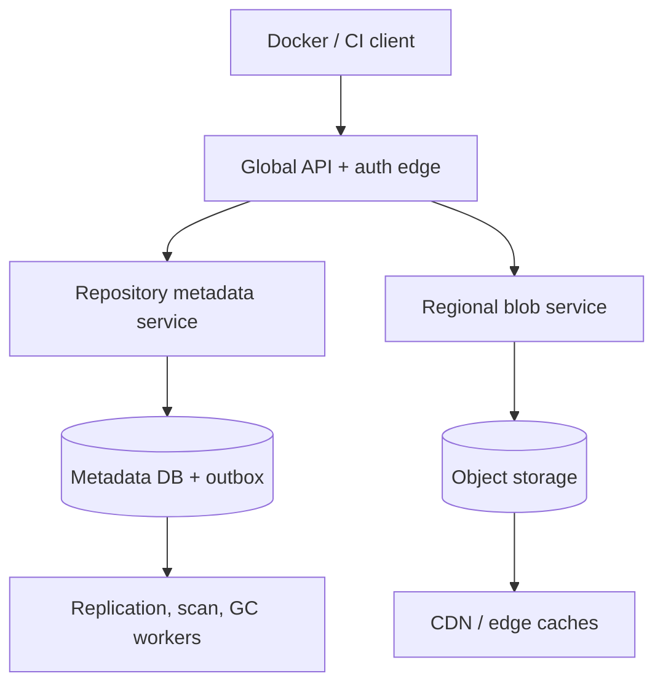

# Design a Global Container Registry

**Difficulty:** Senior/Staff  
**Primary themes:** content-addressed storage, resumable uploads, metadata consistency, caching, multi-region reliability, garbage collection, tenant isolation  
**Interview time budget:** requirements 5 minutes, entities 2 minutes, interface 5 minutes, high-level design 10–15 minutes, deep dives 10–15 minutes. This educational walkthrough is deliberately longer than the spoken interview.

The problem looks like “upload and download files,” but the useful design hinges on separating two kinds of state:

- **Immutable content:** image layers, configs, and manifests identified by cryptographic digest.
- **Mutable names:** tags such as `prod` or `latest` that point to a manifest digest.

That distinction determines deduplication, caching, consistency, replication, and garbage collection.

The structure follows Hello Interview’s public delivery framework: establish requirements, name core entities, define the interface, build the simplest complete design one requirement at a time, and then harden the load-bearing pieces ([System Design Delivery Framework](https://www.hellointerview.com/learn/system-design/in-a-hurry/delivery)). The service design and dialogue below are original.

## Interviewer prompt

> Design a globally available container image registry similar to Docker Hub or a cloud provider’s private registry. Developers and CI systems should be able to push and pull OCI-compatible images using repositories, tags, and digests.

## Targeted clarifying questions and assumed answers

**Candidate:** Is this a public registry, a private enterprise registry, or both?  
**Interviewer:** Focus on a multi-tenant private registry. Public repositories are a policy extension.

**Candidate:** Do clients need the standard OCI/Docker Registry API?  
**Interviewer:** Yes. Existing container clients should work without a custom protocol.

**Candidate:** Which core operations matter?  
**Interviewer:** Push resumable layer blobs, push manifests and multi-platform indexes, pull by tag or digest, list tags, and delete tags/manifests according to retention policy.

**Candidate:** What scale should I assume?  
**Interviewer:** Ten million repositories, five billion unique blobs, 20 PB of stored compressed content, 500,000 pull requests per second at peak, 20 TB/s peak egress across regions, and 50,000 concurrent uploads.

**Candidate:** What are the SLOs?  
**Interviewer:** Manifest lookups should be p99 under 100 ms in-region; layer delivery should start within 200 ms on a cache hit. Pull availability is 99.99%. A successful push must be durable in its home region, readable there immediately, and available in configured replica regions within five minutes.

**Candidate:** What consistency should tags and digests provide?  
**Interviewer:** Digest reads are immutable. Tag updates within a repository must be linearizable in the home region and support compare-and-swap. Remote regions may briefly serve an older tag, but clients pulling by returned digest must receive exactly those bytes. Enterprise customers may opt into synchronous multi-region publication.

**Candidate:** Do we include image scanning and signatures?  
**Interviewer:** Store signatures, SBOMs, and scan results as OCI artifacts/referrers. The scanner itself can be an asynchronous external pipeline.

**Candidate:** What is out of scope?  
**Interviewer:** Building a container runtime, CI system, vulnerability database, or general-purpose object store. Explain the interfaces to those systems.

### What I would say aloud

> “I’ll model blobs and manifests as immutable digest-addressed objects, while tags are mutable repository-scoped pointers. A push uploads missing blobs first and commits the manifest last, so the manifest becomes the publication boundary. Pulls resolve a tag once, then fetch immutable content by digest. That lets us combine strong tag semantics with aggressive global caching.”

## 1. Requirements (~5 minutes)

### Core functional requirements

1. **Push an image safely.** Authenticate, discover existing blobs, upload missing data resumably, verify content digests, and atomically publish a manifest under a tag.
2. **Pull an image efficiently.** Resolve a tag or digest, return the OCI manifest or index, and stream referenced config/layer blobs from a nearby cache or origin.
3. **Manage lifecycle and supply-chain metadata.** List and conditionally update tags, delete references, enforce retention, attach signatures/SBOMs/scan results, and reclaim unreachable content safely.

### Quantified non-functional requirements

| Dimension | Target | Concrete consequence |
|---|---:|---|
| Peak pulls | 500K requests/s | Stateless manifest service, CDN/edge caches, horizontally scaled authorization |
| Peak egress | 20 TB/s | Object storage behind global delivery; application servers never proxy all layer bytes |
| Concurrent uploads | 50K | Resumable sessions, direct multipart object-store upload, bounded gateway state |
| Pull availability | 99.99% | Regional read path survives control-plane and home-region outages for replicated content |
| Manifest latency | p99 <100 ms in-region | Indexed metadata and tag cache with correctness-aware invalidation |
| Durability | No acknowledged manifest or reachable blob lost | Multi-AZ quorum metadata plus durable object storage before publication |
| Replication | Configured regions within 5 minutes | Asynchronous content replication with per-digest status and publication barriers |

### Consistency and availability contract

- **Blob or manifest by digest:** immutable and strongly content-consistent. If `sha256:D` exists, every successful response for it must hash to `D`. It may return `404` in a replica region until replication completes, unless the service falls back to the home region.
- **Tag in the home region:** linearizable. A completed `PUT tag=prod` is immediately visible to later home-region reads. Conditional mutation prevents lost updates.
- **Tag in asynchronous replica regions:** eventually consistent, with a five-minute SLO. A replica must not expose a new tag until its manifest and all required blobs are readable locally or through a safe origin fallback.
- **Availability:** immutable pulls continue from replica regions and edge caches during metadata-control-plane failures. Tag mutation may become unavailable rather than accept conflicting writers during a home-region partition.

The API returns the resolved digest so deployment systems can pin it. “Deploy `app@sha256:D`” is reproducible; “deploy `app:latest`” is not.

### Scope

In scope are OCI distribution semantics, authorization, metadata, storage, replication, caching, retention, deletion, and artifact referrers. Out of scope are building images, running containers, discovering vulnerabilities, and compiling SBOMs.

## Scale estimates that change design decisions

At 20 TB/s of peak egress, even 100 Gb/s servers would require roughly:

\[
20\ \text{TB/s} \times 8 \div 100\ \text{Gb/s} \approx 1{,}600
\]

fully saturated servers before overhead or failure headroom. Therefore registry API servers must authorize and redirect or sign access; CDN/object-storage data planes stream large blobs.

Twenty petabytes cannot be synchronously copied to every region. Assume three replicas on average: 60 PB physical before erasure coding and caches. Replication policy must therefore be tenant/repository specific, while CDN cache fill is demand driven.

If 500,000 peak requests/s average 4 metadata or blob requests per pull, the service sees about 125,000 image pulls/s. A common base layer referenced by millions of manifests should occupy storage once per isolation domain and be cached globally. Content addressing makes that deduplication safe because equality means the digest and verified bytes match.

### What I would say aloud

> “The 20-terabyte-per-second estimate rules out proxying layers through registry services. The API authorizes and resolves immutable digests; object storage and edge caches serve bytes. Twenty petabytes also rules out full replication everywhere, so repositories choose replica regions and the CDN fills opportunistically.”

## 2. Core entities (~2 minutes)

| Entity | Essential fields and responsibility |
|---|---|
| `Tenant` | `tenant_id`, quotas, encryption domain, replication/retention policy |
| `Repository` | `repository_id`, tenant, canonical name, home region, access policy |
| `Blob` | digest, size, media type, storage key, verification state, replica bitmap |
| `Manifest` | digest, bytes, media type, referenced descriptors, subject digest, created time |
| `Tag` | repository, tag name, target manifest digest, generation, updated by/time |
| `UploadSession` | session ID, repository, expected digest/size, multipart state, expiry |
| `RepositoryLink` | repository to blob/manifest reachability; authorization and GC boundary |
| `Referrer` | subject digest to signature, SBOM, provenance, or scan-result manifest |
| `Tombstone` | deleted reference, deletion epoch, grace deadline, audit metadata |

Physical bytes can be globally deduplicated while repository links remain tenant-aware. Possessing a digest must not grant access to another tenant’s content.

### What I would say aloud

> “Blob is physical immutable content; RepositoryLink says a repository is allowed to use it. Tag is the mutable pointer and therefore carries a generation for compare-and-swap. UploadSession exists only until digest verification and commit.”

## 3. API and system interface (~5 minutes)

Use the OCI Distribution API so standard clients can push and pull. The OCI spec defines blob endpoints and `/v2/<name>/manifests/<tag-or-digest>`; a push normally uploads blobs first and the manifest last ([OCI Distribution Specification](https://github.com/opencontainers/distribution-spec/blob/main/spec.md)).

Authentication uses a bearer token minted for a scoped action such as `repository:team/payments:pull,push`. The server derives tenant and permissions from the verified token; it never trusts a tenant ID in a body.

### Discover or mount an existing blob

```http
HEAD /v2/team/payments/blobs/sha256:abc...
Authorization: Bearer <scoped-token>
```

Return `200` with `Docker-Content-Digest` and `Content-Length` only if the caller’s repository can access the blob. Otherwise return `404`, avoiding cross-tenant existence leakage.

```http
POST /v2/team/payments/blobs/uploads/?mount=sha256:abc...&from=team/base
Authorization: Bearer <scoped-token>
```

If the caller has pull permission on `team/base` and push permission on `team/payments`, create a repository link without copying bytes. Otherwise start an upload session.

### Resumable blob upload

```http
POST /v2/team/payments/blobs/uploads/
```

```http
HTTP/1.1 202 Accepted
Location: /v2/team/payments/blobs/uploads/u_91K
Docker-Upload-UUID: u_91K
Range: 0-0
```

```http
PATCH /v2/team/payments/blobs/uploads/u_91K
Content-Range: 0-67108863
Content-Type: application/octet-stream

<64 MiB chunk>
```

```http
PUT /v2/team/payments/blobs/uploads/u_91K?digest=sha256:abc...
```

Finalization verifies size and SHA-256 before returning `201 Created`. Retrying completion is idempotent by digest.

### Publish a manifest and tag

```http
PUT /v2/team/payments/manifests/prod
Authorization: Bearer <scoped-token>
Content-Type: application/vnd.oci.image.manifest.v1+json
If-Match: "tag-generation-17"

{
  "schemaVersion": 2,
  "mediaType": "application/vnd.oci.image.manifest.v1+json",
  "config": {
    "mediaType": "application/vnd.oci.image.config.v1+json",
    "digest": "sha256:cfg...",
    "size": 7023
  },
  "layers": [
    {
      "mediaType": "application/vnd.oci.image.layer.v1.tar+gzip",
      "digest": "sha256:abc...",
      "size": 268435456
    }
  ]
}
```

```http
HTTP/1.1 201 Created
Docker-Content-Digest: sha256:manifest...
ETag: "tag-generation-18"
Location: /v2/team/payments/manifests/sha256:manifest...
```

The service canonicalizes and hashes the manifest bytes, verifies every required descriptor is linked to the repository, stores the immutable manifest, and updates the tag in one metadata transaction. `If-Match` is a useful enterprise extension for safe promotion even if basic clients omit it.

### Pull by tag, then immutable digest

```http
GET /v2/team/payments/manifests/prod
Accept: application/vnd.oci.image.manifest.v1+json
```

The response includes `Docker-Content-Digest: sha256:manifest...`. The client then requests:

```http
GET /v2/team/payments/blobs/sha256:abc...
```

The registry can return a short-lived signed edge URL or stream through an edge service. The authorization grant must be scoped to the exact digest, repository, and expiry.

### Attach supply-chain artifacts

An OCI artifact manifest uses `subject.digest = sha256:manifest...`; the referrers API enumerates signatures, SBOMs, provenance, or scan results for that subject. OCI 1.1 formalizes this relationship ([OCI Image Manifest](https://specs.opencontainers.org/image-spec/manifest/)).

## 4. Data flow

### Push flow

1. Client obtains a repository-scoped token.
2. Client `HEAD`s each layer/config digest; existing authorized content is skipped or mounted.
3. Missing blobs upload in resumable multipart chunks directly to temporary object-store keys.
4. Finalization recomputes the digest, verifies size, promotes the temporary object to its immutable content key, and creates the repository link.
5. Client uploads the manifest last.
6. Metadata service validates descriptors and atomically stores the immutable manifest plus optional tag update.
7. An outbox emits replication, audit, cache-invalidation, scanning, and policy events.

### Pull flow

1. Authenticate and authorize the repository/action.
2. Resolve a mutable tag to one manifest digest, or accept a supplied digest.
3. Return immutable manifest bytes and their digest.
4. Authorize exact referenced blob digests and serve them from edge cache, regional object storage, or home-region fallback.
5. Client verifies bytes against descriptor digests before use. The OCI descriptor specification says content should be verified against its digest and size ([OCI Descriptor Specification](https://specs.opencontainers.org/image-spec/descriptor/)).

## 5. High-level design (~10–15 minutes)



The metadata and byte paths separate immediately. Metadata servers handle kilobytes; blob services and storage handle gigabytes.

### Operation 1: start and resume a blob upload

The API edge authenticates the caller and asks the metadata service whether the repository already links the digest. If so, return success without uploading. If physical content exists in the same deduplication/encryption domain but lacks a repository link, authorize a mount only after checking source-repository pull permission.

For missing content, create `UploadSession(session_id, repository_id, expected_size?, multipart_id, committed_offset, expires_at)`. Return signed part-upload URLs or accept chunks through regional ingest nodes. Signed URLs constrain:

- object-store temporary key;
- allowed method and part number;
- maximum size;
- short expiry;
- session identity.

After each completed part, persist the object-store part ETag and highest contiguous offset. The client can query session status and resume. Session writes are serialized by version or lease so two retries cannot finalize different byte sequences.

At completion, assemble the multipart object and verify the digest. For very large blobs, compute SHA-256 incrementally during trusted ingest, but still perform an independent verification before commit when the upload path bypasses registry compute. A mismatched digest deletes/quarantines the temporary object and returns `DIGEST_INVALID`.

The final object key can be `blobs/sha256/ab/abc...`. Because it is immutable, concurrent identical uploads converge safely: one creates the object, others verify it and create links. Do not use the client’s filename as identity.

### Operation 2: publish an image

The client pushes a manifest only after its blobs. The manifest service:

1. checks schema, media type, descriptor sizes, and policy limits;
2. computes the digest over the exact manifest bytes;
3. confirms every referenced digest is committed and linked to this repository;
4. stores immutable manifest bytes;
5. in one database transaction, inserts the manifest/link, compares tag generation, updates `Tag(prod -> digest)`, records audit data, and inserts an outbox event.

The transaction makes a tag point only to a complete graph. If a client disconnects after commit, replaying the same manifest/tag is safe; the manifest digest is stable, and the tag conditional update reveals whether another writer won.

A multi-platform image index is another immutable manifest whose descriptors point to platform-specific manifests. Validation walks only enough of the graph to ensure repository links and limits; it need not load layer bytes.

### Operation 3: pull an image

For `GET manifest/prod`, the edge authorizes the repository, reads the tag from a regional metadata replica/cache, and returns the manifest plus resolved digest. Cache keys for tags include repository and tag generation; tag responses have short TTLs or targeted invalidation. Digest-addressed manifests can be cached for a year with immutable headers.

For blob requests, the edge issues a short-lived signed token containing tenant/repository, digest, method, and expiry. The CDN validates the token and looks up the immutable digest key:

1. edge cache hit: stream immediately;
2. miss: fetch from configured regional object storage;
3. replica miss during propagation: optionally fetch from the home region, verify digest, fill the replica/cache, then stream;
4. home unreachable and no copy: return a retryable availability error, not different bytes.

Range requests allow parallel and resumed downloads. A CDN must not cache authorization failures as content, and its cache key must include the immutable digest—not the signed query string or mutable tag.

### Operation 4: replicate safely

Outbox events contain manifest digest, its reachable descriptor graph, destination policy, and metadata commit sequence. Replication workers copy missing blobs by digest, checksum them at destination, copy manifests, and then advance a destination readiness marker.

A remote tag update is exposed only after the destination proves the entire referenced graph is readable locally or the product explicitly allows origin fallback. This is a publication barrier: metadata must not outrun bytes.

For synchronous enterprise publication, the home transaction first commits a pending generation, replicates content to the required regions, then atomically marks the tag generation visible. This increases push latency and reduces write availability, so it should not be the default.

### Operation 5: asynchronous scanning and artifacts

The committed-manifest outbox queues a scan job keyed by manifest digest. Workers pull immutable layers, scan them, and push results as OCI artifact manifests referring to the subject. Policy can mark a tag `QUARANTINED` or deny deployment tokens, but scanning does not mutate the image bytes.

Retries are idempotent by `(scanner, scanner_version, subject_digest, vulnerability_db_version)`. Observability distinguishes “image available” from “policy approved.”

## 6. Deep dives (~10–15 minutes)

### Deep dive A: resumable uploads, deduplication, and untrusted content

#### Where the baseline breaks

A naive single `PUT` forces a multi-gigabyte retry after any network failure. Trusting the claimed digest permits corruption or malicious aliasing. Deduplicating merely because another tenant supplied the same digest leaks content existence and can create authorization bypasses.

#### Options

| Approach | Benefit | Cost or risk |
|---|---|---|
| Proxy one request through API servers | Simple | Expensive bandwidth, poor resumability, API fleet becomes bottleneck |
| Direct object-store multipart upload | Scalable, resumable | Needs constrained credentials and independent verification |
| Global physical deduplication | Best storage savings | Existence side channels, encryption/retention coupling |
| Per-tenant deduplication | Strong isolation | Duplicates common public/base layers |

#### Choice and evolution

Use direct multipart upload with a small durable `UploadSession`. Temporary objects are unreadable from pull paths. On completion, verify digest and size, then promote to immutable storage and add a repository link.

Use **deduplication domains**, normally a tenant or an explicitly shared organization domain. Physical storage may still coalesce encrypted chunks underneath, but the registry API always evaluates repository authorization and never confirms cross-domain existence. For convergent physical deduplication, encryption key design and equality leakage need a separate security review; ordinary per-tenant envelope encryption is safer.

Protect ingest with:

- per-tenant concurrent-session and byte-rate quotas;
- maximum blob/manifest sizes;
- session expiry and asynchronous cleanup;
- decompression-bomb protection in scanners—registry storage hashes compressed bytes but scanners must bound expanded bytes;
- malware/policy quarantine separate from digest verification;
- checksum at client, ingest, object storage, replication, and optionally periodic scrubbing.

The commit is idempotent. A session state machine is `OPEN -> FINALIZING -> COMMITTED` or `FAILED/EXPIRED`. A fencing generation prevents an expired worker from committing after a newer finalizer takes over.

#### Failure modes and observability

- **Gateway crashes mid-part:** object store retains completed parts; session status enables resume.
- **Finalizer crashes after object promotion but before metadata link:** reconciliation finds immutable unlinked content; retry links it or GC later removes it.
- **Metadata commits but object promotion failed:** forbidden by ordering; the service verifies durable object visibility before committing the link.
- **Two identical uploads race:** conditional create on digest key; both can link the verified winner.
- **Digest mismatch:** quarantine/delete temp content and increment per-tenant security counters.

Track upload completion rate, resumed bytes, abandoned temporary bytes, digest failures, multipart age, duplicate bytes avoided, verification latency, and quota rejections.

### What I would say aloud

> “The upload session is mutable, but the committed blob is not. I first assemble into a private temporary key, independently verify the digest, then atomically create a repository link to immutable content. Deduplication never bypasses authorization or reveals another tenant’s blob.”

### Deep dive B: mutable tags over immutable global content

#### Where the baseline breaks

If a CDN caches `/manifests/latest` like an immutable object, deployments see stale tags. If tag metadata replicates before layer bytes, a remote client resolves the new digest and immediately fails to pull it. Concurrent CI jobs can also overwrite `prod` without noticing.

#### Options

| Approach | Benefit | Tradeoff |
|---|---|---|
| Globally linearizable tag store | Simple global semantics | Cross-region write latency and partition unavailability |
| Home-region linearizable, async replicas | Fast writes and local correctness | Bounded remote staleness |
| Never cache tags | Freshest | Metadata origin load and reduced outage tolerance |
| Short cache + generation invalidation | Scalable and bounded | Invalidation can lag; clients should pin digest |

#### Choice and evolution

Assign each repository a home region. Serialize its tag mutations there using a transaction or consensus-backed shard. Store `Tag(repository_id, name, digest, generation)`. `If-Match` or expected generation implements compare-and-swap for release promotion.

Replicate an ordered metadata log per repository. A destination applies generation 18 only after a readiness record proves its target graph is available. Generations prevent reordering: delayed generation 17 cannot overwrite 18.

Cache policy:

- blob and manifest by digest: immutable, long cache TTL, safe stale serving;
- tag lookup/listing: short TTL plus invalidation keyed by repository/tag/generation;
- authorization: short-lived decision/token with policy version; revocation trades immediacy against availability;
- negative blob responses: very short TTL because replication may soon create the object.

The manifest response always includes the resolved digest. Deployment tooling should resolve a tag once and record the digest in its rollout. Different replicas may temporarily resolve `prod` differently, but neither may return bytes that fail its advertised digest.

For read-your-writes across regions, return a commit token `{repository, generation, home_region}`. A client can present it to a remote read. The remote region waits briefly until it has that generation or routes the metadata read to the home region. This gives session consistency without making every read globally linearizable.

#### Failure modes and observability

- **Home region partition:** digest pulls continue; tag writes stop or fail over through a fenced consensus procedure.
- **Invalidation lost:** short TTL bounds staleness; generation metrics expose it.
- **Metadata ahead of content:** publication barrier blocks tag visibility; fallback is explicit and measured.
- **Concurrent tag writers:** one expected generation wins; the loser re-reads instead of silently overwriting.
- **Replica permanently behind:** exclude it from configured readiness, alarm, and serve through another region.

Measure tag-resolution age, generation lag, content-readiness lag, origin fallback rate, manifest-cache hit rate, blob-cache hit bytes, and read-after-write token waits.

### Deep dive C: safe deletion and garbage collection

#### Where the baseline breaks

A blob can be shared by thousands of manifests and repositories. Deleting bytes when one tag moves breaks all other references. A simple reference counter is also fragile: out-of-order replication, failed transactions, referrer artifacts, and in-flight pushes can make it temporarily wrong. Meanwhile, never deleting anything makes abandoned uploads and old layers consume petabytes.

#### Options

| Approach | Benefit | Weakness |
|---|---|---|
| Transactional reference count only | Fast candidate detection | Drift and race risk across regions/workflows |
| Periodic mark-and-sweep | Derives truth from roots | Expensive graph scan; needs mutation-race protection |
| Tombstone + grace + mark-and-sweep | Recoverable and safe | Reclaims later and needs epoch bookkeeping |

#### Choice and evolution

Use reference counts as an optimization, never the sole deletion proof. The authoritative process is epoch-based mark-and-sweep with a grace period.

1. **Delete reference:** removing a tag or manifest link writes a tombstone and audit record. It does not immediately delete bytes.
2. **Choose epoch E:** take a consistent metadata snapshot or high-watermark.
3. **Mark:** start from live repository tags, directly retained digests, legal holds, active upload sessions, manifests, indexes, and retained referrers. Traverse descriptor edges and mark reachable content.
4. **Candidate:** objects unmarked at E and older than the grace period become deletion candidates.
5. **Recheck:** immediately before deletion, check no link or newer-than-E mutation references the digest. Use a conditional deletion generation.
6. **Sweep replicas:** write a durable deletion event, evict CDN entries, delete regional copies, and retain a final tombstone long enough to reject stale replication.

The grace period covers cached metadata, replication lag, retries, and accidental deletion recovery. Enterprise retention, immutability locks, and legal holds override GC.

Stale replication must not resurrect deleted content. Every link mutation carries a repository sequence; replicas reject creation older than a tombstone sequence. Re-uploading identical bytes later is allowed as a new link because the digest remains the same, but it must pass current authorization and retention rules.

Temporary uploads use a separate TTL sweeper because they are not graph roots after session expiry. CDN eviction is not required for confidentiality by itself—tokens still gate access—but is required for storage policy and predictable reclamation.

#### Failure modes and observability

- **Marker misses a concurrent new tag:** the pre-delete generation recheck sees a post-E reference and cancels deletion.
- **Worker dies during regional sweep:** deletion event is durable and idempotently retried.
- **Reference count is zero incorrectly:** mark traversal preserves reachable content.
- **Object deleted in one region only:** replica bitmap and deletion acknowledgements reveal drift.
- **Customer deletes `prod` accidentally:** soft-delete window permits restoration of the repository link.

Track logical bytes, physical bytes, dedup ratio, unreachable bytes by age, mark/sweep duration, candidates rescued by recheck, deletion lag per region, abandoned-upload bytes, and restore requests.

### What I would say aloud

> “Reference counts find candidates but do not authorize deletion. I use tombstones, a grace period, an epoch-based reachability scan, and a final generation check. That prevents a concurrent tag or delayed replica event from turning garbage collection into data loss.”

## Reliability, security, and observability across the design

### Reliability

- Multi-AZ quorum metadata shards provide RPO 0 for acknowledged tag updates in the home region.
- Immutable object storage uses erasure coding or replication, checksums, versioning, and periodic integrity scrubs.
- The pull path degrades from local edge to regional origin to configured home-region fallback.
- Control-plane outages do not invalidate already issued short-lived pull grants or cached immutable bytes.
- Reconciliation compares manifests, repository links, object existence, replica bitmaps, and outbox high-watermarks.

### Security

- Short-lived repository/action-scoped tokens; workload identity for CI instead of long-lived passwords.
- Authorization on every manifest, blob, mount, referrer, list, and delete operation.
- Per-tenant encryption keys where isolation requirements outweigh physical deduplication.
- Signed upload/download URLs constrained to exact keys, methods, sizes, and expiry.
- Audit tag changes, deletes, retention changes, token issuance, mounts, and policy overrides.
- Verify digests after every untrusted transfer. A digest proves byte identity, not publisher trust; signatures/provenance establish who produced it.
- Prevent path traversal by treating repository names and digests as parsed identifiers, never raw filesystem paths.

### Observability

Trace control operations with tenant-safe identifiers and sample byte-path traces. Dashboard:

- manifest/tag latency and error rate by region;
- authorization latency, denials, and token-cache hit rate;
- edge hit ratio by requests and bytes;
- first-byte latency, range retries, origin/fallback bandwidth;
- upload session age, resumed bytes, verification failures;
- replication generation and byte lag;
- object checksum/scrub failures;
- scanner backlog and policy status;
- GC candidates, rescued objects, deletion lag, and dedup savings.

Synthetic clients continuously push a known multi-platform image, pull by tag and digest from each region, verify every hash, attach a referrer, move the tag conditionally, and delete after the grace workflow.

## 7. Final design

### Concise final design

The registry exposes the OCI Distribution API behind a global authentication edge. Blobs, configs, manifests, and indexes are immutable objects identified by verified digest; repository links preserve authorization even when physical storage is deduplicated. Upload sessions write resumable multipart data to private temporary keys, verify digest and size, then promote content before making it reachable.

A strongly consistent home-region metadata shard atomically validates a complete manifest graph, stores its immutable manifest, and conditionally advances a mutable tag generation. An outbox drives replication, cache invalidation, scanning, audit, and lifecycle work. Remote regions publish a new tag only after its referenced content is ready or safe origin fallback is guaranteed.

Pulls resolve a tag once, return its digest, and fetch manifests/layers through immutable digest keys. CDN and regional object storage serve the byte path; API servers handle only authorization and metadata. Tombstones, grace periods, epoch-based mark-and-sweep, and final generation checks reclaim unreachable content without racing pushes or replication.

### Requirements check

| Requirement | Design response |
|---|---|
| OCI-compatible push/pull | Standard blob-upload, manifest, tag/digest, and referrer interfaces |
| Resumable large uploads | Durable multipart sessions and ranged continuation |
| Correct content | Digest and size verification before immutable commit |
| Deduplication | Content addressing within an explicit isolation domain |
| Atomic publication | Upload blobs first; commit manifest and tag transaction last |
| Fast global pulls | CDN plus regional object storage using immutable digest cache keys |
| Tag consistency | Linearizable home-region generations and conditional update |
| Replica safety | Content-readiness barrier before remote tag visibility |
| 99.99% pull availability | Replicas, cacheable immutable content, and origin fallback |
| Supply-chain artifacts | OCI referrers for signatures, SBOMs, provenance, and scans |
| Safe deletion | Tombstone, grace period, reachability mark, and final recheck |
| Tenant isolation | Scoped tokens, repository links, quotas, audit, encryption domains |

### A polished 60-second close

> “The key split is immutable content versus mutable names. Clients upload missing layers resumably into temporary storage; the registry verifies each digest and creates authorized repository links. The manifest is pushed last and is the atomic publication boundary. A home-region metadata shard conditionally moves the tag generation, while an outbox replicates the immutable graph and exposes the tag remotely only after content is ready. Pulls resolve a tag once and then use digest-addressed manifests and layers, so CDN and object storage can serve almost all bytes safely. For lifecycle, reference counts only nominate candidates; tombstones, a grace period, epoch mark-and-sweep, and a final generation check prevent GC from deleting content referenced by concurrent pushes or delayed replicas.”

## Realistic interviewer follow-ups with strong sample answers

### Why upload layers before the manifest?

**Candidate:** “The manifest is the publication boundary. Validating that every descriptor already exists means readers never observe a committed manifest whose required layers are missing.”

### Why are tags not content-addressed?

**Candidate:** “A tag is intentionally a human-friendly mutable pointer such as `prod`. Its target changes, so I store it with a generation. The manifest and blobs it points to remain immutable by digest.”

### Can two repositories share a layer?

**Candidate:** “Yes, physical bytes can be shared, but each repository needs an authorized link. A cross-repository mount checks pull permission on the source and push permission on the destination. Knowing a digest alone never grants access.”

### How do you make a push idempotent?

**Candidate:** “Committed blobs and manifests are keyed by digest, so identical retries converge. Upload sessions expose durable offsets, finalization uses a fenced state transition, and tag updates use expected generation to distinguish a retry from a conflicting writer.”

### What if the client lies about the digest?

**Candidate:** “The service computes the digest over completed bytes before commit. A mismatch leaves no reachable blob; temporary content is quarantined or deleted and the request fails.”

### How do you prevent stale `latest` during deployment?

**Candidate:** “Tags have short caching and generation invalidation, but a deployment should resolve the tag once and record the returned manifest digest. All rollout nodes then pull that digest, not repeatedly resolve the mutable tag.”

### What happens if metadata reaches a replica before a layer?

**Candidate:** “The replica can ingest metadata internally but cannot publish the new tag generation until a readiness barrier proves the entire graph is locally readable or approved origin fallback exists.”

### How would you provide global read-your-writes?

**Candidate:** “Return a generation token after tag commit. A remote read presenting it waits until that generation arrives or routes to the home region. That provides session consistency without putting every ordinary read through global consensus.”

### Why not use only reference counting for garbage collection?

**Candidate:** “Counters can drift through retries, replication, and partial failures. I use them to find candidates, but deletion requires a reachability mark from authoritative roots plus a final generation check after a grace period.”

### How do you stop stale replication from resurrecting deleted data?

**Candidate:** “Link and tombstone events carry repository sequence numbers. A replica retains the tombstone and rejects older create events. A legitimate later re-upload must create a new authorized link at a newer sequence.”

### How are multi-architecture images represented?

**Candidate:** “An OCI image index is an immutable manifest containing descriptors for platform-specific manifests. The client selects the matching OS and architecture, then pulls that manifest and its layers by digest.”

### Do hashes make images trustworthy?

**Candidate:** “No. A digest proves that retrieved bytes match an identifier, not who created them or whether they are safe. Signatures and provenance establish publisher identity, while scanners and admission policy assess risk.”

### How do you survive the home metadata region failing?

**Candidate:** “Existing digest pulls and replicated tag reads continue. Writes pause unless a consensus-controlled failover fences the former leader and promotes a replica. I choose temporary write unavailability over split-brain tag histories.”

### What would you build first?

**Candidate:** “Single-region OCI pull and verified blob storage, then resumable push and manifest-last publication, tag generations and authorization, CDN delivery, multi-region content barriers, referrers/scanning integration, and finally retention and epoch-based GC.”

## Common pitfalls

1. Treating tags and digests as having the same consistency or caching semantics.
2. Proxying all multi-gigabyte layers through application servers.
3. Trusting a client-provided digest without independently hashing bytes.
4. Publishing a manifest before every referenced blob is reachable.
5. Equating possession of a digest with repository authorization.
6. Returning cross-tenant blob existence from `HEAD` and leaking private information.
7. Retrying a failed upload from byte zero instead of using resumable sessions.
8. Deduplicating globally without defining encryption and isolation boundaries.
9. Updating `prod` or `latest` without compare-and-swap and losing concurrent promotions.
10. Caching mutable tag URLs for as long as digest URLs.
11. Replicating tag metadata ahead of the content graph.
12. Claiming global linearizability while describing asynchronous tag replication.
13. Forgetting range requests and time-to-first-byte for large pulls.
14. Assuming a content digest proves publisher identity or image safety.
15. Deleting a blob when one tag moves even though other manifests reference it.
16. Trusting only distributed reference counts for irreversible deletion.
17. Running mark-and-sweep without a mutation epoch and final recheck.
18. Allowing delayed replication to resurrect a tombstoned link.
19. Making the scanner synchronous in the basic push path without stating the availability cost.
20. Ignoring abandoned multipart uploads and temporary-storage growth.
21. Caching signed URLs as distinct objects because the query signature entered the cache key.
22. Letting authentication or policy-control-plane failure stop already authorized immutable downloads immediately.
23. Omitting tenant quotas for storage, upload concurrency, request rate, and egress.
24. Logging bearer tokens, signed URLs, or private repository names without controls.

## Public references

- [Hello Interview — System Design Delivery Framework](https://www.hellointerview.com/learn/system-design/in-a-hurry/delivery)
- [Open Container Initiative — Distribution Specification](https://github.com/opencontainers/distribution-spec/blob/main/spec.md)
- [Open Container Initiative — Image Specification](https://specs.opencontainers.org/image-spec/)
- [Open Container Initiative — Image Manifest Specification](https://specs.opencontainers.org/image-spec/manifest/)
- [Open Container Initiative — Descriptor Specification](https://specs.opencontainers.org/image-spec/descriptor/)
- [Open Container Initiative — Distribution Specification overview](https://specs.opencontainers.org/distribution-spec/)
- [Docker Registry HTTP API V2](https://distribution.github.io/distribution/spec/api/)
