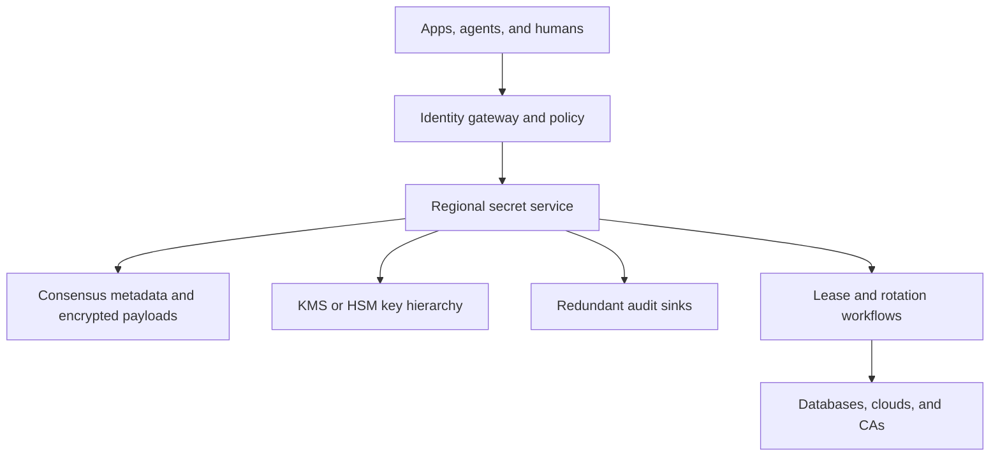

# Design a Global Secrets Management and Dynamic Credential Service

**Difficulty:** Senior / Staff-level  
**Primary themes:** security infrastructure, envelope encryption, identity, consistency, caching, queues, rotation workflows, lease revocation, auditability, and regional reliability

> **Interview timing vs. this walkthrough:** In a 45-minute interview, spend roughly 5 minutes on requirements, 2 minutes on entities, 5 minutes on interfaces, 10–15 minutes making static secret put/get work end to end, and 10–15 minutes on the most important deep dives. This walkthrough is deliberately longer for study. In the interview, establish the security and consistency contracts before discussing sophisticated rotation or disaster recovery.

This answer follows Hello Interview’s public delivery framework: clarify functional and non-functional requirements, identify core entities and interfaces, build the simplest complete design operation by operation, and reserve time for requirement-driven deep dives. genui{"citation":{"ref":"turn102search29"}} The problem, dialogue, estimates, and architecture below are original.

---

## Interviewer prompt

> Design a multi-tenant global secrets-management service for applications and humans. It should store versioned static secrets, issue short-lived database and cloud credentials, rotate credentials safely, enforce identity-based access, support regional reads, record tamper-evident audits, and recover from failures without exposing plaintext or accepting stale authority.

## Targeted clarifying questions with assumed interviewer answers

**Candidate:** What types of secrets are in scope?

**Interviewer:** Arbitrary key-value secrets up to 64 KiB, database passwords, cloud credentials, API tokens, certificates, and generated dynamic credentials. Large files belong in object storage and may use this service only for encryption keys or references.

**Candidate:** What scale should I design for?

**Interviewer:** 20,000 tenants, 100 million stored secret versions, 2 million peak reads/s globally, 50,000 static writes/s, 100,000 dynamic credential issuances/s, and 5 million active leases.

**Candidate:** What latency and availability targets apply?

**Interviewer:** Regional static reads should be under 20 ms p99 and 99.99% available. Writes, policy changes, and dynamic issuance may take hundreds of milliseconds. Emergency revocation should begin within seconds and be observable.

**Candidate:** Should applications authenticate with stored API keys?

**Interviewer:** Prefer workload identity—such as signed cloud identity, Kubernetes service account, or mutual TLS. Human access uses enterprise SSO plus step-up authentication where policy requires it.

**Candidate:** What consistency is required?

**Interviewer:** A successful write must return a version. The writer can request read-after-write using that version or commit token. Normal cross-region reads may lag briefly, but revocation and policy tightening must fail closed rather than serve known-stale authorization.

**Candidate:** Can a client cache a secret?

**Interviewer:** Yes, but only in memory, with policy-bounded TTL and version metadata. Revocation-sensitive secrets may disable client caching. The platform should support agents or sidecars so applications do not each reinvent this logic.

**Candidate:** What does rotation mean?

**Interviewer:** For stored secrets, create a pending version, update the downstream system, test it, then atomically promote it. For databases, support single-user or alternating-user rotation. Also support dynamic per-client credentials with a TTL and revocation lease.

**Candidate:** Is immediate revocation always possible?

**Interviewer:** Only when the downstream provider supports it. The service must distinguish requested, provider-confirmed, and best-effort revocation. Never claim a credential is invalid merely because its record was deleted locally.

**Candidate:** Are secrets globally writable?

**Interviewer:** Each tenant has a home region for authoritative mutation. Regional replicas serve eligible reads. Disaster recovery can promote another region only with a higher authority epoch and explicit fencing of the old primary.

**Candidate:** What audit requirements apply?

**Interviewer:** Record authentication, authorization decision, secret/version identifiers, operations, leases, rotation steps, and administrative changes. Do not log plaintext secret values. Audit loss must be detectable; privileged operations should fail closed if no durable audit sink is available.

### Scope statement to say aloud

> “I’ll separate a strongly controlled metadata plane from an encrypted secret payload store and external credential providers. Workload identity is authenticated at the edge, policy is evaluated against versioned metadata, and secrets use envelope encryption with keys protected by an HSM-backed KMS. Static reads can use bounded regional replicas and memory caches; policy tightening and revocation use barriers that fail closed. Dynamic credentials are created through provider plugins and tracked by durable leases. Rotation is an idempotent workflow with pending and current versions, tests, rollback, and audit. I’ll deep-dive on key hierarchy, cache consistency and revocation, and reliable rotation plus regional recovery.”

---

## 1. Requirements (~5 minutes)

### Three core functional requirements

1. **Store and retrieve versioned static secrets.** Authenticate, authorize, encrypt, version, read, list metadata, delete, and recover according to retention policy.
2. **Issue and manage dynamic credentials.** Generate provider credentials, return lease metadata, renew within policy, and revoke on request, identity loss, or expiry.
3. **Rotate and govern access.** Run safe external rotation workflows, publish policies, distribute revocations, and provide complete audit and health evidence.

### Quantified non-functional requirements

| Property | Target | Design implication |
|---|---:|---|
| Static reads | 2M/s global peak | Regional serving, versioned cache, batched APIs |
| Static writes | 50K/s | Tenant/home-region partitioning and consensus-backed metadata |
| Dynamic issuance | 100K/s | Provider-specific queues, quotas, and idempotent plugins |
| Stored versions | 100M | Partitioned encrypted blob store and compact metadata indexes |
| Active leases | 5M | Time-bucketed expiry index and distributed revocation workers |
| Read latency | p99 < 20 ms regional | No remote KMS call on every read; protected DEK cache |
| Read availability | 99.99% | Multi-zone clusters and bounded regional replicas |
| Revocation start | Within 5 s p99 | Priority queue and provider circuit visibility |
| Audit durability | No silent gaps | Redundant append-only sinks and sequence reconciliation |
| Plaintext exposure | Memory only, shortest practical lifetime | Envelope encryption and zeroization discipline |

### Consistency, availability, and security contract

- A successful static write returns immutable `secret_version` and `commit_revision` values.
- `CURRENT` is a version pointer changed atomically with metadata; payload versions are immutable.
- A caller requesting `min_revision` receives data at least that new or an explicit lag error—never silent fallback.
- Normal regional reads may be eventually consistent within a bounded lag SLO.
- Policy tightening, identity revocation, and emergency disable create a **deny barrier**. A region that has not applied the barrier cannot serve the affected principal or secret.
- Secret payloads are encrypted with data-encryption keys (DEKs); DEKs are wrapped by key-encryption keys (KEKs) held in KMS/HSM. The database never stores plaintext DEKs.
- Authorization uses authenticated identity plus immutable policy revision, not tenant or role fields supplied in the request body.
- A dynamic credential is valid only according to the downstream provider. The service tracks lease intent and confirmation separately.
- Renewal never extends beyond role maximum TTL, identity validity, policy validity, or provider capability.
- Rotation promotes a version only after downstream update and validation succeed. Retries reuse one rotation and step ID.
- Audit records never contain plaintext secrets. Security-sensitive success is acknowledged only after a durable audit record reaches at least one independent sink.
- During uncertainty over authority or key availability, the service fails closed. Availability does not outrank preventing unauthorized disclosure.

HashiCorp Vault similarly associates dynamic secrets with leases containing TTL and renewability, and revocation invalidates the downstream credential when the provider supports it. genui{"citation":{"ref":"turn102search0"}}

### Out of scope

- General object storage for large documents
- End-user password hashing and login databases
- Designing a cryptographic primitive
- Making an external provider more available than it is
- Guaranteed instantaneous invalidation of already-open database sessions
- Full PKI internals beyond issuing and rotating certificate material
- Storing secrets in source control or build logs

### Scale estimates that change the design

At 2 million reads/s with an average 2 KiB encrypted payload and metadata:

```text
2M × 2 KiB ≈ 4 GiB/s of payload before protocol overhead
```

Routing every read to one region or KMS is infeasible. We need regional replicas, batching, locally cached policy snapshots, and a small protected DEK cache. Secret values themselves may be cached only under explicit policy.

Suppose each of 100 million versions averages 4 KiB after ciphertext, wrapped DEK, tags, and metadata:

```text
100M × 4 KiB ≈ 381 GiB raw
```

Even with replication and indexes this is not a petabyte problem. Security, audit, access patterns, and write correctness matter more than exotic storage compression.

Five million active leases with an average 1 KiB record consume roughly 5 GiB raw, but expiration scanning is the real challenge. A full scan every second is impossible. Time-bucketed expiry indexes and a durable delay queue make expiry proportional to leases due now.

At 100,000 credential issuances/s, if a provider call takes 200 ms on average:

```text
100,000 × 0.2 s = 20,000 concurrent provider operations
```

Provider pools, per-role rate limits, queues, circuit breakers, and backpressure are mandatory. One slow database must not exhaust issuance capacity for unrelated tenants.

If a client fleet of one million instances refreshes a 10-minute cached secret simultaneously, that is a 1.67K/s baseline but potentially a 1M-request spike at the boundary. Refresh jitter, singleflight inside agents, and stale-within-policy fallback prevent a thundering herd.

**What to say aloud:**

> “The raw storage footprint is modest, but the read and provider-call rates drive the design. Two million reads per second rules out a KMS call per read. One hundred thousand dynamic issuances with 200-millisecond providers implies about 20,000 concurrent external operations, so provider isolation and backpressure matter. Five million leases require time-bucketed expiry, not scanning the lease table.”

---

## 2. Core entities (~2 minutes)

| Entity | Essential fields |
|---|---|
| `Tenant` | ID, home region, residency policy, KEK reference, status |
| `Principal` | Workload/human identity, issuer, subject, groups, assurance level |
| `Secret` | Stable ID, path, owner, labels, policy binding, current version |
| `SecretVersion` | Version, ciphertext, wrapped DEK, nonce/tag, KEK version, state |
| `PolicyVersion` | Rules, subjects, resources, actions, conditions, revision |
| `Role` | Provider, permitted parameters, TTL limits, rotation/revocation policy |
| `Lease` | ID, principal, credential reference, issue/expiry time, renewable, state |
| `ProviderConnection` | Plugin, endpoint, auth reference, health, rate limits |
| `Rotation` | ID, secret, candidate version, strategy, step state, deadline |
| `RevocationBarrier` | Scope, revision, reason, issued time, regional acknowledgments |
| `AuditEvent` | Sequence, request ID, actor, decision, resource ID, operation, outcome |
| `RegionEpoch` | Tenant, authoritative region, monotonic epoch, fence status |

The ciphertext and wrapped DEK belong to the immutable `SecretVersion`. The mutable `Secret` row contains the `CURRENT` pointer and lifecycle metadata. This separation makes retries and rotation promotion much safer.

---

## 3. API and system interface (~5 minutes)

Identity is derived from the authenticated channel. Tenant, principal, groups, and assurance level are not accepted as caller-controlled request fields.

### 3.1 Create or update a static secret

```http
POST /v1/secrets/payments/prod/db
Authorization: Bearer <workload-or-human-token>
Idempotency-Key: deploy-882-db-secret
If-Match: "current-version-41"
Content-Type: application/json

{
  "value":{"username":"payments_app","password":"<redacted>"},
  "labels":{"service":"payments","environment":"prod"},
  "cache_policy":{"max_ttl_s":60,"revocation_sensitive":true}
}
```

```json
{
  "secret_id":"sec_7a9",
  "version":42,
  "state":"CURRENT",
  "commit_revision":991827,
  "created_at":"2026-10-15T09:55:12Z"
}
```

The value is never echoed. `If-Match` prevents a stale deployment from overwriting a newer version. Reusing the idempotency key with different plaintext hash or metadata returns `409`.

### 3.2 Read a static secret

```http
GET /v1/secrets/payments/prod/db?version=CURRENT&min_revision=991827
Authorization: Bearer <payments-workload-token>
X-Request-Purpose: startup
```

```json
{
  "secret_id":"sec_7a9",
  "version":42,
  "value":{"username":"payments_app","password":"<redacted>"},
  "served_revision":991901,
  "cache_control":{"max_age_s":60,"must_revalidate_on_barrier":true}
}
```

The server derives tenant and policy context from authentication. For batching, `POST /v1/secrets:batchRead` accepts stable paths/versions and returns independent per-item decisions without revealing whether unauthorized paths exist.

### 3.3 Issue a dynamic database credential

```http
POST /v1/roles/payments-readonly:issue
Authorization: Bearer <payments-workload-token>
Idempotency-Key: pod-7-start-019
Content-Type: application/json

{
  "requested_ttl_s":900,
  "context":{"database":"orders","region":"us-east"}
}
```

```json
{
  "lease_id":"lease_b81",
  "credentials":{"username":"v_pay_8f2","password":"<redacted>"},
  "issued_at":"2026-10-15T09:56:01Z",
  "expires_at":"2026-10-15T10:11:01Z",
  "renewable":true,
  "max_expires_at":"2026-10-15T10:56:01Z",
  "provider_status":"CONFIRMED"
}
```

Issuance success means the provider confirmed credential creation and a durable lease plus audit event exists.

### 3.4 Renew or revoke a lease

```http
POST /v1/leases/lease_b81:renew
Authorization: Bearer <payments-workload-token>
Content-Type: application/json

{"increment_s":900}
```

```http
POST /v1/leases/lease_b81:revoke
Authorization: Bearer <payments-workload-token>
Idempotency-Key: shutdown-pod-7
```

```json
{
  "lease_id":"lease_b81",
  "state":"REVOKED",
  "provider_status":"CONFIRMED",
  "effective_at":"2026-10-15T10:03:17Z"
}
```

If the provider is unreachable, the lease may be `REVOKE_PENDING`. The credential is denied for renewal and local reissue, but the response does not claim downstream invalidation.

### 3.5 Configure and trigger rotation

```http
PUT /v1/secrets/payments/prod/db/rotation
Authorization: Bearer <security-admin-token>
Content-Type: application/json

{
  "strategy":"ALTERNATING_USERS",
  "schedule":"0 2 * * *",
  "window_s":3600,
  "provider_connection":"orders-prod",
  "validation":{"type":"SQL","query":"SELECT 1"}
}
```

```http
POST /v1/secrets/payments/prod/db:rotate
Authorization: Bearer <security-admin-token>
Idempotency-Key: emergency-rotation-20261015
```

```json
{"rotation_id":"rot_122","state":"QUEUED","current_version":42}
```

AWS documents single-user and alternating-user rotation; alternating users keep one valid credential while the other is changed, improving availability during rotation. genui{"citation":{"ref":"turn103search0"}}

### 3.6 Emergency deny and health

```http
POST /v1/revocation-barriers
Authorization: Bearer <incident-commander-token>
Content-Type: application/json

{
  "scope":{"secret_prefix":"payments/prod/"},
  "reason":"suspected workload compromise",
  "actions":["DENY_READ","REVOKE_DYNAMIC_LEASES"]
}
```

```json
{
  "barrier_revision":992144,
  "state":"PROPAGATING",
  "regions_acknowledged":2,
  "regions_total":4
}
```

### Important errors

| Error | Meaning |
|---|---|
| `ACCESS_DENIED` | Identity/policy rejected the operation |
| `STALE_POLICY_REGION` | Region has not applied the required deny/policy revision |
| `MIN_REVISION_UNAVAILABLE` | Local replica cannot satisfy read-after-write |
| `SEALED` | Cryptographic barrier cannot be opened |
| `PROVIDER_UNAVAILABLE` | Credential provider cannot safely issue/rotate/revoke |
| `LEASE_NOT_RENEWABLE` | Lease, policy, identity, or provider forbids extension |
| `ROTATION_CONFLICT` | Another rotation or manual update changed the target |
| `AUDIT_UNAVAILABLE` | Required durable audit acknowledgment cannot be obtained |
| `409` | Idempotency key or optimistic version conflict |

---

## 4. Data flow

### Static secret write

1. Gateway validates workload or human identity and request size.
2. Authorization engine evaluates action, path, labels, conditions, and policy revision.
3. Secret service checks idempotency and optimistic `If-Match` version.
4. Crypto service generates a random DEK, encrypts plaintext locally with authenticated encryption, and wraps the DEK with the tenant KEK in KMS/HSM.
5. Transaction stores immutable version metadata/ciphertext and atomically advances `CURRENT`.
6. Audit event is durably acknowledged; the service returns version and commit revision.
7. Replication stream distributes metadata, ciphertext, and cache invalidation. It never distributes plaintext.

### Static secret read

1. Gateway authenticates and checks the latest applicable deny barrier.
2. Policy engine evaluates authorization from a signed local policy snapshot.
3. Read router selects a regional replica meeting `min_revision` or forwards to the home region.
4. Service loads encrypted version and unwraps its DEK using a protected short-lived cache or KMS/HSM.
5. Ciphertext is authenticated and decrypted only in process memory.
6. Response is audit-logged, returned over mTLS, and carries version/cache instructions.
7. Buffers are zeroized or released through a secrets-aware allocator as soon as practical.

### Dynamic credential issuance

1. Authorize the role, requested context, TTL, quota, and identity lifetime.
2. Create a durable issuance operation with idempotency key.
3. Dispatch to a provider-isolated queue and plugin worker.
4. Plugin creates a least-privilege downstream principal/credential with a stable external operation tag.
5. Persist encrypted credentials, lease, provider reference, expiry bucket, and audit event.
6. Return plaintext once. Subsequent reads, if permitted, are separately authorized and audited.
7. Expiry/revocation workers call the provider until confirmed or a terminal provider-specific result occurs.

### Rotation

1. Scheduler creates one rotation workflow inside the permitted window.
2. Generate a candidate secret version in `PENDING` state.
3. Apply candidate to the downstream system using an idempotent step ID.
4. Validate authentication and least-privilege behavior.
5. Atomically move version labels/pointer: candidate becomes `CURRENT`; old becomes `PREVIOUS`.
6. Publish invalidation and wait according to overlap policy.
7. Disable/revoke old credentials, verify, and mark rotation complete.
8. On failure, retain old `CURRENT`, mark candidate failed, and run compensating cleanup.

---

## 5. High-level design (~10–15 minutes)

### Compact architecture



### Operation 1: store one encrypted secret

Begin with a single-region service and transactional database. Authenticate the caller, authorize `write`, encrypt the value, store `(path, version, ciphertext)`, and return the version. A read authorizes `read`, decrypts, audits, and returns over TLS.

This proves the basic contract, but placing a master encryption key in application configuration would make database compromise plus host compromise catastrophic. We need a key hierarchy.

### Operation 2: envelope encryption

For every secret version:

```text
DEK = random 256-bit key
ciphertext = AEAD_Encrypt(DEK, plaintext, associated_data)
wrapped_DEK = KMS_Encrypt(tenant_KEK_version, DEK)
store ciphertext + wrapped_DEK + nonce/tag + KEK version
```

Associated data binds tenant ID, secret ID, version, algorithm, and schema. Swapping ciphertext between rows then fails authentication.

Google Cloud’s envelope-encryption guidance describes generating a DEK locally, encrypting data with it, wrapping the DEK with a KMS-held KEK, and never storing the plaintext DEK. genui{"citation":{"ref":"turn102search1"}}

### Operation 3: split metadata from payload access

The metadata plane stores secret paths, labels, versions, policies, roles, leases, rotation state, and audit sequence. The payload store contains encrypted blobs and wrapped DEKs. Listing APIs return metadata only and require separate permission; they never decrypt values.

Use stable opaque secret IDs internally. Paths can be renamed by metadata without re-encrypting payload, while associated data uses immutable IDs rather than mutable display paths.

### Operation 4: identity-derived authorization

Gateway validates an external identity assertion and converts it into an internal principal context:

```text
issuer, subject, tenant, groups, workload attributes,
assurance level, issued time, expiry, token/session ID
```

Policy rules bind subjects to resource selectors, actions, conditions, and TTL/cache limits. Deny wins. Human reads of production secrets may require MFA and an approved reason/ticket. Workloads receive only roles needed by their service/environment.

Serving nodes cache signed immutable policy snapshots. They never invent access when the policy service is unavailable; expired snapshots fail closed.

### Operation 5: versioned regional reads

Partition tenants by home region and secret ID. The home region owns mutations through a consensus-backed metadata group. Replication streams immutable versions and ordered pointer/policy changes to read regions.

Each replica exposes `applied_revision`. Normal reads use the local replica. A `min_revision` read waits briefly, forwards home, or fails explicitly. This gives low latency without claiming global linearizability.

### Operation 6: cache carefully

Use several different caches because their risks differ:

| Cache | Key | Typical TTL | Invalidation sensitivity |
|---|---|---:|---|
| Metadata | Secret ID + revision | Minutes | Pointer/policy changes |
| Policy snapshot | Tenant + policy revision | Minutes | Deny barrier |
| Unwrapped DEK | KEK version + wrapped-DEK hash | Seconds/minutes | KEK disable/compromise |
| Plaintext server cache | Secret/version | Usually disabled or seconds | Secret revoke/rotation |
| Client agent | Secret/version/principal | Policy-bounded | Barrier and max age |

Never persist plaintext to disk. Prevent core dumps, swap where possible, debug endpoints, tracing bodies, and exception serialization from capturing secret material.

### Operation 7: dynamic credentials and leases

A role defines provider connection, credential template, permissions, default/max TTL, renewability, and revocation procedure. Issuance workers use narrowly scoped provider-admin credentials stored behind a more restrictive policy.

The lease state machine is:

```text
ISSUING → ACTIVE → RENEWING → ACTIVE
                 → REVOKE_PENDING → REVOKED
                 → EXPIRED_UNCONFIRMED
```

Do not mark `ACTIVE` before provider confirmation. Do not mark `REVOKED` before confirmed invalidation unless the provider’s documented semantics make expiry authoritative.

### Operation 8: expiration queue

Index leases by expiry minute plus shard:

```text
bucket = floor(expires_at / 60s)
partition = hash(lease_id) mod N
```

Workers claim due buckets under leases, verify current lease version, and enqueue revocation. This is at-least-once, so provider calls use stable external operation tags and state comparison. A reconciliation scan covers missed or stuck records without scanning everything frequently.

### Operation 9: rotation workflow

Rotation is not “replace a database row.” It spans the secret service and an external system, so use a durable saga/state machine. Each step stores intent, attempt number, provider response hash, and deadline before proceeding.

For alternating database users, update the inactive identity, validate it, promote it, allow overlap, then disable the old identity. For single-user rotation, coordinate a smaller overlap or application reconnect window. AWS describes alternating users as the higher-availability choice because one credential remains valid during update. genui{"citation":{"ref":"turn103search6"}}

### Operation 10: audit as a security dependency

Create structured audit events before returning security-sensitive outcomes. Send to two independent append-only sinks—such as a local durable log and remote compliance stream—with hash chaining and monotonically scoped sequence numbers.

At least one sink must acknowledge. Later reconciliation compares sequences across sinks. Vault’s audit design similarly records API requests/responses and refuses corresponding service when no enabled audit device can persist an event; its guidance recommends multiple audit devices. genui{"citation":{"ref":"turn103search2"}}

---

## 6. Deep dives (~10–15 minutes)

### Deep dive A: key hierarchy, sealing, and cryptographic lifecycle

#### Where the baseline breaks

A single database encryption key in an environment variable makes rotation disruptive and turns application compromise into full-store compromise. Calling KMS for every read misses latency and availability targets. Caching an unwrapped root key forever weakens the security boundary.

#### Key hierarchy

Use layers:

```text
HSM/KMS root protection
  └── tenant KEK versions
       └── per-secret-version DEKs
            └── encrypted secret payload
```

- KMS/HSM enforces key use and produces independent audit.
- Tenant KEKs limit blast radius and support residency/deletion.
- Random DEKs isolate payloads and allow parallel encryption.
- KEK rotation rewraps DEKs without decrypting every payload value.

#### Encrypt/decrypt details

Use an approved authenticated-encryption library, not custom crypto. Record algorithm and key versions. Generate nonces according to the algorithm’s uniqueness rules. Associated data includes immutable context. Verify authentication before releasing plaintext.

Ciphertext storage can be replicated widely because confidentiality rests on KEK access, but metadata still reveals names, access patterns, and sizes; protect and minimize it.

#### DEK cache options

| Approach | Latency | Risk/availability tradeoff |
|---|---:|---|
| KMS unwrap every read | Highest | Strong centralized control; KMS bottleneck |
| Cache unwrapped DEK briefly | Low | In-memory exposure and revocation delay |
| Cache only wrapped DEK | Medium/high | Little latency benefit for unwrap |
| Regional crypto proxy/HSM | Low/medium | More infrastructure and trust boundary |

Choose a small, encrypted-memory or locked-memory DEK cache with seconds-to-minutes TTL, entry/byte limits, and no persistence. Cache keys include KEK version and wrapped-DEK hash. Emergency KEK disable flushes matching entries through a barrier; nodes that have not applied the barrier stop serving.

#### Seal/unseal

On startup, a node is **sealed**: it can expose health but cannot decrypt protected key material. Auto-unseal asks an external KMS/HSM to unwrap the storage/keyring root. Manual quorum recovery can exist for catastrophic cases.

Vault’s documented seal model similarly protects the keyring/root with a seal and can use cloud KMS or HSM for unsealing. genui{"citation":{"refs":["turn103search4","turn103search39"]}}

Avoid automatic fail-open when KMS is unavailable. Existing nodes may continue only while explicitly permitted cached key material remains valid. New nodes stay sealed.

#### KEK rotation

1. create and activate a new KEK version for new writes;
2. enqueue all older wrapped DEKs for rewrap;
3. KMS unwraps with old KEK and wraps with new KEK inside trusted crypto workers;
4. atomically replace wrapped-DEK metadata with optimistic version check;
5. verify coverage through inventory/checksums;
6. disable old decrypt only after retention, replica, backup, and rollback checks;
7. destroy old material only under explicit cryptographic-erasure policy.

This is an online migration. Reads accept both key versions during transition.

#### Backup and restore

Backups contain ciphertext, wrapped DEKs, metadata, policies, and audit checkpoints—not plaintext keys. A restore is useless without authorized KMS/HSM recovery, which is a feature, not a bug.

Restoring old metadata can resurrect revoked policy or secret pointers. Restore into a higher recovery epoch, keep external issuance disabled, reconcile policies/barriers/leases/providers, and require explicit activation before serving.

#### Observability

- KMS/HSM latency, errors, throttling, and authorization failures
- DEK cache hit rate, age, evictions, and emergency flush completion
- sealed/unsealed nodes and unexpected seal events
- ciphertext authentication failures—security alert
- KEK rewrap coverage, backlog, and old-version reads
- key-access audit mismatch between service and KMS
- plaintext-buffer lifetime and secret-bearing crash prevention checks

**What to say aloud:**

> “Each secret version gets a random DEK; the payload is AEAD-encrypted with immutable context as associated data, and the DEK is wrapped by a tenant KEK held in KMS or HSM. I cache unwrapped DEKs only briefly in protected memory because a KMS call per read cannot meet two million reads per second. KEK rotation rewraps DEKs online; it does not decrypt every payload. Nodes start sealed and never fail open when key authority is uncertain.”

### Deep dive B: cache consistency, policy tightening, and revocation

#### Where the baseline breaks

Regional replicas and caches improve availability but can serve a secret after access was revoked. Deleting ciphertext does not erase a plaintext value already cached by an application. Normal eventual consistency is therefore insufficient for deny changes.

#### Classify changes by safety

| Change | Safe behavior under lag |
|---|---|
| Add a secret version | Old version may remain visible within freshness SLO |
| Promote rotation candidate | Old current may remain valid during defined overlap |
| Grant new access | Lag may temporarily deny—safe |
| Tighten/revoke access | Lag must not permit—deny barrier required |
| Emergency disable secret | All unacknowledged regions fail closed |
| Delete old version | Cache may retain only through prior explicit TTL |

This asymmetric rule is important: stale grants are dangerous; stale denials are inconvenient but safe.

#### Deny barrier protocol

1. Authoritative region commits a monotonically increasing barrier revision and scope.
2. A high-priority stream sends it to every serving region and client-agent control channel.
3. Regional gateways persist and apply the barrier before acknowledging.
4. Requests matching the scope require `local_barrier_revision >= required_revision`.
5. A disconnected or lagging region denies matching reads.
6. Servers flush relevant plaintext/DEK/authorization cache entries.
7. Agents erase cached plaintext or stop returning it and acknowledge where supported.

The system cannot claw back a value copied into arbitrary application memory. The contract is bounded exposure: short cache TTL, agents, dynamic credentials, downstream revocation, and rapid deny propagation reduce the window.

#### Read-after-write

Writers receive `commit_revision`. A deployment that immediately reads the new secret supplies it as `min_revision`. The router:

- serves locally if applied revision is sufficient;
- waits a small bounded interval;
- forwards to the tenant home region;
- otherwise returns `MIN_REVISION_UNAVAILABLE`.

It never silently serves the older `CURRENT` pointer.

Vault documents that performance replicas/standbys may be eventually consistent because writes are log-shipped; some read-after-write sequences therefore need explicit consistency handling. genui{"citation":{"ref":"turn103search9"}}

#### Client-agent cache

Provide a local sidecar/daemon that:

- authenticates via workload identity and renews its own session;
- fetches and caches versioned values only in memory;
- singleflights concurrent misses;
- refreshes at a jittered fraction of TTL;
- exposes file/socket delivery with restrictive permissions;
- watches barrier/version notifications;
- reports version and age metrics without values;
- erases entries when identity expires or policy/barrier changes.

The agent never returns stale beyond server-issued `max_age`, even if the server is down. For high-risk secrets, `max_age=0` forces online authorization.

#### Thundering herd and overload

- randomize refresh between 50–80% of TTL;
- coalesce by secret/version/principal;
- return immutable version for a whole deployment generation;
- use request quotas and exponential backoff;
- protect authorization/barrier traffic over ordinary refresh;
- allow stale only when the original policy explicitly authorized a stale window.

#### Regional failover

DNS or load-balancer switching is not enough. A new authoritative region needs a higher `RegionEpoch`. External fencing prevents the old region from committing metadata, issuing credentials, or completing rotation.

If fencing cannot be proved, remain read-only or unavailable for mutations. Existing regional reads continue only when policy/barrier/key snapshots remain valid and residency rules permit them.

#### Observability

- replication lag by revision and secret class
- barrier commit-to-apply p50/p95/p99 by region
- requests denied due to stale policy/barrier
- cache hit ratio, entry age, and plaintext cache footprint
- `min_revision` waits, forwards, and failures
- agent refresh jitter distribution and singleflight effectiveness
- stale-within-policy serves during outage
- regional epoch and stale-writer rejection events

**What to say aloud:**

> “I allow bounded eventual consistency for ordinary version publication, but not for access revocation. Policy tightening creates a deny barrier with a revision. Any region that has not durably applied the relevant barrier refuses the read and flushes matching caches. Read-after-write uses the write revision. Client agents cache only in memory for a server-bounded TTL and refresh with jitter; we cannot retract bytes already copied by arbitrary application code, so short leases and downstream revocation limit exposure.”

### Deep dive C: reliable issuance, rotation, audit, and recovery

#### Where the baseline breaks

Credential creation and rotation span our database plus an external provider, so there is no shared transaction. A timeout may mean the provider succeeded but the response was lost. Retrying naïvely creates duplicate users. Promoting before testing causes outages. Failing to audit a privileged read creates an invisible security gap.

#### Provider plugin contract

Plugins run in isolated workers with:

- narrow network egress and provider-admin permission;
- typed create/renew/revoke/test operations;
- stable external idempotency tag;
- deadlines, rate limits, and circuit breaker;
- redacted structured logs;
- declared capabilities and revocation semantics;
- versioned configuration and rollout.

Provider-admin secrets are never exposed to the requesting client or general secret workers.

#### Idempotent dynamic issuance

Store operation intent before calling the provider:

```text
operation_id, role, principal, desired TTL,
external tag, state=CREATING, attempt, deadline
```

On timeout, query the provider by external tag before retrying. When provider lookup is impossible, use deterministic names plus conflict-safe create, then reconcile. Persist the credential encrypted and activate its lease before returning plaintext.

If persistence fails after provider success, a compensating worker revokes the orphan using the external tag. Reconciliation continuously compares provider-tagged principals with local operations.

#### Lease renewal

Renew only if:

```text
now < current expiry
identity/session still valid
policy still authorizes role
new expiry <= role max expiry
provider confirms extension or credential semantics permit it
```

Renew early, not at the deadline. A client that cannot confirm renewal stops using the credential before expiry. Open database connections may outlive password invalidation, so provider/session termination semantics must be documented separately.

#### Rotation saga

```text
SCHEDULED
→ CANDIDATE_CREATED
→ PROVIDER_UPDATED
→ VALIDATED
→ PROMOTED
→ OLD_DISABLED
→ COMPLETED
```

Every transition is conditional on the expected prior state and has a stable step ID. A controller restart resumes rather than restarts. The old version remains current until validation. After promotion, rollback depends on whether the provider still accepts the previous credential.

#### Strategy comparison

| Strategy | Availability | Security/complexity |
|---|---|---|
| Single-user in-place | Potential reconnect window | Simpler; least overlap |
| Alternating users | High; old user stays valid during validation | Two identities and admin clone permissions |
| Dynamic per-client | Short blast radius, automatic expiry | High provider operation rate |
| Dual credential set | Smooth application migration | Longer overlap and cleanup discipline |

Choose dynamic credentials for capable high-value systems. Use alternating users for long-lived application credentials requiring continuous availability. Use single-user only when provider constraints and downtime/reconnect tolerance permit it.

#### Revocation backlog

Expiry is a workflow, not a local delete. Prioritize emergency revocations over routine expiry, but reserve capacity so routine backlog cannot grow without bound. Per-provider queues prevent one outage from blocking others.

States distinguish:

- `REVOKED_CONFIRMED`;
- `EXPIRED_PROVIDER_ENFORCED`;
- `REVOKE_PENDING`;
- `IRREVOCABLE` with risk escalation.

Alert on credentials older than intended maximum lifetime even if the lease record says expired.

#### Audit pipeline

Audit event content:

```text
tenant, sequence, request_id, timestamp,
authenticated principal and issuer,
policy revision and decision reason,
secret/role/lease IDs, version, operation,
region/node, outcome, error class,
hashes of sensitive fields—not plaintext
```

Hash-chain events per tenant/shard and periodically anchor roots in an independent immutable store. Use two sinks. If all required sinks fail, deny privileged operations. For extremely high read availability, policy may allow a short bounded local durable spool—but never silent dropping.

#### Disaster recovery

Back up encrypted state, workflow records, audit anchors, and key references. Test restore regularly. During regional promotion:

1. fence the old authority externally;
2. allocate a higher regional epoch;
3. verify metadata, policy, barriers, audit sequence, and KMS access;
4. keep provider-changing workflows paused;
5. reconcile active leases and rotations with providers;
6. resume issuance per provider only after ownership is proven;
7. force rotation of privileged credentials if compromise is suspected.

HashiCorp’s recommended patterns similarly distinguish intra-cluster high availability from disaster-recovery replication for cluster-wide failures. genui{"citation":{"ref":"turn103search22"}}

#### Observability

- issuance latency and success by provider/role
- provider rate limit, timeout, and circuit state
- duplicate/orphan credentials discovered and removed
- active leases, due buckets, revocation backlog, oldest pending age
- rotation duration by step and failure/rollback rate
- credentials exceeding intended max age
- audit sink acknowledgment latency and sequence gaps
- provider versus local reconciliation mismatch
- disaster-recovery reconciliation progress

**What to say aloud:**

> “External credential systems do not share our transaction, so issuance and rotation are durable idempotent workflows. I write intent first, tag provider objects with a stable operation ID, query after ambiguous timeouts, and compensate or reconcile orphans. Rotation keeps the old version current until the candidate works, then atomically promotes and later disables the old credential. Audit is part of the success path, not best-effort telemetry.”

---

## 7. Finish

### Concise final design

The service uses a home-region authoritative control plane for each tenant and bounded-lag regional read replicas. Gateways authenticate workload or human identity and build immutable principal context. A versioned policy engine authorizes actions, while high-priority deny barriers make policy tightening and emergency disable fail closed across regions.

Static secret values are immutable versions encrypted with per-version DEKs. Tenant KEKs in KMS/HSM wrap those DEKs; associated data binds ciphertext to tenant, secret, and version. The database stores ciphertext, wrapped DEKs, metadata, and an atomic `CURRENT` pointer—never plaintext keys. Regional services use short-lived protected DEK caches and optional policy-bounded plaintext/client-agent caches to meet latency without a KMS operation per read.

Dynamic credential roles map identity to provider-specific least-privilege templates and TTL limits. Provider-isolated workers create, renew, test, and revoke credentials through durable idempotent operations. Leases live in time-bucketed expiry indexes, and reconciliation finds ambiguous, orphaned, or overdue provider credentials.

Rotation is a saga: create a pending version, update the downstream provider, validate it, atomically promote it, allow controlled overlap, then disable the previous credential. Alternating users or dynamic credentials provide high availability where supported. Static version publication may be eventually consistent within bounds, but deny barriers, minimum revisions, authority epochs, and provider confirmation protect sensitive transitions.

Every security-sensitive request produces a redacted structured audit record to redundant append-only sinks with sequence and hash-chain verification. Disaster recovery fences the old region, promotes with a higher epoch, validates KMS/policy/audit state, and reconciles leases and rotations before provider-changing work resumes.

### Requirements check

| Requirement | Design support |
|---|---|
| Versioned static secrets | Immutable encrypted versions and atomic current pointer |
| 2M reads/s | Regional replicas, batching, policy and DEK caches |
| p99 under 20 ms | No remote KMS call on every read |
| Identity-based access | Workload identity, SSO/MFA, versioned policy |
| Read-after-write | Commit revision and `min_revision` routing |
| Safe revocation | Deny barriers and fail-closed lag behavior |
| Dynamic credentials | Provider plugins, durable operations, leases |
| Lease expiry | Time-bucketed queues and reconciliation |
| Reliable rotation | Candidate/test/promote/disable saga |
| High-availability rotation | Alternating users or dynamic credentials |
| Encryption at rest | Per-version DEK and KMS/HSM-wrapped KEK hierarchy |
| Key rotation | Online DEK rewrap migration |
| Regional recovery | External fencing and monotonic region epoch |
| Auditability | Redundant append-only sinks and sequence verification |
| Tenant isolation | Per-tenant keys, partitions, quotas, and provider pools |

## Realistic interviewer follow-up questions with strong sample answers

**Interviewer:** Why not encrypt every secret directly with KMS?

**Candidate:** KMS payload limits, latency, throughput, cost, and availability make it unsuitable for millions of direct reads per second. Envelope encryption uses local random DEKs for data and KMS-held KEKs for centralized control.

**Interviewer:** Why one DEK per secret version?

**Candidate:** It limits blast radius, gives independent authenticated ciphertext, supports immutable versions, and lets us rotate KEKs by rewrapping small DEKs rather than decrypting every payload.

**Interviewer:** What is associated data?

**Candidate:** Non-secret context authenticated with the ciphertext—tenant ID, immutable secret ID, version, and algorithm. It prevents a valid ciphertext from being moved to another record undetected.

**Interviewer:** Where is plaintext present?

**Candidate:** Only in controlled process or agent memory during encryption, decryption, or permitted caching. Never in databases, durable queues, logs, traces, crash dumps, or audit records.

**Interviewer:** How do you meet 20 ms if KMS is slow?

**Candidate:** Cache unwrapped DEKs briefly in protected bounded memory, cache immutable metadata, and serve from regional replicas. Emergency KEK barriers flush caches and make unacknowledged nodes fail closed.

**Interviewer:** What happens if KMS is unavailable?

**Candidate:** Existing nodes may use explicitly valid cached DEKs until their security TTL ends. Cache misses and new nodes fail closed or remain sealed. We do not bypass the key authority.

**Interviewer:** How do you rotate a KEK?

**Candidate:** Activate a new KEK for writes, asynchronously unwrap old DEKs and rewrap them with the new KEK, verify coverage across replicas/backups, then disable and eventually destroy the old version under policy.

**Interviewer:** How does read-after-write work across regions?

**Candidate:** A write returns a commit revision. The read supplies `min_revision`; the local region serves only after reaching it, otherwise waits briefly, forwards home, or returns an explicit lag error.

**Interviewer:** Why can normal reads be eventual but revocation cannot?

**Candidate:** Serving an older permitted version may be acceptable within a declared freshness window. Serving after access was removed is a security violation. Tightening creates a deny barrier, and lagging regions refuse affected reads.

**Interviewer:** Can you truly revoke a cached secret?

**Candidate:** Not from arbitrary application memory. We bound exposure through short cache TTLs, managed agents, notifications, dynamic credentials, and downstream revocation. The API must state that limitation honestly.

**Interviewer:** What is a dynamic secret?

**Candidate:** A credential generated on demand for a principal/role—such as a temporary database user—associated with a lease and TTL rather than a long-lived shared password.

**Interviewer:** Can the system promise immediate revocation?

**Candidate:** Only if the provider confirms it and its session semantics support it. We expose confirmed, pending, provider-enforced expiry, and irrevocable states instead of equating a local delete with invalidation.

**Interviewer:** What if issuance times out after the provider created the user?

**Candidate:** We persist intent first and use a stable external operation tag. After timeout we query by tag before retrying. Reconciliation finds and revokes any orphan.

**Interviewer:** Why use alternating database users?

**Candidate:** The inactive user can be updated and tested while the current user remains valid. After promotion and overlap, the old user is disabled. That avoids a credential gap at the cost of two identities and more complex permission parity.

**Interviewer:** How do you avoid a rotation outage?

**Candidate:** Never promote before downstream update and validation. Use idempotent steps, retain the old current credential during overlap, canary where possible, and know whether rollback remains valid after provider mutation.

**Interviewer:** How are five million leases expired?

**Candidate:** Bucket by expiry time and shard, claim only due buckets, enqueue idempotent provider revocations, and run slower reconciliation for missed/stuck leases. Do not scan the entire lease table every second.

**Interviewer:** What happens when audit sinks fail?

**Candidate:** Require at least one durable independent acknowledgment for sensitive operations. With no sink, fail closed. A tightly bounded durable local spool may preserve read availability only if policy explicitly allows it; silent dropping is never acceptable.

**Interviewer:** How do you fail over a region?

**Candidate:** Fence the old authority externally, allocate a higher region epoch, verify replicated metadata/policies/barriers/audit and KMS access, reconcile provider-side leases and rotations, then resume mutation gradually.

**Interviewer:** What would you build first?

**Candidate:** Single-region versioned static secrets, workload identity, policy, envelope encryption, KMS-backed unseal, redundant audit, and basic HA. Then add regional reads and barriers, dynamic database credentials, lease expiry, rotation, and disaster recovery.

## Common pitfalls

1. Describing the system as merely an encrypted key-value store.
2. Storing the master key beside encrypted data.
3. Inventing custom cryptographic algorithms.
4. Encrypting without authentication or associated data.
5. Reusing nonces incorrectly.
6. Storing plaintext DEKs.
7. Sending every read synchronously to KMS.
8. Caching unwrapped keys indefinitely.
9. Persisting plaintext cache entries to disk.
10. Allowing secrets into logs, traces, metrics labels, or crash dumps.
11. Trusting tenant or identity fields from the request body.
12. Treating authentication as sufficient without authorization.
13. Serving with an expired policy snapshot.
14. Applying new grants before policy propagation is complete and calling it a failure.
15. Applying revoked access from a stale replica.
16. Treating ordinary eventual consistency as safe for deny changes.
17. Ignoring read-after-write for deployments.
18. Keying client caches only by path, not version/principal.
19. Claiming cached plaintext can always be retracted.
20. Refreshing every client at the exact TTL boundary.
21. Issuing dynamic credentials before persisting operation intent.
22. Retrying ambiguous provider creates blindly.
23. Marking a credential active before provider confirmation.
24. Marking a credential revoked after only deleting local state.
25. Scanning all leases to find expirations.
26. Renewing beyond identity, policy, role, or provider limits.
27. Assuming password revocation closes existing database sessions.
28. Rotating a stored value without changing the downstream system.
29. Promoting a candidate before testing it.
30. Using non-idempotent rotation steps.
31. Starting concurrent rotations for one secret without fencing.
32. Ignoring single-user rotation downtime.
33. Keeping alternating users active indefinitely.
34. Giving provider plugins broad network or admin access.
35. Letting one failing provider consume every worker.
36. Auditing plaintext request or response bodies.
37. Treating audit as best-effort telemetry.
38. Depending on only one audit sink.
39. Failing over via DNS without fencing the old authority.
40. Restoring old state and immediately resuming issuance without reconciliation.

## A polished 60-second close

> “I use workload identity and versioned policy at the gateway, with a home-region authority per tenant and bounded-lag regional reads. Each immutable secret version is AEAD-encrypted with a random DEK; a tenant KEK held in KMS or HSM wraps that DEK, and immutable context is authenticated as associated data. Short-lived protected DEK caches meet latency, while deny barriers flush caches and force lagging regions to fail closed for policy tightening or emergency disable. Static writes atomically publish a current-version pointer and return a revision for read-after-write. Dynamic credential roles dispatch idempotent provider operations, persist leases in expiry buckets, and distinguish local intent from provider-confirmed revocation. Rotation is a durable saga—create candidate, update provider, validate, promote, overlap, then disable old—with alternating users when availability requires it. Every sensitive request produces a redacted, sequenced audit event to redundant durable sinks. Regional disaster recovery fences the old authority, raises the region epoch, verifies keys, policies, barriers, and audit, and reconciles provider credentials before mutations resume.”

## References

- [Hello Interview: System Design Delivery Framework](https://www.hellointerview.com/learn/system-design/in-a-hurry/delivery)
- [HashiCorp Vault: Lease, Renew, and Revoke](https://developer.hashicorp.com/vault/docs/concepts/lease)
- [HashiCorp Vault: Authentication](https://developer.hashicorp.com/vault/docs/concepts/auth)
- [HashiCorp Vault: Audit Logging](https://developer.hashicorp.com/vault/docs/audit)
- [HashiCorp Vault: Data Consistency in Replication](https://developer.hashicorp.com/vault/docs/enterprise/consistency)
- [HashiCorp Vault: Replication Support](https://developer.hashicorp.com/vault/docs/enterprise/replication)
- [HashiCorp Vault: Sealing Best Practices](https://developer.hashicorp.com/vault/docs/configuration/seal/seal-best-practices)
- [HashiCorp Vault: Recommended Deployment Patterns](https://developer.hashicorp.com/vault/docs/internals/recommended-patterns)
- [AWS Secrets Manager: Rotate Secrets](https://docs.aws.amazon.com/secretsmanager/latest/userguide/rotating-secrets.html)
- [AWS Secrets Manager: Rotation Strategies](https://docs.aws.amazon.com/secretsmanager/latest/userguide/rotation-strategy.html)
- [Google Cloud KMS: Envelope Encryption](https://cloud.google.com/kms/docs/envelope-encryption)
