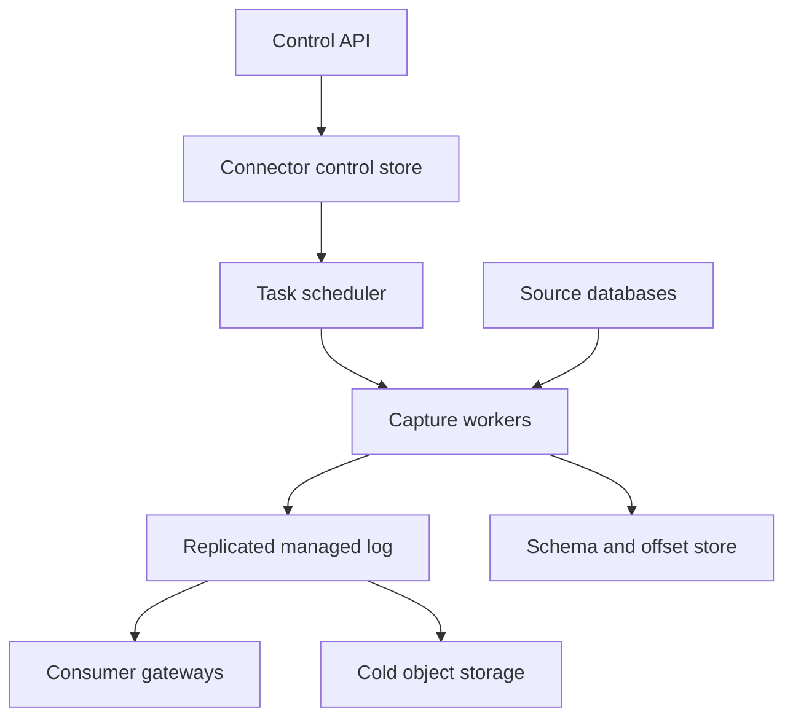
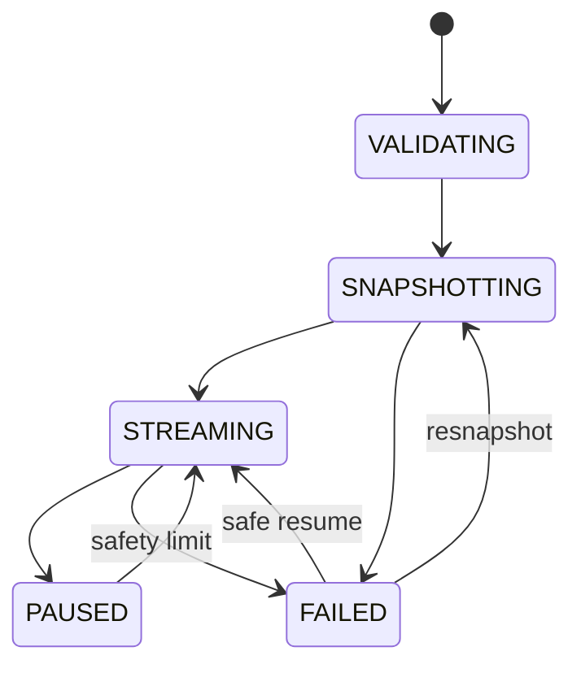

# Design a Managed Change Data Capture Platform

**Difficulty:** Senior / Staff  
**Primary themes:** databases, write-ahead logs, snapshots, streaming, queues, ordering, schema evolution, backpressure, reliability, multi-tenancy  
**Interview time budget:** requirements 5 minutes, entities 2 minutes, interface 5 minutes, high-level design 10–15 minutes, deep dives 10–15 minutes.  
**Learning note:** the explanation is deliberately longer than what you would deliver in a 45-minute interview.

This walkthrough uses Hello Interview’s public [delivery framework](https://www.hellointerview.com/learn/system-design/in-a-hurry/delivery): establish requirements, name the core entities, define the system contract, build a complete design operation by operation, and then deepen the design where scale or correctness breaks the baseline. The walkthrough and dialogue are original.

## Interviewer prompt

> Design a managed change data capture platform. Customers connect production relational databases and select tables. The platform should perform an initial snapshot, continuously capture inserts, updates, deletes, and schema changes, and publish ordered change events to a durable stream that downstream systems can replay. It must avoid losing acknowledged database changes, isolate tenants, recover from worker failures, and protect source databases from runaway replication lag.

## Targeted clarifying questions with assumed answers

**Candidate:** Which databases and destinations should we support?

**Interviewer:** Design for PostgreSQL and MySQL sources. The managed platform exposes its own durable event stream; Kafka, object storage, and warehouse sinks may subscribe later. Focus on the source-to-managed-stream path.

**Candidate:** Do customers need an initial copy of existing rows?

**Interviewer:** Yes. A new capture should produce a consistent initial snapshot and then continue with changes committed during the snapshot, without gaps.

**Candidate:** What ordering is required?

**Interviewer:** Preserve source transaction order per database. Events from one transaction must remain together and ordered. No global order across unrelated databases is required.

**Candidate:** What delivery guarantee should consumers receive?

**Interviewer:** At least once by default. Consumers must be able to deduplicate by stable event identity. Offer an exactly-once effect when a compatible sink can atomically commit output and source offsets, but do not promise it for arbitrary side effects.

**Candidate:** How should schema changes behave?

**Interviewer:** Emit versioned schema events before row changes requiring the new schema. Additive changes should continue automatically. Incompatible changes may pause an affected table according to policy, not silently corrupt data.

**Candidate:** What scale should I use?

**Interviewer:** Support 20,000 active source databases, five million row-change events per second at peak, and 10 TB of encoded change data per day. A single hot source may emit 200,000 events per second.

**Candidate:** What latency and reliability targets matter?

**Interviewer:** For healthy sources, make p99 source-to-stream lag under five seconds. Target 99.99% control-plane availability and 99.95% capture availability. After the source confirms a transaction and our replication position advances, do not lose its events during a single-zone failure.

**Candidate:** What happens if the platform or downstream consumers are slow?

**Interviewer:** Buffer transiently, enforce quotas, and alert. Never allow an abandoned replication slot or unread binlog position to fill a customer’s source disk indefinitely. The platform may pause or fail a connector under an explicit safety policy.

**Candidate:** Are cross-database joins, transformations, and conflict resolution in scope?

**Interviewer:** No. Capture faithful row and schema changes. Lightweight filtering and redaction are in scope; arbitrary stream processing is downstream.

## 1. Requirements (~5 minutes)

### Core functional requirements

1. **Configure and operate a connector** for selected PostgreSQL or MySQL tables, including credentials, filters, redaction, and lifecycle controls.
2. **Bootstrap with a consistent snapshot and transition to log streaming** without missing committed changes or duplicating them beyond the documented at-least-once boundary.
3. **Publish replayable row and schema events** with transaction order, offsets, health, and consumer checkpoints.

### Quantified non-functional requirements

- Support **20,000 active databases**, **5 million change events/s peak**, and **10 TB/day** of encoded change data.
- Keep healthy source-to-stream lag below **5 seconds p99**; expose lag in both time and source-log bytes.
- Provide **99.99% control-plane availability** and **99.95% capture availability**.
- Once the platform reports a durable source position, survive **one availability-zone failure without losing corresponding events**.
- Enforce tenant quotas, encrypted credentials, network isolation, and a bounded **source-log retention safety limit**.

### Scope and consistency contract

The platform reads a database’s ordered replication log—PostgreSQL WAL through logical decoding or MySQL binlog—rather than polling tables by `updated_at`. Polling misses deletes, struggles with transactional boundaries, and adds expensive table scans.

PostgreSQL logical replication decodes WAL changes through a replication slot and output plugin; the official architecture describes a walsender decoding WAL and transforming it into the logical replication protocol ([PostgreSQL logical replication architecture](https://www.postgresql.org/docs/current/logical-replication-architecture.html)). A slot preserves the position needed by a consumer, which is useful for recovery but dangerous if an unhealthy consumer pins unlimited WAL.

The contract is:

- **Snapshot consistency:** rows reflect one database-consistent snapshot position.
- **Streaming order:** events preserve source commit order per database; records inside a transaction carry sequence numbers.
- **Durability:** the connector advances its acknowledged source position only after the full transaction and its offset are durable in the managed stream.
- **Delivery:** managed-stream consumption is at least once. Each event includes a stable source identity and position for deduplication.
- **Schema:** a schema version is durable before row events reference it.
- **Availability:** a source partition has one fenced active reader. During failover, capture pauses rather than allowing two readers to publish conflicting progress.

> **Say aloud:** “I separate source acknowledgement from consumer acknowledgement. The connector may release source WAL once our managed log has durably accepted the transaction; a slow downstream consumer must not pin the customer’s database log.”

### Scale estimates that change the design

Five million events per second at an average encoded size of 2 KB is:

\[
5{,}000{,}000 \times 2\text{ KB} \approx 10\text{ GB/s}
\]

The stated 10 TB/day average is about 116 MB/s, so peak traffic is highly bursty. Capacity planning must use peak partition throughput, while object storage and retention planning can use daily volume.

If events are kept for seven days in the hot managed stream:

\[
10\text{ TB/day} \times 7 = 70\text{ TB}
\]

With replication factor three, that is roughly 210 TB before indexes and compression. We therefore need partitioned append logs, compression, tiering older segments to object storage, and per-tenant retention—not an OLTP row for every change.

At 20,000 connectors, one process per connector wastes memory, but a connector is also stateful and source-specific. If a worker safely multiplexes 50 moderate connectors, the baseline requires about 400 workers, with dedicated tasks for hot sources. Dynamic placement must consider bytes/s and decode CPU, not connector count alone.

A 200,000 events/s source cannot map to one fixed downstream partition if a partition handles only, say, 50,000 events/s. Yet arbitrary sharding can destroy transaction order. The design must either keep a database’s transaction envelope on one ordered control partition while row payloads fan out with sequence metadata, or document per-table/key ordering instead of full-database ordering. Because the interviewer requires database transaction order, I choose an ordered transaction stream that can scale using large batched records and dedicated hot-source partitions; later we will discuss the ceiling.

> **Say aloud:** “The key scale constraint is not just aggregate throughput. The ordering unit determines the maximum throughput of one hot source, so I call that out before choosing the partition key.”

## 2. Core entities (~2 minutes)

| Entity | Purpose |
|---|---|
| **Source** | Database endpoint, engine, network policy, encrypted credential reference, and safety limits |
| **Connector** | Desired and observed capture configuration and lifecycle |
| **CaptureTask** | Fenced runtime ownership of a source partition |
| **SourceOffset** | Engine-specific resume position: PostgreSQL LSN or MySQL binlog file/GTID position |
| **Snapshot** | Snapshot ID, consistent start position, table/chunk progress, and state |
| **ChangeEvent** | Row mutation with source identity, transaction ID, offset, sequence, schema version, and before/after data |
| **SchemaVersion** | Versioned table schema and compatibility metadata |
| **TransactionEnvelope** | Begin/row events/commit boundary and total event count |
| **StreamPartition** | Durable ordered event log and retention unit |
| **ConsumerSubscription** | Authorized stream selection and checkpoint |

## 3. API or system interface (~5 minutes)

Tenant identity comes from authentication. The request references a secret stored in the platform vault; database passwords are never returned through the API.

### Create a connector

```http
POST /v1/connectors
Idempotency-Key: 7707b6c1-4674-4ce8-8535-0fe4df1aa902
Authorization: Bearer <tenant-token>
Content-Type: application/json

{
  "name": "orders-prod",
  "engine": "POSTGRESQL",
  "endpoint": "orders.internal:5432",
  "database": "commerce",
  "credentialRef": "secret://cdc/orders-reader",
  "tables": ["public.orders", "public.order_items"],
  "snapshotMode": "INITIAL_THEN_STREAM",
  "filters": {"excludeColumns": ["public.orders.card_token"]},
  "safety": {
    "maxRetainedWalBytes": 53687091200,
    "maxLagSeconds": 1800
  }
}
```

```json
{
  "connectorId": "con_01K7...",
  "state": "VALIDATING",
  "configVersion": 1
}
```

Creation is asynchronous. Validation checks network reachability, least-privilege permissions, replication settings, table keys, and safety limits before creating a slot or retaining source logs.

### Inspect lifecycle and health

```http
GET /v1/connectors/con_01K7...
```

```json
{
  "state": "STREAMING",
  "sourceOffset": {"lsn": "0/7A12F1B8"},
  "durableOffset": {"lsn": "0/7A12EFC0"},
  "lagSeconds": 1.8,
  "retainedSourceLogBytes": 73400320,
  "snapshot": {"state": "COMPLETED", "progress": 1.0},
  "lastError": null,
  "version": 19
}
```

`sourceOffset` is the newest observed position; `durableOffset` is safe to acknowledge to the source. Their difference is platform capture lag.

### Pause, resume, or delete

```http
POST /v1/connectors/con_01K7.../pause
If-Match: "19"

{"mode":"SAFE","reason":"planned maintenance"}
```

`SAFE` stops after a committed transaction and preserves the replication slot. `RELEASE_SOURCE_LOG` checkpoints what is durable and drops or advances the slot according to policy, making resume require a new snapshot. Deletion is a two-step operation because removing a source slot is destructive.

### Consume changes

```http
POST /v1/subscriptions

{
  "connectorId": "con_01K7...",
  "startPosition": "EARLIEST",
  "tables": ["public.orders"],
  "consumerGroup": "search-indexer"
}
```

Consumers use a streaming protocol or Kafka-compatible endpoint. A row event looks like:

```json
{
  "eventId": "pg:source_7:0/7A12EF88:tx58391:seq4",
  "connectorId": "con_01K7...",
  "table": "public.orders",
  "operation": "UPDATE",
  "transactionId": "58391",
  "transactionSequence": 4,
  "sourceOffset": {"lsn": "0/7A12EF88"},
  "commitTime": "2026-10-15T21:41:12.203Z",
  "schemaVersion": 17,
  "key": {"order_id": 98142},
  "before": {"status": "PENDING"},
  "after": {"status": "PAID"},
  "snapshot": false
}
```

Identity and ACLs are derived from the subscription token. A consumer cannot request another tenant’s connector by changing a body field.

## 4. Data flow

1. The control plane validates access, stores desired connector state, and places a task request.
2. A scheduler leases the connector to a compatible regional worker using an increasing fencing epoch.
3. For initial capture, the worker opens a consistent database snapshot and records the matching WAL/binlog position.
4. Snapshot readers copy tables in resumable primary-key chunks while a log reader buffers changes after the recorded position.
5. After all snapshot chunks are durable, the publisher releases buffered changes in source order and switches to continuous streaming.
6. The decoder groups row changes into transaction envelopes, attaches the schema version, applies filters/redaction, and writes to the durable managed log.
7. Only after the transaction and its source offset commit durably does the connector acknowledge progress to the source.
8. Consumers read independently and checkpoint their managed-log offsets; their lag never controls source WAL retention.

## 5. High-level design (~10–15 minutes)



### Operation 1: create and assign a connector

The control API derives the tenant, validates configuration syntax, stores encrypted secret references, and writes `Connector(desired_state=RUNNING, config_version=1)`. A validator reaches the source through a tenant-approved private network path and verifies:

- engine/version support and TLS identity;
- replication privileges without broad write access;
- WAL/binlog configuration and retention capacity;
- selected tables and stable primary or replica identity;
- expected snapshot size and source read budget;
- redaction/filter rules and schema compatibility policy.

Only after validation may a worker create or adopt a replication slot. The scheduler assigns connectors by region, engine, decode CPU, bytes/s, and tenant quota. A lease contains `(task_id, owner_epoch, expires_at)`. Every offset update and publication includes the epoch so a paused former worker cannot advance state after reassignment.

Hot sources receive dedicated tasks; small connectors share workers but keep isolated memory and flow-control budgets. A control-plane outage does not stop healthy tasks: workers renew leases against a replicated ownership service and continue using the last valid signed configuration.

### Operation 2: take a consistent snapshot

A naive “scan tables, then start WAL” has a gap: transactions committed during the scan can be missed. “Start WAL, then scan” avoids gaps but creates duplicates unless snapshot rows and buffered changes have a defined handoff.

For PostgreSQL, the coordinator creates/uses a logical slot and opens an exported consistent snapshot tied to a starting LSN. Snapshot readers use that database snapshot while the log reader retains changes from the start position. For MySQL, use a consistent transaction plus binlog/GTID position under engine-appropriate locking or snapshot semantics.

Snapshot tables are divided into deterministic primary-key ranges:

```text
SnapshotChunk(snapshot_id, table_id, low_key, high_key,
              state, row_count, checksum, completed_at)
```

Workers read with bounded parallelism, encode each existing row as `operation=READ, snapshot=true`, and publish chunks idempotently. The event identity includes snapshot ID, table, and primary key. The chunk is marked complete only after its output is durable.

Large tables may be chunked dynamically using sampled key ranges. Tables without stable keys require a slower engine-specific strategy or are rejected for exactly resumable snapshots; physical row position is not a stable logical identity.

When every chunk completes, the coordinator emits `SNAPSHOT_COMPLETE(start_offset)` and begins releasing buffered log transactions strictly after that source position. Consumers see snapshot rows, a barrier, then ordered live changes. A row changed during the snapshot may appear first as a snapshot image and then as a later update; that is correct temporal behavior, not an unwanted duplicate.

> **Say aloud:** “The invariant is a consistent cut: snapshot rows are as of position P, then streaming begins strictly after P. Buffering costs space, but it removes the gap between two independent reads.”

### Operation 3: stream committed transactions

The log reader decodes engine records and assembles transactions. Uncommitted rows are not published as durable consumer-visible changes. On commit, the worker creates a transaction envelope:

```text
TransactionEnvelope(
  source_id, transaction_id, begin_offset, commit_offset,
  commit_time, event_count, schema_versions, owner_epoch
)
```

It writes `BEGIN`, ordered row events, and `COMMIT` to the source’s managed-log partition in one producer transaction or as one framed batch. The transaction’s commit offset and connector progress are committed atomically in log metadata. Only then may the worker acknowledge the source position.

Partition by `(tenant_id, source_id)` to preserve database order. This gives simple correctness but caps one source at one partition’s throughput. Large batches, compression, zero-copy transfer, and a dedicated partition support the stated 200,000 events/s hot source. If requirements exceed one partition, we must weaken the contract to table/key order or introduce a global transaction-sequencer partition plus payload subpartitions; consumers then need a merge barrier. Do not claim both unlimited fan-out and effortless total order.

The managed log is replicated across three zones. Recent segments stay on brokers for fast consumption; closed segments are copied to object storage with manifests and checksums. Replay locates hot or cold segments transparently.

### Operation 4: handle schema evolution

The decoder maintains `SchemaVersion(source, table, version, columns, keys, effective_offset)`. When DDL changes a captured table, it durably publishes a schema event before any row event decoded with the new version.

Schema history matters because a raw log record may only make sense with the schema effective at its position. Debezium documents internal schema history for reconstructing table structure while decoding source logs, which is the same conceptual need ([Debezium architecture](https://debezium.io/documentation/reference/stable/architecture.html)).

Policies classify changes:

- **add nullable column:** automatically publish new version and continue;
- **rename/drop/type narrowing:** publish DDL, pause affected table or route to a quarantine stream pending approval;
- **primary-key change:** finish current transaction, stop table capture, and require a controlled resnapshot;
- **unknown DDL:** fail closed for that table, not silently emit misdecoded rows.

Consumers declare whether they accept dynamic schemas. Event payloads always include schema version, and the schema API keeps immutable versions for the retention period.

### Operation 5: consumer replay and checkpoints

Each consumer group owns managed-log offsets, independent of the connector’s source offset. A consumer polls records, processes them, and commits its managed offset. If it crashes after side effects but before offset commit, it receives records again; stable `eventId` enables deduplication.

Exactly-once effect requires cooperation. For a transactional sink, the consumer writes destination changes and its source offset in one destination transaction. Kafka Connect’s official configuration describes exactly-once source support as atomically writing source records and source offsets while fencing old task generations—useful precedent for the boundary of the claim ([Kafka Connect configuration](https://kafka.apache.org/42/configuration/kafka-connect-configs/)). An HTTP webhook or email cannot participate in that transaction, so it remains at least once with an idempotency key.

### Operation 6: pause and recover

A worker periodically checkpoints the durable managed-log offset, engine position, schema-history position, and owner epoch. On crash, the scheduler grants a higher epoch to a replacement, which reloads the checkpoint and resumes from the source position. The source may replay already durable records; publication is deduplicated by source position or the log transaction ID.

A connector state machine makes operator-visible behavior explicit:



## 6. Deep dives (~10–15 minutes)

### Deep dive A: snapshot-to-stream handoff

#### Where the baseline breaks

Full snapshots can last hours. Holding every concurrent change in worker memory is unsafe. Restarting the whole snapshot after one failed chunk is expensive. Publishing live changes immediately can put updates before their snapshot base row and make bootstrap difficult for consumers.

#### Plausible approaches

| Approach | Advantages | Problems |
|---|---|---|
| Stop writes during snapshot | Simple consistent copy | Unacceptable production downtime |
| Snapshot then start log | Simple implementation | Gap loses concurrent commits |
| Start log, buffer all changes, snapshot, then drain | Clear ordering | Large buffer and source-log retention risk |
| Interleave chunk snapshots with watermarks | Lower buffering, resumable | More complex consumer semantics |
| Database-native consistent snapshot plus log position | Correct cut with online writes | Engine-specific coordination still required |

#### Selection and evolution

Use the database-native consistent cut, resumable chunks, and a durable spill buffer. The source log itself remains the ultimate replay buffer, but the platform copies decoded changes to tenant-isolated spill storage so worker memory stays bounded. Spill objects are keyed by source position and encrypted.

For a baseline consumer-friendly mode, hold live publication until `SNAPSHOT_COMPLETE`. For very large sources, offer incremental snapshot mode: emit per-table or per-chunk low/high watermarks, allow live events to flow, and let the snapshot reader deduplicate against changes observed inside the window. This reduces source-log retention but complicates downstream bootstrap. Make the mode explicit in the contract.

Chunk progress and output are idempotent. A replacement can repeat a chunk; stable snapshot event IDs let the managed log or consumer deduplicate. Adaptive concurrency watches source CPU, replica lag, lock waits, and query latency, decreasing snapshot parallelism before harming production traffic.

Failure cases:

- **Snapshot worker dies:** resume incomplete chunks under same snapshot if the database snapshot is still valid; otherwise create a new snapshot generation.
- **Source fails over:** reconnect using logical position/GTID if supported; otherwise validate continuity or resnapshot.
- **Schema changes mid-snapshot:** associate each chunk with snapshot schema and publish later DDL at its log position.
- **Buffer approaches quota:** throttle snapshot reads, spill durably, and enforce the connector safety deadline.

### Deep dive B: offsets, duplicates, and ordering

#### Where the baseline breaks

Three systems have progress: the source log, managed log, and each consumer. Advancing them in the wrong order either loses data or creates duplicates. Transactions may be huge, and a worker may crash between publishing events and recording progress.

#### Selected protocol

For each source transaction T ending at offset P:

1. decode all records without advancing the durable source acknowledgement;
2. publish the complete transaction and `(source_id, P)` in one managed-log transaction;
3. wait for multi-zone quorum;
4. persist connector durable offset P if not part of step 2 metadata;
5. acknowledge P to the database.

If the worker crashes before step 3, nothing was durably acknowledged and T is replayed. If it crashes after step 3 but before step 5, T is replayed from the source; the managed log recognizes the same `(source_id, transaction_id, commit_offset)` and returns the existing commit. Therefore capture is lossless and may internally retry without exposing extra committed copies.

Event identity must be source-derived, not a random UUID generated on each attempt:

```text
event_id = hash(source_generation, transaction_id,
                commit_offset, event_sequence)
```

`source_generation` changes after a resnapshot or detected log discontinuity. This prevents an old position reused by a rebuilt database from colliding with the previous history.

Large transactions cannot be buffered entirely in RAM. Spill their rows, publish chunks tagged with transaction ID, and keep them invisible until a final commit marker. Consumers either read transactionally committed records or assemble until the known `event_count`. If a transaction exceeds configured limits, pause with an actionable error rather than breaking atomicity silently.

Global ordering is unnecessary and expensive. Preserve source order per database. Cross-source consumers must use event time or their own coordination and accept clock skew; the CDC service must not invent causal order between independent databases.

> **Say aloud:** “Exactly once is not a label on the queue. I define the atomic boundary: source transaction plus managed-log offset. Arbitrary downstream effects are still at least once unless the sink commits data and checkpoint together.”

### Deep dive C: backpressure and protecting the source database

#### Where the baseline breaks

A PostgreSQL replication slot can retain WAL needed by a lagging consumer. If a connector is abandoned or the platform loses capacity, retained WAL can fill source disks and cause a production outage. MySQL binlogs may expire first, causing an unrecoverable gap instead. Both are worse than a clearly failed connector.

#### Layered flow control

1. **Worker buffers:** small bounded memory queues smooth milliseconds of jitter.
2. **Durable spill:** encrypted local/object spill absorbs short managed-log outages.
3. **Managed log:** durable quorum allows the source position to advance independently of downstream consumers.
4. **Admission quotas:** per-tenant bytes/s, events/s, snapshot reads, and hot partitions prevent noisy neighbors.
5. **Safety circuit:** source-log bytes and time lag trigger warnings, throttling, and finally a deliberate slot-release or connector-failure policy.

Example thresholds:

| Condition | Action |
|---|---|
| Lag > 60s or WAL > 10 GB | warn and increase worker priority |
| Lag > 10m or WAL > 30 GB | stop snapshot work; reserve spill and broker capacity |
| Lag > 30m or WAL > 50 GB | fail connector safely; release slot if customer policy allows |
| Source log discontinuity | mark `RESNAPSHOT_REQUIRED`; never skip ahead silently |

The destructive last action is opt-in and clearly reported. Some customers prefer source protection over guaranteed continuity; others provision enough disk and choose to retain the slot. The control plane validates that every connector has an explicit policy.

Downstream lag never propagates to the source once events are in the managed log. Slow consumers are throttled, moved to cold replay, or expired by their own retention policy.

#### Multi-tenancy and security

- run capture workers in tenant-aware network sandboxes with narrowly scoped egress;
- store credentials in a vault and issue short-lived access tokens where possible;
- require TLS and verify database identity;
- isolate log namespaces, encryption keys, quotas, spill paths, and schema metadata by tenant;
- apply redaction before durable publication so excluded secrets never enter the stream;
- restrict query logging because SQL/table names and row values can be sensitive;
- audit connector configuration, credential access, pause/release actions, and consumer reads.

#### Observability and repair

Track source-observed, decoded, durable, and acknowledged offsets separately. Key metrics include:

- source-to-durable lag in seconds and bytes;
- retained WAL/binlog bytes and time to safety threshold;
- decode, filter, serialization, compression, and quorum latency;
- events/bytes per source, tenant, table, and partition;
- open transaction age and spill bytes;
- snapshot rows/s, chunk retries, source CPU, replica lag, and lock waits;
- duplicate publication attempts and deduplication hits;
- schema-event lag, incompatible DDL pauses, and schema-history gaps;
- worker lease loss, failover duration, stale-epoch rejection, and resnapshot count;
- consumer lag, cold-tier reads, corrupt segment checksums, and retention expiry.

Synthetic canary databases continuously perform insert/update/delete/DDL transactions with known checksums. A verifier consumes their streams and confirms completeness, order, schema versions, and recovery after injected worker failure.

## 7. Final design

### Concise final design

The control plane validates least-privilege access, source replication settings, table identity, filters, and a mandatory WAL/binlog safety policy before scheduling a connector. A fenced capture worker owns each source, creates a database-consistent snapshot at source position P, copies tables in idempotent primary-key chunks, and durably buffers changes after P. Once snapshot output and its barrier are committed, the worker drains transactions after P and enters continuous streaming.

The decoder reconstructs committed transactions, applies schema versions and redaction, and publishes ordered transaction envelopes to a multi-zone replicated log partitioned by tenant and source. It advances the acknowledged database position only after the transaction and source offset are durable. Schema events precede row events using new schemas. Independent consumer groups replay hot or cold segments and checkpoint managed offsets; arbitrary sinks receive at-least-once delivery with stable event IDs.

Leases, fencing, source-derived idempotency, transactional publication, checkpoint recovery, durable spill, tenant quotas, and source-log safety circuits handle failures without silent gaps or production-disk exhaustion.

### Requirements check

| Requirement | Design response |
|---|---|
| PostgreSQL/MySQL capture | Engine adapters over logical WAL/binlog protocols |
| Initial consistent copy | Native consistent snapshot tied to source position P |
| No snapshot-to-stream gap | Buffer changes after P; barrier then ordered drain |
| Inserts, updates, deletes | Versioned row-change envelope with before/after/key |
| Schema evolution | Durable schema history and schema-first publication |
| Source transaction order | One ordered source partition and transaction envelopes |
| 5M events/s | Partitioned workers/logs, compression, batching, hot-source isolation |
| Hot-source support | Dedicated task/partition and large transactional batches |
| Under 5s p99 lag | Streaming decode path, bounded buffers, lag-aware scheduling |
| Zone-failure durability | Quorum log commit before advancing source acknowledgement |
| Replay | Consumer groups, retained log, cold object segments |
| Failure recovery | Fenced lease, durable offset, source-position deduplication |
| Protect source disks | Explicit WAL/binlog thresholds and release/resnapshot policy |
| Tenant isolation | Vault secrets, network sandbox, quotas, namespaced encrypted data |

## Realistic interviewer follow-up questions with strong sample answers

### Why not query rows using an `updated_at` column?

**Candidate:** “It misses deletes, depends on every transaction maintaining the column, has timestamp-boundary races, does not preserve transaction boundaries, and repeatedly scans indexes. The database replication log already records ordered committed mutations.”

### How do you avoid missing writes during the snapshot?

**Candidate:** “Create a consistent snapshot tied to source position P, retain or copy the log from P, publish the snapshot, emit a completion barrier, then stream transactions strictly after P. Concurrent commits therefore appear after their correct snapshot base.”

### Can snapshot and stream events duplicate a row?

**Candidate:** “A row can legitimately appear as its snapshot image and later as an update committed after P. Retries can also repeat an identical event, so snapshot rows and log events have stable identities. Consumers should upsert by primary key and deduplicate event IDs when side effects are non-idempotent.”

### Why acknowledge the source after the managed log rather than after consumers process?

**Candidate:** “The managed log is the durable ownership boundary. Waiting for every consumer would couple source WAL retention to the slowest downstream system and could fill the production disk. Consumers replay independently from our retention tiers.”

### Is delivery exactly once?

**Candidate:** “Capture can atomically commit a source transaction with its managed offset and deduplicate replay. Consumer delivery is at least once. Exactly-once effect exists only when a sink atomically commits both its output and consumed offset; it cannot be promised for arbitrary external side effects.”

### What if the source deletes old binlogs before we read them?

**Candidate:** “Detect that the durable offset is no longer available, stop with `RESNAPSHOT_REQUIRED`, and never jump to the newest log position. Skipping would create an invisible data gap.”

### What if a PostgreSQL slot fills the customer’s disk?

**Candidate:** “Monitor retained bytes and time, prioritize lagging tasks, stop snapshot load, and spill decoded changes. At the configured hard limit, either release the slot and require resnapshot or remain paused if the customer explicitly accepts the source risk. The choice is configured before capture starts.”

### How do you scale one extremely hot database?

**Candidate:** “Full database transaction order creates a serial sequencing point. First maximize that partition through batching, compression, and a dedicated worker. Beyond its limit, negotiate a weaker contract—per-table or per-key order—or publish a small ordered transaction manifest with payload shards and require consumers to merge at commit barriers.”

### How are multi-row transactions exposed?

**Candidate:** “Rows carry transaction ID and sequence, bracketed by begin/commit metadata with event count. They become visible only after the commit marker is durable. Consumers that require atomic application buffer until commit or use transactional reads.”

### What happens on a primary database failover?

**Candidate:** “Reconnect using an engine-supported logical identity such as GTID or a failover-capable logical slot, verify the new log continues from our durable position, and fence the old reader. If continuity cannot be proven, pause and resnapshot rather than guessing.”

### How do you handle a primary-key change?

**Candidate:** “Finish the current transaction, publish the schema event, and pause that table. A key change alters event identity and snapshot chunking, so it normally requires an approved mapping or controlled resnapshot.”

### What would you build first?

**Candidate:** “One PostgreSQL connector with durable offsets and continuous WAL capture, then consistent snapshot handoff, transaction envelopes, schema history, worker leases and fencing, source safety limits, multi-tenant quotas, MySQL support, cold replay, and compatible exactly-once sinks.”

## Common pitfalls

1. Polling `updated_at` and claiming full CDC correctness.
2. Starting log capture only after a long snapshot finishes.
3. Taking a snapshot without recording its exact log position.
4. Publishing live updates before defining their ordering relative to snapshot rows.
5. Using unstable physical row positions as event identity.
6. Requiring every table to fit in one snapshot transaction without chunking.
7. Retrying chunks with random event IDs.
8. Publishing uncommitted row changes as final events.
9. Splitting a source across partitions while still claiming total transaction order.
10. Advancing the source acknowledgement before a durable quorum commit.
11. Conflating source offset, managed-log offset, and consumer checkpoint.
12. Claiming end-to-end exactly once for arbitrary sinks.
13. Ignoring very large transactions and buffering them entirely in RAM.
14. Decoding old log records using only the latest table schema.
15. Silently coercing incompatible schema changes.
16. Letting a dead replication slot retain unlimited WAL.
17. Allowing downstream consumer lag to pin the source database log.
18. Skipping ahead after source logs expire instead of declaring a gap.
19. Running two capture workers without lease fencing.
20. Scheduling connectors by count rather than byte rate and decode cost.
21. Letting snapshots saturate source CPU, I/O, or replicas.
22. Logging credentials or unredacted row payloads operationally.
23. Applying redaction after sensitive data has entered the durable stream.
24. Deleting a connector and slot in one unrecoverable click.

## A polished 60-second close

> “The control plane validates replication permissions, table identity, redaction, and a mandatory source-log safety policy, then grants a fenced lease to a capture worker. For bootstrap, the worker opens a consistent database snapshot tied to position P, copies tables in resumable primary-key chunks, and durably buffers log changes after P. It publishes snapshot rows and a completion barrier, then drains committed transactions strictly after P. In steady state, it reconstructs transaction envelopes, attaches the schema version, and writes events plus the source offset to a multi-zone replicated log before acknowledging progress to the database. Schema events precede data using the new schema. Consumer groups replay independently from hot or cold retention and receive at-least-once delivery with stable source-derived event IDs; exactly-once effects require a transactional sink. Durable spill, leases, fencing, quotas, reconciliation, and WAL/binlog safety thresholds prevent worker failures or slow consumers from silently losing data or filling the customer’s production disk.”

## Public references

- [Hello Interview — System Design Delivery Framework](https://www.hellointerview.com/learn/system-design/in-a-hurry/delivery)
- [PostgreSQL — Logical Replication Architecture](https://www.postgresql.org/docs/current/logical-replication-architecture.html)
- [PostgreSQL — Logical Decoding](https://www.postgresql.org/docs/current/logicaldecoding.html)
- [PostgreSQL — Streaming Replication Protocol Interface](https://www.postgresql.org/docs/current/logicaldecoding-walsender.html)
- [Debezium — Architecture](https://debezium.io/documentation/reference/stable/architecture.html)
- [Apache Kafka — Kafka Connect Configuration](https://kafka.apache.org/42/configuration/kafka-connect-configs/)
- [Apache Kafka — Connector Development Guide](https://kafka.apache.org/42/kafka-connect/connector-development-guide/)
