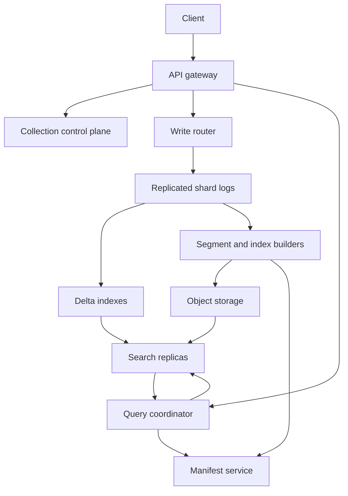

# Design a Multi-Tenant Vector Database for Semantic Search

**Difficulty:** Senior / Staff  
**Primary themes:** approximate nearest-neighbor search, immutable segments, indexing pipelines, filtering, consistency, multi-tenancy, caching, and reliability

This is a detailed educational walkthrough. In a real 45-minute interview, use the time boxes as navigation rather than trying to say every detail. The structure follows Hello Interview's public advice to move from requirements to entities, APIs, a high-level design, and targeted deep dives; the design and dialogue below are original. See [Hello Interview's delivery framework](https://www.hellointerview.com/learn/system-design/in-a-hurry/delivery).

## Interviewer prompt

> Design a managed, multi-tenant vector database. Customers store embedding vectors plus metadata and query for the nearest vectors, usually to power semantic search or retrieval-augmented generation. The service must support ongoing writes, metadata filters, and large collections.

## Targeted clarifying questions

**Candidate:** Are clients supplying embeddings, or must our service run embedding models?

**Interviewer:** Clients supply vectors. Embedding generation is out of scope. Validate dimensions and basic numeric constraints, but do not host models.

**Candidate:** Which write and read operations matter most?

**Interviewer:** Create collections, batch upsert and delete records, and top-K similarity search with metadata filters. Collection administration can be asynchronous.

**Candidate:** What scale and vector shape should I design for?

**Interviewer:** Assume 10,000 tenants, 50 billion stored vectors globally, typically 768 float32 dimensions. Peak traffic is 1 million searches per second and 2 million vector mutations per second. A single collection can contain 10 billion vectors.

**Candidate:** What latency and quality are expected?

**Interviewer:** Search p99 under 100 ms for `topK <= 100`, and at least 95% recall@10 on a declared evaluation set. New writes should normally become searchable within five seconds.

**Candidate:** Do searches require exact results or strict read-after-write consistency?

**Interviewer:** Approximate nearest neighbors are acceptable. Default reads may be eventually consistent, but a client should be able to wait for a mutation token and obtain read-your-writes behavior.

**Candidate:** Which similarity metrics and filters are in scope?

**Interviewer:** Cosine, dot product, and Euclidean distance. Filters support equality, set membership, ranges, and Boolean combinations over declared metadata fields.

**Candidate:** Should tenants share infrastructure? What isolation is required?

**Interviewer:** Yes. Small tenants share nodes; large tenants may receive dedicated shards. Enforce authentication, authorization, quotas, and performance isolation. Data from one tenant must never appear in another tenant's result.

**Candidate:** Are cross-region writes required?

**Interviewer:** A collection has one write region and replicas in other regions. Regional disaster recovery matters; active-active conflict resolution does not.

**Candidate, summarizing aloud:** “I’ll design the vector storage and search plane. I’ll exclude embedding generation and application-level prompt construction. I’ll optimize for approximate filtered top-K search, fast mutation visibility, and tenant isolation, with an explicit session-consistency option.”

---

## 1. Requirements (~5 minutes in the interview)

### Functional requirements

1. **Manage collections.** A tenant creates a collection with vector dimension, distance metric, metadata schema, retention, and desired replication policy.
2. **Mutate vectors.** A tenant batch-upserts or deletes vector records idempotently while searches continue.
3. **Search.** A tenant requests approximate top-K neighbors, optionally with metadata filters, and receives IDs, scores, selected metadata, and record versions.

Secondary capabilities include asynchronous index status, snapshots/backups, schema evolution, usage reporting, and collection deletion.

### Quantified non-functional requirements

| Goal | Target |
|---|---:|
| Search scale | 1,000,000 peak QPS globally |
| Mutation scale | 2,000,000 vector upserts/deletes per second globally |
| Search latency | p99 < 100 ms for `topK <= 100` under the supported filter envelope |
| Search quality | recall@10 >= 95% on each collection's evaluation sample |
| Mutation visibility | 99% searchable within 5 seconds |
| Availability | 99.99% search, 99.9% accepted writes per region |
| Durability | no acknowledged mutation loss after a single-node or single-zone failure |
| Isolation | tenant ID enforced at every authorization, routing, storage, and result boundary |

**Recall@10** is the fraction of the true ten nearest neighbors that appear in the approximate result's first ten positions. Approximate indexes exchange some recall for much lower latency and cost.

### Consistency and availability contract

- A successful mutation returns a monotonic `commit_token` scoped to the collection.
- Default search is eventually consistent and may omit mutations newer than the serving replica's visible watermark.
- A search with `min_commit_token=T` waits briefly or routes to a replica whose visible watermark is at least `T`. If the deadline cannot be met, it returns a clear `CONSISTENCY_TIMEOUT`; it must not silently weaken the request.
- Upserts to the same vector ID are ordered by server-assigned collection sequence number. The highest committed sequence wins.
- Deletes are tombstones and obey the same ordering. Once a delete token is visible, older copies cannot reappear.
- Availability wins for default searches during a partition. For token-constrained reads, the stated session-consistency guarantee wins, so the request may fail rather than serve stale data.
- Results are approximate. The API guarantees the configured recall SLO over measured workloads, not that every response contains the mathematically exact neighbors.

**What I would say aloud:** “I want to separate two contracts that candidates often mix together: database freshness and ANN quality. The token controls whether a committed version is eligible to be seen; recall measures whether the index finds the best eligible vectors.”

### Scale estimates that change the design

One 768-dimensional float32 vector occupies:

\[
768 \times 4\text{ bytes} = 3{,}072\text{ bytes} \approx 3\text{ KB}
\]

For 50 billion vectors, raw vectors alone require roughly:

\[
50 \times 10^9 \times 3{,}072 \approx 154\text{ TB}
\]

With metadata, identifiers, ANN structures, temporary compaction space, and three replicas, physical storage can easily reach several hundred terabytes or more. Keeping every full-precision vector and graph edge in RAM is unnecessarily expensive. This pushes us toward compressed in-memory search structures, SSD-backed immutable segments, and exact reranking of a small candidate set.

At 1 million searches per second, fan-out matters more than raw request count. If every query contacted 100 shards, the fleet would see 100 million shard-searches per second. We therefore need bounded shard fan-out, segment pruning, and replicas placed close to query traffic. We should not use semantic routing by default because sending a query to only “likely” shards can silently reduce recall; introduce it only after measuring that tradeoff.

At 2 million mutations per second, synchronous graph rewiring and in-place index maintenance would create contention and unpredictable latency. An append-only log plus small mutable indexes and asynchronously built immutable segments makes the write path tractable.

### Out of scope

- Generating embeddings or choosing a foundation model
- Full-text ranking beyond a simple optional sparse-score input
- Arbitrary joins or transactions across collections
- Global active-active writes
- Billing implementation and user-facing search UI

---

## 2. Core entities (~2 minutes)

Identify the nouns before drawing tables:

| Entity | Essential fields and purpose |
|---|---|
| `Tenant` | `tenant_id`, plan, quota, isolation tier, encryption key reference |
| `Collection` | `collection_id`, tenant owner, dimension, metric, schema version, shard count, replication policy, state |
| `VectorRecord` | `vector_id`, vector values or blob pointer, metadata, `version`, `commit_seq`, creation time |
| `Mutation` | collection, vector ID, operation, idempotency key, commit sequence, payload checksum |
| `Shard` | stable write-ownership range, replica set, leader/term, durable and visible watermarks |
| `Segment` | immutable vector range, metadata statistics, index type/version, object-store URIs, checksum |
| `DeltaIndex` | recent searchable mutations not yet included in a sealed segment |
| `Tombstone` | vector ID, delete sequence, expiry after all older segments are compacted away |
| `Manifest` | atomic list of visible segments, delta generations, schema version, and snapshot epoch |
| `IndexBuild` | source segment, configuration, state, quality metrics, artifact checksum |
| `CommitToken` | collection plus commit sequence used for read-your-writes |

We do not need to commit to every column yet. Fields appear when a component needs them.

**What I would say aloud:** “The key modeling choice is that a record's logical identity is separate from its physical copies. Immutable segments may temporarily contain several versions of one vector ID, while a version map and tombstones decide which version is live.”

---

## 3. API and system interface (~5 minutes)

Authentication terminates at the API gateway. `tenant_id` and permissions come from the verified access token, never from a client-controlled body field.

### Create a collection

```http
POST /v1/collections
Authorization: Bearer <token>
Idempotency-Key: 91c...
Content-Type: application/json

{
  "name": "product-embeddings",
  "dimension": 768,
  "metric": "COSINE",
  "metadata_schema": {
    "category": "keyword",
    "price": "float",
    "in_stock": "boolean"
  },
  "filter_indexes": ["category", "price", "in_stock"],
  "replicas": 3
}
```

```json
{
  "collection_id": "col_7f1",
  "state": "PROVISIONING"
}
```

The collection service validates the schema, chooses initial shards, writes control-plane metadata transactionally, and starts asynchronous provisioning.

### Batch upsert

```http
POST /v1/collections/col_7f1/vectors:upsert
Authorization: Bearer <token>
Idempotency-Key: batch-20261015-0042
Content-Type: application/json

{
  "records": [
    {
      "id": "sku_1842",
      "values": [0.013, -0.082, 0.041],
      "metadata": {"category": "shoe", "price": 79.99, "in_stock": true}
    }
  ]
}
```

The shortened vector is illustrative; production validation requires exactly 768 values.

```json
{
  "accepted": 1,
  "commit_token": "col_7f1:938447201",
  "status": "COMMITTED"
}
```

`COMMITTED` means replicated durably to the shard log. It does not necessarily mean every search replica has indexed it yet. Retrying the same idempotency key with the same payload returns the original result; a different payload returns `409 IDEMPOTENCY_CONFLICT`.

### Search

```http
POST /v1/collections/col_7f1:search
Authorization: Bearer <token>
Content-Type: application/json

{
  "vector": [0.021, -0.079, 0.038],
  "top_k": 10,
  "filter": {
    "and": [
      {"eq": {"category": "shoe"}},
      {"lte": {"price": 100}},
      {"eq": {"in_stock": true}}
    ]
  },
  "min_commit_token": "col_7f1:938447201",
  "include_metadata": ["category", "price"]
}
```

```json
{
  "matches": [
    {
      "id": "sku_1842",
      "score": 0.931,
      "version": 17,
      "metadata": {"category": "shoe", "price": 79.99}
    }
  ],
  "visible_commit_token": "col_7f1:938447315",
  "partial": false,
  "took_ms": 24
}
```

The service rejects an invalid filter field rather than scanning unindexed arbitrary JSON. Pagination, if offered, uses an opaque cursor bound to a manifest epoch; it is not a stable offset into a continuously changing approximate ranking.

### Delete records

```http
POST /v1/collections/col_7f1/vectors:delete
Authorization: Bearer <token>
Idempotency-Key: delete-1842-v18
Content-Type: application/json

{"ids": ["sku_1842"]}
```

The response contains a commit token with the same semantics as upsert.

### Inspect index state

```http
GET /v1/collections/col_7f1/indexes
Authorization: Bearer <token>
```

This returns active index versions, build progress, visible watermark, measured recall, segment counts, and degraded replicas. It does not expose physical hostnames.

---

## 4. Data flow

### Mutation pipeline

1. Gateway authenticates the caller, derives `tenant_id`, checks collection ownership and rate limits, and validates request size.
2. The write router hashes `(collection_id, vector_id)` to a stable shard.
3. The shard leader validates dimension and metadata, deduplicates the idempotency key, assigns a collection commit sequence, and replicates the mutation through consensus across availability zones.
4. After quorum durability, it acknowledges with a commit token.
5. An indexer consumes the ordered log into an in-memory delta index and advances the searchable watermark.
6. When the delta reaches a size or age threshold, it is sealed. Background workers build immutable ANN and filter indexes, upload artifacts to object storage, verify checksums and recall, and atomically publish a new manifest.
7. Compaction later merges segments and removes obsolete versions whose tombstones are safe.

### Search pipeline

1. Gateway authenticates and validates the query.
2. The query coordinator resolves the collection manifest and chooses healthy replicas satisfying the requested commit token.
3. Each shard searches relevant immutable segments and its delta index, applying an adaptive filter strategy.
4. Shards return more than K candidates with approximate scores and record versions.
5. The coordinator removes stale versions and tombstones, optionally fetches original vectors for exact distance recomputation, merges candidates, and returns global top K.

---

## 5. High-level design (~10–15 minutes)



The control plane manages slow-changing metadata and placement. The data plane accepts mutations and searches. Keeping them separate prevents a temporary administrative outage from stopping searches on already provisioned collections.

### Step 1: Make one collection work correctly

Start with one shard on one machine. Store full vectors and metadata in a map and scan every live record for every search. This produces exact answers and defines metric semantics, validation, ordering, and tie-breaking.

It breaks quickly: searching 1 billion 768-dimensional vectors requires roughly 768 billion component operations per query. But the brute-force path remains useful for tiny collections, index validation, and recall measurement.

**What I would say aloud:** “I begin with exact scan to establish correctness, then replace only the bottleneck—the candidate-generation step—with ANN. The API and record semantics remain stable.”

### Step 2: Add durable, idempotent mutations

A write router assigns each ID to a shard. The shard leader appends mutations to a replicated log and acknowledges only after a quorum persists them. A small relational or strongly consistent key-value store holds collection definitions and idempotency outcomes; the high-volume vector payload belongs in the shard log and segment store.

Per shard, maintain:

- `latest_version[vector_id] -> commit_seq`
- `tombstone_seq[vector_id]`, when deleted
- `durable_watermark`
- `visible_watermark`

The version map prevents an older copy in an immutable segment from winning over a newer delta entry.

### Step 3: Partition ownership without destroying recall

Use stable hashing of vector IDs into a collection's logical shards. It spreads writes and gives every ID one ordering owner. Each logical shard contains a representative portion of the vector space, so exact global top K requires querying every logical shard for that collection.

That sounds expensive, so shard count must be controlled. A large shard can be tens or hundreds of millions of compressed vectors and have many read replicas; throughput scaling usually comes first from replicas, not from splitting into thousands of tiny shards. For a 10-billion-vector collection with 100-million-vector shards, there are about 100 logical shards—still high fan-out. We can group shards on query workers, prune segments using coarse centroids, and add carefully evaluated routing later. The initial design favors recall over speculative routing.

Small tenants share physical shards but retain distinct logical namespaces and encryption contexts. Large or latency-sensitive collections can be promoted to dedicated shard groups without changing the API.

### Step 4: Use a mutable delta plus immutable segments

The log consumer writes recent records into a delta store:

- a hash map for latest values and versions;
- a small mutable ANN structure or periodic micro-index;
- filter bitmaps or ordered structures for recent metadata;
- tombstones.

After a threshold—say 30 seconds or 1 GB—the delta freezes. Builders create an immutable segment containing compressed candidate-search data, original-vector storage or pointers, filter indexes, ID/version tables, and statistics such as metadata min/max values and coarse vector centroids.

Immutable segments are easy to checksum, cache, replicate, and rebuild. A manifest publication is an atomic metadata change: queries see either the old segment set or the new one, never a half-built index.

### Step 5: Add approximate search

For moderate hot segments, use HNSW, a multilayer proximity graph. A query begins in sparse upper layers and descends toward promising neighbors, then explores a larger candidate frontier at the base layer. The original HNSW paper describes the logarithmic-style navigable hierarchy and its favorable recall/latency behavior ([Malkov and Yashunin](https://arxiv.org/abs/1603.09320)).

For very large segments, use an inverted-file index with product quantization:

- **IVF** assigns vectors to coarse centroid lists, so a query probes only the nearest lists.
- **Product quantization (PQ)** compresses sub-vectors into short codebook indexes, reducing memory and distance-computation cost.
- Retrieve perhaps 100–1,000 compressed candidates, then rerank them using full-precision or higher-precision vectors from SSD/object-backed cache.

Faiss documents these families and their parameters in its [index guide](https://github.com/facebookresearch/faiss/wiki/Faiss-indexes). We use the concepts, not necessarily Faiss as a distributed database.

### Step 6: Execute filtered search adaptively

Every indexed metadata field gets an appropriate per-segment structure:

- keyword/Boolean: compressed bitmap;
- numeric range: sorted values, block min/max, or a range bitmap;
- high-cardinality identifier: hash or sorted postings.

At planning time, estimate filter selectivity from segment statistics.

- **Very selective filter:** obtain the allowed ID set first, then exact-scan or search a filter-aware ANN path.
- **Broad filter:** run ANN first, filter candidates, and oversample.
- **Intermediate filter:** interleave ANN traversal with membership checks, increasing the search budget until K matches or a hard limit is reached.

If only 1% of records qualify and each shard returns exactly K ANN candidates, post-filtering yields about `0.01K` results on average. To obtain ten matches, the naive expectation is 1,000 candidates, with poor tail behavior. That arithmetic justifies adaptive planning instead of a fixed oversampling factor.

### Step 7: Merge global top K

Each shard returns `K' > K` candidates. The coordinator validates versions and tombstones, normalizes score direction for the chosen metric, exact-reranks a bounded set when configured, and merges with a size-K heap.

If shards return only K, the global top K is still mathematically sufficient when each shard's local result is exact. With approximate indexes, filtering, and reranking, extra candidates provide headroom. Choose `K'` empirically based on recall curves, not a universal constant.

The response sets `partial=true` only if the collection's policy permits degraded results and names missing shard ranges in telemetry. For high-integrity RAG, the default should fail when any required shard is unavailable; silently incomplete context is dangerous.

### Step 8: Cache the right things

Search replicas keep hot index pages, centroid tables, PQ codebooks, filter bitmaps, and popular original vectors in memory. Cache keys include `tenant_id`, `collection_id`, `segment_id`, and `index_version` to prevent cross-tenant leakage and stale reuse.

Whole-query result caching has limited value because query vectors are often unique and freshness complicates invalidation. It can help for repeated canonical queries, but index-page caching is the dependable first optimization.

---

## 6. Deep dives (~10–15 minutes)

### Deep dive A: Choosing indexes without pretending one algorithm wins everywhere

#### Where the baseline breaks

Flat scan cannot serve billion-vector collections. A single mutable HNSW graph also becomes problematic: it consumes substantial memory for vectors and edges, deletion leaves graph debt, bulk construction is expensive, and constant online mutation harms predictability.

#### Plausible approaches

| Approach | Strengths | Weaknesses | Best fit |
|---|---|---|---|
| Flat exact scan | Perfect recall, simple updates | Linear CPU and memory bandwidth | Tiny collections, reranking, quality oracle |
| HNSW | Excellent latency/recall, no coarse training | Memory-heavy graph; deletion and rebuild complexity | Hot or medium-sized segments |
| IVF-Flat | Prunes most vectors; preserves full vectors | Larger memory than compressed variants; training required | Large collections with enough RAM/SSD bandwidth |
| IVF-PQ | Strong compression and throughput | Quantization error; tuning and training complexity | Massive collections, candidate generation |
| Disk-oriented graph | Much larger-than-RAM scale | SSD random I/O and cache sensitivity | Cold, very large collections |

#### Selected design

Use a **segment-adaptive index policy**:

- delta/micro-segments: brute force or small HNSW for fast visibility;
- hot immutable segments: HNSW when memory cost is acceptable;
- very large/cold immutable segments: IVF-PQ or a disk-oriented graph;
- exact reranking: original vectors for the best bounded candidate set.

Index configuration is versioned in each segment manifest. Builders train on representative samples and test recall before publication. A new index version is shadow-loaded, receives sampled queries, and is promoted only if latency, recall, memory, and filter behavior meet policy.

Important tuning knobs include HNSW's construction/search exploration and graph degree, or IVF's number of lists and probed lists. Raising the search budget usually improves recall at the cost of latency. The service should expose a simple collection-level target such as `quality=balanced`, while operators manage the low-level knobs.

**What I would say aloud:** “I would not promise that HNSW is the database. It is one physical index. Immutable segments let us choose a different index per size and temperature while preserving one logical API.”

#### Measuring quality

For each collection tier, retain a statistically useful sample and periodically compute exact neighbors offline. Compare production-index results to that ground truth by metric, filter selectivity, vector age, and segment type. Aggregate recall alone can hide a severe regression for selective filters.

### Deep dive B: Fast updates, read-your-writes, and safe compaction

#### Where the baseline breaks

Rebuilding a billion-vector index for every mutation is impossible. Updating all replicas synchronously would inflate write latency. Immutable segments create duplicate physical versions, so an old upsert could resurface after a delete unless version semantics are explicit.

#### Evolved write protocol

1. The leader rejects stale client preconditions if supplied, then assigns `commit_seq`.
2. Consensus replicates the mutation. A quorum acknowledgment makes it durable.
3. Index consumers apply log entries in order. Applying the same entry twice is safe because `(vector_id, commit_seq)` is idempotent.
4. Once every mutation through sequence `T` is present in searchable delta state, the replica advances `visible_watermark` to `T`.
5. A query with `min_commit_token=T` selects such a replica or waits within its deadline.

This token is a lightweight session guarantee, not a distributed transaction. The collection's single write region provides a clear order; replicas may lag independently.

#### Manifest publication and snapshots

Builders produce index artifacts under a unique segment ID, then verify checksums and a quality gate. The manifest service atomically swaps from epoch N to N+1. Search processes pin a manifest epoch for the request, so files are not deleted while in use.

Backups record the manifest plus log position and reference immutable objects. Because objects are content-addressed or immutable, a backup need not copy every byte immediately; retention prevents garbage collection until the snapshot expires.

#### Tombstones and compaction

Deletes enter the delta immediately. Query merge checks the newest version map before returning a candidate, so a stale segment copy is suppressed. Compaction merges segments, keeps only the highest live version of each ID, and drops tombstoned data only after:

- all input segments that could contain older versions are included;
- no pinned snapshot needs those versions;
- replicas have adopted a manifest excluding them.

Compaction is throttled and partitioned. It must not compete without bounds against search I/O. Track compaction debt; if tombstones or segments accumulate, query amplification and storage cost rise even though the API still appears healthy.

#### Failure modes

- **Leader dies after quorum commit but before response:** retry with the idempotency key returns the original commit result.
- **Indexer crashes:** replay from its checkpoint; versioned application prevents duplication.
- **Builder crashes:** unpublished artifacts are garbage-collected later.
- **Manifest publish succeeds but notification is lost:** replicas poll/watch the authoritative manifest and converge.
- **Replica cannot reach token T:** route elsewhere or return `CONSISTENCY_TIMEOUT`.

Distributed vector systems commonly offer bounded, session, or strong consistency choices; for example, Milvus documents several consistency levels in its [consistency guide](https://milvus.io/docs/consistency.md). Our contract deliberately exposes one simple default plus an explicit minimum token.

### Deep dive C: Filtered recall, hot tenants, and failure isolation

#### Where the baseline breaks

A post-filter-only design can return too few results. A pre-filter-only design may force expensive scans for broad filters. Shared replicas allow one tenant's huge `top_k`, selective predicate, or bursty traffic to consume CPU, memory, and SSD bandwidth needed by everyone else.

#### Adaptive filtered ANN

The planner estimates selectivity per segment and chooses pre-filter, post-filter, or filter-aware traversal. It also uses segment metadata to skip impossible segments; for example, a segment with `price_min=200` cannot satisfy `price <= 100`.

If the search budget is exhausted before K valid candidates are found, return fewer results with an explicit exhaustion reason only when the API contract permits it. Never fabricate low-quality matches. Observe recall separately for selectivity buckets such as `<0.1%`, `0.1–10%`, and `>10%`.

For frequently filtered dimensions chosen at collection creation, optionally partition new segments by a low-cardinality field such as locale or category. This reduces work but increases small-segment pressure and can skew partitions; do it only for proven query patterns.

#### Tenant isolation

Apply defense in depth:

- authentication derives the tenant; collection authorization is checked before routing;
- physical keys and cache keys include tenant and collection IDs;
- each tenant has token buckets for query count, mutation bytes, candidate computations, and concurrent expensive filters;
- a fair scheduler uses weighted queues rather than FIFO across all tenants;
- per-query budgets cap fan-out, `top_k`, filter complexity, and rerank candidates;
- large tenants move to dedicated shard groups when their steady load justifies it;
- envelope encryption uses tenant-specific key references where required.

The scheduler should charge work units, not just requests. A filtered `top_k=100` query probing many lists costs much more than an unfiltered `top_k=5` query.

#### Reliability and regional behavior

Each shard has replicas across at least three availability zones. Writes use a quorum in the collection's home region. Search can use any sufficiently fresh replica. If a search replica fails, the coordinator hedges only after a latency threshold; immediate duplicate requests would double fleet load during an incident.

Immutable segments live in replicated object storage and are reconstructible from source segments plus the mutation log. Search nodes are largely disposable caches. Cross-region replicas asynchronously copy logs and artifacts. Regional failover promotes a disaster-recovery region using a fenced epoch so the old leader cannot continue accepting writes when connectivity returns.

#### Observability

Monitor both systems metrics and semantic quality:

- search latency by coordinator, shard, index type, tenant tier, and filter selectivity;
- recall@K and score drift from shadow exact evaluation;
- durable-to-visible lag and commit-token wait time;
- shard fan-out, candidates visited, rerank count, cache hit ratio, and SSD reads;
- segment count, tombstone ratio, compaction debt, and index-build queue age;
- partial-result rate, replica divergence, checksum failure, and failover rate;
- per-tenant throttling and noisy-neighbor saturation.

Use trace sampling keyed by a hashed tenant identifier. Logs must not contain vectors or unrestricted metadata because embeddings and metadata can encode sensitive information.

**What I would say aloud:** “A vector service can be green on CPU and still be broken if recall collapses. Recall, freshness lag, and partial-result rate are first-class production signals, not offline curiosities.”

---

## 7. Final design and interview close

### Concise final architecture

The service has a strongly consistent control plane for collections, schemas, placement, and manifests, plus a horizontally scaled data plane. Mutations route by collection and vector ID to a quorum-replicated shard log. Log consumers make new data searchable in small delta indexes within seconds. Builders transform frozen deltas into immutable, checksummed segments stored in object storage and atomically publish manifests.

Query coordinators authenticate tenant scope, select replicas meeting any commit token, and fan out across a bounded set of shard workers. Workers search HNSW, IVF-PQ, disk-oriented, or flat indexes according to segment size and temperature, combine ANN with adaptive metadata filtering, and return extra candidates. Coordinators suppress stale versions and tombstones, optionally exact-rerank, and merge global top K. Fair scheduling, work-based quotas, dedicated placement for large tenants, and tenant-scoped cache/encryption keys provide isolation.

### Requirements check

| Requirement | How the design meets it |
|---|---|
| Create and manage collections | Transactional control plane plus asynchronous provisioning |
| Upsert/delete continuously | Quorum log, idempotency keys, delta indexes, tombstones |
| Filtered top-K search | Per-segment ANN and filter indexes with adaptive planning |
| p99 < 100 ms | Compressed candidate indexes, page caches, replicas, bounded fan-out, exact rerank only for a small set |
| Recall@10 >= 95% | Quality-gated builds, tunable search budgets, exact shadow evaluation by filter bucket |
| Searchable within 5 seconds | Ordered log consumers and mutable delta indexes |
| Read-your-writes option | Collection-scoped commit token and visible watermarks |
| High availability | Multi-zone replicas, quorum writes, replica-aware routing, immutable object recovery |
| Tenant isolation | Auth-derived identity, namespace enforcement, fair scheduling, quotas, optional dedicated shards |

### Realistic interviewer follow-ups

**Interviewer:** Why not partition vectors by cluster so each query contacts only one shard?

**Strong answer:** “Cluster partitioning reduces fan-out, but cluster boundaries are imperfect and embeddings drift. A true neighbor may be in another cluster, so routing to one shard lowers recall. I would start with ID-based ownership and coarse segment pruning, then test multi-probe semantic routing against exact ground truth. If we adopt it, queries probe multiple nearby partitions and the recall SLO governs the fan-out.”

**Interviewer:** How do you support an embedding-model migration from 768 to 1,536 dimensions?

**Strong answer:** “Dimension is immutable within an index generation because mixed dimensions have no valid distance. Create a new collection or vector field, dual-write during backfill, build and validate the new index, shadow reads, then atomically switch the application alias. Retain the old generation for rollback.”

**Interviewer:** Can two clients concurrently upsert the same ID?

**Strong answer:** “The shard leader serializes them and assigns commit sequences; last committed sequence wins. If the application needs optimistic concurrency, accept `if_version` and reject a mismatch. Idempotency keys solve retries, not business-level write conflicts.”

**Interviewer:** What happens if filtering leaves only three matching records but `top_k=10`?

**Strong answer:** “Return three. Top K means up to K qualifying records. The engine can prove exhaustion for a prefiltered exact set or stop at a documented work limit for ANN; the response should distinguish true cardinality exhaustion from a search-budget limit.”

**Interviewer:** How would you add hybrid keyword and vector search?

**Strong answer:** “Add a sparse retrieval path, such as an inverted text index, alongside dense ANN. Retrieve candidates independently, normalize or rank-fuse them—reciprocal-rank fusion avoids assuming comparable raw scores—and rerank the union. Keep ACL and metadata filters in both paths, and measure quality on hybrid relevance judgments.”

**Interviewer:** Why store original vectors if PQ already stores compressed codes?

**Strong answer:** “PQ is excellent for cheap candidate generation but introduces distance error. Fetching original or higher-precision vectors for a few hundred candidates improves final ordering. Originals also support rebuilding a new index without asking customers to re-upload data.”

**Interviewer:** How do you reshard a live collection?

**Strong answer:** “Create target shards at a new routing epoch, copy a consistent snapshot, stream subsequent log mutations, and compare watermarks. Once targets catch up, atomically publish the routing epoch. Routers briefly understand both epochs, and fenced leaders prevent two owners from accepting the same ID range.”

**Interviewer:** How do you prevent deleted vectors from appearing in results?

**Strong answer:** “A visible tombstone wins over every segment version with a lower sequence. Both shard workers and the coordinator validate candidate versions. Compaction eventually removes old bytes, but correctness does not wait for compaction.”

**Interviewer:** Would you ever provide strong consistency for every search?

**Strong answer:** “Yes as a premium collection mode, but it raises latency and reduces availability because every query must reach replicas at the latest committed watermark. Most semantic-search workloads benefit more from the default eventual mode plus an explicit token after writes.”

### Common pitfalls

- Naming HNSW and stopping, without a durable write path, deletion semantics, or rebuild strategy.
- Claiming exact nearest neighbors while using an approximate index.
- Treating recall as one global number and ignoring filtered-query recall.
- Sharding into too many pieces and overlooking query fan-out amplification.
- Updating a massive graph synchronously for every write.
- Deleting from the primary map but allowing an older segment copy to reappear.
- Trusting a client-supplied tenant ID or omitting tenant IDs from cache keys.
- Rate-limiting requests without accounting for their very different compute costs.
- Caching whole search responses before understanding uniqueness and freshness.
- Publishing a new index without atomic manifests, checksums, shadow traffic, and rollback.
- Discussing only latency and forgetting mutation visibility, compaction debt, and semantic recall.

### A polished 60-second close

> “The core design is a log-structured vector database. Quorum-replicated shard logs make mutations durable and ordered. Small delta indexes expose those mutations within seconds, while background builders create immutable, versioned ANN segments and publish them atomically. Query coordinators search healthy replicas, combine adaptive metadata filtering with segment-appropriate indexes, validate versions and tombstones, exact-rerank a bounded candidate set, and merge global top K. Commit tokens provide read-your-writes without forcing every search to be strongly consistent. The major tradeoff is recall versus latency and cost, so recall by filter selectivity, freshness lag, and partial results are production SLOs. Multi-tenant safety comes from auth-derived identity, tenant-scoped storage and caches, work-based fair scheduling, and dedicated placement for heavy tenants.”

## References

- [Hello Interview — System Design Delivery Framework](https://www.hellointerview.com/learn/system-design/in-a-hurry/delivery)
- [Malkov and Yashunin — Efficient and Robust Approximate Nearest Neighbor Search Using Hierarchical Navigable Small World Graphs](https://arxiv.org/abs/1603.09320)
- [Faiss — Indexes and tradeoffs](https://github.com/facebookresearch/faiss/wiki/Faiss-indexes)
- [Milvus — Architecture overview](https://milvus.io/docs/architecture_overview.md)
- [Milvus — Consistency](https://milvus.io/docs/consistency.md)
