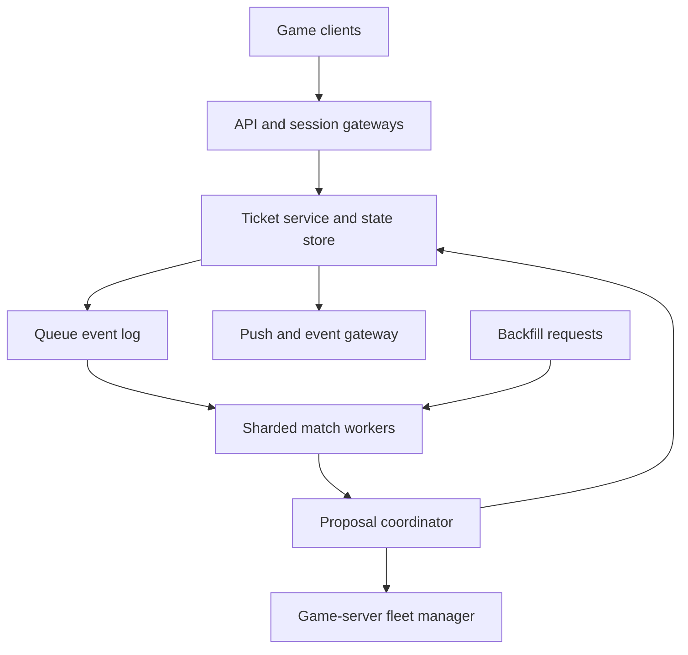
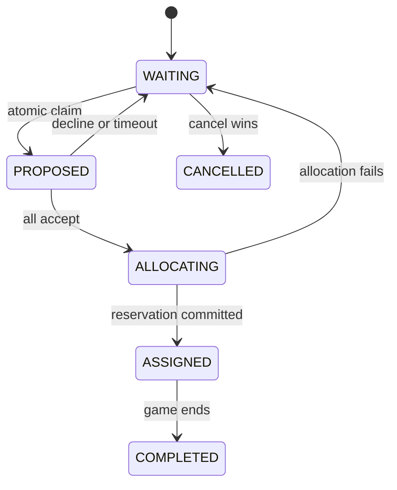

# Design a Global Multiplayer Matchmaking Service

**Difficulty:** Senior / Staff  
**Primary themes:** queues, constraint matching, distributed ownership, atomic state transitions, fairness, regional placement, reliability, caching, skill models  
**Interview time budget:** requirements 5 minutes, entities 2 minutes, interface 5 minutes, high-level design 10–15 minutes, deep dives 10–15 minutes.  
**Learning note:** this walkthrough is intentionally more detailed than a 45-minute interview answer.

The sequence follows Hello Interview's public [system-design delivery framework](https://www.hellointerview.com/learn/system-design/in-a-hurry/delivery): clarify requirements, identify core entities, define the interface, build the simplest complete design one operation at a time, and spend the remaining time on the bottlenecks created by scale and correctness. The problem treatment and dialogue are original.

## Interviewer prompt

> Design a global matchmaking service for a competitive 5-versus-5 multiplayer game. Players may queue alone or in parties, select a game mode and acceptable regions, and receive a fair match on an available game server. The system should balance match quality against waiting time, prevent a player from entering multiple matches, support acceptance checks and backfill, and survive service failures.

## Targeted clarifying questions with assumed answers

**Candidate:** Are we designing gameplay networking and the skill-rating algorithm, or only matchmaking?

**Interviewer:** Design matchmaking and server placement. Treat gameplay servers as an external fleet manager. A skill service supplies a rating and uncertainty; briefly explain how that information affects matching.

**Candidate:** What modes and party behavior must we support?

**Interviewer:** Focus on ranked 5v5. A ticket represents one player or a party of up to five, and a party must remain together. Teams should have similar aggregate skill and comparable party composition.

**Candidate:** What scale should I use?

**Interviewer:** Plan for 20 million daily active players, two million concurrently online, and 200,000 players waiting during peak. Peak ticket creation is 50,000 per second globally.

**Candidate:** What are the quality and latency goals?

**Interviewer:** Half of players should receive a proposal within 10 seconds and 95% within 60 seconds when regional capacity exists. Prefer under 50 ms network latency, avoid above 100 ms, and keep predicted team win probability between 45% and 55% for most ranked matches.

**Candidate:** Does a proposal require players to accept?

**Interviewer:** Yes. Players have 10 seconds to accept. If anyone declines or times out, accepted tickets return to the queue with their original enqueue time; repeated offenders receive a cooldown.

**Candidate:** What happens if a player leaves after the match starts?

**Interviewer:** During the first two minutes, the game server may request a backfill player. Backfill must preserve role, region, and a reasonable skill range.

**Candidate:** What consistency and availability guarantees matter?

**Interviewer:** A player must not be committed to two live matches. Queue estimates and ticket status may be eventually consistent, but proposal and reservation transitions must be atomic. Target 99.99% queue API availability and 99.9% successful placement once all players accept.

**Candidate:** Are friends, chat, tournaments, and post-game rating updates in scope?

**Interviewer:** No. Authentication, party membership, skill ratings, penalties, and server allocation are upstream or downstream services. Integrate their contracts but do not design them fully.

## 1. Requirements (~5 minutes)

### Core functional requirements

1. **Create, inspect, and cancel a matchmaking ticket** for a solo player or party, with mode, roles, latency measurements, and preferences.
2. **Form and confirm a fair 5v5 match**, atomically claiming tickets, collecting acceptance, and allocating a compatible regional game server.
3. **Backfill an early vacancy** using a compatible waiting player without placing that player elsewhere.

### Quantified non-functional requirements

- Support **50,000 ticket creates/s**, **200,000 concurrent waiting players**, and short bursts after updates or outages.
- Proposal latency: **p50 under 10 seconds**, **p95 under 60 seconds** when capacity is available.
- For most ranked matches, target **45–55% predicted win probability**, similar party shapes, required roles, and **under 50 ms preferred / 100 ms maximum latency**.
- Provide **99.99% queue API availability** and **99.9% successful server placement** after unanimous acceptance.
- Guarantee that one player is committed to **at most one live proposal or match**. Ticket reads and wait estimates may be stale by a few seconds.

### Scope and consistency contract

The matchmaking service owns ticket lifecycle and match formation. It does not own combat simulation, long-term skill training, identity, or fleet provisioning.

The most important invariant is:

```text
For each player_id, at most one active ticket may be in
PROPOSED, ACCEPTED, ALLOCATING, or ASSIGNED state.
```

Queue membership can be eventually consistent because a stale ticket can be filtered before commitment. The transition from waiting tickets to one proposal must be strongly consistent within the ticket-owning shard. Server allocation is a cross-service saga, not a distributed transaction: reserve capacity with an idempotency key, then either publish the assignment or compensate by releasing it and requeueing eligible tickets.

Microsoft's PlayFab documentation models a ticket as a player or list of players plus attributes submitted to a matchmaking queue, which is a useful real-world boundary for this API ([PlayFab Matchmaking](https://learn.microsoft.com/en-us/gaming/playfab/multiplayer/matchmaking/)). Amazon GameLift similarly documents match proposals, acceptance, placement, and backfill as distinct stages ([FlexMatch process](https://docs.aws.amazon.com/gameliftservers/latest/flexmatchguide/gamelift-match-howitworks.html)).

> **Say aloud:** “The queue is approximate, but commitment is not. I will tolerate stale search candidates and make the final claim atomic, because double-matching a player is the correctness failure.”

### Scale estimates that change the design

Assume an average ticket contains 1.25 players. At 200,000 waiting players:

\[
200{,}000 / 1.25 \approx 160{,}000\text{ active tickets}
\]

A 5v5 match consumes about eight tickets at that party average, so a busy system may form tens of thousands of candidate groups per second. Comparing every ticket with every other ticket would be roughly \(O(n^2)\), clearly impossible.

Instead, bucket tickets by hard constraints—game build, mode, region set, input method, and party size—then use ordered skill bands and age windows inside each bucket. If one region holds 20,000 tickets and we split it into 100 skill bands, a worker searches hundreds rather than tens of thousands of immediate neighbors.

Ticket creation at 50,000/s is not the main storage problem; the hard problem is repeated candidate evaluation. If every ticket is reconsidered ten times per second, that is 1.6 million evaluations/s. We need shard-local indexes, incremental matching, and bounded candidate windows rather than database scans.

> **Say aloud:** “The scale estimate changes the algorithm: this is indexed neighborhood search with atomic claims, not a SQL query that scans the waiting table.”

## 2. Core entities (~2 minutes)

| Entity | Purpose |
|---|---|
| **PlayerSnapshot** | Immutable matchmaking inputs: skill, uncertainty, role preferences, party membership, latency map, trust/input pools |
| **Party** | Indivisible group that must be placed on one team |
| **Ticket** | Queue request with lifecycle, enqueue time, constraints, and idempotency key |
| **QueuePolicy** | Versioned hard rules, relaxation schedule, scoring weights, and timeout behavior |
| **MatchProposal** | Tentatively claimed tickets, team assignment, acceptance deadline, and policy version |
| **PlayerClaim** | Fenced ownership record preventing simultaneous proposals or matches |
| **ServerReservation** | Idempotent hold returned by the fleet manager for region, build, and capacity |
| **MatchAssignment** | Final match ID, roster, server endpoint, and join tokens |
| **BackfillRequest** | Open slot constraints tied to an existing match |

Do not fully normalize the schema yet. The entities clarify ownership: queue workers discover candidates, the proposal coordinator owns commitment, and the fleet manager owns compute capacity.

## 3. API or system interface (~5 minutes)

The gateway derives `player_id` from authentication. A party service issues a signed `party_token` listing members and leader; clients cannot invent party membership or submit their own skill value.

### Create a ticket

```http
POST /v1/matchmaking/tickets
Idempotency-Key: 4f25d7d0-6d3e-4a1b-93c7-8abf2cdd75c1
Authorization: Bearer <player-token>
Content-Type: application/json

{
  "queue": "ranked-5v5",
  "partyToken": "signed-party-token",
  "preferredRoles": ["support", "tank"],
  "latencyMs": {
    "us-east": 24,
    "us-central": 47,
    "us-west": 91
  },
  "clientBuild": "2026.10.15.3"
}
```

```json
{
  "ticketId": "tkt_01K7...",
  "status": "WAITING",
  "estimatedWaitSeconds": 18,
  "version": 1
}
```

Creation validates the signed party, takes server-side skill and penalty snapshots, atomically ensures no member has another active ticket, persists the ticket, and publishes an outbox event. The idempotency key makes a client retry return the same ticket.

### Read or cancel a ticket

```http
GET /v1/matchmaking/tickets/tkt_01K7...
```

```json
{
  "ticketId": "tkt_01K7...",
  "status": "PROPOSED",
  "proposalId": "mp_83d...",
  "acceptBy": "2026-10-15T20:00:10Z",
  "version": 4
}
```

```http
DELETE /v1/matchmaking/tickets/tkt_01K7...
If-Match: "4"
```

Cancellation uses a version precondition. A client cannot cancel an already assigned match through a stale read.

### Accept a proposal

```http
POST /v1/matchmaking/proposals/mp_83d.../accept
Idempotency-Key: accept-tkt_01K7-mp_83d

{"ticketId":"tkt_01K7...","accepted":true}
```

The server derives the player identity and verifies membership in that ticket. Acceptance is idempotent. When all tickets accept, the proposal moves once from `PROPOSED` to `ALLOCATING`.

### Watch updates

Clients open a WebSocket or server-sent-event stream:

```text
ticket.updated {ticketId, status, version, proposalId?}
match.assigned {matchId, serverEndpoint, joinToken, expiresAt}
```

Polling remains a fallback. Events carry monotonically increasing ticket versions so clients discard duplicates and out-of-order messages.

### Request backfill

```http
POST /internal/v1/matches/m_62a/backfill
Authorization: mTLS <game-server-identity>

{
  "vacantTeam": "BLUE",
  "role": "support",
  "region": "us-east",
  "targetSkill": 1720,
  "allowedDelta": 180,
  "deadlineSeconds": 20
}
```

Only the authenticated server assigned to that match may request backfill.

## 4. Data flow

1. The gateway authenticates the leader, verifies the signed party, and fetches authoritative player snapshots.
2. The ticket service transactionally creates the ticket, claims each member's active-ticket slot, and writes an outbox record.
3. An indexer consumes the event and inserts the ticket into an in-memory shard selected by queue, compatibility pool, and latency region.
4. A match worker chooses an old anchor ticket, retrieves nearby candidates, evaluates hard rules, and scores feasible team partitions.
5. A coordinator atomically claims all selected tickets and player records, creating a proposal with a deadline.
6. Notifications reach clients; acceptances update proposal state idempotently.
7. After unanimous acceptance, the coordinator reserves a server, writes the final assignment, and returns short-lived join tokens.
8. Declines, timeout, or allocation failure release claims and requeue eligible tickets with their original waiting age.

## 5. High-level design (~10–15 minutes)



### Operation 1: join the queue

The ticket service reads authoritative party, skill, penalty, build, and trust data. It snapshots fields needed for this matchmaking attempt so an upstream rating update does not change the ticket midway.

Within one shard transaction it:

1. verifies every party member is eligible;
2. conditionally creates `PlayerClaim(player_id, ticket_id, phase=WAITING, epoch)` if no active claim exists;
3. stores `Ticket(..., state=WAITING, enqueue_time, policy_version)`;
4. writes an outbox event.

Partition player claims by a stable player hash. A party may span claim shards, so there are two practical choices: route a party through a coordinator using conditional multi-key transactions in a distributed database, or reserve members in sorted order with a short lease and compensate on failure. At this scale and with parties capped at five, I choose a database supporting transactional conditional writes across those few records. The invariant is worth the coordination cost because ticket creation is far less frequent than candidate evaluation.

The outbox event asynchronously populates queue indexes. Until then, the ticket is durable but not yet discoverable. A repair scanner republishes missing outbox events.

### Operation 2: discover compatible candidates

Queue shards are divided by hard compatibility dimensions:

```text
(queue, build_family, trust_pool, input_pool, geographic_cell)
```

Within a shard, indexes organize tickets by skill, party size, role mask, and enqueue time. A geographic cell may represent one primary region plus compatible neighboring regions; tickets can appear as references in several regional indexes, but the durable ticket has one owner and can be claimed only once.

Workers operate continuously rather than running one query per new ticket. A worker selects an anchor from the oldest tickets, obtains candidates in a current skill/latency window, and runs a bounded team-construction search. Hard filters remove incompatible build, blocked-player conflicts, party splits, missing roles, and latency violations. A scorer then ranks valid arrangements.

One conceptual cost function is:

```text
cost = 5 * predicted_team_imbalance
     + 3 * max_network_latency_penalty
     + 2 * party_shape_mismatch
     + 1 * role_preference_penalty
     - 4 * normalized_wait_age
```

Weights are versioned policy, not magic constants embedded in code. The candidate with the lowest cost below the current threshold wins.

Skill is a distribution rather than a perfectly known number. Microsoft's TrueSkill work represents player ability with a mean and uncertainty; uncertainty is high for new players and shrinks with evidence ([TrueSkill](https://www.microsoft.com/en-us/research/project/trueskill-ranking-system/)). The matcher can use conservative skill estimates and predicted outcome probability while the rating service owns model updates.

### Operation 3: atomically create a proposal

Candidate discovery may use stale indexes, so the proposal coordinator re-reads authoritative tickets. In one serializable transaction within the owning match shard it verifies:

- every ticket is still `WAITING` at the expected version;
- all player claims still point to those tickets;
- no ticket appears twice and total party sizes equal ten;
- the policy version is still permitted.

It then writes the roster and team allocation, changes all tickets to `PROPOSED`, advances player claims to the proposal ID, and sets a 10-second deadline. Only after commit does it notify clients.

If tickets are owned by different queue shards, use a deterministic proposal coordinator and conditional compare-and-swap on every ticket. Acquire in sorted ticket-ID order; if any claim fails, release the successful provisional claims. These are short internal leases, while the durable proposal transaction is the final commit. Fencing epochs prevent a paused coordinator from committing after its lease expires.

> **Say aloud:** “Matching is optimistic: indexes propose, authoritative state disposes. A stale candidate only wastes computation because compare-and-swap prevents a double match.”

### Operation 4: collect acceptance and allocate a server

Each acceptance updates a set or bit mask on the proposal using `(proposal_id, ticket_id)` as an idempotency key. Decline immediately moves the proposal to `REJECTED`; a deadline worker handles timeouts.

When all tickets accept, one conditional transition changes `PROPOSED -> ALLOCATING`. The coordinator calls the fleet manager with `reservation_key = proposal_id`, acceptable regions ordered by the roster's measured latency, build, mode, and required slots.

The fleet manager returns a leased `reservation_id`, server endpoint, and expiry. The coordinator then transactionally writes `MatchAssignment`, changes tickets and player claims to `ASSIGNED`, and emits events. Join tokens are signed, scoped to player and match, and expire quickly.

If allocation times out, retry with the same reservation key. If no region has capacity before the proposal deadline, release any reservation, return tickets to `WAITING`, preserve their original enqueue time, and widen the region only within policy. We do not hold database locks during the network call.

### Operation 5: decline, cancel, and reconnect

For a decline or timeout, the coordinator atomically closes the proposal and releases all proposal claims. Accepted tickets return to `WAITING` with their initial age; the declining ticket may enter `COOLDOWN`. The event stream updates queue indexes.

If a client disconnects, its durable ticket continues. On reconnect, `GET ticket` is authoritative and the event stream resumes after the last observed version. If cancellation races with proposal creation, exactly one conditional state transition wins.

### Operation 6: backfill

An authenticated game server creates a high-priority `BackfillRequest`. Its existing roster defines team skill, region, build, input pool, open role, and remaining match stage. The matcher searches solo tickets or suitably sized parties that explicitly allow backfill.

Backfill is prioritized because server capacity and nine players are already committed, but its constraints are stricter: never move the session region, never violate team size or role, and cap skill impact. The selected ticket still goes through an atomic claim and a short acceptance step. If the match passes the two-minute limit or ends, the server cancels the request and any late commit is rejected by match epoch.

## 6. Deep dives (~10–15 minutes)

### Deep dive A: balancing quality, latency, and wait time

#### Where the baseline breaks

Fixed strict rules produce excellent matches for popular skill bands but starve rare skills, parties, roles, regions, and off-peak queues. Immediately widening all constraints lowers wait time but creates unfair or high-latency matches.

#### Options

| Strategy | Strength | Weakness |
|---|---|---|
| Fixed buckets | Fast and predictable | Boundary artifacts and starvation |
| Global best-match optimization | Best theoretical quality | Too expensive and slow online |
| Greedy oldest-first | Strong wait fairness | Can waste candidates and reduce quality |
| Window expansion by ticket age | Bounded work and graceful relaxation | Needs careful policy tuning |
| Periodic batch optimization | Better global combinations | Adds latency and operational complexity |

#### Selection

Use age-based window expansion with the oldest ticket as anchor, plus small periodic batch optimization for pathological shards.

Example relaxation schedule:

| Wait age | Skill delta | Regions | Party-shape rule |
|---:|---:|---|---|
| 0–10s | ±75 | under 50 ms | exact |
| 10–25s | ±150 | under 70 ms | near-exact |
| 25–45s | ±250 | under 90 ms | scored penalty |
| 45–60s | ±400 | under 100 ms | relaxed, never split parties |

Hard safety rules—game build, bans, trust pool, maximum latency, and party integrity—never relax. Soft rules—skill delta, secondary role preference, and party-shape similarity—expand gradually.

Bucket boundaries overlap so players rated 1499 and 1501 are neighbors. Workers periodically process oldest anchors first, but candidate scoring still considers overall group quality. Reserve a small fraction of matching cycles for aged tickets so high-volume central skill bands cannot monopolize compute.

Measure outcomes, not just wait time: predicted balance, actual win margin, surrender rate, disconnects, rematch complaints, and retention. Run policy changes as shadow evaluations first, then regional canaries. A faster match is not an improvement if players abandon it.

> **Say aloud:** “Waiting time is part of the objective function, not merely an SLO. I relax only soft constraints with age and keep latency, trust, build, and party integrity as hard bounds.”

### Deep dive B: exactly-once commitment on at-least-once infrastructure

#### Where the baseline breaks

Workers crash, retry, and race. Queue events duplicate. A ticket can appear in multiple regional indexes. Acceptance and cancellation arrive concurrently. No message queue provides exactly-once end-to-end behavior across the state store and fleet manager.

#### Selected state machine



Every transition is a compare-and-swap on current state and version. Commands carry idempotency keys. Events are at least once and contain the new version. Consumers ignore versions they have already applied.

`PlayerClaim` is the global guard. The claim value includes `{ticket_id, proposal_id?, match_id?, epoch, expires_at}`. Queue indexes do not establish ownership; only a successful conditional claim does. Expiry handles abandoned `WAITING` tickets, but proposal and assigned claims are released only by their owning state machine or a reconciler with a higher fencing epoch.

Server allocation uses a saga:

1. durably enter `ALLOCATING`;
2. request a reservation idempotently by proposal ID;
3. durably attach the reservation and publish `ASSIGNED`;
4. on permanent failure, release the reservation and requeue;
5. reconciliation lists old `ALLOCATING` proposals and asks the fleet manager by idempotency key before deciding.

This survives “reservation succeeded but response was lost.” The reconciler discovers the reservation instead of allocating a second server.

The outbox pattern couples state changes and emitted events in one database transaction. A relay may publish twice, so index updates and notifications remain idempotent. The user-visible guarantee is at-most-one active match, not exactly-once delivery of notifications.

#### Failure cases

- **Worker proposes stale ticket:** authoritative claim fails; discard candidate.
- **Coordinator pauses after provisional claims:** leases expire; higher epoch fences it.
- **Acceptance is duplicated:** same `(proposal,ticket)` produces no new transition.
- **Cancel races with proposal:** one versioned transition wins; loser reads final state.
- **Fleet response is lost:** retry same reservation key or reconcile.
- **Assignment event is lost:** outbox relay retries; client polling recovers.
- **Region fails during proposal:** durable home-shard state fails over; expired proposals requeue.

### Deep dive C: regional sharding, hot queues, and overload

#### Where the baseline breaks

A single global queue adds cross-region latency and becomes a contention point. Fully independent regional queues cannot match parties whose acceptable regions overlap and may strand low-population regions. A celebrity event or game update can make one queue shard hot.

#### Design

Assign each ticket a durable home shard based on queue, trust/input pool, and a stable hash. Maintain ephemeral references in every acceptable regional search index. Match workers acquire an anchor's home-shard lease, gather candidates from nearby indexes, then coordinate claims against authoritative owners.

Use virtual shards so hot populations can split without changing ticket IDs. The shard directory is versioned and cached. During movement, old owners forward or reject with a newer epoch; durable event-log replay rebuilds in-memory indexes.

Within each shard:

- partition indexes by coarse skill and party size;
- use ordered sets for enqueue age and skill neighborhoods;
- batch insert/remove events;
- assign bounded CPU budgets per queue and tenant/title;
- apply weighted fair scheduling across modes;
- autoscale from oldest-ticket age and evaluation CPU, not queue length alone.

If overloaded, preserve correctness and degrade quality gracefully: slow estimated-wait updates, reduce shadow evaluations, shrink candidate fan-out, then apply more aggressive but policy-bounded relaxation. Never skip final claims or merge incompatible builds merely to improve throughput.

Regional isolation also limits blast radius. Existing tickets remain matchable during a control-plane outage using the last signed policy snapshot. New queue-policy publication pauses if validators or signatures fail.

#### Server-capacity feedback

The fleet manager streams available warm capacity by region, build, and instance class. Match workers cache this advisory data to avoid proposing combinations with no plausible host. It is not authoritative: only reservation confirms capacity.

When capacity is scarce, queue estimates include placement delay and admission may stop widening toward the exhausted region. Pre-warming forecasts use queue arrival rate and match duration. Matchmaking quality should not form thousands of accepted proposals that cannot be hosted.

#### Observability

Track:

- ticket creation, cancellation, duplicate, and eligibility rejection rates;
- wait-time percentiles by region, mode, skill decile, party size, and role;
- candidate evaluations per proposal and atomic-claim conflict rate;
- match quality: predicted win probability, skill delta, latency, party shape;
- relaxation stage used and starvation age;
- proposal acceptance, decline, timeout, and cooldown rates;
- allocation latency, failure, orphan reservation, and warm-capacity shortage;
- backfill latency, success, and post-backfill departure rate;
- event lag, index rebuild duration, stale references, and reconciler repairs;
- real outcomes such as score margin, early quit, and rematch satisfaction.

Use synthetic players in non-production pools to test create → propose → accept → allocate → join continuously. Audit policy versions and retain anonymized decision features for offline fairness analysis without exposing raw player identity.

## 7. Final design

### Concise final design

Authenticated clients create idempotent party tickets. The ticket service snapshots authoritative skill and eligibility data, transactionally claims every party member, stores the ticket, and publishes an outbox event. Sharded in-memory indexes group tickets by hard compatibility and maintain ordered skill and age neighborhoods. Match workers anchor on older tickets, widen only soft constraints over time, and score bounded candidate team arrangements.

Candidate discovery is optimistic. A proposal coordinator revalidates versions and atomically advances all selected tickets and player claims to one fenced proposal. It collects idempotent acceptances, then uses a saga and proposal-scoped idempotency key to reserve a regional game server. The final transaction publishes the assignment and short-lived join tokens. Declines, timeouts, and allocation failures release claims and requeue eligible tickets with preserved age. Game servers can submit tightly constrained high-priority backfill requests.

Durable home shards establish ownership; multi-region queue indexes are rebuildable hints. Versioned policies, virtual shards, quotas, fair worker scheduling, reconciliation, outbox events, and explicit overload behavior keep the service correct and available.

### Requirements check

| Requirement | Design response |
|---|---|
| Solo and party queueing | Signed party token, immutable ticket snapshot, party as indivisible unit |
| 50K creates/s | Partitioned ticket store, outbox log, stateless API gateways |
| 200K waiting players | Sharded in-memory indexes and bounded neighborhood search |
| Fair 5v5 teams | Skill-distribution scoring, roles, party-shape penalties |
| Bounded wait | Oldest anchors and age-based soft-constraint expansion |
| Regional latency | Client latency map, regional indexes, hard maximum latency |
| No double match | Transactional player claims, versioned state machine, fencing |
| Acceptance | Durable proposal deadline and idempotent responses |
| Server placement | Idempotent reservation saga and reconciliation |
| Backfill | Server-authenticated, match-epoch-bound priority request |
| Failure recovery | Durable ticket state, at-least-once events, index replay, reconcilers |
| Queue availability | Regional shards use last valid signed policy during control outage |

## Realistic interviewer follow-up questions with strong sample answers

### Why not store the waiting queue only in Redis?

**Candidate:** “Redis-like ordered structures are useful indexes, but I would not make them the sole owner of ticket and claim state. Durable ticket records and player claims enforce lifecycle invariants; in-memory indexes are replayable discovery accelerators. Losing an index delays matching, while losing ownership state could double-match players.”

### How do you avoid splitting a party?

**Candidate:** “A party is one ticket with a size and role vector. Team construction places the entire ticket on one side or rejects the arrangement. Proposal commitment claims the party ticket and all member claim records atomically.”

### How do you handle a party whose players prefer different regions?

**Candidate:** “Aggregate per-player latency into a party region score, usually the maximum or a high percentile rather than the average. A region is eligible only if every member stays below the hard cap. This prevents sacrificing one member for a low average.”

### Why preserve enqueue time after another player declines?

**Candidate:** “Accepted players did nothing wrong. Resetting them would punish them and create starvation. I preserve their original age, while the declining or timed-out ticket receives policy-specific cooldown treatment.”

### Could the same ticket appear in several regional indexes?

**Candidate:** “Yes, as an ephemeral reference. Discovery may race, but only the authoritative versioned claim can move the ticket from WAITING to PROPOSED. Losers discard stale candidates.”

### How do you prevent new players with uncertain skill from ruining matches?

**Candidate:** “Use both mean and uncertainty, not a single rank. Provisionally place high-uncertainty players in wider but protected calibration pools, avoid stacking several uncertain players on one team, and update rapidly after results. The rating service owns inference; matchmaking consumes a conservative snapshot.”

### What if the fleet manager is down after everyone accepts?

**Candidate:** “The proposal is durably ALLOCATING. Retry with the same reservation key so success cannot allocate twice. If the deadline expires, query the fleet manager by that key, release any discovered reservation, and requeue players with preserved age. The client sees a clear placement failure, not a hanging proposal.”

### Would you optimize matches globally?

**Candidate:** “Not synchronously. Global optimization increases compute and waiting latency, and player arrivals constantly invalidate the solution. I use bounded local search with age-based relaxation, then optionally run small periodic batch optimization for aged pathological shards.”

### How would you estimate wait time?

**Candidate:** “Use recent arrival and formation rates for the player's compatibility bucket, current older tickets, role scarcity, relaxation schedule, acceptance rate, and server capacity. Return a range or percentile, not a false precise number. Estimates are explicitly advisory.”

### How do you handle blocked players?

**Candidate:** “Use a compact block-list check during candidate validation. For small lists, fetch/cache IDs; for large social graphs, call a batched relationship service or use Bloom filters only for prefiltering, followed by an exact check before proposal. A Bloom-filter false positive may reject a candidate but must never allow a blocked pairing.”

### What would you build first?

**Candidate:** “One-region solo queue with durable tickets, an ordered skill index, and atomic proposal claims. Then add acceptance and idempotent server allocation, parties and roles, age-based relaxation, multi-region latency indexes, backfill, hot-shard splitting, and offline policy evaluation.”

## Common pitfalls

1. Scanning every waiting player for every ticket.
2. Treating a fixed skill bucket boundary as a hard match boundary.
3. Optimizing only skill while ignoring network latency and wait time.
4. Using average party latency and hiding one player's unusable connection.
5. Splitting parties while constructing balanced teams.
6. Letting clients submit authoritative skill, party, trust, or penalty data.
7. Making the in-memory queue the only durable source of truth.
8. Assuming removal from a queue atomically prevents another worker from matching the player.
9. Holding database locks while allocating a game server.
10. Retrying allocation without an idempotency key.
11. Resetting innocent players' wait age after another player declines.
12. Relaxing hard constraints such as build compatibility or maximum latency.
13. Ignoring skill uncertainty for new or returning players.
14. Using one global queue and adding intercontinental coordination to every match.
15. Using fully isolated regional queues that strand small populations.
16. Trusting advisory capacity as a real server reservation.
17. Publishing assignment before durable state and reservation agree.
18. Forgetting cancellation-versus-proposal races.
19. Treating WebSocket delivery as the authoritative state.
20. Measuring only average wait instead of tail latency by cohort.
21. Improving wait time while worsening early quits and match satisfaction.
22. Letting backfill commit after the match epoch changed or the game ended.

## A polished 60-second close

> “Clients create idempotent tickets containing authoritative snapshots for a solo player or indivisible party. Durable player claims prevent overlapping active tickets. Outbox events populate sharded in-memory indexes organized by hard compatibility, skill, party size, role, and age. Workers anchor on older tickets, search bounded neighborhoods, gradually relax only soft constraints, and score team balance, latency, party shape, and wait. Discovery is optimistic; a coordinator revalidates ticket versions and atomically moves every player into one fenced proposal. Acceptances are idempotent. After unanimous acceptance, an idempotent saga reserves a regional game server and commits the final assignment, while failures release claims and preserve innocent players' queue age. Regional indexes are rebuildable hints over durable home shards, and backfill uses the same claim path with tighter constraints. The central tradeoff is quality versus wait, but the central invariant is simpler: one player can be committed to at most one match.”

## Public references

- [Hello Interview — System Design Delivery Framework](https://www.hellointerview.com/learn/system-design/in-a-hurry/delivery)
- [Microsoft PlayFab — Matchmaking](https://learn.microsoft.com/en-us/gaming/playfab/multiplayer/matchmaking/)
- [Microsoft PlayFab — How matchmaking works](https://learn.microsoft.com/en-us/xbox/playfab/multiplayer/matchmaking/how-matchmaking-works)
- [Amazon GameLift Servers — FlexMatch matchmaking process](https://docs.aws.amazon.com/gameliftservers/latest/flexmatchguide/gamelift-match-howitworks.html)
- [Amazon GameLift Servers — Backfill existing games](https://docs.aws.amazon.com/gameliftservers/latest/flexmatchguide/match-backfill.html)
- [Microsoft Research — TrueSkill ranking system](https://www.microsoft.com/en-us/research/project/trueskill-ranking-system/)
- [Microsoft Research — TrueSkill 2](https://www.microsoft.com/en-us/research/publication/trueskill-2-improved-bayesian-skill-rating-system/)
