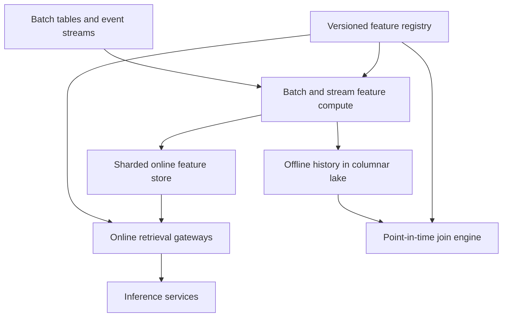

# Design a Real-Time Machine Learning Feature Store

**Difficulty:** Senior / Staff-level  
**Primary themes:** low-latency databases, stream processing, caching, queues, temporal consistency, schema evolution, reliability, and ML serving

> **Interview timing vs. this walkthrough:** In a 45-minute interview, spend roughly 5 minutes on requirements, 2 minutes on entities, 5 minutes on interfaces, 10–15 minutes building online write/read and historical retrieval, and 10–15 minutes on point-in-time correctness, freshness, and online/offline consistency. This walkthrough is deliberately more detailed for study. In the interview, first make one feature view work end to end; introduce backfills, streaming corrections, and multi-region serving only after the baseline is complete.

This answer uses Hello Interview’s public system-design structure: clarify functional and non-functional requirements, identify core entities and interfaces, build a complete baseline operation by operation, and spend remaining time on requirement-driven deep dives. genui{"citation":{"ref":"turn99search0"}} The problem, dialogue, estimates, and design below are original.

---

## Interviewer prompt

> Design a multi-tenant feature store for machine-learning teams. Data scientists define reusable features over batch tables and event streams. Training pipelines retrieve historical feature values without future-data leakage, while online inference services retrieve the latest valid values for one or many entities at very low latency. Support backfills, streaming updates, schema/version management, freshness monitoring, access control, lineage, and safe rollout of feature changes.

## Targeted clarifying questions with assumed interviewer answers

**Candidate:** Which access paths are required?

**Interviewer:** Online point lookup by entity, batch historical retrieval for training, streaming ingestion, batch materialization, feature definitions, and freshness/lineage inspection.

**Candidate:** What scale should I design for?

**Interviewer:** 5 million online reads/s, 2 million streaming updates/s, 10 billion active entities, 100,000 feature definitions, 50 PB of offline history, and training jobs returning up to 100 trillion feature cells.

**Candidate:** What are the latency targets?

**Interviewer:** Online retrieval p99 under 10 ms within a region for up to 200 features across 20 entities. Streaming updates should become online-visible within 5 seconds p99. Historical jobs may run for minutes or hours.

**Candidate:** What consistency matters for online serving?

**Interviewer:** A read should not go backward for a feature/entity within a region. Late or duplicate events must not overwrite newer event-time values. Cross-region replicas may lag, but their freshness must be observable.

**Candidate:** What exactly does point-in-time-correct training mean?

**Interviewer:** For every training example timestamp, select the latest feature event at or before that timestamp, subject to feature TTL and source availability. Never use a value produced in the future.

**Candidate:** Must online and offline values be identical?

**Interviewer:** They should share definitions and be comparable, but exact identity can be affected by streaming approximation, late data, and materialization lag. Expose those semantics and detect skew rather than claiming magic parity.

**Candidate:** Are arbitrary Python transformations allowed online?

**Interviewer:** No. Definitions compile into approved deterministic batch and streaming plans. On-demand request features may use a constrained expression runtime with strict latency and sandboxing.

**Candidate:** What happens when features are missing or stale?

**Interviewer:** Each model contract specifies defaults, maximum age, required versus optional features, and fail-open/fail-closed behavior. Retrieval returns metadata, not just values.

**Candidate:** Is model serving itself in scope?

**Interviewer:** Only the feature-fetch boundary. Show how the inference service pins a feature-service version and handles missing/stale results, but do not design model execution deeply.

**Candidate:** What security is required?

**Interviewer:** Workload-derived identity, project/feature-view permissions, field-level controls for sensitive features, encryption, audit logs, retention/deletion, and regional residency.

### Scope statement to say aloud

> “I’ll separate an offline historical plane from a low-latency online plane, tied together by a versioned feature registry and materialization pipelines. Producers write immutable event-time feature rows to durable storage and an ordered stream. Stream processors validate, deduplicate, and upsert only newer event-time versions into a sharded online store. Inference services fetch a pinned feature-service schema in one batched request with freshness metadata. Training retrieval performs point-in-time as-of joins so examples never see future values. I’ll deep-dive on temporal correctness, hot-key serving, and keeping batch and stream computations aligned.”

---

## 1. Requirements (~5 minutes)

### Three core functional requirements

1. **Define and govern features.** Register entities, sources, transformations, schemas, owners, TTLs, versions, access policy, lineage, and validation rules.
2. **Serve features online.** Ingest streaming/batch values and retrieve a consistent, version-pinned vector for entity keys with low latency, freshness metadata, and defaults.
3. **Build training datasets.** Retrieve historical values with point-in-time correctness, run backfills/materialization, and publish reproducible dataset manifests.

### Quantified non-functional requirements

| Property | Target | Design implication |
|---|---:|---|
| Online reads | 5M/s | Sharded in-memory/SSD online store and batched RPC |
| Streaming writes | 2M/s | Partitioned log, idempotent processors, micro-batches |
| Active entities | 10B | Hash partitioning and sparse column storage |
| Feature definitions | 100K | Versioned registry and dependency DAG |
| Offline history | 50 PB | Columnar object storage and distributed query engine |
| Online read latency | p99 < 10 ms regional | No synchronous offline-store or registry dependency |
| Stream freshness | p99 < 5 s | End-to-end event-time lag monitoring |
| Availability | 99.99% online reads | Multi-zone replicas, cache, bounded fallback |
| Training correctness | No future leakage | Point-in-time as-of joins and immutable snapshots |
| Tenant isolation | Fairness and security | Quotas, separate namespaces, field policies |

### Consistency and availability contract

- Feature rows carry both **event time**—when the fact was true—and **ingestion time**—when the platform observed it.
- For one `(feature_view_version, entity_key)`, the online store accepts an update only if its ordering tuple is newer than the stored one. Retries are idempotent.
- A regional online read is read-your-writes when the caller supplies a committed write revision or waits for the materialization watermark; otherwise it returns the latest locally applied version.
- Cross-region online replicas are eventually consistent and expose their applied source/partition watermarks and feature age.
- A feature-service version pins the ordered feature list, types, defaults, source definitions, and transformation versions used by a model.
- Historical retrieval is reproducible against pinned source snapshots, registry versions, code artifacts, and cutoff/watermark policies.
- Point-in-time joins select only feature events with `feature_event_time <= example_time`; TTL may make an otherwise older value missing.
- Late events may correct offline history. Online application follows an explicit lateness policy; a late older event never overwrites a newer current value.
- Online serving remains available using last known-good registry snapshots during control-plane failure. Publishing new definitions and starting new jobs may pause.
- Missing, stale, unauthorized, and invalid values are distinguishable. Defaults are applied only according to the pinned model contract.

Feast’s documentation describes the same foundational split: latest values are retrieved from an online store for inference, while point-in-time joins over historical data prevent future feature values from leaking into training examples. genui{"citation":{"refs":["turn99search13","turn99search25"]}}

### Out of scope

- Training algorithms and model execution internals
- Arbitrary notebook code in the online request path
- Guaranteeing source-data correctness
- A general-purpose data warehouse
- Global linearizability for all online feature values
- Exactly-once delivery from every external source
- Automatically choosing business-valid defaults without model-owner input

### Scale estimates that change the design

At 5 million reads/s, 200 features, and an average encoded value plus metadata of 24 bytes:

```text
5M × 200 × 24 B = 24 GB/s of value payload
```

Protocol, keys, and replication increase this. Feature projection and one batched RPC per prediction are mandatory; 200 individual network calls are impossible.

If 10 billion entities each have 200 materialized features averaging 24 bytes:

```text
10B × 200 × 24 B = 48 TB raw values
```

With keys, timestamps, indexes, and replication this can be hundreds of TB. The online store must be sharded, sparse, and limited to actively served feature views—not a copy of all 50 PB history.

Two million updates/s at 500 bytes average is:

```text
2M × 500 B = 1 GB/s ingest
≈ 86.4 TB/day before replication
```

The stream log needs partitioning, compression, bounded retention, and archival to the offline lake.

A training dataset with 1 billion examples and 100 features contains:

```text
1B × 100 = 100B feature cells
```

At even 8 bytes per value that is 800 GB before keys/nulls. Historical retrieval must be an asynchronous distributed job writing columnar output, not an API response buffered in one service.

At 5M reads/s, improving cache hit rate from 80% to 95% avoids:

```text
5M × (0.20 - 0.05) = 750K backend reads/s
```

Caching matters, but freshness and invalidation semantics must be explicit because stale features can silently change model quality.

**What to say aloud:**

> “The online path moves roughly tens of gigabytes per second, so callers fetch projected feature vectors in one batched RPC. Ten billion entities make the online store large but still far smaller than 50 petabytes of history because it retains only latest served values. Historical retrieval is a distributed export job. Finally, a 15-point cache-hit improvement removes about 750,000 backend reads per second, but cache age must be part of the model contract.”

---

## 2. Core entities (~2 minutes)

| Entity | Essential fields |
|---|---|
| `Project` | Tenant, owners, region policy, quotas, status |
| `EntityType` | Name, join keys, key types, description |
| `DataSource` | Location/topic, schema, event-time field, watermark policy |
| `Feature` | Name, type, description, sensitivity, validation/default policy |
| `FeatureViewVersion` | Entities, features, transformation artifact, TTL, source, version |
| `FeatureServiceVersion` | Ordered projections used by one model/version |
| `FeatureRow` | Entity key, feature values, event time, ingestion time, source sequence |
| `OnlineValue` | Feature-view version, entity hash, values, ordering tuple, expiry |
| `MaterializationJob` | Source range, target version, checkpoints, state, metrics |
| `HistoricalJob` | Entity spine, requested service, snapshots, output manifest, state |
| `DatasetManifest` | Source snapshots, registry/code versions, row count, checksums |
| `Watermark` | Source/partition, max complete event time and applied sequence |

The **entity spine** is the table of training examples, usually containing entity keys, example timestamps, and labels. Historical features are joined onto each row as of its timestamp.

---

## 3. API and system interface (~5 minutes)

Authentication supplies tenant/project/workload identity. The server derives authorization and never accepts a caller-chosen tenant field.

### 3.1 Register a feature-view version

```http
POST /v1/projects/fraud/feature-views
Authorization: Bearer <feature-admin-token>
Idempotency-Key: card-behavior-v7
Content-Type: application/json

{
  "name":"card_behavior",
  "version":7,
  "entities":[{"name":"card","join_keys":["card_id"]}],
  "source":{"id":"transactions_stream_v3","event_time":"occurred_at"},
  "features":[
    {"name":"spend_1h","type":"FLOAT64"},
    {"name":"declines_10m","type":"INT64"}
  ],
  "transformation":{"artifact":"sha256:7ab..."},
  "ttl_s":7200,
  "online":true
}
```

```json
{
  "feature_view":"card_behavior",
  "version":7,
  "state":"VALIDATING",
  "registry_revision":4412
}
```

Publishing runs schema, dependency, determinism, policy, and compatibility checks. It creates a new immutable version; it does not mutate version 6 in place.

### 3.2 Push feature rows

```http
POST /v1/projects/fraud/feature-views/card_behavior/versions/7:push
Authorization: Bearer <producer-token>
Idempotency-Key: tx-partition-18-offset-771
Content-Type: application/json

{
  "rows":[{
    "entities":{"card_id":"card_91"},
    "event_time":"2026-10-15T05:58:02.123Z",
    "source_sequence":{"partition":18,"offset":771},
    "values":{"spend_1h":241.50,"declines_10m":2}
  }]
}
```

```json
{
  "accepted":1,
  "commit_id":"commit_884",
  "stream_revision":99182
}
```

Acceptance means durable ingestion, not necessarily online visibility. The caller can wait on or inspect the online materialization watermark.

### 3.3 Retrieve online features

```http
POST /v1/projects/fraud/feature-services/fraud_model_v12:readOnline
Authorization: Bearer <inference-workload-token>
Content-Type: application/json

{
  "entities":[
    {"card_id":"card_91","merchant_id":"merchant_7"},
    {"card_id":"card_22","merchant_id":"merchant_7"}
  ],
  "max_age_ms":5000,
  "consistency":{"min_commit_id":"commit_884"}
}
```

```json
{
  "service_version":12,
  "rows":[{
    "values":{"spend_1h":241.50,"declines_10m":2,"merchant_risk":0.81},
    "statuses":{"spend_1h":"PRESENT","declines_10m":"PRESENT","merchant_risk":"PRESENT"},
    "max_event_age_ms":820,
    "read_revision":99201
  }]
}
```

The response preserves requested entity order and the feature-service schema. Partial rows contain per-feature status such as `MISSING`, `STALE`, `DEFAULTED`, `UNAUTHORIZED`, or `INVALID`.

### 3.4 Start a historical retrieval job

```http
POST /v1/projects/fraud/historical-jobs
Authorization: Bearer <training-pipeline-token>
Idempotency-Key: fraud-train-2026-10-15
Content-Type: application/json

{
  "feature_service":"fraud_model_v12",
  "entity_spine":"lake://fraud/examples/2026-10-15/",
  "entity_timestamp_field":"decision_time",
  "output":"lake://fraud/training/run_771/",
  "source_snapshot_policy":"PIN_AT_SUBMISSION",
  "late_data_cutoff":"2026-10-15T05:00:00Z"
}
```

```json
{
  "job_id":"hist_771",
  "state":"PLANNING",
  "registry_revision":4412,
  "feature_service_version":12
}
```

On completion, the job returns a dataset manifest containing source snapshots, transformation artifacts, row/cell counts, missingness, min/max event times, and output checksums.

### 3.5 Materialize a range

```http
POST /v1/projects/fraud/materializations
Authorization: Bearer <pipeline-token>
Idempotency-Key: card-v7-backfill-2026-10-15
Content-Type: application/json

{
  "feature_view":"card_behavior",
  "version":7,
  "start":"2026-10-01T00:00:00Z",
  "end":"2026-10-15T00:00:00Z",
  "target":"ONLINE",
  "mode":"UPSERT_IF_NEWER_EVENT_TIME"
}
```

### 3.6 Inspect freshness and lineage

```http
GET /v1/projects/fraud/feature-views/card_behavior/versions/7/status
Authorization: Bearer <reader-token>
```

```json
{
  "online_event_watermark":"2026-10-15T05:59:01Z",
  "offline_event_watermark":"2026-10-15T05:58:40Z",
  "p99_online_lag_ms":1820,
  "late_event_rate":0.0014,
  "schema_violations_1h":12,
  "dependencies":["transactions_stream_v3"]
}
```

### Important errors

| Error | Meaning |
|---|---|
| `FEATURE_SERVICE_NOT_READY` | Pinned service/version is not deployed regionally |
| `SCHEMA_MISMATCH` | Value or source schema violates definition |
| `STALE_BEYOND_CONTRACT` | Required value is older than allowed |
| `MATERIALIZATION_LAG` | Required commit/watermark has not reached online store |
| `POINT_IN_TIME_UNAVAILABLE` | Required history/snapshot was expired or incomplete |
| `COMPUTE_QUOTA_EXCEEDED` | Historical/backfill capacity unavailable |
| `429` | Tenant online/ingest quota exceeded |
| `409` | Idempotency key reused with different data |

---

## 4. Data flow

### Streaming update

1. Producer authenticates and publishes a feature row or raw event with event time and stable source position.
2. Durable partitioned log acknowledges replication.
3. Stream processor loads the pinned feature-view plan, validates types, computes transformations/window aggregates, and deduplicates source positions.
4. It writes immutable rows to the offline lake and conditionally upserts the online store if the ordering tuple is newer.
5. Checkpoint and online applied watermark advance atomically or through an idempotent recovery protocol.
6. Freshness, validation, and lineage events flow to monitoring.

### Online read

1. Gateway authenticates the inference workload and loads a local signed feature-service snapshot.
2. It validates/batches entity keys and groups requested feature views by online shard.
3. Parallel bounded fanout reads projected columns from regional cache/store.
4. Aggregator checks version, TTL, feature age, and minimum revision.
5. Constrained on-demand expressions run after stored retrieval.
6. Defaults/failure policy apply; the ordered vector and metadata return to model serving.

### Historical retrieval

1. Planner pins registry, transformation, entity-spine, and source snapshot versions.
2. It validates entity/time columns and expands the feature dependency DAG.
3. Distributed compute partitions examples and feature histories by entity/time ranges.
4. Each feature uses an as-of join: latest valid event at or before example time and within TTL.
5. Output is written as partitioned columnar files.
6. Validation computes leakage, missingness, skew, and row-count checks before publishing the manifest.

---

## 5. High-level design (~10–15 minutes)

### Compact architecture



### Operation 1: one feature in one database

Start with `OnlineFeature(entity_id, feature_name, value, event_time)`. Producers upsert a value; inference reads it by entity. Keep append-only history in a warehouse for training.

This baseline proves the two read patterns but fails on vector latency, late events, schema versions, reproducibility, and point-in-time joining.

### Operation 2: add the feature registry

The registry is a strongly consistent control-plane database for immutable versions of entities, sources, feature views, transformations, and feature services. A publish compiler produces a signed deployment snapshot.

Online gateways and stream processors cache snapshots locally. Serving does not call the registry synchronously. New versions move through `DRAFT → VALIDATED → DEPLOYING → ACTIVE → DEPRECATED`.

### Operation 3: design the online row

Co-locate features commonly fetched together:

```text
partition key: hash(project, feature_view_version, entity_key)
row key:       (feature_view_version, encoded_entity_key)
columns:       feature values
metadata:      event_time, ingestion_time, source_sequence,
               schema_version, expiry_time, write_revision
```

One row per feature view/entity makes a projected vector read cheap. Very wide views can be column-family split. A model requesting multiple views fans out in parallel with a strict budget.

### Operation 4: prevent time regression

An upsert performs atomic compare-and-set:

```text
accept if incoming ordering_tuple > stored ordering_tuple
```

Define the tuple deterministically, for example:

```text
(event_time, source_generation, source_partition, source_offset)
```

This handles duplicate retries and equal timestamps. Ingestion time alone is wrong because a delayed old event could overwrite a newer fact.

### Operation 5: partition and replicate online serving

Hash entity rows over many shards. Each shard has replicas across zones; a leader or quorum applies writes, while reads use a regionally consistent replica policy. Because feature retrieval values availability, we can serve a slightly lagged replica when the model contract permits and return age/watermark metadata.

For strict minimum-commit reads, route to a replica whose applied revision meets the request or wait briefly; otherwise return `MATERIALIZATION_LAG` rather than silently older data.

### Operation 6: add cache

Retrieval gateways cache immutable registry snapshots and optionally hot entity rows. Cache key includes project, feature-view version, encoded entity key, and projection signature.

Use short TTLs plus update-driven invalidation when available. Cache entries retain event time/write revision. A request with `min_commit_id` bypasses an entry below that revision.

Negative caching is very short because a missing entity may appear shortly. Do not cache authorization decisions with broader scope than the workload.

### Operation 7: streaming compute

Raw events enter a durable partitioned log keyed by entity when per-entity order matters. Stream processors maintain window state, for example spending over 10 minutes, and emit feature rows.

Exactly-once end to end is unnecessary if outputs are idempotent. Checkpoint input offsets and use deterministic row identifiers/order tuples. On replay, duplicate offline rows are compacted/deduplicated and online conditional upserts are no-ops.

### Operation 8: offline history

Store immutable feature rows as partitioned columnar files, commonly partitioned by feature view/date and bucketed by entity hash. Maintain table snapshots/manifests so jobs can reproduce a consistent view while compaction runs.

The offline plane retains multiple values per entity. The online plane retains latest serving state. Treating one database as both usually makes either online latency or historical scans poor.

### Operation 9: point-in-time historical join

For every example `(entity, t_example)`, select:

```text
max(feature_event_time)
where feature_event_time <= t_example
  and feature_event_time >= t_example - feature_ttl
```

Partition and sort both sides by entity and time. A distributed sort-merge as-of join can scan efficiently. Preserve null when no valid value exists; do not substitute today’s online value.

Feast explicitly documents point-in-time-correct joins for this purpose. genui{"citation":{"ref":"turn99search25"}}

### Operation 10: materialization and backfill

Batch materialization reads offline rows over a time range and conditionally upserts latest eligible values online. Jobs are resumable by partition/range checkpoint.

Backfill must not overwrite a newer streaming value. The same event-time/source-order compare-and-set applies to both paths. Batch and streaming writers therefore converge rather than race.

### Operation 11: multi-region serving

Deploy online stores regionally. Stream outputs replicate by log or write to regional sinks. Each region exposes applied watermarks. Model traffic uses the local region and its model contract decides whether to accept lag, use defaults, call a home region, or fail closed.

Registry versions are globally published but regionally activated only after required feature data reaches a readiness watermark.

---

## 6. Deep dives (~10–15 minutes)

### Deep dive A: point-in-time correctness and late data

#### Where the baseline breaks

Joining each training row with the current feature value leaks future information. Joining by ingestion time can also be wrong because events arrive late. A backfill executed today can produce different values from the original training run if source snapshots and lateness policy were not pinned.

#### The temporal model

Track at least:

- **event time:** when the business fact occurred;
- **ingestion time:** when the platform received it;
- **processing time:** when transformation ran;
- **example time:** when the prediction would have occurred;
- **source sequence:** deterministic tie-break/order within a generation.

Point-in-time join uses event time. Ingestion/processing times measure lag and support reproducibility policies.

#### Late-event policies

| Policy | Benefit | Tradeoff |
|---|---|---|
| Wait for a long watermark | More complete history | Slower datasets/features |
| Fixed lateness cutoff | Predictable jobs | Very late facts omitted |
| Rebuild datasets on correction | Highest retrospective accuracy | Training artifacts can change |
| Pin snapshot/cutoff | Reproducibility | Preserves known incompleteness |

Choose pinned source snapshots plus an explicit late-data cutoff for reproducible training. Later corrections create a new dataset version rather than mutating the published artifact.

For online serving, a late event can update historical offline partitions but cannot replace a newer online value. If it affects a window aggregate, the stream processor may emit a corrected aggregate with a newer computation generation and explicit effective event time.

#### TTL semantics

TTL is not only online eviction. During training, a feature older than TTL at example time is missing:

```text
t_feature <= t_example
t_example - t_feature <= TTL
```

Using an arbitrarily old value in training but rejecting it online creates skew.

#### Leakage validation

Before publishing a dataset:

- assert selected feature event times never exceed example time;
- sample and recompute joins independently;
- record max/quantiles of feature age;
- compare label time and feature availability time;
- check that transformation code did not read post-example partitions;
- record source snapshots and watermarks.

#### Observability

- late-event rate and lateness histogram
- event-time versus ingestion-time lag
- point-in-time leakage violations—must be zero
- feature age and missingness by training interval
- rows changed between dataset versions
- source snapshot/cutoff lineage completeness
- as-of join shuffle, skew, and spill metrics

**What to say aloud:**

> “Point-in-time correctness means selecting the latest feature event at or before each example timestamp, also respecting TTL. I distinguish event, ingestion, processing, and example time. Training jobs pin source snapshots and a late-data cutoff, so reruns are reproducible. Later corrections create a new dataset version. Late older events can repair history but never overwrite newer online state.”

### Deep dive B: low-latency online serving, hot entities, and fallback

#### Where the baseline breaks

Fetching 200 features individually multiplies network overhead. Cross-shard fanout raises tail latency. Celebrity or merchant entities create hot partitions. Caches improve capacity but can violate freshness. Partial backend failure forces a model-specific decision, not a universal empty response.

#### Read layout choices

| Layout | Benefit | Limitation |
|---|---|---|
| One key per feature | Flexible independent updates | 200 reads per prediction |
| One entity-wide row | One read | Huge row and unrelated feature coupling |
| One feature-view/entity row | Co-locates related features | Several bounded parallel reads |

Choose feature-view/entity rows and encourage feature services to use a modest number of views. Gateways fan out in parallel, enforce a total deadline, and return one ordered response.

#### Hot entities

Replicate hot immutable/latest rows in gateway caches and read replicas. Detect skew by key QPS and bandwidth. Apply request coalescing for simultaneous misses.

Updates to a hot entity can invalidate many caches. Use versioned entries and short TTL; an update notification marks the prior revision stale. Do not synchronously push the new body to every gateway.

If one entity is included in nearly every request—global exchange rates, for example—model it as request/global context with regional broadcast caching rather than a normal hashed entity row.

#### Tail-latency budget

For a 10 ms p99 objective, a plausible server budget is:

```text
auth + registry lookup: 0.5 ms local
cache/shard routing:     0.5 ms
parallel store reads:    5.0 ms
aggregation/defaults:    1.0 ms
network/error margin:    3.0 ms
```

This rules out synchronous offline queries, remote control-plane calls, and unconstrained transformations.

#### Partial results and model contracts

Each feature specifies required/optional, default, maximum age, and invalid-value behavior. Each deployed model pins a feature service and aggregate policy:

- fail closed if a fraud-blocking feature is missing;
- use a trained default for optional personalization;
- fall back to a simpler model with fewer dependencies;
- use last known value only within allowed age.

Return per-feature statuses so inference telemetry can distinguish default use from actual values.

#### Cache consistency

Cache keys include immutable schema/version identity. Values include revision and event time. A minimum revision read never accepts older cache state. During control-plane outage, last known-good schemas work; during data-store outage, only policy-approved cached ages can serve.

#### Multi-region behavior

Serving locally avoids WAN latency. Each response includes a regional applied watermark or maximum feature age. A model that requires fresher state can route to the home region, but this trades latency and availability. Usually the better design is local eventual state plus explicit staleness bounds.

#### Observability

- p50/p95/p99 by feature service and shard count
- cache hit ratio, age, and invalidation lag
- backend fanout and slowest dependency
- hot-entity QPS and replica/cache amplification
- per-feature missing/stale/defaulted rates
- fallback-model activation rate
- minimum-revision wait/timeouts
- regional watermark lag
- online value size and projection efficiency

**What to say aloud:**

> “I store one row per feature-view version and entity, then retrieve all requested views in a bounded parallel fanout. Hot rows are cached by immutable schema version with revision and age metadata. The model contract—not the feature store globally—decides whether missing or stale values use a trained default, a simpler fallback model, or fail closed. Every response exposes those decisions for monitoring.”

### Deep dive C: online/offline parity, schema evolution, and backfills

#### Where the baseline breaks

Separate batch SQL and streaming code drift. Floating-point/window differences create skew. Updating a feature in place can silently change a running model. Backfills can overwrite fresh stream values. A new online schema may activate before regional data is ready.

#### Definition strategy

Store a declarative transformation DAG and immutable artifact hash. Compile it into batch and streaming plans from the same logical operators where possible. Not all operators are equivalent: approximate streaming sketches and finalized batch aggregates must declare their semantics.

Feast exposes pluggable compute for transformations, materialization, historical retrieval, and point-in-time joins, which reflects the need to separate logical feature definitions from execution engines. genui{"citation":{"refs":["turn99search28","turn99search32"]}}

#### Schema evolution

| Change | Compatibility | Action |
|---|---|---|
| Add optional feature | Usually backward compatible | New view/service version |
| Rename feature | Breaking | New version and migration |
| Change type | Breaking or explicit widening | New version, backfill, model validation |
| Change window/logic | Semantically breaking | New version and parallel comparison |
| Change TTL/default | Model-contract change | Version and approval |

Never mutate the meaning of an active feature version. Old models keep reading old versions until retired.

#### Safe rollout

1. validate definition and dependencies;
2. compute/backfill offline history;
3. materialize online rows under the new version namespace;
4. verify regional readiness watermarks;
5. shadow-read old and new versions on production traffic;
6. compare values, missingness, freshness, and inference impact;
7. activate a new feature-service version for a canary model;
8. ramp traffic; retain rollback version;
9. retire after lineage/retention horizons.

#### Backfill versus streaming race

Both writers use the same conditional ordering rule. A backfill row older than the current online event loses. If recomputation intentionally supersedes prior logic, write to a new feature-view version or higher computation generation—not an ambiguous timestamp hack.

#### Skew detection

Log a sampled set of online vectors with entity keys hashed/redacted, feature-service version, event times, and prediction IDs. Later recompute the same features offline using the prediction timestamp and compare:

- value difference/tolerance;
- missing/default mismatch;
- feature age difference;
- categorical distribution divergence;
- source/transformation version mismatch.

Separate expected approximation error from pipeline bugs.

#### Deletion and retention

Privacy deletion must cover registry-linked offline partitions, online rows, caches, derived datasets where policy requires it, and logs. Maintain deletion tombstones so late replay/backfill does not resurrect removed entity data. Dataset manifests record retention/legal bases.

#### Observability

- online/offline value mismatch by feature/version
- transformation artifact and source-version drift
- shadow-read comparison distributions
- backfill rows accepted/rejected as older
- regional readiness and activation lag
- schema validation/rejection rate
- dataset/model lineage completeness
- deletion tombstone application and resurrection attempts
- deprecated versions still receiving traffic

**What to say aloud:**

> “Definitions are immutable and compile from one logical DAG into batch and streaming plans. Semantic changes create new namespaces, then backfill, materialize, shadow-compare, canary, and ramp. Batch and stream writers share an event-time/source-order conditional upsert, so backfills cannot clobber fresher values. Sampled production vectors are later recomputed offline to measure real skew rather than assuming parity.”

---

## 7. Finish

### Concise final design

The service has a strongly governed control plane and two data planes. A versioned registry stores entities, data sources, immutable feature-view definitions, transformations, schemas, TTLs, policies, and feature-service projections. It compiles signed snapshots used locally by stream processors, historical jobs, and online gateways; serving does not synchronously depend on the registry.

Raw events enter a durable partitioned log. Stream processors validate and deduplicate source positions, run versioned transformations, append immutable event-time rows to the offline columnar lake, and conditionally upsert sharded online rows only when their ordering tuple is newer. Batch materialization uses the same rule, so old backfills cannot overwrite fresh streaming state.

The online store keeps sparse latest values keyed by feature-view version and entity, replicated across zones and regions. Retrieval gateways authenticate workloads, pin a feature-service schema, batch keys, fan out to a small number of shards, apply TTL/freshness and authorization, run constrained on-demand expressions, and return ordered values with per-feature status, event age, revision, and defaults. Hot rows use revision-aware short-lived caches and coalesced misses.

The offline lake retains full immutable history in partitioned columnar snapshots. Historical jobs pin registry, code, source, entity-spine, and cutoff versions, then execute distributed point-in-time as-of joins: latest feature event at or before each example time and within TTL. Published dataset manifests make training reproducible and auditable.

Feature changes create new immutable versions. The system backfills and materializes them in parallel, checks regional readiness, shadow-compares old/new values, canaries a model, and ramps with rollback available. Sampled online vectors are recomputed offline to quantify skew. Regional watermarks, feature ages, late-event rates, defaults, and lineage make consistency limitations visible instead of hidden.

### Requirements check

| Requirement | Design support |
|---|---|
| Reusable feature definitions | Versioned registry and dependency DAG |
| 5M online reads/s | Sharded row store, batching, cache, bounded fanout |
| p99 under 10 ms | Regional local path and constrained computation |
| Streaming updates | Partitioned log and idempotent processors |
| No time regression | Conditional event-time/source-order upsert |
| Historical training | Columnar lake and distributed export jobs |
| No future leakage | Point-in-time as-of joins |
| Reproducibility | Pinned snapshots, code, registry, and manifest |
| Backfills | Resumable jobs using same ordering rule |
| Online/offline consistency | Shared logical DAG and skew measurement |
| Schema evolution | Immutable versions and compatibility checks |
| Missing/stale handling | Model-pinned contracts and per-feature status |
| Multi-region | Local replicas and observable watermarks |
| Availability | Multi-zone storage and policy-bounded cache fallback |
| Security/privacy | Derived identity, field policy, audit, deletion tombstones |

## Realistic interviewer follow-up questions with strong sample answers

**Interviewer:** Why do we need both online and offline stores?

**Candidate:** Online inference needs millisecond point lookups of latest values; training needs petabyte scans over historical versions. One physical layout rarely serves both efficiently, so the registry and materialization pipeline unify semantics across specialized stores.

**Interviewer:** What is an entity?

**Candidate:** The business object used to join features, such as user, card, merchant, or item. Its typed join keys form the lookup identity in online reads and historical joins.

**Interviewer:** What is a feature view?

**Candidate:** A versioned group of features sharing entities, source, transformation, TTL, and serving lifecycle. Co-locating its values gives efficient vector reads.

**Interviewer:** What is a feature service?

**Candidate:** The exact ordered projection of feature-view versions expected by one model version, including defaults and freshness requirements. It is the contract between feature and model serving.

**Interviewer:** Why track event and ingestion time?

**Candidate:** Event time decides what was true at prediction time. Ingestion time shows when we learned it, measures lateness, and supports reproducibility policies. Using ingestion time for training joins can leak or misorder facts.

**Interviewer:** How do you prevent a late event from overwriting a newer value?

**Candidate:** Online upsert atomically compares a deterministic tuple such as event time, source generation, partition, and offset. Only a newer tuple wins.

**Interviewer:** What if two values have the same event timestamp?

**Candidate:** Use deterministic source-generation/partition/sequence tie-breakers. Timestamp alone is not a complete ordering key.

**Interviewer:** What exactly is a point-in-time join?

**Candidate:** For each entity/example timestamp, choose the latest feature event no later than the example and no older than its TTL. This prevents future values from entering training.

**Interviewer:** Why not train from the current online store?

**Candidate:** It contains only latest state and loses historical versions. Using it for past examples would apply future state and cause severe leakage.

**Interviewer:** How do you make a huge historical request?

**Candidate:** Return an asynchronous job ID. Distributed workers write partitioned columnar output and publish a manifest; the API never buffers trillions of cells.

**Interviewer:** Can we promise exactly-once ingestion?

**Candidate:** Prefer at-least-once delivery with stable source positions and idempotent conditional sinks. That provides exactly-once-like state without requiring every external producer and sink to share a transaction.

**Interviewer:** How do batch and stream pipelines avoid racing?

**Candidate:** They write the same immutable version namespace and share the same ordering compare-and-set. An older backfill loses to newer stream state. A semantic recomputation uses a new feature version.

**Interviewer:** How do you meet 10 ms for 200 features?

**Candidate:** Group related features into view/entity rows, use one batched API, route in parallel to a small bounded shard set, cache hot rows by version/revision, and forbid remote registry/offline queries or arbitrary code in the request path.

**Interviewer:** What if one merchant is in every request?

**Candidate:** Detect it as a hot/global feature, replicate it in regional gateway caches, coalesce misses, and possibly model it as broadcast request context rather than a normal hash-sharded entity.

**Interviewer:** What happens if one feature shard times out?

**Candidate:** The pinned model contract decides: trained default, bounded stale value, fallback model, or fail closed. The response and prediction telemetry record the status.

**Interviewer:** How do you handle schema changes?

**Candidate:** Never change active semantics in place. Publish a new immutable feature-view/service version, backfill and materialize it, shadow-compare, canary, then ramp and eventually retire the old version.

**Interviewer:** How do you detect training-serving skew?

**Candidate:** Sample production vectors with their versions/timestamps, recompute them offline as of prediction time, and compare values, missingness, age, defaults, distributions, and transformation/source versions.

**Interviewer:** What does a watermark mean?

**Candidate:** It is a progress claim such as the greatest event time or source offset known complete/applied for a partition. It lets readers and rollout controllers reason about freshness and readiness.

**Interviewer:** Can we serve from another region during failure?

**Candidate:** Yes, but its watermark may lag. The model contract chooses between local stale-bounded state, a remote home-region call, defaults/fallback, or failure. We expose the tradeoff rather than claim global strong consistency.

**Interviewer:** How do privacy deletions survive replay?

**Candidate:** Apply deletion across online, offline, caches, logs/datasets as policy requires, and retain tombstones or suppression state so late events and backfills cannot resurrect the entity.

**Interviewer:** What would you build first?

**Candidate:** Versioned registry, one batch source, offline history, point-in-time retrieval, one sharded regional online store, batch materialization, batched reads, and freshness metadata. Then add streaming compute, caches, skew monitoring, multi-region replicas, and sophisticated rollout governance.

## Common pitfalls

1. Treating a feature store as only a key-value database.
2. Using one physical store for both online lookup and petabyte history.
3. Fetching each feature with a separate RPC.
4. Calling the registry or warehouse in the online request path.
5. Joining training examples to current feature values.
6. Using ingestion time instead of event time for as-of joins.
7. Ignoring feature TTL during historical retrieval.
8. Allowing late older events to overwrite newer online values.
9. Using timestamp alone when equal timestamps are possible.
10. Claiming exactly-once without source-to-sink transactions.
11. Failing to make retries and sinks idempotent.
12. Letting a backfill overwrite fresh streaming state.
13. Mutating an active feature’s meaning in place.
14. Changing types/defaults without a new model contract.
15. Activating a version before regional data is ready.
16. Running arbitrary notebook code on the serving path.
17. Ignoring numerical differences between batch and streaming engines.
18. Claiming perfect online/offline parity without measuring it.
19. Publishing a training dataset without source/code manifests.
20. Mutating an already published training dataset.
21. Returning only values without event time and status.
22. Applying silent defaults not used during training.
23. Serving stale values without a model-specific age limit.
24. Failing the entire vector when optional features are missing.
25. Always failing open for safety-critical models.
26. Caching without schema/version identity.
27. Ignoring minimum revisions on read-your-write flows.
28. Negative-caching missing entities for too long.
29. Letting one hot global entity overload a shard.
30. Unbounded cross-shard fanout for one feature service.
31. Storing all 50 PB of history in the online store.
32. Storing all defined features online regardless of usage.
33. Ignoring watch/log backpressure and replay storms.
34. Treating a watermark as exact wall-clock freshness without definition.
35. Hiding cross-region replication lag.
36. Logging sensitive feature values indiscriminately.
37. Applying project authorization but not field-level policy.
38. Deleting current rows while allowing replay to resurrect them.
39. Monitoring service uptime without missingness, freshness, and skew.
40. Designing elaborate transformation DSLs before a correct read/write/join path.

## A polished 60-second close

> “I separate a versioned feature registry, an append-oriented offline history plane, and a sharded low-latency online plane. Batch and stream processors compile from immutable definitions, write historical event-time rows, and conditionally upsert online state only when a deterministic event-time/source-order tuple is newer. Inference services pin a feature-service version and fetch projected view/entity rows through one bounded parallel RPC, receiving values plus age, revision, and missing/default status. Hot rows use revision-aware caches. Historical jobs pin source, registry, transformation, and entity-spine snapshots, then perform distributed as-of joins selecting only values at or before each example timestamp and within TTL. Backfills share the online ordering rule, while semantic changes use new versions. New versions are backfilled, materialized, shadow-compared, canaried, and ramped. Sampled production vectors are recomputed offline to measure skew, and regional watermarks make freshness and failover tradeoffs explicit.”

## References

- [Hello Interview: System Design Delivery Framework](https://www.hellointerview.com/learn/system-design/in-a-hurry/delivery)
- [Hello Interview: ML System Design Delivery Framework](https://www.hellointerview.com/learn/ml-system-design/in-a-hurry/delivery)
- [Feast: Point-in-Time Joins](https://docs.feast.dev/getting-started/concepts/point-in-time-joins)
- [Feast: Quickstart and Online Feature Retrieval](https://docs.feast.dev/getting-started/quickstart)
- [Feast: Compute Engines](https://docs.feast.dev/master/reference/compute-engine)
- [Feast: Feature Transformation](https://docs.feast.dev/master/getting-started/architecture/feature-transformation)
- [Google Cloud: BigQuery Feature Serving](https://cloud.google.com/bigquery/docs/feature-serving)
