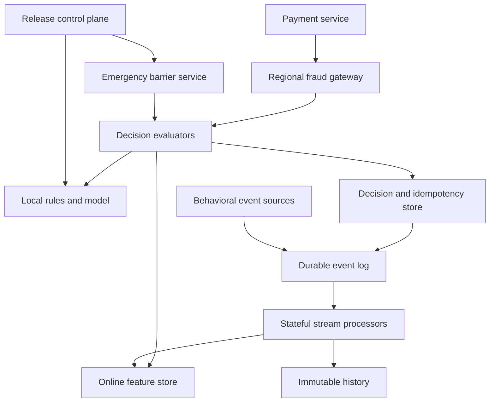

# Design a Real-Time Payment-Fraud Decisioning Platform

**Difficulty:** Senior / Staff  
**Primary themes:** low-latency online serving, stateful streaming, event-time correctness, rules and ML inference, idempotency, reliability, consistency, and graceful degradation

This is a detailed study walkthrough. In a real 45-minute interview, use the stated time boxes to steer the discussion; do not attempt to recite every implementation detail. The organization follows Hello Interview's public delivery framework—requirements, core entities, interfaces, a high-level design built requirement by requirement, then focused deep dives. The problem, assumptions, architecture, and dialogue are original. [Hello Interview recommends making request flows and state changes explicit](https://www.hellointerview.com/learn/system-design/in-a-hurry/delivery).

## Interviewer prompt

> Design a real-time fraud detection platform for a global payment processor. For every card authorization, the platform must return approve, challenge, or decline before the payment deadline. It should combine rules, recent behavioral features, and an ML risk model, then learn from chargebacks and analyst feedback.

## Targeted clarifying questions and assumed answers

**Candidate:** Is this system moving money, or only recommending a fraud decision to the payment authorization service?

**Interviewer:** It returns a risk decision. The payment service owns the financial ledger and final authorization.

**Candidate:** What decisions and traffic should we support?

**Interviewer:** `APPROVE`, `CHALLENGE`, and `DECLINE`. Design for 250,000 peak evaluations per second globally and 10 billion behavioral events per day.

**Candidate:** What latency budget belongs to fraud evaluation?

**Interviewer:** p99 under 50 ms and p99.9 under 100 ms inside a broader payment deadline. Availability should be 99.999% because an unavailable fraud service can block legitimate purchases.

**Candidate:** Which signals are available at decision time?

**Interviewer:** Payment details, device and network signals, merchant information, recent account/card/device behavior, allow/block lists, rules, and an already-trained model. Model training itself can be summarized but is not the main focus.

**Candidate:** How fresh must behavioral features be?

**Interviewer:** Most successful authorizations should affect velocity features within two seconds. Some upstream events arrive late or out of order.

**Candidate:** Should repeated requests return the same answer?

**Interviewer:** Yes. Payment retries with the same merchant and transaction identity must not independently increment velocity counters or receive inconsistent decisions.

**Candidate:** Do rules and model updates have to be instantly global?

**Interviewer:** Normal updates may roll out progressively, but every decision must record exactly which versions it used. Emergency blocks must propagate globally within five seconds and fail closed for the targeted entity.

**Candidate:** What feedback do we receive?

**Interviewer:** Authorization outcome, challenge outcome, confirmed fraud, chargebacks that may arrive weeks later, and analyst labels.

**Candidate:** What is out of scope?

**Interviewer:** Card-network protocols, payment settlement, user-facing challenge UX, and building the entire offline ML training platform.

**Candidate, summarizing aloud:** “I’ll treat this as a decision system beside the payment ledger. The synchronous path must be bounded and highly available; events and labels update durable state asynchronously. I’ll make idempotency, event-time feature semantics, versioned policy, and degradation behavior part of the contract rather than implementation footnotes.”

---

## 1. Requirements (~5 minutes in the interview)

### Core functional requirements

1. **Evaluate a payment in real time.** Combine request facts, cached reference data, behavioral features, rules, and an ML model to return `APPROVE`, `CHALLENGE`, or `DECLINE` with reason codes.
2. **Maintain fresh behavioral state.** Consume payment and security events, deduplicate them, and update time-windowed features such as attempts per card, devices per account, and amount per merchant.
3. **Operate decision logic safely.** Version, validate, deploy, roll back, and audit rule bundles, model releases, thresholds, allow/block lists, and emergency controls.

Feedback ingestion and historical replay support these three requirements. They are important, but the interview should first make the authorization path work.

### Quantified non-functional requirements

| Goal | Target |
|---|---:|
| Peak decision traffic | 250,000 evaluations/second globally |
| Behavioral input | 10 billion events/day; tolerate 3× bursts |
| Fraud-service latency | p99 < 50 ms; p99.9 < 100 ms |
| Decision availability | 99.999% |
| Feature freshness | 99% of accepted source events reflected within 2 seconds |
| Normal configuration rollout | globally convergent within 60 seconds |
| Emergency block propagation | globally enforced within 5 seconds |
| Audit retention | immutable decision evidence for at least 7 years |
| Isolation | tenant/program data and policies cannot cross boundaries |

### Correctness, consistency, and availability contract

- The decision API is idempotent on `(tenant_id, transaction_id)`. A retry with the same immutable request facts returns the original result. Reuse with different facts returns a conflict.
- Each result records `rule_version`, `model_version`, `feature_snapshot_time`, decision-region epoch, reason codes, and a digest of the evaluated request.
- The online feature store provides per-key monotonic versions, not a globally serializable snapshot across card, account, device, merchant, and IP keys. The evaluator detects feature age and version skew.
- Streaming features use event-time windows with a declared lateness policy. Once a decision is made, late events do not retroactively change it; they update future state and offline labels.
- Normal policies and models are eventually deployed but immutable by version. A single decision pins one compatible release manifest so it never mixes arbitrary rule, threshold, and model versions.
- Emergency denies use a separate high-priority barrier. A region that cannot prove it has reached the required barrier must deny or challenge affected entities rather than use stale permission.
- The system favors availability for ordinary scoring and follows a configured degradation matrix when dependencies fail. It does not quietly invent a default.
- “Exactly once” means externally observable state and effects are idempotent under replay. It does not mean every process physically executes each event only once.

**What I would say aloud:**

> “There are three kinds of consistency here. Transaction idempotency prevents a retry from becoming a new risk event. Feature watermarks describe how current behavior is. Version pinning makes the decision reproducible. None of those requires a globally serializable transaction across every feature key.”

### Scale estimates that affect the design

Average behavioral throughput is:

\[
10\text{ billion events}/86{,}400 \approx 116{,}000\text{ events/s}
\]

At a 3× burst, plan for roughly 350,000 events/s. If a normalized event averages 2 KB, peak ingress is about 700 MB/s before replication. Daily raw volume is about 20 TB. This rules out a single relational write path and motivates a partitioned durable log plus stream processors and object storage.

At 250,000 decisions/s and 50 ms average time in the service, Little's Law gives approximately:

\[
250{,}000 \times 0.05 = 12{,}500
\]

concurrent evaluations globally, before burst and failure headroom. A 3× capacity target means tens of thousands of in-flight requests and hundreds or thousands of stateless evaluators, depending on model cost.

Suppose one evaluation reads 20 feature groups. That is 5 million logical feature reads/s. Remote round trips per feature are impossible inside 50 ms, so requests must batch reads by shard, keep tiny reference data and model artifacts locally, and cache hot feature values carefully.

If each transaction fans out to five synchronous third-party enrichment calls, even a 99.9%-available dependency would make the combined success probability roughly `0.999^5 ≈ 99.5%`, far below the target. External reputation feeds must be pre-ingested, cached, or placed behind strict optional timeouts.

### Out of scope

- Payment capture, settlement, refunds, or account balances
- User-facing 3-D Secure or challenge screens
- Card-network transport protocols
- Feature discovery and full model-training infrastructure
- Manual case-management UI implementation
- Guaranteeing that all fraud is detected

---

## 2. Core entities (~2 minutes)

| Entity | Essential fields and purpose |
|---|---|
| `Transaction` | tenant, transaction ID, account/card tokens, merchant, amount/currency, device/network facts, event time |
| `Decision` | transaction ID, outcome, risk score, reason codes, policy/model versions, feature watermark, request digest, latency |
| `BehaviorEvent` | event ID, subject keys, type, amount, event time, ingestion time, source sequence |
| `FeatureValue` | entity key, feature ID, value, event-time watermark, version, expiry |
| `FeatureDefinition` | computation, key, window, allowed lateness, default, online/offline compatibility version |
| `RuleBundle` | immutable rules, priority, action, explanation code, effective interval, version |
| `ModelRelease` | model artifact URI/digest, feature schema, calibration, thresholds, compatibility and rollout state |
| `ReleaseManifest` | compatible rule, model, feature-contract, threshold, and reference-data versions |
| `EmergencyBarrier` | target scope, action, barrier revision, reason, issuer, expiry |
| `Feedback` | transaction, label type, confidence/source, occurred time, observed time |
| `Case` | analyst workflow state, linked decisions/events, disposition |
| `TenantProgram` | tenant identity, data residency, risk appetite, quotas, degradation policy |

**What I would say aloud:**

> “The important entity is the decision evidence, not just the score. Months later, a chargeback investigator must reconstruct which immutable release and which feature snapshot produced the answer.”

---

## 3. API and system interface (~5 minutes)

Service identity is authenticated with mTLS or signed workload tokens. `tenant_id`, permitted payment program, and caller privileges come from verified identity—not request body fields.

### Evaluate a payment

```http
POST /v1/fraud/decisions
Authorization: Bearer <workload-token>
Idempotency-Key: tenantA:txn_8f29
Content-Type: application/json

{
  "transaction_id": "txn_8f29",
  "occurred_at": "2026-10-15T14:01:03.481Z",
  "amount_minor": 12999,
  "currency": "USD",
  "payment_token": "card_tok_71c",
  "account_id": "acct_52a",
  "merchant_id": "merch_91d",
  "device_id": "dev_31b",
  "ip": "203.0.113.24",
  "channel": "ECOMMERCE"
}
```

```json
{
  "decision_id": "fd_01JAF...",
  "transaction_id": "txn_8f29",
  "outcome": "CHALLENGE",
  "risk_score": 0.872,
  "reason_codes": ["CARD_VELOCITY_HIGH", "NEW_DEVICE"],
  "release_manifest": "risk-us-v1842",
  "feature_snapshot_time": "2026-10-15T14:01:02.901Z",
  "degraded": false,
  "expires_at": "2026-10-15T14:06:03Z"
}
```

The response is the durable idempotency result. It should not expose raw rule expressions, internal model features, or attacker-useful thresholds.

### Submit an outcome or label

```http
POST /v1/fraud/feedback
Authorization: Bearer <workload-token>
Idempotency-Key: chargeback:cb_771
Content-Type: application/json

{
  "feedback_id": "cb_771",
  "transaction_id": "txn_8f29",
  "label": "CONFIRMED_FRAUD",
  "occurred_at": "2026-11-28T16:13:00Z",
  "source": "CHARGEBACK"
}
```

The synchronous response only confirms durable acceptance. Feature correction, case linkage, training-data updates, and metrics happen asynchronously and idempotently.

### Publish a release manifest

```http
POST /v1/fraud/releases
Authorization: Bearer <operator-token>
Idempotency-Key: release-risk-us-v1843
Content-Type: application/json

{
  "model_version": "model_219",
  "rule_version": "rules_882",
  "feature_contract": "features_71",
  "threshold_version": "thresholds_313",
  "rollout": {"mode": "CANARY", "percent": 1}
}
```

The caller must have a deployment role. The control plane validates compatibility, signatures, offline quality gates, and approval policy before making the release eligible.

### Install an emergency barrier

```http
POST /v1/fraud/emergency-barriers
Authorization: Bearer <privileged-operator-token>
Content-Type: application/json

{
  "target": {"payment_token": "card_tok_71c"},
  "action": "DECLINE",
  "reason": "CONFIRMED_ACCOUNT_TAKEOVER",
  "expires_at": "2026-10-16T14:00:00Z"
}
```

This is a privileged, dual-controlled path with stricter audit and propagation semantics than a normal model rollout.

### System interface for event ingestion

Producers write versioned envelopes to the durable event log:

```json
{
  "event_id": "evt_773",
  "tenant_id": "derived-by-ingress-credential",
  "source": "authorization-service",
  "source_partition": 41,
  "source_sequence": 9918271,
  "event_time": "2026-10-15T14:01:03.481Z",
  "type": "AUTHORIZATION_APPROVED",
  "schema_version": 8,
  "payload": {}
}
```

Schema compatibility is enforced at ingress. Sensitive values use tokens; raw card numbers must never enter general logs or analytics streams.

---

## 4. Data flow

### Online decision flow

1. The regional gateway authenticates the payment service, derives tenant/program identity, validates the request, and applies request and cost limits.
2. The idempotency service looks up `(tenant, transaction_id)`. A completed matching request returns its stored decision; a conflicting payload is rejected.
3. The evaluator checks the local emergency-barrier snapshot before any permissive result.
4. A feature client derives entity keys and batch-fetches recent online features from local-region shards, including values, versions, and watermarks.
5. The local rule engine evaluates deterministic allow/deny/challenge rules.
6. The model server evaluates the pinned model using request facts and features. A policy combiner applies precedence and calibrated thresholds.
7. The system durably records decision evidence and the idempotency result, publishes a `DECISION_MADE` event through an outbox, and returns the response.

### Streaming feature flow

1. Authorization, login, device, merchant, challenge, and feedback producers append events to a replicated log.
2. A normalizer validates schema, tokenizes restricted identifiers, deduplicates source events, and emits a canonical event.
3. Stateful jobs key the stream by card, account, device, merchant, or IP; update event-time windows and sketches; checkpoint their state; and write versioned feature updates.
4. The online feature sink conditionally applies newer versions. The same canonical events also land in immutable object storage for replay, audit, and offline training.
5. Late events inside the allowed-lateness bound revise future online features. Very late events remain in history but do not rewrite past decisions.

### Release flow

1. Operators submit signed, immutable artifacts and a compatibility manifest.
2. Validation runs schema, determinism, latency, security, quality, and bias checks.
3. Evaluators prefetch the release, verify digests, and acknowledge readiness.
4. Traffic moves through shadow, canary, and percentage stages while comparing outcomes and operational metrics.
5. A small strongly consistent pointer selects the active manifest per tenant/program/region. Rollback changes the pointer; artifacts remain immutable.

---

## 5. High-level design (~10–15 minutes)



Separate the **serving plane**, **streaming plane**, and **control plane**. The serving plane has no synchronous dependency on the training system or third-party feeds. Stream lag should reduce feature freshness, not directly take down authorization. Control-plane unavailability should prevent new releases but not stop evaluators using an already verified release.

### Step 1: Make one synchronous decision work

Begin with one evaluator, a rule bundle, one model loaded in memory, and a database containing a few behavioral counters. For each payment:

1. validate the request;
2. fetch features;
3. evaluate emergency controls and rules;
4. run the model;
5. combine the results;
6. store and return the decision.

Rule precedence might be:

1. mandatory regulatory or confirmed-compromise decline;
2. trusted allow rule, unless a non-overridable deny exists;
3. deterministic challenge/decline rule;
4. model score mapped through tenant thresholds;
5. explicit degradation policy.

Precedence is configuration, not scattered `if` statements. Every matched rule produces a stable internal explanation code.

**What I would say aloud:**

> “The simplest complete system evaluates one request end to end. I would first define precedence and persist reproducible evidence. Scaling a non-deterministic or unauditable decision engine only creates faster incidents.”

### Step 2: Make retries safe

Payment clients retry after timeouts. Before evaluation, reserve an idempotency record with request digest and state `IN_PROGRESS`. Only one owner evaluates; duplicates wait briefly or receive a retryable status. Completion atomically stores the response.

If a process crashes after storing the decision but before sending the response, the retry returns the stored answer. If it crashes before completion, a lease expires and another evaluator resumes. The transaction's own behavioral event is emitted from the same durable decision transaction using an outbox, so a response cannot permanently succeed without the event eventually reaching the stream.

Idempotency keys are common in payment APIs precisely because network failures make retries unavoidable; Stripe's public API documentation describes returning the saved result for a repeated key ([Stripe idempotent requests](https://docs.stripe.com/api/idempotent_requests)).

### Step 3: Move slow-changing data into local snapshots

Evaluators hold immutable, signed snapshots of:

- rule bytecode or a restricted rule AST;
- model artifact and inference runtime;
- thresholds and calibration tables;
- merchant/reference data small enough to cache;
- emergency-barrier indexes;
- feature definitions and default policy.

Snapshots are keyed by release manifest and loaded with read-copy-update semantics: new requests use the new snapshot while in-flight requests finish on the old one. This removes network calls from the hot path and prevents half-updated releases.

### Step 4: Add a sharded online feature store

Key features by `(tenant, entity_type, entity_id, feature_group)`. Partition with consistent hashing and keep three replicas across zones. The API batch-gets all groups for the request, returning:

```text
value, feature_version, event_time_watermark,
computed_at, definition_version, expiry
```

Values are denormalized for serving. This is not a general query database; it supports point reads, conditional versioned writes, TTL, and perhaps atomic operations within one entity key.

Maintain a bounded near-cache in each evaluator for stable or frequently reused features. Cache entries include tenant, feature definition, and value version. Very short TTLs or update invalidations are appropriate for velocity features; long TTLs are acceptable for merchant category or account age.

### Step 5: Build event-time features with stateful streams

Partition canonical events by the key required for a feature. A card-velocity operator owns state for each card and maintains windows such as:

- attempts in 1 minute and 1 hour;
- approved amount in 24 hours;
- distinct devices in 7 days;
- countries seen in 30 days.

Event time represents when behavior occurred; ingestion time represents when the platform saw it. A watermark estimates that no much-earlier events are likely to arrive. Windows remain revisable until the allowed-lateness boundary.

One event may update features for multiple entity types. The normalizer emits derived keyed records to card, account, device, merchant, and IP streams. Updates carry deterministic versions such as `(source partition, offset)` or a job epoch plus per-key sequence, allowing the online store to reject stale replayed writes.

### Step 6: Add multi-region placement

Route a payment to the nearest healthy region allowed by data residency. Each region has evaluators, feature replicas, an idempotency/decision store, log capacity, and pinned release artifacts.

For transaction idempotency, use a deterministic home region based on tenant and transaction ID, or a globally routable strongly consistent decision key. Avoid independent active-active creation of the same transaction. If the normal region fails, failover obtains a higher fencing epoch before taking ownership.

Behavioral features may converge asynchronously across regions. Events replicate through the durable log, and each response records its regional feature watermark. For high-risk cross-region patterns, maintain compact globally replicated deny/barrier state separately from the full feature set.

### Step 7: Close the feedback loop

Challenge outcomes, confirmed fraud, chargebacks, and analyst actions join back to the original decision ID. Store both event time and observation time: a chargeback may describe a purchase from weeks ago but become known today.

Feedback drives:

- future behavioral features and block lists;
- analyst cases and graph investigations;
- precision/recall and financial-loss metrics by release;
- immutable training examples with point-in-time feature joins;
- drift and calibration monitoring.

Never train using features computed after the historical decision time. That would create label leakage and unrealistic offline results.

---

## 6. Deep dives (~10–15 minutes)

### Deep dive A: Staying below 50 ms without sacrificing feature integrity

#### Where the baseline breaks

Sequential feature reads, synchronous external calls, and a remote model service can consume the entire deadline. Tail latency multiplies when a request fans out. Meanwhile, aggressive caching can serve counters that are too stale to catch a burst of card testing.

#### Budget the latency explicitly

An example p99 budget:

| Stage | Budget |
|---|---:|
| Gateway, authentication, validation | 3 ms |
| Idempotency lookup/reservation | 5 ms |
| Emergency and release lookup | 1 ms local |
| Batched feature fetch | 15 ms |
| Rules | 2 ms |
| Model inference | 10 ms |
| Combine and durable decision commit | 10 ms |
| Network/serialization reserve | 4 ms |
| **Total** | **50 ms** |

This is not a promise that every stage always consumes exactly its slice. It forces architectural choices and makes timeout ownership clear.

#### Compare feature-serving approaches

| Approach | Benefit | Problem |
|---|---|---|
| Query analytical warehouse | Flexible and complete | Far too slow and unpredictable |
| Read raw events and compute per request | Fresh in theory | Unbounded work and I/O |
| Precomputed online features | Bounded point reads | Eventual freshness and duplication complexity |
| Evaluator-local state only | Extremely fast | Poor durability, rebalance, and global consistency |

Choose precomputed online features with evaluator caches. Batch fetch by storage shard in parallel, set a small deadline, and return age metadata. Co-locate feature replicas with evaluators. Pre-ingest optional device/IP intelligence so third parties are not synchronous dependencies.

#### The read-your-own-event problem

The current transaction has not yet passed through streaming computation. Rules and the model must combine **stored history plus current request facts**. For example, if `attempts_last_minute=9`, the evaluator can compute the decision-time feature as 10 without waiting for the stream to round-trip. Later the outbox event updates durable state once. This is sometimes called a write-around or request-time delta.

For a retry, idempotency returns the existing decision before applying the delta again. That prevents one payment from appearing as multiple attempts merely because the caller timed out.

#### Degradation matrix

Predefine behavior by dependency and tenant risk appetite:

| Failure | Low-risk fallback | High-risk fallback |
|---|---|---|
| One feature replica slow | hedge to another replica | hedge; challenge if stale beyond bound |
| Feature store unavailable | local cached stable features + conservative model | challenge or decline selected segments |
| Model unavailable | deterministic rules and emergency controls | challenge unless allowlisted by non-overridable policy |
| Stream lag high | mark degraded; tighten threshold | challenge/decline categories needing fresh velocity |
| Control plane unavailable | use last verified release | use last verified release |
| Emergency barrier freshness unknown | only unaffected entities may use normal policy | fail closed for barrier scope |

Do not use one universal `APPROVE` fallback. The cost of false positives and false negatives varies by merchant, payment channel, value, and regulation.

#### Tail controls

- bounded feature and inference deadlines;
- hedged feature reads only after a percentile threshold, not immediately;
- admission control by tenant and work cost;
- preallocated inference workers and bounded queues;
- circuit breakers for optional enrichments;
- bulkheads so one tenant, model, or feature shard cannot exhaust all threads;
- load shedding that preserves emergency checks and high-value traffic.

**What I would say aloud:**

> “The latency SLO belongs to the whole critical path, so I assign budgets. Historical features are precomputed and batch-read locally; the current request is added as an in-memory delta. Optional intelligence is pre-ingested. Every dependency has a deadline and an explicit risk-aware fallback.”

### Deep dive B: Correct stateful streaming under duplicates, lateness, and replay

#### Where the baseline breaks

At-least-once delivery repeats events after retries or recovery. Out-of-order events corrupt naïve windows. A processor may checkpoint state but crash after updating an external feature store, causing the update to run again. Claiming “Kafka gives exactly once” does not automatically protect a database sink.

#### Source identity and deduplication

Require a stable `event_id` or `(source, partition, sequence)`. Keep bounded deduplication state based on the maximum retry horizon. For permanent audit, the immutable log may contain duplicates; canonical processing suppresses duplicate effects.

Producers use idempotent publication and transactions where multiple log records must appear atomically. Kafka's design documentation distinguishes idempotent production and transactional read-process-write behavior within Kafka ([Apache Kafka design](https://kafka.apache.org/40/design/design/)). It does not magically make an arbitrary external database transactional.

#### Stateful checkpoints

Stream operators periodically take a consistent snapshot of keyed state and source offsets. On failure they restore the snapshot and replay. Apache Flink documents this checkpoint-and-replay approach for exactly-once state consistency ([Flink stateful stream processing](https://nightlies.apache.org/flink/flink-docs-stable/docs/concepts/stateful-stream-processing/)). The meaningful guarantee is that recovered logical state is equivalent to applying each canonical event once.

#### Idempotent sink

Feature updates use conditional writes:

```text
apply update only if incoming_feature_version > stored_feature_version
```

For non-commutative aggregates, write a complete materialized value tied to the checkpoint or use a transactional sink. For naturally mergeable values, use deterministic deltas plus a dedupe key. A sink acknowledgment before checkpoint completion is safe to replay because the same version has no second effect.

#### Event-time semantics

Consider these events:

```text
10:00:05 purchase A arrives
10:00:09 purchase C arrives
10:00:07 purchase B arrives late
```

A one-minute event-time window should include A, B, and C regardless of arrival order. The watermark delays finalization enough to accept typical disorder. Allowed lateness is a business choice: a larger bound improves historical correctness but retains more state and delays final output.

The online path need not wait for windows to finalize. It publishes provisional monotonic feature versions as events arrive. A late event can revise the current feature value, but it never changes the immutable decision already returned.

#### Hot keys and skew

A globally popular merchant or shared NAT IP can overload one partition. Options:

- salt high-volume keys into subpartitions, compute partial aggregates, then merge;
- use approximate sketches for distinct counts and heavy hitters;
- isolate known hot merchants;
- separate card/account exact counters from merchant/IP approximate features;
- dynamically split state only through a checkpointed rescaling procedure.

For a count-min sketch or HyperLogLog, document that the feature is approximate. Model training and online serving must use compatible computation; otherwise training-serving skew overwhelms small accuracy gains.

#### Backfill and replay

Reprocessing historical data writes to a new feature namespace or computation version, never directly over the live namespace. Compare the backfill against current results, then atomically switch the feature contract in a release manifest. Rate-limit replay so it cannot starve fresh events.

### Deep dive C: Safe rule/model deployment, reproducibility, and adversarial reliability

#### Where the baseline breaks

A bad model or threshold can decline millions of good payments before humans react. Independently deploying rules, models, and feature definitions can create incompatible combinations. Fraudsters adapt to observable behavior, so detailed explanations and predictable thresholds become attack surfaces.

#### Immutable compatibility manifest

One manifest binds:

```text
model digest
feature schema and definitions
rule bundle
threshold/calibration table
reference-data snapshot
inference runtime compatibility
```

Artifacts are content-addressed and signed. Evaluators reject an incomplete or incompatible manifest. Every request pins one manifest for its lifetime, and every decision stores the manifest ID.

#### Promotion stages

1. **Offline gates:** schema compatibility, point-in-time validation, latency/load tests, calibration, segment performance, and policy review.
2. **Shadow:** score live traffic without influencing outcomes; compare latency, scores, and disagreement.
3. **Canary:** affect a small deterministic cohort so retries remain in the same cohort.
4. **Progressive rollout:** increase by region and tenant while monitoring technical and business guardrails.
5. **Promotion or rollback:** atomically change the active manifest pointer.

Guardrails include approval rate, challenge rate, estimated fraud loss, false-positive proxies, latency, errors, feature-default rate, score distribution, and subgroup drift. Delayed chargebacks mean immediate metrics cannot prove final fraud quality, so use both leading and lagging signals.

#### Emergency changes

Emergency barriers are deliberately separate from the normal release pipeline. They are tiny, fast to replicate, monotonic by revision, scoped, expiring, and auditable. Evaluators acknowledge barrier revision. A privileged operation requires dual control, and broad barriers have blast-radius confirmation.

A rule intended to block a compromised card should not wait for a model release. Conversely, emergency infrastructure should not become a convenient unreviewed general rule system.

#### Explainability without helping attackers

Internally store matched rule IDs, major model factors, feature versions, and decision traces. Externally return coarse reason codes suitable for the payment workflow. Restrict detailed traces to audited analyst access and redact payment credentials.

#### Security and privacy

- tokenize PANs before general processing and keep PCI scope narrow;
- encrypt data in transit and at rest with tenant/program context;
- never log raw credentials, unrestricted feature vectors, or full request bodies;
- authorize analyst access by case and purpose;
- enforce retention and regional residency;
- sign release artifacts and verify them in evaluators;
- isolate rule execution in a restricted deterministic language with CPU and memory limits;
- rate-limit probing and monitor repeated near-threshold attempts.

#### Reliability failure modes

- **Evaluator crashes after decision commit:** retry returns the durable decision.
- **Outbox publisher repeats:** event ID makes downstream effects idempotent.
- **Feature shard loses a leader:** clients retry another replica using a bounded deadline.
- **Stream processor fails:** restore checkpoint and replay; conditional sink versions suppress repeats.
- **Model artifact is corrupt:** digest verification fails before activation; old manifest remains active.
- **Canary metrics regress:** controller freezes rollout and rolls back the pointer.
- **Region partitions:** local serving continues on the last verified manifest; ownership epochs fence decision/idempotency writes after failover.
- **Barrier stream is stale:** targeted operations fail closed according to the barrier contract.

#### Observability

Technical signals:

- latency by stage, region, tenant, release, and outcome;
- feature batch latency, cache hit ratio, default rate, age, and watermark lag;
- stream consumer lag, late-event rate, checkpoint duration/failure, and hot-key skew;
- model inference queue, runtime errors, and artifact load failures;
- idempotency conflicts, duplicate waits, outbox age, and decision-event mismatch;
- release adoption, barrier acknowledgments, degraded decisions, and failover epoch.

Decision-quality signals:

- approval, challenge, and decline rate;
- confirmed-fraud and chargeback loss per dollar approved;
- false-positive estimates and challenge completion;
- score calibration and population stability;
- performance by merchant, channel, geography, and legally reviewed cohorts;
- rule hit rate, overlap, and marginal contribution;
- model/rule disagreement and reason-code drift.

Alert on changes, not only fixed thresholds. A stable 20-ms model that suddenly approves 15% more high-value transactions is an incident even though CPU and latency are green.

**What I would say aloud:**

> “The deployment unit is a signed compatibility manifest, not an independent model file. I shadow, canary deterministically, and promote behind business and technical guardrails. Every decision remains reproducible. Emergency denies use a smaller monotonic barrier path with stronger propagation semantics.”

---

## 7. Final design and interview close

### Concise final design

The payment service calls a regional fraud gateway using authenticated workload identity and an idempotency key. The gateway reserves the transaction identity, checks the current emergency barrier, and sends the request to a stateless evaluator pinned to one immutable release manifest. The evaluator batch-reads versioned recent features from a local replicated online store, combines them with the current request, executes deterministic rules and an in-memory model, applies tenant thresholds and degradation policy, and durably stores decision evidence before replying.

An outbox publishes each completed decision exactly effectively once. Authorization, device, challenge, feedback, and decision events enter a replicated log. Stateful processors deduplicate, compute event-time keyed windows, checkpoint state, and conditionally write monotonically versioned online features. Immutable events also land in object storage for audit, replay, point-in-time training joins, and investigation.

A separate control plane validates signed rule, model, feature, threshold, and reference artifacts; binds compatible versions in a release manifest; and rolls them out through shadow, deterministic canary, and progressive stages. Tiny emergency barriers follow a higher-priority monotonic replication path. Multi-region serving uses ownership epochs for idempotent decision writes, bounded-lag feature replicas, local artifacts, and risk-specific degradation policies.

### Requirements check

| Requirement | Design support |
|---|---|
| Real-time approve/challenge/decline | Regional stateless evaluators with local rules/model |
| p99 below 50 ms | Explicit stage budgets, batched local feature reads, no synchronous third parties |
| 99.999% availability | Multi-zone replicas, local snapshots, bulkheads, risk-aware degradation |
| Retry safety | Transaction-scoped idempotency record and stored response |
| Fresh behavior | Partitioned stateful streaming and online feature store |
| Out-of-order events | Event-time windows, watermarks, and allowed lateness |
| Replay safety | Stable event IDs, checkpoints, and conditional versioned sinks |
| Reproducible decisions | Immutable evidence and pinned release manifest |
| Safe deployments | Signed artifacts, compatibility gates, shadow/canary/rollback |
| Emergency blocking | Separate monotonic barrier with fail-closed scope |
| Feedback loop | Durable outcomes linked to original decisions and history |
| Global operation | Regional serving, replicated events, fenced failover epochs |
| Audit and privacy | Tokenization, redacted immutable evidence, long retention |

## Realistic interviewer follow-up questions with strong sample answers

**Interviewer:** Why not call the feature-stream processor synchronously and get perfectly fresh counters?

**Candidate:** “That couples authorization availability and tail latency to stream scheduling. I batch-read the latest materialized history and add the current request as a local delta. The outbox later advances durable streaming state. The response records the feature watermark so freshness is observable.”

**Interviewer:** Can you guarantee exactly-once processing?

**Candidate:** “I guarantee exactly-once logical effects within stated boundaries: dedupe canonical events, checkpoint operator state and offsets, and make sink writes conditional on monotonic versions. A process can execute an event again after failure. Kafka transactions cover Kafka read-process-write, not an arbitrary external database by themselves.”

**Interviewer:** How does the same event update card, account, and device features atomically?

**Candidate:** “It usually does not need a distributed transaction across all keys. The canonical event is durable, each keyed update is idempotent, and features expose versions and watermarks. The evaluator tolerates bounded skew. Security barriers that require stronger semantics use a separate strongly propagated path.”

**Interviewer:** What if the model and rules disagree?

**Candidate:** “A versioned combiner defines precedence. Non-overridable hard denies win, then carefully scoped allow rules, then other deterministic actions, then model thresholds. The decision records both outputs and the winning reason so we can measure disagreement and tune policy.”

**Interviewer:** Why have `CHALLENGE` instead of only approve or decline?

**Candidate:** “It converts uncertainty into an additional signal. For medium-risk payments, challenge can reduce fraud without the customer cost of a hard decline. The threshold is optimized against fraud loss, challenge abandonment, and false positives.”

**Interviewer:** How do you avoid counting a retry twice?

**Candidate:** “The idempotency result is checked before applying the request-time delta. The decision outbox has a stable event ID, and downstream stream operators deduplicate it. Same transaction and same request returns the first decision; changed request facts produce a conflict.”

**Interviewer:** What happens when a chargeback arrives six weeks later?

**Candidate:** “Store observation time separately from the original transaction's event time and link the label to the immutable decision. It updates evaluation and future features, but never rewrites the historical response. Training uses a label-maturity policy so recent negatives are not incorrectly treated as legitimate.”

**Interviewer:** How do you perform point-in-time-correct training?

**Candidate:** “Join each historical transaction only to feature values whose event-time visibility was available at that decision time, using versioned offline history. Never use a later chargeback-derived feature to predict the earlier payment. Then verify online and offline feature definitions are compatible.”

**Interviewer:** What if one merchant is 20% of global traffic?

**Candidate:** “Exact card/account state stays naturally distributed. For merchant aggregates, salt the hot merchant into partial keys and merge, or use mergeable sketches. Isolate known hot tenants or merchants and monitor skew. The approximation becomes part of the feature contract.”

**Interviewer:** Why not put rules in the database and read them on every request?

**Candidate:** “That adds latency and lets one decision observe partial updates. I compile a restricted rule language into an immutable signed bundle, bind it to the release manifest, and load it locally. The database stores control metadata, not a synchronous rule lookup.”

**Interviewer:** How do you roll out a model without retries getting different answers?

**Candidate:** “Canary assignment is deterministic on tenant and transaction ID. More importantly, the idempotency record stores the first response. Once a transaction is evaluated, a retry returns that result even if the active manifest changes.”

**Interviewer:** What do you do if feature lag rises to ten minutes?

**Candidate:** “Expose age and watermark, alert immediately, and apply the tenant's degradation matrix. Stable features and current request facts may still support low-risk approvals; velocity-sensitive or high-value traffic shifts toward challenge or decline. I do not pretend a stale counter is fresh.”

**Interviewer:** How do you handle a regional outage?

**Candidate:** “Route to a prepared region, allocate a higher ownership epoch, and fence old decision writers. The new region already has verified release artifacts, replicated decision/idempotency state or deterministic routing, event-log history, and feature replicas. It serves with explicit watermark/degraded status while catching up.”

**Interviewer:** How would you add graph-based fraud detection?

**Candidate:** “Build an asynchronous graph pipeline connecting accounts, cards, devices, IPs, and merchants. Materialize bounded graph features—shared compromised devices, risky-neighbor counts, community risk—into the same online store. Do not traverse an unbounded graph synchronously in the 50-ms path.”

**Interviewer:** What would you build first?

**Candidate:** “Single-region idempotent evaluation with rules, one model, a basic online feature store, durable evidence, and an outbox. Then add stateful streaming, release manifests and canaries, multi-zone resilience, emergency barriers, multi-region failover, and advanced feedback/graph features.”

## Common pitfalls

1. Treating the fraud service as the payment ledger.
2. Starting with ML training instead of the synchronous decision path.
3. Making external reputation providers synchronous hard dependencies.
4. Reading every feature separately rather than batching by shard.
5. Omitting a stage-by-stage latency budget.
6. Retrying a payment as a new decision and double-counting velocity.
7. Claiming exactly-once because a queue or framework has that marketing label.
8. Ignoring the sink when reasoning about replay.
9. Using processing time when the business feature needs event time.
10. Allowing late events to rewrite decisions already returned.
11. Failing to store feature watermarks and versions with the decision.
12. Requiring a distributed transaction across every entity feature.
13. Mixing independently deployed feature, model, rule, and threshold versions.
14. Loading a model without digest and compatibility verification.
15. Sending a new release directly to 100% of traffic.
16. Assigning canaries randomly on every retry.
17. Having no explicit rule/model precedence.
18. Returning attacker-useful thresholds or internal rule expressions.
19. Using one universal approve-on-failure policy.
20. Letting stream lag silently reduce fraud protection.
21. Training with features observed after the historical decision.
22. Treating recent unlabeled transactions as confirmed legitimate.
23. Updating a broad emergency rule through the slow normal release path.
24. Turning emergency controls into an unreviewed general policy engine.
25. Logging raw card data, full requests, or sensitive model inputs.
26. Monitoring CPU and latency without approval rate, fraud loss, or calibration.
27. Ignoring hot merchants, shared IPs, and partition skew.
28. Replaying history directly over the live feature namespace.
29. Failing over without fencing the old region's decision writers.
30. Claiming perfect fraud detection instead of discussing cost tradeoffs.

## A polished 60-second close

> “The service is a low-latency regional decision plane backed by an asynchronous behavioral pipeline. Authenticated payment requests reserve an idempotency key, check high-priority emergency barriers, batch-read versioned online features, add the current request as a local delta, and run a pinned rule/model manifest entirely from local artifacts. A policy combiner returns approve, challenge, or decline, and the system durably stores the result and evidence before responding. An outbox sends canonical events to a replicated log; checkpointed stateful processors compute event-time features and write them through monotonic conditional updates, making replay safe. Signed compatibility manifests bind rules, features, models, thresholds, and reference data and roll out through shadow and deterministic canary stages. Every dependency has a latency budget and a risk-specific degradation policy. Multi-region failover uses fenced ownership epochs, while tiny emergency barriers propagate with stronger semantics than normal releases. I monitor not only latency and errors, but feature age, replay health, approval shifts, calibration, false-positive proxies, and eventual fraud loss.”

## References

- [Hello Interview — System Design Delivery Framework](https://www.hellointerview.com/learn/system-design/in-a-hurry/delivery)
- [Apache Flink — Stateful Stream Processing](https://nightlies.apache.org/flink/flink-docs-stable/docs/concepts/stateful-stream-processing/)
- [Apache Flink — Checkpointing](https://nightlies.apache.org/flink/flink-docs-stable/docs/dev/datastream/fault-tolerance/checkpointing/)
- [Apache Kafka — Design: Idempotence and Transactions](https://kafka.apache.org/40/design/design/)
- [Apache Kafka — KIP-98: Exactly Once Delivery and Transactional Messaging](https://cwiki.apache.org/confluence/spaces/KAFKA/pages/66854913/KIP-98+-+Exactly+Once+Delivery+and+Transactional+Messaging)
- [Stripe — Idempotent Requests](https://docs.stripe.com/api/idempotent_requests)
