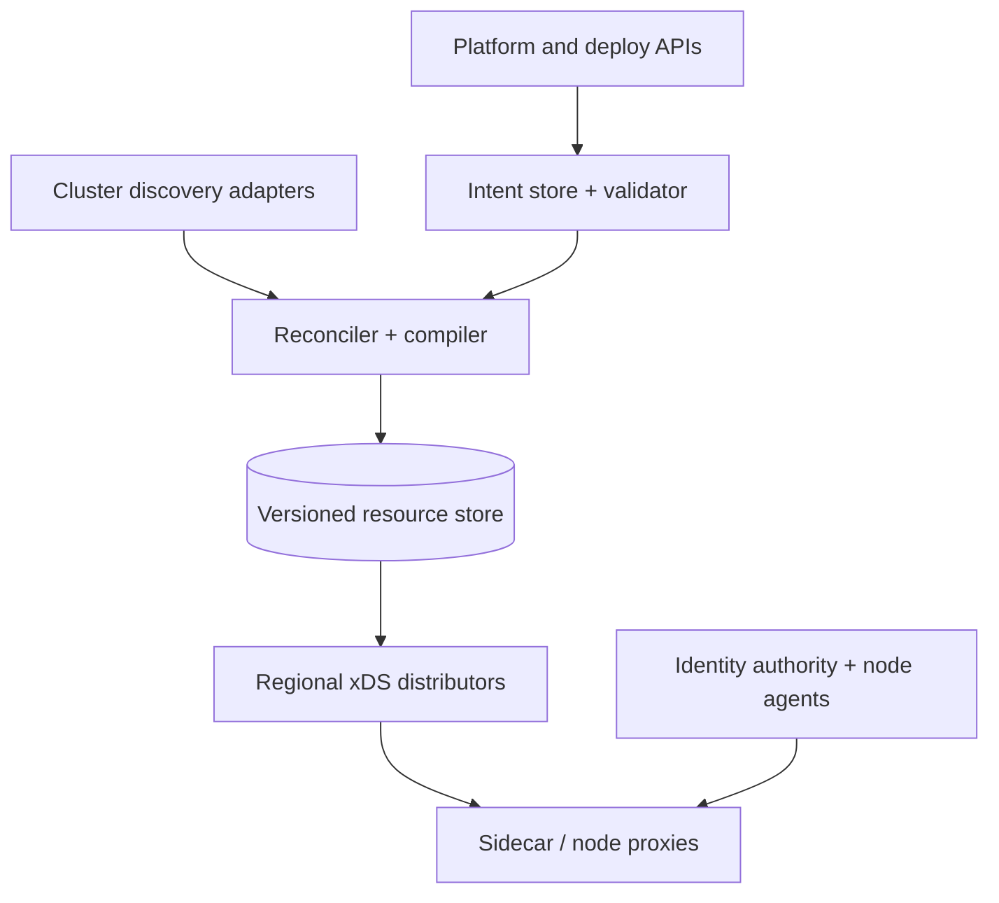

# Design a Global Service-Mesh Control Plane

**Difficulty:** Staff  
**Primary themes:** control/data-plane separation, configuration compilation, streaming fan-out, consistency, safe rollout, workload identity, reliability  
**Interview time budget:** requirements 5 minutes, entities 2 minutes, interface 5 minutes, high-level design 10–15 minutes, deep dives 10–15 minutes. The walkthrough below is intentionally more detailed than the spoken interview.

This problem tests whether you can distribute rapidly changing, interdependent configuration without putting a central service in the application request path. The most important rule is:

> A control-plane outage may delay configuration changes, but it must not interrupt traffic already handled by healthy proxies.

The structure follows Hello Interview’s public delivery framework: define requirements, identify entities, map interfaces, build a working design requirement by requirement, then harden the most important non-functional requirements ([System Design Delivery Framework](https://www.hellointerview.com/learn/system-design/in-a-hurry/delivery)). The design and dialogue are original.

## Interviewer prompt

> Design a global control plane for a service mesh. The platform should discover workloads, configure sidecar or node proxies for service-to-service routing, enforce traffic and security policies, and distribute workload identities across multiple clusters and regions.

## Targeted clarifying questions and assumed answers

**Candidate:** Are we designing the proxies too, or only the management system?  
**Interviewer:** Treat Envoy-like proxies as given. Design the control plane, its APIs, and its contract with proxies.

**Candidate:** Which configuration features are required?  
**Interviewer:** Service discovery, listeners, routes, clusters, endpoints, retries/timeouts, canary weights, authorization policy, and mTLS certificates.

**Candidate:** What is the deployment scale?  
**Interviewer:** One million connected proxies across 100,000 services, 100 regions, and thousands of clusters. At peak, 200,000 workload endpoints change per second during deploys or autoscaling.

**Candidate:** What propagation targets matter?  
**Interviewer:** Ninety-nine percent of endpoint changes should reach affected proxies in under five seconds. Policy and route changes should reach them in under 30 seconds. Emergency revocation should be as fast as possible, targeting five seconds.

**Candidate:** What are the availability requirements?  
**Interviewer:** Existing application traffic should continue during a control-plane or WAN outage. Configuration APIs target 99.95% availability; proxy traffic targets 99.99% or better and must not depend synchronously on control-plane availability.

**Candidate:** What consistency do dependent resources need?  
**Interviewer:** A proxy must not activate a route that references an unknown cluster, or a cluster whose required endpoints/secrets are unusable. Across proxies, temporary version skew is acceptable, but one proxy’s applied view must be internally valid.

**Candidate:** Do we need workload identity?  
**Interviewer:** Yes. Use short-lived workload certificates with automated rotation and trust-bundle distribution. Multi-cluster trust and gradual CA rotation matter.

**Candidate:** Should offline or partitioned proxies keep serving?  
**Interviewer:** Yes, from last-known-good configuration and unexpired credentials. Define limits and fail-safe behavior.

**Candidate:** What is out of scope?  
**Interviewer:** Implementing L7 proxy internals, the underlying orchestrator, a full PKI/HSM product, and application business logic.

### What I would say aloud

> “I’ll separate an authoring plane, which stores user intent, from a compilation and distribution plane, which produces a proxy-specific immutable snapshot. Proxies ACK only valid resources, retain last-known-good state on NACK or disconnect, and keep application traffic local. I’ll prioritize dependency-safe publication, million-stream fan-out, and certificate rotation.”

## 1. Requirements (~5 minutes)

### Core functional requirements

1. **Ingest intent and discovery.** Accept service, routing, resilience, authorization, and trust policies; continuously reconcile workload endpoints from orchestrators and VM registries.
2. **Compile and distribute proxy configuration.** Convert global intent into the minimal listeners, routes, clusters, endpoints, secrets, and policies required by each proxy; stream changes and process ACK/NACK feedback.
3. **Issue and rotate workload identity.** Attest workloads, issue short-lived identities, distribute trust bundles and certificates, and revoke or rotate safely.

### Quantified non-functional requirements

| Dimension | Target | Design consequence |
|---|---:|---|
| Connected proxies | 1 million | Hierarchical regional fan-out; persistent-stream sharding |
| Endpoint churn | 200K changes/s peak | Incremental updates, coalescing, locality filtering, backpressure |
| Endpoint propagation | p99 <5 s to affected proxies | Streaming distribution and precomputed dependency indexes |
| Route/policy propagation | p99 <30 s | Validation, staged compilation, ACK/NACK telemetry |
| Data-plane availability | ≥99.99% | Proxy retains last-known-good config; no synchronous control call per request |
| Control API availability | 99.95% | Multi-AZ authoring service and durable intent log |
| Safety | No invalid cross-resource activation | Versioned dependency graph and atomic snapshot/ordered apply |

### Consistency and availability contract

- **Authoring:** configuration changes for one tenant/mesh use optimistic concurrency and are durably ordered. Conflicting updates do not silently overwrite one another.
- **Per-proxy view:** every accepted snapshot is internally consistent. A proxy either applies a valid new resource version or retains the last-known-good version.
- **Across proxies:** eventual consistency is acceptable during rollout. Version skew is measured and bounded by SLO, not hidden.
- **Discovery:** endpoint membership is eventually consistent and optimized for availability. Local active health checks can remove a failed endpoint faster than global control-plane convergence.
- **Partition behavior:** proxies keep serving existing traffic. New config, new endpoints, and certificate renewal may be unavailable. Once credentials reach an explicit expiry boundary, security policy determines fail closed rather than silently extending trust forever.

### Scope boundaries

In scope are northbound intent APIs, discovery ingestion, validation, compilation, xDS-style distribution, rollout, identity delivery, caching, observability, and disaster recovery. Proxy packet processing, Kubernetes itself, application authentication, and CA key implementation are external.

## Scale estimates that change decisions

One million long-lived gRPC streams cannot terminate on a small central fleet. If one distributor safely maintains 20,000 streams after memory, TLS, and failure headroom, we need at least:

\[
1{,}000{,}000 \div 20{,}000 = 50
\]

distributors just for steady connections, likely hundreds after regional placement, redundancy, upgrades, and burst headroom.

A full snapshot of listeners, routes, clusters, and endpoints might be 5 MB for a moderately connected proxy. Broadcasting it to every proxy for each event would make one rollout cost 5 PB of logical transfer. At 200,000 endpoint events per second, full-state fan-out is impossible. We therefore need:

- dependency-based subscriptions so only affected proxies receive an update;
- delta resources rather than full snapshots for high-churn endpoints;
- coalescing many endpoint events into short windows;
- regional/locality filtering.

Assume each proxy receives an average 5 KB/s of deltas during busy periods. One million proxies produce 5 GB/s of control traffic before protocol overhead—large but tractable across regional fleets, not one global service.

### What I would say aloud

> “The estimate rules out broadcasting full mesh state. I’ll keep durable global intent centrally, compile proxy-specific resource graphs, and fan out deltas through regional distributors. Persistent connections and update bandwidth, not database QPS, are the primary scaling constraint.”

## 2. Core entities (~2 minutes)

| Entity | Important fields and role |
|---|---|
| `Mesh` | tenant/trust domain, regions, default policy, current intent revision |
| `Service` | logical name, ports, protocol, owners, labels |
| `WorkloadEndpoint` | workload ID, service, IP/port, locality, labels, health, discovery generation |
| `TrafficPolicy` | routes, matches, weights, retries, timeout, fault/circuit settings |
| `SecurityPolicy` | source/destination principals, methods/paths, action, policy revision |
| `ProxyNode` | stable node ID, workload identity, locality, capabilities, last ACKed versions |
| `Resource` | typed listener/route/cluster/endpoint/secret object, name, version, dependencies |
| `ProxySnapshot` | node/selector, revision, resource-version map, content hash, rollout cohort |
| `IdentityLease` | SPIFFE-like ID, certificate serial, validity, trust-bundle generation |
| `Rollout` | target selectors, stages, success thresholds, pause/rollback state |

Do not expose every global object to every proxy. `ProxySnapshot` is a materialized, least-privilege view derived from these entities.

### What I would say aloud

> “User intent and proxy resources are different entities. The compiler converts Service, Endpoint, and Policy revisions into a ProxySnapshot containing only resources that one node is authorized to learn and needs to route traffic.”

## 3. API and system interface (~5 minutes)

### Northbound intent API

Identity is derived from the authenticated administrator or automation principal. Tenant and ownership are not trusted from arbitrary body fields.

```http
PUT /v1/meshes/prod/routes/payments
Authorization: Bearer <admin-token>
If-Match: "intent-revision-884"
Idempotency-Key: 6c29...
Content-Type: application/json

{
  "hosts": ["payments.internal"],
  "rules": [
    {
      "match": {"headers": {"x-canary": "true"}},
      "destinations": [{"subset": "v2", "weight": 100}],
      "timeout_ms": 800,
      "retries": {"attempts": 2, "per_try_timeout_ms": 250}
    },
    {
      "destinations": [
        {"subset": "v1", "weight": 95},
        {"subset": "v2", "weight": 5}
      ]
    }
  ]
}
```

```json
{
  "intent_revision": 885,
  "validation": "PASSED",
  "rollout_id": "ro_47D",
  "state": "COMPILING"
}
```

`If-Match` prevents two deployment systems from losing each other’s changes. The synchronous validator rejects malformed weights, impossible references, policy conflicts, tenant-boundary violations, and unsafe retry combinations. Deeper compilation and staged rollout remain asynchronous.

### Read rollout status

```http
GET /v1/rollouts/ro_47D
```

```json
{
  "intent_revision": 885,
  "state": "REGION_CANARY",
  "target_proxies": 281340,
  "acked": 2730,
  "nacked": 3,
  "disconnected": 41,
  "p99_apply_ms": 920,
  "top_error": "unknown cluster payments-v2"
}
```

### Southbound discovery stream

An Envoy-like proxy opens a bidirectional gRPC xDS stream and identifies itself using authenticated node identity and capabilities:

```text
DiscoveryRequest {
  node_id: "spiffe://prod.example/ns/payments/sa/api/pod/7d9"
  type_url: "...envoy.config.endpoint.v3.ClusterLoadAssignment"
  resource_names_subscribe: ["payments-v1", "payments-v2"]
  initial_resource_versions: {"payments-v1": "e91", "payments-v2": "e12"}
}
```

```text
DeltaDiscoveryResponse {
  system_version_info: "mesh-885"
  resources: [{name: "payments-v2", version: "e13", resource: ...}]
  removed_resources: []
  nonce: "stream-991:4431"
}
```

The proxy ACKs with the response nonce after validation, or NACKs with `error_detail` while reporting the last accepted version. Envoy’s xDS protocol uses versions plus nonces to associate ACK/NACK feedback with a specific response; delta xDS sends resources that changed rather than the entire type state ([xDS protocol](https://www.envoyproxy.io/docs/envoy/latest/api-docs/xds_protocol.html)).

### Workload identity interface

A local node agent attests the workload and exposes a Unix-domain Workload API. The workload or proxy receives:

```text
WorkloadIdentity {
  spiffe_id: "spiffe://prod.example/ns/payments/sa/api"
  x509_svid: <short-lived certificate chain>
  private_key_handle: <non-exportable/local>
  trust_bundles: {"prod.example": generation_72}
  expires_at: "2026-10-16T05:00:00Z"
}
```

SPIFFE defines short-lived SVID identity documents delivered through a Workload API, suitable for service authentication ([SPIFFE overview](https://spiffe.io/docs/latest/spiffe-about/overview/), [Workload API](https://spiffe.io/docs/latest/spiffe-specs/spiffe_workload_api/)).

## 4. Data flow

This system has three asynchronous flows.

### Intent-to-proxy configuration

1. Authenticate, authorize, validate, and commit intent plus an outbox event.
2. Reconciler combines intent, service discovery, proxy capabilities, and prior state.
3. Dependency compiler builds typed resources and a proxy/selector-to-resource index.
4. Snapshot store writes immutable resource versions and rollout metadata.
5. Regional distributors receive invalidations/deltas, identify subscribed proxies, and stream updates.
6. Proxies validate and ACK/NACK. Rollout controller advances, pauses, or rolls back.

### Endpoint discovery

1. Cluster adapters watch orchestrators or VM registries.
2. Normalizer assigns stable workload identity and monotonic source generation.
3. Endpoint store applies idempotent adds/updates/removes.
4. Coalescer batches a short time window and recompiles only impacted endpoint resources.
5. Regional distributors send locality-filtered deltas; proxies additionally use active health checks.

### Identity rotation

1. Node/workload is attested.
2. Identity service authorizes a SPIFFE-like ID and issues a short-lived certificate.
3. Local agent delivers key/certificate and trust bundle to the proxy.
4. Before expiry, the agent renews and the proxy atomically swaps credentials for new connections.
5. During CA rotation, old and new trust anchors overlap until all issued old-chain certificates expire.

## 5. High-level design (~10–15 minutes)



### Operation 1: author a route safely

The northbound API commits user intent to a strongly consistent multi-AZ database. The transaction compares the mesh revision, stores the policy revision and audit record, and appends a `MeshIntentChanged` outbox record. Returning `202 Accepted` after durable commit decouples user writes from one million proxy connections.

The validator has two levels:

- **Admission validation:** schema, authorization, quotas, deterministic local invariants, and references that must already exist.
- **Compilation validation:** constructs the complete affected graph and verifies cross-resource dependencies, route ambiguity, cycles, protocol compatibility, and security consequences.

A rejected compilation never mutates the active snapshot. The API reports errors against the authoring object and revision.

### Operation 2: compile a least-privilege proxy view

The reconciler consumes an ordered stream of intent and discovery changes. It maintains a dependency graph:

```text
Listener -> RouteConfiguration -> Cluster -> EndpointSet
                          \-----> AuthorizationPolicy
Listener/Cluster --------> Secret/TrustBundle
```

For each changed object, a reverse index finds affected services and proxy selectors. The compiler creates deterministic resources, each with a content hash/version. Unchanged resources retain their version, making deltas small.

The view for a proxy is selected from authenticated identity, namespace, service account, labels, locality, network, proxy version, and supported features. This is both a scaling and security boundary: a payments sidecar should not learn endpoints or secrets for every unrelated tenant.

Store immutable resources in a durable regional snapshot cache backed by a global source of truth. A `ProxySnapshot` is a manifest of resource names and versions, not necessarily duplicate serialized bytes for every node. Nodes with the same selector/capability cohort share compiled artifacts.

### Operation 3: establish and resume a proxy stream

The proxy connects to a nearby regional distributor through a stable endpoint. Mutual authentication binds its claimed node ID to the presented workload identity. The distributor computes the cohort and subscriptions, then compares the proxy’s initial resource versions with the current manifest.

If the gap is small, send deltas. If state is missing, corrupt, too old, or across an incompatible compiler epoch, send a state-of-the-world snapshot. The proxy validates off the request-processing path, warms referenced clusters/secrets as needed, and ACKs or NACKs.

Distributors are stateless with respect to authoritative configuration. Connection ownership is ephemeral; durable versions live in the snapshot store. On distributor failure, proxies reconnect with their accepted resource-version map and resume without forcing a full global recomputation.

### Operation 4: process endpoint churn

Cluster adapters watch authoritative orchestrators and stamp each event with `(source_id, source_generation, object_version)`. This makes replay idempotent and prevents a delayed delete from removing a recreated workload.

Events enter partitioned queues by cluster/service. A 50–200 ms coalescing window collapses repeated pod transitions during a deployment. The compiler produces Endpoint Discovery Service resources grouped by cluster and locality.

Only proxies subscribed to the service receive the delta. Remote proxies may receive aggregated regional endpoints rather than every pod if routing architecture allows hierarchical load balancing. This bounds fan-out.

Envoy documents EDS as dynamic cluster-member discovery and recommends eventually consistent service discovery combined with active health checking ([Envoy service discovery](https://www.envoyproxy.io/docs/envoy/latest/intro/arch_overview/upstream/service_discovery.html)). The proxy immediately stops using endpoints that fail local active/passive checks even if the global remove is delayed.

### Operation 5: issue and rotate identity

A privileged node agent authenticates to the identity service using machine/orchestrator attestation. It maps verified workload attributes to a SPIFFE-like ID and obtains a short-lived X.509 SVID. The private key is generated locally or held in a secure key handle; the central service need not transmit a reusable private key.

The agent streams secrets to the proxy through a local API or SDS. The proxy keeps old and new certificates briefly during rotation, uses the new certificate for new connections, and drains or naturally expires old connections.

Trust-bundle generation is versioned. During root/intermediate rotation:

1. distribute a bundle containing old and new trust anchors;
2. wait for ACK coverage and a safety interval;
3. begin issuing leaf certificates from the new chain;
4. wait for all old leaves to expire;
5. remove the old anchor.

### Operation 6: staged rollout and rollback

Not every syntactically valid configuration is operationally safe. The rollout controller targets stages such as compiler shadow, internal canary proxies, 1% of one region, one whole region, then global cohorts. Gates include:

- ACK/NACK rate and error signatures;
- proxy crash/restart and CPU/memory change;
- upstream connect errors, resets, latency, and `5xx` changes;
- route/cluster warming time;
- configuration skew and disconnected-proxy count.

Rollback republishes a new snapshot manifest pointing to previously known-good resource versions. Versions remain monotonic, so old delayed messages cannot appear newer than the rollback.

## 6. Deep dives (~10–15 minutes)

### Deep dive A: dependency-safe configuration publication

#### Where the baseline breaks

Listeners, routes, clusters, endpoints, and secrets may travel as separate resource types. If a new route arrives before its cluster, the proxy may NACK it or briefly lack an upstream. Independent streams can reorder updates, and partial rollout makes debugging difficult.

#### Options

| Approach | Benefit | Cost or weakness |
|---|---|---|
| One giant atomic configuration blob | Easy consistency | Huge updates; unrelated changes conflict; expensive validation |
| Independent resource streams | Efficient deltas | Cross-type ordering and partial activation hazards |
| Versioned dependency graph with ordered rollout | Efficient and safe | More compiler/distributor state and protocol care |

#### Choice and evolution

Compile a versioned resource graph and publish dependencies before dependents:

1. secrets/trust material;
2. clusters;
3. endpoint assignments;
4. routes;
5. listeners that expose the route.

Removal reverses the safe order: stop referencing a resource before deleting it. Resources carry stable names and content versions, while a rollout revision ties them to one intended graph.

Use Aggregated Discovery Service or a control stream when ordering across types matters. ACK of a response means the resource is valid in isolation, not necessarily that every proxy has globally converged. The rollout controller therefore tracks dependency and cohort ACKs rather than equating one ACK with full rollout success.

For changes requiring strict atomic visibility—such as switching a listener, route, and authorization policy together—compile a shadow-named resource graph, wait for dependencies to warm, then send the final listener/root reference as the commit point. Old resources remain during a grace period. This resembles blue/green configuration.

NACK behavior:

- retain last-known-good resources;
- record node, proxy build, type, rejected version, nonce, and sanitized error;
- stop resending the identical invalid version in a tight loop;
- quarantine the rollout cohort if NACK rate crosses a threshold;
- permit a newer corrected version even after a NACK.

#### Failure modes and observability

- **Route references missing cluster:** compiler catches it; shadow publication prevents exposure.
- **Proxy version lacks a feature:** capability-aware compilation or rollout exclusion.
- **One resource NACKs:** proxy retains previous version; controller pauses affected cohort.
- **Delayed removal:** versions and dependency checks prevent resurrection.
- **Rollback itself fails:** keep older snapshot locally and use the same validation/ACK mechanism.

Key metrics are per-type ACK/NACK latency, last accepted revision, dependency-warming time, config age, cohort skew, rollback completion, and the top normalized NACK reasons.

### What I would say aloud

> “I’m not promising simultaneous global activation. I’m promising that each proxy transitions between valid graphs. I publish shadow dependencies first and use the root listener or route reference as a commit point, with ACK-gated staged rollout and last-known-good fallback.”

### Deep dive B: scaling one million streams under churn

#### Where the baseline breaks

Broadcasting every discovery event to every proxy creates a fan-out storm. A large deployment can reconnect thousands of proxies simultaneously, forcing snapshot serialization, TLS handshakes, and database reads—the classic thundering herd. A slow proxy can also accumulate unbounded queued deltas.

#### Options

| Approach | Benefit | Cost or weakness |
|---|---|---|
| Central global distributor | Simple | Connection and blast-radius bottleneck |
| Regional distributors reading DB per update | Regional isolation | Database becomes fan-out bus; repeated serialization |
| Durable change log + compiled regional cache | Replayable, scalable | More moving parts and cache reconciliation |

#### Choice and evolution

Shard distributors by region and consistent hash of authenticated node ID. Each region has several failure domains and reads immutable compiled resources from a regional cache. A durable log carries resource invalidations and manifest changes; it does not carry one bespoke message per proxy.

Maintain indexes:

- resource -> subscribed cohort/proxy IDs;
- proxy -> accepted resource versions;
- service/selector -> compiled snapshot manifest;
- region/distributor -> connection and ACK watermarks.

Coalesce changes by resource key for 50–200 ms. If endpoint `e1` changes five times before publication, send only the final relevant state. Preserve deletion semantics and source generations so coalescing cannot resurrect a stale endpoint.

Backpressure policy is bounded:

1. one in-flight response per resource type/stream where protocol requires ordered feedback;
2. merge queued changes to the newest resource version;
3. if the proxy falls far behind, discard intermediate deltas and offer a fresh snapshot;
4. if it cannot drain, disconnect with randomized retry guidance while it continues serving last-known-good state.

Reconnect protection:

- exponential backoff with jitter in proxies;
- admission tokens or retry-after hints during regional overload;
- warm serialized cohort snapshots in cache;
- prioritize certificate renewal and emergency policy over low-priority telemetry/config;
- reserve capacity for failover from a neighboring distributor zone.

Distributors never query the authoring database per proxy. They consume snapshot manifests and pre-serialized resource blobs. A bloom/filter or manifest comparison identifies missing versions during reconnect.

#### Failure modes and observability

- **Distributor dies:** proxies keep serving, reconnect elsewhere with initial versions.
- **Regional cache unavailable:** distributors serve cached resources already in memory; new changes pause.
- **Log lag:** config-age and sequence-watermark alarms fire before SLO breach.
- **Slow proxy:** queues coalesce, then reset to snapshot; memory remains bounded.
- **Mass cluster restart:** jitter, regional admission, cached snapshots, and autoscaling absorb reconnection.

Track open streams, reconnects/s, handshake latency, bytes/update, resources/update, fan-out amplification, queue depth, coalescing ratio, snapshot fallback rate, distributor CPU/memory, regional log lag, and proxy config age.

### Deep dive C: identity rotation and partition safety

#### Where the baseline breaks

Long-lived shared certificates increase compromise impact. Extremely short certificates reduce that window but make identity availability critical: a CA or network outage can expire an entire region. Root rotation can break all mTLS if trust bundles and issued chains change in the wrong order. A “revocation” update also cannot instantly terminate every existing connection.

#### Options

| Approach | Benefit | Cost or weakness |
|---|---|---|
| Long-lived certs + revocation list | Low renewal load | Large exposure window; revocation distribution complexity |
| Short-lived workload certs | Natural expiry and small exposure | Continuous issuance/rotation dependency |
| Shared namespace cert | Fewer certs | Weak workload identity and broad blast radius |
| Attested per-workload identity | Least privilege | Agent and attestation complexity |

#### Choice and evolution

Use attested per-workload identities with short-lived X.509 certificates—perhaps hours, adjusted to operational capacity. Renew around one-third to one-half of lifetime with jitter. The local agent caches the current identity and trust bundles on disk or secure memory so transient control disconnection does not immediately break restarts.

The identity service is regional and backed by protected intermediate authorities; offline/root keys are not used for routine issuance. Rate limits and quotas isolate tenants. An issuance log records identity, node attestation, serial, validity, and policy revision without logging private keys.

SPIFFE calls these verifiable documents SVIDs and organizes trust under trust domains. A verifier trusts an SVID when its issuing authority belongs to the appropriate trust domain ([SPIFFE identity specification](https://spiffe.io/docs/latest/spiffe-specs/spiffe-id/)).

Rotation safety:

- trust new, then issue new, then stop old, then remove old;
- use overlapping bundles and ACK coverage;
- keep keys/certificates versioned and atomically swapped;
- retain old certificate only for existing connections during a bounded drain;
- monitor minimum remaining lifetime by region and workload cohort.

Emergency compromise response differs by layer:

1. stop new issuance for the compromised principal or issuer;
2. publish deny policy and updated bundle/revocation signal at emergency priority;
3. rotate affected credentials;
4. optionally force-close matching existing connections if the proxy supports it;
5. recognize that partitioned proxies cannot receive immediate revocation, so short lifetime bounds the residual risk.

During partition, continue using an unexpired certificate. Do not invent indefinite grace after cryptographic expiry. Critical systems may pre-issue a bounded next certificate or use redundant issuance paths, but the security contract must state the maximum offline window.

#### Failure modes and observability

- **Regional issuer down:** fail over to authorized regional issuer; cached cert remains until expiry.
- **Renewal herd:** renewal jitter and priority queues flatten demand.
- **Clock skew:** secured time, skew monitoring, and modest validity tolerance; never mask large skew.
- **Wrong trust-bundle ordering:** staged overlap and verification probes block removal.
- **Attestation replay:** short-lived node challenges, nonce binding, and hardware/orchestrator claims.

Track issuance/renewal latency, failures by reason, certificate age and remaining lifetime, trust-bundle ACK coverage, authentication failures by principal, emergency-policy lag, clock skew, and connections using retiring chains.

### What I would say aloud

> “Short-lived identity turns revocation into bounded expiry, but it creates a renewal SLO. I distribute the new trust anchor before issuing from it, overlap chains until old leaves expire, renew with jitter, and let proxies use only unexpired last-known-good credentials during partitions.”

## Reliability, security, and observability across the system

### Reliability

- Multi-AZ intent store and outbox provide durable ordered authoring revisions.
- Compilers are deterministic and idempotent by `(mesh_revision, compiler_version, selector)`.
- Regional distributors are replaceable; proxies reconnect with accepted versions.
- Proxies persist or retain last-known-good resources independently of stream health.
- Snapshot stores retain several known-good revisions and periodic full manifests.
- Reconciliation compares intent revision, compiled manifests, distributor watermarks, and proxy ACK state.

### Security

- Mutual authentication binds proxy node IDs to attested identities.
- Snapshot compilation filters resources by tenant and workload authorization.
- Admin APIs use least-privilege roles, optimistic concurrency, and complete audit history.
- Signing or MACing snapshot manifests protects regional-cache integrity; TLS protects transport.
- Secret resources are encrypted separately, never logged, and distributed only to authorized nodes.
- Policy changes are tested against reachability invariants to avoid accidental mesh-wide deny or allow.
- Break-glass access is time-limited, multi-party approved, and audited.

### Observability

Correlate four revisions: authoring revision, compiled snapshot revision, distributor-sent version, and proxy-ACKed version. A single “config version” metric hides where lag occurs.

Dashboards include:

- authoring-to-compile, compile-to-send, and send-to-ACK latency;
- connected/disconnected proxies and configuration age;
- NACKs by resource, proxy build, region, and normalized cause;
- endpoint event input/coalesced/output rates;
- stream bandwidth, queue memory, reconnects, and snapshot fallbacks;
- rollout health gates and automatic pauses;
- certificate remaining lifetime, renewal errors, and bundle adoption;
- data-plane proxy error/latency changes correlated to rollout revision.

Synthetic meshes continuously create a service and endpoints, shift canary weight, apply authorization, rotate identity, kill a distributor, partition a region, and verify traffic plus last-known-good behavior.

## 7. Final design

### Concise final design

A strongly consistent authoring plane stores versioned service, traffic, security, and trust intent. Discovery adapters normalize workload changes with source generations. A deterministic reconciler compiles those inputs into typed immutable resources and cohort-level proxy snapshot manifests, validating the full dependency graph before publication.

Regional xDS distributors consume durable invalidations, serve precompiled resources from regional caches, and maintain one million authenticated streams. Delta subscriptions, reverse dependency indexes, locality filtering, short coalescing windows, and bounded backpressure prevent endpoint churn from becoming global broadcast. Proxies ACK or NACK specific responses, atomically apply only valid resources, and continue serving last-known-good configuration during disconnection.

Attested node agents deliver short-lived SPIFFE-like workload certificates and versioned trust bundles. Overlapping trust, jittered renewal, regional issuers, and explicit expiry behavior support rotation without making the request path depend on the CA. Rollouts progress through canary cohorts using ACK/NACK and data-plane health, with monotonic rollback to known-good resource graphs.

### Requirements check

| Requirement | Design response |
|---|---|
| Ingest services and policies | Authenticated, revisioned intent API with admission validation |
| Discover workloads | Idempotent cluster adapters with source generations |
| Configure proxies | Deterministic compiler and xDS-compatible typed resources |
| Internally valid views | Dependency graph, shadow resources, ordered activation, ACK/NACK |
| One million proxies | Regional sharded distributors and cohort snapshot caches |
| 200K endpoint changes/s | Delta EDS, filtering, reverse indexes, and coalescing |
| <5 s endpoint propagation | Streaming updates and precomputed affected subscriptions |
| Data-plane independence | Local last-known-good config; no per-request control call |
| Workload mTLS | Attested short-lived identities and automated secret delivery |
| Safe CA rotation | Trust-first overlapping bundle state machine |
| Failure recovery | Reconnect with accepted versions and snapshot fallback |
| Safe rollout | Canary cohorts, telemetry gates, monotonic rollback |

### A polished 60-second close

> “The system separates durable global intent from compiled, proxy-specific configuration. Service discovery and policy changes enter an ordered authoring/reconciliation pipeline; a deterministic compiler builds a dependency-valid resource graph and least-privilege cohort snapshot. Regional distributors fan out deltas over authenticated xDS streams, coalescing endpoint churn and bounding slow-client queues. Proxies ACK or NACK individual versions and always retain last-known-good state, so control-plane failure delays change but does not stop application traffic. For strict dependency changes I publish shadow clusters, endpoints, routes, and secrets before switching the root listener reference. Attested node agents rotate short-lived workload certificates with overlapping trust bundles. Canary rollout, configuration-age metrics, ACK/NACK analysis, and data-plane telemetry make changes observable and reversible.”

## Realistic interviewer follow-ups with strong sample answers

### Why not let every proxy watch Kubernetes directly?

**Candidate:** “That couples proxies to every orchestrator, exposes excessive cluster state, multiplies API-server load, and makes cross-cluster policy inconsistent. Adapters normalize discovery once, and the compiler sends each proxy only its authorized view.”

### Does an ACK mean the rollout succeeded?

**Candidate:** “It means that proxy accepted that response. It does not prove every dependency is globally converged or that application traffic is healthy. Rollout success also requires dependency ACKs, cohort coverage, and data-plane health gates.”

### What does a proxy do after a NACK?

**Candidate:** “It reports the nonce, rejected version, and sanitized error while retaining the last accepted resource. The server stops retrying the identical invalid version, pauses the cohort if needed, and may send a newer corrected version.”

### State-of-the-world or delta xDS?

**Candidate:** “Delta for high-churn resources and large subscriptions because it sends changed resources and explicit removals. State-of-the-world is simpler for bootstrap, resynchronization, or small resource sets. I support both and fall back to a snapshot when version history is unavailable.”

### How do you update a route and cluster without a broken intermediate state?

**Candidate:** “Publish a shadow-named cluster and endpoints first, wait for acceptance/warming, then publish the route referencing them. The route or listener switch is the commit point. Removal happens in reverse order after a grace period.”

### How do you handle a slow proxy?

**Candidate:** “Keep bounded queues, merge pending changes to newest versions, and allow only controlled in-flight responses. If it falls too far behind, discard intermediate deltas and send a current snapshot. If it still cannot drain, disconnect with jittered retry while it serves last-known-good state.”

### How do you avoid a reconnect storm?

**Candidate:** “Proxy exponential backoff with jitter, regional admission and retry hints, cached serialized cohort snapshots, distributor headroom, and priority for identity/emergency policy. Distributors never rebuild from the authoring DB per reconnect.”

### What if the control plane is unavailable for an hour?

**Candidate:** “Existing proxy traffic continues with last-known-good routes, endpoints, policy, and unexpired credentials. Endpoint freshness degrades, but local health checks reject failing backends. Writes and new discovery pause. Certificate lifetime and offline policy define the hard security boundary.”

### Could stale configuration create a security hole?

**Candidate:** “Yes, especially for revocation. Emergency deny updates get priority, but a partitioned proxy cannot receive them. Short-lived identities and bounded policy TTLs reduce exposure; the contract must state that offline availability and immediate revocation cannot both be absolute.”

### How do you rotate a root CA?

**Candidate:** “Distribute a trust bundle containing old and new roots, wait for adoption, issue leaves from the new chain, wait until old leaves expire, then remove the old root. Reversing that order causes mesh-wide authentication failure.”

### How is endpoint deletion made idempotent?

**Candidate:** “Each source event carries a source generation and object version. The endpoint store rejects older events, so a delayed delete for a former pod instance cannot remove a new workload that reused its name or address.”

### How do you limit blast radius of a bad config?

**Candidate:** “Validate against the full graph, shadow-compile, then canary by proxy cohort and region. Gate progression on NACKs and traffic telemetry. Preserve known-good revisions and roll back by publishing a new monotonic snapshot.”

### Why not make all configuration globally linearizable?

**Candidate:** “Application traffic only needs each proxy’s view to be internally valid. Requiring simultaneous global activation adds WAN latency and sacrifices availability without eliminating propagation time. I use strong ordering for intent and eventual, observable rollout across proxies.”

### How do you secure the xDS server itself?

**Candidate:** “Mutual authentication binds node identity to attestation; authorization maps that identity to a selector; the compiler filters least-privilege resources. Streams are rate-limited, manifests are integrity-protected, secret resources are separately encrypted, and all authoring and break-glass operations are audited.”

### What would you build first?

**Candidate:** “One cluster with service and endpoint discovery, deterministic CDS/EDS compilation, one regional distributor, ACK/NACK and last-known-good behavior. Then routes/listeners, dependency-safe rollout, multi-region fan-out, policy, identity rotation, and global canary automation.”

## Common pitfalls

1. Putting the control plane synchronously in the application request path.
2. Broadcasting the entire mesh configuration for every endpoint change.
3. Letting every proxy watch the orchestrator API directly.
4. Storing user intent and proxy-specific generated configuration as the same model.
5. Sending every proxy every service endpoint and leaking tenant topology.
6. Claiming one globally atomic rollout across a million proxies.
7. Publishing routes before referenced clusters/endpoints exist.
8. Removing dependencies before removing the objects that reference them.
9. Treating xDS ACK as proof of application health or global convergence.
10. Retrying an identical NACKed resource in a tight loop.
11. Forgetting proxy-version and capability skew.
12. Reading the authoring database once per connected proxy or update.
13. Keeping unbounded per-proxy delta queues.
14. Replaying every intermediate endpoint state instead of coalescing safely.
15. Omitting source generations and allowing stale deletes to remove recreated workloads.
16. Ignoring reconnect storms during distributor or regional recovery.
17. Depending only on global endpoint removal instead of local health checking.
18. Rotating a CA by issuing from the new root before distributing trust.
19. Using long-lived shared certificates for operational convenience.
20. Extending expired certificates indefinitely during partitions without stating the security cost.
21. Claiming emergency revocation is instantaneous for disconnected proxies or existing connections.
22. Logging private keys, certificates, secret resources, or full sensitive policy payloads.
23. Measuring only “latest config version” instead of each pipeline stage’s revision and age.
24. Rolling out globally without canaries, NACK thresholds, or data-plane telemetry gates.

## Public references

- [Hello Interview — System Design Delivery Framework](https://www.hellointerview.com/learn/system-design/in-a-hurry/delivery)
- [Envoy — xDS REST and gRPC protocol](https://www.envoyproxy.io/docs/envoy/latest/api-docs/xds_protocol.html)
- [Envoy — xDS configuration API overview](https://www.envoyproxy.io/docs/envoy/latest/intro/arch_overview/operations/dynamic_configuration)
- [Envoy — xDS API endpoints](https://www.envoyproxy.io/docs/envoy/latest/configuration/overview/xds_api.html)
- [Envoy — Service discovery](https://www.envoyproxy.io/docs/envoy/latest/intro/arch_overview/upstream/service_discovery.html)
- [SPIFFE — Overview](https://spiffe.io/docs/latest/spiffe-about/overview/)
- [SPIFFE — SPIFFE ID and Verifiable Identity Document](https://spiffe.io/docs/latest/spiffe-specs/spiffe-id/)
- [SPIFFE — Workload API](https://spiffe.io/docs/latest/spiffe-specs/spiffe_workload_api/)
