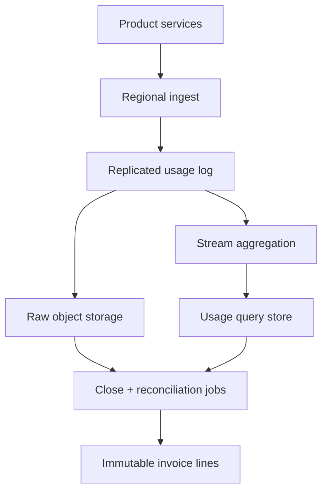
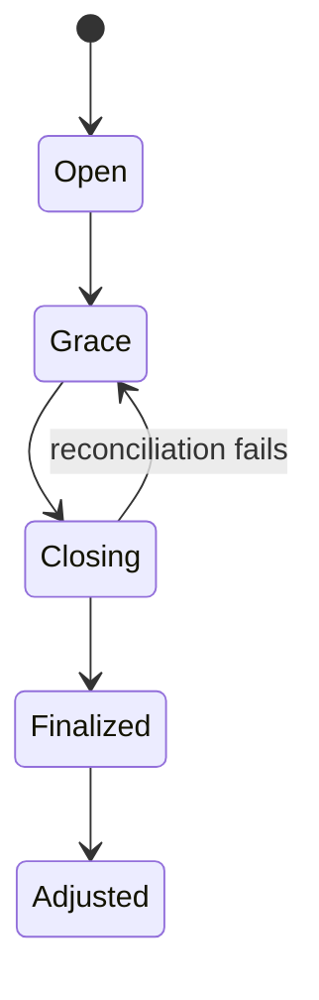

# Design an API Usage Metering and Billing Platform

**Difficulty:** Senior / Staff  
**Primary themes:** durable ingestion, idempotency, event-time aggregation, late data, pricing versions, reconciliation, financial correctness

## Interviewer prompt

> Design a platform that meters billable API usage for a multi-tenant cloud company. Product services report usage events such as API calls, bytes processed, compute seconds, and model tokens. Customers need near-real-time usage dashboards, while finance needs correct monthly invoices despite retries, delayed events, outages, and pricing changes.

This walkthrough follows the requirements → entities → interfaces → high-level design → deep-dives sequence and approximate timings in the public [Hello Interview delivery framework](https://www.hellointerview.com/learn/system-design/in-a-hurry/delivery). The problem analysis and dialogue are original. The timings are an interview guide; the educational walkthrough is intentionally more detailed than a 45-minute answer.

## Targeted clarifying questions

**Candidate:** “Which usage and pricing models must we support?”  
**Interviewer:** “Count, sum, maximum, and distinct-resource usage. Pricing can be per unit, graduated tiers, volume tiers, and committed-use credits.”

**Candidate:** “Who sends usage?”  
**Interviewer:** “Trusted product services send server-side events. Customers may also upload usage for products built on our billing platform, but that path needs stricter validation.”

**Candidate:** “What are the customer-facing operations?”  
**Interviewer:** “Ingest usage, query current usage and estimated charges, and produce an immutable invoice at the end of a billing period.”

**Candidate:** “What scale should I assume?”  
**Interviewer:** “Five million tenants, 200 products, an average of 2 million events per second, bursts to 10 million events per second, and 90 days of queryable raw events.”

**Candidate:** “How quickly should dashboards update?”  
**Interviewer:** “Within one minute for 99% of events. Invoice generation may take hours, but correctness matters more than speed.”

**Candidate:** “How late can events arrive?”  
**Interviewer:** “Normally minutes, occasionally seven days because an edge site was disconnected. The business closes an invoice three days after period end; later events become explicit adjustments.”

**Candidate:** “Can events be duplicated or corrected?”  
**Interviewer:** “Yes. Producers retry. Authorized producers can submit corrections or reversals. We need an audit trail rather than in-place mutation.”

**Candidate:** “Should this platform collect payment?”  
**Interviewer:** “No. Stop at finalized invoice line items and export them to the existing invoicing/payment system.”

## 1. Requirements (~5 minutes)

### Functional requirements

Prioritize three capabilities:

1. **Ingest usage:** authenticate producers, validate meter schemas, durably accept idempotent usage events, corrections, and reversals.
2. **Show usage and estimated cost:** query near-real-time usage by tenant, meter, and billing period with freshness indicators.
3. **Close a billing period:** recompute authoritative usage, apply the correct versioned pricing and credits, freeze invoice line items, and support later adjustments.

Out of scope: payment collection, taxation, revenue recognition, contract negotiation, client-side analytics, and arbitrary business-intelligence queries.

### Quantified non-functional requirements

| Goal | Target | Design consequence |
|---|---:|---|
| Ingestion availability | 99.99%; p99 acknowledgment < 250 ms | Multi-AZ stateless ingest and replicated append log |
| Dashboard freshness | 99% of accepted events reflected within 60 s | Streaming aggregation and incremental materialized views |
| Financial correctness | No double billing; every invoice amount reproducible from retained inputs and versions | Global event IDs, append-only corrections, immutable pricing versions |
| Scale | 2M events/s average, 10M/s burst, 5M tenants | Partitioned logs, local pre-aggregation, hot-tenant isolation |
| Retention | Raw events queryable for 90 days; billing evidence retained 7 years | Tiered storage and compact immutable invoice evidence |
| Period close | 99% of invoices finalized within 6 hours after close starts | Parallel deterministic batch recomputation |

### Consistency and availability contract

Event acceptance is durable once the API returns success. Transport and processing are **at least once**, but a logical usage event contributes to billing at most once because its identity is deduplicated within the tenant/meter scope.

Dashboard totals are eventually consistent and may temporarily differ from the final invoice. Every response exposes `computed_through`, `watermark`, `pricing_version`, and `is_estimate`. An invoice is generated from an authoritative recomputation over a closed event set and becomes immutable once finalized. Later usage or corrections create adjustment line items; they do not rewrite a previously issued invoice.

During a partition, regional collectors may continue accepting events if they can write to a durable regional log. Invoice finalization waits until all required regions are reconciled. We prefer delayed billing over an incomplete invoice.

**What to say aloud:**

> “I separate low-latency estimates from financial truth. The dashboard is an eventually consistent materialized view. The invoice is a deterministic, versioned recomputation over a declared closed event set, and late changes become auditable adjustments.”

## Scale estimates that change the design

Assume a normalized event is 400 bytes before replication:

\[
2{,}000{,}000 \times 400\text{ B} = 800\text{ MB/s}
\]

At 3× replication, average log write traffic is roughly **2.4 GB/s**, with bursts around 12 GB/s. A single relational ingestion table is not a credible hot path. We need a partitioned replicated log, compressed batches, and tiered object storage.

Raw daily volume is:

\[
800\text{ MB/s} \times 86{,}400 \approx 69\text{ TB/day}
\]

Ninety days is about **6.2 PB uncompressed**. This makes columnar compression and object storage mandatory; keeping all raw events in an OLTP database is too expensive.

If a large tenant emits 1 million events/s for one meter, partitioning only by `tenant_id` creates a hot partition. We need a write key such as `(tenant_id, meter_id, shard_bucket)` and a second-stage merge for that tenant’s totals.

Suppose pre-aggregation compresses 60 million per-minute raw events for one dimension set into one accumulator. Even with thousands of dimension combinations, aggregation reduces invoice scan work by orders of magnitude. However, raw immutable events remain available for dispute resolution and recomputation.

**What to say aloud:**

> “The average stream is already hundreds of megabytes per second and 90-day raw retention reaches petabytes. That forces log-first ingestion, object storage, and incremental aggregates. I still retain raw evidence because aggregates alone cannot resolve disputes or pricing bugs.”

## 2. Core entities (~2 minutes)

- **Tenant:** account, billing timezone, contract, billing-period policy.
- **Producer:** authenticated service or customer integration, allowed tenant/meter scopes.
- **MeterDefinition:** event name, unit, aggregation type, required dimensions, validation rules.
- **UsageEvent:** immutable quantity observation with event time, ingestion time, identity, and dimensions.
- **CorrectionEvent:** reversal or delta referencing an earlier event or adjustment reason.
- **PricingVersion:** immutable effective interval, currency, tiers, rounding, minimums, and credit rules.
- **UsageAggregate:** windowed accumulator with source coverage and watermark.
- **BillingPeriod:** open, grace, closing, finalized, or adjusted.
- **InvoiceLine:** frozen quantity, pricing version, amount, provenance digest.
- **ReconciliationRun:** compared sources, discrepancies, repair actions, evidence.

Example canonical event:

```json
{
  "event_id": "01JCFN7Y7N8M6K2D11A4Z7X0P3",
  "tenant_id": "tenant_42",
  "meter_id": "llm_output_tokens",
  "producer_id": "inference-gateway-us-east",
  "occurred_at": "2026-10-16T15:40:12.421Z",
  "ingested_at": "2026-10-16T15:40:12.603Z",
  "quantity": 1842,
  "dimensions": {"model":"model-x", "region":"us-east"},
  "schema_version": 3
}
```

Never store floating-point money or billable quantities requiring exact decimals as binary floats. Use integer base units or fixed-precision decimals, and define rounding in the pricing version.

## 3. API and system interface (~5 minutes)

Identity comes from mTLS workload identity or an OAuth token. The service derives `producer_id` and allowed tenant/meter scopes from authentication; it does not trust a caller-supplied producer identity.

### Ingest usage

```http
POST /v1/usage-events
Authorization: Bearer <producer-token>
Idempotency-Key: req-7e1c
Content-Type: application/json
```

```json
{
  "event_id": "01JCFN7Y7N8M6K2D11A4Z7X0P3",
  "tenant_id": "tenant_42",
  "meter_id": "llm_output_tokens",
  "occurred_at": "2026-10-16T15:40:12.421Z",
  "quantity": "1842",
  "dimensions": {"model":"model-x", "region":"us-east"}
}
```

```http
202 Accepted
```

```json
{
  "event_id": "01JCFN7Y7N8M6K2D11A4Z7X0P3",
  "status": "ACCEPTED",
  "receipt_id": "rcpt_9fd2",
  "durable_at": "2026-10-16T15:40:12.603Z"
}
```

Return success only after replicated durable append. Repeating the same event ID and payload returns the original receipt. Reusing the ID with a different payload returns `409 EVENT_ID_CONFLICT` and triggers a security/data-quality signal.

Support compressed batches for high-throughput producers:

```http
POST /v1/usage-events:batch
Content-Encoding: zstd
```

Return per-event outcomes because one invalid record must not make a producer retry valid events blindly.

### Submit a correction

```http
POST /v1/usage-corrections
```

```json
{
  "correction_id": "corr_71",
  "tenant_id": "tenant_42",
  "meter_id": "llm_output_tokens",
  "original_event_id": "01JCFN7Y7N8M6K2D11A4Z7X0P3",
  "operation": "REVERSE",
  "reason": "request was refunded"
}
```

Corrections are new immutable events. Authorization is stricter than ordinary usage submission.

### Query usage and estimate

```http
GET /v1/tenants/tenant_42/usage?meter_id=llm_output_tokens&period=2026-10
```

```json
{
  "meter_id": "llm_output_tokens",
  "quantity": "4821900371",
  "estimated_amount": {"currency":"USD", "minor_units":"874201"},
  "pricing_version": "price_v17",
  "computed_through": "2026-10-16T15:41:00Z",
  "watermark": "2026-10-16T15:36:00Z",
  "is_estimate": true
}
```

`computed_through` describes processing progress; the event-time watermark says events earlier than that time are unlikely—but not impossible—to arrive later.

### Close and retrieve a billing period

```http
POST /internal/v1/billing-periods/tenant_42/2026-10:close
Idempotency-Key: close-tenant42-2026-10

GET /v1/tenants/tenant_42/invoice-lines?period=2026-10
```

Only the billing workflow can close a period. Tenant identity in public reads must match the authenticated account unless the caller has an explicit finance-support role.

## 4. Data flow

1. A producer batches events to the nearest regional ingestion endpoint.
2. The endpoint authenticates scope, validates the meter schema and event-time bounds, then appends accepted events to a replicated regional log.
3. A normalization consumer adds trusted ingestion metadata and writes immutable raw records to partitioned object storage.
4. Deduplication detects repeated event IDs and routes conflicts to quarantine.
5. Stream processors aggregate accepted events into minute/hour windows by tenant, meter, and allowed dimensions.
6. A materialized-view store serves current usage; a rating service applies effective pricing versions to produce estimates.
7. Reconciliation jobs compare ingress receipts, durable raw segments, aggregate coverage, and producer control totals.
8. At period close, a deterministic batch job scans authoritative raw/validated aggregates, applies pricing and credits, and writes immutable invoice lines plus provenance.
9. Events received after finalization create adjustment candidates for the next invoice or a credit note according to policy.

## 5. High-level design (~10–15 minutes)



### Operation 1: accept events durably

The ingest tier is stateless and multi-AZ. It caches meter definitions and producer entitlements but fails closed if authorization is unknown. Schema validation includes required dimensions, numeric bounds, maximum event age/future skew, payload size, and cardinality policy.

An event is appended with key `(tenant_id, meter_id, shard_bucket)`. The bucket is a stable hash of `event_id` or resource identity, allowing a hot tenant to spread across partitions. The response includes a signed receipt containing event ID, partition, offset/range, and durability time. Receipts help support prove whether the platform accepted an event.

The request idempotency key deduplicates retried HTTP requests for a limited window; the logical `event_id` deduplicates usage across longer replay and batch scenarios. They solve different problems.

**What to say aloud:**

> “I acknowledge only after replicated append. The HTTP idempotency key handles request retries, while the event ID is the durable business identity that prevents the same usage from contributing twice.”

### Operation 2: normalize and preserve raw evidence

Consumers validate against a versioned meter schema, attach producer identity and ingestion timestamps, and classify each record as accepted, duplicate, quarantined, or conflict. Raw input and disposition are written to immutable, date/region/partition-organized object files.

Use a table format with manifests and columnar files so close jobs can prune by tenant hash, meter, and event date without listing millions of objects. A small metadata catalog records file checksums, row counts, minimum/maximum event times, and covered log offsets.

The platform never silently “fixes” malformed billable events. Invalid records produce explicit rejection outcomes and producer-facing diagnostics. Reprocessing uses the original bytes plus a new normalization version, preserving lineage.

### Operation 3: compute near-real-time usage

Stream processors maintain combinable partial aggregates:

- count → integer sum of accepted events;
- sum → fixed-precision quantity sum;
- maximum → maximum value plus contributing event identity;
- distinct resource → exact set for small tenants or a policy-approved sketch for dashboards only.

For financial distinct counts, probabilistic sketches are not authoritative unless contracts explicitly allow approximation. Otherwise retain exact unique identities in a partitioned set or compute them during close.

First aggregate by write shard and minute, then merge shards into tenant/meter/hour and billing-period totals. State changes and input offsets commit atomically when the stream framework supports it; regardless, writes include deterministic aggregate keys and source-range versions so replay overwrites rather than double-adds.

Materialized records contain:

```text
tenant_id, meter_id, dimension_key, window_start,
quantity, source_range_set, max_event_time, updated_at,
aggregation_version, correction_generation
```

### Operation 4: price estimates

Pricing is a pure function of versioned inputs:

```text
amount = rate(pricing_version, contract_version,
              billing_period, usage, credits, rounding_policy)
```

The rating service never asks “what is today’s price?” for historical usage. It selects the immutable pricing version whose effective interval and contract assignment cover the event/billing period.

Graduated tiers price each band separately; volume tiers price all usage at the final tier’s rate. Committed-use credits require an ordered allocation policy—such as earliest-expiring credit first—and an immutable credit ledger. Estimates may update as volume crosses a tier, so the API labels them nonfinal.

### Operation 5: close the period

At period end, transition the period from `OPEN` to `GRACE`. Continue accepting valid event-time usage during the configured three-day grace period. The dashboard changes, but no invoice is final.

At close:

1. record regional log high-water marks and raw-file manifests;
2. ensure all accepted offsets through those marks exist in durable raw storage;
3. wait for required late regions or declare an explicit exception;
4. recompute authoritative usage using frozen meter, transform, contract, price, and rounding versions;
5. compare recomputed totals with streaming views and investigate discrepancies;
6. allocate credits and calculate invoice lines using exact decimal arithmetic;
7. atomically publish immutable lines and a provenance manifest;
8. mark the period `FINALIZED`.

The provenance manifest includes input manifest IDs, covered offset ranges, code/config versions, aggregate hashes, and pricing versions. Rerunning with the same inputs must produce the same line-item digest.

## 6. Deep dives (~10–15 minutes)

### Deep dive A: idempotency, deduplication, and “exactly once” billing

#### Where the baseline breaks

Producers retry after timeouts. Regional forwarders replay after crashes. Consumers may write state and crash before committing an offset. A malicious or buggy producer may reuse one ID with a different quantity. Simply summing every delivered message overbills customers.

#### Options

| Approach | Benefit | Weakness |
|---|---|---|
| Assume producers send once | Simple | Networks make this false |
| Central global dedup database | Strong lookup | Bottleneck at 10M events/s |
| Bloom filter only | Memory efficient | False positives can underbill |
| Partition-local exact index plus reconciliation | Scalable and auditable | Requires routing discipline and retention design |

Choose exact deduplication within the billing evidence horizon. Route the same `(tenant_id, meter_id, event_id)` to the same logical partition. Each partition maintains an LSM-style exact ID index on local/state-store SSD with changelog replication; older indices compact into immutable sorted files with Bloom filters as negative-read accelerators, never as the final billing decision.

Store `event_id → payload_hash, disposition, receipt, first_seen_at`. Outcomes:

- unseen ID → accept;
- same ID and same hash → duplicate; return original disposition;
- same ID and different hash → conflict; quarantine and alert;
- authorized correction → new correction ID referencing the original.

Even if the log offers transactional processing, end-to-end side effects cross object storage, query stores, and invoice databases. Apache Kafka’s own design documentation cautions that “exactly once” claims require examining system boundaries. Therefore, make every boundary idempotent and prove invoice coverage independently.

For accumulators, never execute an unguarded `quantity += delta` on retry. Write a deterministic partial aggregate for source range `[offset_a, offset_b]`, then merge each range once. Alternatively transact state update and consumed offset together.

#### Failure modes

- **Dedup state loss:** restore from replicated changelog/raw log and block close until rebuilt.
- **Producer resets ID generator:** conflict rate spikes; isolate producer scope and reject reuse.
- **Same logical request emitted by two services with different IDs:** enforce ownership and optionally use a domain idempotency key such as `request_id + meter_id`.
- **Retention expires too early:** retain exact identity at least through dispute/adjustment policy or compact billed IDs into invoice evidence.

**What to say aloud:**

> “I do not promise magical exactly-once transport. I guarantee at-most-once financial contribution for a logical event through stable identity, exact dedup, idempotent range aggregates, and independent close reconciliation.”

### Deep dive B: event time, late data, corrections, and finalized invoices

#### Where the baseline breaks

Ingestion time is not billing time. An edge can buffer usage for days; clocks can be wrong; a producer can backdate usage into a cheaper contract period; a correction can arrive after invoice issuance. Waiting forever prevents close, while ignoring late data loses revenue or overcharges customers.

#### Time model

Track three times:

- `occurred_at`: producer-claimed business time;
- `ingested_at`: trusted platform receipt time;
- `processed_at`: pipeline execution time.

Validate `occurred_at` against producer policy: bounded future skew, maximum backfill age, credential validity, tenant contract interval, and optionally a trusted edge sequence/attestation. Suspicious but potentially legitimate data goes to review rather than silently changing periods.

A **watermark** is the processor’s estimate that most events earlier than time `W` have arrived. It controls window emission and dashboard stability, not invoice truth. Windows can reopen when allowed late events arrive.

#### Period state machine



- `OPEN`: current usage changes freely.
- `GRACE`: period ended; accept authorized late events.
- `CLOSING`: freeze declared regional high-water marks and reconcile.
- `FINALIZED`: invoice lines immutable.
- `ADJUSTED`: later event/correction produces separate debit or credit evidence.

An authorized reversal is not deletion. Append a correction with its own identity, reason, actor, and reference. The aggregator computes the net contribution according to meter rules. This keeps the chain auditable.

#### Policy tradeoff

Long grace periods improve completeness but delay invoices. Short grace periods improve cash flow but create adjustments. Choose three days based on the stated business contract, monitor lateness percentiles per producer, and require disconnected edges to upload signed sequence summaries so missing ranges are detectable.

At finalization, record the acceptance rule: for example, events with `occurred_at` in October, valid credentials/contract, accepted before the close cutoff, and included through each region’s high-water mark. This makes the event set reproducible.

**What to say aloud:**

> “Watermarks make streaming practical; they do not redefine financial truth. The billing period has an explicit grace and close boundary. Once finalized, history is immutable and late events become adjustments, preserving both auditability and customer expectations.”

### Deep dive C: hot tenants, aggregation cardinality, and reconciliation

#### Where the baseline breaks

Partitioning by tenant overloads one partition for the largest customer. Allowing arbitrary dimensions creates an unbounded number of aggregate keys and can turn a customer-supplied request ID into billions of time series. Streaming totals can also look plausible while missing an entire partition.

#### Partitioning and aggregation choices

| Choice | Advantage | Risk |
|---|---|---|
| Tenant-only partition | Easy per-tenant order | Hot tenant bottleneck |
| Random event partition | Even writes | Expensive tenant merge and dedup routing |
| Tenant/meter/write-shard | Scales hot tenants while preserving scoped identity | Second-stage aggregation |
| Pre-aggregate at producer | Low bandwidth | Trust and audit complexity |

Use `(tenant, meter, shard_bucket)`, then hierarchical aggregation. Meter definitions allow only named, bounded billing dimensions such as model and region. High-cardinality diagnostic attributes may remain in raw evidence but are excluded from indexed aggregate keys.

Maintain per-partition control totals:

```text
accepted_count, duplicate_count, correction_count,
quantity_sum, min_offset, max_offset, gap_bitmap/hash,
raw_file_manifest_ids
```

Reconciliation compares four layers:

1. ingestion receipts/log offsets;
2. raw object manifests;
3. streaming aggregate source-range coverage;
4. close-job output and invoice-line provenance.

A mismatch never gets “balanced” by inserting an unexplained delta. Repair replays a known source range into a new aggregation generation, and the audit trail records which old materialization it supersedes.

#### Hot-key controls

- Allocate more write shards to a tenant before known launches.
- Split shards only at explicit epochs so dedup routing remains deterministic.
- Apply per-producer quotas and batch limits.
- Isolate pathological tenants into dedicated processor pools.
- Cache tenant-level reads but key them by aggregate generation and watermark.
- Use request coalescing for dashboard refresh storms at period end.

#### Reconciliation observability

Track accepted versus raw-persisted offsets, uncovered ranges, duplicate/conflict rates, late-event distribution, watermark lag, aggregate key cardinality, per-tenant shard skew, streaming-versus-batch variance, invoice rerun digest equality, and adjustment rate.

**What to say aloud:**

> “I shard a hot tenant before aggregation, then merge deterministic partials. Every partial declares its source ranges, so reconciliation proves coverage rather than trusting a final number. Arbitrary dimensions stay out of the billing index.”

## Reliability, security, and observability

### Reliability

- Replicate ingest logs across availability zones before acknowledgment.
- Buffer regionally during inter-region partitions; retain sequence ranges for later reconciliation.
- Checkpoint stream state and restore from changelogs; make output generations idempotent.
- Write raw object manifests atomically only after all files and checksums are durable.
- Use a transactional outbox when publishing finalized invoice lines to the downstream billing system.
- Run periodic full and sampled recomputation, not only end-of-month checks.
- Keep replay tooling scoped by tenant, meter, time, source range, and aggregation version.

### Security and abuse controls

- mTLS/workload identity, short-lived tokens, and least-privilege tenant/meter scopes.
- Signed batches for intermittently connected edge collectors, including monotonic producer sequence ranges.
- Meter-schema allowlists, quantity bounds, clock-skew limits, and bounded dimensions.
- Stronger role and dual approval for reversals, manual adjustments, price activation, and period reopening.
- Encryption in transit and at rest; tokenize or omit unnecessary customer identifiers.
- Tamper-evident audit records and separation of duties between product, pricing, and finance operators.

### Observability

Monitor the pipeline as a financial control system, not just a stream processor:

| Signal | Purpose |
|---|---|
| Acknowledgment latency/error rate | Producer reliability |
| Log and raw-persistence lag | Durability and replay readiness |
| Watermark and processing lag | Dashboard freshness |
| Duplicate/conflict/rejection rate by producer | Data quality and abuse |
| Aggregate state size/cardinality | Capacity and dimension control |
| Streaming-versus-close variance | Correctness drift |
| Uncovered source ranges | Missing billing evidence |
| Price/contract version misses | Rating correctness |
| Close duration and failed tenants | Invoice SLO |
| Late adjustments and dispute rate | Policy quality |

Use `event_id`, `receipt_id`, `run_id`, and `invoice_line_id` for drill-down in logs/traces. Do not use tenant or event IDs as unrestricted metric labels.

## Concise final design

Authenticated producers submit versioned, uniquely identified usage events to regional ingest nodes. The system validates scope and schema and acknowledges only after replicated durable append. Events are normalized into immutable raw object storage, exactly deduplicated within their billing scope, and streamed into sharded minute/hour aggregates. Hierarchical merging handles hot tenants; materialized views provide near-real-time estimates labeled with watermarks and pricing versions.

At period close, the platform freezes explicit regional high-water marks, proves that every accepted range exists in raw storage, and deterministically recomputes usage using frozen meter, transformation, contract, price, credit, and rounding versions. It compares batch truth with streaming views, publishes immutable invoice lines with provenance, and exports through an outbox. Late usage and corrections append adjustment evidence rather than rewriting finalized invoices.

**Thirty-second interview close:**

> “The log gives durable acceptance, event identity prevents double contribution, and raw object storage preserves evidence. Streaming aggregates make dashboards fast, but invoices come from a deterministic close job that proves source-range coverage and freezes every relevant version. Watermarks manage lateness before close; after finalization, changes are explicit adjustments.”

## Requirements check

| Requirement | Design response |
|---|---|
| Ingest usage reliably | Multi-AZ regional ingest and replicated append before acknowledgment |
| Prevent double billing | Stable event IDs, exact dedup, idempotent range aggregates |
| Dashboard within 60 s | Streaming hierarchical aggregates and materialized views |
| Support pricing models | Versioned pure rating function, exact decimals, tier/credit policies |
| Handle late events | Event time, watermark, three-day grace, explicit adjustments |
| Correct final invoices | Deterministic recomputation and source-range reconciliation |
| 10M events/s bursts | Partitioned logs, compressed batches, write sharding |
| Hot tenants | Tenant/meter/shard partitioning and second-stage merge |
| Corrections | Append-only reversal/delta events with stronger authorization |
| Auditability | Raw evidence, immutable invoice lines, provenance manifests |

## Realistic interviewer follow-ups

### “Why retain raw events after aggregation?”

**Strong answer:** “Aggregates are optimized state, not sufficient evidence. Raw events let us investigate disputes, correct a transform or pricing bug, rebuild lost state, and prove which events contributed. We tier them to compressed object storage rather than expensive OLTP storage.”

### “Do Kafka transactions solve exactly-once billing?”

**Strong answer:** “They can atomically coordinate Kafka offsets, state, and Kafka outputs in a bounded topology. Our side effects include object manifests, query stores, invoice databases, and downstream billing. I still need stable business IDs, idempotent writes, and reconciliation across those boundaries.”

### “How do you choose the partition key?”

**Strong answer:** “Use tenant and meter for locality, plus a stable shard bucket to split hot tenants. The same event ID must route deterministically for exact dedup. A second-stage aggregator merges shard partials into the tenant total.”

### “Can HyperLogLog be used for distinct-user billing?”

**Strong answer:** “Only if the contract explicitly permits approximation and defines error behavior. It is excellent for dashboard estimates. For exact billing, use exact unique identities in partitioned storage or an exact period-close computation.”

### “What if a producer sends an event with last month’s timestamp?”

**Strong answer:** “Validate its maximum age, credential and contract interval, producer sequence, and close policy. During grace it may enter the prior period. After finalization it becomes a reviewed adjustment; the producer cannot silently rewrite the invoice by backdating.”

### “How do graduated and volume tiers differ?”

**Strong answer:** “Graduated pricing charges each quantity band at its own rate. Volume pricing selects one rate based on total usage and applies it to all units. Because an estimate can cross a volume threshold, the displayed amount may move nonlinearly even when usage only increases.”

### “What if the same event ID arrives with different payloads?”

**Strong answer:** “That is not a normal retry. Store the first payload hash, return a conflict, quarantine the second event, and alert the producer owner. Never pick last-write-wins for financial identity.”

### “How do you know a disconnected region uploaded everything?”

**Strong answer:** “Collectors publish signed monotonic sequence ranges and control totals. Reconciliation detects missing ranges. Period close waits or records an explicit exception; a watermark alone cannot prove completeness.”

### “How do you roll out a new aggregation implementation?”

**Strong answer:** “Version it, dual-run it from the same raw inputs, compare per-tenant/meter/window results, and canary reads. New materializations use a new generation and never overwrite the old generation in place. Invoice close pins one approved version.”

### “What happens if pricing changes mid-month?”

**Strong answer:** “Pricing versions have explicit effective intervals. Either split usage at the boundary or apply the contract’s period rule. The invoice line records the exact pricing versions and quantities used, so reruns do not depend on current configuration.”

## Common pitfalls

1. Treating message delivery as exactly once without stable business identity.
2. Using only an HTTP idempotency key and losing protection after its TTL.
3. Summing duplicates with unguarded increments.
4. Using floating-point arithmetic for money.
5. Pricing historical usage with the latest price.
6. Treating dashboard aggregates as invoice truth.
7. Dropping raw evidence after aggregation.
8. Partitioning only by tenant and creating a hot shard.
9. Allowing arbitrary high-cardinality billing dimensions.
10. Using probabilistic distinct counts for exact contracts without disclosure.
11. Billing by ingestion time instead of validated event time.
12. Waiting forever for late events or silently discarding them.
13. Mutating finalized invoices in place.
14. Applying corrections by deleting history.
15. Advancing offsets separately from aggregate state without idempotency.
16. Reconciling only row counts rather than source-range coverage.
17. Ignoring regional sequence gaps during period close.
18. Making invoice generation depend on mutable code or configuration.

## Interview pacing versus this walkthrough

- **0–5 min:** clarify usage models, lateness, scale, dashboard versus invoice semantics.
- **5–7 min:** define event, meter, price version, aggregate, period, invoice line, reconciliation.
- **7–12 min:** specify ingest, correction, query, and close interfaces.
- **12–25 min:** trace durable acceptance, normalization, aggregation, estimates, and close.
- **25–40 min:** deep dive into idempotency, event time, hot tenants, and reconciliation.
- **40–45 min:** reliability, security, requirements check, and close.

The detailed walkthrough is study material. In an interview, establish one distinction early: **the streaming path produces a fast estimate; the close path produces reproducible financial truth**.

## Public references

- [Hello Interview — System Design Delivery Framework](https://www.hellointerview.com/learn/system-design/in-a-hurry/delivery)
- [Apache Kafka — Design and delivery semantics](https://kafka.apache.org/documentation/#design)
- [Apache Kafka Streams — Core concepts and exactly-once processing](https://kafka.apache.org/documentation/streams/core-concepts)
- [Stripe Documentation — Meter event streams](https://docs.stripe.com/api/v2/billing-meter-stream)
- [Stripe Documentation — Usage-based billing](https://docs.stripe.com/billing/subscriptions/usage-based)
- [OpenTelemetry — Semantic conventions](https://opentelemetry.io/docs/concepts/semantic-conventions/)
