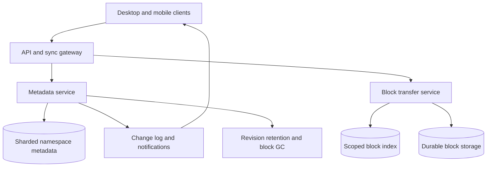

# Design a Cloud File Synchronization Service

**Difficulty:** Senior / Staff | **Primary themes:** metadata consistency, content-addressed storage, offline clients, resumable transfer, change feeds, conflict resolution

This is a detailed educational walkthrough. In a 45-minute interview, use the time boxes to pace the discussion rather than trying to say everything below. The structure follows Hello Interview's public [system-design delivery framework](https://www.hellointerview.com/learn/system-design/in-a-hurry/delivery): establish requirements, identify entities, define interfaces, build a complete baseline, and then deepen the difficult constraints.

## Interviewer prompt

> Design a Dropbox-like service that synchronizes files and folders across a user's devices. Users may edit while offline, share folders with other users, and upload large files over unreliable networks. Changes should propagate quickly without losing data.

## Targeted clarifying questions

**Candidate:** Are we designing both cloud storage APIs and a desktop sync client?

**Interviewer:** Yes. Focus on the server architecture and the client/server sync protocol. Briefly describe the local sync engine.

**Candidate:** Which operations are required?

**Interviewer:** Create, modify, move, rename, and delete files or directories; upload/download contents; receive changes on other devices; share a folder with read or write access.

**Candidate:** Should files support collaborative byte-level merging?

**Interviewer:** No. A file revision is an opaque byte sequence. Concurrent edits must preserve both users' work rather than silently overwrite one version.

**Candidate:** What scale should I assume?

**Interviewer:** One hundred million users, 500 million connected devices, 100 billion metadata entries, 10 billion file revisions per day, and 50 petabytes of new logical content per day. Files range from empty to 1 terabyte.

**Candidate:** What freshness and availability are expected?

**Interviewer:** Online changes should normally appear on other connected devices within five seconds. Reads and uploads should be highly available. Namespace mutations require strong ordering within a shared folder.

**Candidate:** Can clients remain offline for long periods?

**Interviewer:** Yes, possibly weeks. They reconnect with a local operation log based on an old server cursor.

**Candidate:** Is cross-user block deduplication allowed?

**Interviewer:** Deduplicate within an authorization boundary. Avoid designs that let one tenant infer another tenant's file ownership.

**Candidate:** Are end-to-end encryption, document editing, malware detection, and backups in scope?

**Interviewer:** Server-side encryption, integrity, and deleted-file recovery are in scope. End-to-end encryption, document semantics, antivirus internals, and backup product UX are out of scope.

## 1. Requirements (~5 minutes)

### Functional requirements

1. Users can create, modify, move, rename, and delete files and folders, including in shared folders.
2. Clients upload/download large files resumably and transfer only missing content blocks when possible.
3. Every device consumes an ordered change feed and reconciles offline edits without silently losing either version.

### Non-functional requirements

- **Durability:** committed file revisions have at least eleven nines annual durability; a metadata commit never points permanently to unavailable content.
- **Freshness:** p99 notification delivery under five seconds for online devices; catch-up after reconnect is proportional to unseen changes, not total namespace size.
- **Availability:** 99.99% for content reads and resumable block transfer; 99.95% for namespace mutations. During an ambiguous partition, reject conflicting metadata writes rather than invent two authoritative directory states.
- **Consistency:** mutations are totally ordered within a namespace/shared folder. A successful commit returns a revision and cursor that subsequent reads in that namespace can observe.
- **Scale:** 100 billion entries, 10 billion revisions/day (about 116,000/s average and perhaps 10× peak), 500 million device connections, and 50 PB/day of new logical bytes.

### Scope and consistency contract

A **namespace** is a personal root or shared folder with its own ordered mutation log. Metadata inside one namespace is strongly ordered; changes across unrelated namespaces need not be atomic. File bytes are immutable, content-addressed blocks. A mutable path points to an immutable file revision whose manifest lists blocks.

A client sync is eventually consistent because devices can be offline. Once the server commits revision `r` at cursor `c`, the change feed eventually delivers it to authorized devices. A device may optimistically show its local edit before the server accepts it, but server acknowledgement is the durability boundary.

The system guarantees no silent overwrite. It does not promise automatic semantic merging of arbitrary file formats.

### Out of scope

Real-time document coauthoring, search indexing internals, end-to-end encryption, antivirus internals, media transcoding, public link serving, and billing are excluded.

### Scale estimates that change the design

Ten billion revisions/day average roughly:

```text
10,000,000,000 / 86,400 ≈ 116,000 metadata commits/s
```

At a 10× burst, the metadata plane must tolerate about 1.2 million mutations/s globally. One relational primary cannot own the world; partition by stable namespace ID so independent folders scale independently while each folder retains an ordered leader.

If 500 million devices poll every five seconds, that is 100 million requests/s even when nothing changes. Use long-lived notification connections or push signals, then fetch changes by durable cursor. Notifications are hints; the cursor log is the source of truth.

At 50 PB/day, retrying whole files after a dropped connection is unacceptable. Splitting content into 4 MiB blocks means a 1 GiB file has 256 blocks. If a small edit changes one block, the client can upload about 4 MiB plus metadata rather than 1 GiB—a roughly 256× reduction for that case.

> **What I would say aloud:** “I’ll separate immutable content from mutable namespace metadata. Blocks can be uploaded, retried, and deduplicated independently, while one ordered authority per shared namespace decides which revision a path names.”

## 2. Core entities (~2 minutes)

- **Namespace:** personal root or shared folder; unit of authorization, partitioning, and ordered change history.
- **Entry:** stable file/directory identity, parent identity, display name, type, and current revision.
- **FileRevision:** immutable size, content manifest, author, timestamps, and causal base revision.
- **Block:** immutable encrypted bytes addressed by a scoped content hash.
- **UploadSession:** expected blocks, uploaded blocks, expiry, owner, and idempotency state.
- **ChangeRecord:** namespace sequence number and committed mutation.
- **Mount:** maps a shared namespace into a user's visible tree with permissions.
- **DeviceCursor:** last namespace sequence durably applied by one device.
- **Tombstone:** deletion marker retaining entry identity and revision history for recovery and offline reconciliation.

Stable entry IDs matter. Paths change during rename or move; using paths as identity makes an offline client confuse “same file moved” with “old file deleted and new file created.” Dropbox's engineering account of its sync-engine rewrite similarly highlights stable identity across moves as a critical data-model property in large-scale sync systems ([Dropbox Engineering](https://dropbox.tech/infrastructure/rewriting-the-heart-of-our-sync-engine)).

> **What I would say aloud:** “The path is a mutable attribute, not identity. Entry IDs survive rename and move, which is essential when two devices reconcile changes made from different historical paths.”

## 3. API / system interface (~5 minutes)

The gateway derives `principal_id` and device trust from authentication. Clients never submit an arbitrary acting user.

### Begin a block upload

```http
POST /v1/upload-sessions
Authorization: Bearer <device-credential>
Idempotency-Key: 6bb1...
Content-Type: application/json

{
  "namespace_id":"ns_12",
  "file_size":10485760,
  "blocks":[
    {"index":0,"hash":"sha256:aa...","size":4194304},
    {"index":1,"hash":"sha256:bb...","size":4194304},
    {"index":2,"hash":"sha256:cc...","size":2097152}
  ]
}
```

```json
{
  "upload_id":"up_91",
  "missing_blocks":[0,2],
  "expires_at":"2026-10-17T10:00:00Z"
}
```

The server checks block presence only inside the authorized deduplication scope. It must not reveal whether an unrelated tenant owns a hash.

### Upload a missing block

```http
PUT /v1/upload-sessions/up_91/blocks/0
Content-Length: 4194304
Digest: sha-256=<base64-digest>

<bytes>
```

```json
{"index":0,"status":"STORED"}
```

Repeated uploads of identical verified bytes are idempotent.

### Commit a file mutation

```http
POST /v1/namespaces/ns_12/entries/file_44/commits
Authorization: Bearer <device-credential>
Idempotency-Key: f02d...
Content-Type: application/json

{
  "base_revision":"rev_8",
  "upload_id":"up_91",
  "parent_id":"dir_7",
  "name":"report.pdf",
  "client_operation_id":"dev_3:1881"
}
```

```json
{
  "entry_id":"file_44",
  "revision":"rev_9",
  "namespace_cursor":88401,
  "conflict":false
}
```

If `base_revision` is stale and both sides changed content, the server preserves the new upload as a conflict revision/entry and returns both IDs; it does not overwrite `rev_9`.

Moves and deletes use the same optimistic base cursor or revision:

```http
PATCH /v1/namespaces/ns_12/entries/file_44
If-Match: rev_9

{"parent_id":"dir_99","name":"final-report.pdf"}
```

```http
DELETE /v1/namespaces/ns_12/entries/file_44
If-Match: rev_10
```

### Fetch changes

```http
GET /v1/namespaces/ns_12/changes?after=88350&limit=1000
```

```json
{
  "changes":[
    {
      "cursor":88351,
      "operation":"UPSERT",
      "entry_id":"file_44",
      "parent_id":"dir_7",
      "name":"report.pdf",
      "revision":"rev_9"
    }
  ],
  "next_cursor":88401,
  "has_more":false
}
```

### Download a revision

```http
GET /v1/files/file_44/revisions/rev_9/manifest
```

```json
{
  "size":10485760,
  "blocks":[
    {"index":0,"hash":"sha256:aa...","size":4194304,"url":"https://signed..."},
    {"index":1,"hash":"sha256:bb...","size":4194304,"url":"https://signed..."}
  ]
}
```

Short-lived signed URLs bind block, namespace authorization, operation, and expiry. The client downloads missing blocks in parallel, verifies hashes, reconstructs a temporary file, fsyncs it, then atomically renames it into place.

## 4. Data flow

### Upload and commit

1. Client watches local filesystem and records a stable local operation.
2. Client chunks and hashes a stable file snapshot.
3. Server returns the missing block set.
4. Client uploads missing blocks in parallel and resumably.
5. Client commits a metadata mutation referencing the completed manifest and its base revision.
6. Metadata leader checks authorization/conflicts, writes revision and change record atomically, and returns the namespace cursor.
7. Notification service wakes other devices; they fetch changes from their cursors.

### Download and apply

1. Device fetches ordered metadata changes.
2. It updates its local metadata journal.
3. For content-required entries, it fetches manifests and missing blocks.
4. It verifies, reconstructs, fsyncs, and atomically replaces the local file.
5. It advances the durable device cursor only after local application is recoverable.

## 5. High-level design (~10–15 minutes)



### Operation 1: detect and snapshot a local change

The desktop client combines filesystem notifications with periodic scanning because OS watchers can overflow or miss events. A local transactional database tracks:

```text
LocalEntry(entry_id, local_path, server_revision, inode_hint, state)
PendingOperation(operation_id, entry_id, base_revision, kind, state)
LocalCursor(namespace_id, applied_cursor)
```

The sync engine should avoid uploading a file while an application is still writing it. It records size and modification metadata, reads and hashes the file, then verifies the attributes again. If they changed, retry with backoff. Platform snapshot APIs may provide stronger snapshots where available.

Hashing and network I/O run concurrently, but one deterministic control loop serializes state transitions in the local journal. This reduces races between local changes, remote changes, retries, and cancellation.

### Operation 2: upload immutable blocks

Split the snapshot into fixed 4 MiB blocks for the baseline. Each block key is:

```text
BlockKey(dedup_scope_id, SHA256(plaintext_block))
```

The server's block index maps that logical key to encrypted physical replicas/erasure-coded fragments, integrity metadata, and reference state. Dropbox publicly described a similar design in which files are divided into 4 MiB blocks and a file is identified by its SHA-256 block list ([Streaming File Synchronization](https://dropbox.tech/infrastructure/streaming-file-synchronization)).

The transfer service streams each block to staging storage while hashing it independently. It accepts the block only when length and digest match. A successful response means the staged block is durable enough to survive transfer-node failure. Upload sessions are metadata; the content itself bypasses metadata leaders.

Resumption is block-granular: the client asks which indexes are complete and retries only missing blocks. For very large blocks or mobile networks, support byte offsets inside a block using an opaque upload token and monotonic offset, similar to the semantics in the IETF's [Resumable Uploads for HTTP draft](https://datatracker.ietf.org/doc/draft-ietf-httpbis-resumable-upload/).

### Operation 3: atomically commit namespace metadata

Route every mutation by `namespace_id` to its current shard leader. The core records are:

```text
Entry(namespace_id, entry_id, parent_id, normalized_name,
      display_name, type, current_revision, state, metadata_version)

FileRevision(namespace_id, entry_id, revision_id, base_revision,
             manifest_id, size, author_id, committed_at)

ChangeRecord(namespace_id, sequence, operation, entry_id,
             revision_id, metadata_delta, committed_at)
```

In one database transaction, the leader:

1. validates write permission and upload ownership;
2. checks name uniqueness within the target directory;
3. compares the client's base revision/metadata version;
4. creates a file revision or conflict-preserving result;
5. updates the entry or tombstone;
6. appends a change record with the next namespace sequence;
7. records the idempotency result and commits.

The commit must not reference temporary content that can expire. Before metadata commit, all manifest blocks transition from staged to retained or receive a retention lease long enough for an asynchronous reference indexer to finalize them. A reconciler repairs the rare case where block-reference accounting lags.

### Operation 4: notify devices and consume changes

The transaction also writes an outbox row. A relay publishes `(namespace_id, newest_sequence)` to regional notification infrastructure. Connected devices may receive a lightweight WebSocket/gRPC wake-up; mobile devices may receive OS push.

The signal can be duplicated or lost. The device always calls `changes?after=cursor`. The metadata log returns ordered, paginated records. The client applies them idempotently by sequence and advances its cursor only after its local journal transaction commits.

If the cursor is older than retained incremental history, return `CURSOR_RESET_REQUIRED` with a compact namespace snapshot and snapshot sequence. The client reconciles stable entry IDs rather than deleting its whole folder blindly.

### Operation 5: download and install content safely

The client obtains a manifest, skips blocks present in its verified local cache, and downloads the rest from a nearby content edge. It validates every SHA-256 hash and the manifest's revision identity.

Write reconstruction to a temporary file in the same filesystem, preserve supported metadata, fsync file and parent directory as appropriate, then atomically rename. If the target changed locally during download, do not overwrite it; re-enter reconciliation with the observed local revision.

### Operation 6: delete and restore

Deletion creates a tombstone and ordered change; it does not immediately remove revisions or blocks. Restore is a new mutation that points the stable entry ID to a retained revision. A retention service expires tombstones/revisions according to plan and legal-hold policy.

Block garbage collection is asynchronous. It deletes a block only after no retained manifest references it, no upload lease protects it, and a safety grace period passes. Because reference events can be delayed, periodic mark-and-sweep from retained manifests verifies reference counts before physical deletion.

## 6. Deep dives (~10–15 minutes)

### Deep dive A: block sync, deduplication, and safe garbage collection

#### Where the baseline breaks

Whole-file uploads waste bandwidth and restart poorly. Naive global deduplication reveals whether a hash already exists in another tenant and creates ownership confusion. Immediate reference-count deletion can destroy a block when commit and accounting events are reordered.

#### Options

| Approach | Benefit | Cost or weakness |
|---|---|---|
| Whole-file objects | Simple | Poor retry and delta efficiency |
| Fixed-size blocks | Simple parallelism and indexing | Insertions shift later block boundaries |
| Content-defined chunking | Insertions preserve more unchanged chunks | Variable chunks, more CPU, complex limits |
| Global convergent dedup | Maximum savings | Confirmation and cross-tenant side channels; key-management risk |

#### Choice and evolution

Start with 4 MiB fixed blocks, deduplicated within a tenant or shared-namespace security boundary. The design is predictable, supports parallel upload, and bounds retry waste. Add content-defined chunking for selected large file types only after measuring whether insertion-heavy workloads justify CPU and index overhead.

The server never answers a bare “does hash H exist globally?” query. `missing_blocks` is evaluated only after authenticating access to the dedup scope and binding the request to a declared upload. Possession of a hash is not authorization to read a block.

Encrypt at rest with envelope keys. Physical storage may coalesce ciphertext only where policy and key design permit, but the logical block index remains scoped. A hash collision or corrupt media cannot silently substitute bytes: verify digest and length on ingress, periodically scrub stored fragments, and verify on client download.

Use a two-phase lifecycle:

1. uploaded blocks have staging leases;
2. committed manifests create durable logical references;
3. expired sessions release staging leases;
4. retention expiration removes manifest references;
5. GC candidates wait through a grace period;
6. mark-and-sweep confirms no live manifest before deletion.

This favors leaked storage over lost data. Reference counts speed candidate discovery but are not the sole deletion proof.

#### Failure modes and observability

- **Transfer node dies:** client queries session and retries missing blocks.
- **Hash mismatch:** reject, record corruption source, and never publish manifest.
- **Metadata commits while reference index lags:** staging/commit lease prevents GC.
- **GC race with restore:** restore transaction renews references before the sweep epoch can delete.
- **Hot shared block:** CDN and replicated block servers absorb reads; index sharding must avoid one hash partition bottleneck.

Track logical versus physical bytes, dedup ratio by scope, uploaded bytes per committed byte, resumed-transfer rate, block verification failures, staging age, unreferenced bytes, GC candidate age, and scrub-repair counts.

> **What I would say aloud:** “Content addressing is an integrity and transfer primitive, not authorization. I scope existence checks, commit metadata only after blocks are durable, and make garbage collection conservative because leaked bytes are recoverable but deleted live bytes are not.”

### Deep dive B: offline edits and deterministic conflict preservation

#### Where the baseline breaks

Last-write-wins silently discards work. Locking files while a client is offline is impossible. Comparing only paths misinterprets renames, and wall-clock timestamps are unreliable across devices.

#### Options

| Approach | Benefit | Cost or weakness |
|---|---|---|
| Last writer wins | Simple UX | Silent data loss |
| Long-lived checkout locks | Prevents conflicts online | Unavailable offline; abandoned locks |
| Automatic byte merge | Convenient for some text | Unsafe for arbitrary formats |
| Base-revision compare with conflict copies | Preserves data; general | User may resolve duplicate files manually |

#### Choice and conflict rules

Every mutation names the server revision/cursor it was based on and carries a globally unique client operation ID. The server orders accepted operations by namespace sequence, not device clock.

Use stable entry IDs and deterministic rules:

- **Content edit versus unchanged server:** accept as the next revision.
- **Concurrent content edits from the same base:** keep the first ordered revision at the original entry; commit the later content as a conflict entry/revision named predictably with actor/device and date. Preserve both manifests.
- **Rename versus content edit:** because identity is stable, apply the content revision to the renamed entry.
- **Concurrent renames:** accept the first; materialize or report the other as a metadata conflict rather than creating two identities accidentally.
- **Delete versus offline edit:** retain the tombstone and create a recovered/conflict file for the edit. Never discard uploaded content solely because the old path was deleted.
- **Parent directory deleted while child changes:** place the child in a recovered-items location or conflict subtree with provenance.

The client operation ID makes retries idempotent. A device that times out after commit asks for that operation result instead of uploading a second conflict copy.

Local application also needs conflict safety. Before replacing a downloaded file, compare the local observed version from the journal. If it changed, preserve the local bytes and emit a new pending operation.

#### Failure modes and observability

- **Device clock is wrong:** sequence and server commit time decide order; clocks appear only in display names.
- **Duplicate filesystem events:** coalesce locally and deduplicate with operation IDs.
- **Case-insensitive versus case-sensitive filesystems:** store normalized collision keys per mount compatibility rules while retaining display name.
- **Rename cycle or directory move into descendant:** reject using ancestor validation in the namespace transaction.
- **Client database corruption:** rebuild from server snapshot while quarantining unmatched local files instead of deleting them.

Measure conflict frequency by cause, offline duration, recovered-item creation, operation dedup hits, cursor-reset rate, local apply failures, and support incidents indicating silent loss. Run deterministic simulation that reorders filesystem events, RPC responses, disconnects, and crashes; Dropbox describes using a mock backend capable of delaying, reordering, and failing sync RPCs in its own [sync testing](https://dropbox.tech/infrastructure/-testing-our-new-sync-engine).

### Deep dive C: ordered change feeds at massive scale

#### Where the baseline breaks

Scanning an entire namespace after every notification is too expensive. One global log makes unrelated users contend and creates a global availability dependency. Pure pub/sub loses history while a device is offline. Keeping every delta forever makes storage and per-device catch-up unbounded.

#### Options

| Approach | Benefit | Cost or weakness |
|---|---|---|
| Full-tree polling | Simple server model | Work proportional to total files, even when idle |
| Ephemeral pub/sub | Low-latency wake-up | Offline clients miss events |
| One global ordered log | Easy global cursor | Needless contention and global blast radius |
| Per-namespace durable log + notification hint | Ordered catch-up and independent scaling | Many logical logs and cursor compaction |

#### Choice and evolution

Use a monotonic sequence per namespace, assigned in the same transaction as metadata. This is the smallest ordering boundary matching collaboration semantics. A user's visible tree may mount many namespaces, so the client maintains one cursor per mounted namespace and merges updates locally.

Shard namespace leaders by consistent hashing with load-aware exceptions for giant enterprise namespaces. A directory with millions of collaborators can be isolated on dedicated partitions. Rebalancing transfers leadership with an epoch/fencing token so two leaders cannot allocate overlapping sequence ranges.

Serve recent changes from database/log storage and compact older history into immutable namespace snapshots. A snapshot includes all current entries and tombstones needed for the retention window, plus `snapshot_sequence`. After installing it, the device resumes at that sequence.

Notifications carry only the newest known sequence. Coalesce repeated updates for the same device/namespace: if cursors 101 through 150 arrive while the device is slow, one “newest=150” signal is enough. The subsequent change read returns every durable record.

Apply backpressure at connection gateways. Slow devices keep no unbounded per-change socket queue; gateways remember only a dirty namespace/newest cursor, then require the client to catch up over paginated APIs.

#### Failure modes and observability

- **Notification loss:** periodic keepalive/cursor comparison finds the gap.
- **Duplicate or reordered signals:** client fetches by durable cursor, so signals are harmless hints.
- **Metadata leader failover:** new leader continues after replicated commit index and uses a higher epoch.
- **Very old device:** server returns snapshot reset; client reconciles IDs and protects unknown local content.
- **Hot shared folder:** isolate partition, cache read-only snapshots, batch/coalesce notifications, and rate-limit pathological writers.

Track commit-to-log, log-to-notification, and notification-to-device-apply latency separately; also connection count, dirty namespaces, change-read QPS, records/page, consumer lag, snapshot-reset frequency, leader skew, and hottest namespaces.

> **What I would say aloud:** “Push is only a wake-up. Correctness comes from a per-namespace durable cursor log. That lets me coalesce notifications aggressively without losing a change and lets an offline device catch up from exactly where it stopped.”

## Reliability, security, and regional strategy

### Reliability

- Metadata shards replicate synchronously across availability zones; only the fenced leader accepts namespace writes.
- Block storage uses multi-AZ replication or erasure coding, background scrubbing, and repair.
- An upload success is weaker than a file commit: orphan blocks are safe to collect later, but metadata never commits an incomplete manifest.
- Idempotency keys cover upload-session creation and namespace mutations.
- Clients use exponential backoff with jitter and persist pending operations before network calls.
- Disaster recovery restores metadata logs and block manifests together; recovery-point objectives must not create committed revisions with missing blocks.

### Multi-region behavior

Content blocks replicate asynchronously to regional read caches after durable home-region storage. Metadata for each namespace has one write-home region at a time. Nearby regions serve cached reads and proxy writes to the home leader.

Moving a namespace's home region is an explicit fenced handoff: stop/queue mutations, replicate through a cutover sequence, advance ownership epoch, then resume. Do not accept active-active writes and hope to merge arbitrary filesystem metadata later.

### Security

- Authorize every metadata and block operation through namespace membership and revision reachability.
- Use short-lived signed block URLs bound to operation and namespace.
- Encrypt transport and storage; rotate envelope keys without changing content identity.
- Avoid exposing global hash existence, dedup savings, or timing that leaks other tenants' files.
- Audit sharing changes, restores, permanent deletion, and administrator access.
- Sanitize filenames and prevent path traversal, reserved-name abuse, and Unicode-normalization confusion.
- Scan uploaded content asynchronously where policy requires, but quarantine status must be part of authorized metadata rather than an unsafe out-of-band overwrite.

## 7. Final design and requirements check

### Concise final design

Clients persist local operations and per-namespace cursors, snapshot stable file bytes, split them into hashed blocks, and resumably upload only blocks missing within their authorized deduplication scope. A sharded metadata service provides one fenced, ordered leader per personal or shared namespace. In one transaction it validates permissions and causal bases, creates immutable revisions, updates stable entries/tombstones, and appends cursor-addressable changes. Notification gateways merely wake devices; durable change APIs provide correct catch-up. Downloads verify block hashes and install files atomically. Conservative retention and mark-and-sweep garbage collection preserve revisions through delayed accounting and offline conflicts.

### Requirements check

| Requirement | Design response |
|---|---|
| Create, edit, move, rename, delete | Stable entry IDs and transactional namespace mutations |
| Shared folders | Namespace mounts, membership authorization, one ordered mutation log |
| Large resumable transfer | Block manifests, missing-block negotiation, parallel upload, offset recovery |
| Efficient delta sync | Fixed-size content-addressed blocks and verified local block cache |
| Offline reconciliation | Base revisions, unique client operations, tombstones, conflict preservation |
| Fast propagation | Coalesced push hints plus durable per-namespace cursor feeds |
| No silent data loss | Immutable revisions, conflict copies, conservative GC and retention |
| Global scale | Namespace sharding, independent leaders, content/metadata separation |
| High durability | Replicated/erasure-coded blocks, hash verification, scrubbing and repair |
| Tenant isolation | Scoped dedup indexes, namespace authorization, non-oracular hash APIs |

> **Thirty-second close:** “I separate immutable bytes from ordered namespace state. Clients upload verified content blocks first, then atomically commit a revision and change record through the namespace leader. Stable entry IDs make rename and offline reconciliation correct; stale concurrent edits preserve both versions. Push is only a hint—the durable cursor feed drives catch-up. Conservative leases and mark-and-sweep prevent delayed metadata from causing live-block deletion.”

## Realistic interviewer follow-ups

### “Why not store each file as one object?”

**Strong answer:** That is a good baseline for small files, but a dropped 1 TB upload or a 4 MiB edit becomes prohibitively expensive. Immutable blocks enable parallelism, resumption, deduplication, and local caching. Metadata points to a manifest, so the namespace transaction stays small.

### “Why use fixed blocks instead of content-defined chunks?”

**Strong answer:** Fixed blocks give predictable memory, indexing, and parallel requests. Their weakness is boundary shift after insertion. I would start fixed and measure workloads; content-defined chunking is an optimization for insertion-heavy large files, with CPU, variable-size, and abuse limits that the baseline avoids.

### “Can the client skip uploading a block merely because it knows its hash?”

**Strong answer:** Only if the authenticated scope already has a durable readable reference or policy-approved dedup claim. Hash possession is not authorization. Otherwise the service could become a file-presence oracle or let a user claim content they cannot access.

### “What if the metadata commit succeeds but the response is lost?”

**Strong answer:** The client retries with the same idempotency/client-operation ID. The namespace leader returns the stored commit result, including revision and cursor. It does not create a second revision or conflict copy.

### “How do you resolve two offline edits?”

**Strong answer:** Both cite the same base revision. The first server-ordered commit advances the entry. The second is detected as concurrent, so its immutable manifest becomes a conflict entry/revision with deterministic provenance. We preserve both and avoid pretending we can merge arbitrary bytes.

### “Can rename and edit commute?”

**Strong answer:** Yes when they target the same stable entry and do not have another metadata conflict. Rename changes parent/name; edit changes the current content revision. Path-based identity would lose this property, which is why entry ID survives moves.

### “Why not use one global sequence?”

**Strong answer:** Users require ordering inside a collaboration boundary, not across unrelated folders. A global sequencer adds contention and blast radius. Per-namespace sequences preserve the relevant invariant and let hot or large namespaces move independently.

### “What happens when a device is offline longer than change retention?”

**Strong answer:** Return a compact snapshot at a known sequence. The client reconciles stable IDs against its local journal, quarantines unmatched local files, installs server state, then resumes deltas. It never treats reset as permission to erase unknown local work.

### “How do you prevent garbage collection from deleting a live block?”

**Strong answer:** Commit leases bridge asynchronous reference indexing, deletions obey revision retention, candidates wait through a grace period, and a mark phase scans retained manifests before sweep. Reference counts nominate candidates but do not independently authorize deletion.

### “How do you handle a billion-file enterprise namespace?”

**Strong answer:** Isolate it on dedicated metadata capacity, page all listings/changes, compact history into partitioned snapshots, and coalesce notifications. If one namespace must be internally partitioned, keep a namespace-level ordering coordinator or partition by subtree with explicit restrictions on cross-subtree atomic moves; I would not hide that tradeoff.

### “Could multiple regions accept offline edits concurrently?”

**Strong answer:** Devices may create edits anywhere, but authoritative commits for one namespace route to its write-home leader. Offline availability comes from local pending operations, not multiple metadata primaries. Regional failover uses a fenced epoch before another leader writes.

## Common pitfalls

1. Treating paths as file identity and breaking rename reconciliation.
2. Uploading whole large files after every small edit.
3. Committing metadata before referenced blocks are durable.
4. Treating a block hash as authorization to read or claim content.
5. Revealing global dedup existence across tenants.
6. Using last-write-wins and silently discarding offline work.
7. Attempting semantic merges for arbitrary binary formats.
8. Trusting device wall clocks to order mutations.
9. Assuming filesystem notifications are complete and never rescanning.
10. Replacing local files without rechecking whether they changed during download.
11. Advancing the device cursor before local state is durably applied.
12. Treating push notifications as the source of truth.
13. Keeping an unbounded per-device notification queue.
14. Scanning the full tree after every reconnect.
15. Requiring a single global mutation order across all users.
16. Immediately deleting blocks when a reference count reaches zero.
17. Forgetting tombstones and causing deleted files to resurrect from old devices.
18. Ignoring case, Unicode normalization, and reserved-name differences across operating systems.
19. Accepting active-active namespace writers without fencing.
20. Reporting “sync complete” before content installation and local cursor state are crash-safe.

## Interview pacing

- **0–5 min:** clarify operations, offline behavior, sharing, scale, durability, and conflict semantics.
- **5–7 min:** name namespace, stable entry, revision, block, upload session, change record, and tombstone.
- **7–12 min:** define upload, commit, change-feed, move/delete, and manifest APIs.
- **12–25 min:** trace local detection, block upload, metadata commit, notification, download, and deletion.
- **25–40 min:** deep dive on block lifecycle, offline conflicts, and ordered change-feed scaling.
- **40–45 min:** cover regional failure, security, requirements, and the closing summary.

Keep returning to two central ideas: **paths are mutable but entry identity is stable**, and **content transfer completes before an ordered metadata commit makes a revision visible**.

## Public references

- [Hello Interview — System Design Delivery Framework](https://www.hellointerview.com/learn/system-design/in-a-hurry/delivery)
- [Dropbox Engineering — Rewriting the heart of our sync engine](https://dropbox.tech/infrastructure/rewriting-the-heart-of-our-sync-engine)
- [Dropbox Engineering — Streaming File Synchronization](https://dropbox.tech/infrastructure/streaming-file-synchronization)
- [Dropbox Engineering — Inside LAN Sync](https://dropbox.tech/infrastructure/inside-lan-sync)
- [Dropbox Engineering — Testing sync at Dropbox](https://dropbox.tech/infrastructure/-testing-our-new-sync-engine)
- [IETF HTTPBIS — Resumable Uploads for HTTP](https://datatracker.ietf.org/doc/draft-ietf-httpbis-resumable-upload/)
