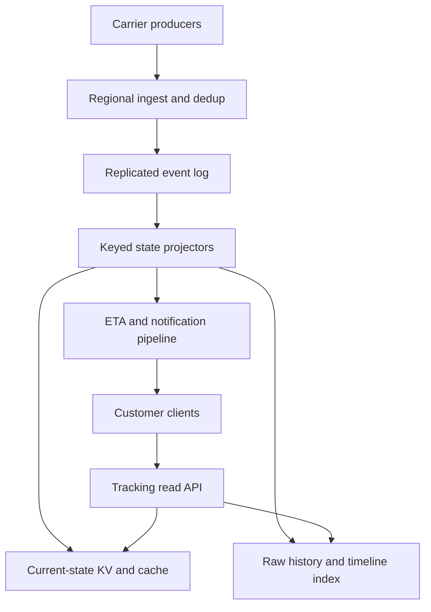

# Design a Global Package Tracking and ETA Platform

**Difficulty:** Senior  
**Primary themes:** event ingestion, out-of-order data, state machines, stream processing, caching, ETA inference, notifications, auditability

## Interviewer prompt

> Design a platform that tracks packages across multiple carriers. Carrier systems and scanning devices submit pickup, facility, transit, delivery, and exception events. Customers should see a trustworthy timeline, current package status, and an estimated delivery time. The system must tolerate duplicate, delayed, and out-of-order events at global scale.

## Targeted clarifying questions

**Candidate:** Are we building the carrier's physical-routing system or a tracking aggregation platform?

**Interviewer:** Focus on tracking. Carriers decide how packages move. We ingest their events, compute customer-facing state and ETA, and send updates.

**Candidate:** Do we track only milestone scans, or continuous GPS as well?

**Interviewer:** Milestone scans are required. A subset of last-mile vehicles sends GPS every 15–30 seconds. Customers should not see the courier's exact location; use GPS to improve ETA and optionally show a coarse area.

**Candidate:** Which user operations matter most?

**Interviewer:** A carrier registers a shipment and submits events. A customer reads the latest state and complete timeline. Customers can subscribe to meaningful updates such as out-for-delivery, delay, and delivered.

**Candidate:** How should late or contradictory scans behave?

**Interviewer:** Preserve valid events in the audit timeline, but do not let a delayed facility scan move a delivered package backward to “in transit.” Corrections must be explicit and auditable.

**Candidate:** What scale should I assume?

**Interviewer:** Assume 200 million active shipments, 5 billion tracking events per day, 500,000 events/s at peak, and 2 million customer reads/s at peak. Retain detailed events for seven years. The largest carriers can produce 30% of all traffic.

**Candidate:** What are the latency and reliability targets?

**Interviewer:** Acknowledge ingestion within 200 ms at p99 after durable acceptance. Normal milestone updates should appear to customers within five seconds. Tracking reads should complete within 150 ms at p99. Reads should be 99.99% available, and no acknowledged event may be lost.

**Candidate:** Is ETA exact, and is its model in scope?

**Interviewer:** ETA is a prediction with a confidence window. Design online inference and fallback behavior; model training can remain a separate offline pipeline.

**Candidate:** May I assume identity, email/SMS providers, maps, and carrier contracts already exist?

**Interviewer:** Yes. Show their interfaces and failure boundaries without designing them internally.

## Interview pacing

In a 45-minute interview, spend about 5 minutes on requirements, 2 on entities, 5 on interfaces, 10–15 on the simplest complete design, and 10–15 on deep dives. This follows Hello Interview's public [System Design Delivery Framework](https://www.hellointerview.com/learn/system-design/in-a-hurry/delivery): define scope, identify entities and APIs, make the core use cases work, then harden the design. The walkthrough below is deliberately more detailed study material.

---

## 1. Requirements (~5 minutes)

### Functional requirements

Prioritize three capabilities:

1. **Ingest shipment events.** Authorized carrier systems and scanners create shipments and append milestone, location, and correction events idempotently.
2. **Track a package.** A customer retrieves a shipment's current canonical state, ETA, and immutable event timeline.
3. **Compute and deliver updates.** The platform updates ETA after meaningful changes and notifies subscribers about important state transitions or delays.

Out of scope: warehouse inventory, route optimization, label purchasing, driver dispatch, customs decision-making, and model training internals.

### Quantified non-functional requirements

| Property | Target | Design consequence |
|---|---:|---|
| Ingest durability | No acknowledged event loss | Acknowledge only after replicated durable append. |
| Ingest latency | p99 < 200 ms | Keep carrier ingestion independent of downstream projections. |
| Customer freshness | p99 < 5 s for normal milestone events | Use stream processing and push-based cache updates. |
| Read latency | p99 < 150 ms | Serve current state from regional caches/materialized views. |
| Availability | 99.99% reads; 99.9% ingestion | Reads may be stale during a partition; ingestion buffers regionally. |
| Ordering | Deterministic canonical state per shipment | Key processing by shipment and apply explicit transition rules. |
| Retention | Seven years of event evidence | Tier immutable history into compressed object storage. |

### Consistency and availability contract

- **Event acceptance is durable and idempotent.** The same event ID with the same payload returns the original receipt. Reusing the ID with different content is a conflict.
- **The event history is append-only.** A late valid scan may be inserted into its chronological timeline, but historical records are not silently overwritten.
- **The current state is a deterministic projection.** It may lag ingestion by a few seconds, but it never regresses merely because an older event arrived late.
- **Tracking reads favor availability.** During a partition, a region may return a slightly stale state with `last_updated_at` and `version` rather than fail.
- **Security-sensitive terminal transitions use stronger authority.** Only an authorized delivery source can mark `DELIVERED`, and correcting it requires a privileged correction event.

**What to say aloud:**

> “I will separate event truth from projected state. The timeline can absorb late evidence, while the current customer status is computed by a versioned state machine and must not naively follow arrival order or event time.”

### Scale estimates that change the design

Assumptions:

- 5 billion events/day gives about `5B / 86,400 ≈ 58,000 events/s` on average and 500,000/s at peak.
- A normalized event averages 1 KB, so peak ingress is about 500 MB/s and raw evidence is roughly 5 TB/day before replication, indexes, and compression.
- 200 million active current-state records at 1 KB each are about 200 GB logical, small enough for a sharded key-value store and distributed cache.
- At 2 million reads/s, a 95% cache hit rate still leaves 100,000 backend reads/s.
- If every peak event triggered an expensive ETA inference, the model service would need 500,000 predictions/s. Most scans do not materially change ETA, so inference needs gating, batching, and route-level feature reuse.

These estimates lead to a durable partitioned log for ingestion, object storage for long retention, a compact materialized current-state store, and an event-triggered ETA pipeline rather than synchronous inference on every write.

---

## 2. Core entities (~2 minutes)

Name the business entities before expanding schemas.

| Entity | Essential fields | Purpose |
|---|---|---|
| `Shipment` | `shipment_id`, `carrier_id`, `tracking_number`, `service_level`, `origin`, `destination_region`, `created_at`, `recipient_access_policy` | Stable package identity and routing context. |
| `TrackingEvent` | `event_id`, `shipment_id`, `type`, `occurred_at`, `recorded_at`, `source_id`, `source_sequence`, `facility_id`, `coarse_location`, `payload_hash` | Immutable carrier evidence. |
| `CanonicalState` | `shipment_id`, `status`, `substatus`, `last_facility_id`, `last_event_id`, `state_version`, `updated_at`, `projection_version` | Fast customer-facing projection. |
| `RoutePlan` | `shipment_id`, `planned_legs`, `current_leg`, `service_calendar_version` | Expected journey used for validation and ETA. |
| `ETAPrediction` | `shipment_id`, `predicted_at`, `window_start`, `window_end`, `confidence`, `model_version`, `feature_version`, `trigger_event_id` | Versioned prediction rather than a mutable timestamp. |
| `Subscription` | `subscription_id`, `shipment_id`, `principal_id`, `channels`, `event_preferences`, `verified_destination` | Authorized notification preferences. |
| `NotificationIntent` | `intent_id`, `shipment_id`, `state_version`, `type`, `channel`, `status` | Idempotent handoff to notification providers. |
| `IngestReceipt` | `carrier_id`, `event_id`, `disposition`, `log_partition`, `log_offset`, `payload_hash` | Retry-safe proof of acceptance. |

The external tracking number is not the internal partition key: tracking numbers can be reused or collide across carriers. Resolve `(carrier_id, tracking_number)` to an immutable `shipment_id`.

**What to say aloud:**

> “The important split is immutable `TrackingEvent`, compact `CanonicalState`, and versioned `ETAPrediction`. That lets me replay projections without losing what the carrier actually reported.”

---

## 3. API and system interface (~5 minutes)

The carrier identity comes from mTLS or a signed OAuth workload credential. Customer identity comes from authentication or a scoped tracking token. A caller never chooses another carrier's `carrier_id` in the body. Hello Interview's [API guidance](https://www.hellointerview.com/learn/system-design/core-concepts/api-design) recommends sketching the small set of operations needed to expose the design, not spending the interview perfecting REST details.

### Register a shipment

```http
POST /v1/carrier/shipments
Authorization: Bearer <carrier-workload-token>
Idempotency-Key: shipment-order-99172
Content-Type: application/json

{
  "tracking_number": "1Z999AA10123456784",
  "service_level": "TWO_DAY",
  "origin_facility_id": "fac_bos_01",
  "destination_region": "US-MA",
  "promised_delivery_date": "2026-10-19"
}
```

```json
{
  "shipment_id": "shp_01K...",
  "status": "LABEL_CREATED",
  "state_version": 1
}
```

### Append tracking events

Support individual requests and compressed batches.

```http
POST /v1/carrier/tracking-events:batch
Authorization: Bearer <carrier-workload-token>
Content-Type: application/json

{
  "events": [
    {
      "event_id": "evt_01K...",
      "tracking_number": "1Z999AA10123456784",
      "type": "DEPARTED_FACILITY",
      "occurred_at": "2026-10-16T18:42:11Z",
      "source_id": "scanner_bos_448",
      "source_sequence": 78219,
      "facility_id": "fac_bos_01"
    }
  ]
}
```

```json
{
  "receipts": [
    {
      "event_id": "evt_01K...",
      "disposition": "ACCEPTED",
      "receipt_id": "rcpt_01K..."
    }
  ]
}
```

Other dispositions are `DUPLICATE`, `CONFLICT`, `REJECTED_SCHEMA`, `REJECTED_SCOPE`, and `QUARANTINED_TIME`. The receipt means durable acceptance, not that every read model and notification is already updated.

### Read current tracking state

```http
GET /v1/tracking/1Z999AA10123456784?carrier=carrier_ups
Authorization: Bearer <customer-token-or-scoped-tracking-token>
```

```json
{
  "shipment_id": "shp_01K...",
  "status": "IN_TRANSIT",
  "substatus": "DEPARTED_FACILITY",
  "last_location": {
    "city": "Boston",
    "region": "MA"
  },
  "eta": {
    "window_start": "2026-10-19T14:00:00-04:00",
    "window_end": "2026-10-19T18:00:00-04:00",
    "confidence": 0.82,
    "predicted_at": "2026-10-16T18:42:13Z"
  },
  "state_version": 18,
  "last_updated_at": "2026-10-16T18:42:13Z"
}
```

### Read the timeline

```http
GET /v1/shipments/shp_01K.../events?cursor=...&limit=50
```

Timeline responses include `occurred_at`, `recorded_at`, and a `late_arrival` flag. Sensitive facility details and raw GPS are redacted from the customer view.

### Subscribe to updates

```http
PUT /v1/shipments/shp_01K.../subscription
Authorization: Bearer <customer-token>
Content-Type: application/json

{
  "channels": ["PUSH", "SMS"],
  "event_preferences": ["OUT_FOR_DELIVERY", "DELAYED", "DELIVERED"]
}
```

The server verifies that the principal may view the shipment and owns the channel destination. A live application may additionally subscribe through server-sent events or WebSocket using `after_state_version`.

---

## 4. Data flow

### Milestone event flow

1. A scanner sends a batch over an authenticated carrier connection.
2. The ingest service validates schema, tenant scope, shipment mapping, clock bounds, and batch size.
3. Exact dedup checks `(carrier_id, event_id)` and the payload hash.
4. The service appends accepted events to a replicated regional log and returns receipts.
5. Events are normalized, archived into immutable object-storage files, and repartitioned by `shipment_id`.
6. A keyed projector updates timeline indexes and `CanonicalState` using versioned transition rules.
7. A material change triggers ETA evaluation and inserts a notification intent through an outbox.
8. Cache and live-update consumers publish the new state version to customers.

### Why both event time and record time matter

GS1's EPCIS standard is a public supply-chain visibility model and distinguishes business-event time from repository record time ([GS1 EPCIS](https://ref.gs1.org/standards/epcis/2.0.1/)). We make the same distinction:

- `occurred_at`: when the physical/business event supposedly happened;
- `recorded_at`: trusted platform acceptance time;
- `source_sequence`: ordering evidence from one device or carrier stream.

No single field is sufficient. Client event time can be late or skewed, record time reflects network delay rather than package movement, and source sequence orders only within a source.

---

## 5. High-level design (~10–15 minutes)

Build the simplest working design one operation at a time.



### Operation 1: register a shipment

The shipment service transactionally creates `Shipment`, the initial `CanonicalState`, and the tracking-number mapping. A unique constraint on `(carrier_id, tracking_number, active_generation)` prevents ambiguity while still allowing a carrier to reuse a tracking number years later.

Shipment metadata belongs in a relational store because registration needs uniqueness, ownership, and lifecycle constraints. Personally identifiable recipient data is tokenized or kept in a separate access-controlled store; tracking projections contain only the minimum data needed to serve the page.

### Operation 2: accept events durably

Deploy ingest endpoints in several regions close to large carrier producers. The closest healthy region:

1. authenticates and applies per-carrier quotas;
2. validates batch envelope and individual events;
3. resolves tracking numbers to shipment IDs from a local mapping cache;
4. performs exact idempotency checks;
5. appends to a log replicated across availability zones;
6. returns an `IngestReceipt` only after the required replicas acknowledge.

The log is partitioned by a stable hash of `shipment_id`, not carrier. That spreads a large carrier's traffic and puts all events for one shipment into one ordered processing partition. Kafka documents that records with the same key can be routed to the same partition, whose consumers observe partition order ([Kafka documentation](https://kafka.apache.org/documentation/)). Partition order is arrival order, however—not necessarily physical-event order—so the projector still needs late-event logic.

If the tracking-number mapping cache misses, the event can enter a bounded `UNRESOLVED` stream keyed by carrier and tracking number. A resolver retries after shipment registration. Do not discard a scan merely because registration raced it.

### Operation 3: materialize timeline and current state

Each stream partition has one active projector owner and a replicated checkpoint. For each shipment, the projector keeps a compact reorder buffer, recent dedup metadata, current route context, and canonical state.

Every accepted event goes to:

- immutable raw object storage, grouped into compressed files by date/carrier/partition;
- a timeline index keyed by `(shipment_id, occurred_at, event_id)`;
- the canonical-state transition function.

The transition function produces a new `state_version` only when customer-visible state changes. It writes `CanonicalState` and an outbox row atomically. Cache consumers apply a write only when its version exceeds the cached version.

The current-state store is a sharded key-value database keyed by `shipment_id`. The timeline can use a wide-column store or sorted index optimized for bounded per-shipment scans. Seven-year raw evidence remains in low-cost object storage even if the online timeline retains fewer details.

### Operation 4: read tracking state

The customer-facing path is intentionally independent from carrier ingestion:

1. The API authorizes either a logged-in principal or a high-entropy scoped tracking token.
2. A regional cache returns public current state by `shipment_id`.
3. On a miss, the API reads the nearest materialized-state replica.
4. Timeline pagination queries the shipment's sorted event partition.
5. The response exposes `state_version` and freshness so clients can ignore older live updates.

Cache the public status separately from personalized subscription state. Open shipments use a short TTL, such as 30 seconds, plus event-driven updates. Delivered shipments are immutable under normal operation and can have a much longer TTL.

### Operation 5: update ETA and notify

The projector emits `ShipmentStateChanged` after commit. An ETA trigger service decides whether the change merits inference—for example, a new facility departure, route exception, out-for-delivery scan, or meaningful GPS displacement.

The ETA service assembles features such as service level, route leg, facility dwell history, weekday/holiday, weather category, backlog, distance, and vehicle progress. It calls a versioned model server and writes an `ETAPrediction`. If the model is unavailable or confidence is low, it falls back to the carrier promise or a rules-based service window.

A notification policy compares old and new public state. It creates a deterministic intent ID such as `hash(subscription_id, state_version, notification_type)`. The notification service retries providers safely and records delivery outcome; it does not recompute package truth.

**What to say aloud:**

> “Carrier acknowledgment stops at the replicated log. Projection, ETA, caches, and notifications are downstream and replayable. That isolates producer reliability from model or messaging failures.”

---

## 6. Deep dives (~10–15 minutes)

### Deep dive A: duplicates, out-of-order events, and non-regressing state

#### Where the baseline breaks

Sorting by ingestion order makes a delayed hub scan appear after delivery. Sorting only by `occurred_at` trusts skewed device clocks and lets a backdated event rewrite state. Assigning a simple numeric rank to statuses fails for exceptions, returns, failed delivery attempts, and re-routing.

#### Plausible approaches

| Approach | Advantage | Failure |
|---|---|---|
| Last event received wins | Very simple | Network delay causes arbitrary regressions. |
| Largest event timestamp wins | Produces a neat timeline | Device clocks are untrusted; ties and corrections remain ambiguous. |
| Monotonic status rank | Prevents basic regression | Real shipment workflows branch and sometimes legitimately move backward. |
| Versioned state machine with source authority | Explicit, testable business semantics | More policy and replay complexity. |

Choose the versioned state machine.

#### Exact deduplication

Maintain `(carrier_id, event_id) -> payload_hash, receipt, disposition` in a partition-local state store backed by a changelog or durable table.

- Unseen ID: accept.
- Same ID and same hash: return the original receipt.
- Same ID with a different hash: return `CONFLICT`, quarantine, and alert.
- Legitimate correction: require a new event ID, `corrects_event_id`, reason, and privileged source.

Do not use a Bloom filter as the final dedup answer; false positives could drop a real delivery event. A Bloom filter may avoid expensive negative lookups, but an exact store decides.

#### Canonicalization rules

1. Validate source authority: only a delivery application may assert `DELIVERED`; only customs sources assert customs release; only privileged workflows correct terminal state.
2. Use per-source sequence where available to identify missing or reordered device records.
3. Hold ordinary nonterminal events in a small reorder buffer, for example two minutes, to absorb normal network jitter.
4. Apply a versioned transition table that considers current state, event type, route leg, source role, event time, and correction relationship.
5. Append every valid late event to history even when it has no effect on current state.
6. Emit a new state version only when the deterministic projection changes.

Example:

- Current state is `DELIVERED` at version 28.
- A `DEPARTED_FACILITY` scan with an older occurrence time arrives later.
- The event is added to the timeline with `late_arrival=true`, but the transition function returns `NO_STATE_CHANGE`.
- A privileged `DELIVERY_REVERSED` correction can transition to `EXCEPTION` at version 29 and references the delivery event.

#### Reprocessing and policy evolution

Store `projection_version` with current state. When business rules change, replay raw events into a shadow projection, compare outcomes, and cut over by generation. Never silently apply new logic to only recent packages while old packages retain unexplained semantics.

#### Failure modes

- **Projector crashes after state write:** transactional state/outbox or idempotent version writes prevent double emission.
- **Partition reassignment:** restore checkpoint and dedup state before consuming new events; fence the old owner.
- **Missing source sequence:** mark the gap, request carrier replay, and surface internal data-quality alerts.
- **Clock far outside policy:** quarantine rather than letting it influence state; retain the original payload for investigation.
- **Poison event:** isolate it to a dead-letter workflow without blocking the entire partition indefinitely.

**What to say aloud:**

> “Arrival order is transport truth, not shipment truth. I preserve the immutable event, but a versioned transition function decides whether it changes the canonical state. Terminal changes require source authority, and corrections append evidence instead of rewriting history.”

### Deep dive B: sustain carrier bursts without losing auditability

#### Where the baseline breaks

Writing each event synchronously to the current-state database, timeline database, object store, model server, and notification service couples ingestion to every dependency. A carrier reconnecting after an outage may upload hours of scans at once. Carrier-only partitioning creates a 30%-of-traffic hot partition.

#### Selected ingestion architecture

- **Batch at the edge.** Support hundreds of events per compressed request with per-event receipts.
- **Partition by shipment.** A large carrier spreads across many partitions while one package retains one processing owner.
- **Replicate before acknowledgment.** Require multi-AZ log durability, not completion of downstream materializations.
- **Separate raw and normalized streams.** Keep original signed payloads for evidence; emit a stable internal schema for consumers.
- **Archive asynchronously but verifiably.** Object files have checksums, log offset ranges, counts, and atomic manifests.
- **Apply carrier quotas and fair admission.** Reserve capacity for smaller carriers and keep bounded regional buffers.

At 500 MB/s raw peak, 3× replication produces roughly 1.5 GB/s of intra-cluster write traffic before protocol overhead. This is a cluster, not a single broker. With 100 MB/s of conservative sustained disk/network budget per broker, the raw arithmetic suggests at least 15 brokers for throughput; headroom, replication recovery, partition balance, and maintenance may push the deployed count to 30–50.

#### Backpressure contract

When the regional log is healthy but downstream consumers lag, continue ingesting within retention capacity and alert on lag. When the log cannot meet its durability quorum, do not acknowledge. Return a retryable error so carrier gateways retain the batch locally with exponential backoff and jitter.

Large carriers should send monotonic batch sequence ranges. Reconciliation compares:

- carrier-reported ranges and counts;
- ingest receipts and log offsets;
- raw object manifests;
- projector checkpoints;
- current-state and notification outbox versions.

A missing range is explicit. Never “fix” it by fabricating a state transition.

#### Storage lifecycle

- Hot log: several days for replay.
- Online timeline: recent customer-visible milestones, partitioned by shipment.
- Raw object storage: seven years, compressed, encrypted, lifecycle-tiered.
- Dedup identity: retained through the carrier replay and dispute window; compact older IDs into evidence indexes.
- Current state: active shipments plus a long-lived terminal summary.

#### Failure modes

- **One carrier floods ingestion:** token buckets at carrier and source levels plus weighted fair queues.
- **Cross-region partition:** local durable acceptance continues while capacity allows; global projection freshness degrades visibly.
- **Object archive lag:** do not drop log retention until manifests prove archival coverage.
- **Schema rollout breaks a consumer:** version envelopes, run compatibility checks, and retain raw payloads for re-normalization.

**What to say aloud:**

> “The ingestion SLA ends at replicated append. I partition by shipment rather than carrier, preserve source ranges and raw manifests, and let every projection replay. That absorbs a carrier reconnect burst without making notification or ETA availability part of event acceptance.”

### Deep dive C: scalable ETA inference and notification correctness

#### Where the baseline breaks

Calling the model synchronously for every event couples ingestion to model latency and may demand 500,000 inferences/s. A noisy GPS stream can produce nearly identical predictions and spam customers. A model outage could otherwise stop tracking updates, even though status is still useful.

#### Compare ETA strategies

| Strategy | Strength | Weakness |
|---|---|---|
| Static carrier promise | Cheap and highly available | Does not react to current conditions. |
| Rules by route and service level | Explainable fallback | Limited interaction modeling. |
| Per-package model inference | Most personalized | Expensive under scan/GPS volume. |
| Hierarchical prediction | Reuses route/facility predictions, then adjusts per package | More feature/version coordination. |

Choose hierarchical prediction with gated per-package inference.

#### Selected design

1. A stream processor maintains shared features for route legs, facilities, weather regions, and last-mile vehicles.
2. Recompute a shared route/facility baseline when its conditions materially change.
3. Trigger per-package inference only on important milestones, detected delay, changed route, large GPS progress, or expiration of the previous prediction.
4. Micro-batch model requests by model version and region. Cache feature vectors and route baselines.
5. Persist predictions with `model_version`, `feature_version`, `trigger_event_id`, confidence, and a window—not only a point estimate.
6. Serve the latest prediction whose input state version is not ahead of the shipment projection. Mark old predictions stale after a configured interval.

If gating reduces model calls to 10% of peak events, capacity falls from 500,000 to 50,000 inferences/s. With batches of 100, that is 500 batch requests/s across the serving fleet. The exact hardware count depends on model cost and measured batch latency, but this arithmetic justifies separating trigger selection from inference.

#### Fallback and degradation

- Model timeout: use the most recent non-expired prediction.
- Expired prediction: fall back to a route/service-level rules window.
- Missing features: return the carrier commitment with lower confidence.
- System-wide model incident: tracking status continues; suppress “ETA changed” notices caused only by fallback oscillation.
- Bad model release: compare canary error against actual delivery, then roll back by model version.

#### Notification policy

Notifications are based on canonical state versions, not raw events. A policy service decides whether the change is customer-meaningful:

- notify once for `OUT_FOR_DELIVERY` and `DELIVERED`;
- notify for delay only when the promised day or ETA window changes beyond a threshold;
- suppress repeated exception scans with the same public meaning;
- obey quiet hours, channel preference, consent, and regional regulations;
- use a deterministic intent ID so retries cannot send the same notification twice through normal processing.

Provider delivery is at least once from our perspective. The outbox and intent ID make our requests idempotent where providers support keys. Where they do not, store attempt state and prefer a small risk of duplicate delivery over silently losing critical delivery confirmation.

#### Observability

Track ETA inference rate after gating, batch size, model latency/error, feature freshness, fallback rate, confidence calibration, absolute error by route/service level, and prediction churn. For notifications, track intent lag, dedup hits, provider acceptance, delivery receipts, suppression reason, and complaints. Model health and message-provider health must not be confused with ingestion freshness.

**What to say aloud:**

> “ETA is a versioned derived view, not shipment truth. I trigger inference only on meaningful feature changes, reuse route-level work, return a confidence window, and degrade to rules without blocking status updates. Notifications consume canonical versions so raw scan noise cannot spam users.”

---

## Reliability, consistency, security, and operations

### Multi-region reliability

- Carrier producers write to the nearest healthy ingest region; each region replicates across availability zones.
- A global event fabric asynchronously mirrors accepted data for disaster recovery and centralized analytics.
- Shipment ownership for projection is single-active per partition with fencing. Customer reads are active-active from regional materialized replicas.
- During an inter-region partition, local ingestion continues within buffer capacity, but another region may serve stale state. Return `last_updated_at` rather than inventing freshness.
- Recovery replays from durable offsets. Cache and notifications are rebuilt from state/outbox generations, not treated as sources of truth.

### Security and privacy

- Use mTLS/workload identity for carriers and least-privilege source scopes.
- Resolve customer access through account ownership or a high-entropy, revocable tracking token; knowing a short tracking number alone should not expose sensitive details.
- Redact exact recipient address, raw GPS, device identity, and internal facility metadata from public responses.
- Encrypt data in transit and at rest; segregate carrier tenants and audit support access.
- Sign offline scanner batches with device identity and sequence ranges; rotate compromised credentials.
- Apply retention and deletion policy separately to operational events, PII mappings, and analytical features.

### Operational observability

| Signal | Why it matters |
|---|---|
| Ingest acknowledgment latency/error | Producer-facing SLA and quorum health |
| Duplicate/conflict rate by source | Scanner retry behavior or ID misuse |
| Source sequence gaps | Missing physical evidence |
| Log, normalization, archive, and projector lag | End-to-end freshness and replay safety |
| Open shipment state age | Detect silently stuck projections |
| Invalid transition and quarantine rate | Carrier data quality or policy bugs |
| Cache version lag and hit rate | Read freshness and backend load |
| ETA fallback/error distribution | Model-serving and feature health |
| Notification intent/provider lag | Customer communication health |
| Raw-manifest offset coverage | Long-term audit completeness |

Trace by `shipment_id`, `event_id`, `receipt_id`, `state_version`, and `prediction_id`. Avoid unbounded carrier or shipment IDs as metric labels.

### Reconciliation

Periodic jobs prove that every accepted offset is either archived and projected or explicitly quarantined. For terminal shipments, verify that the canonical terminal state has supporting authorized evidence, the final ETA is no longer being updated, and outstanding notification intents have a disposition. Replay a sample of event histories through the pinned projection version and compare the resulting state digest.

---

## 7. Concise final design

Authorized carriers register shipments and submit uniquely identified tracking events to regional ingestion. The platform validates, exactly deduplicates, and acknowledges only after multi-AZ log replication. Events are normalized, archived as immutable evidence, and repartitioned by shipment. A single fenced projector per partition applies a versioned state machine that tolerates late events without regressing canonical status, writes a versioned current-state record, indexes the timeline, and emits an outbox event.

Regional read APIs serve current state from caches and materialized replicas while timelines come from a shipment-partitioned event index. Meaningful state changes trigger hierarchical, batched ETA inference with a rules-based fallback. Notification policy consumes canonical state versions, suppresses noise, and creates idempotent delivery intents. Raw manifests, source sequence ranges, projection versions, fencing, and reconciliation make the system replayable and auditable.

## Requirements check

| Requirement | Design response |
|---|---|
| Register shipments | Transactional identity and tracking-number generation mapping |
| Ingest 500,000 events/s | Regional batching, partitioned replicated logs, horizontal consumers |
| No acknowledged loss | Receipt only after multi-AZ durable append |
| Duplicate safety | Exact event ID and payload-hash deduplication |
| Out-of-order tolerance | Immutable timeline plus versioned canonical state machine |
| Tracking under 150 ms p99 | Regional cache and compact current-state KV |
| Updates within five seconds | Keyed stream projection and event-driven cache updates |
| ETA prediction | Gated hierarchical inference, versioned confidence window, fallback |
| Notifications | Canonical-state policies, outbox, deterministic intent IDs |
| Seven-year retention | Compressed immutable object storage with manifest coverage |
| Carrier isolation | Workload identity, scoped authorization, quotas, tenant controls |
| Failure recovery | Checkpoints, fencing, replay, versioned projections, reconciliation |

## Realistic interviewer follow-ups and strong sample answers

### “Why not just update one shipment row whenever an event arrives?”

> “That loses audit history and makes late events overwrite newer truth. I append immutable evidence first, then compute current state as a deterministic projection. The row is a fast materialized view that I can rebuild.”

### “Kafka already orders messages. Why do you need out-of-order logic?”

> “The partition orders arrival to our log. A scanner can be offline for hours, two carrier sources can race, and device clocks can differ. Transport order is not physical-event order, so the projector combines source authority, sequence, event time, route context, and transition rules.”

### “How do you prevent a delivered package from becoming in transit?”

> “`DELIVERED` is a guarded terminal transition. An older transit event is stored in the timeline but yields no state change. Only a privileged correction event referencing the delivery can move the state to an exception or reversal.”

### “What if a scan arrives before shipment registration?”

> “I durably retain it in a bounded unresolved stream keyed by carrier and tracking number. A resolver retries the mapping when registration appears. We alert and eventually quarantine entries that exceed policy; we do not silently drop them.”

### “How would you handle GPS at much higher volume?”

> “GPS is a different stream with shorter raw retention and spatial/temporal compaction. Keep the latest vehicle position and aggregate path segments; do not create a customer milestone for every ping. Use coarse locations and route-level features for ETA, with strict access control around raw coordinates.”

### “Why not run ETA inference synchronously during ingestion?”

> “It would add model latency and availability to the carrier SLA and require inference for low-value scans. Durable acceptance should be independent. A downstream trigger gates meaningful changes, batches inference, and falls back to rules while tracking remains available.”

### “How do you partition if one carrier is 30% of traffic?”

> “Partition normalized events by a stable hash of `shipment_id`, not carrier. The large carrier spreads across the fleet, while events for one package stay with one projector. Carrier quotas still protect admission fairness.”

### “How do you correct a bad event?”

> “Never edit or delete it in place. Append a privileged correction that references the original ID and reason. The projection version applies the correction and emits a new state version, preserving the evidence chain.”

### “Can notification delivery be exactly once?”

> “End to end, providers and devices make that promise unrealistic. I guarantee one logical notification intent per subscription, state version, and type, then retry idempotently where the provider supports keys. I record attempts and delivery receipts and suppress duplicate processing.”

### “How would you roll out a new state-machine rule?”

> “Version it and replay a representative or complete population into a shadow projection. Compare state digests, invalid-transition rates, and customer-visible changes. Cut over by projection generation and retain the previous generation for rollback.”

### “Would you use a geospatial database?”

> “For facility lookup, route analysis, and authorized operational proximity queries, yes. PostGIS documents that `ST_DWithin` can use a spatial index for radius filtering ([PostGIS guidance](https://postgis.net/documentation/tips/st-dwithin/)). The ordinary customer tracking lookup remains keyed by shipment, so it does not need a spatial query.”

## Common pitfalls

1. Treating arrival order as physical package order.
2. Letting a late event regress a delivered shipment.
3. Mutating or deleting incorrect events instead of appending corrections.
4. Using a probabilistic Bloom filter as the final dedup decision.
5. Partitioning by carrier and creating a dominant hot partition.
6. Acknowledging before durable replication.
7. Making carrier ingestion wait for ETA, cache, or notification providers.
8. Storing only current state and losing replay/audit evidence.
9. Ignoring scans that arrive before shipment registration.
10. Trusting device timestamps without clock and source policy.
11. Exposing exact driver GPS or recipient details through public tracking.
12. Running model inference on every GPS ping or scan.
13. Sending notifications from raw events rather than canonical transitions.
14. Omitting state, projection, feature, and model versions.
15. Using cache TTL alone without revision checks.
16. Claiming exactly-once notification delivery across third-party providers.
17. Retaining the event log indefinitely instead of proving object-archive coverage.
18. Ignoring source sequence gaps and therefore missing entire scanner batches.

## A polished 60-second wrap-up

> “I separate durable event evidence from the customer-facing projection. Carrier events are authenticated, exactly deduplicated, and acknowledged after regional log replication. They are archived and keyed by shipment into a fenced stream processor. A versioned state machine uses source authority, sequence, event time, and route context so late scans enrich the timeline without incorrectly regressing current status. Regional caches serve the compact state at high read volume. Only meaningful canonical changes trigger batched ETA inference and idempotent notification intents, and rules-based ETA keeps the product useful during a model outage. Offset manifests, projection versions, source-range reconciliation, and append-only corrections make the result recoverable and auditable.”

## Public references

- [Hello Interview — System Design Delivery Framework](https://www.hellointerview.com/learn/system-design/in-a-hurry/delivery)
- [Hello Interview — API Design](https://www.hellointerview.com/learn/system-design/core-concepts/api-design)
- [GS1 — EPCIS 2.0.1 Standard](https://ref.gs1.org/standards/epcis/2.0.1/)
- [Apache Kafka — Documentation](https://kafka.apache.org/documentation/)
- [PostGIS — Use ST_DWithin for radius queries](https://postgis.net/documentation/tips/st-dwithin/)
