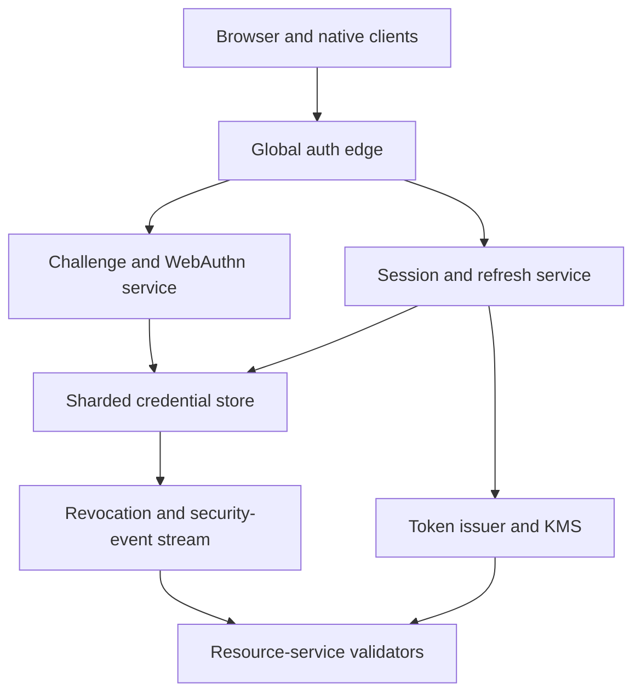

# Design a Global Passwordless Authentication and Session Service

**Difficulty:** Senior / Staff  
**Primary themes:** passkeys, replay prevention, token issuance, refresh rotation, revocation, caching, multi-region consistency, security observability

## Interviewer prompt

> Design a global authentication service for consumer applications. Users should register and sign in with passkeys rather than passwords, stay signed in across multiple devices, review active sessions, and revoke one device or every session. Application services must validate access tokens with very low latency, while account compromise actions should take effect quickly.

## Targeted clarifying questions

**Candidate:** Should I focus on authentication—proving identity—or also application authorization?

**Interviewer:** Focus on authentication, session lifecycle, and basic token scopes. Fine-grained application permissions are owned by downstream services.

**Candidate:** Is the primary credential WebAuthn/passkeys?

**Interviewer:** Yes. Support platform and roaming authenticators. Passkeys may sync through an operating-system provider. Email recovery exists, but its delivery service is external and recovery policy is only a supporting flow.

**Candidate:** Which operations are in scope?

**Interviewer:** Register a passkey, authenticate with it, issue and refresh sessions, list devices, revoke one session, revoke all sessions, and distribute keys so services can validate access tokens.

**Candidate:** Should access tokens be self-contained JWTs or opaque tokens?

**Interviewer:** Choose and justify. Resource services need high availability and sub-10-ms local validation. Critical account revocation should propagate within 30 seconds.

**Candidate:** What scale should I design for?

**Interviewer:** Assume 200 million monthly active users, 50,000 login or registration completions per second at peak, 10,000 refreshes per second, and one million access-token validations per second across application services.

**Candidate:** What are the latency and availability goals?

**Interviewer:** Token validation should add less than 10 ms at p99. The server portions of login and refresh should be under 300 ms at p99, excluding the user's biometric interaction. Token validation should be 99.99% available, and login/refresh 99.95%.

**Candidate:** What security invariants matter most?

**Interviewer:** Challenges are unpredictable, short-lived, and single-use. Credentials are bound to the correct relying party and origin. Refresh-token replay must be detected. Signing-key rotation must not break healthy sessions. No raw private key or reusable passkey secret ever reaches our servers.

**Candidate:** Is multi-region active-active expected?

**Interviewer:** Yes for reads, challenge creation, and ordinary login. Security mutations may coordinate through a user's home partition if needed.

## Interview pacing

For a 45-minute interview, spend around 5 minutes on requirements, 2 on entities, 5 on interfaces, 10–15 on a complete register/login/validate flow, and 10–15 on the most security-sensitive deep dives. This follows Hello Interview's public [System Design Delivery Framework](https://www.hellointerview.com/learn/system-design/in-a-hurry/delivery): make the core system work before hardening it. This walkthrough is intentionally more detailed than the spoken interview.

---

## 1. Requirements (~5 minutes)

### Functional requirements

Prioritize three capability groups:

1. **Enroll a passkey.** An authenticated or recovery-verified user requests registration options and submits a WebAuthn credential whose public key is stored on the account.
2. **Sign in and maintain a session.** A user completes a passkey challenge and receives a short-lived access token plus a rotating refresh token.
3. **Manage and revoke sessions.** A user lists devices, revokes one session or all sessions, and application services validate access tokens using published verification keys and revocation state.

Out of scope: the internals of biometric authenticators, email delivery, fine-grained resource authorization, social identity-provider internals, and the complete fraud-model training pipeline.

### Non-functional requirements

| Property | Target | Design consequence |
|---|---:|---|
| Token validation | p99 < 10 ms, 99.99% available | Validate signatures locally; do not call the auth database per request. |
| Login/refresh latency | Server p99 < 300 ms | Keep challenge/session writes regionally close and narrowly transactional. |
| Login/refresh availability | 99.95% | Multi-AZ regional service with controlled cross-region failover. |
| Revocation freshness | Critical actions effective globally within 30 s | Push a compact revocation epoch/set to validators. |
| Replay protection | Single-use challenges and rotating refresh tokens | Exact atomic consumption and token-family state. |
| Durability | No acknowledged credential or revocation loss | Commit security mutations to quorum storage before success. |

### Consistency and availability contract

- **Credential registration and removal are strongly consistent per user.** A success response means the new credential version is durably committed.
- **A challenge is consumed at most once.** Concurrent verification attempts cannot both create sessions.
- **Refresh rotation is linearizable per session family.** Reusing an already-rotated token revokes or quarantines the family.
- **Access-token validation is locally available and bounded-stale.** Services verify a signed token plus cached revocation metadata without a synchronous auth-service call.
- **Revocation has a documented bound.** Normal logout stops refresh immediately and existing access tokens expire within five minutes; high-risk account revocation is pushed to validators within 30 seconds.
- **During an unsafe partition, security writes may fail closed.** Existing low-risk requests may continue with locally valid tokens, but credential changes and refreshes require authoritative state.

**What to say aloud:**

> “I will not pretend a self-contained token can be instantly revoked for free. I will use very short access-token lifetimes plus a pushed account/session epoch for urgent revocation. Validation remains local, while credential and refresh mutations stay strongly consistent per user.”

### Scale estimates that change the design

Assumptions:

- 50,000 login/registration completions/s at peak.
- Each completion has a challenge phase and a verification phase, so the public auth tier sees at least 100,000 requests/s before retries.
- A challenge lives for five minutes. At 50,000 new challenges/s, there can be `50,000 × 300 = 15 million` live challenges.
- At roughly 500 bytes of stored challenge state plus overhead, challenge storage is on the order of 7.5–15 GB—not huge, but it needs horizontal partitioning and automatic TTL cleanup.
- One million token validations/s cannot afford a central network lookup. A single extra 1-ms remote dependency would also amplify outages across every application.
- If access tokens last five minutes, a global key or claim mistake can affect at most that window without refresh. Short lifetimes increase refresh load, so refresh rotation must scale independently.

Therefore, use local cryptographic validation, a distributed TTL challenge store, a sharded strongly consistent credential/session store, cached key sets, and compact revocation feeds.

---

## 2. Core entities (~2 minutes)

Identify the security objects before designing tables.

| Entity | Essential fields | Purpose |
|---|---|---|
| `User` | `user_id`, `status`, `auth_version`, `home_shard`, `recovery_policy`, `created_at` | Account-level security boundary. |
| `Credential` | `credential_id`, `user_id`, `public_key`, `rp_id`, `transports`, `backup_eligible`, `backup_state`, `sign_count`, `status`, `created_at` | Server-side WebAuthn public credential metadata. |
| `Challenge` | `challenge_id`, `ceremony`, `user_hint`, `rp_id`, `origin_policy`, `nonce_hash`, `expires_at`, `consumed_at`, `region` | One-time registration or authentication ceremony state. |
| `Session` | `session_id`, `user_id`, `device_id`, `created_at`, `last_seen_at`, `risk_level`, `revoked_at`, `session_version` | User-visible signed-in device. |
| `RefreshFamily` | `family_id`, `session_id`, `current_token_hash`, `generation`, `expires_at`, `reuse_detected_at` | Linearizable refresh-token rotation state. |
| `SigningKey` | `key_id`, `algorithm`, `public_key`, `kms_key_ref`, `not_before`, `sign_until`, `verify_until`, `status` | Token signing and safe rotation. |
| `RevocationRecord` | `subject_type`, `subject_id`, `min_valid_version`, `revoked_at`, `reason`, `expires_at` | Compact urgent-revocation state. |
| `SecurityEvent` | `event_id`, `user_id`, `type`, `actor`, `ip_region`, `device_id`, `occurred_at`, `result`, `risk_signals` | Immutable audit and detection stream. |

Private passkey key material stays in the authenticator. The server stores only the public key and metadata needed to verify assertions.

**What to say aloud:**

> “The core entities are a public-key credential, a one-time challenge, a user-visible session, and a refresh-token family. `auth_version` and `session_version` give validators a compact way to invalidate previously issued tokens.”

---

## 3. API and system interfaces (~5 minutes)

Identity is derived from the verified ceremony, recovery proof, or current authenticated session. APIs never accept a caller-supplied `user_id` as authority. Keep the interview API set compact, consistent with Hello Interview's [API design guidance](https://www.hellointerview.com/learn/system-design/core-concepts/api-design).

### Begin passkey registration

```http
POST /v1/passkeys/registration/options
Authorization: Bearer <recently-authenticated-session-or-recovery-token>
Content-Type: application/json

{
  "display_name": "Rahul's laptop"
}
```

```json
{
  "challenge_id": "chl_01K...",
  "publicKey": {
    "challenge": "base64url-random-bytes",
    "rp": {"id": "login.example.com", "name": "Example"},
    "user": {
      "id": "opaque-user-handle",
      "name": "masked@example.com",
      "displayName": "Rahul"
    },
    "pubKeyCredParams": [{"type": "public-key", "alg": -7}],
    "timeout": 300000,
    "attestation": "none"
  }
}
```

### Complete passkey registration

```http
POST /v1/passkeys/registration/verify
Content-Type: application/json

{
  "challenge_id": "chl_01K...",
  "credential": {
    "id": "credential-base64url",
    "type": "public-key",
    "response": {
      "clientDataJSON": "...",
      "attestationObject": "..."
    }
  }
}
```

```json
{
  "credential_id": "cred_01K...",
  "status": "ACTIVE",
  "credential_version": 4
}
```

The registration challenge is authorized when created. Verification derives the user from that server-side state, not from the response body.

### Begin authentication

```http
POST /v1/authentication/options
Content-Type: application/json

{
  "login_hint": "rahul@example.com"
}
```

```json
{
  "challenge_id": "chl_01M...",
  "publicKey": {
    "challenge": "base64url-random-bytes",
    "rpId": "login.example.com",
    "timeout": 300000,
    "userVerification": "required",
    "allowCredentials": []
  }
}
```

An empty `allowCredentials` supports discoverable credentials and avoids revealing whether an account exists. Responses and timing should be indistinguishable for unknown login hints.

### Complete authentication

```http
POST /v1/authentication/verify
Content-Type: application/json

{
  "challenge_id": "chl_01M...",
  "credential": {
    "id": "credential-base64url",
    "type": "public-key",
    "response": {
      "clientDataJSON": "...",
      "authenticatorData": "...",
      "signature": "...",
      "userHandle": "opaque-user-handle"
    }
  },
  "device": {
    "name": "Chrome on macOS",
    "device_public_key": "optional-DPoP-key"
  }
}
```

```json
{
  "access_token": "eyJ...",
  "token_type": "DPoP",
  "expires_in": 300,
  "refresh_token": "opaque-high-entropy-secret",
  "session_id": "ses_01K..."
}
```

### Refresh a session

```http
POST /v1/sessions/refresh
Authorization: DPoP <refresh-token>
DPoP: <signed-proof>
Content-Type: application/json

{
  "session_id": "ses_01K..."
}
```

The response returns a new access token and a replacement refresh token. The presented refresh token becomes invalid as part of the same transaction.

### List and revoke sessions

```http
GET /v1/sessions
Authorization: DPoP <access-token>
```

```http
DELETE /v1/sessions/ses_01K...
Authorization: DPoP <access-token>
```

```http
POST /v1/sessions/revoke-all
Authorization: DPoP <recently-reauthenticated-access-token>
```

`revoke-all` increments the user's `auth_version`, revokes refresh families, and publishes urgent revocation state.

### Publish token-verification keys

```http
GET /.well-known/jwks.json
```

Resource services cache the key set by `kid`, honor cache headers, refresh on an unknown key, and retain overlap keys until every token signed by them has expired.

---

## 4. Data flows

### Registration flow

1. A recently authenticated session or recovery proof requests registration options.
2. The challenge service creates 32 or more random bytes, stores a hash with ceremony type, user, RP ID, allowed origins, expiration, and authorization context, then returns the raw challenge.
3. The authenticator creates a scoped key pair and signs attestation data; the private key never leaves the authenticator.
4. Verification atomically consumes the challenge, validates client data, origin, RP-ID hash, flags, algorithm, and credential uniqueness.
5. A transaction inserts the public `Credential`, increments the user's credential version, and emits a security event.

### Login and session flow

1. The service creates an authentication challenge without confirming whether the login hint exists.
2. The authenticator selects a passkey after local user verification and signs the challenge-bound assertion.
3. The verification service atomically consumes the challenge and verifies the signature against the stored public key.
4. Risk policy checks account state, credential state, device posture, impossible travel, abuse rate, and recovery sensitivity.
5. A transaction creates `Session` and `RefreshFamily` and writes an outbox security event.
6. The token issuer signs a five-minute access token and returns one opaque refresh token whose hash is stored.
7. Resource services validate the access token locally and compare its versions against cached revocation state.

---

## 5. High-level design (~10–15 minutes)



### Operation 1: create and consume a challenge

Challenge creation is high-volume, short-lived, and region-local. Use a partitioned TTL store replicated across availability zones. Store a keyed hash of the raw challenge rather than the raw value, along with:

```text
challenge_id, ceremony, user_or_flow_id, rp_id,
allowed_origins, nonce_hash, created_at, expires_at,
consumed_at, authorization_context, issuing_region
```

Verification routes back to the issuing region encoded in an authenticated challenge ID, or reads from a globally replicated challenge partition. Consumption is a conditional write:

```sql
UPDATE challenges
SET consumed_at = now()
WHERE challenge_id = :id
  AND consumed_at IS NULL
  AND expires_at > now();
```

Only the request that changes one row proceeds. A second concurrent assertion fails even if its signature is valid.

### Operation 2: register the public credential

After consuming the registration challenge, the WebAuthn verifier checks the ceremony and cryptographic response. The W3C WebAuthn specification defines public-key credentials scoped to a relying party and includes a server-provided challenge ([WebAuthn Level 3](https://www.w3.org/TR/webauthn-3/)).

The credential store is sharded by `user_id` and synchronously replicated within a region. A global unique index or deterministic home-shard lookup protects `credential_id`, because login may begin with a credential rather than an email. Store credential public key, algorithm, RP ID, backup flags, transport hints, and lifecycle status. Attestation policy defaults to `none` for consumer privacy; regulated enterprise tenants may enforce approved authenticators.

### Operation 3: authenticate and issue a session

On assertion verification:

1. Hash the presented credential ID and find its credential/home shard.
2. Read active credential and user state.
3. Validate `clientDataJSON.type`, challenge, exact allowed origin, RP-ID hash, user-presence/user-verification flags, signature, and user handle.
4. Feed security signals to a policy engine. Low risk continues; high risk can require another credential or recovery step.
5. Transactionally create the session and first refresh-token hash.
6. Sign the access token through a hardened issuer whose private key operations occur in an HSM/KMS-backed boundary.

The access token contains minimal claims:

```json
{
  "iss": "https://login.example.com",
  "sub": "usr_01K...",
  "aud": "api.example.com",
  "sid": "ses_01K...",
  "av": 12,
  "sv": 1,
  "scope": "profile:read",
  "iat": 1792188000,
  "exp": 1792188300,
  "jti": "tok_01K...",
  "cnf": {"jkt": "device-key-thumbprint"}
}
```

RFC 7519 defines standard JWT claims including expiration and unique token ID ([RFC 7519](https://www.rfc-editor.org/rfc/rfc7519.html)). Do not put email, device name, or sensitive profile data in a broadly propagated bearer token.

### Operation 4: validate access locally

Each resource-service sidecar or library:

1. parses the token with strict size and algorithm allowlists;
2. locates the cached public key by `kid`;
3. verifies signature, issuer, audience, expiration, not-before, and clock-skew bounds;
4. verifies a DPoP proof and key thumbprint when sender-constrained tokens are used;
5. checks cached minimum valid `auth_version` and any urgent `session_version` revocation;
6. authorizes required scopes.

DPoP binds a token to a public key and requires a per-request proof, reducing the usefulness of a stolen token ([RFC 9449](https://www.rfc-editor.org/rfc/rfc9449.html)). It does not help if malware steals both token and private key, so it complements rather than replaces secure client storage and risk controls.

### Operation 5: refresh and revoke

Refresh tokens are random opaque secrets. Store only an HMAC or slow-resistant keyed hash, never the raw token. Each successful refresh transaction:

1. locks or compare-and-swaps the `RefreshFamily` generation;
2. verifies the current token hash, session status, account version, expiration, and DPoP key binding;
3. replaces the stored hash with the next token hash and increments generation;
4. commits before returning the replacement token.

If an old refresh token appears after rotation, assume theft or replay: mark `reuse_detected_at`, revoke the family, publish urgent revocation, and require reauthentication.

Revoking all sessions increments `User.auth_version`. Newly issued tokens carry the new value. Validators receive `user_id -> min_auth_version` through a compact stream/cache. A current-session revoke similarly publishes `session_id -> min_session_version or revoked_until`.

**What to say aloud:**

> “Access tokens are cheap, short-lived, and locally verifiable. Refresh tokens are expensive security state: opaque, one-time rotating, device-bound when possible, and serialized per family. Revocation changes versions rather than distributing every access-token ID.”

---

## 6. Deep dives (~10–15 minutes)

### Deep dive A: make WebAuthn ceremonies replay- and phishing-resistant

#### Where the baseline breaks

A signature alone is not sufficient. If the server fails to bind it to a fresh challenge, correct origin, RP ID, ceremony type, and expected user, an attacker may replay an assertion or substitute one generated for another site or flow. If challenge consumption is not atomic, two simultaneous requests can create two sessions.

#### Challenge design choices

| Approach | Strength | Weakness |
|---|---|---|
| Stateless signed challenge blob | No server lookup | Harder single-use enforcement; leaked valid blob can replay until expiry. |
| Server-stored random challenge | Exact single-use state and policy binding | Requires a highly available TTL store. |
| Hybrid signed ID plus stored hash | Fast routing and tamper detection with exact consumption | More components and key management. |

Choose the hybrid. The client receives a random challenge plus an opaque authenticated ID containing only routing metadata. The server stores the hash and ceremony context and conditionally consumes it once.

#### Registration verification checklist

- exact `type` for credential creation;
- expected challenge and unexpired, unconsumed server record;
- exact origin allowlist, never suffix matching;
- RP-ID hash corresponding to configured relying-party ID;
- user-presence and required user-verification flags;
- supported, explicitly allowlisted public-key algorithm;
- credential ID uniqueness and valid public-key encoding;
- attestation validation only if policy requires it;
- no user identity taken from untrusted request fields.

#### Authentication verification checklist

- exact assertion ceremony type, challenge, origin, and RP ID;
- active credential belongs to the resolved user;
- signature verifies over the prescribed authenticator/client data;
- user verification satisfies policy;
- credential not revoked or disabled;
- clone/counter signals and backup metadata feed risk policy.

Older authenticators may provide a signature counter, but synced passkeys and authenticator behavior mean it should be treated as a risk signal rather than an unconditional global monotonic invariant. A counter regression can trigger step-up or investigation without locking out every legitimate synced device.

#### Failure modes

- **Challenge store unavailable:** do not verify from client data alone; fail the ceremony or route to a healthy replica.
- **Verification succeeds but session commit fails:** the challenge remains consumed; the client requests a new challenge. Do not reopen it.
- **Origin configuration rollout is wrong:** canary by client/version, use an explicit allowlist, and retain fast rollback.
- **Credential ID collision or cross-account reuse:** enforce uniqueness and quarantine inconsistent metadata.
- **Account enumeration:** normalize status, response body, and approximate latency for known and unknown hints; rate-limit by multiple dimensions.

**What to say aloud:**

> “WebAuthn security comes from ceremony binding, not just public-key crypto. I atomically consume a random challenge and verify exact type, origin, RP ID, flags, credential ownership, and signature before any session exists.”

### Deep dive B: reconcile local token validation with fast revocation

#### Where the baseline breaks

Pure self-contained JWT validation has no central lookup, so a stolen token normally remains valid until expiration. Checking a session database on every request enables immediate revocation but turns the authentication control plane into a million-QPS dependency and a global outage amplifier.

#### Options

| Option | Validation | Revocation | Tradeoff |
|---|---|---|---|
| Opaque access token + introspection | Network call/cache | Near immediate | Central latency and availability dependency. |
| Long-lived JWT | Fully local | Slow until expiry | Large compromise window. |
| Short JWT only | Fully local | Bounded by short expiry | Higher refresh load; still not urgent enough for some incidents. |
| Short JWT + revocation epochs | Local signature plus tiny cached state | Seconds for urgent cases | Revocation feed/cache complexity. |

Choose short JWTs plus revocation epochs.

#### Revocation model

- Each token carries `sub`, `sid`, account auth version `av`, and session version `sv`.
- Validators cache `min_av[user_id]` for users under urgent account revocation and `revoked_session[session_id]` for targeted revocations.
- Absence means the token relies on signature and five-minute expiration; the cache need not contain all 200 million users.
- Revocation events are signed, monotonically versioned, partitioned by subject, and pushed to every validation region.
- A periodic snapshot repairs missed stream events. Cache entries live until every affected token must have expired.
- High-risk services may perform introspection or require a fresher revocation watermark; ordinary read APIs remain fully local.

This creates an explicit consistency contract: global urgent revocation is normally under 30 seconds, and always bounded by token expiry if the feed is degraded.

#### Signing-key rotation

Use separate lifecycle times:

1. `PUBLISHED`: public key appears in JWKS before use.
2. `ACTIVE`: issuer signs new tokens with the key.
3. `VERIFY_ONLY`: issuer stops signing, validators retain the public key.
4. `RETIRED`: remove only after maximum token lifetime plus clock skew and cache margin.

Private keys are non-exportable in HSM/KMS-backed infrastructure. Issuers cache safe key handles and apply per-key quotas. An emergency compromise removes signing authority, publishes revocation guidance, and may increment a global issuer epoch for especially sensitive audiences.

#### Failure modes

- **JWKS endpoint unavailable:** validators use cached keys through a safe stale window; key overlap prevents immediate failure.
- **Unknown `kid`:** rate-limit forced refreshes so an attacker cannot cause a JWKS fetch storm.
- **Revocation consumer lag:** expose watermark age; high-risk endpoints fail closed or introspect when beyond policy.
- **Clock skew:** use small bounded leeway and monitor fleet time; never grant unbounded grace.
- **Token theft:** DPoP reduces bearer replay, while short expiry, scope minimization, and urgent revocation limit impact.

**What to say aloud:**

> “I keep the common validation path local. Five-minute JWTs bound ordinary exposure, while sparse account and session epochs cover urgent revocation. The business must accept and monitor the 30-second propagation contract instead of hearing an impossible claim of instant global revocation.”

### Deep dive C: refresh-token replay, multi-region ownership, and failover

#### Where the baseline breaks

If two regions accept the same refresh token concurrently, both may issue valid descendants. If refresh state replicates asynchronously with last-write-wins, replay detection becomes nondeterministic. Making every refresh globally synchronous, however, increases latency and reduces availability.

#### Plausible approaches

- **Active-active last-write-wins:** low latency, but unsafe for one-time rotation.
- **Global consensus for every family:** strong correctness, but expensive across continents.
- **Per-user/session home region:** strong local serialization with predictable cross-region routing.
- **Region-affine refresh plus emergency migration:** good normal latency, explicit failover pause.

Choose a home shard for each user/session family. Login may verify a credential at any edge, but session creation and refresh commit through the home partition. The edge can perform cryptographic and risk prechecks before the cross-region write.

#### Rotation transaction

```text
read family where id = F
require status = ACTIVE
require presented_hash = current_token_hash
require generation = client_expected_generation
require DPoP thumbprint = bound_key
write current_token_hash = H(new_token)
write generation = generation + 1
commit
```

The raw replacement token is generated before commit but returned only after commit. If the response is lost, the client may retry the old token; the server recognizes that generation as already used. To distinguish a harmless lost response from theft, retain a short encrypted or recoverable result handle bound to the same DPoP key and idempotency key. A different device/key presenting the old token triggers family revocation immediately.

#### Failover

- The home partition synchronously replicates across availability zones.
- Cross-region disaster recovery uses a promoted replica with fencing; old-region refresh writes must be impossible before promotion.
- During ambiguous partition state, pause refresh and credential mutation rather than accept the same token twice.
- Existing access tokens continue until their short expiration, preserving limited read availability.
- After promotion, rotate affected refresh families or require reauthentication if the last committed generation cannot be proven.

#### Abuse isolation

Attackers can cheaply request challenges or submit invalid assertions. Use hierarchical rate limits by IP prefix, device attestation signal, account hint hash, credential ID, ASN, and tenant. Proof-of-work or step-up challenges can protect extreme abuse cases, but do not reveal account existence. Separate challenge-creation capacity from verification/session-write capacity so floods cannot starve legitimate completions.

#### Observability

Track refresh compare-and-swap conflicts, token reuse by key/device, home-region routing latency, family revocations, failover fencing failures, session-creation duplicates, and security-event publication lag. Alert on any two active descendants of one refresh generation; that invariant should be continuously audited.

**What to say aloud:**

> “A refresh token is a one-time credential, so I will not resolve concurrent use with last-write-wins. Each family has one authoritative home partition and generation. Failover is fenced, and when authority is ambiguous I preserve safety by pausing refresh while existing five-minute access tokens wind down.”

---

## Reliability, security, and observability

### Reliability

- Run auth edge, challenge, verification, session, and issuer services across multiple availability zones.
- Keep challenge state ephemeral but replicated; losing it fails a ceremony safely rather than losing an account.
- Use transactional outboxes for security events and revocation changes.
- Cache credential lookup routes, JWKS, and revocation snapshots with signed versions and bounded staleness.
- Maintain capacity isolation between registration, login, refresh, recovery, JWKS, and administrative revocation.
- Exercise regional failover, signing-key rotation, stale-validator behavior, and mass-revocation procedures regularly.

### Security controls

- TLS everywhere; mTLS/workload identity among internal services.
- Non-exportable signing keys and dual-control administrative key operations.
- Exact origin/RP policy and algorithm allowlists; reject algorithm confusion and oversized tokens.
- Store refresh tokens, recovery codes, and challenges only as appropriate keyed hashes; never log raw secrets.
- Encrypt credential metadata and security events at rest; separate high-privilege recovery service access.
- Require recent reauthentication for adding/removing credentials, exporting recovery material, or revoking all sessions.
- Notify users out-of-band about new credentials, recovery, and unusual sessions, but do not make notification delivery part of the security transaction.
- Preserve append-only audit evidence for credential lifecycle, session creation, refresh reuse, risk decisions, and administrator actions.

### Observability

| Signal | Purpose |
|---|---|
| Challenge creation/consumption rate and age | Replay, leak, and abuse detection |
| Verification failures by stage | Origin/RP/configuration or attack diagnosis |
| Credential registration/removal anomalies | Account takeover detection |
| Login and refresh p50/p95/p99 by region | User experience and home-routing health |
| Refresh reuse and family revocation rate | Token theft signal |
| Token issuer latency and KMS errors | Signing-path reliability |
| JWKS cache age and unknown-`kid` rate | Rotation safety |
| Revocation watermark age by validator fleet | Enforcement freshness |
| Token validation failures by reason | Expiry, audience, signature, version, or DPoP issues |
| Recovery success and abandonment | Recovery usability and abuse |

Use sampled traces keyed by `challenge_id`, `credential_id`, `session_id`, and security-event ID. Never emit tokens, assertions, client data, recovery secrets, or public-key blobs as unrestricted logs or metric labels.

### Reconciliation and invariant checks

Continuously verify:

- no challenge has more than one successful ceremony;
- every active credential belongs to one active user and allowed RP ID;
- each refresh family has at most one current generation;
- every issued session has a durable session record and security event;
- signing keys used for unexpired tokens remain published for verification;
- validator revocation watermarks satisfy the 30-second objective;
- revoked credentials cannot create new sessions;
- audit events cover every credential and session mutation.

---

## 7. Concise final design

Global edges create short-lived WebAuthn challenges in a replicated TTL store. Registration and login verification atomically consume a challenge and validate exact ceremony type, origin, RP ID, user-verification flags, credential ownership, and signature. Public credentials, users, sessions, and refresh families live in a sharded, per-user strongly consistent store. Successful login creates a visible device session and a one-time rotating refresh family before an HSM-backed issuer returns a five-minute access JWT.

Application services validate JWT signatures, claims, DPoP proofs, and sparse revocation versions locally. Credential and refresh mutations route to the user's fenced home partition; refresh-token reuse revokes the family. Account/session version changes stream to validators within 30 seconds, while short token expiry is the final safety bound. Overlapping JWKS publication makes signing-key rotation safe. Security events, outboxes, invariant checks, abuse isolation, and recovery drills make the system auditable and operable.

## Requirements check

| Requirement | Design response |
|---|---|
| Register passkeys | One-time registration challenge and strongly consistent public credential write |
| Passwordless login | WebAuthn assertion verification plus risk policy |
| Low-latency validation | Local JWT, claim, DPoP, and cached-version checks |
| Persistent sessions | Short access token plus rotating opaque refresh family |
| List/revoke devices | Durable `Session` records and session-version revocation |
| Revoke all sessions | Increment account auth version and revoke refresh families |
| Replay-resistant challenges | Random nonces, short TTL, exact ceremony binding, atomic consumption |
| Refresh replay detection | One-time generation, exact hash, family reuse response |
| Global scale | Stateless edges, sharded challenge/credential/session stores, local validation |
| Key rotation | Publish-active-verify-retire overlap lifecycle |
| Multi-region safety | Home-partition serialization, fencing, controlled failover |
| Auditability | Append-only security events and continuous invariant checks |

## Realistic interviewer follow-ups and strong sample answers

### “Why use JWT access tokens instead of opaque tokens?”

> “The requirement is one million validations per second with high availability and sub-10-ms overhead. A short signed JWT lets services validate locally. I recover fast revocation with five-minute expiry plus sparse account/session versions. High-risk endpoints can still introspect.”

### “Can logout invalidate the JWT immediately?”

> “Not everywhere without shared state. Current-device refresh is revoked immediately at its home partition. Existing access is normally bounded by five minutes. For critical revocation, a version event reaches validator caches within a 30-second SLO. I would state and monitor that contract explicitly.”

### “Why store a challenge? Why not sign it and remain stateless?”

> “A signed blob proves server origin but does not prove single use. WebAuthn assertions should create at most one session. A TTL store lets me atomically consume the ceremony and bind it to user, RP, origin, and authorization context.”

### “What happens when two refresh requests use the same token?”

> “The home partition serializes a compare-and-swap on family generation. One request rotates successfully. A same-device retry with the same idempotency context can recover the committed result briefly; a different device or key presenting the old token triggers reuse detection and family revocation.”

### “Why not active-active last-write-wins refresh state?”

> “It can create two valid descendants from one token, violating the one-time credential invariant. Refresh is a security mutation, so I accept a home-region hop and briefly fail closed during ambiguous failover rather than merge conflicting generations.”

### “How do synced passkeys change signature-counter handling?”

> “A simple globally increasing counter is not reliable across all synced or multi-device credentials. I store and compare available counters as a risk signal, combine them with backup metadata and device behavior, and step up suspicious logins rather than treating every regression as definitive cloning.”

### “What if JWKS is unavailable during key rotation?”

> “Publish the new public key before using it, cache JWKS locally, overlap old verification keys beyond maximum token lifetime, and refresh on unknown `kid` with rate limiting. Validators should survive a temporary JWKS outage from cache.”

### “What does DPoP protect?”

> “It sender-constrains a token to a client key, so stealing the token string alone is insufficient. It does not protect when malware steals the key too, and it is not authentication by itself. I still need secure key storage, short expiry, scope limits, and revocation.”

### “How do you prevent account enumeration?”

> “Return the same options envelope and approximate timing for known and unknown login hints, prefer discoverable credentials, rate-limit on several signals, and never reveal whether recovery mail was sent to a real account.”

### “How do you recover an account after every passkey is lost?”

> “Recovery is a separate high-risk state machine using pre-enrolled recovery methods, waiting periods or support review according to account value, strong rate limits, and out-of-band alerts. Successful recovery increments `auth_version`, revokes sessions, and records an immutable event.”

### “How would you add enterprise SSO later?”

> “Federated identity becomes another credential type whose assertion maps to the same user and session issuance path. I isolate IdP metadata, issuer/audience validation, tenant policy, and deprovisioning, while preserving the same refresh, token, revocation, and audit model.”

### “What happens if the revocation stream is delayed?”

> “Validators expose watermark age. Ordinary services rely on five-minute token expiry within a configured stale window; sensitive services introspect or fail closed after 30 seconds. Snapshots repair gaps, and alerting treats a stale watermark as a security incident.”

## Common pitfalls

1. Treating a valid signature as sufficient without challenge, origin, and RP binding.
2. Using reusable or predictable challenges.
3. Consuming challenges with a non-atomic read-then-write.
4. Trusting `user_id` or email supplied in the verification request.
5. Storing passkey private keys or implying the server receives biometric data.
6. Treating signature counters as universally reliable for synced passkeys.
7. Issuing long-lived bearer JWTs with no revocation story.
8. Calling a central session database for every resource request despite the latency/availability target.
9. Claiming instant global JWT revocation without defining state and propagation.
10. Storing raw refresh tokens, challenges, or recovery codes.
11. Allowing concurrent refresh with last-write-wins semantics.
12. Failing to revoke a refresh family after credible token reuse.
13. Rotating signing keys without publish/use/verify overlap.
14. Fetching JWKS synchronously for every request or every attacker-chosen `kid`.
15. Putting sensitive profile data in access tokens.
16. Letting login abuse exhaust session-write or KMS capacity.
17. Failing open on credential mutation during split-brain uncertainty.
18. Treating DPoP as a replacement for authentication or secure client storage.
19. Designing the happy path but omitting account recovery and credential removal.
20. Logging tokens or WebAuthn response blobs in general application logs.

## A polished 60-second wrap-up

> “My design uses WebAuthn as a challenge-bound public-key ceremony, not merely a signature check. Global edges create short-lived random challenges, and verification atomically consumes one while validating exact origin, RP ID, flags, credential ownership, and signature. A successful ceremony creates a durable device session and one-time rotating refresh family at the user's fenced home partition. Resource services validate five-minute, DPoP-bound JWTs locally, using cached JWKS and sparse account/session versions for revocation within 30 seconds. Refresh reuse revokes the family, key rotation overlaps publication and verification, and existing access tokens provide limited continuity during a regional security-write outage. The main tradeoff is explicit: local validation maximizes application availability, while bounded token lifetime and pushed epochs—not an impossible instant-revocation promise—control compromise risk.”

## Public references

- [Hello Interview — System Design Delivery Framework](https://www.hellointerview.com/learn/system-design/in-a-hurry/delivery)
- [Hello Interview — API Design](https://www.hellointerview.com/learn/system-design/core-concepts/api-design)
- [W3C — Web Authentication Level 3](https://www.w3.org/TR/webauthn-3/)
- [IETF RFC 7519 — JSON Web Token](https://www.rfc-editor.org/rfc/rfc7519.html)
- [IETF RFC 8725 — JSON Web Token Best Current Practices](https://www.rfc-editor.org/rfc/rfc8725.html)
- [IETF RFC 9449 — OAuth 2.0 Demonstrating Proof of Possession](https://www.rfc-editor.org/rfc/rfc9449.html)
- [IETF RFC 9700 — Best Current Practice for OAuth 2.0 Security](https://www.rfc-editor.org/rfc/rfc9700.html)
