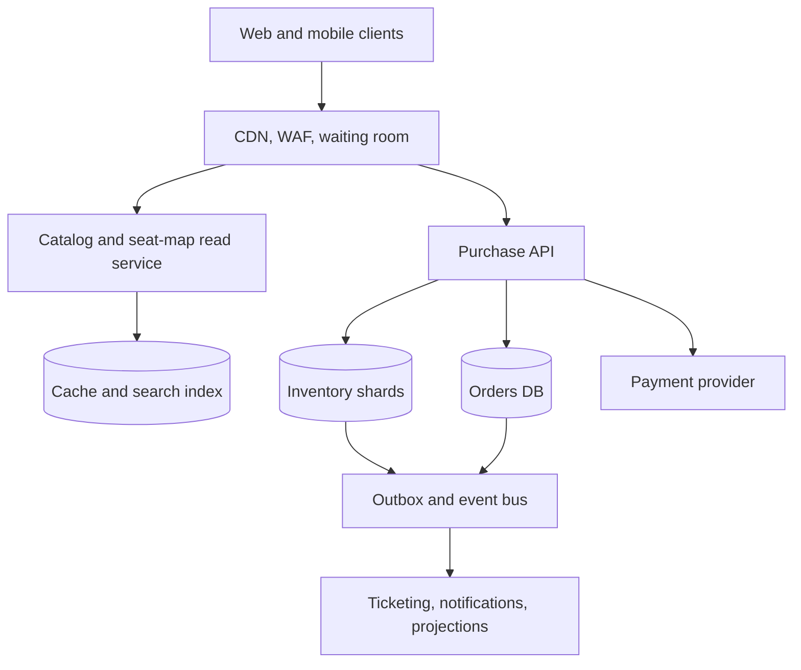
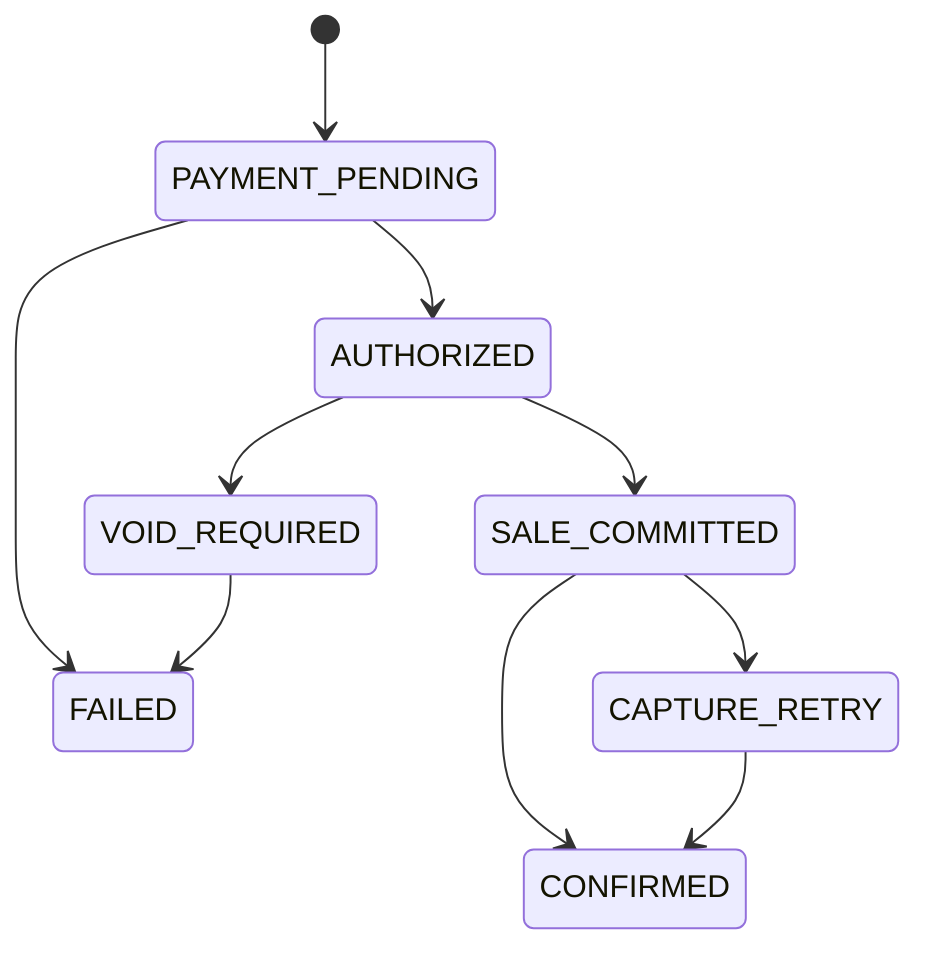

# Design a Large-Scale Event Ticketing Platform

**Difficulty:** Senior / Staff | **Primary themes:** high-contention inventory, admission control, payments, consistency, queues, caching

This is a detailed educational walkthrough. In a 45-minute interview, use the time boxes to control the conversation; do not try to say every sentence below. The sequence follows Hello Interview's public [delivery framework](https://www.hellointerview.com/learn/system-design/in-a-hurry/delivery): establish requirements, name core entities, define interfaces, build a complete design, then spend the remaining time on the load-bearing tradeoffs.

## Interviewer prompt

> Design a large-scale event ticketing platform. Fans should be able to discover events, select seats, and buy tickets. Popular onsales may attract millions of users at once, but the system must not sell the same seat twice.

## Targeted clarifying questions

**Candidate:** Are we designing primary ticket sales, resale, or both?

**Interviewer:** Primary sales only. Refunds, resale, transfers, and venue entry scanning are out of scope.

**Candidate:** Do we support assigned seats, general-admission inventory, or both?

**Interviewer:** Both. Assigned seats are individually addressable; general admission is a quantity in a section.

**Candidate:** Should a user be able to hold seats while entering payment details?

**Interviewer:** Yes. A successful hold lasts five minutes. Holding inventory must not charge the user.

**Candidate:** What scale and traffic shape should I design for?

**Interviewer:** Fifty million registered users. A normal day has 20 million event-detail views and 500,000 purchases. A single hot onsale may bring five million simultaneous visitors, 100,000 hold attempts per second, and 10,000 purchase attempts per second.

**Candidate:** How strict are ordering and consistency requirements?

**Interviewer:** A seat must never be sold twice. The visible seat map may lag by a few seconds. For a presale queue, approximate arrival order is acceptable, but admitted users must not bypass capacity controls.

**Candidate:** May a user choose exact seats? Should adjacent-seat selection be atomic?

**Interviewer:** Yes. A request for several seats either holds all of them or none of them.

**Candidate:** What should happen if payment succeeds but our response is lost?

**Interviewer:** Retrying must not create another charge or order. The user should eventually see the correct order state.

**Candidate:** Are bot defense, PCI compliance, and fraud detection in scope?

**Interviewer:** Address them at the boundaries, but do not design the fraud model or card vault.

## 1. Requirements (~5 minutes)

### Functional requirements

1. Users can discover events and view a seat map with approximate availability and prices.
2. An admitted, authenticated user can atomically hold one or more assigned seats or a general-admission quantity for five minutes.
3. The user can complete an idempotent checkout; successful payment converts the hold into an order and issues tickets.

The high-demand waiting room is not a separate product feature. It is an admission-control mechanism necessary to keep requirements 2 and 3 working during a flash crowd.

### Non-functional requirements

- **No overselling:** ownership transitions are linearizable per inventory item. At most one active hold or completed sale may own a seat. Multi-seat holds are atomic.
- **Latency:** cached event pages and seat-map snapshots have p99 under 300 ms; hold requests have p99 under 500 ms after admission, excluding contention retries; checkout initiation has p99 under 1 second, excluding customer authentication at the payment provider.
- **Availability:** browsing is 99.99% available; hold and purchase paths are 99.95% available. When inventory authority is unavailable, fail closed rather than risk overselling.
- **Freshness:** seat-map views may be up to five seconds stale. Hold and checkout decisions always read authoritative state.
- **Durability:** a confirmed sale and its payment reference survive a regional service failure. Ticket delivery can be eventually consistent within one minute.

### Consistency and availability contract

The system deliberately has two views of availability:

- The **discovery view** is cached and eventually consistent. It can show a seat as available just before another buyer holds it.
- The **commit view** is strongly consistent within the seat's inventory shard. A hold response is successful only after the authoritative transaction commits.

During a network partition, the purchase path chooses consistency over availability for affected inventory. Browsing can continue from cache. This is a business invariant, not a blanket claim that the whole system is “CP.”

### Out of scope

Resale, transfers, refunds, dynamic-pricing algorithms, venue access control, recommendation ranking, and the internal design of the payment processor are excluded.

### Scale estimate that changes the design

If five million clients poll a seat map every two seconds, they generate **2.5 million reads per second**. Sending those reads to the inventory database would consume the resource needed for holds. We therefore serve versioned seat-map snapshots from a CDN and push or poll compact deltas from a cache.

The headline 100,000 hold attempts per second is misleading: one stadium may have only 70,000 seats. Letting every attempt contend on rows increases latency without increasing sales. An edge waiting room should admit only the rate the inventory and checkout tiers can safely process—suppose 5,000 hold requests per second for that event—and queue the rest.

> **What I would say aloud:** “I’ll make browsing cheap and slightly stale, but keep one authoritative state machine for each seat. A waiting room is essential because excess concurrency cannot create more inventory; it only creates lock contention.”

## 2. Core entities (~2 minutes)

Name the nouns before designing tables:

- **Event:** performance, venue, onsale time, status, and pricing policy version.
- **Venue / Section / Seat:** stable physical layout. A general-admission section has capacity rather than individual seats.
- **InventoryItem:** sale state for one assigned seat or one GA bucket.
- **Hold:** buyer, selected inventory, expiry, status, and fencing token.
- **AdmissionToken:** permission for a buyer to enter a particular event's purchase path for a limited time.
- **Order:** immutable commercial record with line items and total.
- **PaymentAttempt:** external provider reference and authorization/capture state.
- **Ticket:** fulfillment record created only after the sale commits.

Do not fully normalize the schema yet. Per Hello Interview's guidance, introduce fields beside the component that needs them; this keeps data modeling tied to request flow rather than guessing every column up front.

> **What I would say aloud:** “The critical distinction is between static venue layout and mutable inventory. A seat rarely changes physically, while its sale state is hot and strongly consistent.”

## 3. API / system interface (~5 minutes)

The gateway derives `buyer_id` from the authenticated session. Clients never supply another user's identity.

### Discover events

```http
GET /v1/events?city=nyc&starts_after=2026-11-01&cursor=...
```

```json
{
  "events": [{"event_id":"evt_42","name":"The Comets","starts_at":"2026-11-08T20:00:00Z"}],
  "next_cursor":"eyJ..."
}
```

### Read the seat map

```http
GET /v1/events/evt_42/seat-map?after_version=8841
```

```json
{
  "snapshot_version": 8842,
  "sections": [{"section_id":"A","available_count":126}],
  "changed_seats":[{"seat_id":"A-12-7","status":"UNAVAILABLE","price_minor":14500}],
  "currency":"USD"
}
```

`UNAVAILABLE` intentionally combines held and sold; exposing hold expiry encourages abusive timing. A full snapshot is returned when the client's version is too old.

### Join or check the waiting room

```http
POST /v1/events/evt_42/admission-sessions
Idempotency-Key: 3e9b...
```

```json
{"session_id":"as_77","state":"QUEUED","estimated_wait_seconds":420}
```

When admitted, polling returns a short-lived, signed `admission_token` bound to `event_id`, `buyer_id`, and an expiry. The token is authorization to attempt purchases, not a reservation.

### Create a hold

```http
POST /v1/events/evt_42/holds
Authorization: Bearer <session>
X-Admission-Token: <signed-token>
Idempotency-Key: 8f15...
Content-Type: application/json

{"seat_ids":["A-12-7","A-12-8"],"expected_price_version":19}
```

```json
{
  "hold_id":"h_901",
  "status":"HELD",
  "expires_at":"2026-10-16T06:05:00Z",
  "items":[{"seat_id":"A-12-7","price_minor":14500},{"seat_id":"A-12-8","price_minor":14500}],
  "total_minor":29000,
  "currency":"USD"
}
```

A conflict returns `409` with the unavailable seat IDs and a fresh seat-map version. A price-version mismatch also returns `409`; the server never silently changes the accepted total.

For GA, the body uses `{"section_id":"FLOOR","quantity":2,...}`.

### Start checkout and read the order

```http
POST /v1/holds/h_901/checkout
Authorization: Bearer <session>
Idempotency-Key: c27a...
Content-Type: application/json

{"payment_method_token":"pm_tok_..."}
```

```json
{
  "order_id":"ord_551",
  "status":"PAYMENT_ACTION_REQUIRED",
  "payment_client_secret":"opaque-provider-secret"
}
```

```http
GET /v1/orders/ord_551
```

```json
{"order_id":"ord_551","status":"CONFIRMED","ticket_ids":["t_1","t_2"]}
```

The checkout POST may return `PROCESSING`; clients poll the order or receive a push notification. A timeout is not evidence of failure, so retries reuse the same idempotency key.

## 4. Data flow

Three related flows matter:

1. **Admission:** edge assigns a queue position before onsale, then issues signed tokens at a controlled rate.
2. **Reservation:** admitted request atomically changes inventory from `AVAILABLE` to `HELD` and schedules expiry.
3. **Purchase saga:** checkout authorizes money, commits inventory and order, captures payment, and asynchronously issues tickets. A saga is a sequence of local transactions plus compensating actions rather than one distributed transaction across companies.

## 5. High-level design (~10–15 minutes)



### Operation 1: browse events and seats

The catalog service stores event metadata in a relational database and indexes searchable fields by city, artist, and date in a search engine. Static venue geometry is immutable, versioned, and CDN-cacheable.

The seat-map read service combines that geometry with an availability projection. Inventory transactions emit changes through a transactional outbox. Projection workers update:

- `SeatMapSnapshot(event_id, version, generated_at, object_key)` in object storage/CDN;
- `SeatDelta(event_id, version, seat_id, display_status, price)` in a short-retention stream/cache;
- aggregate section counts used on event cards.

The outbox is a database table written in the same transaction as the business change. A relay publishes unsent rows to the event bus. This avoids the dual-write failure where the seat changes but the cache-invalidating event is lost.

If the projection lags, users may click a seat that has just become unavailable. That is acceptable because only the hold endpoint makes a commitment.

### Operation 2: admit buyers during an onsale

Before the onsale, the edge places visitors in a pre-queue. At the start time it assigns randomized positions to visitors already present, then appends later arrivals in order. Randomization prevents a millisecond race and reduces the advantage of synchronized bot fleets; this is a product choice, not perfect fairness.

An admission controller observes per-event health: hold latency, database lock time, error rate, payment capacity, and current inventory. It releases a bounded number of signed tokens per second. Each token contains:

```text
event_id, buyer_id, session_id, issued_at, expires_at, max_parallel_requests, nonce
```

The purchase API validates the signature locally and enforces nonce/rate limits in a small admission store. The queue therefore absorbs millions of persistent connections while the scarce inventory tier sees thousands, not millions, of active buyers. Cloudflare's public [waiting-room documentation](https://developers.cloudflare.com/waiting-room/reference/queueing-methods/) is a useful concrete example of configurable queue ordering and pre-queue behavior.

### Operation 3: atomically hold assigned seats

Partition inventory by `event_id` so all seats in the common multi-seat request share one database shard and transaction. The mutable row is:

```text
InventoryItem(
  event_id, inventory_id, kind,
  state,                 -- AVAILABLE | HELD | CHECKOUT_PENDING | SOLD
  owner_hold_id,
  hold_expires_at,
  version,
  price_minor,
  price_version
)
```

The purchase service first checks authentication, admission token, item count limits, and idempotency. In one short transaction it:

1. locks requested rows in sorted `inventory_id` order;
2. verifies every row is `AVAILABLE`, or has an expired hold eligible for reclamation;
3. verifies the price version;
4. inserts `Hold(hold_id, buyer_id, event_id, status, expires_at, fencing_token)`;
5. updates every item to `HELD`, sets the owner and expiry, and increments `version`;
6. writes `InventoryChanged` rows to the outbox;
7. commits and returns the hold.

Sorted locking prevents two transactions requesting overlapping seat sets in opposite order from needlessly deadlocking. PostgreSQL documents that [`SELECT ... FOR UPDATE`](https://www.postgresql.org/docs/current/explicit-locking.html) blocks conflicting writers until the transaction ends; production code must use a short lock timeout and retry boundedly.

A **fencing token** is a monotonically increasing ownership version. Every later transition must present the current token. A delayed expiry worker carrying an old token cannot release a seat that has since been re-held.

For GA inventory, one row tracks `capacity`, `held_count`, and `sold_count`. The transaction succeeds only when `capacity - held_count - sold_count >= quantity`, then increments `held_count`. Very hot GA buckets can be split into capacity partitions, but the service must allocate the entire request from one or atomically across a small fixed set.

### Operation 4: expire abandoned holds

After commit, the hold service publishes an expiry job with `(hold_id, expires_at, fencing_token)` to a delayed queue. Delivery is at least once and timing is approximate. When the job fires, the worker opens a transaction and releases inventory only if:

- the hold is still `HELD`;
- its fencing token matches;
- database time is past `expires_at`.

The database predicate, not the queue timer, decides correctness. A periodic sweeper indexed on `(status, expires_at)` repairs lost or late jobs. Workers are idempotent.

### Operation 5: checkout and ticket fulfillment

There is no atomic transaction with an external payment provider. The order service uses a saga:

1. In the inventory shard, transition the valid hold from `HELD` to `CHECKOUT_PENDING` and extend it by a short payment grace period. Create an order in `PAYMENT_PENDING` with immutable line items and an idempotency record.
2. Create or reuse one payment intent using a deterministic provider idempotency key derived from `order_id`. Authorize, but do not capture, the amount.
3. After authorization, atomically transition the matching inventory rows from `CHECKOUT_PENDING` to `SOLD`, set `order_id`, and emit `SaleCommitted`.
4. Capture the authorization. Update the order to `CONFIRMED` when capture succeeds.
5. Ticket workers consume `SaleCommitted`/`OrderConfirmed`, create deterministic ticket IDs, and send notifications. Duplicate events become no-ops because `(order_id, inventory_id)` is unique.

Stripe's documentation provides real examples of [idempotent requests](https://docs.stripe.com/api/idempotent_requests) and [separate authorization and capture](https://docs.stripe.com/api/payment_intents/capture). The design does not assume one provider; these are examples of the semantics required.

If authorization fails, release the hold. If inventory commit fails after authorization, retry while the checkout lease remains valid; if it cannot succeed, void the authorization. If capture succeeds but our response or database update is lost, provider webhooks and a reconciliation worker recover the state using the same provider reference. The user sees `PROCESSING` until the ambiguity is resolved.

> **What I would say aloud:** “I cannot promise exactly-once execution across our database and a payment company. I can promise one logical outcome with idempotency keys, durable state transitions, and reconciliation.”

## 6. Deep dives (~10–15 minutes)

### Deep dive A: prevent overselling under contention

#### Where the baseline breaks

A cache-based lock can expire during a long pause; its former owner may then write after a new owner. A read-then-write sequence such as “read AVAILABLE, then update HELD” lets two buyers observe the same state. Serializing an entire event also creates a hot leader.

#### Plausible approaches

| Approach | Advantage | Failure or cost |
|---|---|---|
| Distributed cache lock per seat | Fast and familiar | Lock expiry and failover can admit stale owners; cache is the wrong sale authority |
| Optimistic compare-and-set | No waiting; good when conflicts are rare | Hot seats cause retry storms; multi-seat atomicity still needs a transaction |
| Row locks in a transactional DB | Simple invariant and atomic multi-seat holds | Contention blocks; deadlocks and hot shards require discipline |
| Single-writer actor per event | Natural serialization and predictable overload | Leader recovery, durable log, and very hot-event throughput add complexity |

#### Selection and evolution

Use a transactional inventory database with row locks or conditional updates, plus admission control. This is the simplest design that proves the invariant. Transactions are short, seat IDs are locked in a canonical order, timeouts are bounded, and failed conflicts are not automatically retried many times.

The invariant can be expressed as:

```text
For each assigned seat:
  state = SOLD  => exactly one order_id
  state in {HELD, CHECKOUT_PENDING} => exactly one current hold_id and fencing_token
```

Add unique constraints and check constraints where possible, not only application checks. Persist an append-only `InventoryTransition` audit trail for reconciliation.

If a single event outgrows one shard, partition by `event_id + section_id`. Most adjacent-seat requests stay within a section. Cross-section requests are rejected or handled as separate holds; avoiding a cross-shard transaction is an explicit product constraint. For a pathological GA onsale, route its bucket through a durable single-writer command processor, while keeping assigned-seat transactions unchanged.

The cache is never allowed to turn a failure into success. If the authoritative shard is unavailable, new holds fail closed; existing pages remain viewable.

#### Failure modes and observability

- **Deadlock:** database aborts one transaction; return a retriable conflict after bounded jitter.
- **Shard primary failover:** in-flight commits have unknown status; look up the idempotency key before retrying.
- **Expiry worker delay:** capacity appears lower, but no oversell occurs; sweeper releases stale holds.
- **Replica lag:** never read a replica to approve a hold or checkout.

Alert on hold-conflict rate, lock-wait p95/p99, deadlocks, transaction aborts, expired-but-owned inventory, and any invariant query returning rows. An oversell invariant violation is a page, even if no customer has complained.

### Deep dive B: survive a five-million-user flash crowd fairly

#### Where the baseline breaks

Autoscaling application servers does not protect a finite database or payment-provider quota. Millions of retries synchronize into waves, saturate connection pools, and make healthy dependencies look failed. Strict global FIFO is also impossible to prove from browser arrival times because networks and edge regions have different delays.

#### Plausible approaches

| Approach | Benefit | Tradeoff |
|---|---|---|
| First request wins | Minimal machinery | Rewards low latency and bots; origin collapses |
| Global strict FIFO | Easy fairness story | Central sequencer bottleneck; “arrival time” is not globally objective |
| Edge waiting room with controlled admission | Absorbs connections near users and protects origin | Approximate ordering and signed-token lifecycle |
| Lottery for all inventory | Resistant to races | Changes the product and delays gratification |

#### Selection and evolution

Choose an edge waiting room with randomized pre-queue order and FIFO afterward. The controller uses additive increase and multiplicative decrease: cautiously raise admission while lock latency and error rate are healthy; quickly reduce it when thresholds are breached. This is closed-loop backpressure.

Tokens are short-lived, signed, bound to account and event, and allow only a small number of concurrent requests. The gateway rejects replay, rate-limits by account/device/network signals, requires step-up challenges for suspicious traffic, and caps seats per buyer. A token cannot name seats, so queue compromise still cannot bypass inventory transactions.

Degrade gracefully:

- pause new admissions before shedding admitted checkout traffic;
- serve queue pages and event content from the edge if the origin is impaired;
- disable live seat deltas and fall back to five-second snapshots;
- expose an honest estimated range rather than a fake exact queue time.

Measure queue depth and age, admission rate, abandonment, token replay, admitted-to-hold conversion, origin saturation, and fairness by comparing expected versus observed position distributions across edge regions.

> **What I would say aloud:** “The queue protects a downstream concurrency budget. I would admit based on measured lock and payment capacity, not on how many web servers autoscaling can launch.”

### Deep dive C: make payment and order recovery safe

#### Where the baseline breaks

Charging first can leave a paid customer without a seat. Selling first can leave an unpaid seat. A two-phase commit with a card network is unavailable and would hold locks far too long. “Exactly once” messaging does not solve an ambiguous network timeout.

#### Plausible approaches

| Sequence | Good property | Bad outcome |
|---|---|---|
| Capture, then sell | Money secured first | Capture may succeed after seat lease is lost |
| Sell, then capture | Seat secured first | Capture failure creates unpaid sold inventory |
| Authorize, sell, then capture | Limits both risks; authorization is reversible | Requires saga state and reconciliation |

#### Selection and state machine

Choose authorize → sell → capture. Keep inventory in `CHECKOUT_PENDING` during customer authentication, with a bounded grace period. The durable order state machine is:



Every command carries `(order_id, attempt_no)` and every webhook is deduplicated by provider event ID. State transitions use compare-and-set so an old webhook cannot move a terminal order backward. Store the provider reference, amount, currency, and last observed provider status.

A reconciler continuously compares old nonterminal orders with provider state:

- authorized with no sale after the lease deadline → void and release;
- sold with uncaptured authorization → retry capture within the authorization window, then escalate;
- captured but local order not confirmed → mark confirmed and resume fulfillment;
- confirmed order without tickets → replay the idempotent fulfillment event.

Dashboards track authorization success, capture lag, orders stuck per state, orphan authorizations, captured-without-confirmed count, duplicate-key hits, and reconciliation age. Use distributed traces keyed by `order_id`, but never log payment secrets or full card data.

## Reliability, security, and regional strategy

- Run stateless read and API tiers across availability zones. Inventory shards use synchronous multi-zone replication and automated failover.
- Give each event one write-home region during its onsale. Global edges route purchase traffic there; asynchronous cross-region replicas are for disaster recovery, not concurrent writes. This avoids two regions selling the same seat.
- Use recovery point objective near zero for confirmed orders and a recovery time objective under 15 minutes for regional disaster recovery. Promotion requires fencing the old primary; if safe fencing is uncertain, pause sales.
- Tokenize card details directly with the payment provider so platform services handle provider tokens, reducing PCI scope.
- Encrypt personal data, separate ticket-holder identity from public catalog data, audit privileged inventory changes, and rotate ticket-signing keys.
- Apply WAF rules, device/account velocity limits, behavioral bot signals, CAPTCHA selectively, and purchase limits. Never let bot scoring weaken the inventory invariant.

## 7. Final design and requirements check

### Concise final design

The edge serves cached discovery data and absorbs flash crowds in an event-scoped waiting room. Admitted buyers receive signed, rate-limited tokens. A purchase service routes each event to its authoritative inventory shard, where short transactions atomically hold assigned seats or decrement GA capacity. Five-minute leases use fencing tokens, delayed expiry jobs, and a repair sweeper. Checkout is an idempotent authorize-sell-capture saga with durable order states and reconciliation. Transactional outboxes drive seat-map projections, ticket issuance, notifications, and analytics. Browse paths favor availability; inventory writes fail closed and favor consistency.

### Requirements check

| Requirement | Mechanism |
|---|---|
| Discover events and view seats | Search index, CDN venue maps, versioned cached availability snapshots and deltas |
| Hold several seats atomically | Event-local inventory transaction, canonical row locking, fencing token, five-minute lease |
| Complete checkout safely | Auth-derived identity, idempotency records, payment authorization, sale commit, capture, reconciliation |
| Never oversell | One write-home shard, authoritative state machine, unique/check constraints, no cache-authorized writes |
| Survive hot onsales | Edge waiting room, adaptive admission, backpressure, bot controls |
| Meet latency and availability goals | Cached reads; bounded short write transactions; multi-zone services; graceful degradation |
| Recover lost messages and ambiguous responses | Transactional outbox, idempotent consumers, provider webhooks, sweepers and reconcilers |

> **Thirty-second close:** “I separated advisory availability from authoritative inventory, colocated seats for atomic holds, and protected that hot path with event-scoped admission control. Payments use an idempotent authorization-and-capture saga because no distributed transaction exists with the provider. Outboxes and reconcilers make every asynchronous step replayable, while fencing tokens prevent stale workers from corrupting current ownership.”

## Realistic interviewer follow-ups

### “Why not put every seat in Redis and use `SET NX`?”

**Strong answer:** Redis can accelerate projections or admission counters, but I would not make an expiring cache lock the commercial source of truth. A pause or failover can let an old owner act after its lease expires. The transactional database stores both ownership and the business transition atomically; a fencing version rejects stale actors. If Redis is lost, sales remain correct, though slower.

### “What if two users request overlapping sets: [A, B] and [B, C]?”

**Strong answer:** Both transactions lock seat IDs in sorted order. One obtains B first; the other waits or hits the short lock timeout. The winner commits all requested seats. The loser rechecks and returns a conflict for the full request, so neither receives a partial hold.

### “Could we make the seat map perfectly current?”

**Strong answer:** We could route every read to the primary, but millions of viewers would threaten the write path and still race between read and click. Perfect display freshness does not eliminate the need for atomic holds. A versioned snapshot plus deltas gives a better availability/scale tradeoff, and the UI labels availability as subject to confirmation.

### “How do you handle active-active regions?”

**Strong answer:** Browsing is active-active, but an event has one fenced write-home region. Ownership changes are not safely mergeable: two independently valid sales cannot be reconciled. On failover, I stop admissions, prove or fence the old writer, promote a sufficiently current replica, then resume. The brief unavailability protects the no-oversell contract.

### “What if a buyer closes the browser during 3-D Secure?”

**Strong answer:** The browser is not the coordinator. The order remains durable in `PAYMENT_PENDING`; provider webhooks update it. The checkout lease has a bounded grace period. Reconciliation either observes an authorization and continues the sale, or voids/releases after the deadline. The buyer can reopen the order by ID.

### “How would you choose the admission rate?”

**Strong answer:** Start from load tests and dependency quotas, then control dynamically. Inputs include inventory lock wait, hold p99, connection-pool saturation, payment rate limits, and error rate. Raise gradually while there is headroom; reduce quickly under distress. Reserve separate capacity for in-progress checkouts so new browsers cannot starve users who already hold seats.

### “How do you support best-available adjacent seats?”

**Strong answer:** Maintain a read-optimized index of candidate contiguous runs per section. It only proposes seats. The hold transaction still verifies and locks the exact IDs. On conflict, recompute from a newer version rather than trusting the index. For very hot events, offer a small set of candidates to avoid expensive global optimization per request.

## Common pitfalls

- Treating the seat-map cache as authoritative or promising that a visible seat is guaranteed.
- Saying “use a distributed lock” without defining lease expiry, fencing, ownership state, or stale-writer rejection.
- Holding database locks while the customer completes payment authentication.
- Claiming exactly-once payment rather than explaining idempotency, state machines, ambiguous timeouts, and reconciliation.
- Expiring holds solely from a queue timer without rechecking database time and the fencing token.
- Scaling web servers while ignoring the inventory shard, connection pool, and payment-provider limits.
- Sharding individual seats randomly, then discovering that a multi-seat hold requires distributed transactions.
- Letting two regions accept writes for the same event without a single fenced authority.
- Spending the interview on search or recommendations while skipping the no-oversell invariant.
- Giving an architecture diagram without tracing state changes, failure recovery, and what the client observes.

## Interview pacing

For a 45-minute interview:

- **0–5 min:** clarify scope, three functional requirements, quantified NFRs, and the consistency contract.
- **5–7 min:** name entities.
- **7–12 min:** define seat-map, admission, hold, checkout, and order interfaces.
- **12–25 min:** build browse, admission, hold, expiry, and checkout flows in that order.
- **25–40 min:** deep dive on inventory contention, waiting-room backpressure, and the payment saga.
- **40–45 min:** cover failure modes, check requirements, and summarize tradeoffs.

The educational walkthrough is intentionally longer than what you would deliver aloud. In the interview, keep returning to the two load-bearing claims: **the cached map is advisory**, and **only the authoritative inventory transaction can grant ownership**.
