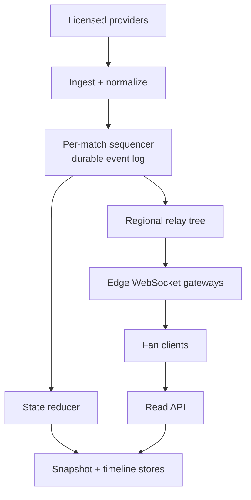

# Design a Live Sports Score and Play-by-Play Platform

**Difficulty:** Senior / Staff  
**Primary themes:** ordered event streams, hot-key fan-out, caching, corrections, reconnects, regional reliability

## Interviewer prompt

> Design a platform that ingests authoritative live sports data and lets fans browse games, view the current score and play-by-play timeline, and receive live updates. A major final may have millions of simultaneous viewers. Updates should appear within two seconds and remain correct when feeds duplicate, arrive late, or issue corrections.

This walkthrough follows the requirements → entities → interfaces → high-level design → deep-dives sequence and approximate interview timings recommended by the public [Hello Interview delivery framework](https://www.hellointerview.com/learn/system-design/in-a-hurry/delivery). The design and dialogue are original. The timings are an **interview pacing guide**; the educational explanation below is intentionally more detailed than what one could say in 45 minutes.

## Targeted clarifying questions

**Candidate:** “Are we designing for one sport or several?”  
**Interviewer:** “Several. Support soccer, basketball, and baseball initially. Shared infrastructure is desirable, but sport-specific scoring rules are allowed.”

**Candidate:** “What are the must-have user journeys?”  
**Interviewer:** “Browse scheduled, live, and completed games; open a game to see current state and play-by-play; and subscribe to live changes.”

**Candidate:** “Where does the data originate?”  
**Interviewer:** “Licensed providers send authoritative feeds. A match may have a primary and backup provider. Internal operators can issue corrections.”

**Candidate:** “Should we include video, betting odds, chat, fantasy scoring, or personalized notifications?”  
**Interviewer:** “No. Focus on scores and play-by-play. You may mention notifications as an extension.”

**Candidate:** “What scale and latency should I target?”  
**Interviewer:** “Assume 100 million daily users, 50 million concurrent connections at peak, and up to 5 million viewers on one game. A live update should reach 99% of connected viewers within two seconds of our ingest edge receiving it.”

**Candidate:** “What correctness behavior matters?”  
**Interviewer:** “A viewer must not move backward from a newer match state to an older one. Duplicate events must not double-count. Provider corrections should be visible quickly and auditable.”

**Candidate:** “Must users be signed in?”  
**Interviewer:** “No. Scores are public. Authentication may identify signed-in users, but anonymous sessions must work.”

## 1. Requirements (~5 minutes)

### Functional requirements

Prioritize three capabilities:

1. **Browse games:** list games by competition, date, and status.
2. **Read a game:** return the current score, clock/inning/period state, and a paginated play-by-play timeline.
3. **Follow a game live:** stream ordered deltas, recover after a disconnect, and surface authoritative corrections.

Out of scope: acquiring provider contracts, video transport, betting, chat, team rosters beyond display metadata, and long-term analytics.

### Non-functional requirements

| Goal | Target | Design consequence |
|---|---:|---|
| Live latency | p99 ≤ 2 s from ingest receipt to connected client | Persistent connections, push fan-out, and no synchronous analytics in the hot path |
| Snapshot latency | p99 ≤ 200 ms | Regional caches and precomputed match snapshots |
| Availability | 99.99% for reads and live subscriptions | Multi-AZ services, regional read replicas, reconnect/resume |
| Correctness | Per-match revisions are monotonic; committed events are durable and duplicates do not change state twice | Single logical writer per match, idempotency keys, append-only log |
| Scale | 50M concurrent connections; 5M on one match; 100K provider messages/s globally at peak | Hierarchical fan-out and independently scalable connection tier |
| Recovery | Resume recent streams for 30 minutes; retain canonical events for 30 days | Hot replay buffer plus durable event storage |

### Consistency and availability contract

The authoritative state of one match is **strongly ordered**: every accepted canonical event gets a strictly increasing `match_revision`. A client applies only revisions greater than its last applied revision. Reads and streams in different regions may be a few seconds apart, so the system is not globally linearizable, but each response states its revision and clients never regress.

During a regional partition, the system prefers **correctness over accepting competing authoritative writes** for the same match. One fenced home region owns sequencing. Read paths remain available from the latest replicated snapshot and clearly expose its `as_of` time. This is a deliberate split: CP-like behavior for match mutation, highly available eventual reads for fans.

**What to say aloud:**

> “I’ll make one match the consistency boundary. Inside that boundary, updates have one total order and are idempotent. Across regions, delivery may lag, but every payload carries a revision so clients never apply stale state over fresh state.”

## Scale estimates that change the design

These are decision estimates, not trivia.

Assume a typical live delta is 250 bytes before transport overhead. One update sent directly from an origin to 5 million viewers is:

\[
5{,}000{,}000 \times 250\ \text{bytes} = 1.25\ \text{GB}
\]

At two material updates per second during a busy basketball finish, that is **2.5 GB/s of payload** for one game, before TLS and framing. The ingestion rate is modest; duplicated egress is the dominant problem. Therefore, the origin must publish once to each regional/edge relay, and relays must fan out locally.

If a gateway safely holds 50,000 WebSocket connections, 50 million concurrent viewers require roughly:

\[
50{,}000{,}000 / 50{,}000 = 1{,}000\ \text{gateways}
\]

With 40% failover headroom, provision about **1,400 gateway-equivalents** globally. This makes connection count, outbound bandwidth, and reconnect rate first-class autoscaling signals—not ordinary HTTP request rate.

**What to say aloud:**

> “The source write volume is not scary; fan-out is. Five million copies of a tiny event exceed a gigabyte, so I need a distribution tree and edge-local replication rather than one service looping over subscribers.”

## 2. Core entities (~2 minutes)

Name the nouns before designing tables:

- **Competition**: league/tournament, season, timezone, sport.
- **Team**: display identity and metadata.
- **Match**: participants, schedule, status, home region, current revision.
- **ProviderFeed**: provider, credentials, priority, health, provider-specific cursor.
- **RawProviderEvent**: immutable received bytes plus provider identifiers and timestamps.
- **CanonicalMatchEvent**: normalized event with a server-assigned match revision.
- **MatchSnapshot**: materialized score and sport-specific state at one revision.
- **SubscriptionCursor**: a client’s last applied match revision.
- **Correction**: a canonical event referencing an earlier event or field it supersedes.

Do not force all sports into one giant relational row. Keep a common envelope and a versioned sport-specific state payload:

```json
{
  "match_id": "match_742",
  "revision": 1842,
  "event_id": "evt_01J...",
  "type": "SCORE",
  "sport": "basketball",
  "occurred_at": "2026-10-16T23:41:08.420Z",
  "accepted_at": "2026-10-16T23:41:08.611Z",
  "payload_version": 3,
  "payload": {"team_id": "team_9", "points": 3, "period": 4, "clock_ms": 12400}
}
```

The common fields support ordering, replay, and observability. A sport-specific reducer interprets `payload` and produces the current state.

## 3. API and streaming interface (~5 minutes)

Identity comes from the validated access token when present. Anonymous clients receive a signed, short-lived session identifier at the edge. The service never trusts a `user_id` supplied in a request body.

### Browse games

```http
GET /v1/matches?competition_id=nba&date=2026-10-16&status=live
Authorization: Bearer <optional-token>
```

```json
{
  "matches": [
    {
      "match_id": "match_742",
      "status": "LIVE",
      "scheduled_at": "2026-10-16T23:00:00Z",
      "summary": {"away": 101, "home": 103, "period": 4, "clock_ms": 12400},
      "revision": 1842
    }
  ],
  "next_cursor": null
}
```

### Read snapshot and timeline

```http
GET /v1/matches/match_742
GET /v1/matches/match_742/events?after_revision=1800&limit=100
```

The snapshot response includes `revision`, `as_of`, and `state`. Timeline pagination uses `(match_id, revision)`, not an unstable offset.

### Subscribe and resume

The client opens `wss://live.example.com/v1/stream`. After the WebSocket upgrade it sends:

```json
{"op":"subscribe","match_id":"match_742","last_revision":1840}
```

If revisions 1841–1842 remain in the replay buffer, the server sends them. If the cursor is too old or a gap cannot be filled, it sends a complete reset:

```json
{
  "op": "reset",
  "match_id": "match_742",
  "revision": 1842,
  "state": {"away": 101, "home": 103, "period": 4, "clock_ms": 12400}
}
```

Subsequent messages are deltas:

```json
{
  "op": "event",
  "match_id": "match_742",
  "revision": 1843,
  "event_id": "evt_01J...",
  "type": "TIMEOUT",
  "payload": {"team_id": "team_9"}
}
```

The client acknowledges its highest contiguous revision periodically, not every event. Ping/Pong heartbeats detect dead connections; RFC 6455 explicitly defines Ping as a keepalive/responsiveness mechanism and requires a Pong response in the normal case.

### Internal provider interface

```http
POST /internal/v1/provider-events
Provider-Signature: ...
Idempotency-Key: statsco:match_742:99881
```

```json
{
  "provider": "statsco",
  "provider_match_id": "A91",
  "provider_event_id": "99881",
  "provider_sequence": 771,
  "occurred_at": "2026-10-16T23:41:08.420Z",
  "type": "three_pointer",
  "payload": {"side": "home", "player": "p_23"}
}
```

Return `202 Accepted` only after the raw event is durably recorded; normalization and delivery continue asynchronously.

## 4. Data flow

1. A provider connects to the nearest ingest edge using mTLS or a signed webhook.
2. The ingest service validates the schema and durably stores the raw envelope before acknowledging it.
3. A normalizer maps provider identifiers and sport-specific fields into a canonical candidate event.
4. The match sequencer deduplicates it, resolves source authority, assigns the next `match_revision`, and appends it to the canonical log.
5. A deterministic reducer consumes the ordered log and writes a new `MatchSnapshot`.
6. The event is published to regional relays; they populate a short replay buffer and forward one copy per subscribed edge gateway.
7. Each gateway multiplexes that event to its local sockets. Clients reject duplicates and request a reset on a revision gap.
8. Snapshot and timeline stores serve new page loads and reconnects independently of the live path.

## 5. High-level design (~10–15 minutes)



### Operation 1: browse games

The schedule service writes normalized match metadata to a relational database. A change-data-capture stream updates a denormalized listing index keyed by `(competition_id, local_date, status, scheduled_at)`. The read API queries the index and caches popular date/competition pages regionally for 5–15 seconds.

When a match changes from scheduled to live or live to final, the state reducer emits a summary update. This invalidates or refreshes the relevant listing cache. A few seconds of staleness is acceptable for lists; no expensive join belongs in the live event path.

**What to say aloud:**

> “Browse is a different access pattern from live play-by-play. I’ll denormalize match summaries into a query-friendly index and tolerate a short cache TTL instead of making every list request join the canonical event system.”

### Operation 2: open a match

The read API fetches `snapshot:{match_id}` from a regional cache. On a miss it reads the durable snapshot store, caches the result, and returns the state with its revision. The timeline store is keyed by `(match_id, revision)` and supports forward or reverse cursor pagination.

The reducer writes snapshot revision `R` only after applying canonical event `R`. A snapshot contains:

```text
match_id, revision, status, score, phase, clock_anchor,
sport_state, updated_at, reducer_version, ownership_epoch
```

`clock_anchor` is more useful than writing every visible second. It contains an authoritative game-clock value and wall-clock anchor; the client animates between authoritative updates. Pauses, period changes, and corrections send new anchors.

### Operation 3: follow live

The gateway authenticates the session, enforces a small subscription cap, and registers the socket in an in-memory `match_id → connection IDs` structure. The first local subscriber causes the gateway to subscribe upstream; the last leaving subscriber removes that upstream interest after a brief grace period.

On subscription, the gateway compares `last_revision` with its replay buffer:

- Contiguous deltas available: replay them, then join live delivery.
- Cursor absent or too old: return the current snapshot as a reset, then join live delivery.
- Client cursor greater than the server snapshot: wait briefly for replication, then route to the match’s home region or reset from the authority.

The join must not lose the event arriving between snapshot fetch and stream registration. The relay registers the subscription at revision `H`, then returns a snapshot at revision `S ≤ H`, followed by buffered events `(S, H]`. This snapshot-plus-tail pattern makes the handoff race explicit.

### Data-store choices

| Data | Store shape | Why |
|---|---|---|
| Match metadata | Relational DB | Constraints and schedule queries |
| Raw provider events | Object storage + durable queue | Audit and reprocessing at low cost |
| Canonical events | Partitioned replicated log | Ordered consumption and replay |
| Current snapshot | Key-value store, cache in front | One-key low-latency reads |
| Timeline | Wide-column or relational partitions by match | Ordered cursor scans |
| Hot replay | Relay/gateway memory with replicated regional backing | Fast reconnects over recent minutes |

Apache Kafka is one plausible log, not a requirement. Its official documentation guarantees order within a topic-partition, so keying canonical events by `match_id` gives the ordering boundary the design needs. It does **not** create a global order across partitions—and this system does not require one.

## 6. Deep dives (~10–15 minutes)

### Deep dive A: duplicates, late events, provider failover, and corrections

#### Where the baseline breaks

Provider webhooks retry. Network paths reorder. Two providers may describe the same score with different identifiers. A feed may first report a two-point basket and later correct it to three. If consumers simply apply arrival order, the score can double-count or regress.

#### Options

| Approach | Advantage | Problem |
|---|---|---|
| Trust arrival order | Simple | Retries and late packets corrupt state |
| Sort by provider timestamp | Intuitive historical order | Clocks differ; waiting increases latency; timestamps can tie |
| Distributed last-write-wins state | Available writes | A score is not a scalar; concurrent mutations lose meaning |
| Per-match sequencer with immutable corrections | Deterministic, replayable, auditable | One logical write owner per match |

Choose the per-match sequencer. Route all candidates for one match to the same logical partition. Maintain:

- provider dedupe key `(provider, provider_match_id, provider_event_id)`;
- optional semantic fingerprint for cross-provider duplicates;
- last accepted sequence per provider;
- active provider priority and feed-health state;
- server-assigned `match_revision`;
- `ownership_epoch` fencing stale regional writers.

A **fencing token** is a monotonically increasing ownership number. After failover, the new owner writes with epoch 42; stores reject a delayed writer still using epoch 41. This prevents split-brain mutation even if the old process has not realized it lost ownership.

Do not edit historical events in place. Append a correction:

```json
{
  "revision": 1849,
  "type": "CORRECTION",
  "supersedes_event_id": "evt_old",
  "reason": "provider changed basket from 2 to 3 points",
  "patch": {"points": 3}
}
```

The reducer is deterministic: the same canonical log and reducer version produce the same snapshot. For a local correction it can apply an inverse/patch operation; for complex corrections it reloads the latest checkpoint before the affected revision and replays forward. It then emits revision 1849 as the authoritative state. Clients see a correction badge rather than silently changing history.

#### Failure handling

- **Primary provider stalls:** alert on sequence/heartbeat lag, open a short reconciliation window, then promote backup. Cross-provider fingerprints suppress repeats.
- **Normalizer bug:** preserve raw inputs, deploy a corrected version, replay to a shadow state, compare, then publish correction events.
- **Sequencer retry:** idempotency lookup returns the previously assigned revision.
- **Poison event:** quarantine it with reason and page operators; do not block unrelated matches.

**What to say aloud:**

> “Exactly-once delivery across every component is unnecessary. I want at-least-once transport plus idempotent acceptance, one ordered revision sequence per match, and immutable correction events. That is testable and replayable.”

### Deep dive B: a five-million-viewer hot match

#### Where the baseline breaks

A single pub/sub consumer cannot write to five million sockets. Adding partitions by `match_id` does not split the hottest key: all viewers still want the same event. Letting every gateway consume the entire global log wastes bandwidth, and reconnect storms can overload the snapshot store.

#### Options

| Approach | Advantage | Problem |
|---|---|---|
| Direct origin-to-socket fan-out | Minimal components | Origin bandwidth and connection limits collapse |
| Every gateway consumes every event | Easy routing | Work grows with all matches × all gateways |
| Hash a match across many origin partitions | Parallel delivery | Complicates ordering and duplicate suppression |
| Hierarchical interest-based relays | One ordered source, distributed copies | More routing and operational state |

Choose hierarchical relays:

1. The sequencer publishes one canonical event.
2. Only regions with subscribers receive it.
3. Each regional relay sends one copy to each interested edge cluster.
4. Each gateway performs in-process fan-out to local connections.

The hot key is replicated **after** ordering, not sharded before it. This preserves one revision sequence while distributing the expensive copying.

Gateways maintain bounded per-connection queues. Events have classes:

- **Never coalesce:** score, play, status, correction, period/inning transition.
- **Coalesce:** clock-anchor refreshes and presence-like metadata; keep only the newest unsent value.
- **Drop under pressure:** cosmetic telemetry.

If a client remains behind, send `resync_required` with the latest known revision and close gracefully. The reconnect path returns a snapshot plus tail. Unbounded buffering merely converts one slow phone into a gateway memory leak. The WHATWG WebSockets standard exposes queued bytes through `bufferedAmount` and specifies failure behavior when sending cannot be buffered; at the server, we mirror that concern with explicit queue limits.

#### Reconnect storm controls

- Clients use exponential backoff with full jitter and honor `Retry-After`.
- Edge load balancers use connection draining, not simultaneous termination.
- Snapshot caches use request coalescing (“singleflight”) so thousands of misses cause one backend read.
- Relays retain the last 30 minutes of events and the latest snapshot.
- Gateways shed new subscriptions before destabilizing existing ones.

**What to say aloud:**

> “I solve the celebrity-match problem by ordering once and copying through a tree. Slow consumers get bounded buffers: clock noise can coalesce, but semantic plays cannot. If they fall too far behind, a reset is safer than unlimited queues.”

### Deep dive C: snapshot/replay correctness and regional failover

#### Where the baseline breaks

A client can load snapshot 1842 while event 1843 is already in flight, miss 1843 during subscription, then receive 1844. A cache can also contain snapshot 1845 while a lagging regional stream offers 1844. Blindly applying either causes a gap or rollback.

#### Selected protocol

Every state and event carries a revision. The client state machine is:

1. No state: accept a snapshot at revision `R`.
2. Receive `R + 1`: apply it.
3. Receive `≤ R`: discard as duplicate/stale.
4. Receive `> R + 1`: pause application and request events after `R`.
5. Replay unavailable: accept a reset snapshot only if its revision is `≥ R`.

This yields monotonic client behavior without globally synchronous reads.

For storage, checkpoint every 100 canonical events or 30 seconds, whichever comes first. A checkpoint and its revision are written atomically. Timeline events remain the source of truth; caches are disposable. On cache miss, rebuild from the latest checkpoint plus log tail.

Each match has a home region selected from venue/provider locality. The home region’s sequencer lease is replicated to a quorum across three availability zones. On regional loss:

1. Stop granting the old ownership epoch.
2. Promote a replica only after quorum confirms a higher epoch.
3. Resume from the highest committed revision.
4. Republish the current snapshot/reset to regional relays.

During the election, fan reads continue from the last replicated snapshot; writes pause for that match. Availability degrades visibly but correctness survives. For a rare global control-plane failure, already-owned matches continue under leases while new match assignment waits.

#### Consistency nuance

“Exactly once” is an end-to-end business property, not something a queue toggle alone supplies. A producer can retry after an ambiguous timeout, a reducer can crash after writing state, and a gateway can retransmit after reconnect. Dedupe keys, transactional event-and-outbox writes, deterministic reducers, and revision-aware clients together make duplicate processing harmless.

## Reliability, security, and observability

### Reliability mechanisms

- Multi-AZ ingest, sequencers, logs, reducers, and snapshot stores.
- Quorum replication before acknowledging canonical acceptance.
- Transactional outbox from canonical commit to downstream publish, preventing “stored but never broadcast.”
- Dead-letter quarantine with replay tooling, never silent deletion.
- Provider circuit breakers and isolated worker pools so one malformed feed cannot exhaust all normalizers.
- Periodic end-to-end probes that inject a synthetic match event and confirm its appearance at representative edges.

### Security and abuse controls

- mTLS or request signatures, nonce/timestamp validation, and IP policy for providers.
- Schema and payload-size limits before durable queues.
- RBAC, dual approval for sensitive operator corrections, and immutable audit logs.
- Per-session subscription caps, rate limits, WAF/DDoS protection, and origin shielding.
- Short-lived edge session tokens; authorization is rechecked for any future premium feeds.

### Observability

Measure the user-visible pipeline with a shared `event_id` and timestamps at every hop:

| Signal | Why it matters |
|---|---|
| Provider receipt lag and sequence gaps | Detect source degradation before fans report it |
| Ingest → canonical commit latency | Isolate validation/sequencer bottlenecks |
| Commit → regional relay → gateway latency | Locate distribution delay |
| Sampled client receipt acknowledgements | Measure the actual two-second SLO |
| Revision-gap and reset rate | Detect dropped delivery or short replay retention |
| Snapshot/event revision divergence | Catch reducer or replication bugs |
| Active sockets, reconnects, queued bytes, dropped/coalesced frames | Protect gateway health |
| Correction count and time-to-converge | Monitor data quality |

Avoid high-cardinality metric labels for every `match_id`. Use structured logs and traces for individual matches; reserve metrics labels for bounded dimensions such as region, sport, provider, and tier. Promote only a controlled set of marquee matches to dedicated dashboards.

## Concise final design

The system durably receives provider messages, normalizes them, and routes all candidates for a match through one fenced logical sequencer. The sequencer deduplicates events and assigns a monotonic match revision in an append-only canonical log. Deterministic reducers create revisioned snapshots and timelines. Read APIs serve precomputed snapshots and denormalized listings from regional caches.

For live delivery, a regional relay tree copies each ordered event only to interested edge clusters; gateways multiplex it to local WebSockets. Clients resume from their last revision, discard duplicates, detect gaps, and fall back to a non-regressing snapshot reset. Immutable correction events, raw input retention, replayable reducers, and ownership epochs handle bad data and failover without split brain.

**Thirty-second interview close:**

> “The central abstraction is a revisioned event log per match. It gives us dedupe, ordering, replay, and auditable corrections. A deterministic reducer turns that log into cheap snapshots, while an interest-based relay tree solves the five-million-viewer hot key after ordering is established. Clients use revision cursors for reconnect and never regress. The mutation path pauses rather than split-brains during failover, while cached reads remain available.”

## Requirements check

| Requirement | How the design meets it |
|---|---|
| Browse games | Denormalized competition/date/status index with short regional caching |
| Current score and timeline | Revisioned snapshot plus cursor-paginated canonical events |
| Live updates | WebSockets, regional relays, and edge-local multiplexing |
| p99 live latency ≤ 2 s | Asynchronous hot path, persistent connections, regional distribution |
| 5M viewers on one match | Order once; hierarchical fan-out; bounded gateway queues |
| No double-counting or rollback | Provider idempotency keys, canonical revisions, client state machine |
| Corrections | Append-only correction events and deterministic replay |
| 99.99% reads/subscriptions | Multi-AZ tiers, cached reads, reconnect/resume, graceful shedding |
| Regional failure | Fenced ownership epoch; durable replication; stale-but-marked reads |

## Realistic interviewer follow-ups

### “Why WebSockets instead of server-sent events?”

**Strong answer:** “Either can deliver server-to-client updates. WebSockets make subscription changes, cursor acknowledgements, heartbeat handling, and future bidirectional features natural over one connection. SSE is simpler and HTTP-native, and I would choose it if clients only followed one stream and infrastructure support favored it. The important design decisions—revision cursors, bounded buffers, and hierarchical fan-out—do not depend on the transport.”

### “Does one partition per match create too many partitions?”

**Strong answer:** “I mean one logical ordering key per match, not necessarily one physical Kafka partition per match. Many matches hash to each physical partition, but all events for a match use the same key. A scheduler can isolate exceptionally hot matches into dedicated partitions before they begin, while the downstream relay tree handles viewer fan-out.”

### “What if two provider events have the same sequence number?”

**Strong answer:** “The dedupe record stores the payload hash. Same key and same hash is a harmless retry. Same key and different hash is a provider conflict: retain both raw envelopes, quarantine the newer candidate, alert, and resolve using provider rules or an operator. I would never silently overwrite it.”

### “How do you show a running clock without an update every second?”

**Strong answer:** “Send a clock anchor: authoritative remaining time, wall-clock timestamp, and running/paused state. The client interpolates locally. Send a new anchor on pauses, resumptions, periodic reconciliation, and corrections. This removes enormous fan-out traffic while preserving authoritative boundaries.”

### “How would you add score notifications?”

**Strong answer:** “Consume canonical score events into a separate notification pipeline. Store user preferences by team or match, expand recipients asynchronously, dedupe on `(user_id, event_id, channel)`, and send through rate-limited channel workers. Notification failure must never block canonical scoring or live fan-out.”

### “Could a CRDT make the writes multi-region?”

**Strong answer:** “CRDTs merge concurrent state when operations have safe algebraic semantics. Sports events include retractions, clock transitions, and provider authority; merging two concurrent score histories can produce a valid-looking but wrong game. A single ordered authority per match is simpler. Regionalize across matches, not within one match’s authoritative sequence.”

### “How do you deploy a new reducer safely?”

**Strong answer:** “Run the new version in shadow mode from the same canonical log, compare snapshots at each revision, and classify expected schema differences. Backfill historical events, canary a small set of matches, then switch snapshot pointers atomically. Keep the old reducer and checkpoints until rollback is no longer needed.”

## Common pitfalls

- Starting with databases before defining the per-match consistency contract.
- Saying “Kafka guarantees order” without limiting that claim to one partition.
- Sharding by match and assuming that solves a single five-million-viewer hot key.
- Broadcasting directly from the sequencer, coupling correctness to slow clients.
- Treating a score as last-write-wins state instead of a derived event history.
- Mutating old events instead of appending auditable corrections.
- Omitting snapshot/stream handoff, which loses events in a race.
- Claiming exactly-once delivery while lacking idempotency at state boundaries.
- Allowing unbounded per-socket buffers.
- Sending a clock event every second instead of client-side interpolation.
- Using timestamps as the only ordering mechanism.
- Ignoring reconnect storms, gateway draining, and cache stampedes.

## Interview pacing versus this walkthrough

In a 45-minute interview, aim for roughly:

- 5 minutes: clarification and requirements
- 2 minutes: entities
- 5 minutes: APIs and streaming contract
- 10–15 minutes: build browse, read, and live flows
- 10–15 minutes: ordering/corrections and hot-key fan-out; cover failover if time permits
- 2 minutes: requirements check and close

The detailed failure modes, data fields, and follow-up answers above are study material. In the interview, state the invariant, draw the simplest working path, and let the interviewer choose where to go deeper.

## Public references

- [Hello Interview — System Design Delivery Framework](https://www.hellointerview.com/learn/system-design/in-a-hurry/delivery): public guidance for structuring requirements, entities, APIs, high-level design, and deep dives.
- [Apache Kafka — Introduction and concepts](https://kafka.apache.org/documentation/): official documentation for event-key partitioning and ordering within a topic-partition.
- [RFC 6455 — The WebSocket Protocol](https://datatracker.ietf.org/doc/html/rfc6455): the standards-track protocol, including Ping, Pong, and Close control frames.
- [WHATWG — WebSockets Standard](https://websockets.spec.whatwg.org/): the living WebSocket API standard, including queued-byte visibility and buffering behavior.
