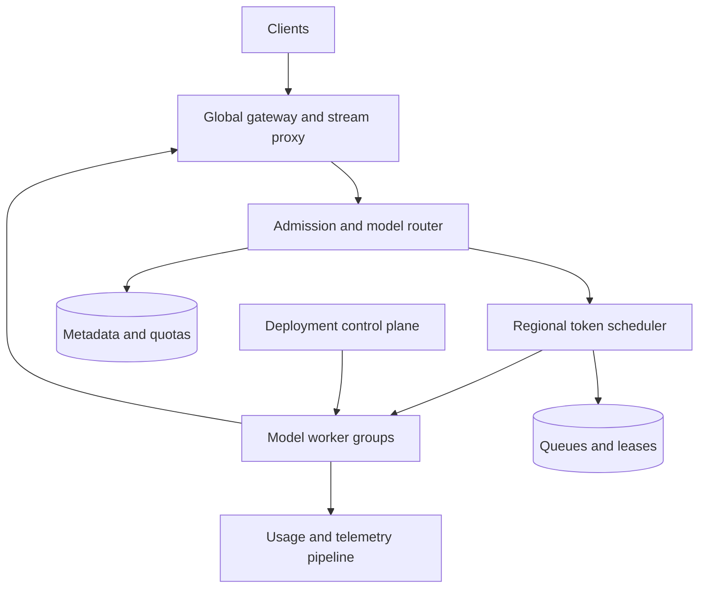

# Design a Multi-Tenant LLM Inference Serving Platform

**Difficulty:** Senior / Staff | **Primary themes:** AI inference, continuous batching, KV-cache management, admission control, streaming, fairness, autoscaling

This is a detailed educational walkthrough. In a 45-minute interview, follow the time boxes and compress the explanation. The structure follows Hello Interview's public [system-design delivery framework](https://www.hellointerview.com/learn/system-design/in-a-hurry/delivery): clarify requirements, identify entities, define interfaces, build the simplest complete design, and then deepen the load-bearing constraints.

## Interviewer prompt

> Design a managed platform that serves text-generation models to many enterprise tenants. Clients submit prompts and receive streamed tokens. The platform should support multiple model versions, high throughput, predictable latency, tenant quotas, and failures without exposing one tenant's data to another.

## Targeted clarifying questions

**Candidate:** Are customers uploading models, or do we operate a fixed catalog?

**Interviewer:** Start with an approved catalog of decoder-only language models. Operators deploy versioned weights. Customer-uploaded code is out of scope.

**Candidate:** Do we need synchronous and streaming generation?

**Interviewer:** Streaming is primary, using server-sent events or gRPC streaming. A non-streaming wrapper may collect the same output.

**Candidate:** What scale and model sizes should I assume?

**Interviewer:** Peak load is 20,000 requests per second across regions and 2 million generated tokens per second. Prompts range from 100 to 32,000 tokens, outputs from 1 to 4,000 tokens. Models range from 8B parameters on one accelerator to 70B models sharded across eight accelerators.

**Candidate:** What latency matters?

**Interviewer:** For the interactive tier, p99 time to first token should be under 2 seconds for prompts up to 2,000 tokens, and p99 inter-token latency under 100 ms. A batch tier may trade latency for price.

**Candidate:** What availability and consistency guarantees matter?

**Interviewer:** Target 99.95% successful request availability, excluding invalid requests and client cancellation. Model-version routing and quota decisions must be consistent enough to prevent unauthorized access and material overuse. Generation is not deterministic across retries unless explicitly configured.

**Candidate:** Do we need conversation history or retrieval augmentation?

**Interviewer:** No. Clients send the complete prompt. Conversation storage, RAG, fine-tuning, training, and content-policy model design are out of scope.

**Candidate:** Can requests migrate between workers after decoding begins?

**Interviewer:** Assume not in the baseline. Explore recovery and KV-cache transfer in a deep dive.

## 1. Requirements (~5 minutes)

### Functional requirements

1. An authenticated tenant can list permitted model versions and submit a generation request with sampling parameters.
2. The platform streams generated tokens and supports cancellation.
3. Operators can deploy, canary, promote, drain, and roll back immutable model versions without interrupting unrelated tenants.

### Non-functional requirements

- **Latency:** interactive p99 time to first token (TTFT) under 2 seconds for prompts up to 2,000 tokens; p99 inter-token latency (ITL) under 100 ms. Batch traffic has no interactive SLO.
- **Scale:** 20,000 requests/s and 2 million output tokens/s at peak, with burst absorption and regional isolation.
- **Availability:** 99.95% successful request availability. An admitted stream may be lost on worker failure; retries are explicit and never silently concatenate two generations.
- **Isolation:** no prompt, token, adapter, or KV-cache data may cross tenant boundaries. Per-tenant quotas and weighted fairness prevent noisy neighbors.
- **Correct routing:** the control plane may converge eventually, but each accepted request is pinned to one authorized immutable `(model_id, version, tokenizer_version)` for its lifetime.

### Scope and consistency contract

The request path prioritizes availability when spare capacity exists, but overload must be rejected or queued before accelerator memory is exhausted. Authorization, model allowlists, and hard quota reservations are strongly checked. Usage dashboards may lag by minutes.

Once a request is admitted, its model version and sampling parameters never change. Token streaming is ordered within a request. The service provides **at-most-one active execution per request attempt**, not exactly-once text generation. If a connection fails after tokens were delivered, the client may retry with a new attempt and receive different text.

### Out of scope

Training, fine-tuning, customer-supplied executable code, vector retrieval, conversation persistence, billing settlement, safety-model internals, and exact bitwise reproducibility across hardware are excluded.

### Scale estimates that change the design

At 2 million output tokens/s, running each sequence alone wastes accelerator parallelism. If one accelerator produces 2,000 tokens/s for an optimized 8B model, the fleet needs roughly **1,000 fully utilized accelerator equivalents**, before redundancy and prompt-prefill work. A 30% headroom target brings this to about 1,430 equivalents. The exact benchmark is hardware- and model-specific; the decision is to batch continuously and provision by measured token throughput, not request count.

KV cache is often the concurrency limiter. Assume a 70B configuration consumes approximately 320 KiB of KV cache per token across its tensor-parallel group. A request with 8,000 cached tokens then consumes about 2.5 GiB. One hundred such sequences would require roughly 250 GiB, so admission must reserve token memory before scheduling; GPU utilization alone cannot reveal safe capacity.

Traffic measured only in requests/s is deceptive. A 100-token prompt requesting 20 output tokens is radically cheaper than a 32,000-token prompt requesting 4,000. Scheduling, quotas, and autoscaling therefore use **input tokens, output-token budget, active sequence count, and KV blocks**.

> **What I would say aloud:** “For LLMs, the work unit is not a request. Prefill cost grows with prompt length, decode consumes one step per active sequence, and KV memory grows with live tokens. I’ll make the scheduler token-aware.”

## 2. Core entities (~2 minutes)

- **Tenant:** identity, permitted models, priority tier, quotas, and data-handling policy.
- **ModelVersion:** immutable weights, tokenizer, runtime configuration, parallelism plan, and lifecycle state.
- **Deployment:** regional replicas, hardware pool, routing weights, and health.
- **GenerationRequest:** prompt reference, sampling parameters, token budgets, tenant, chosen version, deadline, and state.
- **ExecutionAttempt:** one placement on one worker group, with lease and progress metadata.
- **WorkerGroup:** one model replica spanning one or more accelerators.
- **QuotaReservation:** reserved concurrent requests and token budget for an attempt.
- **UsageRecord:** metered input, cached-input, and output tokens.

The **KV cache** is runtime state, not durable application data. It stores attention keys and values for tokens already processed so each decode step need not recompute the whole prefix.

> **What I would say aloud:** “I separate a logical request from an execution attempt. That lets the control plane retry placement without pretending streamed generation is exactly once.”

## 3. API / system interface (~5 minutes)

Tenant identity comes from the API key or workload identity validated at the gateway. The client cannot supply `tenant_id`.

### List permitted models

```http
GET /v1/models
Authorization: Bearer <tenant-credential>
```

```json
{
  "models": [
    {"id":"atlas-8b","version":"2026-10-12","context_window":32768,"streaming":true}
  ]
}
```

### Create a streamed generation

```http
POST /v1/generations
Authorization: Bearer <tenant-credential>
Idempotency-Key: 772b...
Accept: text/event-stream
Content-Type: application/json

{
  "model":"atlas-8b@stable",
  "prompt":"Explain continuous batching.",
  "max_output_tokens":300,
  "temperature":0.2,
  "top_p":0.95,
  "seed":42,
  "service_tier":"interactive"
}
```

The server resolves `stable` once and returns headers before streaming:

```http
HTTP/1.1 200 OK
Content-Type: text/event-stream
X-Request-Id: req_91
X-Model-Version: 2026-10-12
```

```text
event: token
data: {"index":0,"text":"Continuous","output_tokens":1}

event: token
data: {"index":1,"text":" batching","output_tokens":2}

event: done
data: {"finish_reason":"stop","input_tokens":5,"output_tokens":87}
```

Errors before headers use ordinary HTTP status codes. Errors after streaming begins use a terminal `error` event containing the last token index and whether a new attempt may be submitted.

`Idempotency-Key` deduplicates creation before execution starts. Repeating it returns the same request metadata. It does not replay an arbitrarily long token stream; clients that lose a live stream query status and deliberately create a new attempt if needed.

### Cancel or inspect a generation

```http
DELETE /v1/generations/req_91
```

```json
{"request_id":"req_91","state":"CANCEL_REQUESTED"}
```

```http
GET /v1/generations/req_91
```

```json
{
  "request_id":"req_91",
  "state":"FAILED",
  "model_version":"2026-10-12",
  "delivered_tokens":41,
  "retryable":true
}
```

### Deploy a model version

```http
POST /internal/v1/models/atlas-8b/versions
If-Match: 81
Content-Type: application/json

{
  "artifact_uri":"model://sha256:abc...",
  "tokenizer_uri":"tokenizer://sha256:def...",
  "runtime":"engine-7",
  "parallelism":{"tensor":1,"pipeline":1},
  "regions":["us-east","us-west"]
}
```

The operator API creates an immutable version and a rollout, not an in-place mutation.

## 4. Data flow

1. **Deployment flow:** validate signed artifacts → stage weights near accelerator nodes → start replicas → warm kernels and representative prompts → health-check → canary → promote alias.
2. **Request flow:** authenticate → tokenize/validate → reserve quota → select region/version/replica → enqueue → prefill → iterative decode → stream tokens → meter usage → release resources.
3. **Cancellation flow:** client disconnect or DELETE → gateway signals scheduler → scheduler marks sequence cancelled → worker removes it at a safe iteration boundary → KV blocks and quota are released.

## 5. High-level design (~10–15 minutes)



### Operation 1: validate and route a request

The global gateway terminates TLS, authenticates the credential, applies request-size limits, and routes to a healthy home region that hosts the requested model. It keeps the client stream open but does not choose an accelerator.

The admission service tokenizes the prompt with the exact tokenizer bound to the resolved model version. This is necessary for context-window validation and cost estimation; trusting a client-supplied token count would permit quota bypass. It creates:

```text
GenerationRequest(
  request_id, tenant_id, model_id, model_version,
  input_tokens, max_output_tokens, sampling_hash,
  service_tier, deadline, state, created_at
)
```

It checks model authorization, context length, parameter bounds, moderation hooks, and hard tenant limits. It atomically reserves concurrency plus estimated token budget in `QuotaReservation`. The reservation is later reconciled to actual usage.

The router considers model/version, data residency, accelerator compatibility, queue delay, cache locality, and regional health. It pins the request to one region and version, then publishes it to a regional scheduler queue partitioned by `(model_version, service_tier)`.

### Operation 2: prefill and begin streaming

The scheduler selects a worker group with loaded weights and enough free KV blocks. It grants an execution lease so only one worker group may actively own the attempt.

During **prefill**, the model processes the prompt in parallel and creates KV-cache entries. Prefill is compute-heavy and can delay active decodes, so the scheduler may chunk a long prompt—for example, process 512 tokens per iteration—allowing decode work to run between chunks.

After the first sampled token, the worker sends `(request_id, attempt_id, token_index, token_bytes)` through an internal streaming channel to the gateway. The gateway preserves order, applies bounded buffering, and forwards SSE frames. Token indexes let it detect duplicates or gaps within the same attempt.

### Operation 3: continuous decoding

Unlike static batching, where a fixed group starts and ends together, **continuous batching** rebuilds the active batch at iteration boundaries. Finished or cancelled sequences leave; queued sequences enter. Each decode iteration generally generates one token per active sequence.

The scheduler balances:

- maximum tokens or sequences per iteration;
- KV blocks available;
- request deadlines and tenant weights;
- prefill chunks versus decode steps;
- hardware-specific efficient batch sizes.

This prevents a short request from waiting for the longest member of a static batch. vLLM's documentation lists [PagedAttention and continuous batching](https://docs.vllm.ai/en/v0.6.5/) as core serving techniques; NVIDIA Triton similarly documents how [dynamic batching](https://docs.nvidia.com/deeplearning/triton-inference-server/user-guide/docs/user_guide/optimization.html) combines requests to raise throughput.

### Operation 4: finish, cancel, or fail

On stop token, length limit, or cancellation, the worker emits a terminal record and frees KV blocks. A durable usage event includes:

```text
UsageRecord(
  request_id, attempt_id, tenant_id, model_version,
  input_tokens, cache_hit_tokens, output_tokens,
  accelerator_ms, finish_reason
)
```

The gateway sends `done`, the admission service reconciles the reservation, and asynchronous consumers update billing and dashboards. Usage events are deduplicated by `(request_id, attempt_id, sequence_no)`.

If the worker dies before any token reaches the client, the scheduler may place a new attempt elsewhere. Once tokens have been delivered, automatic restart is unsafe because regenerated text may diverge. The gateway ends with a retryable error and the client decides whether to submit a new generation.

### Operation 5: deploy and roll back a model

The control plane stores immutable model manifests:

```text
ModelVersion(
  model_id, version, weights_digest, tokenizer_digest,
  runtime_digest, precision, context_window,
  tensor_parallel, pipeline_parallel, state
)
```

Node agents download verified weight shards to local SSD, then start worker groups. Readiness requires weights loaded, collectives initialized, memory pools allocated, kernels warmed, and a golden inference check passed. The rollout controller sends 1%, 10%, 50%, then 100% of new requests to the version while watching errors, TTFT, ITL, output sanity, and memory failures.

Promotion changes a versioned alias in routing metadata. Existing streams remain pinned. Rollback moves new traffic back to the prior immutable version and drains the bad version after its streams finish or hit a deadline.

## 6. Deep dives (~10–15 minutes)

### Deep dive A: throughput without destroying tail latency

#### Where the baseline breaks

One request per accelerator leaves matrix units underutilized. Large fixed batches improve throughput but wait to fill and suffer head-of-line blocking. Mixing a 32K-token prefill with interactive decodes can make inter-token latency spike for every active user.

#### Options

| Approach | Benefit | Cost or weakness |
|---|---|---|
| One request at a time | Simple, low interference | Poor throughput and economics |
| Static batching | Efficient kernels | Batch waits to fill; longest request holds the batch |
| Continuous batching | High utilization; finished slots refill | Scheduler and KV management are more complex |
| Separate prefill and decode pools | Independent scaling and isolation | KV transfer cost, more routing, harder recovery |

#### Choice and evolution

Start with continuous batching inside each model replica and chunked prefill. Use two service queues: interactive requests get a bounded-delay objective, while batch jobs fill otherwise idle token capacity. Weighted deficit round robin schedules tenants by estimated token cost rather than request count.

The scheduler assigns each tenant a token deficit. It adds credits proportional to the tenant's configured weight and subtracts actual scheduled tokens. This allows a large request to make progress without letting it monopolize iterations. Enforce maximum concurrent sequences, prompt-token rate, output-token rate, and queued-token limits.

Use deadline-aware admission. Estimate:

```text
predicted_TTFT = queue_delay + prefill_time(input_tokens, batch_state)
```

If the interactive SLO cannot be met, reject quickly with `429`/`503` and `Retry-After` instead of accepting into an unbounded queue. Batch traffic may wait in durable storage.

As scale grows, disaggregate prefill and decode for large models. Prefill nodes optimize high-bandwidth prompt processing; decode nodes optimize many live sequences. Transfer the KV state once, ideally over high-bandwidth networking. Choose this only when independent scaling savings exceed transfer latency and network cost.

#### Failure modes and observability

- **Prefill monopolizes compute:** chunk it and cap prefill tokens per iteration.
- **Tiny batches during low load:** allow a microsecond-scale wait budget, then execute.
- **Queue estimate lies:** recalibrate from observed prompt length, batch shape, and hardware.
- **Tenant floods short requests:** enforce token and concurrency quotas, not just request rate.

Track TTFT and ITL separately by model, prompt bucket, tenant tier, batch size, and region. Also track scheduled tokens/iteration, prefill/decode ratio, queue age, deadline misses, throughput per accelerator, and rejected token budget.

> **What I would say aloud:** “Batching is not simply maximize batch size. I’m optimizing tokens per accelerator-second subject to TTFT and ITL constraints, so the scheduler must separate prefill pressure from decode pressure.”

### Deep dive B: KV-cache allocation, locality, and overload

#### Where the baseline breaks

Preallocating a contiguous worst-case KV buffer per request wastes memory because most generations stop early. Fragmentation prevents admitting a large prompt even when aggregate free memory looks sufficient. Routing without locality also discards reusable prefixes and warm cache state.

#### Options

| Approach | Benefit | Cost or weakness |
|---|---|---|
| Contiguous per-request allocation | Simple addressing | Internal waste, fragmentation, poor concurrency |
| Paged KV blocks | Incremental allocation and sharing | Block tables and kernels are more complex |
| CPU/NVMe KV offload | More logical capacity | Transfer latency can violate ITL |
| Recompute evicted state | No transfer storage | Expensive and delays resumed sequences |

#### Choice and evolution

Allocate KV cache in fixed-size blocks and maintain a per-sequence block table, analogous to virtual-memory paging. Reserve blocks for the prompt plus a bounded initial decode allowance, then grow incrementally. Admission considers both currently free blocks and committed future allowance. Keep an emergency reserve so the worker can finish already-admitted sequences instead of failing midstream.

Use prefix caching only for exact, immutable token prefixes under a compatible tuple:

```text
(tenant_scope, model_version, tokenizer_version, adapter_id,
 attention_configuration, prefix_token_hash)
```

Tenant scope is part of the key by default; cross-tenant sharing is disabled unless content is explicitly public and policy permits it. Cache entries reference immutable KV blocks with refcounts. A cryptographic hash is an index, but equality and length metadata still protect against accidental misuse.

Eviction prefers unreferenced, old, low-reuse blocks. Active sequence blocks are pinned. CPU offload is acceptable for paused batch work but usually not interactive decode because pulling blocks into accelerator memory can break ITL.

Avoid admitting solely from `free_memory_bytes`. The allocator exports free blocks, largest usable block class, pinned blocks, prefix-cache blocks, reserved decode growth, and fragmentation. When pressure rises:

1. stop admitting batch work;
2. evict unreferenced prefix cache;
3. reduce interactive admission;
4. preserve active sequences;
5. fail new requests before an out-of-memory crash.

#### Failure modes and observability

- **Underestimated output growth:** reservation expands incrementally; if no capacity remains, stop at a documented resource limit rather than crash the replica.
- **Worker crash:** its KV cache is lost; recover according to whether tokens were exposed.
- **Version rollout:** prefix keys include immutable version and tokenizer, preventing incompatible reuse.
- **Data leakage:** zero or overwrite freed blocks before reassignment where the runtime/hardware requires it; never expose raw cache data through APIs.

Track KV utilization, committed versus used blocks, allocation failures, fragmentation, prefix-hit tokens, eviction rate, offload bytes, active tokens, and OOM near misses.

### Deep dive C: multi-tenant fairness, quotas, and autoscaling

#### Where the baseline breaks

FIFO lets one tenant submit huge prompts ahead of latency-sensitive work. Autoscaling on GPU utilization reacts too late: model loading can take minutes, and a memory-full decode worker may show less than 100% compute. Scaling every model independently also strands expensive accelerators.

#### Options

| Approach | Benefit | Cost or weakness |
|---|---|---|
| Global FIFO | Easy to implement | Head-of-line blocking and noisy neighbors |
| Per-tenant queues with strict priority | Strong premium latency | Lower tiers can starve |
| Weighted fair token scheduling | Proportional isolation | Requires cost estimation and hierarchical queues |
| Dedicated fleets | Best isolation | Low utilization and higher cost |

#### Choice and evolution

Use hierarchical scheduling:

1. service tier selects an SLO class;
2. weighted fair scheduling selects a tenant within the class;
3. shortest predicted prefill or earliest deadline breaks ties;
4. the replica scheduler packs compatible sequences into iterations.

Hard limits prevent abuse; soft reservations guarantee purchased capacity. Large or regulated tenants may use dedicated deployments, while ordinary tenants share pools.

Autoscaling has two loops:

- **Fast loop:** adjust admission and routing every few seconds using queued input tokens, active KV blocks, predicted TTFT, and decode capacity.
- **Slow loop:** add or remove worker groups using forecast demand, model load time, accelerator availability, and minimum warm replicas.

Scale on normalized token work:

```text
required_capacity = queued_prefill_work / target_prefill_delay
                  + active_decode_sequences × expected_decode_cost
```

Keep popular versions warm based on forecasts. Less-popular versions may share a pool with local weight caches, but cold starts belong to the batch tier unless the product explicitly allows seconds-to-minutes TTFT. Kubernetes exposes GPUs as vendor resources through [device plugins](https://kubernetes.io/docs/tasks/manage-gpus/scheduling-gpus/), but a higher-level inference scheduler still needs model topology, memory, and interconnect awareness.

Use topology-aware placement for sharded models: all devices in a tensor-parallel group should have the required high-bandwidth interconnect. A 70B model cannot be scheduled as eight arbitrary free GPUs across slow hosts.

#### Failure modes and observability

- **Sudden hot model:** route to spare warm replicas, shed batch work, and queue within a bounded token budget.
- **Cold-start stampede:** one rollout/download per node with shared local artifact cache; requests wait behind a single-flight load.
- **Quota-store outage:** preserve already-reserved streams; fail closed for new untrusted requests or use a small signed local allowance.
- **Bad cost estimate:** reconcile actual usage and continually retrain/calibrate the estimator.

Measure per-tenant offered, admitted, queued, rejected, and completed tokens; fairness deficit; quota accuracy; warm-replica coverage; load time; capacity forecast error; and cost per million tokens.

> **What I would say aloud:** “I need two controls: admission protects the machine now, while autoscaling prepares capacity minutes ahead. GPU utilization alone is insufficient; queue tokens and KV commitments are leading signals.”

## Reliability, consistency, security, and observability

### Reliability and regional behavior

- Deploy gateways, schedulers, and metadata replicas across availability zones.
- Keep execution region-local; do not synchronously replicate live KV state in the baseline.
- Use execution leases with heartbeats. Lease expiry permits retry only according to stream progress.
- Maintain at least N+1 worker-group capacity per popular model so one failure does not remove all serving capacity.
- Drain workers by stopping admission, finishing bounded streams, then cancelling at a deadline.
- Store immutable model artifacts in replicated object storage and cache them on local SSD.
- Use circuit breakers around metadata, policy, and logging systems; inference must not block on analytics delivery.

### Security

- Authenticate every request and authorize the resolved model version, adapter, tier, and region.
- Encrypt prompts and outputs in transit; avoid durable payload storage by default.
- Never log raw prompts, tokens, API keys, or KV-cache contents. Provide opt-in, access-controlled diagnostic capture with retention limits.
- Namespace queues, cache keys, metrics labels, and adapter memory by tenant.
- Verify signed model and tokenizer digests before loading; run workers without customer code.
- Rate-limit tokens, concurrent streams, cancellations, and connection attempts to resist resource-exhaustion attacks.

### Observability

Correlate `request_id`, `attempt_id`, tenant tier, model version, scheduler queue, worker group, and rollout revision. Core dashboards include:

- TTFT, ITL, end-to-end latency, and stream-error rate;
- input/output tokens/s and accelerator-seconds per token;
- queue delay split from prefill and decode time;
- batch size and scheduled tokens per iteration;
- KV allocation, prefix hits, evictions, and OOM prevention;
- admission rejection reasons and quota-reservation drift;
- worker health, model-load time, collective failures, and version canary health.

Synthetic probes continuously test a short prompt, a long prefill, cancellation, quota rejection, worker drain, and version rollback in each region.

## 7. Final design and requirements check

### Concise final design

A global gateway authenticates tenants and owns client streams. Regional admission services tokenize prompts with the pinned model tokenizer, enforce model policy and token quotas, reserve capacity, and route requests to model-version queues. Token-aware schedulers place attempts on warm worker groups using weighted fairness, deadlines, queue pressure, and KV-block availability. Workers use chunked prefill, paged KV cache, and continuous batching to maximize token throughput while protecting TTFT and ITL. Immutable model versions roll out through warmed canaries; aliases affect only new requests. Usage flows asynchronously, while cancellations and failures release KV and quota through idempotent terminal records.

### Requirements check

| Requirement | Design response |
|---|---|
| Authenticated model invocation | Gateway identity, model allowlist, exact tokenizer validation |
| Stream tokens and cancel | Ordered attempt stream, token indexes, bounded buffers, safe-iteration cancellation |
| Deploy and roll back versions | Signed immutable artifacts, warm replicas, canary weights, pinned streams, draining |
| TTFT and ITL targets | Deadline admission, chunked prefill, continuous batching, separate traffic tiers |
| Two million output tokens/s | Token-aware batching, sharded worker groups, forecasted warm capacity |
| Noisy-neighbor protection | Hierarchical weighted fairness and hard token/concurrency quotas |
| Memory safety | Paged KV blocks, reservations, emergency headroom, pressure-based admission |
| Availability | Multi-zone control services, N+1 replicas, leases, regional isolation |
| Tenant privacy | Tenant-scoped caches and queues, no raw payload logs, signed artifacts |
| Accurate metering | Durable idempotent usage events and reservation reconciliation |

> **Thirty-second close:** “The system schedules tokens and KV memory, not just requests. Admission pins an authorized immutable model version and reserves quota; regional schedulers continuously batch compatible work while chunking long prefills and enforcing weighted tenant fairness. Paged KV allocation raises concurrency and gives an explicit overload signal. Streaming attempts have clear failure semantics, and immutable warmed canaries let us deploy or roll back without changing active generations.”

## Realistic interviewer follow-ups

### “Why not autoscale only on GPU utilization?”

**Strong answer:** Utilization is lagging and ambiguous. A KV-full worker can be unable to admit requests while compute is below 100%, and a long queue may form during multi-minute model startup. I use queued prefill tokens, active decode sequences, KV commitments, predicted TTFT, and a demand forecast; utilization is one corroborating signal.

### “Can you retry transparently after a worker crashes?”

**Strong answer:** Only before output becomes externally visible. After streaming starts, a new attempt may diverge even with the same seed because batching and kernels can affect determinism. I terminate the attempt with its last token index and let the client explicitly retry. If strict reproducibility is a product requirement, it needs constrained kernels and sampling plus a different performance contract.

### “How do you keep one long prompt from hurting everyone?”

**Strong answer:** Validate and reserve its token cost, then chunk prefill so decodes run between chunks. Per-tenant token fairness and queue limits contain its share. Under pressure, route very long prompts to a high-context or batch pool with a different SLO.

### “What is the difference between dynamic and continuous batching?”

**Strong answer:** Dynamic batching usually waits briefly to combine requests for an execution. Continuous batching changes membership at generation iteration boundaries: completed sequences leave and new ones enter while other sequences continue decoding. That matters because text generations have different lengths.

### “Would you share prefix cache across tenants?”

**Strong answer:** Not by default. Even if raw text is not exposed, cache timing and lifecycle can leak information. The key includes tenant scope. I would allow cross-tenant reuse only for an explicitly public platform-owned prefix under a reviewed policy.

### “How do you serve a model larger than one GPU?”

**Strong answer:** The version manifest specifies tensor and pipeline parallelism. The scheduler allocates an atomic worker group with compatible accelerators and required interconnect, loads weight shards, initializes collectives, and exposes the group only after a distributed health check. A partial group is not schedulable.

### “What happens if the client reads slowly?”

**Strong answer:** The gateway has a bounded per-stream buffer. It first stops requesting additional buffered tokens if the protocol supports flow control. If the client remains slow, it cancels the sequence so scarce KV memory is not held indefinitely. The scheduler should never block an entire batch on one socket.

### “Why reserve maximum output tokens if most users stop early?”

**Strong answer:** Reserving the entire maximum is safe but underutilizes capacity. I reserve enough initial KV growth plus a statistical or policy-bounded allowance, expand incrementally, and retain emergency headroom for admitted sequences. Hard tenant token quotas still use the declared maximum or a conservative estimate to prevent abuse.

### “When would you split prefill and decode?”

**Strong answer:** When measurements show interference or independent scaling gains exceed KV-transfer overhead. Long-prefill traffic and high-concurrency decode use hardware differently. Disaggregation helps, but adds network cost, another failure boundary, and placement complexity, so it is an evolution rather than the baseline.

### “How do you roll back a tokenizer bug?”

**Strong answer:** Tokenizer and weights are one immutable compatibility unit. Stop new traffic to the bad version, repoint the alias, and drain existing streams. Never move an active sequence because its token IDs and KV state belong to the old tokenizer/version. Audit which requests used the affected digest.

### “How do you bill accurately if events are duplicated?”

**Strong answer:** Workers emit sequenced usage records keyed by request and attempt. Consumers deduplicate that key and only one terminal attempt is billable according to policy. Quota reservations reconcile against actual input, cached-input, and output tokens; duplicate delivery changes neither total.

## Common pitfalls

1. Measuring capacity only in requests per second.
2. Saying “use batching” without distinguishing prefill, decode, static batching, and continuous batching.
3. Ignoring KV cache and assuming GPU compute is always the bottleneck.
4. Allowing an unbounded scheduler queue instead of rejecting before the SLO is impossible.
5. Mixing 32K-token prefills with interactive decode without chunking or isolation.
6. Treating a client-provided token count as trusted.
7. Routing an active generation to a different model version during rollout.
8. Claiming exactly-once streamed generation after a worker failure.
9. Retrying after partial output and silently concatenating divergent generations.
10. Using global FIFO and allowing a large tenant to starve others.
11. Rate-limiting requests but not input tokens, output budget, concurrency, and KV occupancy.
12. Sharing prefix caches across tenants without a privacy analysis.
13. Scaling on GPU utilization alone while ignoring cold-start time and queue tokens.
14. Scheduling tensor-parallel replicas onto arbitrary GPUs without topology awareness.
15. Blocking inference on billing, analytics, or logging delivery.
16. Logging prompts, output tokens, credentials, or raw KV data.
17. Loading new weights directly into live workers instead of immutable warmed canaries.
18. Draining a worker without a deadline or cancellation path.
19. Quoting one throughput number without naming model, precision, hardware, prompt mix, and SLO.
20. Optimizing average latency while ignoring p99 TTFT and ITL separately.

## Interview pacing

- **0–5 min:** clarify model catalog, streaming, scale, latency, isolation, and retry semantics.
- **5–7 min:** name entities and explain that KV cache is ephemeral runtime state.
- **7–12 min:** define generation, cancellation, status, and deployment interfaces.
- **12–25 min:** trace admission, tokenization, placement, prefill, continuous decode, streaming, and rollout.
- **25–40 min:** deep dive on latency-aware batching, KV memory, and fair token scheduling/autoscaling.
- **40–45 min:** cover failures, security, requirements, and the closing summary.

Keep returning to the two central ideas: **schedule token work rather than request count**, and **admit from both compute and KV-memory budgets before expensive execution begins**.

## Public references

- [Hello Interview — System Design Delivery Framework](https://www.hellointerview.com/learn/system-design/in-a-hurry/delivery)
- [vLLM documentation — PagedAttention, continuous batching, and prefix caching](https://docs.vllm.ai/en/v0.6.5/)
- [NVIDIA Triton — Optimization and dynamic batching](https://docs.nvidia.com/deeplearning/triton-inference-server/user-guide/docs/user_guide/optimization.html)
- [NVIDIA Triton — Rate limiter](https://docs.nvidia.com/deeplearning/triton-inference-server/user-guide/docs/user_guide/rate_limiter.html)
- [Kubernetes — Schedule GPUs](https://kubernetes.io/docs/tasks/manage-gpus/scheduling-gpus/)
