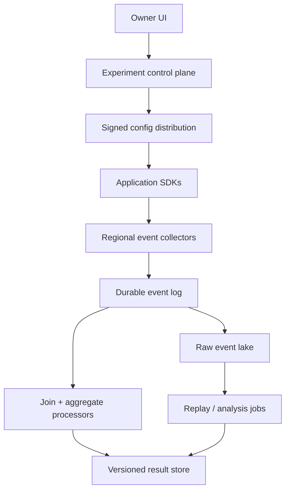
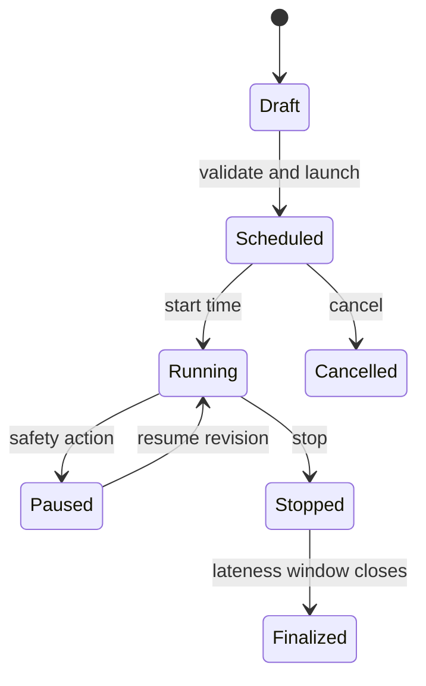

# Design a Large-Scale Online Experimentation Platform

**Difficulty:** Senior / Staff  
**Primary themes:** deterministic assignment, event pipelines, late data, idempotency, analytical correctness, caching, statistical guardrails

This is a 45-minute interview plan followed by a more detailed study walkthrough. In the interview, budget roughly 5 minutes for requirements, 2 for entities, 5 for interfaces, 10–15 for the high-level design, and 10–15 for deep dives. The educational version is intentionally longer.

The structure follows Hello Interview’s public recommendation to clarify requirements, identify entities and APIs, build the simplest complete system, and then harden it against non-functional requirements in focused deep dives. Their [System Design Delivery Framework](https://www.hellointerview.com/learn/system-design/in-a-hurry/delivery) explicitly recommends getting a working design in place before layering on complexity, and their [API Design guide](https://www.hellointerview.com/learn/system-design/core-concepts/api-design) frames the interface step as a short mapping from requirements to operations. The problem, dialogue, calculations, and design below are original.

## Interviewer prompt

> Design an online experimentation platform that lets product teams define A/B tests, assign users consistently, record exposures and outcomes, and view trustworthy experiment results. Think of infrastructure used to test product changes at a large consumer internet company.

## Targeted clarifying questions

**Candidate:** “Is the platform responsible for feature delivery, statistical analysis, or both?”

**Interviewer:** “Both assignment and analysis. Assume application SDKs ask for a treatment, emit exposure events, and later emit business outcomes. A separate feature-flag product is not required.”

**Candidate:** “What is the randomization unit?”

**Interviewer:** “Usually authenticated user ID, but experiment owners may choose device, account, or organization. One experiment cannot change its unit after launch.”

**Candidate:** “Which experiment shapes must we support?”

**Interviewer:** “Control plus one or more treatments, percentage allocation, targeting, mutual exclusion, scheduled start/stop, and gradual ramp. Factorial experimentation and bandits are out of scope.”

**Candidate:** “What results are required?”

**Interviewer:** “Counts, means, conversion rates, ratios, percentile guardrails, treatment lift, confidence intervals, and diagnostic checks such as sample-ratio mismatch. Results may be provisional before they finalize.”

**Candidate:** “What scale and latency should I assume?”

**Interviewer:** “One billion monthly users, 10 million treatment lookups per second at peak, 5 million telemetry events per second, 100,000 concurrent experiments, and 5,000 organizations. Assignment should add under 5 ms p99 in-process. Dashboard results should be less than five minutes stale.”

**Candidate:** “How late or duplicated can telemetry be?”

**Interviewer:** “Mobile devices can be offline for days. Events are at-least-once and may arrive out of order. Publish provisional results within five minutes, revise them for seven days, then finalize.”

**Candidate:** “How strong must consistency be?”

**Interviewer:** “A subject must receive stable treatment for a fixed experiment version. Launch, ramp, and stop operations must be strongly ordered. Analytics may be eventually consistent but must expose completeness and analysis version.”

**Candidate:** “Any privacy constraints?”

**Interviewer:** “Raw identifiers and events are tenant-isolated, encrypted, access-controlled, and deleted under retention requests. Results must enforce minimum cohort sizes.”

**Candidate summary aloud:**

> “I’ll separate a strongly controlled experiment configuration plane from a high-volume assignment and telemetry plane. Treatment is a deterministic function of immutable experiment version and randomization unit. Analysis will join exposures to outcomes in event time, publish provisional versioned results, and use replayable raw data for correction and audit.”

---

## 1. Requirements (~5 minutes)

### Core functional requirements

1. **Define and operate experiments:** Create a draft, validate it, launch a version, ramp allocations, pause or stop it, and enforce targeting plus mutual exclusion.
2. **Assign and expose:** Return a stable treatment at very low latency and record exactly one logical first exposure per subject, experiment version, and analysis scope.
3. **Analyze outcomes:** Ingest exposure and outcome events, compute versioned metrics and statistical comparisons, diagnose invalid experiments, and serve provisional then finalized results.

### Quantified non-functional requirements

- **Assignment latency and availability:** in-process evaluation under 5 ms p99 with 99.999% availability; no network dependency on the hot path after configuration is cached.
- **Analytics freshness:** 95% of valid on-time events reflected within 5 minutes.
- **Correctness:** stable treatment for a fixed version; no silent cross-version mixing; idempotent logical event handling and reproducible analysis.
- **Scale:** 10 million assignment evaluations/s, 5 million telemetry events/s, 100,000 concurrent experiments, and 1 billion monthly users.
- **Late data:** provisional results revise for 7 days; final result versions are immutable except for an explicit audited backfill.
- **Privacy:** tenant isolation, encrypted identifiers, least-privilege access, deletion workflows, and minimum cohort thresholds.

### Scope and consistency contract

The control plane is strongly consistent per experiment. Every state transition uses an expected version, and a launched version is immutable. A ramp creates a new allocation revision rather than mutating historical meaning.

Assignment is deterministic for `(tenant, layer, experiment_version, randomization_unit_value)`. Two healthy SDKs with the same signed configuration return the same treatment without coordination. During configuration partitions, an SDK may use the last unexpired version; if none exists, it returns the declared safe default and does not invent an assignment.

Analytics is eventually consistent and versioned. Every dashboard shows:

- experiment and allocation revision;
- metric-definition version;
- analysis run version;
- event-time watermark and completeness estimate;
- whether the result is provisional, final, degraded, or invalid.

An experiment is not “correct” merely because every event was eventually processed. The platform must preserve assignment semantics, exposure causality, deduplication, population integrity, and reproducible metric definitions.

### Explicitly out of scope

- Contextual bandits, reinforcement learning, and automatic traffic optimization
- Editing application code or deploying variants
- Arbitrary ad hoc warehouse SQL on the interactive dashboard path
- Cross-device identity resolution beyond a supplied randomization key
- Replacing expert statistical review for high-risk decisions

### Scale estimates that change the design

At 10 million assignments/s, even a modest 2 ms network call would require enormous connection and server capacity while adding a new availability dependency. Therefore assignment must run locally from a compact signed configuration snapshot.

At 5 million telemetry events/s and an average compressed envelope of 300 bytes:

`5,000,000 × 300 B = 1.5 GB/s ≈ 130 TB/day`.

Keeping seven days of compressed hot replay data is roughly `910 TB` before replication. Raw immutable events belong in object storage, while the stream processor holds only bounded deduplication, join, and aggregate state.

Suppose 100,000 experiments each expose 100 metric slices, 4 variants, and 24 hourly windows:

`100,000 × 100 × 4 × 24 = 960 million aggregate cells/day`.

We cannot eagerly compute every arbitrary segment combination. Precompute registered metrics and bounded approved dimensions; run rare exploratory cuts as asynchronous warehouse jobs.

**What I would say aloud:**

> “The assignment QPS removes a network service from the hot path. The event volume requires an append-only log plus object-store replay, and the metric cardinality means dimensions must be registered and bounded instead of allowing arbitrary dashboard group-bys.”

---

## 2. Core entities (~2 minutes)

| Entity | Purpose | Important fields |
|---|---|---|
| `Experiment` | Stable logical test | `experiment_id`, `tenant_id`, `layer_id`, `owner`, `randomization_unit`, `state` |
| `ExperimentVersion` | Immutable assignment contract | `version`, `salt`, `variants`, `bucket_ranges`, `targeting_rule`, `start_at`, `stop_at` |
| `Layer` | Mutual-exclusion namespace | `layer_id`, `namespace_size`, `policy_version` |
| `MetricDefinition` | Versioned outcome calculation | `metric_id`, `version`, `event_type`, `numerator`, `denominator`, `window`, `dimensions` |
| `ExposureEvent` | Subject actually encountered a variant | `event_id`, `subject_hash`, `experiment_id`, `version`, `variant`, `event_time` |
| `OutcomeEvent` | Behavior to measure | `event_id`, `subject_hash`, `event_type`, `value`, `event_time`, `attributes` |
| `AggregateCell` | Mergeable sufficient statistics | experiment/version/variant/metric/window/dimension plus counts, sums, moments, sketches |
| `AnalysisRun` | Reproducible result publication | `run_id`, input offsets, watermark, metric versions, code version, status |
| `ResultSnapshot` | Dashboard-serving output | effects, intervals, diagnostics, completeness, publication state |

The key modeling distinction is between **assignment** and **exposure**. Assignment says what treatment a subject would receive. Exposure says the product actually rendered or executed the treatment. Outcome attribution normally begins at exposure, otherwise users who never encountered the feature dilute or bias the result.

---

## 3. API and system interface (~5 minutes)

User and service identity comes from authentication. Clients supply the randomization key value, but the experiment definition determines which key type is legal. SDK credentials are scoped to a tenant, environment, and application.

### Create and launch an experiment

```http
POST /v1/experiments
Authorization: Bearer <owner-token>
Idempotency-Key: 6c17...

{
  "name": "checkout-button-copy",
  "layer_id": "checkout-ui",
  "randomization_unit": "USER_ID",
  "variants": [
    {"key": "control", "weight_bp": 5000},
    {"key": "concise_copy", "weight_bp": 5000}
  ],
  "targeting": {"country_in": ["US", "CA"]},
  "metrics": ["checkout_conversion:v3", "revenue_per_user:v2"],
  "guardrails": ["page_error_rate:v1"]
}
```

```http
POST /v1/experiments/exp_731/launch
Authorization: Bearer <owner-token>
If-Match: "draft-version-4"

{
  "start_at": "2026-10-17T14:00:00Z",
  "allocation_bp": 1000
}
```

The launch response returns immutable `experiment_version`, `allocation_revision`, validation warnings, and an audit ID. `If-Match` prevents two operators from launching conflicting drafts.

### Evaluate locally through an SDK

Application code calls:

```text
decision = experiments.evaluate(
    experiment_key = "checkout-button-copy",
    attributes = {"user_id": "u_812", "country": "US"},
    default = "control"
)
```

```json
{
  "variant": "concise_copy",
  "experiment_id": "exp_731",
  "experiment_version": 5,
  "allocation_revision": 2,
  "decision_id": "d_01K...",
  "exposure_token": "signed-compact-token",
  "reason": "MATCHED"
}
```

The SDK derives the bucket locally. `exposure_token` binds experiment, version, variant, subject hash, config digest, and expiry so the ingestion service can reject fabricated or mismatched exposures.

### Record exposure and outcomes

```http
POST /v1/events:batch
Authorization: Bearer <sdk-token>
Content-Encoding: zstd

{
  "batch_id": "b_401",
  "events": [
    {
      "event_id": "evt_9001",
      "type": "EXPOSURE",
      "event_time": "2026-10-17T14:03:21.183Z",
      "exposure_token": "signed-compact-token"
    },
    {
      "event_id": "evt_9002",
      "type": "CHECKOUT_COMPLETED",
      "subject_key": "u_812",
      "event_time": "2026-10-17T14:06:10.024Z",
      "value": 84.50,
      "attributes": {"country": "US", "platform": "ios"}
    }
  ]
}
```

```json
{
  "batch_id": "b_401",
  "accepted": 2,
  "rejected": [],
  "receipt_id": "rcpt_51"
}
```

The acknowledgement means the durable ingestion log accepted the envelope, not that dashboards already reflect it. Retries with the same `event_id` are safe.

### Read results

```http
GET /v1/experiments/exp_731/results?metric=checkout_conversion:v3
Authorization: Bearer <analyst-token>
```

```json
{
  "experiment_version": 5,
  "allocation_revision": 2,
  "metric": "checkout_conversion:v3",
  "analysis_run": "run_20261017_1410_07",
  "status": "PROVISIONAL",
  "watermark": "2026-10-17T14:07:00Z",
  "completeness": 0.972,
  "variants": {
    "control": {"subjects": 104821, "rate": 0.1421},
    "concise_copy": {"subjects": 104302, "rate": 0.1458}
  },
  "comparison": {
    "absolute_lift": 0.0037,
    "relative_lift": 0.0260,
    "confidence_interval_95": [-0.0004, 0.0078]
  },
  "diagnostics": {"sample_ratio_mismatch": "PASS"}
}
```

**What I would say aloud:**

> “The assignment response includes version and a signed exposure token, because analytics must know exactly which immutable decision produced the observation. Event acceptance is separate from result freshness, and the result API makes provisional state and completeness visible.”

---

## 4. Data flow

### Control and assignment flow

1. An owner saves a draft in the control-plane database.
2. Validation checks allocation totals, metric compatibility, layer collisions, targeting fields, power estimates, and guardrails.
3. Launch commits an immutable `ExperimentVersion` and ordered allocation revision.
4. A transactional outbox publishes a signed configuration bundle through a regional distribution service.
5. SDKs verify the signature, atomically replace their local snapshot, and evaluate subjects deterministically.
6. The application emits an exposure only when the treatment is actually encountered.

### Analytics flow

1. Regional collectors authenticate SDKs, validate schemas and tokens, and append batches to a partitioned durable log.
2. A raw sink writes immutable events to date/tenant-partitioned object storage for replay.
3. Stream processors normalize identifiers, deduplicate event IDs, validate experiment versions, and track event-time watermarks.
4. Attribution operators join each eligible subject’s exposure to outcomes inside metric windows.
5. Aggregators produce mergeable sufficient statistics and diagnostic counters.
6. Periodic analysis jobs compute lift, uncertainty, guardrails, and sample-ratio checks from a pinned input manifest.
7. A publisher atomically installs a versioned `ResultSnapshot`; dashboards read a cache backed by the result store.

---

## 5. High-level design (~10–15 minutes)



### Operation 1: create and safely launch an experiment

Use a relational control-plane database because experiment state transitions, ownership, layer reservations, and audit records benefit from transactions and constraints. A draft is mutable. Launching creates an immutable version after validation.

The experiment state machine is:



Every mutation includes expected control-plane version and an idempotency key. The transaction writes both the new state and an outbox row. A publisher signs the resulting config bundle and distributes it with monotonically increasing tenant/environment sequence numbers.

Before launch, validate:

- variant weights sum correctly and control exists;
- randomization unit and salt are frozen;
- targeting fields are allowlisted and type-safe;
- layer bucket ranges do not collide;
- metric versions and attribution windows exist;
- estimated sample size is feasible;
- guardrails and minimum runtime are declared;
- owner, approver, retention, and privacy classifications are present.

Google’s published experimentation work describes overlapping infrastructure using orthogonal layers so a subject can participate in compatible experiments while mutually exclusive tests share a layer. See [Overlapping Experiment Infrastructure](https://research.google/pubs/overlapping-experiment-infrastructure-more-better-faster-experimentation/). In this design, a layer provides the collision domain.

### Operation 2: deterministic treatment assignment

Each layer has a namespace, for example one million buckets. The SDK computes:

```text
bucket = HMAC-SHA256(
    tenant_secret,
    layer_id || experiment_version || salt || canonical_subject_key
) mod 1_000_000
```

If the bucket is outside the experiment’s current allocation range, return default. Otherwise map it into a variant range. Targeting rules run before or after bucket selection according to one published cross-SDK specification; the choice must not vary by language.

Why a keyed hash?

- deterministic across devices and regions;
- uniform enough for randomization;
- difficult for clients to manipulate by predicting buckets;
- no assignment row per subject;
- easy to test with cross-language golden vectors.

The SDK snapshot contains only configurations authorized for that application. It verifies bundle signature and expiry, then swaps the full snapshot atomically. A partially downloaded bundle is never evaluated.

Ramping from 10% to 25% expands a contiguous allocation range while preserving already assigned subjects. Changing variant weights is more dangerous because it can move subjects between variants. Prefer a new experiment version, or preserve old ranges and allocate only new buckets. The platform warns when a proposed edit causes churn.

Anonymous-to-authenticated transitions are explicit. If the randomization unit is device, keep device assignment. If it is user, do not silently merge earlier anonymous outcomes into the user experiment; either exclude them or use a predeclared identity policy.

**What I would say aloud:**

> “Assignment has no per-user database write. A signed immutable config plus a cross-language keyed hash gives stable treatment locally. I freeze the unit, salt, and bucket semantics at launch, because changing any of them changes the experimental population.”

### Operation 3: record a trustworthy exposure

The SDK computes a decision when application code asks, but it should emit exposure only when the user can encounter the changed behavior. Merely prefetching a flag is not exposure.

The signed exposure token contains:

- tenant, experiment ID, immutable version, and allocation revision;
- variant and layer;
- keyed subject hash, not the raw identity;
- decision timestamp and config digest;
- nonce/decision ID and expiry.

Collectors verify token signature and reject a variant that does not match the token. For server-side trusted SDKs, mTLS plus a compact authenticated envelope may replace a public token, but the same fields remain.

Collectors batch, compress, and append events to a regional log. Partition primarily by tenant plus hashed subject so one subject’s exposure and outcomes have stable ordering where practical. Extremely large tenants receive many virtual partitions.

At-least-once delivery means transport duplicates are expected. Deduplicate by `(tenant_id, event_id)` for a bounded period, but define a separate logical exposure key:

`(tenant, experiment_version, subject_hash, exposure_scope)`.

For an intent-to-treat analysis, the first eligible exposure wins. Repeated page renders increment diagnostic counters but not subject count. Some metrics may count sessions or events, so the metric definition specifies the unit of analysis.

### Operation 4: join outcomes in event time

Processing time is when the platform sees an event; event time is when the product says it occurred. Offline mobile events make the distinction essential.

For each exposure, the processor stores compact keyed state through the longest registered attribution window. An outcome joins when:

- tenant and subject match;
- experiment/version is eligible;
- outcome event time is after the chosen exposure boundary;
- outcome falls before the metric window closes;
- metric predicates and unit-of-analysis rules pass.

Watermarks estimate how far event time has progressed. Apache Flink’s official [event-time documentation](https://nightlies.apache.org/flink/flink-docs-stable/docs/concepts/time/) describes watermarks as progress indicators that let operators advance event-time clocks. A watermark is not proof that no event will arrive later, so this platform treats early results as provisional and applies late corrections.

Outcome events can contribute to several experiments in different layers. The processor reads the subject’s exposure index rather than broadcasting every outcome to all 100,000 experiments. A compact map keyed by subject and event type returns only candidate active exposures.

### Operation 5: aggregate and publish results

Do not store every joined row in the interactive database. Maintain mergeable sufficient statistics per bounded key:

`(tenant, experiment_version, allocation_revision, variant, metric_version, window, approved_dimensions)`.

Examples:

- count: `n`;
- mean: `n`, `sum`, `sum_sq`;
- conversion: eligible subjects and converted subjects;
- ratio: numerator and denominator sums plus covariance terms;
- percentile guardrail: mergeable quantile sketch plus exact audit sample.

Workers checkpoint stream offsets and state. Sink writes use deterministic cell/version IDs or transactional epoch commits so replay does not double-count. Exactly-once processing is an end-to-end property, not a magical queue setting; the raw immutable log and idempotent output are the recovery foundation. Flink’s [fault-tolerance guide](https://nightlies.apache.org/flink/flink-docs-stable/docs/learn-flink/fault_tolerance/) similarly notes that recovery can replay records even when the application offers exactly-once state semantics.

Every few minutes, an analysis coordinator pins:

- source partition offsets and object manifests;
- watermarks and known data-loss intervals;
- experiment/allocation versions;
- metric definition and analysis code versions;
- exclusion and privacy policies.

It computes variant summaries, treatment effects, confidence intervals, power diagnostics, guardrails, and sample-ratio mismatch. It writes a complete candidate snapshot, validates invariants, then atomically changes the dashboard’s active `run_id`.

The result cache key includes experiment version, metric version, analysis run, segment, and viewer authorization cohort. Immutable result snapshots cache well. A small metadata pointer identifies the latest allowed snapshot.

---

## 6. Deep dives (~10–15 minutes)

### Deep dive A: stable assignment, ramps, and overlapping experiments

#### Where the baseline breaks

A naive random number on each request flips users between variants. Persisting every assignment creates a multi-billion-row synchronous database dependency. Independent experiments can conflict, while changing allocation can contaminate previously stable cohorts.

#### Plausible approaches

| Approach | Strengths | Weaknesses |
|---|---|---|
| Random choice per request | Trivial | No stable treatment; statistically invalid |
| Persisted assignment row | Auditable and flexible | Hot-path write/read, enormous state, regional consistency cost |
| Deterministic hash | Local, stable, scalable | Configuration semantics must be immutable and identical across SDKs |

#### Choice and evolution

Choose deterministic hashing with layered namespaces.

An experiment reserves bucket intervals inside one layer. Experiments in the same layer cannot overlap for the same subject; experiments in orthogonal layers may. The control plane uses a serializable transaction or compare-and-swap on the layer map to prevent concurrent launches from reserving the same interval.

Use cross-language conformance fixtures containing Unicode normalization, absent fields, number encoding, rule ordering, and expected buckets. Release validation runs every SDK against these fixtures. A discrepancy is a stop-ship error because it creates treatment mismatch by platform.

Ramps should minimize churn:

- expand the eligible bucket interval rather than rehashing;
- do not change the salt;
- preserve old variant intervals;
- put newly admitted buckets into planned variant ranges;
- record allocation revision on every exposure;
- analyze across revisions only when the estimand permits it.

If treatment itself changes materially, create a new immutable experiment version and either restart analysis or explicitly model epochs. Never silently compare subjects who saw different treatment implementations under one label.

#### Failure modes and observability

- **Stale SDK config:** expose config age, digest, and sequence; reject expired configs according to experiment safety policy.
- **Cross-SDK mismatch:** run shadow decisions and compare aggregate bucket/variant distributions by platform.
- **Biased missing key:** default and emit a diagnostic; never hash an empty value as though it were a real user.
- **Layer collision:** control-plane constraint blocks launch; periodic audit recomputes interval overlap.
- **Ramp churn:** simulate old and new configs over deterministic sample keys before approval.

Track assignment count by variant/platform/config digest, default-reason rate, missing-key rate, stale-config age, cross-SDK mismatch, and subject treatment-change rate.

**What I would say aloud:**

> “The hash is simple; the hard part is version discipline. I use a layer to define mutual exclusion, freeze the salt and unit, simulate ramps for churn, and test every SDK against the same golden vectors.”

### Deep dive B: late, duplicated, missing, and out-of-order telemetry

#### Where the baseline breaks

Counting events as they arrive mixes processing time with event time. Retried batches double-count. Outcomes may arrive before exposures. One stalled partition can hold back a global watermark. A seven-day mobile upload can change an apparently finished result. Silent telemetry loss can bias treatment and control differently.

#### Plausible approaches

| Approach | Strengths | Weaknesses |
|---|---|---|
| Wait seven days, batch once | Simple final answer | No timely feedback; still vulnerable to bad input |
| Stream once and ignore late data | Fast | Permanently wrong results |
| Streaming provisional results plus replayable corrections | Timely and auditable | More state, versioning, and operational complexity |

#### Choice and evolution

Use streaming provisional computation backed by immutable raw events and deterministic replay.

There are three distinct duplicate problems:

1. **Transport duplicate:** same `event_id`; remove with an event-ID ledger or compact probabilistic front filter plus exact store.
2. **Logical repeat:** different IDs for the same first exposure; collapse using the metric’s logical subject key.
3. **Legitimate repeated outcome:** multiple purchases or sessions; retain according to metric semantics.

Deduplication state cannot be kept forever. Use a hot exact TTL store for the seven-day correction horizon and preserve raw events for audited reprocessing. If an event arrives beyond the online TTL, an authorized backfill can rebuild the affected partitions and publish a new run instead of mutating old cells ad hoc.

Watermarks are tracked per source partition. Idle-partition detection prevents a quiet partition from freezing all progress, but a partition with unexplained missing offsets is not “idle”; it is degraded. Result completeness combines watermark coverage, source health, schema rejection rate, SDK heartbeat coverage, and historical lateness distribution.

When a late event changes an aggregate, emit a retract/upsert keyed by deterministic cell and epoch. The serving layer reads only a fully committed analysis run. A dashboard never observes half the variants from run 12 and half from run 13.

Telemetry loss deserves treatment-specific checks. Compare exposure-to-outcome pipeline rates by variant, platform, version, and collector region. Microsoft research on [trustworthy experimentation under telemetry loss](https://www.microsoft.com/en-us/research/publication/trustworthy-experimentation-under-telemetry-loss/) emphasizes that measurement loss can bias conclusions; the platform should invalidate or qualify results when loss is differential.

#### Recovery and reconciliation

- Collectors spool briefly to disk and fail batches explicitly when durable append fails.
- Raw sink verifies source-offset continuity and object checksums.
- Checkpoints bind processor state to input offsets.
- A reconciliation job compares raw counts, normalized counts, joined subjects, and aggregate contributions.
- Backfills write a new namespace/run and use atomic publication.
- A dead-letter stream retains schema failures with tenant-safe diagnostics.

**What I would say aloud:**

> “I do not promise that an event physically arrives once. I promise that a logical event contributes according to one declared metric rule. Raw data is immutable, stream results are provisional, and every correction produces a reproducible new analysis run.”

### Deep dive C: trustworthy results, diagnostics, and safe publication

#### Where the baseline breaks

A dashboard can compute mathematically correct numbers from a broken experiment. Examples include unequal assignment caused by an SDK bug, users appearing in both variants, peeking until significance, incompatible metric changes, novelty effects, and treatment-dependent telemetry loss.

#### Plausible approaches

| Approach | Strengths | Weaknesses |
|---|---|---|
| Display raw means only | Easy to explain | No uncertainty or integrity checks |
| Let every team upload custom analysis code | Flexible | Non-reproducible, unsafe, inconsistent |
| Registered metric DSL plus governed analysis versions | Reproducible and reviewable | Less ad hoc flexibility |

#### Choice and evolution

Use versioned registered metrics and a governed analysis engine.

A metric DSL defines:

- population eligibility and unit of analysis;
- exposure policy and attribution window;
- event filters, numerator, denominator, and capping;
- approved dimensions;
- variance estimator and missing-data policy;
- minimum sample size and privacy threshold.

Compile the DSL to both streaming aggregation and batch replay plans. A compatibility checker ensures both produce equivalent sufficient statistics on golden datasets.

Before publishing a decision-ready result, evaluate:

- **sample-ratio mismatch (SRM):** observed allocation differs unexpectedly from configured allocation;
- treatment crossover or multiple variants per subject;
- pre-experiment metric imbalance;
- differential event loss or schema rejection;
- guardrail regression;
- novelty and day-of-week coverage;
- minimum runtime, sample size, and power;
- multiple-comparison policy where many metrics or variants are tested.

SRM is a smoke alarm, not a diagnosis. If it fires, mark the result invalid for decision-making while retaining it for debugging. Do not “fix” it by randomly dropping subjects until counts match.

Variance reduction such as CUPED can improve sensitivity using pre-experiment covariates, but it must be predeclared and versioned. Microsoft’s [variance-reduction overview](https://www.microsoft.com/en-us/research/articles/beyond-power-analysis-metric-sensitivity-in-a-b-tests/) explains that CUPED uses pre-experiment data to remove explainable variance. The system stores covariate definition, pre-period, eligibility, and code version in `AnalysisRun`.

Avoid uncorrected repeated peeking. The product can use fixed-horizon analysis with a declared end date, or an approved sequential-testing method whose boundaries are computed by the analysis engine. The UI should not imply “95% confidence means a 95% probability treatment is better.” It shows effect size, interval, sample size, runtime, diagnostics, and decision policy together.

#### Privacy and access

- Hash subject keys with tenant-specific rotating keys before the shared pipeline.
- Keep the re-identification map outside analytics.
- Enforce row/column policy on experiment, metric, and sensitive dimensions.
- Suppress slices below a minimum cohort and prevent differencing attacks through query budgeting.
- Log every raw-event query and result export.
- Propagate deletion tombstones through hot state, raw-lake deletion indexes, aggregates where legally required, and caches.

#### Observability

Track result publication age, input offset lag, watermark delay, completeness, SRM rate, cross-variant contamination, metric compiler mismatch, backfill deltas, guardrail status, privacy suppression, and active-run rollback. Maintain synthetic experiments with known 0%, positive, and negative effects to continuously test the full path.

**What I would say aloud:**

> “A confidence interval is the end of the pipeline, not proof the pipeline was valid. I gate publication on population and telemetry diagnostics, version every metric and analysis input, and make invalidity visible rather than producing a persuasive number from a broken test.”

---

## Reliability, consistency, and observability

### Failure behavior

- **Control plane unavailable:** running experiments continue from verified cached bundles; launches and ramps stop.
- **Config distribution delayed:** SDKs use an unexpired prior snapshot and report age; safety-critical experiments may default rather than serve stale treatment.
- **Collector region fails:** SDKs retry another regional endpoint with the same event IDs; duplicates are expected.
- **Stream processor fails:** restore checkpoint and replay log; deterministic sinks prevent double contribution.
- **Result computation fails:** continue serving the last complete result snapshot with stale status.
- **Raw sink lags:** do not declare results final; retain the log until object-store durability catches up.
- **Permission service unavailable:** assignment can continue only from an already authorized app bundle; dashboard and raw-data access fail closed.

### Multi-region model

The control plane has one write leader per tenant or experiment shard with synchronous multi-zone replication. Cross-region replicas support disaster recovery with fencing so two leaders cannot issue divergent versions.

Configuration bundles replicate globally and are independently verifiable. Assignment is local and coordination-free. Telemetry collectors accept locally, replicate through durable logs, and preserve original region/partition/offset metadata. Analysis may run in one data region per tenant to simplify joins and residency; raw data does not cross residency boundaries without policy authorization.

### Key invariants

Continuously audit:

- one immutable meaning for each experiment version;
- no overlapping bucket reservations inside a layer revision;
- one treatment per subject per experiment version;
- every accepted exposure token maps to the published config digest;
- source offsets are continuous or explicitly marked missing;
- every aggregate cell is reproducible from a pinned manifest;
- one active complete result snapshot per experiment/run channel;
- finalization occurs only after correction horizon and source durability checks;
- privacy thresholds apply to dashboards, exports, and caches.

### Operational signals

| Signal | Why it matters |
|---|---|
| Config publish and SDK adoption lag | Assignment consistency |
| Default/stale-config rate | Availability and exposure quality |
| Event accept, reject, duplicate, and drop rate | Ingestion health |
| Per-partition lag and watermark skew | Freshness and late-data behavior |
| Exposure/outcome join rate | Attribution correctness |
| SRM and cross-variant contamination | Randomization integrity |
| Stream-vs-batch reconciliation delta | Processing correctness |
| Result run age and completeness | Dashboard trust |
| Backfill magnitude | Pipeline or lateness regressions |
| Privacy suppression and denied exports | Governance |

Trace by `decision_id`, `event_id`, log position, aggregate-cell key, and `run_id`. Do not put raw subject IDs or high-cardinality experiment IDs into unrestricted metric labels.

---

## 7. Concise final design

Experiment owners use a strongly consistent control plane to create drafts and launch immutable versions. Layers reserve mutually exclusive bucket ranges. Signed configuration bundles propagate to application SDKs, which deterministically hash the declared randomization key to a stable variant without a network call. The application emits a signed exposure only when the user encounters the treatment.

Regional collectors durably append at-least-once telemetry to partitioned logs and immutable object storage. Stream processors validate versions, deduplicate transport events, collapse logical first exposures, join outcomes in event time, and maintain mergeable aggregate statistics. Watermarks drive provisional freshness; late events revise results for seven days. Versioned analysis runs pin offsets, metric definitions, code, exclusions, and completeness, then atomically publish result snapshots after integrity and privacy checks.

### Requirements check

| Requirement | Design response |
|---|---|
| Define and launch tests | Transactional control plane, validation, immutable versions, audit log |
| Stable low-latency assignment | Signed local config and deterministic keyed hashing |
| Mutual exclusion | Layer bucket reservations with ordered revisions |
| Safe ramps | Range expansion, churn simulation, allocation revision on exposure |
| Trustworthy exposure | Emit on encounter; signed token binds subject, variant, version, config |
| Five million events/s | Regional collectors, partitioned log, compression, object-store raw sink |
| Duplicates and late data | Event/logical dedup, event-time joins, watermarks, seven-day correction |
| Fresh dashboards | Streaming aggregates and five-minute versioned publication |
| Reproducibility | Pinned inputs, metric/code versions, immutable result snapshots |
| Statistical guardrails | SRM, contamination, loss, runtime, power, and guardrail checks |
| High availability | Local evaluation, cached bundles, replayable log, previous result fallback |
| Privacy | Tenant hashing, least privilege, suppression, audit, deletion propagation |

**Closing statement aloud:**

> “I separate deterministic assignment from eventually consistent measurement. Immutable experiment versions make treatment stable, signed exposures preserve causality, and replayable event-time analysis makes late corrections auditable. The dashboard publishes only complete versioned runs and labels data quality explicitly, because trustworthy experimentation is an integrity problem before it is a statistics problem.”

---

## Realistic interviewer follow-ups and strong sample answers

### 1. “Why not store every user’s assignment?”

> “At ten million evaluations per second, that introduces unnecessary storage and a synchronous availability dependency. Deterministic hashing reproduces the assignment from immutable config. I persist exposures, because they prove the treatment was encountered and are required for analysis.”

### 2. “How do you change traffic from 10% to 50% without moving users?”

> “Keep the salt and old bucket ranges fixed, then extend the eligible interval. Preserve existing variant ranges and assign only newly admitted buckets. Record a new allocation revision and simulate churn before publishing.”

### 3. “Can the same user be in several experiments?”

> “Yes, when experiments occupy orthogonal layers. Within one layer, bucket reservations are mutually exclusive. Owners put experiments in the same layer when their treatments could interfere and in different layers when concurrent participation is acceptable.”

### 4. “What does exactly once mean here?”

> “It does not mean the network delivers once. Collectors and processors may see duplicates. An `event_id` removes transport retries; a logical key collapses repeated first exposures; deterministic sink epochs prevent replay from double-counting. Legitimate repeated outcomes remain according to the metric definition.”

### 5. “What if an outcome arrives before its exposure?”

> “Event-time state can buffer unmatched outcomes for the allowed out-of-order interval. If the exposure arrives later and the timestamps satisfy attribution, they join. Both remain in raw storage, so a replay can correct results beyond the streaming buffer.”

### 6. “Why show results before the seven-day late-data window closes?”

> “Product teams need timely safety feedback. I label early results provisional, expose completeness and watermark, and prevent final-decision status until declared runtime and integrity checks pass. Each late correction creates a new reproducible run.”

### 7. “What is sample-ratio mismatch?”

> “It is a statistically unlikely difference between configured and observed variant allocation. It often signals broken randomization, filtering, exposure logging, or data loss. I mark the experiment invalid for decision-making and investigate; I do not repair it by deleting data until the counts look right.”

### 8. “How do you support revenue per user?”

> “The metric declares user as the analysis unit and a post-exposure window. I sum eligible revenue events per subject, including zeros for exposed users without purchases, then aggregate subject-level sums by variant. Capping and currency normalization are versioned in the metric definition.”

### 9. “Why not let analysts write arbitrary SQL?”

> “They can for exploration in an asynchronous governed warehouse path. Decision dashboards use registered versioned metrics so streaming and replay semantics, privacy, variance, and attribution are reproducible. Arbitrary SQL should not silently redefine a production decision metric.”

### 10. “How do you handle a user on two devices?”

> “Use the declared randomization unit. If it is authenticated user ID, both devices hash to the same treatment after login. Anonymous device events remain separate unless a predeclared identity policy says otherwise; post hoc merging can bias the population.”

### 11. “Would you cache dashboard results?”

> “Yes. Result snapshots are immutable and cache by experiment version, metric version, run ID, segment, and viewer authorization cohort. A small pointer identifies the latest allowed run. I never cache raw private slices without policy identity and privacy threshold state.”

### 12. “How do you stop a harmful treatment quickly?”

> “The owner or automated guardrail commits a stopped allocation revision, which receives highest-priority distribution. SDKs atomically adopt it and return control/default. The control plane tracks adoption lag. Previously exposed users remain in analysis; stopping traffic does not rewrite history.”

### 13. “What if an experiment changes the telemetry itself?”

> “That is differential measurement risk. Compare collector, schema rejection, heartbeat, and event-production rates by variant. Use independent server-side guardrails where possible. If observability differs materially by treatment, invalidate affected metrics instead of assuming missingness is random.”

### 14. “How would you add CUPED?”

> “Register a pre-experiment covariate and pre-period, compute it before treatment exposure, and store its definition in the analysis run. The engine adjusts the estimator using the predeclared method. I validate that the covariate is not treatment-affected and compare stream and batch implementations.”

### 15. “How do you backfill after discovering a metric bug?”

> “Create a new metric version, pin the affected raw partitions and source offsets, write aggregates and results into a new run namespace, validate against controls and invariants, then atomically publish it. Keep the prior run for audit; never patch displayed cells manually.”

---

## Common pitfalls

1. Treating assignment and exposure as the same event.
2. Making a network call or database write for every treatment lookup.
3. Using request-time randomness, causing users to switch variants.
4. Changing salt, randomization unit, targeting semantics, or variant meaning after launch.
5. Ramping by rehashing the entire population rather than expanding stable ranges.
6. Ignoring experiment interaction and mutual exclusion.
7. Trusting a client-supplied variant without binding it to signed configuration.
8. Saying “Kafka gives exactly once” without defining source deduplication and sink idempotency.
9. Deduplicating all repeated business events as though they were transport retries.
10. Aggregating by processing time when devices can upload late data.
11. Presenting provisional results without watermark, completeness, and analysis version.
12. Mutating aggregate rows during backfill so dashboards observe mixed epochs.
13. Eagerly materializing every arbitrary dimension combination.
14. Computing statistical significance without SRM and contamination checks.
15. Ignoring differential telemetry loss between variants.
16. Allowing continuous uncorrected peeking until a favorable result appears.
17. Changing a metric definition without creating a new version.
18. Omitting zeros from per-user metrics such as revenue per exposed user.
19. Treating a statistically significant tiny effect as automatically valuable.
20. Logging raw subject IDs or serving cohorts below privacy thresholds.
21. Designing only the happy path and omitting stop propagation, replay, reconciliation, and audit.
22. Quoting huge scale numbers without tying them to local evaluation, streaming state, or bounded dimensions.

## A polished 60-second wrap-up

> “The control plane validates drafts and launches immutable experiment versions into mutually exclusive layers. SDKs receive signed snapshots and use a standardized keyed hash to assign subjects locally in under five milliseconds; when the experience is actually encountered, they emit a signed exposure tied to variant, version, subject, and config digest. Regional collectors append exposure and outcome events to durable logs and raw object storage. Event-time processors deduplicate retries, collapse logical first exposures, join eligible outcomes, and maintain mergeable statistics. Watermarks produce five-minute provisional results, while late data can create corrected analysis runs for seven days. Each published snapshot pins offsets, metric and code versions, completeness, and diagnostic checks such as sample-ratio mismatch. The design favors local availability for assignment, strong ordering for configuration, and transparent eventual consistency for analytics.”

## Public references

- [Hello Interview — System Design Delivery Framework](https://www.hellointerview.com/learn/system-design/in-a-hurry/delivery)
- [Hello Interview — API Design](https://www.hellointerview.com/learn/system-design/core-concepts/api-design)
- [Google Research — Overlapping Experiment Infrastructure](https://research.google/pubs/overlapping-experiment-infrastructure-more-better-faster-experimentation/)
- [Apache Flink — Timely Stream Processing](https://nightlies.apache.org/flink/flink-docs-stable/docs/concepts/time/)
- [Apache Flink — Fault Tolerance](https://nightlies.apache.org/flink/flink-docs-stable/docs/learn-flink/fault_tolerance/)
- [Microsoft Research — Trustworthy Experimentation Under Telemetry Loss](https://www.microsoft.com/en-us/research/publication/trustworthy-experimentation-under-telemetry-loss/)
- [Microsoft Research — Metric Interpretation Pitfalls](https://www.microsoft.com/en-us/research/publication/a-dirty-dozen-twelve-common-metric-interpretation-pitfalls-in-online-controlled-experiments/)
- [Microsoft Research — Variance Reduction and Metric Sensitivity](https://www.microsoft.com/en-us/research/articles/beyond-power-analysis-metric-sensitivity-in-a-b-tests/)
