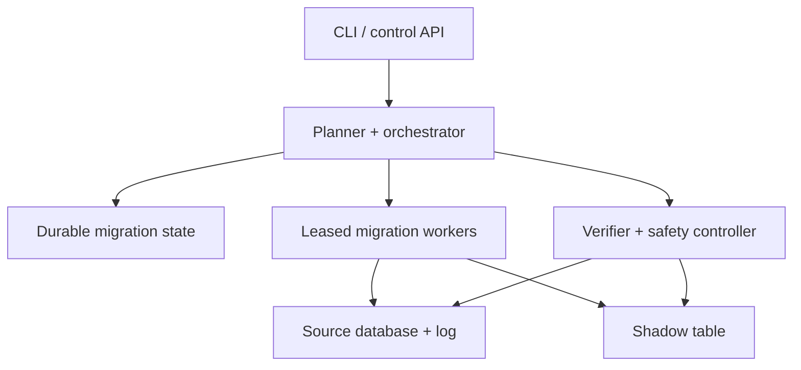
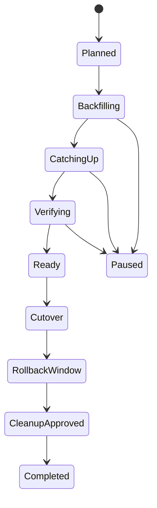

# Design an Online Database Schema Migration Platform

**Difficulty:** Staff  
**Primary themes:** online backfills, change capture, cutover consistency, throttling, verification, rollback, multi-tenant safety

## Interviewer prompt

> Design a managed platform that lets engineering teams change schemas on large production relational databases with little or no downtime. It should support operations such as adding indexes, changing column representations, and rebuilding very large tables while applications continue reading and writing.

This walkthrough uses the requirements → entities → interface → high-level design → deep-dives structure and approximate timings from the public [Hello Interview delivery framework](https://www.hellointerview.com/learn/system-design/in-a-hurry/delivery). The design and dialogue are original. The timings describe a 45-minute interview; the explanation is deliberately longer for study.

## Targeted clarifying questions

**Candidate:** “Which databases and schema changes should we support?”  
**Interviewer:** “Start with sharded MySQL-compatible databases. Support large table rebuilds, adding indexes, changing compatible column types, and adding constraints. Mention how the design could generalize.”

**Candidate:** “Who invokes migrations?”  
**Interviewer:** “Authenticated service owners submit a reviewed migration plan through an API or CLI. The platform executes it against registered production clusters.”

**Candidate:** “What scale should I design for?”  
**Interviewer:** “Ten thousand database clusters, one million tables, and up to one thousand concurrent migrations. A large table may contain 20 billion rows and receive 200,000 row mutations per second.”

**Candidate:** “What is the downtime objective?”  
**Interviewer:** “Normal reads and writes should continue. The final cutover may briefly block conflicting DDL, but application impact should be under one second at p99.”

**Candidate:** “What matters most if speed conflicts with production safety?”  
**Interviewer:** “Production wins. Migrations may slow down or pause automatically. They must not cause a major latency incident or silently lose committed writes.”

**Candidate:** “Should the platform change application code too?”  
**Interviewer:** “No. It validates compatibility and coordinates database work. Application teams handle expand/contract deployments and explicitly authorize cutover.”

**Candidate:** “Must every migration be reversible?”  
**Interviewer:** “Before destructive cleanup, yes. After old data is dropped, rollback may require a new migration or backup restore, so expose that boundary clearly.”

## 1. Requirements (~5 minutes)

### Functional requirements

Prioritize three capabilities:

1. **Plan and start a migration:** validate requested DDL, permissions, topology, application compatibility signals, and available capacity before execution.
2. **Execute online:** create a target representation, backfill existing rows, continuously apply concurrent changes, verify equivalence, and cut over safely.
3. **Operate and recover:** expose progress, pause/resume/cancel, automatically throttle, fail over workers, roll back before the irreversible boundary, and retain an audit trail.

Out of scope: arbitrary data-cleaning programs, application deployment, cross-database business transactions, backup product design, and query optimizer implementation.

### Quantified non-functional requirements

| Goal | Target | Concrete consequence |
|---|---:|---|
| Application availability | No planned outage; cutover impact p99 < 1 s | Online copy plus short atomic rename/metadata switch |
| Safety | Zero silently lost committed mutations | Durable CDC positions, idempotent apply, reconciliation before cutover |
| Production overhead | Added DB CPU < 10%; p99 query-latency increase < 5% | Feedback-controlled throttling and bounded copy batches |
| Platform availability | 99.99% control API; active migrations recover automatically | Durable state machine, leased workers, multi-AZ control plane |
| Scale | 10K clusters, 1K concurrent migrations, 20B-row tables | Sharded orchestration and independently scalable workers |
| Auditability | Every approval, transition, SQL action, and safety override retained for 1 year | Append-only audit events and immutable plan revisions |

### Consistency and availability contract

For one source table, the platform guarantees that the new representation at cutover contains:

1. every source row included by the migration predicate as of a known snapshot boundary; and
2. every committed source mutation after that boundary through a precisely recorded cutover log position.

Copy and change application are at least once. Correctness comes from idempotent upserts/deletes keyed by primary key plus durable source log positions—not from assuming exactly-once transport.

If the platform loses quorum or cannot prove source/target equivalence, it prefers **pausing the migration over cutting over**. The application continues using the old table. Availability of production traffic is more important than availability of migration progress.

**What to say aloud:**

> “The safety invariant is stronger than ‘the row counts match.’ At cutover, the target must equal a consistent source snapshot plus every committed change through a durable log position. If I cannot prove that, I pause rather than switch.”

## Scale estimates that change the design

Suppose a 20-billion-row table averages 500 bytes per row:

\[
20\text{B rows} \times 500\text{ bytes} = 10\text{ TB}
\]

At a deliberately conservative 100 MB/s copy rate, a full scan takes:

\[
10\text{ TB} / 100\text{ MB/s} \approx 100{,}000\text{ seconds} \approx 28\text{ hours}
\]

With indexes, remote I/O, pauses, and contention, it may take days. Therefore, taking a write lock for the copy is impossible; resumable chunking and concurrent change capture are fundamental.

At 200,000 mutations/s and a 300-byte normalized change record, the catch-up stream is about 60 MB/s before replication overhead. If the applier sustains only the source rate, backlog never shrinks. We need apply capacity above peak write rate—say 300,000 mutations/s—or we must lower source overhead without accumulating an unbounded cutover delay.

For 1,000 simultaneous migrations, even 100 MB/s each would demand 100 GB/s of database read traffic. The platform cannot schedule from worker availability alone; it needs per-cluster I/O budgets, global concurrency controls, and production-sensitive admission.

**What to say aloud:**

> “A ten-terabyte copy lasts at least hours, while writes continue at hundreds of thousands per second. That forces a snapshot-plus-log design. It also means the scheduler must allocate database pressure, not merely CPU slots.”

## 2. Core entities (~2 minutes)

- **DatabaseCluster:** engine version, topology, regions, replicas, capacity policy, credentials reference.
- **SchemaObject:** source table, columns, indexes, constraints, primary key, estimated size.
- **MigrationPlan:** immutable requested transformation, risk class, compatibility mode, approvals.
- **MigrationRun:** one execution attempt and its durable state-machine position.
- **BackfillChunk:** primary-key range, snapshot boundary, attempt, checksum, status.
- **ChangeCursor:** source binlog file/position or GTID set and last durably applied position.
- **ShadowTable:** generated target table, schema version, creation metadata.
- **VerificationResult:** structural checks, sampled/full checksums, row counts, divergence details.
- **CutoverLease:** exclusive migration authority, fencing epoch, expiration.
- **AuditEvent:** actor, action, before/after state, reason, timestamp.

The important modeling separation is between an immutable **plan** and a mutable **run**. Retrying execution should not silently change the approved DDL.

```text
MigrationRun
  run_id, plan_id, cluster_id, source_table, shadow_table
  state, ownership_epoch, source_snapshot_position
  copied_through_key, applied_change_position
  verification_version, risk_flags, created_at, updated_at
```

## 3. API and system interface (~5 minutes)

Identity and authorization come from the organization’s authenticated principal and workload identity. The request never supplies a trusted `owner_id`; the API derives actor, team, and permitted database scopes from authentication.

### Create and validate a plan

```http
POST /v1/migration-plans
Authorization: Bearer <service-owner-token>
Idempotency-Key: checkout-orders-index-v4
Content-Type: application/json
```

```json
{
  "cluster_id": "mysql-prod-us-17",
  "database": "checkout",
  "table": "orders",
  "ddl": "ALTER TABLE orders ADD INDEX idx_buyer_created (buyer_id, created_at)",
  "max_db_cpu_percent": 70,
  "max_replica_lag_ms": 2000,
  "cutover_mode": "manual_approval"
}
```

```json
{
  "plan_id": "mp_8f31",
  "risk": "MEDIUM",
  "strategy": "SHADOW_TABLE_REBUILD",
  "estimated_bytes": 10000000000000,
  "checks": [
    {"name": "primary_key_present", "status": "PASS"},
    {"name": "disk_headroom", "status": "PASS", "observed_percent": 44},
    {"name": "replica_available_for_copy", "status": "PASS"}
  ],
  "approval_status": "REQUIRED"
}
```

### Approve and start

```http
POST /v1/migration-plans/mp_8f31/approvals
{"decision":"APPROVE","reason":"Reviewed expand deployment and rollback plan"}

POST /v1/migration-plans/mp_8f31/runs
{"start_after":"2026-10-17T02:00:00Z"}
```

The first endpoint records a human or policy approval. The second creates a run; repeating it with the same idempotency key returns the same run.

### Observe and control

```http
GET  /v1/migration-runs/mr_209
POST /v1/migration-runs/mr_209:pause
POST /v1/migration-runs/mr_209:resume
POST /v1/migration-runs/mr_209:cancel
POST /v1/migration-runs/mr_209:authorize-cutover
```

```json
{
  "run_id": "mr_209",
  "state": "CATCHING_UP",
  "rows_copied": 19600000000,
  "estimated_rows": 20000000000,
  "copy_rate_rows_per_sec": 174000,
  "cdc_lag_ms": 820,
  "source_cpu_percent": 61,
  "replica_lag_ms": 430,
  "next_action": "WAIT_FOR_VERIFICATION"
}
```

Pause stops new copy chunks but continues consuming or durably retaining change data so the database log cannot expire underneath the run. Cancel before cutover removes platform activity but delays shadow cleanup through a safety retention period.

### Worker lease interface

```http
POST /internal/v1/runs/mr_209/lease
{"worker_id":"worker-az2-431","expected_epoch":17}
```

All mutating worker operations include the returned fencing epoch. A stale worker cannot continue copying or cut over after its lease is reassigned.

## 4. Data flow

1. The planner parses the DDL into a typed transformation and snapshots source schema/topology metadata.
2. Policy checks classify risk, require approvals, verify disk/log retention headroom, and select native online DDL or shadow-table rebuild.
3. For a rebuild, the executor creates a shadow table with the desired schema but no application-visible name.
4. Change capture starts at durable source position `P0` before or consistently with the backfill snapshot.
5. Backfill workers copy primary-key ranges in small, idempotent chunks and persist chunk checkpoints.
6. CDC appliers replay inserts, updates, and deletes committed after `P0` into the shadow table.
7. The verifier compares schema, counts, key-range checksums, constraints, and ongoing source/target samples.
8. When copy is complete and CDC lag is near zero, the coordinator obtains cutover authorization and an exclusive fenced lease.
9. It briefly prevents conflicting metadata changes, drains through position `Pc`, atomically swaps names/metadata, then releases application traffic.
10. The old table remains available under a rollback name until the retention boundary; cleanup is separately approved and auditable.

## 5. High-level design (~10–15 minutes)



### Operation 1: plan a migration

The planner reads the current source schema and converts raw SQL into a typed plan such as `ADD_INDEX(columns...)`, `ALTER_COLUMN(old,new)`, or `ADD_CONSTRAINT`. This avoids executing arbitrary text without understanding its safety properties.

It then chooses one of three strategies:

| Strategy | Suitable for | Tradeoff |
|---|---|---|
| Native instant/online DDL | Engine proves operation is metadata-only or safely online | Simplest, but engine/version dependent |
| Shadow-table rebuild | Indexes, representation changes, large rewrites | More storage and CDC complexity |
| Expand/contract workflow | Semantic changes needing application coordination | Safest compatibility, but multi-deployment process |

Capability detection is explicit per engine version. “Online DDL” is not treated as universally non-blocking; the planner uses an allowlist and production policy. Unknown operations require manual review or are rejected.

Preflight verifies:

- source has a stable primary key or another safe chunking key;
- binary logging/CDC contains required row images;
- enough disk exists for source, shadow, indexes, logs, and safety margin;
- replicas are healthy and log retention covers the estimated run;
- no conflicting migration targets the same schema object;
- requested constraints are compatible with current sampled/full data;
- applications have declared the required expand/contract compatibility phase.

**What to say aloud:**

> “I won’t route every ALTER statement through the expensive rebuild path. The planner uses engine-version capabilities: safe native DDL when proven, shadow copy when needed, and expand/contract when application compatibility spans deployments.”

### Operation 2: begin CDC and build the shadow

The orchestrator acquires a table-scoped migration lease and creates `_mig_mr_209_orders` from the desired schema. It records source schema version and `P0`, a durable binlog position or GTID set.

There are database-specific ways to bridge snapshot and streaming. Conceptually, the system must guarantee no gap between the rows represented by the backfill snapshot and changes read from the log. One safe pattern is:

1. begin CDC retention at `P0`;
2. take a consistent snapshot associated with `P0`;
3. scan that snapshot;
4. apply changes after `P0`.

The platform stores raw CDC records durably before acknowledging downstream progress. It may use a replicated log between readers and appliers so a worker restart does not depend solely on the source database retaining an old binlog segment.

### Operation 3: backfill without harming production

The chunk planner selects primary-key ranges adaptively. Each chunk records `(low_key, high_key, snapshot_position, status, attempt)`. A worker performs an idempotent target upsert and marks completion transactionally with its checksum metadata.

Avoid `OFFSET` pagination: later pages become increasingly expensive and concurrent changes make offsets unstable. Seek by primary key:

```sql
SELECT columns
FROM orders
WHERE id > :last_id AND id <= :range_end
ORDER BY id
LIMIT :batch_size;
```

Workers use small transactions to limit undo logs, lock duration, and replica impact. The controller changes batch size and sleep interval from observed source CPU, disk queue, lock waits, and replica lag. Backfill is scavenger traffic: it uses capacity left after production.

If copying from a replica, record and monitor its source position. A replica lowers primary read pressure but may be stale, may lag severely, and can disappear. CDC still reconciles mutations, provided the snapshot boundary and log positions are correct.

### Operation 4: apply concurrent changes

Normalize each committed source transaction into ordered row changes with transaction identity and source position. For each table, route changes by primary-key hash to parallel appliers while preserving order for one key. When cross-row transaction atomicity matters, apply the transaction as a unit or retain a transaction barrier before advancing the durable cursor.

The target operation is idempotent:

- insert/update → upsert the transformed row and its source version;
- delete → delete/tombstone only if the target version is not newer;
- retry → same source transaction and row version has no additional effect.

Backfill and CDC race on the same row. Attach a source ordering version to target writes. An older snapshot copy must not overwrite a newer CDC-applied row. A conditional target write accepts the row only if `incoming_source_version >= stored_source_version`.

### Operation 5: verify and cut over

Verification has layers:

1. **Structural:** target schema and indexes match the approved plan.
2. **Coverage:** every backfill chunk completed; no unowned ranges remain.
3. **Stream:** CDC is healthy and last applied position approaches source head.
4. **Data:** counts, aggregates, range checksums, and sampled row transforms agree.
5. **Behavior:** shadow queries/canaries meet correctness and performance thresholds.

Once CDC lag is near zero, the coordinator requests manual or policy cutover. It obtains a higher fencing epoch, prevents new conflicting DDL, waits for active conflicting transactions within a strict timeout, records `Pc`, applies through `Pc`, and atomically swaps source and shadow names. If it cannot acquire the metadata lock quickly, it aborts the attempt and retries later rather than creating a long application stall.

Afterward, the new table receives traffic and the old table is retained as `_old_mr_209_orders`. A rollback swaps back only while the compatibility window remains valid and writes have been mirrored or the rollback path can reconcile them. Cleanup is a distinct irreversible state.

## 6. Deep dives (~10–15 minutes)

### Deep dive A: proving snapshot-plus-CDC correctness

#### Where the baseline breaks

“Copy the table, then replay the binlog” hides several races:

- a row changes after its snapshot read but before its target insert;
- an old backfill write overwrites a newer CDC update;
- a transaction spans the chosen start boundary;
- deletes vanish because only present rows are copied;
- the applier commits data but crashes before storing its cursor;
- the cursor advances but the target transaction later rolls back.

#### Options

| Approach | Benefit | Failure |
|---|---|---|
| Stop all writes and copy | Easy correctness | Violates availability for hours or days |
| Database triggers mirror writes | Immediate target updates | Adds primary write-path overhead and operational coupling |
| Snapshot plus transaction log | Low application coupling, replayable | Requires careful boundaries and retention |
| Application dual-write | Flexible transformations | Partial failures and every writer must change |

Choose snapshot plus transaction log for the managed default. GitHub’s `gh-ost` demonstrates a triggerless online migration approach for MySQL built around the binary log, while CDC systems such as Debezium formalize snapshot-then-stream workflows.

#### Correctness protocol

Define `P0` as the log position associated with the consistent snapshot. Every target row stores or is tracked against a comparable source version.

For each backfill row at version `v_snapshot`:

```text
upsert target if stored_version <= v_snapshot
```

For each CDC mutation at `v_change`:

```text
apply mutation if stored_version < v_change
record transaction applied and advance cursor atomically
```

The applier stores its cursor in the same target transaction as the transformed writes, or uses an idempotent transaction ledger if the target engine cannot do both atomically. After a crash, replay from an earlier cursor is harmless.

Chunk completion alone is insufficient because source rows can change during the scan. Final correctness is the union of a complete snapshot coverage proof and a complete ordered log prefix through `Pc`.

#### Failure modes

- **Binlog gap:** pause; recover from durable CDC buffer or restart from a fresh snapshot. Never guess.
- **Schema changes outside the platform:** detect schema-version drift, fence the run, require replan.
- **Primary failover:** resume using GTID/engine transaction identity, not server-local filenames alone.
- **Large transaction:** spill safely to disk, preserve transaction boundary, alert if it threatens lag SLO.
- **Poison transformation:** quarantine with source identity; migration cannot cut over while unresolved.

**What to say aloud:**

> “My proof is snapshot coverage plus a contiguous committed-log prefix. Versioned conditional writes solve the backfill-versus-CDC race, and cursor advancement is atomic with target application so crash replay is safe.”

### Deep dive B: adaptive throttling and migration scheduling

#### Where the baseline breaks

A fixed copy rate behaves badly. At night it wastes capacity; during a traffic burst it increases buffer-pool churn, disk queues, lock waits, and replica lag. Pausing only after CPU reaches 100% reacts too late. Across a fleet, independent migrations can synchronize and overload a shared cluster or storage system.

#### Control choices

| Approach | Benefit | Weakness |
|---|---|---|
| Fixed rows/s | Predictable | Row sizes and workload vary |
| Static maintenance windows | Simple governance | Long migrations cross windows; bursts still happen |
| Threshold pause/resume | Safe baseline | Oscillation and poor capacity utilization |
| Feedback controller with budgets | Adapts continuously | More tuning and guardrails |

Use hierarchical budgets and a conservative feedback controller:

- global concurrent migration budget;
- region/storage-system budget;
- cluster budget for read IOPS, write IOPS, and replication bandwidth;
- per-run maximums from policy and the request.

Every control interval, observe production p99 latency, CPU, disk queue depth, buffer-cache eviction, lock waits, replica lag, CDC lag, and error rate. Increase copy tokens slowly when all signals have headroom; decrease quickly when any safety signal worsens. Use hysteresis and randomized resume delay to prevent oscillation and a thundering herd.

CDC application has a higher priority than backfill because an expanding CDC backlog threatens log retention and cutover. Under pressure:

1. stop issuing new backfill chunks;
2. reduce existing chunk size;
3. preserve CDC capture and durable buffering;
4. continue apply within safe write limits;
5. if lag still grows beyond policy, pause and page rather than overload production.

Admission control estimates temporary storage, log retention, and duration. Two runs against different tables may still conflict through shared I/O; schedule by cluster resource envelope, not merely table lock.

#### Observability

Track source impact against a pre-migration baseline, not only absolute values. Key signals include production latency delta, throttle reason/time, rows and bytes copied, CDC arrival/apply rate, backlog age, estimated completion, disk headroom, replica lag, retries, and failed lock attempts.

**What to say aloud:**

> “The migration consumes a revocable resource budget. I raise throughput slowly when production has headroom and cut it quickly on latency or lag. CDC outranks backfill because losing the log continuity is a correctness risk.”

### Deep dive C: cutover, rollback, and irreversible cleanup

#### Where the baseline breaks

An atomic table rename sounds sufficient, but real cutover has hazards: a long transaction may hold metadata locks; prepared statements and connection pools may cache metadata; foreign keys and triggers reference names; new writes begin immediately after the swap; and rolling back to the old table can discard post-cutover writes.

#### Options

| Approach | Benefit | Weakness |
|---|---|---|
| Long write freeze and rename | Straightforward | User-visible outage |
| Proxy/catalog indirection | Fast logical pointer flip | Adds a permanent routing layer |
| Native atomic rename | No application routing change | Engine-specific locking and dependency limits |
| Application dual-read/write phase | Safest semantic migration | Requires application coordination |

For compatible MySQL table rebuilds, use a bounded native atomic rename with strict preconditions. For semantic changes, require expand/contract:

1. **Expand:** add new representation that old code ignores.
2. **Migrate:** backfill and mirror changes.
3. **Switch reads:** deploy code that prefers new but can fall back.
4. **Contract:** stop old writes only after fleet compatibility is proven.
5. **Cleanup:** remove old representation after retention.

The cutover coordinator runs a preflight seconds before the attempt: CDC lag zero/near-zero, verification fresh, no schema drift, approval valid, disk healthy, application compatibility signal green. It sets a low metadata-lock timeout. Failure to lock is a normal retryable event, not a reason to wait indefinitely.

#### Rollback levels

- **Before cutover:** cancel safely; application still uses source.
- **Immediately after cutover:** rename back only if post-cutover writes have been mirrored to the old representation or can be replayed in reverse.
- **After compatibility boundary:** rollback means another forward migration, not a name swap.
- **After old-table deletion:** restore/backfill from durable data; this is intentionally labeled irreversible cleanup.

Keep the old table read-only or continuously mirrored according to the rollback contract. Merely retaining it is not enough if it becomes stale the moment traffic switches.

Use a state machine that prevents impossible transitions:



Every transition uses optimistic concurrency on `run_version` and validates the current fencing epoch. This prevents two coordinators from both deciding to cut over.

## Reliability, security, and observability

### Reliability

- Store orchestration state in a quorum-replicated transactional database across availability zones.
- Workers are stateless beyond caches; durable chunks and cursors allow any healthy worker to resume.
- Use leases plus fencing epochs, not leases alone, because a paused worker can wake after ownership transfer.
- Make all external operations idempotent and record database-side artifacts with `run_id` ownership markers.
- Reconcile desired state against actual database state; repair orphan leases, shadow tables, and partially recorded steps conservatively.
- Test crash points before and after every database mutation and state transition.
- Keep a kill switch per run, cluster, region, and platform.

### Security

- Use short-lived database credentials scoped to the approved cluster and required DDL/DML capabilities.
- Separate plan approval from execution identity; high-risk cutover and cleanup require stronger authorization.
- Parse and allowlist transformations; do not pass unreviewed arbitrary SQL to privileged workers.
- Encrypt control traffic and secrets; never place credentials or row data in audit logs.
- Treat copied production data as production data: same residency, retention, and access policy.
- Record tamper-evident audit events for approvals, overrides, pauses, cutovers, rollbacks, and cleanup.

### Observability and SLOs

Use a shared `run_id` across control traces, worker logs, database sessions, CDC records, and audit events. Dashboards should answer:

- Is production slower because of this migration?
- Is snapshot coverage progressing without gaps?
- Is CDC backlog shrinking or growing?
- Can the source log outlive the backlog?
- Is verification current enough to authorize cutover?
- Which exact condition is throttling or blocking progress?

Alert on production-latency budget breach, sustained replica lag, CDC gap, cursor not advancing, disk safety margin, repeated metadata-lock timeout, stale worker epoch attempts, verification divergence, and log-retention runway.

Avoid per-table metric labels across a million tables. Put `run_id` in structured events and traces; metrics use bounded dimensions such as engine version, region, risk class, state, and throttle reason.

## Concise final design

The platform creates an immutable, reviewed migration plan and executes it through a durable state machine. It selects native online DDL when the engine proves it safe; otherwise it builds a shadow table. Before scanning, it anchors a consistent snapshot to source log position `P0`. Resumable workers copy primary-key ranges while CDC appliers replay every later transaction using versioned, idempotent writes, so older snapshot data cannot overwrite newer changes.

A feedback controller treats backfill as revocable background work and protects application latency, replica lag, disk, and log-retention budgets. Layered verification proves snapshot coverage plus a contiguous change prefix. At near-zero lag, one fenced coordinator attempts a sub-second atomic cutover with a low lock timeout. The old representation remains only under an explicit rollback contract; cleanup is a separate, irreversible approval.

**Thirty-second interview close:**

> “I model migration as a durable safety state machine. A consistent snapshot plus CDC keeps the shadow table current, versioned conditional writes make retries and copy races harmless, and adaptive throttling makes production the priority. Cutover happens only after fresh verification and a fenced, bounded lock attempt. Rollback capability is explicit, and deleting the old table is a separate irreversible step.”

## Requirements check

| Requirement | Design response |
|---|---|
| Plan and validate DDL | Typed immutable plans, capability detection, policy and capacity checks |
| Keep reads/writes online | Shadow-table backfill plus CDC |
| No lost committed changes | Snapshot boundary, durable log positions, idempotent versioned apply |
| p99 cutover impact < 1 s | Near-zero CDC lag, atomic rename, strict metadata-lock timeout |
| Protect production | Hierarchical budgets and fast-decrease adaptive throttling |
| Resume after failures | Durable chunk/cursor state, leased workers, fencing epochs |
| Verify correctness | Coverage, stream continuity, checksums, row samples, canaries |
| Pause/cancel/rollback | Explicit state transitions and compatibility-aware rollback window |
| 1K concurrent migrations | Sharded orchestrator and resource-aware admission control |
| Auditable execution | Immutable plan revisions and append-only audit events |

## Realistic interviewer follow-ups

### “Why not just use native `ALTER TABLE`?”

**Strong answer:** “Use it when an engine/version proves the operation is instant or safely online. But some alters rebuild data, consume large temporary space, or wait on metadata locks. The planner maintains an explicit capability matrix and falls back to a controlled shadow rebuild rather than assuming the word ‘online’ means zero production impact.”

### “What if the table has no primary key?”

**Strong answer:** “Stable resumable chunking and CDC identity become much harder. I would reject high-risk migrations by default, or first introduce a surrogate key through a separately reviewed process. A nonunique chunk key needs composite tie-breakers and still makes deletes ambiguous when row identity is missing.”

### “How do you avoid losing a write between snapshot and CDC?”

**Strong answer:** “Anchor both to a database-defined boundary. Start retaining changes at `P0`, take a consistent snapshot associated with `P0`, scan it, and apply every committed transaction after `P0`. If the engine cannot provide that relationship, I need a brief lock or engine-specific snapshot protocol; I cannot close the gap with timestamps.”

### “What if backfill copies a row after CDC already updated it?”

**Strong answer:** “Both carry comparable source versions. The target accepts a write only if its version is at least the stored version. Therefore, a stale snapshot upsert cannot overwrite a later CDC update or resurrect a CDC delete.”

### “Are matching row counts enough?”

**Strong answer:** “No. Equal counts can hide different rows. I verify schema, complete chunk coverage, CDC continuity, per-range checksums or aggregates, sampled/full transformed rows, constraint validity, and query canaries. The strength depends on risk, but counts alone never authorize cutover.”

### “Can you parallelize CDC application?”

**Strong answer:** “Yes, by primary-key ownership, while retaining order for one key. Cross-row transactions complicate this: either apply them atomically on one worker, or use a barrier so the global durable cursor advances only after all transaction fragments commit. I would trade some throughput for preserving required transaction semantics.”

### “What happens when a source primary fails over?”

**Strong answer:** “Identify changes by a topology-independent transaction identity such as GTIDs, verify the new primary contains the last durable position, then resume. A higher orchestration epoch fences the old reader. If continuity cannot be proven, pause and resnapshot rather than skipping.”

### “Why keep CDC running when a migration is paused?”

**Strong answer:** “Stopping consumption may let source log retention expire and destroy resumability. I pause backfill first, but continue capture into durable storage within quotas. If even capture must stop, the UI exposes the remaining log-retention runway and may require a fresh snapshot later.”

### “How can rollback work after users write to the new table?”

**Strong answer:** “Keeping the old table is not enough; it becomes stale. During the rollback window, mirror post-cutover changes backward or retain a replayable change stream and a reverse-compatible transformation. If neither is safe, advertise roll-forward-only behavior. The contract must be decided before cutover.”

### “How would you support PostgreSQL or Spanner?”

**Strong answer:** “Keep the control-plane abstractions—plan, run, snapshot boundary, change cursor, verification, cutover—but plug in engine-specific capabilities. PostgreSQL may use logical decoding and different lock/catalog operations. Spanner already supports online schema updates and background validation, so more plans can delegate to native operations while the platform still handles policy, progress, and verification.”

## Common pitfalls

1. Treating all `ALTER TABLE` operations as equally online.
2. Copying first and starting CDC afterward, leaving a write gap.
3. Advancing the CDC cursor separately from target writes.
4. Allowing stale backfill rows to overwrite newer CDC changes.
5. Using `OFFSET` to scan a changing multi-billion-row table.
6. Equating row-count equality with correctness.
7. Ignoring deletes during migration.
8. Forgetting transaction boundaries while parallelizing CDC.
9. Scheduling from worker capacity instead of database pressure.
10. Using fixed throughput without production feedback.
11. Pausing CDC until the source log expires.
12. Waiting indefinitely for a metadata lock during cutover.
13. Assuming a retained old table is automatically rollback-ready.
14. Deleting the old table as part of the cutover transaction.
15. Trusting leases without fencing stale workers.
16. Letting out-of-band DDL change the source during a run.
17. Logging copied row data or privileged SQL credentials.
18. Hiding the irreversible cleanup boundary from operators.

## Interview pacing versus this walkthrough

- **0–5 min:** clarify engines, change types, scale, downtime, and safety priority.
- **5–7 min:** define plan, run, chunk, cursor, shadow table, verification, and lease.
- **7–12 min:** cover create/approve/start/status/control interfaces.
- **12–25 min:** trace planning, snapshot/CDC, backfill, apply, verification, and cutover.
- **25–40 min:** deep dive on correctness, adaptive throttling, and cutover/rollback.
- **40–45 min:** reliability, security, requirements check, and close.

In the interview, repeat the central proof: **complete snapshot coverage plus a contiguous committed change prefix**. The longer discussion above is study material; the live answer should expose the invariant early and let the interviewer choose the deep dive.

## Public references

- [Hello Interview — System Design Delivery Framework](https://www.hellointerview.com/learn/system-design/in-a-hurry/delivery)
- [GitHub Engineering — gh-ost: GitHub’s online schema migration tool for MySQL](https://github.blog/news-insights/company-news/gh-ost-github-s-online-migration-tool-for-mysql/)
- [GitHub Engineering — Mitigating replication lag and reducing read load with freno](https://github.blog/engineering/infrastructure/mitigating-replication-lag-and-reducing-read-load-with-freno/)
- [Debezium Documentation — MySQL connector snapshot modes](https://debezium.io/documentation/reference/stable/connectors/mysql.html)
- [Debezium Documentation — PostgreSQL incremental snapshots](https://debezium.io/documentation/reference/stable/connectors/postgresql.html)
- [Google Cloud — Make schema updates in Spanner](https://cloud.google.com/spanner/docs/schema-updates)
