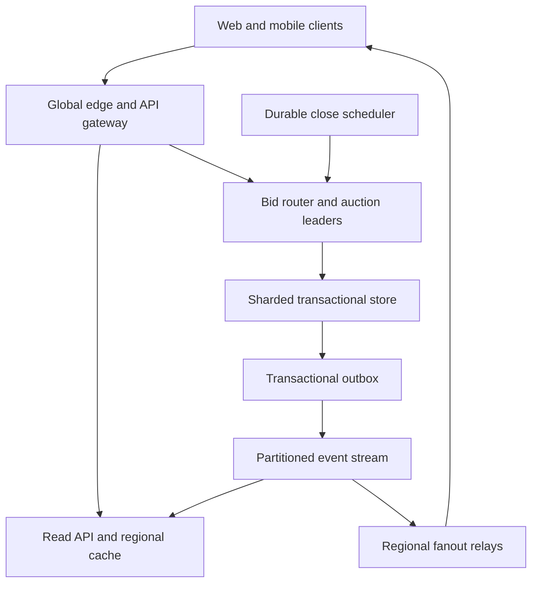
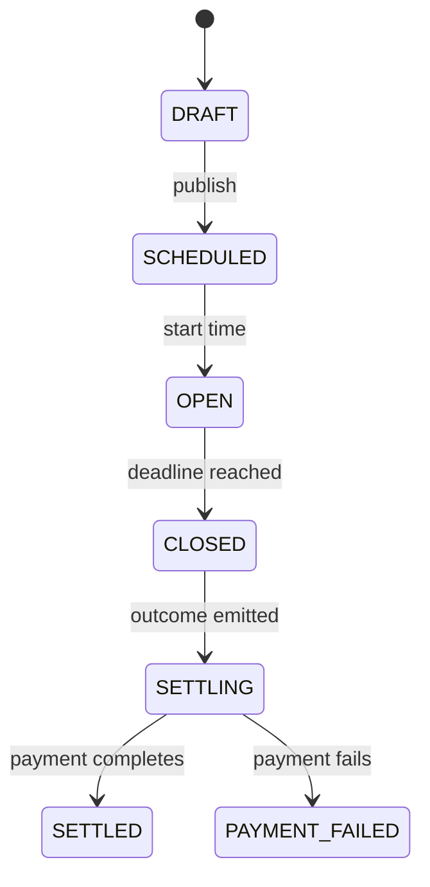

# Design a Real-Time Online Auction Platform

**Difficulty:** Senior / Staff  
**Primary themes:** hot-key serialization, transactional correctness, event ordering, real-time fanout, caching, timers, reliability

## Interviewer prompt

> Design an online auction platform where sellers list timed auctions and buyers place bids. Buyers should see the current price update in near real time, and when an auction ends the system must select exactly one winner. Some auctions may attract a million concurrent viewers and a burst of bids in the final seconds.

## Targeted clarifying questions

**Candidate:** Are these English auctions, where the price rises and the highest bidder wins?

**Interviewer:** Yes. Support automatic, or proxy, bidding: a buyer submits a private maximum, and the system raises their visible bid only as much as needed to lead.

**Candidate:** Do auctions have a fixed ending time, a reserve price, and a minimum increment?

**Interviewer:** Yes. The end time is fixed. A seller may set a private reserve. The increment is defined when the auction is created. Do not add anti-sniping extensions in the initial design.

**Candidate:** Which operations matter most?

**Interviewer:** Sellers create and publish auctions; buyers browse and watch them; authenticated buyers submit maximum bids; the platform closes auctions and names a winner. Payment capture and shipping can be asynchronous follow-on workflows.

**Candidate:** Can bids be retracted or edited?

**Interviewer:** Not by buyers. Administrative corrections are out of scope, but retain an immutable audit history.

**Candidate:** What scale and latency should I design for?

**Interviewer:** Assume 100 million daily active users, 10 million concurrent viewers globally, 100,000 bid attempts per second at peak, and as many as 20,000 attempts per second on one exceptional auction during its final seconds. A hot auction can have one million connected viewers. Auction reads should be under 200 ms at p99, bid decisions under 300 ms at p99, and visible-price updates should normally reach connected viewers within one second.

**Candidate:** What is the correctness contract?

**Interviewer:** For one auction, accepted bids and closing must have one authoritative order. Never accept a bid after the deadline, never produce two winners, and make retries safe. Browse/search results may be eventually consistent.

**Candidate:** Is multi-region support expected?

**Interviewer:** Yes. Reads and live connections should be close to users, but it is acceptable to route bids for an auction to one home region to preserve correctness.

**Candidate:** May I treat identity, payment authorization, fraud scoring, and seller verification as existing services?

**Interviewer:** Yes. Call them where needed, but focus on auction state and delivery.

## How to pace the interview

In a 45-minute interview, spend roughly 5 minutes on requirements, 2 on entities, 5 on interfaces, 10–15 on the high-level design, and the remaining 10–15 on the hardest tradeoffs. This follows the sequencing in Hello Interview's [System Design Delivery Framework](https://www.hellointerview.com/learn/system-design/in-a-hurry/delivery): establish scope, produce the simplest complete design, and then harden it in deep dives. The educational walkthrough below is intentionally more detailed than what you would say aloud.

---

## 1. Requirements (~5 minutes)

### Functional requirements

Prioritize three user-visible capabilities:

1. **Create and publish an auction.** A seller provides item details, start/end times, opening price, minimum increment, and optional reserve.
2. **Browse and watch an auction.** A buyer reads the current public state and can subscribe to price, leader-status, and close updates.
3. **Bid and close correctly.** An authenticated buyer submits a private maximum. The system computes the public price, acknowledges the bid, and selects one winner at the deadline.

Payment capture, refunds, shipping, recommendations, full-text search internals, and administrative bid reversal are outside the core design. We will emit events for those systems.

### Non-functional requirements

| Property | Target | Why it matters |
|---|---:|---|
| Read availability | 99.99% | Browsing should survive regional or cache failures. |
| Bid-path availability | 99.95% | Bids are important, but correctness beats accepting a bid during an unsafe partition. |
| Read latency | p99 < 200 ms | Auction pages should feel interactive. |
| Bid decision latency | p99 < 300 ms normally | A bidder needs a definitive accepted/rejected result, not merely a queued receipt. |
| Live propagation | p99 < 1 s | Watchers should converge quickly to the latest public revision. |
| Durability | No acknowledged bid loss | An accepted response is returned only after durable commit. |
| Ordering | Total order per auction | Bids and close form a single history for that auction; no global order is required. |

### Consistency and availability contract

- **Bid and close state is strongly consistent per auction.** During a network partition, the auction's home-region quorum may reject or time out writes rather than create conflicting winners.
- **Public reads are eventually consistent and revisioned.** A page can briefly show an older price, but it never applies revision 104 after revision 105.
- **The bid response is authoritative.** A stale page does not authorize an invalid bid; the server evaluates every request against committed state.
- **Read-your-write for the bidder** comes from the bid response and subsequent reads pinned to at least the returned `revision`.

**What to say aloud:**

> “I am drawing the consistency boundary around a single auction. Bids and the close transition need one serial order, while browse and fanout can be eventually consistent. That lets me keep the money-sensitive path correct without forcing every viewer through the leader.”

### Scale estimates that change the design

Assumptions:

- 100,000 bid attempts/s globally at peak.
- 20,000 attempts/s can target one auction.
- One million watchers may subscribe to one auction.
- A public update is about 250 bytes after framing and metadata.
- 10 million auctions close per day, with a 10× peak around popular time boundaries.

Consequences:

1. **The hot auction is the write bottleneck.** Hash-sharding auctions handles the global 100,000/s, but it cannot split one auction across independent writers because its bids contend on one state. That auction needs a single logical sequencer, aggressive validation, batching, and admission control.
2. **Direct fanout is infeasible.** One 250-byte update sent to one million viewers is 250 MB of egress. At 10 visible updates/s, that is 2.5 GB/s from one source. We need hierarchical regional relays, and we should publish only public-state changes—not every private maximum.
3. **Closing needs a distributed timer mechanism.** Ten million closes/day average only about 116/s, but a 10× boundary peak is roughly 1,200/s. A durable time-indexed queue or bucketed scheduler is sufficient; scanning every auction is not.

---

## 2. Core entities (~2 minutes)

Name entities before choosing tables. That keeps the model tied to behavior.

| Entity | Essential fields | Purpose |
|---|---|---|
| `Auction` | `auction_id`, `seller_id`, `status`, `starts_at`, `ends_at`, `opening_price_minor`, `reserve_minor`, `increment_minor`, `home_region`, `revision` | Authoritative lifecycle and policy. |
| `Item` | `item_id`, `auction_id`, `title`, `description`, `media_keys` | Listing content, cached separately from volatile price state. |
| `BidIntent` | `bid_id`, `auction_id`, `bidder_id`, `max_amount_minor`, `received_at`, `idempotency_key`, `decision`, `revision` | Immutable private audit record. |
| `BidderMax` | `auction_id`, `bidder_id`, `max_amount_minor`, `first_reached_at` | Highest accepted proxy maximum for each bidder. |
| `AuctionState` | `auction_id`, `leader_id`, `leader_max_minor`, `runner_up_max_minor`, `visible_price_minor`, `bid_count`, `revision` | Compact state updated on the serialized path. |
| `Outcome` | `auction_id`, `winner_id`, `final_price_minor`, `reserve_met`, `closed_at`, `revision` | Unique final result and settlement trigger. |
| `OutboxEvent` | `event_id`, `auction_id`, `revision`, `type`, `payload`, `published_at` | Reliably bridges database commits to streams. |

All monetary values are integer minor units plus a currency, never floating-point numbers. The public read model omits bidder maximums and the reserve.

**What to say aloud:**

> “I need an immutable bid intent for audit, a compact mutable auction state for fast decisions, and a monotonically increasing revision that lets caches and WebSocket clients reject stale updates.”

---

## 3. API and system interfaces (~5 minutes)

The API gateway validates the access token and derives `seller_id` or `bidder_id` from authentication. A caller cannot supply another user's identity in a request body. Sketch only the operations that map to the requirements; Hello Interview's [API guidance](https://www.hellointerview.com/learn/system-design/core-concepts/api-design) similarly recommends keeping this phase compact.

### Create and publish

```http
POST /v1/auctions
Authorization: Bearer <token>
Idempotency-Key: create-7f8...
Content-Type: application/json

{
  "title": "Vintage chronograph",
  "currency": "USD",
  "opening_price_minor": 10000,
  "reserve_minor": 40000,
  "increment_minor": 1000,
  "starts_at": "2026-10-20T18:00:00Z",
  "ends_at": "2026-10-20T20:00:00Z",
  "media_keys": ["upload/abc/front.jpg"]
}
```

```json
{
  "auction_id": "auc_01K...",
  "status": "SCHEDULED",
  "revision": 1
}
```

Publishing can be a separate `POST /v1/auctions/{auction_id}/publish` so drafts are not accidentally visible. Only the authenticated owner may publish.

### Read and browse

```http
GET /v1/auctions/auc_01K...
```

```json
{
  "auction_id": "auc_01K...",
  "status": "OPEN",
  "title": "Vintage chronograph",
  "visible_price_minor": 26000,
  "currency": "USD",
  "minimum_next_bid_minor": 27000,
  "ends_at": "2026-10-20T20:00:00Z",
  "bid_count": 42,
  "viewer_is_leading": false,
  "revision": 87
}
```

Browse uses a cursor, not a page number:

```http
GET /v1/auctions?category=watches&status=OPEN&sort=ending_soon&cursor=...
```

Search results are explicitly allowed to lag authoritative state. Clicking a result fetches the latest auction view.

### Submit a proxy maximum

```http
POST /v1/auctions/auc_01K.../bids
Authorization: Bearer <token>
Idempotency-Key: bid-019a...
Content-Type: application/json

{
  "max_amount_minor": 50000,
  "currency": "USD",
  "observed_revision": 87
}
```

```json
{
  "bid_id": "bid_01K...",
  "decision": "ACCEPTED_LEADING",
  "visible_price_minor": 31000,
  "minimum_next_bid_minor": 32000,
  "viewer_is_leading": true,
  "revision": 88,
  "server_received_at": "2026-10-20T19:59:57.241Z"
}
```

Possible decisions include `ACCEPTED_LEADING`, `ACCEPTED_OUTBID`, `REJECTED_TOO_LOW`, `REJECTED_CLOSED`, and `REJECTED_INELIGIBLE`. `observed_revision` is advisory: the server may warn that the client was stale, but it still evaluates the maximum against current authoritative state. The idempotency key is mandatory and scoped to `(auction_id, bidder_id)`.

### Subscribe to live public state

```json
{
  "action": "subscribe",
  "auction_id": "auc_01K...",
  "after_revision": 87
}
```

```json
{
  "type": "auction_state",
  "auction_id": "auc_01K...",
  "status": "OPEN",
  "visible_price_minor": 31000,
  "bid_count": 43,
  "revision": 88
}
```

WebSocket is a practical bidirectional, long-lived transport standardized by [RFC 6455](https://datatracker.ietf.org/doc/html/rfc6455). Server-sent events would also work because the update stream is mostly server-to-client; choosing between them does not change the correctness path.

---

## 4. Data flow

### Proxy-bid example

Suppose the opening price is $100 and the increment is $10.

1. Alice submits a private maximum of $200. She leads; the visible price remains $100.
2. Bob submits $150. Alice still leads; the visible price becomes $160—Bob's maximum plus one increment, capped by Alice's maximum.
3. Carol submits $250. Carol leads; the visible price becomes $210—Alice's maximum plus one increment.
4. If two bidders reach the same maximum, the earlier accepted maximum wins the tie.

The general visible-price rule is approximately `min(highest_max, second_highest_max + increment)`, bounded below by the opening price. Production code must also define ties, a bidder raising their own maximum, increment schedules, and reserve display policy.

### Bid-to-viewer flow

1. The edge authenticates, rate-limits, validates currency/shape, and records an authoritative server receipt time.
2. The auction router maps `auction_id` to its home shard and current fenced leader.
3. The leader processes the command in the auction's serial order.
4. One transaction inserts `BidIntent`, updates `BidderMax` and `AuctionState`, increments `revision`, and inserts an `OutboxEvent`.
5. The service returns the committed decision to the bidder.
6. An outbox publisher sends the public state change, keyed by `auction_id`, to the event stream.
7. Regional fanout relays update connected viewers. Read-model consumers update caches and search asynchronously.

---

## 5. High-level design (~10–15 minutes)

Start with the smallest complete system and add one operation at a time.



### Operation 1: create and publish an auction

The write API validates seller eligibility and stores `Auction` and `Item` in a relational database. An auction begins as `DRAFT`, then moves to `SCHEDULED` or `OPEN` after publishing. A unique constraint on `(seller_id, idempotency_key)` makes retries safe.

The transactional database is a good baseline because creation touches related records and lifecycle transitions need constraints. Large descriptions and images live in object storage; the database stores metadata and object keys. A CDN serves media.

Publishing also creates a durable close-schedule entry keyed by a time bucket such as minute plus `ends_at`. The scheduler is not the authority on whether an auction may close; it only delivers a close command.

### Operation 2: browse and read

A change-data-capture or outbox consumer builds a denormalized browse index containing public fields such as category, title, thumbnail, status, visible price, and end time. The browse API queries this index and tolerates seconds of lag.

For an auction detail page:

1. The regional read API checks a cache keyed by `auction_id`.
2. On a miss, it reads a nearby replica or materialized view.
3. The response includes `revision` and a short cache TTL, for example 1–3 seconds on open auctions and longer after close.
4. Personalized fields such as `viewer_is_leading` come from an authenticated overlay, not a shared public cache.

Static item data and volatile auction state use separate cache keys. A price update should not invalidate a large description or image manifest.

### Operation 3: place a bid

The router consistently hashes `auction_id` to a shard, then resolves the shard's current leader. Each auction has one logical writer at a time. The baseline implementation can be a service instance that holds a short-lived lease and performs a row lock or compare-and-swap transaction against the database.

Inside the transaction:

1. Read the auction and compact state; verify `OPEN` and `server_received_at < ends_at`.
2. Look up `(auction_id, bidder_id, idempotency_key)`. If present, return the original decision.
3. Validate bidder eligibility and maximum amount.
4. Update that bidder's maximum if the new one is higher.
5. Recompute leader, runner-up, public price, and bid count deterministically.
6. Insert the immutable intent and public outbox event; increment `revision`.
7. Commit before acknowledging acceptance.

The outbox prevents the dual-write bug where the database commits but publishing fails. A worker repeatedly publishes unpublished rows; downstream consumers deduplicate by `event_id` or `(auction_id, revision)`.

### Operation 4: close the auction

At or after `ends_at`, the scheduler sends `CloseAuction(auction_id, expected_ends_at)` to the same leader used for bids. The leader serializes this command with bid commands and executes a conditional transition:

```sql
UPDATE auctions
SET status = 'CLOSED', revision = revision + 1
WHERE auction_id = :id
  AND status = 'OPEN'
  AND ends_at = :expected_ends_at
  AND database_now() >= ends_at;
```

In the same transaction, it creates one `Outcome` row protected by a unique key on `auction_id` and emits `AuctionClosed`. If the highest maximum meets the reserve, the leader becomes the winner at the computed final price; otherwise the outcome records no sale. Settlement consumes this event asynchronously.

**What to say aloud:**

> “The scheduler can fire twice or late; correctness comes from routing close through the same serialization point as bids and from the conditional database transition. The unique outcome row makes repeated close commands harmless.”

---

## 6. Deep dives (~10–15 minutes)

### Deep dive A: serialize bids on one extremely hot auction

#### Where the baseline breaks

A conventional transaction per request with a row lock works for ordinary auctions, but 20,000 attempts/s against one row creates lock queues, connection pressure, and retry storms. Adding database shards does not help because all commands for that auction still touch the same correctness boundary.

#### Plausible approaches

| Approach | Strength | Weakness |
|---|---|---|
| Serializable database transactions | Simple source of truth; database detects unsafe interleavings | A hot row creates aborts or waiting; clients must retry serialization failures. |
| Optimistic compare-and-swap on `revision` | No long lock hold; easy for low contention | Under hot contention, most writers lose and retry, amplifying load. |
| Pessimistic row lock | Straightforward order inside one database leader | Throughput is bounded by transaction round trips and lock queueing. |
| Per-auction actor/sequencer | Natural single-threaded order; can batch commands | Requires ownership, fencing, recovery, and durable state discipline. |

PostgreSQL documents that serializable execution may abort transactions and requires retrying them, which is safe but unattractive under deliberate hot-key contention ([transaction isolation](https://www.postgresql.org/docs/current/transaction-iso.html)). I would therefore evolve the hottest auctions to a **fenced per-auction sequencer** while retaining the transactional store as durable truth.

#### Selected design

- The shard coordinator grants a lease with monotonically increasing `leader_epoch`.
- Routers send all commands for an auction to that owner. Stale owners cannot commit because every write includes the epoch and the store rejects an older one.
- The owner keeps compact auction state in memory, appends commands/results to a replicated log or commits micro-batches transactionally, and returns only after durability.
- Commands within a 1–5 ms window can be batched into one durable write while still receiving deterministic sequence numbers.
- Invalid traffic is rejected before the sequencer: malformed values, blocked accounts, duplicate idempotency keys found in a fast cache, and per-account rate-limit violations.

Kafka-style partitioning is useful for downstream events because events with the same key remain ordered within one partition ([Kafka documentation](https://kafka.apache.org/documentation/)). It is not, by itself, the user-facing bid commit: merely enqueueing a bid cannot promise that it beat the deadline or another maximum. The authoritative response must come from the state machine that decided it.

#### Failure modes

- **Leader crash after commit but before response:** the retry returns the stored result using the idempotency key.
- **Two leaders after a partition:** the fencing epoch lets only the current leader commit.
- **Batch partially fails:** the whole database batch rolls back, or a replicated log replays commands by sequence number.
- **Overload:** bound each auction's queue. Return `429` or `503` with a retry hint before a request's deadline budget expires. Never claim acceptance for an undecided command.
- **Malicious maximum discovery:** responses reveal public price and the caller's status, never another bidder's maximum or the private reserve.

**What to say aloud:**

> “A hot key is not solved by adding shards. I can distribute different auctions, but one auction needs one logical order. I will use a fenced owner, batch a few milliseconds of commands, and durably decide each request before responding.”

### Deep dive B: make the deadline and winner exact

#### Where the baseline breaks

Application timers can fire late, twice, or not at all. Machines have clock skew. A bid can reach one edge before the deadline but reach the home region afterward. During failover, an old leader may continue processing. If we let the timer service directly write `CLOSED`, it can race a bid transaction.

#### Define the contract first

Use **authoritative server receipt time at the auction's home ingress**, not the client's clock. A bid is eligible only if it has passed authentication and is admitted to the home-region command stream before `ends_at`. This is explainable and auditable, though geographic latency is a product fairness tradeoff.

Alternative contracts include client timestamps, global edge timestamps, or processing time at the sequencer. Client time is forgeable. Trusted edge time reduces geographic disadvantage but requires authenticated, signed timestamps plus bounded edge-to-home delay. For an interview baseline, home-ingress time is safer; a later iteration could use trusted edge receipts.

#### Selected design

1. Store times in UTC and use a synchronized clock service; alert on clock offset.
2. The close scheduler uses time buckets and a durable lease. It may deliver at least once.
3. Bids and `CloseAuction` enter the same per-auction state machine.
4. The state machine rejects every bid whose trusted receipt time is `>= ends_at`, even if close has not yet run.
5. Close may execute only when the authoritative database clock is at or beyond `ends_at`.
6. The `OPEN -> CLOSED` transition and unique `Outcome` insert are atomic.
7. A reconciliation worker finds auctions still open past their deadline and resubmits close commands.

This separates **safety** from **liveness**: the receipt-time rule prevents late acceptance even if the timer is delayed; retries and reconciliation ensure the auction eventually closes.

The state machine is:



Do not silently award the item to the runner-up after a payment failure; that is a separate product policy and creates legal and user-experience implications. Record the winner immutably, then run an explicit resolution workflow.

#### Optional anti-sniping evolution

If the product later extends an auction by two minutes when a bid arrives in its last 30 seconds, the leader updates `ends_at`, increments `revision`, and emits `AuctionExtended` in the same accepted-bid transaction. Old close jobs carry `expected_ends_at` and become no-ops, while a new durable job is scheduled.

**What to say aloud:**

> “The timer does not establish correctness. It only nudges the state machine. Late bids are rejected by an invariant on trusted receipt time, and close is an idempotent transition serialized with bids.”

### Deep dive C: broadcast to one million viewers without harming bids

#### Where the baseline breaks

If the bid leader writes directly to every socket, slow consumers and network work steal CPU from bid decisions. A reconnect wave can also turn one auction into millions of read requests. Broadcasting every private bid attempt leaks information and produces unnecessary traffic.

#### Plausible approaches

- **Polling:** simple and cacheable, but one million viewers polling every second means one million requests/s and still produces stale windows.
- **One central WebSocket fleet:** workable at moderate scale, but cross-region latency and a hot channel concentrate egress.
- **Hierarchical pub/sub:** more components, but regional relays replicate one event into many local connections and isolate slow clients.

Choose hierarchical pub/sub.

#### Selected design

1. Commit an outbox event only when public state changes. A bidder increasing an already-winning hidden maximum may create an audit record without a public-price broadcast.
2. Partition the event stream by `auction_id`; each event carries the authoritative `revision`.
3. A global distributor sends one copy per active region, not one per socket.
4. Regional channel relays maintain subscriptions and fan out locally across many gateway nodes.
5. Clients apply only higher revisions. If a client sees a gap, it requests a compact current snapshot rather than replaying every intermediate price.
6. Gateways use bounded per-connection buffers. A slow client receives a `resync_required` marker and the latest snapshot; the system does not retain an unbounded queue.
7. On reconnect, add jitter and exponential backoff. The gateway can answer from a regional last-known-state cache to avoid a thundering herd on the database.

Coalescing is safe for public state: a viewer may move directly from revision 88 to 94 if it receives a complete snapshot for 94. It is not safe for the immutable audit stream, which retains every accepted intent.

#### Cache consistency

- Consumers update a cache only when `incoming_revision > cached_revision`.
- A short TTL repairs missed invalidations.
- The close event is retained longer and the final page can be cached aggressively because it is immutable.
- The bidder's private leading status is obtained from an authenticated endpoint or sent only on that bidder's connection; it never enters the public channel.

#### Fanout observability

Track end-to-end propagation from commit time to regional relay and sampled client acknowledgement. Alert on p99 age, revision gaps, relay queue depth, dropped/coalesced updates, connection churn, and resync rate. Bid latency can look healthy while viewers are minutes behind, so application-level freshness is more useful than socket count alone.

**What to say aloud:**

> “I will decouple durable decisions from best-effort live delivery. Revisions let relays coalesce safely, detect gaps, and refresh a snapshot, so a slow viewer never applies state backward or backpressures the bid leader.”

---

## Reliability, security, and operations

### Multi-region strategy

- Assign each auction a home region at creation, normally near the seller or expected demand.
- Route all bids and close commands there. Replicate public state globally for reads.
- Keep a synchronous quorum across availability zones within the region. Asynchronously replicate to a disaster-recovery region.
- On regional disaster, promote only after fencing the old region. This may pause bidding briefly; that is preferable to split-brain winners.
- For a long outage, product policy may cancel or extend affected auctions. The system must not pretend continuous acceptance when it cannot prove order.

### Abuse and authorization

- Sellers cannot bid on their own auctions; enforce this in the authoritative transaction.
- Apply per-account, per-device, and per-auction rate limits. Use behavioral signals for bot and shill-bidding detection.
- Keep public and private schemas separate so reserve prices and maximums cannot leak through cache keys, logs, analytics, or fanout payloads.
- Encrypt data in transit and at rest; tightly audit administrative access.
- Sign service-to-service commands and validate currency, integer bounds, and overflow.

### Observability and reconciliation

Use structured logs and traces keyed by `auction_id`, `bid_id`, `revision`, and `leader_epoch`. Never log raw private maximums in general application logs.

Key metrics:

- bid decision latency and rejection reason;
- per-auction queue depth and hottest-key throughput;
- transaction conflicts, leader changes, and fence rejections;
- outbox age, stream consumer lag, cache revision lag, and fanout freshness;
- close lateness (`closed_at - ends_at`) and open-past-deadline count;
- duplicate idempotency hits and response recovery after timeouts;
- outcome/settlement mismatch counts.

Periodic jobs verify that every acknowledged bid has an immutable record, every closed auction has exactly one outcome, no bid revision exceeds the close revision, and every outbox row is published. These checks turn silent corruption into an actionable incident.

---

## 7. Concise final design

Each auction is assigned to a home shard and has one fenced logical leader. Sellers create auctions in a transactional store; a durable scheduler later sends idempotent open/close commands. Buyers read from regional caches and subscribe through hierarchical WebSocket relays. Bid requests are authenticated at the edge, routed to the auction leader, and serialized with close. A transaction stores the immutable bid intent, updates bidder maxima and compact public state, advances a revision, and writes an outbox event before replying. The event stream updates caches, search, regional fanout, analytics, and settlement. Reads favor availability; bids and winner selection favor per-auction consistency. Revisions, idempotency keys, fencing epochs, unique outcomes, and reconciliation make retries and failures safe.

## Requirements check

| Requirement | How the design satisfies it |
|---|---|
| Create and publish | Transactional auction/item write, idempotent create, durable close schedule. |
| Browse and watch | Search index, regional caches, CDN media, hierarchical live fanout. |
| Proxy bidding | Private bidder maxima plus deterministic leader/runner-up computation. |
| Exact close and one winner | Bids and close share a serialized state machine; conditional transition and unique outcome. |
| 20,000 attempts/s hot auction | Fenced owner, early rejection, micro-batching, bounded admission. |
| One million viewers | Per-region replication and local relay fanout; snapshots and coalescing. |
| No acknowledged bid loss | Commit or replicated-log durability before the response. |
| High read availability | Multi-region read models and caches independent of the write leader. |
| Auditable behavior | Immutable intents, revisions, receipt times, outcomes, and reconciliation. |

## Realistic interviewer follow-ups and strong sample answers

### “Why not put every bid into Kafka and let a consumer decide later?”

> “Kafka can preserve order for one auction when it is consistently keyed to one partition, but an enqueue acknowledgement is not the product's bid decision. The user needs to know whether the maximum was valid, before the deadline, and leading. I can use a replicated log inside the sequencer, but I respond only after the state machine durably decides the command.”

### “Can one logical writer really handle 20,000 requests per second?”

> “The state transition is small and in memory; the expensive part is durability. I would reject duplicates and invalid traffic before the owner, micro-batch a few milliseconds of commands into sequential durable writes, and broadcast only public changes. If measurement still shows saturation, I cannot safely split the auction's order, so I shed load explicitly or change the product—for example, admission tokens—rather than create multiple conflicting writers.”

### “What happens if the client times out after placing the winning bid?”

> “The client retries with the same idempotency key. If the first request committed, the service returns its stored `bid_id`, decision, and revision. If it did not commit, the retry is evaluated as a new command. There is no ambiguous duplicate maximum.”

### “How do you handle two equal maximums?”

> “The first accepted maximum wins the tie. I persist a server-assigned sequence or `first_reached_at` from the serialized state machine, so the result is deterministic and replayable.”

### “Would you use active-active writes across regions?”

> “Not for one auction. Conflict resolution after the fact cannot correctly invent a single deadline order or undo two winner notifications. I use active-active edges and reads, but a single home-region write authority with cross-zone quorum. Regional failover is fenced and may trade availability for correctness.”

### “How would you make bidding geographically fairer?”

> “Home-region receipt time favors nearby users. A stronger product can timestamp at trusted global edges, sign the receipt, enforce bounded forwarding delay, and have the sequencer order first by verified receipt time and then by a deterministic tie-breaker. That adds clock and delayed-delivery complexity, so I would define the fairness contract explicitly and test it before adopting it.”

### “What if live events arrive out of order?”

> “Every public state has a monotonic per-auction revision. Clients discard lower revisions. On a gap or reconnect, they fetch the latest snapshot. Because the message is full state rather than a non-idempotent delta, jumping forward is safe.”

### “How would anti-sniping change the design?”

> “An accepted near-deadline bid would update `ends_at` in the same transaction as auction state and emit a new revision. The old close job includes the prior expected deadline and becomes a no-op; a new job is scheduled. The core serialization point does not change.”

### “What happens when the winner's payment fails?”

> “Closing produces an immutable auction outcome and starts a settlement saga. A failed payment moves settlement to an explicit failure state and notifies operations or the seller. I would not silently mutate history or award the item to the runner-up unless the product defines and communicates that policy.”

## Common pitfalls

- Treating the page's displayed price as authoritative when accepting a bid.
- Saying “use a queue” without explaining where the synchronous accepted/rejected decision occurs.
- Assuming more shards solve one auction's hot key.
- Letting the timer service race bid writers or trusting a client timestamp.
- Acknowledging before durability, then losing a winning bid on crash.
- Omitting idempotency and creating duplicate bids after a timeout.
- Publishing directly from application code without an outbox, creating database/stream divergence.
- Broadcasting private maxima or the reserve price.
- Sending every attempt to every viewer instead of only public state changes.
- Using an unbounded WebSocket buffer for slow clients.
- Ignoring revision ordering, leader fencing, clock skew, or close reconciliation.
- Spending interview time on payments, shipping, recommendations, or image processing before completing the bidding path.

## A polished 60-second wrap-up

> “My design makes the auction—not the whole platform—the unit of consistency. Each auction has one fenced home-region leader that serializes bid and close commands, computes proxy bidding deterministically, and commits the intent, state revision, and outbox event before replying. Read models, search, caches, and regional WebSocket relays consume that event asynchronously, so millions of viewers do not touch or backpressure the correctness path. Deadline safety comes from trusted server receipt time and an invariant that rejects late bids; the at-least-once timer only drives an idempotent close transition. Idempotency keys, fencing epochs, unique outcomes, revisions, and reconciliation cover retries and failures. The main tradeoff is pausing writes during an unsafe regional partition to avoid split-brain winners, while keeping browse and live reads highly available.”

