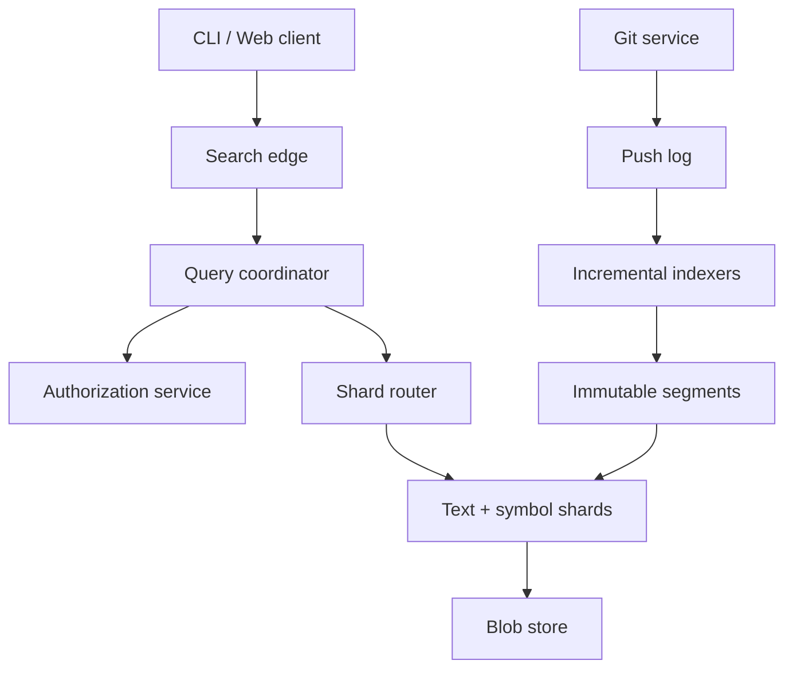

# Design a Large-Scale Source Code Search and Cross-Reference Platform

**Difficulty:** Senior / Staff  
**Primary themes:** immutable indexes, substring and regex search, incremental pipelines, authorization, caching, queues, snapshot consistency

This is a 45-minute interview plan followed by a fuller educational walkthrough. In an actual interview, keep the opening sections tight: roughly 5 minutes on requirements, 2 on entities, 5 on interfaces, 10–15 on the working design, and 10–15 on the most important deep dives. The fuller explanation below is deliberately longer so you can study the reasoning.

The delivery follows Hello Interview’s public pattern of clarifying requirements, naming core entities, defining interfaces, building the high-level design one requirement at a time, and then deep-diving on the hardest constraints. Their public walkthroughs also recommend asking about scale before committing to architecture. See [Hello Interview’s job scheduler walkthrough](https://www.hellointerview.com/learn/system-design/problem-breakdowns/job-scheduler) and [API design reference](https://www.hellointerview.com/learn/system-design/core-concepts/api-design/quick-reference). The problem and solution here are original.

## Interviewer prompt

> Design a source code search platform for a large Git hosting service. Developers should be able to search public and private repositories, run exact-text and regular-expression queries, and navigate from a symbol to its definition and references.

## Targeted clarifying questions

**Candidate:** “Are we searching only the latest default branch, or arbitrary branches and historical commits?”

**Interviewer:** “Optimize global search for each repository’s latest default-branch snapshot. A user may request an exact branch or commit within one repository, but full historical global search is out of scope.”

**Candidate:** “Which query modes matter?”

**Interviewer:** “Literal substring, safe regular expressions, file and language filters, repository or organization filters, and symbol definition/reference lookup. Fuzzy natural-language search is out of scope.”

**Candidate:** “How fresh must results be after a push?”

**Interviewer:** “Ordinary global search should reflect 95% of pushes within 60 seconds. After pushing, a developer searching that repository should see the new commit within 5 seconds.”

**Candidate:** “What are the security expectations for private repositories?”

**Interviewer:** “Strict. Search results, snippets, result counts, suggestions, timing, and caches must not reveal unauthorized repositories. Permission revocation should take effect within 10 seconds.”

**Candidate:** “What scale should I design for?”

**Interviewer:** “Assume 50 million searchable default-branch repositories, 5 billion files, 200,000 search queries per second at peak, and 100,000 repository updates per second at peak. Most repositories are small, but a few monorepos are enormous.”

**Candidate:** “Should symbol navigation be semantically perfect across every language?”

**Interviewer:** “No. Support precise navigation for a set of major languages and best-effort syntax-based results elsewhere. Text search must remain available even if semantic indexing lags.”

**Candidate:** “May we restrict regex features?”

**Interviewer:** “Yes. Safety and predictable latency matter more than full PCRE compatibility.”

**Candidate summary aloud:**

> “I’ll optimize global search for an immutable default-branch snapshot per repository, add an exact-repository freshness path for recent pushes, and treat authorization as a correctness boundary. I’ll first make literal search work, then add regex and symbol navigation, and finally deep-dive on index layout, freshness, and permission safety.”

---

## 1. Requirements (~5 minutes)

### Core functional requirements

1. **Search code:** Search authorized repositories by literal substring or safe regex, with repository, organization, path, and language filters; return ranked matches and line snippets.
2. **Navigate symbols:** Find a symbol’s definition and references for supported languages, while clearly labeling best-effort results.
3. **Stay fresh:** Ingest pushes, incrementally index changed files, and expose a consistent repository snapshot without taking search offline.

### Quantified non-functional requirements

- **Latency:** p99 under 500 ms for bounded literal searches and under 1 second for bounded regex or symbol queries.
- **Availability:** 99.99% monthly availability for searches. Indexing may lag without making the last complete snapshot unavailable.
- **Freshness:** 95% of pushes visible globally within 60 seconds; repository-scoped read-after-push within 5 seconds.
- **Security:** zero unauthorized snippets, paths, counts, or autocomplete terms; revocations enforced within 10 seconds.
- **Scale:** 200,000 peak search QPS, 100,000 update events/s, 50 million repositories, and 5 billion files.

### Consistency and availability contract

Search results are **snapshot-consistent within a repository**: every result from repository `R` is evaluated against one committed index generation tied to a Git commit. A global result page may contain different commit times across repositories because indexing is asynchronous.

The system is **eventually consistent with pushes**, subject to the freshness targets. A repository-scoped query from the pusher may include a recent-delta overlay to provide read-after-push behavior. Authorization is different: it is checked against a current or conservatively cached permission epoch, and uncertainty fails closed. During a partition, stale code results may be served from the last complete authorized snapshot, but stale permissions may not.

### Explicitly out of scope

- Editing, cloning, pull-request review, and build execution
- Global search over every historical commit
- Natural-language or embedding-based semantic search
- Full compiler-quality semantics for every language
- Searching generated binaries or files above a configured size limit

### Scale estimates that change the design

Assume an average indexed text file is 12 KB after excluding binaries, generated artifacts, vendored dependencies, and very large files.

`5 billion files × 12 KB ≈ 60 PB` of logical source text.

We should not fan out to raw blob scans. Even scanning only 0.01% per query would touch roughly 6 TB. We need a candidate-producing index.

At 200,000 QPS and an average of 20 index-shard requests per query, the internal system sees roughly:

`200,000 × 20 = 4 million shard RPCs/s`.

That makes bounded fanout, locality-aware routing, aggressive query planning, and caching material design requirements.

For updates, suppose only 20% of the 100,000 repository events/s change searchable files and each such event changes 4 files on average:

`100,000 × 20% × 4 = 80,000 changed files/s`.

This makes incremental blob-level reuse practical; full repository reindexing would be wasteful, especially for monorepos.

**What I would say aloud:**

> “The estimates rule out scanning and full reindexing. I need an inverted candidate index for reads and a content-addressed incremental pipeline for writes. I’ll keep the committed index immutable so a failed update cannot corrupt the serving snapshot.”

---

## 2. Core entities (~2 minutes)

Name the essential nouns before designing tables:

| Entity | Purpose | Important fields |
|---|---|---|
| `Repository` | Search and authorization boundary | `repo_id`, `owner_id`, `visibility`, `default_ref`, `acl_epoch` |
| `CommitSnapshot` | Immutable searchable view | `repo_id`, `commit_sha`, `generation_id`, `created_at`, `state` |
| `FileManifestEntry` | Maps a path in a snapshot to content | `generation_id`, `path`, `blob_id`, `language`, `size`, `is_searchable` |
| `Blob` | Deduplicated source content | `blob_id`, `content_uri`, `byte_length`, `encoding` |
| `TextPosting` | Candidate locations for a gram | `gram`, `shard_id`, compressed `(repo, blob, offsets)` postings |
| `Symbol` | Definition in a supported language | `symbol_id`, `qualified_name`, `kind`, `definition_location` |
| `Reference` | Use of a symbol | `symbol_id`, `source_location`, `resolution_confidence` |
| `IndexGeneration` | Atomically published shard set | `generation_id`, `repo_id`, `commit_sha`, `segment_uris`, `status` |
| `IndexJob` | Durable ingestion work | `job_id`, `repo_id`, `commit_sha`, `attempt`, `lease_until`, `state` |

`blob_id` is a content hash, so identical file contents can share parsing and indexing work. Git itself is built around content-addressed objects, which supports this model; the [Git object documentation](https://git-scm.com/book/en/v2/Git-Internals-Git-Objects) describes Git as a content-addressable filesystem.

Do not introduce every physical table yet. The schema evolves beside the component that needs it.

---

## 3. API and system interface (~5 minutes)

Authentication middleware validates the session or token and creates an `AuthContext` containing `principal_id`, organization memberships, roles, and a permission epoch. Clients never supply `user_id` in request bodies.

### Search code

```http
POST /v1/code-search
Authorization: Bearer <token>
Content-Type: application/json

{
  "query": "RetryPolicy",
  "mode": "literal",
  "filters": {
    "org": ["acme"],
    "repo": [],
    "language": ["go", "typescript"],
    "path_prefix": ["src/"]
  },
  "limit": 50,
  "cursor": null
}
```

```json
{
  "matches": [
    {
      "repo": "acme/payments",
      "path": "src/retry/policy.go",
      "commit": "7fd31a9",
      "line": 42,
      "snippet": "type RetryPolicy struct {",
      "highlights": [[5, 16]]
    }
  ],
  "next_cursor": "opaque-query-state",
  "partial": false,
  "indexed_through": "2026-10-16T23:58:10Z"
}
```

The cursor binds the normalized query, shard continuation positions, authorization epoch, and expiry. It is authenticated and cannot be edited to skip authorization.

### Search one repository at an exact ref

```http
POST /v1/repos/{owner}/{repo}/search
Authorization: Bearer <token>

{
  "ref": "feature/new-checkout",
  "query": "charge\\(.*idempotencyKey",
  "mode": "regex",
  "limit": 20
}
```

The response includes `searched_commit` and `source`, where source is `COMMITTED_INDEX`, `RECENT_DELTA`, or `BOUNDED_FALLBACK_SCAN`. The fallback scan is allowed only for a small authorized repository or a narrow changed-file set.

### Navigate symbols

```http
GET /v1/repos/{owner}/{repo}/symbols/{symbol_id}/definition?commit=7fd31a9
GET /v1/repos/{owner}/{repo}/symbols/{symbol_id}/references?commit=7fd31a9&limit=100&cursor=...
```

```json
{
  "symbol_id": "go:acme/payments/retry.RetryPolicy",
  "commit": "7fd31a9",
  "definition": {
    "path": "src/retry/policy.go",
    "line": 42,
    "column": 6
  },
  "confidence": "EXACT"
}
```

### Internal ingestion event

```json
{
  "event_id": "push_01J...",
  "repo_id": "r_9831",
  "ref": "refs/heads/main",
  "old_commit": "1a90c2e",
  "new_commit": "7fd31a9",
  "sequence": 9182,
  "occurred_at": "2026-10-16T23:58:02Z"
}
```

The event is at-least-once. Consumers deduplicate by `event_id` and reject an older `sequence` after a newer generation has committed.

**What I would say aloud:**

> “The API exposes the exact commit searched because freshness is part of correctness. Identity comes from authentication, and the cursor carries an authorization epoch so pagination cannot continue under obsolete permissions.”

---

## 4. Data flow

### Indexing path

1. The Git service durably accepts a push and emits an outbox event.
2. An ingestion consumer coalesces rapid pushes to the same ref, preserving the newest sequence.
3. A snapshot builder walks the new Git tree and diffs it against the last published manifest.
4. Unchanged `blob_id`s reuse existing text and syntax artifacts. Changed searchable blobs go to text and symbol indexers.
5. Workers write new immutable index segments and a candidate manifest to object storage.
6. A validator checks segment checksums, counts, grammar versions, and sample queries.
7. The publisher atomically changes the repository’s active `generation_id`.
8. Old generations remain readable until in-flight queries and rollback windows expire.

### Query path

1. The edge authenticates the caller, rate-limits by principal and organization, and forwards `AuthContext`.
2. The coordinator parses and normalizes the query, validates regex syntax, and creates a physical plan.
3. The authorization service returns allowed repository IDs or a signed capability tied to `acl_epoch`.
4. The router selects relevant shards from repository, language, and path filters.
5. Shards use the rarest mandatory grams to produce candidates, then verify the full literal or regex against source bytes.
6. Each shard returns bounded top matches; the coordinator merges, ranks, and paginates them.
7. Snippets are fetched only after authorization and generation checks pass.

---

## 5. High-level design (~10–15 minutes)



### Operation 1: ingest a push without harming serving

The Git service owns the source of truth. When a default-branch push commits, an outbox row and the ref update are written in the same transactional boundary. A relay publishes the push to a partitioned log keyed by `repo_id`; ordering within a repository is preserved, while repositories process in parallel.

The snapshot builder reads the new commit tree and compares it with the prior `FileManifestEntry` set. It filters binaries, generated directories, vendored dependencies, and files above a limit such as 2 MB. The policy is stored with a version so changing exclusion rules can schedule a controlled reindex.

Because content is addressed by `blob_id`, renames and copies often require only new manifest entries. A global artifact catalog can say that blob `b17` already has text grams and a parsed syntax tree produced by compatible indexer version `v8`. The repository-specific manifest still controls path, language override, and authorization boundary.

Workers create immutable segments in object storage. A segment contains:

- dictionary of grams or symbols;
- compressed posting lists;
- blob and path tables;
- line-start offsets for snippets;
- checksums, format version, grammar version, and generation metadata.

The publisher writes `IndexGeneration(state=READY)` and atomically swaps `Repository.active_generation_id`. Searchers that began on the old generation finish there; new requests see the new generation. If indexing fails, the prior snapshot remains live.

**Why immutable segments?** They make publication atomic, cache keys stable, rollback simple, and corruption contained. Background compaction merges small segments later; correctness does not depend on immediate compaction.

**What I would say aloud:**

> “A push produces a candidate generation, not in-place mutations. I reuse artifacts by blob hash, validate all new segments, and then flip one metadata pointer. That gives each repository snapshot isolation and makes a failed index build invisible to readers.”

### Operation 2: literal substring and filtered search

A traditional word index is insufficient because programmers search fragments such as `RetryPol`, punctuation-heavy strings, and identifiers inside camel case. Split each indexed byte string into overlapping trigrams. For `retry`, the grams are `ret`, `etr`, and `try`. A posting list maps each gram to candidate blob IDs and optional positions.

For a literal query, choose the rarest grams first and intersect their postings. If `RetryPolicy` contains one very rare gram, it may reduce billions of blobs to hundreds. Fetch only those blobs and verify the original literal to remove false positives. Verification is mandatory: gram presence alone does not prove that the grams are adjacent in the right order.

The physical index is sharded primarily by repository ranges so repository filters and permission boundaries prune fanout. Very large repositories receive multiple shards. Each shard also maintains gram statistics. A routing catalog maps `repo_id` and active generation to shard replicas.

The coordinator applies filters in this order:

1. authorization and explicit organization/repository scope;
2. language and path metadata;
3. gram candidate intersection;
4. exact source verification;
5. ranking and top-K merge.

Rank using explicit signals rather than a mysterious score: exact case match, identifier-boundary match, path quality, repository scope, definition over reference when relevant, and a capped repository popularity prior. Do not allow a popular public repository to crowd out an explicitly filtered private repository.

The result cache key is:

`hash(normalized_query, filters, allowed_repo_cohort, acl_epoch, generation_vector, page)`.

Caching arbitrary per-user permission sets has a poor hit rate. Cache public results broadly; cache private results only for stable organization permission cohorts or cache shard-local posting intersections that contain no snippets. Never cache a mixed response without permission identity.

### Operation 3: safe regular-expression search

The parser extracts mandatory literal substrings from the regex. For `charge.*idempotency`, candidates must contain grams from both literal fragments. The planner chooses rare mandatory grams and intersects postings before verification.

Verification uses a non-backtracking engine with time and memory budgets. RE2 is designed for untrusted patterns and provides linear-time matching in input length, while intentionally omitting constructs such as backreferences and look-around that require problematic backtracking; see the official [RE2 rationale](https://github.com/google/re2/wiki/WhyRE2) and [syntax reference](https://github.com/google/re2/wiki/Syntax).

Some expressions, such as `.*` or a broad character class, have no selective mandatory gram. The system must not broadcast an unbounded scan. It can require a repository or organization scope, enforce a cost budget, sample or return a “query too broad” error, and offer a narrower query suggestion. Paid enterprise jobs could run asynchronously with a larger declared budget.

### Operation 4: definitions and references

Text matches cannot distinguish a definition from a comment. A symbol worker parses changed source blobs using language-specific grammars. Tree-sitter is an incremental parsing library that builds concrete syntax trees and can efficiently update them; see its official [introduction](https://tree-sitter.github.io/tree-sitter/) and [parser guide](https://tree-sitter.github.io/tree-sitter/using-parsers/).

For supported languages, a semantic resolver combines syntax trees with build metadata or a language server to create stable symbol keys such as:

`language + package/module + qualified_name + kind`.

Definitions and references go into a separate index keyed by `symbol_id`, with every record tagged by `repo_id`, `commit_sha`, and `generation_id`. Resolution confidence is `EXACT`, `HEURISTIC`, or `TEXTUAL`. If semantic indexing for generation 42 fails, text generation 42 may still publish, while symbol queries continue using generation 41 and report that semantic data is stale. This preserves core search availability.

Cross-repository references are harder because dependency versions matter. The baseline supports references within a repository and exact dependencies whose resolved commit is known. A later extension can maintain a dependency graph and resolve public API symbols across pinned versions.

### Operation 5: recent-push read-after-write

Global immutable segments may take tens of seconds to build. For a repository-scoped query at commit `C`, the coordinator checks a `RecentDeltaCatalog`:

- If committed generation already equals `C`, query it normally.
- If `C` has a ready delta, query the base generation plus added/modified blobs and subtract tombstoned paths.
- If the delta is not ready but the change set is small, scan only changed authorized blobs with a strict byte budget.
- Otherwise return the last indexed commit plus an explicit `indexing` status; do not pretend it is current.

The delta is short-lived and keyed by `(repo_id, commit_sha)`. Once the immutable generation publishes, it is evicted. This satisfies the 5-second repository-scoped target without forcing every global shard to mutate immediately.

---

## 6. Deep dives (~10–15 minutes)

Choose three. If time is short, cover the first two and summarize authorization because it is non-negotiable.

### Deep dive A: keep regex fast without losing substring search

#### Where the baseline breaks

Scanning all source is impossible at tens of petabytes. A word index misses substrings and punctuation. A trigram index can grow large, and common grams such as spaces or `the` produce enormous posting lists. Regexes with no literal anchor defeat candidate filtering.

#### Plausible approaches

| Approach | Strengths | Weaknesses |
|---|---|---|
| Raw distributed scan | Simple, supports any pattern | Prohibitive I/O and fanout; unpredictable latency |
| Token/word inverted index | Compact and good for identifiers | Misses arbitrary substrings and punctuation |
| Suffix array/tree | Powerful substring lookup | Expensive global construction and updates; awkward sharding |
| Trigram candidate index + verification | Handles substrings, regex anchors, immutable segments | Storage overhead; weak on short or broad queries |

#### Choice and evolution

Use a trigram index with these safeguards:

- Do not index grams for excluded binaries or oversized generated files.
- Delta-encode sorted IDs and compress postings in blocks.
- Store document frequency statistics per shard and globally approximate them.
- Plan from the rarest mandatory grams; stop intersecting once the candidate set is small.
- Treat queries under three bytes specially: require tight repository/path filters or use a small-file scan budget.
- Verify every candidate against original bytes with bounded RE2 execution.
- Cap shard fanout, bytes verified, matches per file, and total CPU.
- Return `partial=true` with reason codes only when the product contract permits partial results; otherwise fail explicitly.

For hot queries, cache the normalized plan and public candidate sets, not final private snippets. Request coalescing lets concurrent identical queries share one in-flight computation. Admission control protects shards from expensive low-selectivity work.

#### Failure modes and observability

- **One hot gram overloads a shard:** replicate hot posting blocks and add per-gram load metrics.
- **A corrupt segment returns false negatives:** verify checksums on load, compare sampled queries against a reference scanner, and quarantine the generation.
- **A pathological query consumes CPU:** cost it before fanout and enforce per-stage budgets.
- **A slow shard misses the deadline:** use hedged reads only after a latency threshold and only to a distinct replica; excessive hedging can amplify overload.

Track p50/p95/p99 query latency by mode, shard fanout, postings read, candidates verified, cache hit rate, rejected broad queries, partial-result rate, CPU per query, and false-negative audit results.

**What I would say aloud:**

> “The trigram index is a filter, not the answer. I use rare mandatory grams to produce a small candidate set, then run the exact literal or safe regex on source bytes. Queries without a selective anchor need a narrow scope or a larger asynchronous budget.”

### Deep dive B: incremental indexing with atomic snapshot publication

#### Where the baseline breaks

Reindexing a monorepo after every push wastes CPU, and updating postings in place exposes partially applied state. At-least-once events create duplicates; rapid pushes may finish out of order; force-pushes require deletions; parser upgrades require reprocessing even when source does not change.

#### Plausible approaches

| Approach | Strengths | Weaknesses |
|---|---|---|
| Full repository rebuild | Simple correctness story | Too slow and expensive for frequent pushes |
| In-place mutable index | Fast small writes | Readers can observe partial state; rollback and recovery are hard |
| Immutable base plus delta segments | Atomic, incremental, rollback-friendly | Needs compaction and generation lifecycle management |

#### Choice and evolution

Use immutable base and delta segments, with content-addressed artifact reuse.

The durable job key is `(repo_id, commit_sha, index_schema_version)`. Workers may retry safely because output objects use deterministic names and conditional writes. A lease prevents duplicate active work but correctness does not rely on the lease.

Push sequence 102 may finish before 101. Publication uses compare-and-swap:

```text
publish only if
  candidate.repo_id == repository.repo_id
  candidate.sequence >= repository.published_sequence
  candidate.commit_sha still matches the tracked ref or is an allowed exact-ref snapshot
```

The manifest contains added paths, updated `(path, blob_id)` pairs, and tombstones for deletions. Force-pushes are just a new tree diff; the published snapshot follows the ref, while old generations remain addressable briefly for in-flight cursors.

Compaction merges many small delta segments into a larger base when segment count, lookup amplification, or tombstone ratio crosses a threshold. Throttle compaction behind user-facing indexing and cancel obsolete compactions after a newer generation arrives.

Schema or parser upgrades create a shadow generation. Dual-read sampling compares old and new result sets before cutover. Rollback changes the active pointer, not terabytes of postings.

#### Queue reliability

- Git outbox prevents a committed push from being lost before publication.
- The log is partitioned by `repo_id` for ordered consumption.
- Poison jobs move to a dead-letter queue after bounded retries, with reason and artifact pointers.
- A reconciliation scanner compares current default refs with published commits and re-enqueues gaps.
- Backpressure prioritizes active repositories and recent default-branch pushes over cold reindex work.

Freshness SLOs need stage-specific clocks: event age, queue delay, snapshot-build time, text-index time, semantic-index time, validation time, and publish lag. A single end-to-end average hides the bottleneck.

**What I would say aloud:**

> “I make index construction retryable and publication conditional. The serving pointer moves only to a validated generation that is not older than what is live. Reconciliation repairs missed events, and the old snapshot stays searchable while the pipeline is unhealthy.”

### Deep dive C: authorization without metadata leakage

#### Where the baseline breaks

Post-filtering an unrestricted search is unsafe. The query engine may expose private paths in logs, caches, counts, suggestions, timing, or coordinator memory before filtering. A cached response can outlive a permission revocation. A user could also probe result-count differences to infer a repository’s existence.

#### Plausible approaches

| Approach | Strengths | Weaknesses |
|---|---|---|
| Search everything, filter final rows | Operationally simple | Leaks metadata and wastes work; unacceptable |
| Per-user indexes | Strong isolation | Massive duplication and expensive membership changes |
| Shared index with pre-query authorization bitmap | Efficient and flexible | Bitmap freshness and cache identity become correctness-critical |
| Dedicated tenant shards | Strong blast-radius isolation | Higher cost and operational fragmentation |

#### Choice and evolution

Use shared physical infrastructure with mandatory pre-query authorization, plus dedicated shards as an enterprise isolation option.

The authorization service converts `AuthContext` into either an allowed-repository bitmap for the relevant shard ranges or short-lived signed capabilities for explicit repository scopes. The coordinator intersects authorization before choosing postings and fetching snippets. Shards independently validate the capability so a coordinator bug is not the only defense.

Every permission change increments `Repository.acl_epoch`. Permission events take a high-priority stream to authorization caches. Cache entries have short TTLs and are keyed by principal or permission cohort plus epoch. On revocation, the service stops issuing old capabilities immediately; shards reject a stale epoch after the 10-second propagation budget. If the authorization service or epoch lookup is unavailable, private search fails closed. Public search may continue.

Logs record opaque repository IDs and query hashes, not snippets, unless an explicitly controlled debug workflow is enabled. Autocomplete is computed only from public data or an authorized cohort. Result counts are calculated after the authorized repository intersection. Timing is padded or bucketed for sensitive negative lookups where repository existence itself must be hidden.

Observability includes permission-cache age, stale-epoch rejection rate, revocation propagation p99, auth-service errors, capability verification failures, and canary accounts that continuously attempt forbidden searches. Security audit events record principal, policy decision, repository IDs, and epoch without storing source content.

**What I would say aloud:**

> “Authorization happens before candidate generation and again at the shard. Permission epochs are part of cache keys and cursors. If permissions are uncertain, private search stops; availability never wins over confidentiality.”

---

## Reliability, consistency, and operational behavior

### Regional architecture

Run stateless edges and coordinators in several regions. Keep at least two serving replicas of each index shard in separate failure domains. Immutable segments live in multi-zone object storage; shard servers keep hot posting blocks on local SSD and memory-map larger segments.

A user is routed to a nearby region with a sufficiently fresh authorization view. The region may serve the last complete code generation during an indexing outage. A repository’s active generation catalog is replicated; catalog updates are ordered per repository.

### Degradation policy

- If semantic shards are unavailable, return text results and mark symbol navigation degraded.
- If one text shard is late and the query allows partial results, return `partial=true` with missing scope; otherwise return a retryable error.
- If the recent-delta service fails, serve the committed generation and expose its commit, but do not claim read-after-push.
- If authorization is stale or unavailable, private search fails closed while public search can remain available.
- If snippet storage is unavailable, return no private filenames or counts from an unverified candidate set.

### Data integrity and disaster recovery

Index data is derived, so the Git object store is the source of truth. Back up generation catalogs, manifests, schema versions, and job checkpoints. Segments can be rebuilt, but retaining validated segment objects reduces recovery time. Periodically perform restore drills and compare sampled queries with direct scans of authorized repositories.

### Service-level indicators

Measure:

- successful search rate and latency by query mode;
- result completeness and sampled correctness;
- push-to-search freshness p50/p95/p99;
- authorization revocation propagation;
- shard saturation, fanout, and tail amplification;
- indexing queue age and dead-letter rate;
- generation publication and rollback rate;
- text-versus-semantic generation skew;
- cost per thousand queries and per million changed lines indexed.

Use a trace ID across edge, authorization, planning, shard RPCs, blob verification, and merge. Record the physical plan without raw private query text: normalized-query hash, chosen grams, estimated selectivity, shards contacted, candidates verified, and budget consumed.

---

## 7. Final design

The Git service emits ordered, durable push events. Snapshot builders diff immutable Git trees and reuse parsing/index artifacts by content hash. Text and symbol workers create immutable index segments; validation precedes an atomic per-repository generation swap. A short-lived recent-delta overlay provides repository-scoped read-after-push while global indexing remains asynchronous.

At query time, the edge authenticates the caller. The coordinator obtains a current authorized repository scope, parses and costs the query, routes only to relevant repository-range shards, intersects rare trigram postings, and verifies candidates against source bytes with a bounded non-backtracking regex engine. Separate symbol indexes provide definitions and references with confidence and generation metadata. Authorization is checked before candidate generation and again at shards; ACL epochs bind caches and cursors.

### Requirements check

| Requirement | Design response |
|---|---|
| Literal and regex search | Trigram candidate index, selective planning, exact bounded verification |
| Filters and snippets | Manifest metadata prunes shards; snippets fetched after auth and verification |
| Definition/reference navigation | Language parsers plus semantic symbol/reference index |
| p99 latency | Rare-gram planning, bounded fanout, local SSD, top-K merge, safe caching |
| High availability | Immutable replicated shards; prior generation survives pipeline failures |
| 60-second global freshness | Incremental ordered pipeline with stage SLOs and coalescing |
| 5-second repository read-after-push | Recent-delta overlay or bounded changed-file scan |
| Snapshot consistency | Atomic active-generation pointer per repository |
| Permission safety | Pre-query scope, shard recheck, ACL epochs, fail-closed behavior |
| Scale and skew | Repository-range sharding, split monorepos, compressed postings, backpressure |

**Closing statement aloud:**

> “The core idea is to separate immutable correctness from fast freshness. Validated generations give snapshot-consistent search and simple rollback; a small delta overlay handles recent pushes. Trigrams make arbitrary code substrings and anchored regex practical, while exact verification preserves correctness. Authorization is part of planning and serving, never an afterthought.”

---

## Realistic interviewer follow-ups and strong sample answers

### 1. “Why not put every file in Elasticsearch?”

**Answer:**

> “A general search engine can be a valid first version, especially for token search, but arbitrary substring and regex behavior need specialized n-gram indexing, careful candidate verification, and strict fanout control. At this scale I want repository-snapshot publication, content-addressed reuse, and a compact posting format optimized for code. I could still use a general engine for metadata or a smaller product, but I would make the same consistency and authorization contracts explicit.”

### 2. “How do you avoid duplicate work when many repositories vendor the same file?”

**Answer:**

> “Index and parse artifacts are keyed by blob hash plus indexer, grammar, and policy versions. Identical content reuses the artifact, while repository manifests independently map paths and permissions. I never reuse authorization decisions across repositories merely because content matches.”

### 3. “What happens when the user pushes commits A, B, and C quickly?”

**Answer:**

> “The queue preserves repository order, but workers may run concurrently. I coalesce pending default-branch work toward C, reuse artifacts from any completed jobs, and publish only with a sequence compare-and-swap. If B finishes after C, B cannot replace C. Exact-commit searches can retain B temporarily without making it the default generation.”

### 4. “How do you search a regex with no literal substring?”

**Answer:**

> “There is no selective trigram plan. I reject an unscoped global query as too broad. With a narrow repository, path, or language scope, I allow a bounded scan using RE2 and strict byte and CPU budgets. Large exhaustive jobs become asynchronous rather than violating the interactive latency SLO.”

### 5. “What if permissions change while a paginated search is in progress?”

**Answer:**

> “The cursor contains the original authorization epoch, but every page obtains or validates current capabilities. A revocation invalidates the cursor for affected private repositories, so the next page is recomputed or rejected. Snapshot consistency applies to code, not to preserving obsolete access.”

### 6. “How do you detect missing results?”

**Answer:**

> “I run sampled shadow queries against a direct scanner on bounded authorized repositories, compare old and new generations during schema rollouts, validate manifest file counts against Git trees, and maintain canary repositories containing known literals, regex cases, renames, deletions, and symbols. False-negative rate is an explicit correctness SLI.”

### 7. “Would you shard by term instead of repository?”

**Answer:**

> “Term sharding makes a single-term lookup narrow but scatters multi-term intersections, repository filters, snapshots, and authorization. Repository-range sharding localizes those operations and makes generation swaps manageable. I mitigate global fanout with filters, routing summaries, replicas, and a split policy for monorepos. A hybrid can cache globally hot public postings, but repository ownership remains the primary boundary.”

### 8. “How would you add natural-language search later?”

**Answer:**

> “I would add a separate embedding pipeline and vector index over authorized code chunks, then retrieve candidates and rerank them with lexical and repository signals. It would use the same manifests, generations, and authorization scope. I would not replace exact text search because developers need deterministic identifier and regex lookup.”

### 9. “Can the system guarantee global point-in-time consistency?”

**Answer:**

> “Not under the stated contract. A page is consistent per repository generation, but repositories advance independently. A global barrier would add coordination and hurt freshness and availability. If a compliance use case requires it, I would search an explicitly named organization snapshot whose manifest pins every repository commit.”

### 10. “What is the first version you would actually ship?”

**Answer:**

> “Default-branch literal search with repository and path filters, immutable repository generations, pre-query authorization, and an incremental blob pipeline. Then I would add safe anchored regex, the recent-delta overlay, and language-specific symbol navigation. This order proves the security and snapshot model before adding semantic complexity.”

---

## Common pitfalls

- Starting with components before confirming query modes, historical scope, freshness, and permission semantics.
- Treating a word index as sufficient for arbitrary identifiers and punctuation-heavy code.
- Claiming trigrams produce exact answers without source verification.
- Allowing unbounded regex fanout or using a catastrophic-backtracking engine for untrusted patterns.
- Reindexing whole repositories after every push instead of diffing manifests and reusing blobs.
- Mutating a live index in place without a generation boundary or rollback story.
- Saying “eventual consistency” without exposing which commit was searched.
- Filtering private results only after search, leaking paths, counts, suggestions, timing, or cache entries.
- Keying caches only by query text and forgetting permission and generation epochs.
- Assuming queue ordering alone prevents an older job from publishing after a newer one.
- Mixing text and semantic availability so a parser failure takes down exact search.
- Ignoring monorepo skew, very large files, generated code, and hot common grams.
- Giving estimates that do not change a decision. Here, the estimates justify candidate indexing, bounded fanout, and incremental updates.
- Spending the entire interview drawing boxes instead of tracing one push and one query end to end.

## Study references

- [Hello Interview: Design a Distributed Job Scheduler](https://www.hellointerview.com/learn/system-design/problem-breakdowns/job-scheduler) — public example of the requirements/entities/API/high-level-design/deep-dive flow.
- [Hello Interview: API Design Quick Reference](https://www.hellointerview.com/learn/system-design/core-concepts/api-design/quick-reference) — public guidance for operation and interface choices.
- [Git Internals: Git Objects](https://git-scm.com/book/en/v2/Git-Internals-Git-Objects) — primary documentation for Git’s content-addressed object model.
- [Git Internals: Packfiles](https://git-scm.com/book/en/v2/Git-Internals-Packfiles) — primary background on packed Git object storage and indexes.
- [RE2: Why RE2](https://github.com/google/re2/wiki/WhyRE2) — primary rationale for bounded, non-backtracking regex execution.
- [Tree-sitter documentation](https://tree-sitter.github.io/tree-sitter/) — primary documentation for incremental concrete-syntax parsing.
