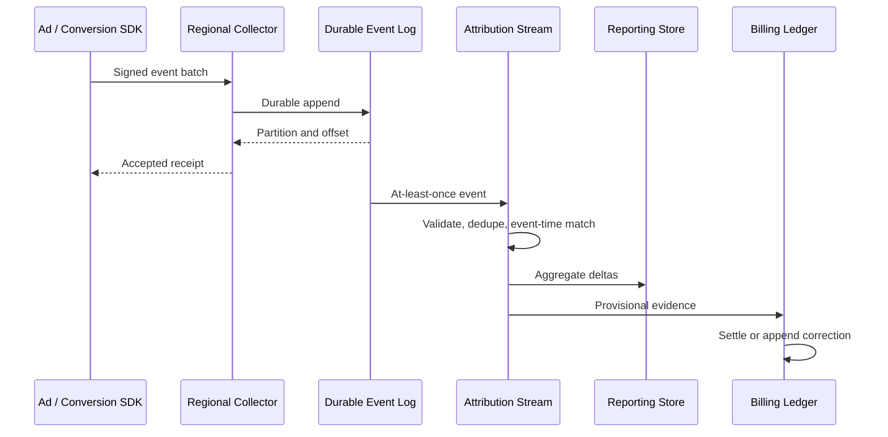
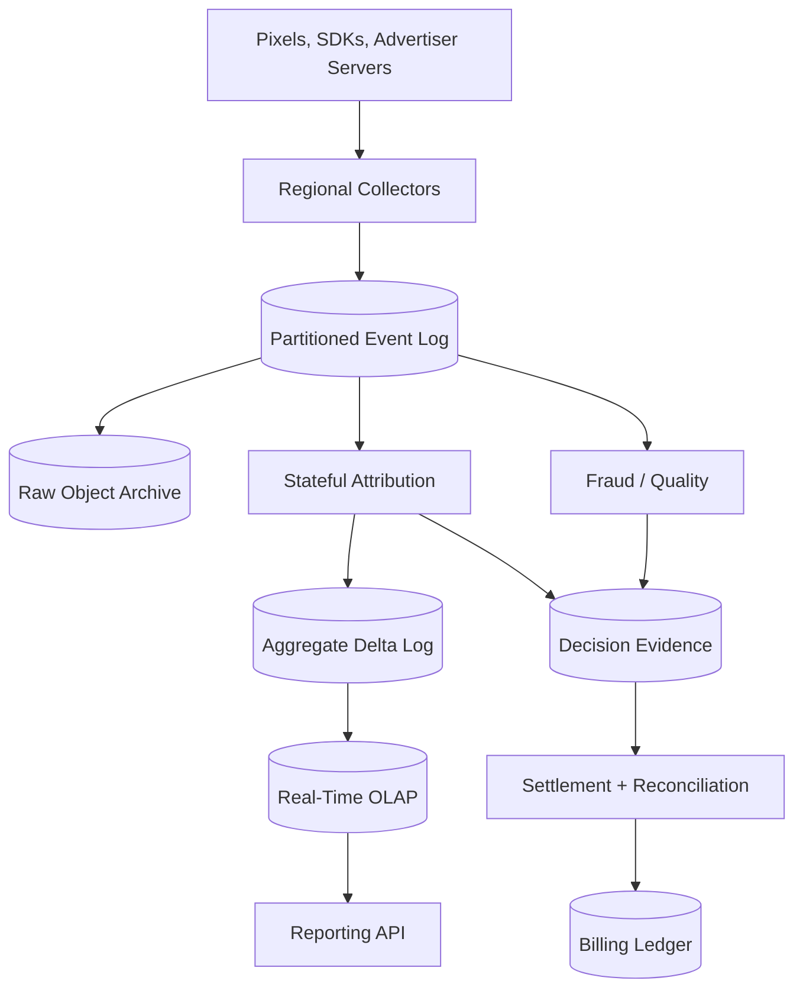

# Design a Large-Scale Advertising Attribution Platform

**Difficulty:** Senior / Staff  
**Primary themes:** high-throughput event ingestion, event-time stream processing, deduplication, queues, consistency, billing correctness, privacy, late-data reconciliation

## Interview prompt

> Design a platform that ingests ad impressions, clicks, and advertiser conversion events, attributes each eligible conversion to an ad interaction, provides near-real-time campaign reporting, and produces trustworthy billable records. The system operates globally and must handle duplicate, delayed, out-of-order, fraudulent, and privacy-restricted events.

This problem is not just “count clicks.” It has two different products with different contracts:

1. a fast, revisable analytics view for campaign operators;
2. a slower, auditable financial view whose billable outcomes must not double count.

## Targeted clarifying questions and assumed answers

**Candidate:** Which attribution rule should we implement?

**Interviewer:** Start with deterministic last eligible ad touch: prefer the latest click in the preceding 7 days; if no click exists, use the latest viewable impression in the preceding 24 hours. Campaigns may configure narrower windows.

**Candidate:** Can the attribution rule change later?

**Interviewer:** Yes. Rules are versioned. A conversion is evaluated using the rule version effective for its advertiser and conversion event time. Historical reprocessing must be reproducible.

**Candidate:** What scale should I design for?

**Interviewer:** At peak, ingest 5 million impression events per second, 500,000 clicks per second, and 100,000 conversions per second. Retain raw events for 90 days and financial evidence for seven years.

**Candidate:** What latency is expected?

**Interviewer:** Event ingestion should acknowledge within 100 ms at p99 from a nearby region. Preliminary dashboards should update within one minute for 99% of on-time events. Financial attribution can settle after 24 hours, with bounded corrections for events arriving up to seven days late.

**Candidate:** What does “exactly once” mean here?

**Interviewer:** The network is at-least-once. Duplicate events are expected. A valid conversion must generate at most one active billable attribution under a rule version. Corrections should be explicit ledger entries, not destructive rewrites.

**Candidate:** Do we own ad serving and auction selection?

**Interviewer:** No. The ad-serving system provides signed impression and click identifiers. Focus on measurement and attribution after delivery.

**Candidate:** What reporting dimensions matter?

**Interviewer:** Advertiser, campaign, creative, publisher, geography, device class, hour/day, and conversion type. High-cardinality user-level data must not appear in advertiser reports.

**Candidate:** How do we match events across devices?

**Interviewer:** Deterministic first-party identifiers may be used when consent and policy allow. Otherwise attribution is device/browser scoped. Probabilistic identity is out of scope.

**Candidate:** Do privacy deletion and consent changes matter?

**Interviewer:** Yes. Ingest consent and jurisdiction flags, minimize identifiers, enforce retention, support user deletion where legally required, and never use disallowed events for attribution.

**Candidate:** What fraud behavior is required?

**Interviewer:** Run real-time quality checks and asynchronous fraud scoring. Suspicious events may be withheld from billing. Later fraud findings create reversals.

### What I would say aloud

> “I’ll separate preliminary analytics from settled billing. Events enter an append-only log with stable IDs and event timestamps. Stateful stream processors deduplicate, maintain eligible touchpoints by privacy-safe subject key, and emit provisional attributions plus minute aggregates. A later reconciliation job uses the retained raw log, versioned rules, consent, and fraud decisions to produce an append-only billing ledger. I’ll deep-dive on event-time correctness, exactly-once financial effects, hot-key scaling, and privacy.”

## Interview time budget versus this walkthrough

In a live 45-minute interview, spend about 5 minutes on requirements, 2 on entities, 5 on interfaces, 10–15 on a complete baseline, and 10–15 on selected deep dives. This follows the public [Hello Interview System Design Delivery Framework](https://www.hellointerview.com/learn/system-design/in-a-hurry/delivery): clarify the contract, identify the important nouns and interfaces, complete the main flows, and then harden the design around bottlenecks and non-functional requirements.

This walkthrough is deliberately more detailed. In an interview, state the correctness contract first, draw the path from impression to conversion to ledger, and spend depth on two or three issues chosen with the interviewer.

---

## 1. Requirements (~5 minutes)

### Core functional requirements

1. **Ingest and validate measurement events.** Accept impressions, clicks, conversions, consent changes, and fraud decisions from authenticated producers; durably retain valid raw events.
2. **Attribute conversions and report campaign performance.** Match each conversion to the latest eligible touchpoint under a versioned rule and expose low-latency, revisable aggregates.
3. **Produce auditable billing outcomes.** Settle valid attributions into an append-only ledger, deduplicate financial effects, and represent corrections as reversals and replacements.

### Out of scope

- Auction bidding and ad selection
- Creative rendering
- Probabilistic cross-device identity
- Machine-learning model training for fraud
- Payment collection from advertisers
- General-purpose customer-data-platform functionality
- Arbitrary SQL queries over raw user-level events

### Quantified non-functional requirements

| Requirement | Target | Architectural consequence |
|---|---:|---|
| Peak ingest | 5M impressions/s, 500K clicks/s, 100K conversions/s | Regional collectors, partitioned durable log, compact binary schema |
| Ingest latency | p99 < 100 ms to durable regional acknowledgement | Minimal synchronous work and local quorum append |
| Preliminary freshness | 99% of on-time events reflected within 60 s | Stateful streaming and incremental aggregates |
| Financial uniqueness | At most one active billable attribution per conversion/rule version | Idempotency keys, transactional ledger constraints |
| Late-event handling | Corrections accepted through 7 days | Event-time state, correction stream, batch reconciliation |
| Read latency | Dashboard p95 < 2 s for common slices | Pre-aggregated OLAP store and result cache |
| Availability | 99.99% ingest and dashboard read availability | Multi-AZ regional ingestion and replicated serving |
| Retention | Raw 90 days; financial evidence 7 years | Tiered object storage and immutable audit/ledger |
| Privacy | Disallowed data never participates in matching | Consent gate, identifier minimization, deletion index |

### Scale estimates that change the design

Peak input rate:

\[
5{,}000{,}000 + 500{,}000 + 100{,}000 = 5.6\ \text{million events/s}
\]

Assume a compact validated event averages 350 bytes after envelope overhead and compression amortization:

\[
5.6\text{M/s} \times 350\text{B} \approx 1.96\ \text{GB/s}
\]

With three replicas in the streaming system, internal write traffic is roughly 6 GB/s before protocol overhead. This requires many partitions and regional ingestion; one global database is not viable.

Daily raw volume at 40% of peak average:

\[
5.6\text{M/s} \times 0.4 \times 86{,}400 \times 350\text{B}
\approx 67.7\ \text{TB/day}
\]

Ninety days is about 6.1 PB before storage compression and replication. Raw events belong in a partitioned log for short retention and columnar object storage for replay—not in the dashboard database.

Assume 100,000 conversion events/s at peak and one provisional attribution per conversion. At 200 bytes per attribution record, that is only 20 MB/s before replication. Financial records are much smaller than raw impression traffic, so we can afford stronger transactional guarantees on the ledger.

If one stream partition safely processes 20,000 simple events/s after state access and checkpointing, raw ingest needs at least:

\[
5.6\text{M} \div 20{,}000 = 280\ \text{partitions}
\]

Allowing 2× headroom, regional imbalance, maintenance, and hot campaigns, start with 600–1,000 logical partitions spread across regions.

### Consistency and availability contract

**Raw ingestion**

- Producers receive success only after the regional durable log acknowledges the event.
- Delivery is at-least-once. The collector does not promise that retries disappear.
- The immutable `event_id` and producer identity define deduplication.

**Preliminary attribution and dashboards**

- Eventual consistency is acceptable.
- Results are event-time based and may change as late clicks, impressions, consent changes, or fraud decisions arrive.
- Every result exposes `data_through_event_time`, processing time, rule version, and status such as `PRELIMINARY` or `SETTLED`.

**Billing**

- Each `(advertiser_id, conversion_id, rule_version)` has at most one active billable outcome.
- Ledger writes are strongly consistent.
- Corrections append reversal and replacement entries in one transaction; prior evidence remains auditable.
- When the system cannot prove uniqueness, billing pauses while analytics may continue.

**Partitions and regional failure**

- Ingestion favors availability within the nearest healthy region.
- Financial settlement favors consistency and fails closed if the ledger shard cannot establish quorum.
- Cross-region raw-log replication may lag; regional recovery exposes the durable offset boundary rather than pretending no events were lost.

### What I would say aloud

> “I’m explicitly declining a magical end-to-end exactly-once claim. The network and log are at-least-once. I make raw processing idempotent and place the financial invariant in a transactional ledger: one active outcome per conversion and rule version, with append-only reversals for corrections.”

---

## 2. Core entities (~2 minutes)

| Entity | Purpose and important fields |
|---|---|
| `Advertiser` | advertiser ID, billing account, policy region, reporting timezone |
| `Campaign` | campaign ID, advertiser, objective, active interval, attribution policy ID |
| `AdTouch` | event ID, impression/click ID, campaign, creative, subject token, event time, consent |
| `Conversion` | conversion ID, advertiser, subject token, type, value/currency, event time, consent |
| `AttributionRule` | immutable version, click/view windows, priority, eligibility and tie-break rules |
| `AttributionDecision` | conversion, selected touch, rule version, reason, state, evidence digest |
| `FraudDecision` | target event/decision, model/rule version, score, action, effective time |
| `ConsentState` | privacy-safe subject key, jurisdiction, allowed purposes, effective interval |
| `AggregateDelta` | dimensions, event-time bucket, metric deltas, decision version |
| `BillingLedgerEntry` | entry ID, conversion, attribution decision, amount, type, supersedes, created time |
| `ProcessingCheckpoint` | job/version, input offsets, state snapshot, output commit ID |
| `DeletionRequest` | subject lookup token, scope, state, completion evidence |
| `AuditEvent` | actor/system, action, resource, rule/model version, request/trace ID, time |

The `subject_token` is not a raw email or device identifier. An edge privacy service derives a purpose- and tenant-scoped pseudonymous token, so two advertisers cannot join their users through the platform.

### What I would say aloud

> “The correctness-bearing entities are the touchpoint, conversion, versioned attribution rule, decision, and billing ledger entry. The ledger records money; the dashboard is a projection that can be rebuilt.”

---

## 3. API and system interface (~5 minutes)

### Authentication and identity

SDKs and server integrations authenticate using scoped workload credentials. The gateway derives `producer_id`, advertiser/tenant, allowed event types, region, and schema permissions. A request body cannot claim another advertiser.

Browser pixels may use short-lived signed collection tokens issued for a specific campaign and origin. They have no read privileges.

### Batch event ingestion

```http
POST /v1/events:batch
Authorization: Bearer <producer-token>
Content-Encoding: gzip
Content-Type: application/x-protobuf

{
  "events": [
    {
      "event_id": "evt_imp_01J...",
      "type": "IMPRESSION",
      "event_time": "2026-10-17T15:59:58.421Z",
      "impression_id": "imp_83...",
      "campaign_id": "cmp_17...",
      "creative_id": "cr_9...",
      "subject_token": "subj_v3:9da...",
      "consent": {
        "purpose": "AD_MEASUREMENT",
        "allowed": true,
        "jurisdiction": "US-MA"
      },
      "device_class": "MOBILE",
      "geo_region": "US-MA",
      "signature": "..."
    },
    {
      "event_id": "evt_clk_01J...",
      "type": "CLICK",
      "event_time": "2026-10-17T16:01:10.052Z",
      "click_id": "clk_28...",
      "impression_id": "imp_83...",
      "campaign_id": "cmp_17...",
      "subject_token": "subj_v3:9da...",
      "signature": "..."
    }
  ]
}
```

```json
{
  "accepted": [
    {
      "event_id": "evt_imp_01J...",
      "receipt": "us-east-1/partition-418/offset-9182331"
    },
    {
      "event_id": "evt_clk_01J...",
      "receipt": "us-east-1/partition-418/offset-9182332"
    }
  ],
  "rejected": []
}
```

A `202 Accepted` means durable ingestion, not successful attribution or billing. Per-event rejections include schema, authorization, signature, consent-format, size, and timestamp errors.

### Conversion ingestion

```http
POST /v1/conversions
Authorization: Bearer <advertiser-server-token>
Idempotency-Key: order-8392-purchase

{
  "conversion_id": "order-8392-purchase",
  "conversion_type": "PURCHASE",
  "event_time": "2026-10-17T16:07:20Z",
  "subject_token": "subj_v3:9da...",
  "value": {
    "amount_minor": 12999,
    "currency": "USD"
  },
  "consent": {
    "purpose": "AD_MEASUREMENT",
    "allowed": true,
    "jurisdiction": "US-MA"
  },
  "order_reference_hash": "sha256:...",
  "metadata": {
    "store_region": "US-EAST"
  }
}
```

The advertiser's idempotency key is useful, but the canonical financial key remains advertiser plus conversion ID plus rule version.

### Attribution lookup

```http
GET /v1/conversions/order-8392-purchase/attribution
Authorization: Bearer <advertiser-analyst-token>
```

```json
{
  "conversion_id": "order-8392-purchase",
  "status": "PRELIMINARY",
  "rule_version": "last-touch-v42",
  "attributed_touch": {
    "type": "CLICK",
    "click_id": "clk_28...",
    "campaign_id": "cmp_17...",
    "creative_id": "cr_9...",
    "event_time": "2026-10-17T16:01:10.052Z"
  },
  "decision_version": 3,
  "data_through_event_time": "2026-10-17T16:08:00Z",
  "late_data_deadline": "2026-10-24T16:07:20Z"
}
```

The response excludes the subject token and unrelated user-level history.

### Reporting query

```http
POST /v1/reports:query
Authorization: Bearer <advertiser-analyst-token>

{
  "time_range": {
    "from": "2026-10-17T00:00:00Z",
    "to": "2026-10-18T00:00:00Z"
  },
  "group_by": ["campaign_id", "hour"],
  "metrics": [
    "impressions",
    "clicks",
    "preliminary_conversions",
    "settled_conversions",
    "spend_minor"
  ],
  "filters": {
    "campaign_id": ["cmp_17..."]
  },
  "consistency": "LATEST_AVAILABLE"
}
```

Response metadata includes freshness, applied privacy threshold, attribution-rule versions, correction watermark, and whether any interval remains preliminary.

### Rule update

```http
POST /v1/attribution-rules
Authorization: Bearer <advertiser-admin-token>
Idempotency-Key: october-rule-change

{
  "effective_from": "2026-10-20T00:00:00Z",
  "click_window_hours": 168,
  "impression_window_hours": 24,
  "priority": ["CLICK", "VIEWABLE_IMPRESSION"],
  "tie_breaker": "LATEST_EVENT_TIME_THEN_EVENT_ID"
}
```

A rule version is immutable after creation. Changing policy creates a new version with a non-overlapping effective interval.

### Correction and settlement interfaces

Internal settlement workers use an idempotent command:

```http
POST /internal/v1/ledger/attributions:settle

{
  "advertiser_id": "adv_44...",
  "conversion_id": "order-8392-purchase",
  "rule_version": "last-touch-v42",
  "decision_version": 7,
  "evidence_digest": "sha256:...",
  "amount_minor": 240,
  "currency": "USD"
}
```

The ledger returns the existing result for the same financial key and evidence or rejects a conflicting stale decision.

---

## 4. Data flow



The raw stream forks into several independent consumers:

- validation and canonicalization;
- attribution;
- fraud and traffic-quality analysis;
- raw archival;
- reporting aggregates;
- billing settlement;
- privacy deletion indexing.

One consumer's outage should not block ingestion or unrelated consumers.

---

## 5. High-level design (~10–15 minutes)

### Compact architecture



### Operation 1: Ingest events quickly and durably

The collector performs only work required before acknowledgement:

1. authenticate the producer or verify the signed collection token;
2. enforce producer, advertiser, IP, and byte-rate quotas;
3. parse the versioned envelope and cap batch size;
4. verify required fields, event ID format, timestamp bounds, and signature;
5. derive authoritative tenant/producer fields from credentials;
6. attach receive time, region, schema version, and privacy-policy snapshot;
7. choose a partition and append to the regional durable log;
8. return partition/offset receipts.

Heavy fraud inference, attribution, cross-event joins, and OLAP writes are asynchronous.

Use a binary schema such as Protobuf or Avro with a registry and backward-compatibility checks. Unknown optional fields survive archival; invalid required semantics go to a secure rejection stream with sampled payloads and aggregate diagnostics.

#### Partitioning

No one key is perfect:

- `subject_token` keeps a user's touches and conversions together but can create hot or privacy-sensitive partitions;
- campaign ID balances reporting aggregation but separates user history;
- event ID distributes evenly but forces a remote state lookup.

Choose `hash(advertiser_id, subject_token)` for the attribution stream. It colocates touchpoints and conversions for one advertiser-scoped subject. The ingest log may initially use a high-cardinality routing key and be repartitioned into specialized downstream topics.

Events without a permitted subject token cannot use user-level matching. They flow to aggregate-only measurement or remain unattributed, according to policy.

### Operation 2: Canonicalize and deduplicate

The canonicalizer validates business semantics and emits a stable normalized event.

Deduplication has layers:

1. **Collector retry cache:** a short TTL cache catches immediate retry storms.
2. **Stream-state dedupe:** keyed state stores `event_id -> payload_hash, first_offset, expiry` for the maximum correction window plus margin.
3. **Archive reconciliation:** batch jobs remove or flag duplicates that escaped state due to disaster recovery or TTL.
4. **Ledger uniqueness:** final financial constraint prevents duplicate money even if upstream dedupe fails.

If the same `event_id` arrives with the same hash, ignore it after recording duplicate metrics. If the payload differs, quarantine both variants and flag producer corruption or abuse; never choose “last write wins” for financial evidence.

Deduplication state can be large. At an average 2.24 million events/s and a seven-day TTL, retaining every event ID in memory would mean over 1.35 trillion IDs. Instead:

- use compact local LSM state on disk with checkpointing;
- apply shorter TTLs to high-volume impressions when downstream identifiers make duplicates independently detectable;
- retain exact long-window IDs for conversions and billable clicks;
- use partitioned Bloom filters only as a fast negative check, never as the final financial dedupe because false positives would drop real events;
- keep raw events for authoritative batch reconciliation.

### Operation 3: Maintain eligible touchpoint state

For each `(advertiser_id, subject_token)`, the attribution operator stores recent eligible touches ordered by event time:

```text
TouchState
  clicks: time-indexed set up to 7 days
  impressions: time-indexed set up to 24 hours
  consent intervals
  latest rule-policy cache generation
  event IDs and fraud eligibility
```

State is bounded by rule windows and event-count caps. A malicious or automated subject generating millions of touches is summarized or truncated under a deterministic policy, and flagged for fraud review.

An impression becomes eligible only after required viewability and signature checks. A click references an impression when available but can be independently validated. Each touch records the consent/purpose state effective at its event time.

### Operation 4: Attribute a conversion

When a conversion arrives:

1. validate and deduplicate it;
2. resolve the immutable attribution-rule version effective at conversion event time;
3. verify consent and jurisdiction policy for both conversion and candidate touches;
4. search clicks in `[conversion_time - click_window, conversion_time]`;
5. if any are eligible, choose the greatest tuple `(event_time, event_id)`;
6. otherwise search viewable impressions in the configured window and apply the same deterministic tie-break;
7. produce an `AttributionDecision` with rule version, selected touch, rejected-candidate reason codes, input offsets, and evidence digest;
8. emit retract/add deltas if this supersedes a provisional decision;
9. persist decision evidence for settlement.

The deterministic event-ID tie-break makes reprocessing converge even when two touches share a timestamp.

#### No-match case

The conversion remains `UNATTRIBUTED` with a decision version. A late touch may change it during the correction window. After the deadline, it settles as unattributed unless policy allows exceptional backfill.

### Operation 5: Update preliminary reports

Do not mutate counters directly from several processors. Emit an append-only `AggregateDelta`:

```json
{
  "delta_id": "decision:order-8392:version:3:add",
  "advertiser_id": "adv_44",
  "bucket_start": "2026-10-17T16:00:00Z",
  "dimensions": {
    "campaign_id": "cmp_17",
    "creative_id": "cr_9",
    "device_class": "MOBILE"
  },
  "metrics": {
    "attributed_conversions": 1,
    "conversion_value_minor": 12999
  },
  "decision_version": 3
}
```

If a late click moves the conversion from campaign A to campaign B, emit:

- a `-1` retraction for A under the prior decision version;
- a `+1` addition for B under the new version.

The aggregation consumer deduplicates by `delta_id` and applies both changes atomically per destination shard where possible. The real-time OLAP store is a projection; raw events and decision logs remain rebuildable sources.

Store minute-level aggregates for recent periods, roll them into hourly/daily segments, and keep common dimensions columnar. Precompute frequent advertiser/campaign/time queries while allowing bounded ad hoc slices.

### Operation 6: Handle late and out-of-order events

Use event time, not collector arrival time. A **watermark** estimates that most events earlier than time T have arrived. Apache Flink's official documentation describes watermarks as the mechanism by which event-time operators track progress: [Timely Stream Processing](https://nightlies.apache.org/flink/flink-docs-stable/docs/concepts/time/).

Maintain watermarks per input partition and take the minimum across active partitions, with idle-partition detection. A stuck or silent partition must not freeze the whole pipeline forever.

Define three horizons:

- **fast lateness:** up to 10 minutes; update stream state and dashboards normally;
- **correction lateness:** 10 minutes to 7 days; issue explicit decision and aggregate corrections;
- **beyond deadline:** archive for audit; change billing only through an exceptional controlled backfill.

Watermarks do not prove no earlier event will ever arrive. They let the product choose when to publish provisional and settled results.

### Operation 7: Settle billing

Preliminary decisions enter an evidence store. Settlement waits until:

- the configured holdback has elapsed, such as 24 hours;
- required fraud checks completed;
- consent is valid;
- the attribution rule/evidence can be reproduced;
- no known data-quality incident affects the input range.

The settlement service writes a ledger transaction:

1. acquire the ledger shard for advertiser/billing account;
2. check unique `(advertiser_id, conversion_id, rule_version, active=true)`;
3. verify the incoming decision version is the current approved version;
4. insert `CHARGE` or return the existing identical entry;
5. append an outbox event for invoices and settled reporting;
6. commit.

A later valid correction writes `REVERSAL` referencing the old charge and a replacement `CHARGE` referencing the new decision in one transaction. Financial history is never overwritten.

### Operation 8: Reconcile stream results with raw truth

A daily batch job reads immutable raw partitions and versioned side inputs:

- campaign and rule history;
- consent intervals;
- fraud-decision history;
- schema decoder versions;
- currency and billing policy versions.

It recomputes attribution deterministically for a closed event-time range and compares evidence digests with streaming output.

Differences create:

- reporting correction deltas;
- ledger correction proposals;
- an incident when divergence exceeds thresholds;
- per-rule and per-code-version accuracy metrics.

Stream and batch logic should share the same versioned attribution library. Separate implementations invite permanent disagreement.

### Baseline failure handling

| Failure | System behavior |
|---|---|
| Producer retries after timeout | Same event ID is deduplicated; receipt may differ but effect does not |
| Collector dies after log append | Client retry creates a duplicate, removed downstream |
| Stream worker dies | Restore checkpointed state and replay log from committed offsets |
| Output written but input checkpoint not committed | Idempotent delta/decision IDs suppress duplicate effects |
| Rule service unavailable | Use pinned cached version if valid; otherwise pause affected attribution |
| OLAP store unavailable | Buffer/replay delta log; ingestion and evidence continue |
| Ledger unavailable | Stop settlement; retain decisions and continue preliminary analytics |
| Region lost | Route new ingestion; replay replicated offsets; expose durable boundary |
| Poison event | Isolate to dead-letter workflow without blocking its partition indefinitely |

### What I would say aloud

> “The raw log is the durable fact. Streaming creates low-latency, versioned decisions and deltas. The OLAP store and billing ledger consume those differently: OLAP accepts corrections, while billing uses a unique financial key and append-only reversals. Daily deterministic replay detects any gap between fast processing and authoritative history.”

---

## 6. Deep dives (~10–15 minutes)

### Deep dive A: Event time, late data, and deterministic re-attribution

#### Where the baseline breaks

A processing-time join might attribute a conversion to whichever click happened to arrive first. That fails because:

- mobile SDKs upload after reconnecting;
- client clocks can be skewed;
- different regions and topics have different delays;
- an impression may arrive after its click;
- a click may arrive after the conversion;
- replay changes arrival order;
- rule changes can be accidentally applied retroactively.

The same raw events must produce the same decision during live processing and replay.

#### Plausible approaches

| Approach | Benefit | Failure/tradeoff |
|---|---|---|
| Processing-time last arrival | Simple and low state | Non-deterministic and unfair |
| Wait full 7-day window before any output | Stable | Unacceptable dashboard latency |
| Event-time provisional result plus corrections | Fast and deterministic | More state and retract/add handling |
| Periodic batch only | Easy correctness reasoning | No near-real-time reporting |

Select event-time provisional decisions plus bounded correction and batch reconciliation.

#### Event timestamp trust

Do not blindly trust client time. Store:

- source event time;
- collector receive time;
- signed server-generated auction/impression time where available;
- producer clock offset estimate;
- timestamp confidence.

For ad-server-generated impression/click tokens, a signed server timestamp is authoritative. For offline advertiser conversions, accept event time within a policy bound and preserve receive time. Events implausibly far in the future or past are rejected or quarantined.

Industry protocols commonly represent event notification timestamps; the [IAB Tech Lab OpenRTB](https://iabtechlab.com/standards/openrtb/) materials include event and impression notification concepts. This design uses original APIs but follows the general principle that event identity and time must be explicit.

#### Watermarks and idle partitions

Each producer partition estimates its event-time progress. The operator watermark is the minimum non-idle partition watermark minus allowed disorder.

If one partition stops:

1. wait an idle timeout;
2. mark it idle for global watermark calculation;
3. record its last offset and event time;
4. if it resumes with old events, treat them as late and run corrections.

Never silently discard resumed events merely because the watermark advanced.

#### Versioned decision state

A decision has:

```text
decision_key = advertiser + conversion_id + rule_version
decision_version = monotonically increasing integer
selected_touch = optional event ID
evidence_digest = hash(rule, conversion, candidates, consent, fraud state)
status = PRELIMINARY | SETTLED | REVERSED
```

A new eligible late event recomputes the candidate set. If selection changes:

- increment decision version;
- append a new decision record;
- emit inverse delta for the prior projection;
- emit forward delta for the replacement;
- notify settlement if the old result was already charged.

#### State expiry

Touch state cannot be infinite. Keep it through:

\[
\max(click\ window,\ impression\ window) + allowed\ lateness + safety\ margin
\]

For a 7-day click window, 7-day corrections, and 1-day margin, some indexed evidence may live 15 days. Raw data remains 90 days for replay.

Expired online state does not mean evidence is erased. Exceptional backfill uses the archive and batch engine rather than bloating the live state store.

#### Replay reproducibility

Pin all side inputs:

- rule version selected by conversion event time;
- consent-policy version and consent interval;
- fraud model/rule decision version;
- schema decoder version;
- identity-token derivation version;
- code artifact digest.

A replay that uses “current rules” is not reconciliation; it is a new policy simulation.

#### Observability

Measure:

- event-time lag distributions by producer and region;
- watermark skew and idle partitions;
- correction rate by lateness bucket;
- decisions changed by late click versus impression;
- future/past timestamp rejection;
- live-versus-batch evidence mismatch;
- state size and expiry backlog;
- percentage of conversions still preliminary by age.

#### What I would say aloud

> “Watermarks are progress estimates, not a claim that the past is closed. I publish a provisional event-time decision quickly, retain state through the correction window, and express every change as a new decision version plus retract/add deltas. Replay pins the original rule, consent, fraud, schema, and code versions.”

### Deep dive B: Exactly-once financial effects over at-least-once infrastructure

#### Where the baseline breaks

Stream processors can retry after failure at any boundary:

- consume conversion;
- compute decision;
- write aggregate;
- write charge;
- checkpoint input offset.

If a crash occurs between the charge and checkpoint, replay can charge again. “The stream engine supports exactly once” is not enough when the sink is an independent financial database.

Official Dataflow documentation distinguishes exactly-once processing effects from network delivery and describes deduplication/checkpointing mechanisms: [Exactly-once in Dataflow](https://docs.cloud.google.com/dataflow/docs/concepts/exactly-once). The system still needs idempotent business keys at the external sink.

#### Plausible approaches

| Approach | Advantage | Problem |
|---|---|---|
| Trust broker delivery exactly once | Minimal application work | Broker cannot atomically control external ledger |
| Distributed transaction across log and ledger | Strong | Expensive, brittle, often unsupported |
| Idempotent ledger command with unique key | Practical and strong at sink | Requires careful correction semantics |
| Recompute invoices from raw events only | Simple ledger | Slow operational feedback and hard adjustments |

Select an idempotent transactional ledger plus an outbox.

#### Ledger schema

```text
billing_entries(
  entry_id,
  advertiser_id,
  conversion_id,
  rule_version,
  decision_version,
  entry_type,          -- CHARGE or REVERSAL
  amount_minor,
  currency,
  evidence_digest,
  supersedes_entry_id,
  created_at
)

active_attributions(
  advertiser_id,
  conversion_id,
  rule_version,
  active_entry_id,
  decision_version,
  evidence_digest,
  PRIMARY KEY(advertiser_id, conversion_id, rule_version)
)
```

Settlement transaction:

1. read/lock `active_attributions` key;
2. if no row, insert charge and active pointer;
3. if identical decision/evidence exists, return success idempotently;
4. if incoming decision version is older, reject it;
5. if newer and approved for correction, insert reversal and replacement, update active pointer;
6. append outbox record;
7. commit.

Money uses integer minor units plus ISO currency—never floating point.

#### Stream checkpoint boundary

The attribution processor writes its decision to a durable decision log with deterministic ID. The ledger consumer independently processes that log. It commits ledger state before acknowledging its input offset.

If it crashes after ledger commit but before offset acknowledgement, the same command replays and returns the existing ledger entry. This is at-least-once delivery with exactly-once *financial effect*.

#### Why append reversals?

Updating the original charge destroys history and makes invoices, audits, and incident analysis difficult. Reversals preserve:

- what the platform previously believed;
- which rule/evidence justified it;
- when and why it changed;
- the net financial result.

Invoice generation reads ledger entries up to a closed accounting watermark. Corrections after invoice close create adjustments in the next statement unless policy requires reopening.

#### Handling partial downstream failure

The ledger transaction also writes an outbox row. Invoice, settled-reporting, and notification consumers process the outbox idempotently. A failed invoice projection cannot roll back or duplicate the ledger.

Reconciliation compares:

- one active attribution per financial key;
- sum of charge/reversal entries with active pointer;
- decision log evidence versus ledger evidence;
- invoice totals versus ledger cutoff.

#### Failure and abuse cases

- **Duplicate conversion with different values:** quarantine conflict; do not silently overwrite.
- **Currency changes across versions:** reverse in original currency and issue replacement explicitly.
- **Advertiser retries after changing order value:** require a correction API/version rather than reusing an idempotency key.
- **Ledger shard unavailable:** queue settlement and expose `PENDING_SETTLEMENT`; do not approximate.
- **Rule bug:** freeze affected settlement range, deploy fixed version, replay, and produce controlled corrections.
- **Mass correction:** throttle by advertiser and accounting period; preserve ordering per financial key.

#### Observability

Track:

- duplicate settlement commands;
- uniqueness conflicts;
- stale decision rejections;
- pending-settlement age;
- reversal volume and reason;
- ledger/outbox lag;
- ledger versus invoice reconciliation difference;
- financial keys with more than one active pointer—must be zero;
- money totals by currency using independent recomputation.

#### What I would say aloud

> “Exactly once is an effect-level property. I deliver settlement commands at least once, but the ledger serializes on advertiser, conversion, and rule version. A retry returns the existing charge. A changed decision appends a reversal and replacement transaction, so the active outcome is unique and the audit history remains complete.”

### Deep dive C: Scaling hot keys, state, and real-time reports

#### Where the baseline breaks

Hashing by subject distributes ordinary traffic, but skew remains:

- a bot can generate millions of events under one identifier;
- a popular campaign dominates aggregate updates;
- a publisher sends all traffic through one producer partition;
- dashboard queries hammer the current minute;
- one advertiser asks for very high-cardinality breakdowns;
- state checkpoints become too large or slow.

#### Attribution-key scaling

A single subject must usually be processed in event order, so unlimited horizontal fan-out is impossible. Protect the system:

- cap touches per subject/window;
- collapse repeated identical impressions into a counted summary when attribution semantics permit;
- isolate abusive keys into a slow/fraud lane;
- apply per-key CPU and state quotas;
- spill ordered state to local LSM storage;
- flag truncated candidate sets in evidence so billing can withhold questionable outcomes.

For a legitimately hot household/device token, a deterministic subkey can shard impression storage, but conversion evaluation must merge candidates before deciding. Use that only beyond a threshold; it adds complexity.

#### Aggregate hot-key scaling

Never have every attribution worker update `campaign_id + current_minute` directly in one database row.

Use two-stage aggregation:

1. workers emit fine-grained deltas keyed by `(campaign, minute, salt)`;
2. local combiners batch counts;
3. downstream reducers merge salts into immutable or versioned aggregate segments;
4. query service sums a small number of recent salts/segments.

As a minute closes, compact it into a stable segment. Corrections write a small delta segment rather than rewriting a large base.

#### Reporting storage options

| Store | Strength | Weakness |
|---|---|---|
| Row-oriented SQL | Transactions and flexible metadata | Poor at high-volume multidimensional scans |
| Key-value counters | Fast fixed-key updates | Limited filters and correction complexity |
| Columnar real-time OLAP | Fast time/dimension aggregations and compression | Operational complexity; not financial source of truth |
| Query raw object storage | Cheap and flexible | Too slow for dashboards |

Select columnar real-time OLAP for advertiser reports, backed by delta logs and raw archive. Use SQL catalog for campaign/rule metadata and ledger for money.

#### Cardinality management

Advertisers may request arbitrary dimensions that explode combinations. Enforce:

- a supported dimension allowlist;
- maximum grouping cardinality;
- query byte/time budgets;
- approximate distinct counts where declared;
- asynchronous export for large queries;
- per-advertiser concurrency quotas;
- privacy thresholds that suppress tiny cohorts.

Cache common queries using advertiser, normalized query, data watermark, and correction generation. A cache entry is invalid once the relevant aggregate generation changes.

#### Checkpointing state

Stateful processors take incremental checkpoints to durable object storage. Full snapshots of multi-terabyte state every minute are infeasible.

Checkpoint metadata includes:

- code and schema version;
- input offsets per partition;
- state backend file digests;
- rule-side-input generations;
- output transaction/commit IDs.

Test restore time, not merely checkpoint success. A system with a one-hour state restore violates a one-minute freshness objective after failure. Keep warm standby capacity or rescale state partitions incrementally.

#### Backpressure

When OLAP or a consumer slows, do not make collectors synchronously wait for dashboards. Durable logs absorb bounded lag. Autoscaling uses:

- input bytes/events per second;
- consumer offset lag;
- state lookup latency;
- checkpoint duration;
- output sink latency;
- watermark lag.

If backlog approaches retention/capacity limits, preserve raw ingestion and billing evidence first, shed optional low-priority projections, and tell users that dashboards are delayed.

#### Observability

- partition skew and top keys;
- events/s and CPU by event type;
- state bytes per key/partition;
- checkpoint duration, size, and restore tests;
- aggregate delta lag and duplicate suppression;
- OLAP ingest lag and segment-compaction backlog;
- query p95/p99 by scanned rows and cardinality;
- cache hit rate keyed by watermark;
- truncated/isolated hot subjects and affected billable value.

#### What I would say aloud

> “I partition attribution by advertiser-scoped subject, but aggregate reporting uses salted two-stage reduction so a viral campaign does not create one counter hot spot. Stateful workers use incremental checkpoints and bounded per-key state. The OLAP store is replaceable; the decision log and ledger remain authoritative.”

### Deep dive D: Privacy, consent, and deletion

#### Where the baseline breaks

An attribution system naturally wants long-lived user histories, but that creates privacy risk:

- raw identifiers can connect behavior across advertisers;
- consent differs by purpose, jurisdiction, and time;
- deletion is difficult across logs, state, aggregates, and backups;
- very small report groups can re-identify individuals;
- a late event may carry consent that was not valid at event time.

Privacy cannot be a downstream cleanup step.

#### Data minimization at collection

At the edge:

- reject raw email, phone, or unsupported identifiers;
- derive a rotating advertiser- and purpose-scoped token;
- store coarse geography and device class instead of precise values unless required;
- separate the tokenization key service from analytics;
- attach consent source, purpose, jurisdiction, and policy version;
- avoid logging request bodies in general infrastructure logs.

Token scope prevents advertiser A and advertiser B from comparing pseudonyms.

#### Consent as temporal state

Consent is not one current Boolean. Store effective intervals:

```text
(subject_token, purpose, jurisdiction, valid_from, valid_to, source, policy_version)
```

A touch and conversion are eligible only if their event times fall within allowed intervals under policy. A withdrawal can stop future use and may require deletion or reprocessing of earlier data depending on jurisdiction and legal basis.

Streaming operators consume consent-change events partitioned by the same subject key. Reconciliation handles races where a consent update arrives late.

#### Deletion workflow

Append-only logs conflict with deletion requirements. Use cryptographic and indexed deletion:

1. privacy service maps the verified request to scoped subject tokens without exposing raw identity to analytics;
2. deletion index locates object partitions, online state, decision evidence, and private detail stores;
3. state processors receive deletion tombstones and remove matching candidate histories;
4. mutable detail stores delete rows;
5. object-store compaction rewrites affected encrypted partitions or destroys per-subject/per-partition data keys when architecture permits;
6. derived aggregates remain only if demonstrably anonymous and policy allows;
7. evidence of completion stores request metadata, counts, and hashes—not deleted personal data;
8. backups expire or support key-based erasure under documented retention exceptions.

A Bloom filter alone cannot prove deletion; use an exact encrypted deletion index.

#### Privacy-safe reporting

- minimum cohort thresholds;
- suppress or combine rare dimensions;
- restrict user-level exports;
- enforce advertiser tenancy on every query;
- audit high-risk query patterns;
- consider differential privacy for broad ecosystem reports, while not applying noisy counts to billing.

#### Failure modes

- **Tokenization service unavailable:** fail closed for personalized measurement or route to aggregate-only events; never log raw identifiers as fallback.
- **Consent side input stale:** pause affected matching beyond a freshness limit.
- **Deletion job partially fails:** remain `IN_PROGRESS`, retry idempotently, and expose incomplete stores.
- **Key rotation:** version tokens; permit windowed matching only across explicitly linked versions.
- **Policy update:** create a new policy version and controlled re-evaluation; never reinterpret history invisibly.

#### What I would say aloud

> “I scope pseudonyms by advertiser and measurement purpose, treat consent as event-time intervals, and build deletion indexing from day one. Privacy state is part of attribution evidence. The system never falls back to raw identifiers when tokenization or consent services fail.”

---

## Reliability, observability, and operations

### Regional topology

Run independent ingestion cells in major regions. Each cell contains collectors, a multi-AZ log, canonicalizers, and raw archival. Attribution processing may be regional when policy requires data residency, with global reporting receiving only allowed aggregates.

Campaign and rule metadata have a home region but replicate as signed immutable versions. The event records the policy/rule selector needed for deterministic resolution.

The billing ledger is sharded by advertiser/billing account and uses multi-AZ consensus. Cross-region failover is controlled and fenced; two ledger leaders must never settle the same financial key independently.

### Data retention tiers

| Data | Hot retention | Long-term retention | Purpose |
|---|---:|---:|---|
| Regional event log | 24–72 hours | None | Replay after worker failure |
| Raw columnar archive | Days in hot object tier | 90 days | Reconciliation and incident replay |
| Touchpoint online state | Rule window + lateness | None | Low-latency attribution |
| Decision evidence | Correction window | Policy/audit duration | Explain and reproduce outcomes |
| Aggregate deltas | Weeks | Years as compact segments | Dashboard rebuilding |
| Billing ledger | Online recent years | 7+ years immutable archive | Financial audit |
| Direct identifiers | Avoid/minimize | Per privacy policy | Tokenization only |

### Security boundaries

- Producers receive write-only event scopes.
- Advertiser analysts can read only their tenant's aggregates.
- Raw user-level access is limited to audited privacy/security services.
- Stream workers use scoped topic and state permissions.
- Only settlement service can write billing entries.
- Rule, fraud, and consent versions are signed or integrity-protected.
- Administrative corrections require dual authorization and reason codes.
- Raw archives and ledgers use separate encryption keys and security accounts.
- Logs redact tokens and conversion metadata.

### End-to-end observability

Propagate `event_id`, `conversion_id`, trace ID, producer ID, partition/offset, rule version, decision version, and ledger entry ID.

Key dashboards:

**Ingestion**
- accepted/rejected/duplicate/conflicting events;
- p50/p99 acknowledgement;
- bytes/s and partition skew;
- producer clock skew and signature failures.

**Streaming**
- consumer offset and event-time lag;
- watermarks by partition;
- state size and checkpoint health;
- late-event and correction rates;
- dead-letter volume.

**Attribution**
- match rate by click/impression/unattributed;
- candidate counts and rule versions;
- live/batch evidence mismatch;
- decisions changed after provisional output.

**Reporting**
- OLAP freshness and query latency;
- aggregate delta backlog;
- correction generations;
- privacy suppression rates.

**Billing**
- pending settlement;
- uniqueness conflicts;
- reversal amount and reason;
- ledger/outbox/invoice reconciliation;
- financial invariants.

### Important alerts

- page when p99 ingest durability exceeds 100 ms for ten minutes;
- page when any healthy partition watermark lags more than the one-minute SLO;
- page on ledger uniqueness invariant violation;
- halt settlement for ranges with missing raw partitions or stale fraud/consent inputs;
- page when batch-versus-stream mismatch exceeds a very small threshold;
- page when deletion jobs exceed statutory/internal deadlines;
- isolate a producer on conflicting payloads for one event ID;
- alert before durable-log retention is consumed by lagging critical consumers.

### Disaster-recovery drills

Regularly test:

- loss of one ingest AZ;
- regional collector rerouting;
- restoration of stream state from checkpoint plus log;
- object archive replay into a clean pipeline;
- ledger shard failover with fencing;
- rule-service outage using pinned versions;
- mass correction without duplicate charges;
- privacy deletion across every store;
- rebuilding OLAP entirely from deltas/raw decisions.

---

## 7. Concise final design

> “Regional collectors authenticate producers, validate small event envelopes, and durably append impressions, clicks, conversions, consent, and fraud events to a multi-AZ partitioned log within 100 ms. The network remains at-least-once. Canonical stream processors deduplicate stable event IDs, partition by advertiser-scoped subject token, and maintain bounded event-time touchpoint state. A conversion uses the immutable rule version effective at its event time and deterministically chooses the latest eligible click, otherwise a viewable impression.
>
> “The stream emits versioned attribution decisions and retract/add aggregate deltas. A real-time columnar store serves preliminary dashboards with explicit watermarks. Late events can revise decisions for seven days. Raw events are archived in columnar object storage, and a daily deterministic replay reconciles streaming output.
>
> “Financial settlement is separate. A transactional ledger enforces one active outcome per advertiser, conversion, and rule version. Replays return the existing entry; changed decisions append reversal and replacement entries. Consent intervals, scoped pseudonyms, fraud decisions, rule versions, and code digests are part of evidence. This yields fast dashboards without weakening billing, privacy, or audit correctness.”

## Requirements check

| Requirement | How the design meets it |
|---|---|
| Ingest impressions, clicks, conversions | Regional collectors and durable partitioned log |
| Attribute last eligible touch | Event-time keyed state and deterministic rule versions |
| Near-real-time reports | Delta stream, two-stage aggregation, columnar OLAP |
| Bill correctly | Idempotent settlement and strongly consistent append-only ledger |
| Handle duplicates | Layered dedupe plus final ledger uniqueness |
| Handle late events | Watermarks, seven-day correction state, replay |
| Support fraud decisions | Versioned quality events, holdback, reversals |
| Meet peak throughput | Partitioned logs, direct asynchronous consumers, salted aggregates |
| Survive failures | Checkpoints, replay, outbox, regional cells, fenced ledger failover |
| Preserve privacy | Scoped pseudonyms, temporal consent, deletion index, cohort thresholds |
| Audit and reproduce | Raw archive plus versioned rules, decisions, evidence, and code |
| Avoid false exactly-once claim | At-least-once transport with exactly-once financial effect |

---

## Realistic interviewer follow-up questions with strong sample answers

### 1. Why not wait seven days and produce only final attribution?

> “That would simplify correction logic but fail the one-minute reporting requirement. I publish a clearly labeled provisional decision using event time, then version it as late data arrives. Billing has a separate holdback and settlement contract.”

### 2. Why partition by subject instead of campaign?

> “Attribution joins a conversion with that subject's recent touches, so subject partitioning keeps state and ordering local. Campaign aggregation is a different access pattern handled by a downstream repartition and salted two-stage aggregation.”

### 3. What if one subject key becomes extremely hot?

> “Apply per-key state and CPU limits, collapse redundant impressions when semantics allow, isolate abusive keys into a fraud lane, and mark truncated evidence ineligible for billing if correctness cannot be proven. Legitimate extreme keys can use subsharded touch storage with a merge at conversion time.”

### 4. Are watermarks a correctness guarantee?

> “No. A watermark is a progress estimate used to decide when to emit or settle provisional windows. Events may still arrive behind it. The correction horizon and raw replay are the correctness mechanisms.”

### 5. How do you prevent duplicate charges after a worker crash?

> “The settlement command uses the unique business key advertiser, conversion, and rule version. The ledger transaction returns the existing charge for a replay. Input offsets are acknowledged only after ledger commit, so delivery can repeat without repeating the financial effect.”

### 6. Why keep a separate billing ledger instead of billing from OLAP totals?

> “OLAP aggregates are eventually consistent, compacted, and corrected asynchronously. They are excellent for dashboards but poor financial evidence. The ledger has per-conversion identity, strong uniqueness, append-only reversals, currency-safe amounts, and an audit trail.”

### 7. What if the same conversion ID arrives with two values?

> “Treat it as a conflict, not last-write-wins. Quarantine the conversion for advertiser review. A legitimate correction needs an explicit versioned correction endpoint so the ledger can reverse and replace the old amount.”

### 8. How does a late click change reports?

> “Recompute the deterministic decision. Append decision version N+1, emit a negative aggregate delta for the old campaign and a positive delta for the new one, then propose a ledger reversal/replacement if the prior decision was settled.”

### 9. How do you reproduce a decision six months later?

> “Preserve the conversion, selected and candidate touch evidence or digest, immutable rule version, consent-policy state, fraud decision, schema decoder, identity-token version, and code artifact digest. Financial evidence retention outlives raw-event retention where required.”

### 10. Can a Bloom filter deduplicate events?

> “It can cheaply identify definite non-members, but false positives could drop legitimate conversions. I use it only as an optimization before an exact state lookup. The ledger's unique business key is the final financial defense.”

### 11. What if the rule changes from last-click to first-click?

> “Create a new immutable rule version with an effective interval. New conversions use it based on event time. Existing settled conversions do not change unless the product explicitly launches a versioned historical restatement workflow.”

### 12. How do you deal with clock skew?

> “Prefer signed server-generated impression/click timestamps. Store receive time and clock-confidence metadata. Bound advertiser-supplied conversion time, quarantine implausible values, and monitor producer skew. Tie-break equal trusted timestamps by stable event ID.”

### 13. What happens when the OLAP database is down?

> “The aggregate delta log buffers updates. Raw ingestion, attribution evidence, and settlement continue. Reports become stale and expose their watermark. When OLAP recovers, idempotent delta IDs replay.”

### 14. How would you support multi-touch attribution later?

> “Change the rule output from one selected touch to a normalized set of `(touch_id, credit_fraction)` values summing to one. Decision versioning, evidence, retract/add deltas, and ledger uniqueness remain. Financial amounts allocate integer minor units deterministically so rounding preserves the total.”

### 15. Can exactly-once stream processing remove the need for idempotency?

> “No. Engine checkpoints can give exactly-once state within a topology, but external calls, producer retries, regional replay, and operator mistakes still occur. Business identifiers and sink constraints remain necessary.”

### 16. How do you protect user privacy while supporting deletion?

> “Use advertiser- and purpose-scoped pseudonyms rather than raw identifiers, maintain temporal consent, build an exact encrypted deletion index, remove online state and detail rows, compact or cryptographically erase archive data, and retain only permitted anonymous aggregates and deletion evidence.”

### 17. What if fraud is detected after invoicing?

> “Append a reversal tied to the original ledger entry and apply the adjustment under accounting policy, often on the next invoice. Never edit the original charge. Reports receive corresponding correction deltas.”

### 18. Why archive raw events if the stream is correct?

> “For disaster replay, rule-bug correction, fraud rescoring, privacy investigations, and independent stream-versus-batch reconciliation. The archive is bounded by retention and access policy; it is not the dashboard query path.”

---

## Common pitfalls

1. Treating attribution as simple counters.
2. Using processing time instead of event time.
3. Claiming network-level exactly-once delivery.
4. Charging directly from an eventually consistent dashboard store.
5. Failing to define a stable event ID and conflicting-duplicate behavior.
6. Dropping late events after the watermark.
7. Waiting the full attribution window before any dashboard output.
8. Mutating prior attribution without a decision version.
9. Updating counters without retract/add corrections.
10. Applying the latest rule retroactively during replay.
11. Using current consent rather than consent effective at event time.
12. Storing raw cross-advertiser identifiers.
13. Partitioning only by campaign and forcing remote user-history joins.
14. Updating one hot campaign counter from every worker.
15. Keeping every dedupe ID forever in memory.
16. Using a Bloom-filter hit as proof of duplication.
17. Allowing different payloads under one event ID.
18. Using floating-point money.
19. Overwriting charges instead of appending reversals.
20. Assuming stream-engine checkpoints atomically cover an external ledger.
21. Failing to include fraud and consent versions in evidence.
22. Making OLAP the source of truth.
23. Ignoring state checkpoint restore time.
24. Letting one idle partition freeze all watermarks forever.
25. Failing to expose data freshness and preliminary/settled status.
26. Allowing arbitrary high-cardinality reports without budgets.
27. Treating pseudonymization as complete anonymization.
28. Adding deletion support after choosing unindexable storage layouts.
29. Letting dashboard outages block event collection.
30. Reimplementing stream and batch attribution rules independently.

## Closing perspective

The strongest design separates three kinds of truth:

1. **Raw fact:** an immutable, authenticated event in the durable log/archive.
2. **Current interpretation:** a versioned attribution decision and revisable dashboard projection.
3. **Financial truth:** an append-only ledger with one active outcome and explicit corrections.

That separation makes it possible to deliver one-minute insights while remaining honest about late data, retries, fraud, consent, and financial correctness.

## Public references

- [Hello Interview: System Design Delivery Framework](https://www.hellointerview.com/learn/system-design/in-a-hurry/delivery)
- [Apache Flink: Timely Stream Processing](https://nightlies.apache.org/flink/flink-docs-stable/docs/concepts/time/)
- [Apache Flink: Stateful Stream Processing](https://flink.apache.org/what-is-flink/flink-applications/)
- [Google Cloud Dataflow: Exactly-once processing](https://docs.cloud.google.com/dataflow/docs/concepts/exactly-once)
- [IAB Tech Lab: OpenRTB](https://iabtechlab.com/standards/openrtb/)
- [IAB Tech Lab: Measurement standards](https://iabtechlab.com/standards/measurement/)
