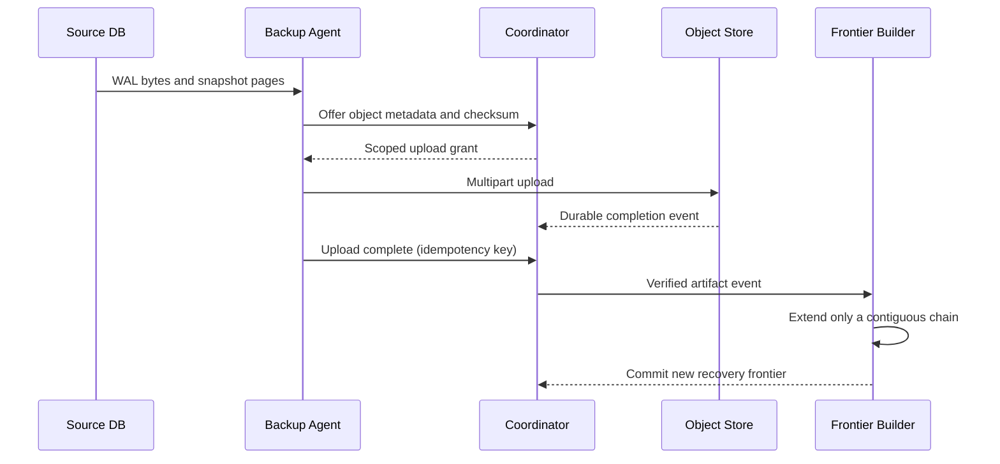
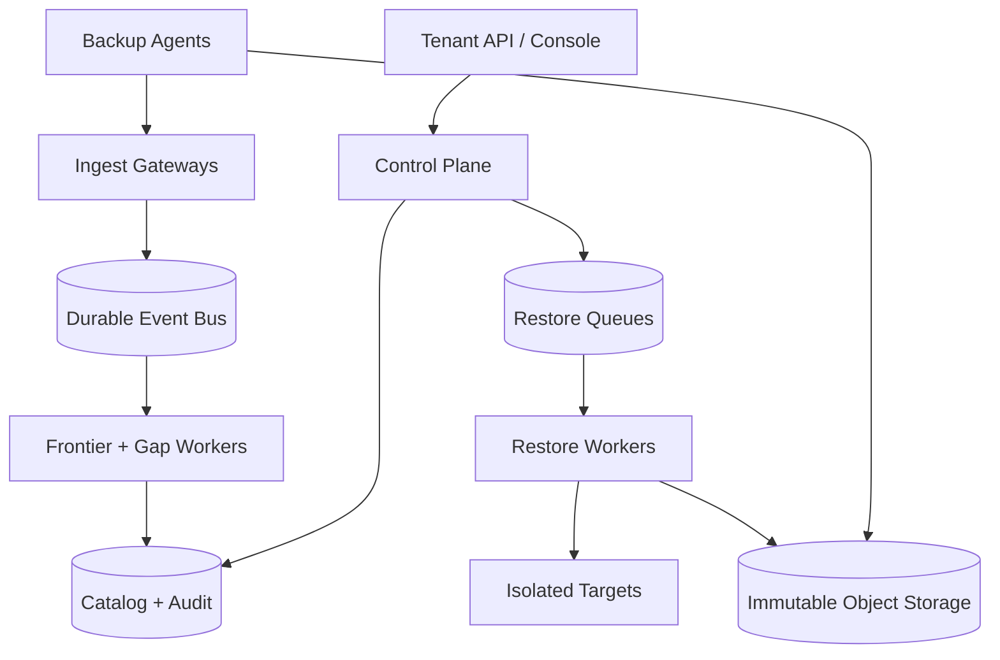
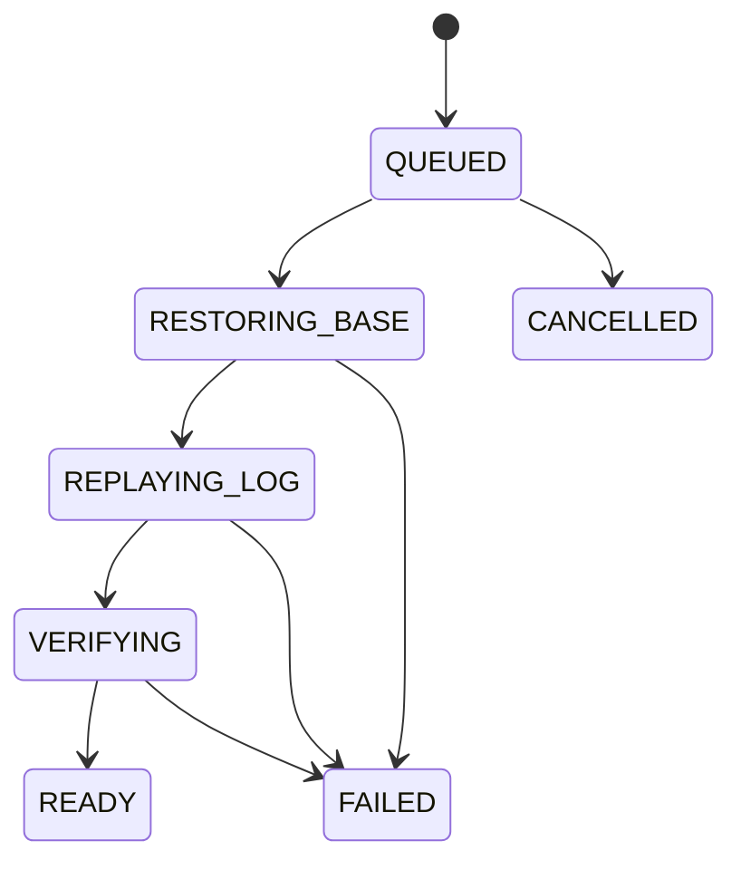

# Design a Multi-Tenant Continuous Backup and Point-in-Time Recovery Service

**Difficulty:** Senior / Staff  
**Primary themes:** databases, change-log ingestion, object storage, queues, consistency, restore correctness, ransomware resilience, multi-tenant reliability

## Interview prompt

> Design a managed service that continuously backs up PostgreSQL-compatible databases for many tenants and can restore a database to a chosen point in time. The service should support retention policies, legal holds, restore verification, and large-scale failures.

This is a deceptively rich question. Uploading files is easy; proving that a recovery point is complete, preserving it under attack, and restoring it within a useful time are the hard parts.

## Targeted clarifying questions and assumed answers

**Candidate:** Are we backing up only PostgreSQL-compatible databases, or arbitrary databases and filesystems?

**Interviewer:** Focus on PostgreSQL-compatible engines. You may define an engine-adapter boundary, but do not design every database's log format.

**Candidate:** What recovery experience matters most?

**Interviewer:** A tenant can choose any recoverable UTC timestamp within its retention window. The system restores into a new isolated database; it never overwrites the source by default.

**Candidate:** What scale should I design for?

**Interviewer:** One million registered database sources, 300,000 active at peak, 20 PB of protected logical data, and about 400 TB of changed data per day. A single source may be 100 TB.

**Candidate:** What are the recovery objectives?

**Interviewer:** For a healthy source, the recovery-point objective, or RPO, is under one minute for 99.9% of source-minutes. Start a restore within five minutes. Restore a typical 1 TB database within one hour when the tenant has reserved capacity.

**Candidate:** What durability and isolation are expected?

**Interviewer:** Backup data should survive an availability-zone loss, and premium policies can replicate to another region. Encrypt every tenant separately. Retained backups must resist accidental deletion and compromised production credentials.

**Candidate:** Do we need legal hold and auditability?

**Interviewer:** Yes. A legal hold prevents protected versions from expiring until explicitly released by an authorized role. Policy changes, deletion attempts, key operations, restores, and hold changes must be auditable.

**Candidate:** May backups briefly lag during a source outage?

**Interviewer:** Yes, but the service must expose the last *proven recoverable* timestamp. It must not claim coverage across a missing log segment.

**Candidate:** Is cross-region active-active restore required?

**Interviewer:** No. The control plane must remain highly available within a home region. Cross-region copies are asynchronous, and the UI must show their separate recovery frontier.

**Candidate:** Are analytics, logical table-level restore, and source failover in scope?

**Interviewer:** No. The core restore unit is a database cluster. A restore creates a new target. Table extraction may be a later extension.

### What I would say aloud

> “I’ll design for PostgreSQL physical backups: periodic base snapshots plus continuous write-ahead-log capture. The key contract is that the product advertises only timestamps backed by a usable snapshot and a gap-free log chain. I’ll cover policy and capture, recovery-point discovery, and isolated restore. Then I’ll deep-dive on correctness of the log frontier, cost and retention, and restore reliability under failure or attack.”

## Interview time budget versus this walkthrough

The live interview version should spend roughly 5 minutes on requirements, 2 on entities, 5 on interfaces, 10–15 on a complete high-level design, and 10–15 on selected deep dives. This follows the public [Hello Interview delivery framework](https://www.hellointerview.com/learn/system-design/in-a-hurry/delivery): establish the contract, name the nouns and interfaces, make the basic system work, then harden the design around the non-functional requirements.

This document is deliberately more detailed than what should be spoken in 45 minutes. In an interview, state the invariant and decision first, draw the main path, and let the interviewer choose which deep dive to explore.

---

## 1. Requirements (~5 minutes)

### Core functional requirements

1. **Configure protection and continuously capture backups.** A tenant registers a database, selects retention and regional policy, takes consistent base snapshots, and continuously uploads WAL segments.
2. **Discover honest recovery points and restore.** A tenant can inspect the contiguous recoverable interval, choose a timestamp, create an isolated target, follow progress, and receive verification results.
3. **Govern retained data.** A tenant can change future retention, place or release legal holds, run restore drills, and view an immutable audit trail.

### Out of scope

- Database query serving or source high availability
- Logical row/table recovery
- Backup-aware application consistency across multiple independent databases
- Arbitrary filesystem backup
- Full database provisioning internals
- Long-term analytics over backup contents

### Quantified non-functional requirements

| Requirement | Target | Architectural consequence |
|---|---:|---|
| Capture RPO | 99.9% of healthy source-minutes have a proven frontier less than 60 s old | Continuous WAL shipping, durable acknowledgement, gap detection, alerts |
| Restore admission | p99 restore job accepted and scheduled within 5 min for reserved tier | Separate restore queue, priority/fairness, reserved worker and network capacity |
| Restore throughput | 1 TB in under 60 min for reserved tier | At least ~300 MB/s sustained after overhead; parallel object reads and replay |
| Metadata availability | 99.99% monthly | Multi-AZ control plane and transactional catalog |
| Backup durability | Survive one AZ loss; premium copy survives regional loss | Multi-AZ object storage and optional independently tracked cross-region copy |
| Tenant isolation | No cross-tenant plaintext or deduplication oracle | Tenant-scoped encryption keys, authorization on every object reference |
| Recovery honesty | Never advertise a timestamp across a known snapshot/log gap | Monotonic contiguous frontier computed from verified artifacts |

### Consistency and availability contract

This system has two very different consistency domains.

**Control metadata is strongly consistent within a source's home region.** Policy generations, legal holds, restore state transitions, and the advertised recovery frontier use transactional writes or compare-and-swap. A successful legal-hold response must be authoritative.

**Backup bytes arrive asynchronously, but claims are conservative.** A WAL upload can be retried and arrive out of order. A timestamp becomes recoverable only after:

1. an eligible base snapshot is complete and its manifest is committed;
2. every required WAL interval from the snapshot checkpoint through the target is durably present;
3. checksums, source identity, timeline ancestry, and encryption metadata validate.

The system prefers stale-but-honest availability over inventing coverage. During a catalog partition, reads may return the last committed frontier with an `observed_at` timestamp. Mutations requiring strong guarantees fail closed if the source's catalog shard cannot establish quorum.

**Restore isolation:** a restore writes only to a newly provisioned target. Promoting it into production is an external, explicitly authorized operation.

### Decision-changing scale estimates

Assumptions supplied or derived from the prompt:

- Protected logical data: 20 PB
- Daily changed bytes: 400 TB/day
- Peak-to-average ingest ratio: 10×
- Average physical backup chunk: 4 MiB after content-defined boundaries, before compression
- Active sources: 300,000

Average change ingest is:

\[
400\ \text{TB/day} \div 86{,}400 \approx 4.6\ \text{GB/s}
\]

At 10× peak, the service must absorb roughly **46 GB/s** before replication. That rules out proxying backup bodies through stateless API servers. Agents should upload directly to object storage with short-lived, scoped upload grants; the control plane receives metadata and completion events.

At 4 MiB per stored chunk, 400 TB/day produces roughly:

\[
400\ \text{TB} \div 4\ \text{MiB} \approx 100\ \text{million chunks/day}
\]

A globally transactional row per chunk would be expensive and create a garbage-collection bottleneck. We should batch chunk references into immutable manifests and maintain coarse ownership/refcount summaries per tenant and storage partition.

One million agents heartbeating every 30 seconds create about **33,000 heartbeats/s**. That is significant but manageable with a sharded ingest/gateway tier and compact time-series storage; it does not justify a globally ordered heartbeat database.

For a 1 TB restore in one hour:

\[
1\ \text{TB} \div 3{,}600 \approx 278\ \text{MB/s}
\]

Allowing for decompression, checksums, random object latency, and WAL replay, reserve at least **350–500 MB/s** of aggregate object-read and target-write bandwidth per such job. This directly motivates parallel restore workers and admission control.

### What I would say aloud

> “Replication is not the same as backup: replication can quickly copy corruption or deletion. My recovery contract is conservative. Bytes may arrive asynchronously, but the advertised frontier moves only across a gap-free, verified chain. The 46 GB/s peak also tells me the data plane must go directly to object storage rather than through the API fleet.”

---

## 2. Core entities (~2 minutes)

Name the nouns before designing tables.

| Entity | Purpose and important fields |
|---|---|
| `Tenant` | `tenant_id`, plan, home region, quotas, key namespace |
| `Source` | `source_id`, tenant, engine/version, cluster identity, current timeline, agent identity, status |
| `BackupPolicy` | immutable `policy_generation`, base-snapshot cadence, retention, replica regions, immutability mode |
| `BaseSnapshot` | source, snapshot ID, checkpoint LSN, timeline, start/end time, manifest root, size, state |
| `BackupManifest` | ordered file/chunk references, checksums, compression/encryption metadata, schema version |
| `LogSegment` | source, timeline, start/end LSN, source time range, object version, checksum, state |
| `RecoveryFrontier` | source, region, earliest/latest recoverable time, latest contiguous LSN, evidence generation |
| `RestoreJob` | tenant, source, target time, chosen snapshot, target, state, progress, failure reason |
| `VerificationRun` | restore/job IDs, checks executed, evidence, outcome, duration |
| `RetentionLease` | artifact scope, retain-until, legal-hold IDs, policy generation |
| `AuditEvent` | actor, tenant, action, resource, before/after digest, request ID, time |

Do not put every chunk into the primary catalog. The catalog owns backup and manifest state. Immutable manifests stored in object storage list chunks; a separate sharded reference index supports lifecycle processing.

PostgreSQL WAL positions are represented here as **LSNs** (log sequence numbers), monotonic byte positions within a timeline. A PostgreSQL recovery can create a new timeline, so `(timeline_id, LSN)` plus timeline ancestry is required; LSN alone is not globally sufficient.

### What I would say aloud

> “The three correctness-bearing entities are the base snapshot, WAL segment, and recovery frontier. The frontier is derived evidence, not a promise based on agent heartbeats. I also model timeline ancestry because a recovered primary can fork history.”

---

## 3. API and system interface (~5 minutes)

The authenticated principal supplies `tenant_id`, actor ID, roles, and policy claims. Clients never choose a tenant in the body and cannot access another tenant by guessing IDs.

### Register a source and policy

```http
POST /v1/sources
Idempotency-Key: 85a4...
Authorization: Bearer <token>
Content-Type: application/json

{
  "display_name": "orders-primary",
  "engine": "postgresql-18",
  "region": "us-east-1",
  "policy": {
    "retention_days": 35,
    "base_snapshot_interval_hours": 24,
    "replica_regions": ["us-west-2"],
    "immutability_mode": "compliance"
  }
}
```

```json
{
  "source_id": "src_7F...",
  "policy_generation": 1,
  "agent_enrollment": {
    "expires_at": "2026-10-17T13:15:00Z",
    "one_time_token": "redacted"
  },
  "state": "AWAITING_AGENT"
}
```

The one-time token is exchanged for a workload identity bound to the source, not stored as a permanent database password.

### Agent control stream

Use a long-lived authenticated gRPC stream for commands and acknowledgements:

```protobuf
rpc BackupControl(stream AgentMessage) returns (stream CoordinatorMessage);

message AgentMessage {
  string source_id = 1;
  string agent_epoch = 2;
  oneof body {
    Heartbeat heartbeat = 3;
    SegmentOffer segment_offer = 4;
    UploadComplete upload_complete = 5;
    SnapshotProgress snapshot_progress = 6;
  }
}
```

`agent_epoch` fences a superseded agent after source failover or re-enrollment. Bulk data goes directly to object storage using upload grants constrained by tenant, source, object prefix, checksum, byte limit, and short expiry.

### Inspect recovery coverage

```http
GET /v1/sources/src_7F/recovery-window?region=us-east-1
```

```json
{
  "earliest_recoverable_time": "2026-09-12T00:00:00Z",
  "latest_recoverable_time": "2026-10-17T12:07:41Z",
  "observed_at": "2026-10-17T12:07:46Z",
  "rpo_seconds": 5,
  "coverage": "CONTIGUOUS",
  "cross_region": {
    "region": "us-west-2",
    "latest_recoverable_time": "2026-10-17T12:06:58Z"
  }
}
```

The two regional frontiers are never conflated.

### Request a restore

```http
POST /v1/restores
Idempotency-Key: restore-orders-20261017-1200
Content-Type: application/json

{
  "source_id": "src_7F",
  "target_time": "2026-10-17T12:00:00Z",
  "target": {
    "region": "us-east-1",
    "instance_class": "db.restore.8xlarge",
    "network_profile_id": "net_isolated_3"
  },
  "verification_profile": "standard"
}
```

```json
{
  "restore_id": "rst_91...",
  "state": "QUEUED",
  "resolved_plan": {
    "base_snapshot_id": "snap_A2...",
    "timeline_id": 41,
    "target_lsn": "7F/B62A9C10",
    "estimated_bytes": 1099511627776
  }
}
```

If the target time is outside proven coverage, return `409 RECOVERY_POINT_UNAVAILABLE` with the nearest safe bounds. Do not silently restore to a later timestamp.

### Track, cancel, and verify

```http
GET  /v1/restores/rst_91
POST /v1/restores/rst_91:cancel
POST /v1/sources/src_7F/verification-runs
GET  /v1/verification-runs/ver_28
```

A restore status includes phase, bytes restored, WAL replay position, target time, estimated completion, and structured failure details. Cancellation is best effort: it stops workers and destroys the incomplete isolated target, but does not delete source backups.

### Legal hold

```http
POST /v1/legal-holds
{
  "source_id": "src_7F",
  "from": "2026-10-01T00:00:00Z",
  "through": "2026-10-02T00:00:00Z",
  "case_reference": "CASE-4815"
}
```

The service resolves the time interval to the base snapshots, WAL objects, manifests, and encryption metadata required for restoration. It transactionally records the hold intent before applying object-level protection, then reports `PENDING`, `ACTIVE`, or `FAILED`; only `ACTIVE` is a completed hold.

---

## 4. Data flow

Backup and restore are long-running pipelines, so an explicit data flow is useful.



For restore:

1. Planner chooses the newest eligible base snapshot at or before the target.
2. It resolves the exact timeline path and contiguous WAL interval to the target.
3. Admission control reserves object-read, compute, and target-write capacity.
4. Workers restore snapshot files in parallel, verifying authenticated checksums.
5. A replay worker applies WAL in database order and stops at the requested transaction/time boundary.
6. The target starts in an isolated network; verification checks engine recovery, catalog readability, sampled page checksums, and optional tenant probes.
7. The job becomes `READY` only after verification. The user separately decides whether to cut applications over.

---

## 5. High-level design (~10–15 minutes)

### Compact architecture



The **control plane** owns tenants, policies, source enrollment, jobs, authorization, audit records, and the recovery frontier. The **data plane** transfers snapshot and log bytes directly between agents/workers and object storage. The durable bus decouples completion events from validation, frontier calculation, replication, retention, and monitoring.

### Operation 1: Register and protect a source

1. The API authenticates the operator and derives the tenant from the token.
2. A transaction creates `Source`, immutable `BackupPolicy` generation 1, quota reservations, and an audit event.
3. The service returns a short-lived enrollment token.
4. The agent exchanges it for workload credentials. Attestation records the source cluster's stable system identifier, engine version, current timeline, and agent epoch.
5. The policy scheduler emits a base-snapshot command and begins WAL capture immediately.

The coordinator never stores a reusable superuser password. For hosted databases, an adapter uses the provider's scoped snapshot/log APIs; for self-managed PostgreSQL, the agent receives least-privilege database and filesystem capabilities.

### Operation 2: Create a consistent base snapshot

A raw copy taken while the database changes may contain partially written pages. PostgreSQL's backup protocol provides a checkpoint and WAL boundary so the restored files can be made consistent by replaying WAL. The official PostgreSQL PITR documentation describes recovery as restoring a physical base backup and replaying a continuous WAL archive to the desired point: [Continuous Archiving and Point-in-Time Recovery](https://www.postgresql.org/docs/current/continuous-archiving.html).

Baseline sequence:

1. Coordinator assigns `snapshot_id`, policy generation, `agent_epoch`, and attempt number.
2. Agent starts the engine's online backup procedure and records the checkpoint/timeline metadata.
3. Agent scans files and splits them into stable chunks. It compresses, encrypts with a random data key, and uploads in parallel.
4. For each object, the object store validates length and checksum. Completion events flow through the bus.
5. Agent finishes the engine backup procedure, obtains the end LSN and backup history, and uploads an immutable manifest.
6. Validator proves every referenced object exists and matches its authenticated checksum.
7. A catalog transaction changes the snapshot from `UPLOADING` to `COMPLETE` and stores the manifest root. It cannot become eligible while any reference is missing.

The manifest contains paths, sizes, mode bits, engine metadata, chunk references, plaintext content hashes inside authenticated encrypted metadata, ciphertext checksums, key version, and format version. Versioning lets future restore code read older backups.

**Why commit a manifest last?** It acts as the atomic publication boundary. Millions of independently uploaded chunks are not a backup until one verified immutable manifest names the exact set.

### Operation 3: Continuously capture WAL

The agent streams or archives closed WAL segments. Large fixed engine segments may be sub-chunked for transport, but the catalog reasons in contiguous LSN intervals.

1. Agent offers `(source, timeline, start_lsn, end_lsn, checksum)`.
2. Coordinator returns an existing receipt if that identity was already committed, or a scoped upload grant otherwise.
3. Agent uploads bytes directly and retries safely after ambiguous timeouts.
4. Validator checks object durability, checksum, header/source identity, timeline, and interval.
5. A unique key on `(source_id, timeline_id, start_lsn, end_lsn, plaintext_hash)` makes identical retries idempotent. Conflicting bytes for the same interval quarantine the source and page an operator.
6. The source receives durable acknowledgement only after the object and catalog receipt satisfy the policy's durability threshold.

Agents retain a local spool until acknowledgement. If the network is down, the spool grows and the control plane exposes `CAPTURE_AT_RISK`. Backpressure protects the source host: the agent caps CPU, I/O, and disk usage, then alerts before local WAL recycling would create an unrecoverable gap.

### Operation 4: Compute and expose recovery points

The frontier builder consumes verified artifact events partitioned by `source_id`. For each timeline it maintains an interval set and a current contiguous high-water mark.

Suppose the latest usable snapshot ends at LSN 100. Segments `[100,120)`, `[140,160)`, and then `[120,140)` may arrive out of order:

- after the first segment, frontier = 120;
- after `[140,160)`, frontier remains 120 because `[120,140)` is missing;
- after `[120,140)`, frontier jumps to 160.

The advertised time is derived from WAL records at or below that LSN, never from upload wall-clock time. Periodic reconciliation independently lists expected catalog/object ranges to catch lost events.

The catalog update is compare-and-swap on `frontier_generation`, so an old worker cannot move the frontier backward or publish stale ancestry. Deleting expired history may move the *earliest* time forward, but it never changes the latest frontier incorrectly.

### Operation 5: Plan and execute a restore

When `POST /restores` arrives:

1. API checks authorization, tenant quota, target isolation, and the target against the chosen region's committed recovery window.
2. Planner selects the newest compatible complete base snapshot whose recovery range includes the target. Newer reduces WAL replay; older may be chosen when a recent snapshot is suspected or held in a different region.
3. Planner pins an immutable `evidence_generation`: snapshot manifest version, timeline path, required WAL object versions, key versions, and verification policy.
4. Job record and outbox event commit together. The outbox prevents a database commit followed by lost queue publication.
5. Scheduler uses weighted fair queuing by tenant and restore class. Reserved disaster-recovery capacity is protected from routine test jobs.
6. Parallel workers fetch, decrypt, decompress, checksum, and write base files. Work units are idempotent and checkpointed.
7. One engine-aware stage replays the ordered WAL stream to the exact target boundary.
8. Verifiers start the target without application ingress, run health/integrity probes, emit evidence, and transition the job to `READY`.

The response may be asynchronous, but job state changes are monotonic:



Retries resume from verified checkpoints. A retry may allocate new workers, but it uses the pinned plan unless an operator explicitly replans, preserving reproducibility.

### Operation 6: Retain, hold, and expire

Retention is an asynchronous workflow with a fail-safe ordering:

1. Compute which artifacts are reachable from every unexpired snapshot, active restore, verification run, cross-region copy, and legal hold.
2. Produce a signed deletion plan and wait through a safety delay.
3. Re-evaluate reachability against a newer catalog generation.
4. Delete only object versions that are both unreachable and past storage-enforced retention.
5. Tombstone reference-index entries; compact them later.

Policy shortening affects future eligibility but cannot defeat storage-enforced retention or an active legal hold. Legal hold activation enumerates and pins the complete restore closure, not merely the top-level manifest.

### Baseline failure handling

| Failure | Behavior |
|---|---|
| Agent retries after lost acknowledgement | Idempotent artifact identity returns the previous receipt |
| Upload completes but event is lost | Periodic reconciler discovers the object and re-emits validation work |
| Event delivered twice | Consumer inbox/dedup key prevents duplicate state transition |
| Coordinator dies after catalog commit | Transactional outbox republishes work |
| WAL interval is missing | Frontier stops before the gap; alert and request retransmission |
| Object checksum fails | Quarantine object, fetch another replica if available, never advance frontier |
| Restore worker dies | Lease expires; another worker resumes completed verified units |
| Source is re-enrolled | Higher agent epoch fences old credentials and messages |
| Catalog quorum is unavailable | Reads serve bounded-stale frontier; holds/deletes/frontier mutation fail closed |

### What I would say aloud

> “I publish a backup by committing its manifest last. WAL uploads are at-least-once, so identity and checksums make them idempotent. A per-source frontier worker can consume out of order but advances only across contiguous intervals. Restore pins that evidence generation, restores the base in parallel, replays WAL in order, and exposes the target only after verification.”

---

## 6. Deep dives (~10–15 minutes)

### Deep dive A: Honest PITR across gaps, duplicates, and timeline forks

#### Where the baseline breaks

“Latest uploaded timestamp” is not a recovery guarantee:

- uploads can complete out of order;
- a segment may be corrupt despite a successful HTTP response;
- two agents may upload conflicting bytes after failover;
- PostgreSQL recovery can fork a new timeline;
- clocks on the database host and service can skew;
- the base snapshot may not be usable with the observed WAL chain.

The official PostgreSQL model requires a usable base backup and a continuous sequence of archived WAL. It also models timeline history after recovery; therefore, a flat timestamp-indexed object list is insufficient.

#### Plausible approaches

| Approach | Advantages | Breakage / cost |
|---|---|---|
| Advertise newest object timestamp | Very simple | Lies across gaps; clock-dependent |
| Sort segments in a SQL query on every read | Easy initial implementation | Expensive at scale; races with validation; timeline handling is awkward |
| Per-source contiguous frontier from verified intervals | Cheap reads, explicit invariant, naturally conservative | Requires partition ownership, checkpoints, and reconciliation |
| Consensus group per source | Strong serialization | Far too expensive for one million mostly quiet sources |

#### Selected design

Use a **partitioned frontier builder**. A durable stream is partitioned by source, and one leased logical owner processes a source at a time. Correctness still lives in compare-and-swap catalog generations, not solely in lease timing.

Maintain:

- current source system ID and agent epoch;
- timeline ancestry DAG;
- complete base snapshots and their start/end LSNs;
- verified WAL interval sets per timeline;
- latest contiguous LSN and time per storage region;
- explicit gaps with first-seen time and retransmission status.

On each artifact:

1. Validate tenant/source binding and epoch.
2. Validate engine header and ciphertext/plaintext hashes.
3. Merge the interval into the timeline's interval set.
4. Starting at the current frontier, repeatedly consume intervals whose start is at or before the frontier and whose end extends it.
5. Resolve commit timestamps only from database log metadata below the continuous LSN.
6. Prove at least one retained base snapshot connects to that path.
7. Compare-and-swap the new evidence generation.

#### Timeline forks

After PITR or promotion, PostgreSQL creates a new timeline. The same numeric LSN can appear in histories with different futures. Store timeline history files and require a child timeline to declare its parent and fork LSN. A restore to timeline 44 can use an ancestor's snapshot only if the target path follows valid ancestry through the fork.

If two live agents claim divergent children from the same source without an authorized failover event, quarantine both branches rather than picking whichever arrived last.

#### RPO measurement

Measure at least three lags:

- **generation lag:** source's latest durable WAL time minus now;
- **upload lag:** newest locally generated interval minus newest durably acknowledged interval;
- **proven-recovery lag:** now minus advertised recoverable time.

Only the third is the customer RPO. The other two diagnose why it is bad. Exclude explicitly paused or unreachable sources from the “healthy source-minutes” SLO denominator, but report them separately; otherwise the SLO can be gamed.

#### Failure modes and observability

Alert on:

- frontier lag by tenant tier and source size;
- gap age and bytes at risk in the agent spool;
- conflicting interval hashes;
- frontier CAS failures and partition rebalances;
- validation backlog and oldest event age;
- orphaned complete objects without catalog receipts;
- sources with no usable base snapshot despite current WAL.

Run synthetic canaries that generate known transactions, record commit markers, back up, restore to before and after each marker, and verify the expected presence/absence.

#### What I would say aloud

> “Freshness is not the latest object time. My customer-facing RPO is the age of a frontier backed by a complete snapshot and continuous verified WAL on one valid timeline path. Out-of-order segments can fill holes, but the frontier stops at the first gap. Timeline ancestry prevents replaying the wrong post-recovery history.”

### Deep dive B: Storage cost, encryption, retention, and garbage collection

#### Where the baseline breaks

With 20 PB protected and 400 TB/day of changes, naïvely copying full databases daily is economically poor. Conversely, aggressive global deduplication creates privacy and authorization risks:

- an attacker can test whether another tenant owns known content;
- shared chunks complicate tenant deletion and cryptographic erasure;
- one corrupted or prematurely deleted chunk damages many tenants;
- reference counts become a globally hot, correctness-critical system.

#### Plausible approaches

| Approach | Cost | Isolation | Operational complexity |
|---|---|---|---|
| Full snapshot copies | Highest | Strong and simple | Simple restore and deletion |
| Per-source incremental forever | Low writes | Strong | Long chains hurt restore and amplify missing-delta risk |
| Global content-addressed dedupe | Lowest potential bytes | Weakest side-channel boundary | Global refcounts, blast radius, key complexity |
| Tenant-scoped chunk reuse + periodic synthetic fulls | Good | Strong | Moderate indexing and compaction |

#### Selected design

Use **tenant-scoped deduplication** where policy permits, plus compression and periodic synthetic full manifests.

- Chunk boundaries are content-defined enough to reuse unchanged regions after file shifts.
- Chunk hashes are computed inside the trusted agent and stored only in encrypted/authenticated manifest metadata.
- Dedup lookup keys are HMACs under a tenant-specific secret, so equal plaintext in different tenants does not reveal a shared identifier.
- Actual objects use random data keys with authenticated encryption. Data keys are wrapped by a tenant key-encryption key in a managed KMS/HSM.
- Highly regulated tenants may disable dedupe and use source-isolated buckets/prefixes and keys.

A **synthetic full** is a new manifest that references an already-uploaded set of chunks, without rereading or rewriting all source bytes. It shortens catalog/recovery planning chains while retaining storage efficiency.

#### Why not only reference counts?

Reference counts are fast but fragile under lost increments, retries, and legal holds. Use a hybrid:

1. Online approximate/sharded reference summaries prevent obvious premature deletion.
2. Periodic mark-and-sweep walks immutable live manifests and hold closures to build an authoritative live set.
3. Deletion candidates wait through a long grace period.
4. The collector rechecks catalog generation, active restores, and holds immediately before deletion.

This makes leaks more likely than data loss—an intentional bias for a backup product.

#### Immutability and separation of duties

Object storage versioning plus WORM retention protects specific object versions from overwrite or deletion. AWS's official [S3 Object Lock documentation](https://docs.aws.amazon.com/AmazonS3/latest/userguide/object-lock.html) distinguishes time-based retention from legal holds and documents compliance mode for preventing deletion during the retention period.

Apply the principle, independent of vendor:

- backup objects live in a separate security/account boundary from production;
- production agents have create-only grants, never delete/list-all;
- lifecycle workers cannot shorten compliance retention;
- hold administrators cannot read backup plaintext merely because they can manage holds;
- key administrators are separate from backup deletion administrators;
- break-glass actions require multi-party approval and append-only audit evidence;
- premium policies copy objects and required metadata to an independently administered region/account.

The [CISA StopRansomware Guide](https://www.cisa.gov/stopransomware/ransomware-guide) recommends offline or isolated encrypted backups, immutable/delete-protected storage, and regular recovery testing. Storage immutability alone is insufficient if an attacker can destroy encryption keys, catalog metadata, or every trusted restore identity, so protect and replicate those dependencies too.

#### Retention semantics

For every artifact, effective retention is the maximum of:

- policy-derived retain-until;
- all active legal holds;
- active restore/verification leases;
- cross-region replication safety lease;
- incident preservation hold.

Changing a 35-day policy to 7 days does not retroactively bypass a 35-day compliance lock already applied. Legal hold has no expiry unless authorized release is completed and audited.

#### Cost and observability

Track cost by tenant and policy:

- logical protected bytes versus physical stored bytes;
- compression and tenant-scoped reuse ratios;
- chunks created/reused per snapshot;
- hot, cool, and archive tier bytes;
- retrieval and early-deletion fees;
- stranded bytes awaiting mark-and-sweep;
- retained bytes attributable to each hold;
- cross-region backlog and copy cost.

Do not archive WAL so aggressively that the one-hour RTO is impossible. Storage tiering is an RTO decision: cold objects may need hours of retrieval. The planner should expose this before accepting a restore or keep the recent recovery window in a rapid-access tier.

#### What I would say aloud

> “I would not globally deduplicate encrypted customer backups. The savings are attractive, but it creates a cross-tenant oracle and a shared deletion blast radius. I’ll reuse chunks only within a tenant, publish synthetic-full manifests, and use conservative mark-and-sweep with a grace period. Storage-enforced WORM, separate credentials, protected keys, and restore drills together provide ransomware resilience.”

### Deep dive C: Meeting restore RTO during normal faults and regional disasters

#### Where the baseline breaks

A backup is valuable only if it can be restored. The happy-path design can miss RTO because:

- thousands of tenants restore simultaneously after a regional event;
- snapshot objects are cold or concentrated on a few storage partitions;
- replaying a day of WAL is CPU- or I/O-bound;
- the target volume accepts writes more slowly than object storage can read;
- a few corrupt chunks appear late in a multi-hour restore;
- a large tenant monopolizes workers;
- KMS, DNS, catalog, or network dependencies fail even though backup bytes survive.

#### Plausible approaches

| Approach | Benefit | Tradeoff |
|---|---|---|
| Restore on one large worker | Simple | Poor parallelism and failure recovery |
| Parallel file/chunk restore, ordered WAL replay | High base-copy throughput | Requires planning, checkpoints, and bandwidth control |
| Prewarm every backup into runnable replicas | Fastest RTO | Prohibitively expensive; becomes HA, not backup |
| Serverless burst workers | Elastic | Capacity may vanish in a regional disaster; cold start and quota risk |

#### Selected design

Use two-stage restore with explicit capacity classes.

**Stage 1: parallel base materialization**

- Partition work by target file/range.
- Use hundreds of bounded concurrent reads for large databases.
- Verify ciphertext checksum before decrypt and authenticated plaintext hash after.
- Write directly into preallocated target volumes.
- Persist completion bitmaps so a worker replacement does not repeat terabytes.
- Fetch manifest and a small sample of every storage partition early to discover access/key/corruption failures before most work is done.

**Stage 2: ordered engine recovery**

- Prefetch and verify WAL ahead of replay.
- Preserve database order; parallelize decompression and fetch, not transaction application when the engine requires order.
- Choose a recent base snapshot when replay cost would dominate.
- Capture replay LSN/time and expose it as progress.

#### Admission and fairness

Maintain queues by region and class: emergency reserved, paid reserved, standard restore, and automated verification. Within a class, use weighted fair queuing by tenant and deficit accounting by estimated bytes/CPU, not merely job count.

Before admission, reserve three resources:

1. object-store read bandwidth and request rate;
2. restore worker CPU/memory/KMS rate;
3. target volume/network write capacity.

If the system cannot meet the requested reserved-tier objective, reject or give an honest estimate rather than accepting every job into an unbounded queue.

For the 1 TB/hour target, a plan might reserve four workers at 125 MB/s useful throughput each. The theoretical 500 MB/s leaves margin above the ~278 MB/s minimum. Runtime control reduces concurrency if target write latency or storage throttling rises.

#### Regional disaster strategy

Cross-region data is only useful with cross-region metadata and keys. Replicate:

- completed manifests and WAL objects;
- timeline histories and recovery frontier evidence;
- policy and legal-hold state;
- wrapped data keys or a disaster-recovery key path;
- restore software/images and configuration;
- tenant network templates and identity mappings.

The secondary frontier advances only after all required bytes and metadata exist there. During home-region loss, elect or authorize the recovery control plane with a fenced epoch. It exposes the secondary region's own frontier, which may trail the primary due to asynchronous copy.

#### Verification as a product feature

Checksums prove bytes match what was uploaded; they do not prove that the source backup procedure was correct, keys remain usable, or recovery software can boot the database. Schedule restore drills:

- small tenants: full periodic restore;
- very large tenants: rotating full restores plus frequent sampled materialization, manifest closure, key unwrap, and WAL parsing;
- critical tenants: tenant-provided read-only smoke tests.

A verification report includes the exact evidence generation, restored time/LSN, engine version, bytes checked, tests, duration, and expiration of confidence. Alert when a policy has not had a successful drill within its required interval.

#### Dependency and corruption failures

- **Object replica corruption:** checksum fails; retrieve another replica or region, repair asynchronously, never mask the event.
- **KMS outage:** pause before allocating excessive target capacity; retry with bounded backoff; emergency key service is separately capacity-tested.
- **Catalog outage:** already pinned restore workers may continue from signed plan bundles; new planning fails closed.
- **Target volume throttling:** adaptive concurrency prevents read buffers from exhausting memory.
- **Poison WAL:** mark the restore failed at exact LSN, quarantine the object, test another replica, and preserve forensic evidence.
- **Mass restore storm:** reserve emergency pools, apply tenant fairness, surface estimates, and support administrator disaster priorities.

#### Observability

Measure:

- queue wait by class and region;
- time to first restored byte and time per phase;
- useful MB/s versus read/write throttling;
- checksum/key failures by storage partition;
- WAL replay MB/s and seconds of database time replayed per second;
- RTO success by source-size bucket;
- verification freshness and failure taxonomy;
- reserved-capacity utilization and failed reservation admissions.

#### What I would say aloud

> “RTO is a capacity contract, not just a parallel-for-loop. I reserve read, compute, and target-write capacity before admitting a premium restore. Base files restore in parallel with checkpoints; WAL fetch and verification are pipelined but replay remains engine ordered. Cross-region recovery tracks its own frontier and includes catalog, keys, and identities—not just copied data.”

---

## Reliability, security, and operational review

### Invariants worth writing on the board

1. `advertised frontier <= latest timestamp provable from a complete snapshot and contiguous verified WAL`.
2. A `COMPLETE` snapshot's immutable manifest references only verified durable object versions.
3. A restore plan pins one snapshot, one valid timeline path, exact object versions, and key versions.
4. No object is deleted while reachable from an unexpired backup, active restore, replica lease, incident hold, or legal hold.
5. An old agent epoch cannot advance coverage or overwrite a newer source history.
6. Restore never mutates the protected source.

### Multi-AZ and disaster recovery

- Run API, catalog quorum, stream brokers, and workers across at least three AZs.
- Object storage supplies multi-AZ durability; catalog backups are separately immutable and restore-tested.
- Keep a signed inventory root so catalog reconstruction can discover manifests without trusting mutable list results alone.
- Premium policies asynchronously copy the complete recovery closure to another region/account.
- Regularly rehearse loss of the catalog, KMS path, worker image registry, DNS, identity provider, and an entire region.

### Security boundaries

- Per-tenant authorization precedes every catalog and object reference resolution.
- Upload grants are write-only, object-specific, checksum-bound, size-limited, and short-lived.
- Restore credentials cannot delete backups; lifecycle credentials cannot decrypt tenant data.
- Agent software is signed and auto-updated; source identity and epoch are attested.
- Metadata that leaks database names, sizes, or timing is encrypted or access-controlled.
- Audit events are append-only, hash-chained or transparency-log anchored, and exported to a separate security account.
- Sensitive restore targets default to isolated networks with no public endpoint.

### Operational dashboards

**Fleet health:** protected sources, paused/unhealthy sources, frontier-lag distribution, snapshot success, agent versions, spool exhaustion risk.

**Pipeline health:** ingest GB/s, validation lag, bus age, duplicate rate, gap count, reconciler discoveries, object-store and KMS throttling.

**Restore health:** queue depth, admission latency, throughput by phase, RTO attainment, cancellation cleanup, verification pass rate.

**Safety:** legal holds pending/failed, retention mismatches, deletion candidates and vetoes, cross-region frontier lag, conflicting artifacts, failed audit export.

### SLO alert examples

- Page when more than 0.1% of healthy premium source-minutes have proven frontier lag above 60 seconds over a 10-minute window.
- Ticket immediately on any conflicting hash for the same source/timeline/LSN interval.
- Page if a legal hold remains `PENDING` beyond its 15-minute activation SLO.
- Page if cross-region frontier lag exceeds policy or if replication lacks necessary key metadata.
- Stop all garbage collection in a partition when reachability reconciliation, audit export, or catalog generation checks are unhealthy.

---

## 7. Concise final design

> “A tenant enrolls a PostgreSQL source and an immutable policy generation. A fenced agent takes engine-consistent base snapshots and continuously ships WAL. Bulk bytes go directly to versioned, encrypted object storage; manifests are committed last as the snapshot publication boundary. Uploads are at-least-once and idempotent by source, timeline, LSN interval, and checksum. A partitioned frontier service advances the customer-visible recovery timestamp only across a complete snapshot and gap-free verified WAL path, with a separate frontier per region.
>
> “A restore request pins an evidence generation: base manifest, timeline ancestry, WAL object versions, and key versions. Admission control reserves storage-read, worker, and target-write capacity. Workers materialize base files in parallel, then the engine replays prefetched WAL in order to the exact target. Verification runs in an isolated target before the job becomes ready. Retention uses storage-enforced immutability, tenant-scoped encryption and dedupe, legal-hold closure, and conservative mark-and-sweep. Separate credentials, protected keys, cross-region evidence, audit logs, and recurring restore drills make the system useful against both infrastructure failure and destructive compromise.”

## Requirements check

| Requirement | How the design meets it |
|---|---|
| Configure and continuously back up | Versioned policies, fenced agents, online base snapshots, direct WAL upload |
| Point-in-time discovery | Per-source contiguous frontier derived from verified snapshot + WAL evidence |
| Restore to isolated target | Pinned plan, capacity admission, parallel base restore, ordered WAL replay, verification |
| Retention and legal hold | Reachability closure, storage-enforced retention, asynchronous hold activation, audit |
| RPO under 60 s | Continuous ship, local spool, partitioned frontier, gap alerts, proven-recovery SLO |
| 1 TB/hour premium restore | 350–500 MB/s reserved aggregate path, parallel workers, replay planning |
| AZ and regional resilience | Multi-AZ control/data plane; optional independently tracked regional copy |
| Tenant isolation | Auth-derived tenant, tenant keys, no cross-tenant dedupe, scoped grants |
| Honest consistency | Strong metadata transitions, monotonic evidence generations, fail-closed mutations |
| Ransomware resilience | Separate boundary, WORM/versioning, immutable audit, key protection, restore drills |

---

## Realistic interviewer follow-ups with strong sample answers

### 1. Why not just use storage snapshots every minute?

**Candidate:**

> “Frequent volume snapshots may be useful when the infrastructure supports crash-consistent incremental snapshots, but they do not automatically capture database semantics or an exact transaction boundary. They can also create high metadata cost and vendor lock-in. I would treat them as an engine adapter: record a checkpoint, snapshot the volumes, retain WAL from the checkpoint, and prove consistency before advertising a frontier. The core contract remains base image plus continuous log.”

### 2. How do you acknowledge WAL without losing the one-minute RPO?

> “I acknowledge only after the configured durable threshold: the object version is complete, checksum verified, and its receipt is committed. The agent keeps a local spool until then. To reduce latency, it can stream small partial objects or sealed subsegments, but the frontier moves only when intervals are continuous. I would measure acknowledged lag separately from proven-recovery lag.”

### 3. Could at-least-once delivery duplicate WAL during restore?

> “The ingest identity makes exact retries collapse. The restore plan names one object version for each required interval. If two objects claim the same interval and hash, one is redundant; if hashes differ, that is corruption or split-brain and the branch is quarantined. Restore never concatenates every object returned by a list call.”

### 4. What happens if a source deletes a table and discovers it two days later?

> “The tenant selects a time before the destructive transaction. I resolve a retained snapshot plus WAL path to that time and restore a new isolated cluster. I do not rewind production. The application owner validates the restored state, then chooses a cutover or logical extraction strategy outside this service.”

### 5. Can you guarantee exactly one restore job for an idempotency key?

> “Within a tenant and retention window, a unique `(tenant_id, idempotency_key)` row stores the request digest and restore ID. A retry with the same digest returns the original job; a different digest returns a conflict. Queue publication uses a transactional outbox, while workers also deduplicate by job and phase.”

### 6. How do policy updates interact with in-flight backups?

> “Every snapshot and log receipt records a policy generation. An in-flight snapshot completes under its pinned generation. The new generation applies to newly scheduled work. Retention computes the maximum obligation across artifacts, old locks, holds, and active jobs, so shortening a policy never removes data that remains protected.”

### 7. Why store both ciphertext and plaintext hashes?

> “A ciphertext checksum detects transport and storage corruption without decryption. An authenticated plaintext hash validates decryption/decompression and enables tenant-scoped reuse. The plaintext hash is not globally visible; it is protected in manifest metadata or transformed with a tenant HMAC to avoid cross-tenant membership tests.”

### 8. What if the backup catalog is destroyed?

> “I continuously back up the catalog into a separate immutable boundary and test that restore. The object layout also contains signed self-describing manifest roots and an inventory index so we can rebuild source-to-manifest relationships. Legal-hold and key metadata are replicated separately. Recovery is rehearsed; object bytes without catalog and keys are not a sufficient backup.”

### 9. How do you avoid a noisy tenant monopolizing restore capacity?

> “Queues are separated by service class, then weighted-fair by tenant. Cost is charged in estimated bytes, I/O, and CPU rather than job count. Each admitted job gets bounded concurrency and reserved tokens. Emergency capacity is not consumed by routine verification jobs, and very large restores progress without starving small ones.”

### 10. How do you verify a 100 TB backup without restoring 100 TB every day?

> “I layer confidence. Every upload gets checksums and manifest-closure validation. Frequent tests sample chunks across storage partitions, unwrap keys, parse WAL, and materialize selected files. Less frequently, a rotating schedule performs a full restore; critical tenants can pay for dedicated full drills. I report the exact level and age of verification rather than labeling an untested checksum as a successful restore.”

### 11. Would you make the control plane globally active-active?

> “Not initially. Each source has a home-region catalog shard with multi-AZ quorum, which keeps policy and frontier transitions simple. Cross-region bytes and evidence replicate asynchronously. Disaster failover uses a fenced control-plane epoch and exposes the secondary's confirmed frontier. Global active-active writes add conflict resolution to safety-critical hold and retention state without helping the main data path much.”

### 12. How would you support MySQL later?

> “Keep generic orchestration around immutable base manifests, ordered-log intervals, frontiers, retention, and restore jobs. Add an engine adapter that defines source identity, snapshot protocol, log coordinates such as binlog/GTID, ancestry/failover rules, timestamp resolution, and replay/verification commands. I would not pretend PostgreSQL LSN and timeline semantics are universal.”

---

## Common pitfalls

1. Treating replication as backup.
2. Advertising the newest uploaded timestamp without proving a continuous log chain.
3. Ignoring database timelines or failover forks.
4. Proxying tens of GB/s through API servers.
5. Declaring a snapshot complete before its immutable manifest and every referenced object are verified.
6. Using agent heartbeats as proof of recoverability.
7. Acknowledging WAL before durability and then allowing the source to recycle it.
8. Assuming exactly-once queues remove the need for idempotency.
9. Globally deduplicating tenant plaintext without discussing side channels and deletion blast radius.
10. Encrypting data but failing to protect or replicate the keys.
11. Applying legal hold only to a top-level snapshot row rather than its full restore closure.
12. Letting a retention-policy change shorten an already enforced compliance period.
13. Deleting on reference counts alone without reconciliation and a grace period.
14. Copying bytes cross-region but omitting catalog, identity, timeline, and key metadata.
15. Promising a one-hour restore without bandwidth arithmetic or admission control.
16. Restoring directly over the production source.
17. Verifying checksums but never performing an actual restore.
18. Ignoring cold-tier retrieval delay when stating RTO.
19. Having one credential that can both decrypt and delete all backups.
20. Omitting auditability for hold release, deletion, restore, and key operations.

## Closing perspective

The strongest answer makes one distinction repeatedly: **stored bytes are not the same as a proven recovery point**. Correctness comes from a complete base image, an unbroken and correctly branched log history, durable metadata and keys, and a restore path that is continuously exercised. Once that invariant is explicit, the choices around queues, manifests, frontiers, storage tiers, garbage collection, and regional recovery become easier to justify.

## Public references

- [Hello Interview: System Design Delivery Framework](https://www.hellointerview.com/learn/system-design/in-a-hurry/delivery)
- [PostgreSQL: Continuous Archiving and Point-in-Time Recovery](https://www.postgresql.org/docs/current/continuous-archiving.html)
- [PostgreSQL: Backup and Restore](https://www.postgresql.org/docs/current/backup.html)
- [Amazon S3: Locking objects with Object Lock](https://docs.aws.amazon.com/AmazonS3/latest/userguide/object-lock.html)
- [CISA: StopRansomware Guide](https://www.cisa.gov/stopransomware/ransomware-guide)
