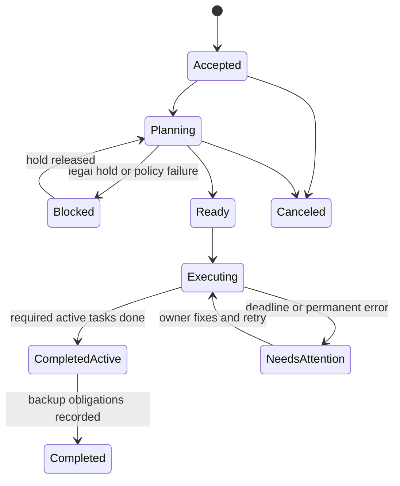
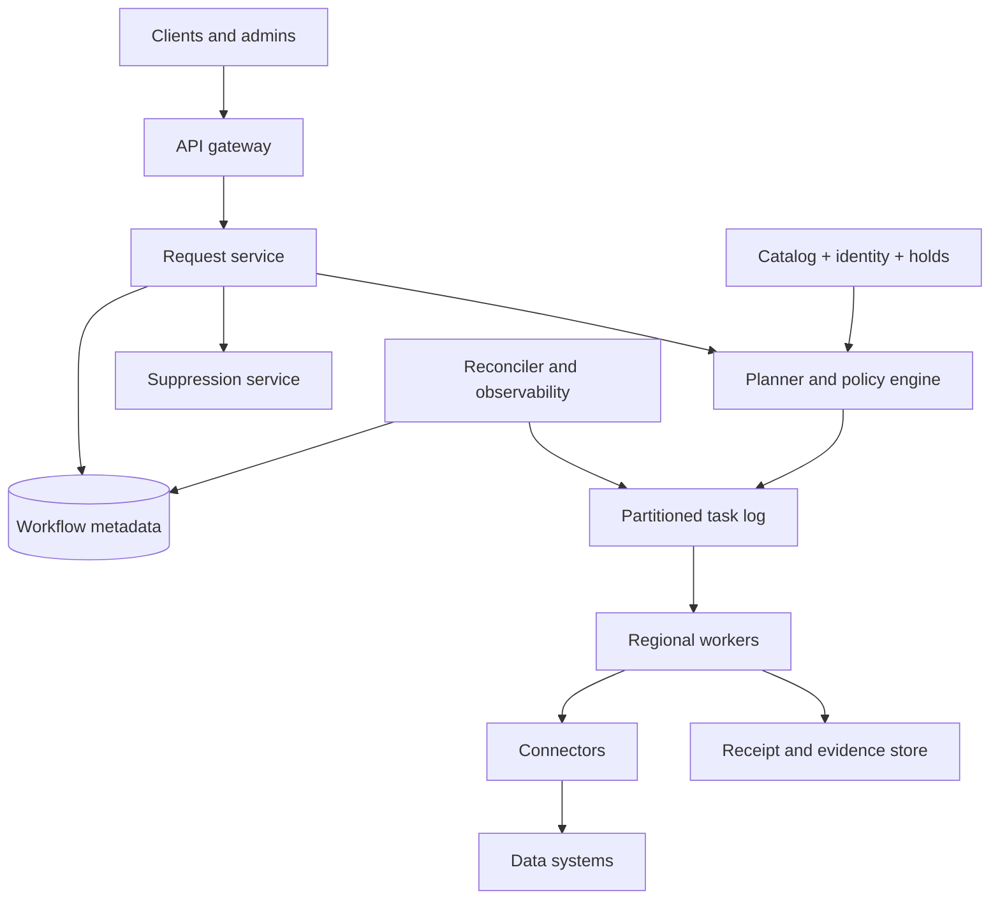

# Design a Global Data Deletion and Retention Orchestrator

**Difficulty:** Hard  
**Primary themes:** durable workflows, distributed data ownership, queues, idempotency, consistency, auditability, backups, privacy, reliability

## How to use this walkthrough

The interview time box is about 45 minutes: requirements (5), entities (2), interface (5), high-level design (10–15), and deep dives (10–15), with a few minutes for wrap-up. This document is intentionally more detailed than what you would say live. In an interview, state the decision, explain why it follows from a requirement, and invite the interviewer to choose the deepest branch.

The delivery order follows the public [Hello Interview system-design delivery framework](https://www.hellointerview.com/learn/system-design/in-a-hurry/delivery): clarify requirements, identify core entities, define the interface, build the simplest design that satisfies the functional requirements, and then add complexity in deep dives to meet non-functional requirements. The system and explanations below are original.

---

## Interviewer prompt

> Design a multi-tenant platform that deletes a person's data across a large company's databases, object stores, search indexes, caches, analytics systems, and backups. It must also enforce retention policies and legal holds. A user or administrator can submit a deletion request, track it, and receive evidence of completion. The platform must remain reliable when downstream systems are slow, unavailable, duplicated, or added without notice.

This is not a “call every service once” problem. It is a durable distributed workflow in which the set of data locations changes, deletion semantics differ by store, and completion must mean something precise.

## Targeted clarifying questions and assumed answers

**Candidate:** What initiates deletion: users, administrators, automated retention, or all three?  
**Interviewer:** All three. User-account deletion and privacy requests are highest priority; policy-expiry jobs may run in large batches.

**Candidate:** Is the input a known account ID, or must we discover identity aliases such as email hashes, device IDs, and advertising IDs?  
**Interviewer:** The request starts with a canonical subject ID. An identity service returns versioned aliases. Do not design identity resolution itself.

**Candidate:** What systems participate?  
**Interviewer:** Roughly 20,000 registered data collections owned by 2,000 services: relational and key-value databases, object stores, search indexes, caches, data-lake tables, derived aggregates, and backup systems.

**Candidate:** What scale should I design for?  
**Interviewer:** Normally 5 million subject-deletion requests per day, with peaks of 2,000 requests/s. Retention expiry can create 500 million record-level tasks per day. One subject fans out to a median of 40 collections and a p99 of 2,000.

**Candidate:** What completion target do we promise?  
**Interviewer:** Online serving systems should suppress the subject within 15 minutes. Ninety-nine percent of ordinary deletions should finish active-data deletion within 24 hours and all non-exempt active systems within 7 days. Backups may age out over 35 days, but restored data must not resurrect a deleted subject.

**Candidate:** May a legal or security hold override deletion?  
**Interviewer:** Yes. A valid hold can retain specifically scoped data. The request must show `BLOCKED_BY_HOLD`, not pretend the data was deleted. Hold policy evaluation must be strongly consistent.

**Candidate:** Do we physically erase every derived aggregate?  
**Interviewer:** Delete subject-addressable data. Truly irreversible aggregates that cannot identify or be joined back to the subject may be recorded as non-addressable. The platform must not make that determination implicitly; the collection registration states its deletion semantics.

**Candidate:** Is deletion reversible?  
**Interviewer:** The request may be canceled only before execution begins. Once any destructive step starts, it is irreversible.

**Candidate:** What evidence may we retain?  
**Interviewer:** Minimal metadata: request ID, policy version, collection IDs, timestamps, attempt counts, result codes, and signed receipts. Do not retain the deleted personal values in logs or evidence.

**Candidate:** Are cross-region requirements important?  
**Interviewer:** Yes. The control plane spans three regions. A request accepted in one region must survive regional loss. Some data must remain in its residency region.

**Candidate:** Should I design every connector?  
**Interviewer:** No. Define a connector contract and show how SQL, object storage, caches, and backups fit it.

### Scope boundary

In scope:

- collection registration and ownership;
- deletion and retention request creation;
- identity-alias snapshots;
- planning, dispatch, retry, reconciliation, and completion;
- legal-hold gating;
- connector contracts for heterogeneous stores;
- cache/search suppression, active-store erasure, backup handling, and audit evidence.

Out of scope:

- user authentication internals;
- the identity-resolution algorithm;
- writing every storage connector;
- legal interpretation of retention rules;
- rebuilding each product's data model.

> **What I would say aloud:** “I’ll treat policy and identity services as dependencies. I’ll design the orchestration plane and the contract that lets each data owner prove suppression or deletion. The key semantic question is what we mean by complete across active data, derived data, and backups.”

---

# 1. Requirements (~5 minutes)

## Functional requirements

Prioritize three:

1. **Submit and track a deletion request.** Resolve a versioned subject-alias snapshot, evaluate holds, create a durable plan, expose progress, and allow cancellation only before execution.
2. **Execute deletion across registered collections.** Fan out tasks, call owner-supplied connectors, retry safely, suppress reads quickly, reconcile missing work, and handle collections added during the request.
3. **Enforce retention and produce evidence.** Generate deletion requests when records expire, honor scoped holds, and produce immutable, privacy-minimized completion receipts.

Useful but secondary:

- dry runs and impact estimates;
- administrator pause/resume;
- connector conformance testing;
- dashboards and owner escalation;
- reprocessing after connector upgrades.

## Quantified non-functional requirements

| Dimension | Target | Design implication |
|---|---:|---|
| Request rate | 5M subject requests/day; 2K/s peak | Partitioned workflow state and admission control |
| Fan-out | median 40, p99 2,000 collections/request | No synchronous fan-out; sparse task creation and sharded queues |
| Retention work | 500M record tasks/day | Batch manifests/range deletion, not one queue message per row |
| Suppression | 99.9% of online paths within 15 min | Global deny/tombstone propagation precedes physical deletion |
| Completion | 99% active data within 24 h; all non-exempt active systems within 7 d | Persistent retries, deadlines, escalation, reconciliation |
| Availability | 99.99% request/status control plane | Multi-region durable metadata and regional workers |
| Durability | no acknowledged request lost; auditable state transitions | Quorum writes plus append-only event history |
| Security | strict tenant isolation; least privilege; residency-aware execution | Scoped connector credentials and regional task routing |

## Scale estimates that change the design

### Subject workflow fan-out

Average request rate:

\[
5{,}000{,}000 / 86{,}400 \approx 58\ requests/s
\]

The average looks small, but the 2,000 requests/s peak and fan-out dominate. If the mean fan-out is 80 collections:

\[
2{,}000 \times 80 = 160{,}000\ collection\ tasks/s
\]

At p99, a single large enterprise subject may create 2,000 tasks. We therefore persist a compact plan and materialize/dispatch tasks in pages; the API never waits for fan-out.

### Retention expiry

Five hundred million individual messages per day is about 5,800/s on average, but daily partition expiry can create massive bursts and waste metadata. For retention, the task unit should usually be a partition, key range, or deletion manifest. If one manifest covers 100,000 rows, five billion row deletions become 50,000 durable workflow tasks rather than five billion.

### Evidence volume

At 5M requests/day and 80 receipts/request, that is 400M receipts/day. At 300 bytes each before indexing, it is 120 GB/day, about 44 TB/year raw. Receipts belong in compressed immutable object storage; the operational database stores only summaries and manifest pointers.

> **What I would say aloud:** “The user-facing QPS is modest, but fan-out turns a 2,000 request-per-second peak into roughly 160,000 collection tasks per second. Retention is even larger, so I need two execution granularities: per-subject tasks and bulk manifests.”

## Consistency and availability contract

Different state needs different guarantees:

- **Request acceptance:** strongly consistent and durable. Repeating the same idempotency key returns the same request.
- **Legal holds:** fail closed. If the authoritative hold service is unavailable or its signed snapshot cannot be validated, destructive execution pauses. Availability yields to safety.
- **Request state:** monotonic. A request cannot move from `EXECUTING` back to `CANCELABLE`, or from `COMPLETED` back to `RUNNING`.
- **Task delivery:** at least once. Exactly-once delivery is neither required nor assumed; connector effects must be idempotent.
- **Status views:** eventually consistent summaries are acceptable, but the API returns a `status_as_of` timestamp and never reports completion until the authoritative completion predicate is satisfied.
- **Suppression:** highly available and convergent. A global tombstone may temporarily over-suppress, which is safer than serving data pending deletion.
- **Physical deletion:** eventual within the stated deadlines. Cross-system atomicity is impossible and unnecessary.
- **Completion:** a precise, versioned predicate over the plan, holds, receipts, discovery watermark, and backup obligations.

### State machine



`CompletedActive` is useful because user-visible active data may be gone while immutable backups are still aging out. The final certificate must say which milestone was reached.

---

# 2. Core entities (~2 minutes)

Name the nouns first; introduce fields only when components need them.

| Entity | Purpose |
|---|---|
| `DeletionRequest` | One subject, scope, reason, policy version, state, deadlines, and idempotency key |
| `SubjectSnapshot` | Canonical subject plus versioned aliases and identity-service revision |
| `Collection` | Registered data location, owner, region, discovery rule, connector, deletion semantics, and SLA |
| `Plan` | Immutable set/query of applicable collection obligations at a catalog revision |
| `DeletionTask` | One subject/manifest × collection execution unit with lease, attempt, and result |
| `SuppressionMarker` | Fast global tombstone preventing reads/reingestion while deletion converges |
| `RetentionPolicy` | Versioned eligibility rule, grace period, deletion mode, and hold behavior |
| `LegalHold` | Strongly governed scope that blocks or narrows deletion |
| `Receipt` | Signed, privacy-minimized evidence from a connector |
| `EvidenceManifest` | Immutable digest and pointers for all receipts in a completed request |
| `DeletionException` | Explicit, approved reason a collection or record remains |

> **What I would say aloud:** “I’m separating the request, immutable plan, executable tasks, and receipts. That separation lets us re-dispatch work without rewriting intent, and prove what happened without storing the personal data we removed.”

---

# 3. API and connector interface (~5 minutes)

The gateway derives `tenant_id`, actor identity, roles, and residency entitlements from authentication. Clients must not choose a tenant in the body.

## 3.1 Create a deletion request

```http
POST /v1/deletion-requests
Authorization: Bearer <token>
Idempotency-Key: del-2026-10-17-user-842
Content-Type: application/json

{
  "subject": {"type": "account_id", "value": "acct_842"},
  "scope": "ALL_PERSONAL_DATA",
  "reason": "ACCOUNT_CLOSURE",
  "priority": "USER_REQUEST",
  "requested_deadline": "2026-10-24T22:00:00Z"
}
```

```json
{
  "request_id": "dr_01JAF...",
  "state": "ACCEPTED",
  "cancelable": true,
  "accepted_at": "2026-10-17T22:02:10Z",
  "target_active_completion_at": "2026-10-18T22:02:10Z"
}
```

The idempotency record stores `(tenant_id, key, request_hash, request_id, terminal_response)`. Reuse with a different body returns `409 Conflict`.

## 3.2 Read status

```http
GET /v1/deletion-requests/dr_01JAF...
```

```json
{
  "request_id": "dr_01JAF...",
  "state": "EXECUTING",
  "status_as_of": "2026-10-17T22:11:04Z",
  "suppression": {"state": "PROPAGATED", "regions": 12},
  "progress": {
    "required": 83,
    "succeeded": 70,
    "retrying": 10,
    "blocked": 2,
    "permanent_failure": 1
  },
  "exceptions": [
    {"collection_id": "tax_ledger", "reason": "LEGAL_HOLD", "hold_id": "lh_91"}
  ],
  "next_deadline": "2026-10-18T22:02:10Z"
}
```

## 3.3 Cancel before execution

```http
POST /v1/deletion-requests/dr_01JAF...:cancel
If-Match: "request-version-3"
```

The conditional version prevents a race in which cancellation returns success after a worker has begun destructive execution.

## 3.4 Register a collection

```http
POST /v1/collections
Authorization: Bearer <service-owner-token>

{
  "name": "orders_by_customer",
  "owner": "commerce-data",
  "residency_region": "eu-west",
  "subject_keys": ["account_id", "email_hmac"],
  "discovery": {"type": "CATALOG_INDEX", "dataset": "orders"},
  "deletion_mode": "FIELD_REDACTION",
  "connector": "sql-redactor-v4",
  "suppression_required": true,
  "active_sla_hours": 24,
  "backup_policy": "AGE_OUT_35_DAYS"
}
```

Registration enters `PENDING_VALIDATION`. A conformance test checks idempotency, authorization, receipt signing, timeout behavior, and a synthetic delete before activation.

## 3.5 Bulk retention request

```http
POST /v1/retention-runs

{
  "policy_id": "rp_events_400d",
  "policy_version": 17,
  "cutoff": "2025-09-12T00:00:00Z",
  "source_partition": "events/day=2025-09-11",
  "mode": "EXECUTE"
}
```

The service generates immutable manifests of object keys, partitions, or primary-key ranges. It does not enumerate every row into the workflow database.

## 3.6 Connector contract

```protobuf
rpc Delete(DeleteCommand) returns (DeleteResult);

message DeleteCommand {
  string task_id = 1;
  string request_id = 2;
  string collection_id = 3;
  int64 collection_version = 4;
  SubjectSnapshotRef subject = 5;
  string deletion_mode = 6;
  string policy_digest = 7;
  string hold_snapshot_digest = 8;
  int64 attempt = 9;
  string execution_token = 10;
}

message DeleteResult {
  enum Outcome { DELETED = 0; NOT_FOUND = 1; BLOCKED = 2; RETRYABLE = 3; PERMANENT_FAILURE = 4; }
  Outcome outcome = 1;
  string operation_id = 2;
  int64 affected_count = 3;
  string result_digest = 4;
  bytes signed_receipt = 5;
}
```

`NOT_FOUND` is successful evidence: deletion is a desired-state operation, not proof that a row previously existed. The response never contains deleted field values.

---

# 4. Data flow

There are two related flows.

## Subject deletion

1. Authenticate and durably accept the request.
2. Resolve and freeze the subject-alias snapshot.
3. create and propagate a suppression marker.
4. Evaluate legal holds against the frozen scope.
5. Plan obligations from a versioned collection catalog.
6. Dispatch regional, least-privilege tasks.
7. Connectors delete, redact, detach, or cryptographically erase.
8. Persist signed receipts; retry or escalate failures.
9. Reconcile against late registrations and source indexes.
10. Seal an evidence manifest when the completion predicate holds.

## Retention expiry

1. A scheduler evaluates a versioned policy against catalog partitions.
2. It writes a manifest and hold-exclusion set.
3. A bulk connector deletes a partition, key range, or listed objects.
4. Verification samples or scans the target and signs a receipt.
5. The run records exceptions and advances the policy watermark.

---

# 5. High-level design (~10–15 minutes)

Build one operation at a time.



## Operation 1: register collections before deletion exists

The catalog is the coverage boundary. Every collection version records:

- stable `collection_id` and monotonic `version`;
- tenant/data-domain owner and escalation contacts;
- subject-key types and discovery method;
- connector version and deletion mode;
- residency and credential scope;
- active deletion SLA and backup policy;
- derived-from lineage edges;
- whether suppression is required;
- conformance-test result.

New collections cannot become production-readable until registered. CI/CD and data-catalog policy checks enforce this where possible. Periodic scanners compare database catalogs, object prefixes, and compute lineage against registration to discover shadow stores.

**Why version it?** A request planned against collection version 7 must not silently execute version 9 semantics. The planner pins versions; an incompatible change creates an explicit replan.

> **What I would say aloud:** “The registry is not just documentation. It is the set over which completion is quantified. I would block new production collections that lack a tested deletion contract and also run discovery because policy gates are never perfect.”

## Operation 2: accept a deletion request

The request service performs one strongly consistent transaction:

1. reserve `(tenant_id, idempotency_key)`;
2. create `DeletionRequest(state=ACCEPTED, version=1)`;
3. append `RequestAccepted` to an outbox table;
4. commit.

An outbox relay publishes the event to the workflow log. The transactional outbox prevents the classic dual-write bug where the database commits but event publication fails.

The subject value is encrypted with a per-request data key. Workers receive short-lived authorization to unwrap it only in allowed regions. Operational indexes use a keyed digest, not plaintext identifiers.

## Operation 3: suppress quickly

Physical deletion can take days, but products should stop serving the data quickly. The suppression service writes a tombstone keyed by `(tenant_id, subject_digest)` with:

- `request_id`;
- alias-snapshot revision;
- creation time and expiration policy;
- scope;
- monotonic epoch;
- signature.

It propagates through a compacted log to regional caches and product gateways. Read paths either filter the subject or return a neutral “not available” result. Ingestion pipelines check the same marker and quarantine matching late events.

Suppression is not evidence of deletion. It is a fast safety layer that buys time for the durable workflow.

## Operation 4: freeze identity and hold snapshots

The planner asks the identity service for the canonical subject and aliases at revision `i`. It stores an encrypted snapshot reference and digest. This prevents a later alias change from making the plan irreproducible.

It then obtains a signed legal-hold snapshot at policy revision `h`. Hold evaluation produces one of:

- allowed;
- partially allowed with explicit collection/field exceptions;
- fully blocked;
- indeterminate, which fails closed.

The planner does not cache an unsigned “no hold” response. It requires a revision and expiry, and revalidates before destructive execution if the authorization window elapsed.

## Operation 5: create a plan

Given subject-key types, request scope, lineage, residency, catalog revision, and hold result, the planner emits an immutable plan:

```text
Plan {
  plan_id, request_id, catalog_revision,
  identity_revision, hold_revision, policy_digest,
  obligation_manifest_uri, obligation_count,
  discovery_watermark, plan_digest
}
```

For a normal request, the manifest lists collection obligations. For a subject with 2,000 collections, tasks are expanded in pages to avoid one huge transaction. A unique constraint on `(request_id, collection_id, collection_version, phase)` prevents duplicate logical tasks.

Lineage matters: deleting a source row does not delete a search document, lake replica, materialized feature, or export. Each addressable derivative is its own obligation unless its connector proves cascading deletion.

## Operation 6: dispatch and execute

Tasks enter a partitioned durable log. Partitioning uses `(residency_region, connector_class, hash(collection_id, subject_digest))`, which provides:

- regional enforcement;
- isolation between slow connector classes;
- ordered updates for the same subject/collection;
- horizontal worker scaling.

A worker claims a bounded lease in the workflow database, obtains a short-lived credential scoped to one collection and task, then invokes the connector. If the worker dies, the lease expires and another worker retries.

Connector examples:

- **SQL:** indexed `DELETE` or field redaction inside a local transaction, with `task_id` in a local dedupe table.
- **Key-value:** conditional tombstone by subject-partition key, followed by compaction.
- **Object store:** delete versioned keys listed by an ownership index; retain a deletion marker until all replicas confirm.
- **Search:** delete by stable document IDs or subject-routing key; refresh asynchronously and verify absence.
- **Cache:** publish invalidation plus add the suppression marker; cache eviction alone is insufficient because data may refill.
- **Data lake:** write delete vectors/tombstones, compact later, and ensure query engines honor them immediately.
- **Backup:** record a do-not-restore tombstone or destroy a subject-scoped encryption key; otherwise wait for backup expiry and verify restore filtering.

## Operation 7: record results and retry

The worker verifies the connector signature and atomically records:

- task terminal/retry state;
- connector operation ID;
- attempt number;
- affected-count bucket;
- result digest;
- receipt object pointer;
- timestamps and error taxonomy.

Transient errors use exponential backoff with jitter. Rate-limit responses respect `Retry-After`. Permanent failures open an owner incident and move the request to `NEEDS_ATTENTION`; they are never silently counted as success.

The queue may deliver twice. The connector must make `Delete(task_id, ...)` idempotent and return the prior result for the same command digest.

## Operation 8: reconcile and complete

A reconciler periodically compares:

- plan obligations versus terminal receipts;
- active catalog collections versus the plan's catalog revision;
- collection discovery/index results versus declared coverage;
- suppression propagation acknowledgements;
- active and backup deadlines;
- current holds versus recorded exceptions.

If a newly registered collection declares that it contains historical data from before the request's discovery watermark, the reconciler appends a supplemental plan generation. Completion is delayed or reopened internally until the added obligation finishes; the external state remains monotonic, so a certificate is issued only after a stabilization window and discovery fence.

The completion service seals an immutable `EvidenceManifest` containing sorted receipt digests, plan generations, policy revisions, exceptions, and a Merkle root. A signing service signs the manifest. The status API returns a human-readable summary; authorized auditors can verify inclusion without accessing personal data.

## Operation 9: retention at bulk scale

Retention uses the same state machine but a different unit of work. A scheduler finds eligible partitions/ranges, subtracts held records, and writes an immutable manifest. Bulk connectors prefer:

- partition drop when all rows are eligible;
- object-prefix lifecycle deletion;
- database range delete with bounded batches;
- delete vectors followed by compaction;
- subject-key destruction when cryptographic erasure is valid.

This avoids exploding a billion-row expiry into a billion workflow records while preserving a digest of the exact manifest and policy revision.

---

# 6. Deep dives (~10–15 minutes)

Choose two or three live. The first three are the strongest default.

## Deep dive A: what does “complete” mean in an open world?

### Where the baseline breaks

A plan generated from today's registry can miss:

- an unregistered shadow table;
- a new collection created while deletion runs;
- a derived dataset whose lineage was incomplete;
- a failed connector that returned an ambiguous timeout;
- a replica or cache that later repopulates from a source;
- a backup restored after active deletion.

So “all tasks in my original list succeeded” is necessary but insufficient.

### Plausible approaches

| Approach | Strength | Fatal weakness |
|---|---|---|
| Best-effort broadcast to all services | Easy to launch | No stable coverage set or proof |
| Static registry snapshot only | Deterministic plan | Misses shadow/new stores |
| Query a central subject-location index only | Efficient targeting | Index lag or false negatives can omit data |
| Registry + location index + lineage + reconciliation | Bounded, testable, recoverable | More platform and governance work |

### Selected design

Use four layers:

1. **Preventive registration:** production data collections require an active deletion contract.
2. **Versioned plan:** every request pins catalog, identity, hold, and policy revisions.
3. **Discovery evidence:** source indexes and lineage narrow where the subject exists, but do not remove a mandatory obligation unless the collection contract permits `NOT_PRESENT` evidence.
4. **Reconciliation fence:** before sealing, wait for catalog/discovery watermarks to pass request acceptance and confirm all plan generations.

Define the completion predicate:

```text
complete(request) iff
  suppression_required_regions_acknowledged
  AND every required active obligation has a valid terminal receipt
  AND every exception is approved, scoped, and unexpired
  AND catalog_watermark >= planning_fence
  AND discovery_watermark >= planning_fence
  AND no unresolved ambiguous operation exists
  AND backup obligations are either fulfilled or explicitly pending in the milestone
```

The platform cannot mathematically prove that no unknown copy exists anywhere. It can prove compliance with a governed inventory and show the health of controls that detect inventory gaps. That distinction is honest and interview-worthy.

### Ambiguous timeout

Suppose a worker calls `DELETE`, the database commits, but the response is lost. Retrying must not create a new semantic operation. The connector stores `task_id -> command_digest, outcome` transactionally with the delete. A repeated identical command returns the stored receipt; a different command digest for the same task is rejected.

### Failure modes and observability

- unregistered collection count and age;
- lineage edges with missing deletion contracts;
- plan-generation churn;
- ambiguous-operation age;
- reconciliation-created task rate;
- certificate issuance lag after last receipt;
- restore drills that detect resurrection.

> **What I would say aloud:** “Completion is a predicate over a governed inventory and watermarks, not merely an empty queue. I cannot prove the absence of unknown systems, so I pair preventive registration with continuous discovery and make coverage gaps visible.”

## Deep dive B: at-least-once orchestration without double destruction

### Where the baseline breaks

Workers crash, queues redeliver, connectors time out, regions fail, and callbacks arrive late. A exactly-once queue would not solve the end-to-end problem because the database effect and queue acknowledgement are separate systems.

### Options

| Option | Pros | Cons |
|---|---|---|
| Distributed transaction across orchestrator and every store | Strong atomic story | Unsupported, slow, and operationally brittle |
| At-most-once calls | No duplicate work | Lost calls leave data undeleted |
| At-least-once + idempotent effects | Survives loss and retry | Requires connector discipline and dedupe state |

Choose at-least-once delivery with idempotent connectors.

### Task state and leasing

```text
PENDING -> LEASED -> SUCCEEDED
                   -> BLOCKED
                   -> RETRY_WAIT -> PENDING
                   -> PERMANENT_FAILURE
```

A lease contains `owner`, `epoch`, and `expires_at`. Completion updates require the current epoch, preventing a slow old worker from overwriting a newer attempt. Queue messages carry only task IDs; the worker reloads authoritative state.

### Retry policy

- Transport timeout: retry with same `task_id` and digest.
- Throttling: retry after connector hint; adapt concurrency per collection.
- Authentication failure: refresh once, then page platform owner.
- Schema mismatch: permanent until collection owner fixes registration.
- Hold changed: stop, re-evaluate, and create a new plan generation.
- `NOT_FOUND`: success if receipt proves the correct key space was checked.

Use a circuit breaker per collection. When one database is failing, do not let its retries consume every worker or queue partition. Weighted fair scheduling reserves capacity for new user requests, retries, and retention work.

### Backpressure

Workers publish capacity tokens by connector/region. Dispatchers limit in-flight work and use queue lag plus downstream latency to tune concurrency. Retention tasks are preemptible; urgent subject requests retain a protected share.

### Exactly-once evidence

Effects may execute more than once, but evidence is logically unique under `(task_id, command_digest)`. The receipt store accepts one canonical result and records duplicate observations separately. A Merkle manifest sorts canonical receipt digests, so replay does not alter the certificate.

### Disaster recovery

Workflow metadata is synchronously replicated across availability zones and asynchronously or consensus-replicated across control-plane regions according to latency. Each accepted request has an append-only event in immutable storage. After regional failover:

1. elect ownership for regional partitions;
2. expire old leases by epoch;
3. replay unacknowledged task events;
4. retry with the same task IDs;
5. reconcile receipts already written by connectors.

RPO is zero for acknowledged intent; RTO can be minutes because suppression continues from regional caches and execution is asynchronous.

> **What I would say aloud:** “Exactly-once delivery is the wrong target. I want at-least-once intent plus idempotent effects, fenced leases, and a canonical receipt. That survives the commit-succeeded/response-lost case.”

## Deep dive C: fast suppression, slow erasure, and resurrection prevention

### Where the baseline breaks

Even after the primary row is deleted:

- a cache may still serve it;
- CDC may replay an old event;
- a search index may refresh slowly;
- a lake compaction may not run yet;
- a backup restore may recreate it;
- a mobile or edge cache may be offline.

Physical deletion alone does not deliver the 15-minute user-visible target.

### Three mechanisms

1. **Suppression marker:** a compact, highly available deny record consulted by read and ingest paths.
2. **Deletion workflow:** removes or redacts active, derived, and indexed copies.
3. **Anti-resurrection rule:** every rebuild, replay, and restore checks a durable deletion ledger newer than the restored snapshot.

### Suppression distribution

The authoritative store assigns each tenant a monotonic tombstone sequence. A compacted log fans markers to regional caches. Each region reports its applied high watermark. Services can consume the stream locally or query the regional suppression API.

For a high-risk read path, fail closed when the marker service is unavailable. For a low-risk experience, the product may serve a neutral degraded response. The choice is declared in the collection contract; the orchestrator does not guess.

False positives temporarily hiding data are preferable to false negatives exposing pending-deletion data. Markers therefore expire only after:

- active completion;
- maximum event-replay horizon;
- backup expiry or restore-filter guarantee;
- cache maximum TTL;
- an additional safety margin.

### Backup strategies

| Strategy | Use when | Tradeoff |
|---|---|---|
| Natural expiry | Immutable backups with bounded retention | Simple, but deletion waits for expiry |
| Restore-time filtering | Backup format cannot be edited | Every restore path must apply tombstones before service |
| Cryptographic erasure | Subject/tenant data has isolated encryption keys | Fast, but fine-grained key management is costly |
| Backup rewrite | Regulations/policy demand early physical removal | Expensive and risks damaging restore integrity |

The default is expiry plus mandatory restore filtering. The platform records the maximum backup expiry time. Restore automation first loads the deletion ledger through a watermark at least as new as the backup, filters/quarantines deleted subjects, and only then permits traffic.

### Late events

Ingestion checks the suppression marker. A matching event is quarantined with a non-sensitive reason code and source offset. It is not silently dropped until the source's delivery contract is understood; otherwise upstream replay may continue forever. The system alerts the producer and eventually acknowledges according to policy.

### Verification

After deletion, connectors verify using the store's strongest affordable primitive:

- point lookup by indexed subject key;
- manifest/object HEAD checks;
- search by routing key after refresh watermark;
- lake snapshot query respecting delete vectors;
- cache generation watermark;
- sampled restore drill for backups.

Verification must avoid copying values into logs. Record counts are bucketed or access-controlled to reduce inference risk.

> **What I would say aloud:** “I separate suppression from erasure. Suppression gives a fast product guarantee; erasure gives the durable storage guarantee. The deletion ledger also travels with rebuild and restore paths so old snapshots cannot resurrect the subject.”

## Deep dive D: legal holds and policy changes

### Why this is hard

A hold can arrive between planning and execution. Deleting held data is irreversible, while retaining non-held data too long also violates policy.

### Selected protocol

- The policy/hold service is the authoritative, strongly consistent system.
- Planning stores a signed hold decision with revision, scope, and short expiry.
- Immediately before a destructive call, the worker validates that the token is unexpired and covers the task.
- If expired, it refreshes. Unavailability pauses destruction.
- A hold change emits a high-priority event that fences affected task leases by incrementing their execution epoch.
- Partial holds split obligations by field, record category, or collection only when the connector contract supports that granularity.

There is an unavoidable race if an external system cannot participate in fencing. For those connectors, use short authorization windows, local precondition checks, and document the maximum race window. Safety-critical collections may require the connector to call back to a regional policy cache before commit.

Policy versions are immutable. A changed retention duration applies according to an explicitly registered effective-time rule; it does not rewrite historical evidence.

## Deep dive E: multi-tenant isolation and privacy of the deletion system

The orchestrator itself handles sensitive identity data and can become a new privacy risk.

Controls:

- tenant and actor identity derived from authenticated context;
- per-request envelope encryption for alias snapshots;
- HMAC digests for operational lookup, with tenant-specific keys;
- short-lived connector credentials scoped to one collection and operation;
- regional key custody and residency-aware queues;
- separate authorization for request submission, status, evidence, and overrides;
- no subject values in queue payloads, metrics, traces, or receipts;
- tamper-evident administrator actions and dual approval for exceptions;
- deletion of orchestration PII after evidence retention expires.

Do not put raw email addresses in partition keys or logs. Even hashes of low-entropy identifiers are vulnerable to guessing; use keyed HMACs.

### Noisy-neighbor controls

- quotas by tenant and priority;
- fair queueing across tenants;
- concurrency limits by target collection;
- manifest size limits;
- per-tenant evidence prefixes and encryption keys;
- separate emergency capacity for user requests.

---

# Reliability, consistency, and observability summary

## Failure-mode table

| Failure | Detection | Behavior | Recovery |
|---|---|---|---|
| API process dies after commit | outbox lag | request remains accepted | relay publishes later |
| Queue redelivery | duplicate task metric | same idempotent command | return canonical receipt |
| Worker dies with lease | heartbeat/lease expiry | no task loss | new epoch and retry |
| Connector times out after commit | ambiguous result | retry same task ID | connector dedupe returns result |
| Target store unavailable | circuit breaker, latency | backoff; isolate queue | resume and reconcile |
| Hold service unavailable | dependency SLO | fail closed for destruction | refresh later |
| Region lost | health and consensus | route control plane; pause residency-bound tasks if needed | replay with fenced leases |
| Catalog misses collection | discovery scanner | coverage alert; block certificate if in fence | register and add plan generation |
| Cache/CDC resurrects data | suppression hit after completion | quarantine/filter | trace producer and replay delete |
| Receipt store unavailable | write failure | do not acknowledge task terminal | retry receipt commit |

## SLOs and metrics

User outcomes:

- request acceptance availability and p99 latency;
- time to global suppression;
- time to active completion by priority;
- deadline miss rate;
- requests in `NEEDS_ATTENTION` by owner.

Pipeline health:

- queue age by region/connector/priority;
- task throughput, retries, ambiguous outcomes, permanent failures;
- worker lease expirations and stale-epoch writes;
- connector p50/p95/p99 latency and throttling;
- reconciliation gap count and age;
- catalog/discovery watermark lag.

Safety and correctness:

- unsigned/invalid receipts;
- hold-token refresh failures;
- suppression false-negative probes;
- resurrection detections in replay/restore drills;
- unregistered collections and incomplete lineage;
- evidence-manifest verification failures.

Use correlation IDs based on request/task IDs, never raw subject IDs. Distributed traces sample control flow but scrub connector payloads.

## Operational playbooks

- **Connector outage:** open circuit, protect other queues, alert owner, estimate deadline impact, and keep suppression active.
- **Backlog surge:** reserve capacity for urgent requests, coalesce retention work into manifests, scale regional workers, and shed dry runs.
- **Hold-service incident:** pause new destructive calls; continue non-destructive planning and suppression.
- **Suspected bad connector:** revoke credential, fence connector version, identify affected receipts, and replan verification.
- **Restore event:** verify deletion-ledger watermark before traffic, run synthetic deleted-subject probes, then lift quarantine.

---

# 7. Final design

## Concise design summary

The system has a strongly consistent control plane and an asynchronous regional execution plane.

1. The API durably accepts an idempotent request with an outbox event.
2. A global suppression marker quickly prevents serving or reingesting the subject.
3. The planner freezes identity, policy, hold, and catalog revisions into an immutable plan.
4. A partitioned task log dispatches per-subject tasks or bulk retention manifests to residency-aware workers.
5. Workers use short-lived credentials and idempotent connectors; fenced leases make retry safe.
6. Signed receipts enter immutable evidence storage while summaries update operational state.
7. Reconciliation compares plans, receipts, catalog/discovery watermarks, and backup obligations.
8. The completion service signs a privacy-minimized evidence manifest only when the versioned completion predicate holds.
9. Suppression and restore-time tombstone filtering prevent deleted data from reappearing during cache refill, replay, rebuild, or backup restore.

## Requirements check

| Requirement | Satisfied by |
|---|---|
| Submit and track | Idempotent request API, durable state machine, monotonic status |
| Delete heterogeneous data | Versioned catalog, connector contract, regional workers |
| Fast user-visible removal | Global suppression markers and regional high watermarks |
| Retention at scale | Partition/range/object manifests and bulk connectors |
| Legal holds | Strong hold service, signed short-lived authorization, fail-closed execution |
| 24-hour/7-day completion | Priority queues, retries, backpressure, owner escalation, reconciliation |
| No lost requests | Quorum metadata, transactional outbox, immutable event history |
| No resurrection | Suppression checks on ingest/read plus restore-time deletion ledger |
| Auditability | Signed receipts, immutable manifests, Merkle root, versioned policies |
| Tenant isolation/residency | Auth-derived tenancy, scoped credentials, regional routing and keys |

## Key tradeoffs

- Availability loses to safety for destructive actions when hold state is uncertain.
- Suppression may over-hide temporarily to avoid exposing pending-deletion data.
- At-least-once execution is chosen over impossible end-to-end exactly-once delivery.
- Completion is proven relative to a governed inventory and discovery fence, not unknowable copies.
- Backup expiry plus restore filtering is cheaper than rewriting immutable backups, but delays physical disappearance.
- Bulk retention manifests improve scale but give less per-row evidence; manifest digests and verification compensate.

---

# Realistic interviewer follow-ups with strong sample answers

## 1. Why not send one event and let every service subscribe?

**Strong answer:** “Broadcast is useful for notification, but it does not define the expected subscriber set, deadlines, or proof of completion. I need a versioned catalog to create obligations, per-target receipts, and reconciliation. Services may still consume an event, but the orchestrator owns closure.”

## 2. How do you handle a service created after a deletion completed?

**Strong answer:** “New collections must bootstrap from sources using the deletion ledger and cannot serve until caught up through a watermark. If they import historical data, their registration declares the historical interval; the reconciler creates supplemental deletion work for requests within that interval.”

## 3. Can Kafka exactly-once semantics solve duplicate deletion?

**Strong answer:** “It can reduce duplicates inside a Kafka transaction boundary, but it cannot atomically cover an arbitrary SQL database, object store, or external API. End-to-end safety still requires an idempotency key and a connector-side dedupe record or naturally idempotent operation.”

## 4. What if the subject changes their email during deletion?

**Strong answer:** “The request freezes an identity snapshot for reproducibility, but identity changes generate a new alias revision. The reconciler compares the latest revision before sealing and adds obligations for newly linked aliases. It never removes old aliases from the plan.”

## 5. How can `NOT_FOUND` count as success?

**Strong answer:** “The operation's postcondition is absence. If the connector authoritatively checked the correct key space and signs that result, `NOT_FOUND` satisfies it. A bare 404 from an unscoped API would not be enough.”

## 6. How do you delete from a data lake efficiently?

**Strong answer:** “I would publish a delete vector or equality-delete file keyed by subject so query engines hide rows immediately, then compact affected files asynchronously. For retention where an entire partition is eligible, drop the partition. The receipt pins the table snapshot and delete-file digest.”

## 7. Would you store one task row per subject and collection?

**Strong answer:** “For user requests, yes, because the p99 fan-out of 2,000 is manageable and gives precise progress. For retention, no: I use immutable manifests and tasks per partition or range. Otherwise metadata amplification would dominate the actual deletion.”

## 8. How do you prevent a stale worker from completing a task after a hold arrives?

**Strong answer:** “Each task has a fenced lease epoch, and hold changes increment the epoch. The connector validates a short-lived signed execution token immediately before commit. A connector that cannot enforce the token has a documented race window and may be disallowed for held data.”

## 9. What if a receipt says success but the connector is buggy?

**Strong answer:** “Receipt signing proves who asserted the result, not that the implementation is correct. I add conformance tests, post-delete verification, synthetic canaries, periodic sampling, restore drills, and versioned connectors. A bad version can be fenced and its receipts targeted for re-verification.”

## 10. How do you keep the audit trail from becoming personal data?

**Strong answer:** “Receipts contain request/task IDs, collection versions, result codes, timestamps, counts, and digests—not raw identifiers or deleted values. Alias snapshots are separately encrypted and expire. Operational lookup uses tenant-keyed HMACs, not plain hashes.”

## 11. How would you support a regional partition?

**Strong answer:** “Request intent is durably replicated. Regional workers may continue already authorized tasks while their hold tokens remain valid; after expiry they pause destructive work. Suppression serves from local caches. Residency-bound tasks do not fail over outside their allowed region, so availability may degrade without violating residency.”

## 12. When can you remove the suppression marker?

**Strong answer:** “Only after active completion, replay and cache horizons, and backup/restore obligations are satisfied, plus a safety margin. In many systems it is cheaper and safer to retain a compact irreversible tombstone longer than the detailed request metadata.”

## 13. How do you prove the receipt set was not altered?

**Strong answer:** “Sort canonical receipt digests, build a Merkle tree, store its root with plan and policy digests, and sign the manifest. An auditor can verify a receipt's inclusion and detect mutation without downloading every receipt.”

## 14. What is your biggest single point of failure?

**Strong answer:** “The governed collection catalog is logically central because it defines coverage. I make it multi-region and append-only/versioned, but I also assume it can be incomplete. Independent discovery scanners and deployment gates are necessary because replication alone cannot fix bad inventory.”

---

# Common pitfalls

1. Treating deletion as a synchronous fan-out RPC.
2. Claiming exactly-once behavior without connector-side idempotency.
3. Equating cache eviction or suppression with physical deletion.
4. Reporting completion when the initial task list is empty, without inventory or discovery fences.
5. Ignoring derived datasets, exports, search indexes, and CDC replay.
6. Deleting from primaries but allowing backups to resurrect data.
7. Failing open when legal-hold state is unavailable.
8. Putting raw subject identifiers in queues, logs, metrics, or receipts.
9. Making one workflow record per expired row at retention scale.
10. Allowing unregistered collections into production.
11. Treating `affected_rows = 0` as failure even when absence is the desired state.
12. Retrying an ambiguous destructive call with a new operation ID.
13. Letting a slow connector monopolize worker capacity.
14. Forgetting residency when routing tasks and credentials.
15. Assuming a signed receipt proves a connector has no bugs.
16. Issuing a final certificate before catalog and discovery watermarks stabilize.
17. Keeping deleted values in the audit trail “for proof.”
18. Omitting restore drills and anti-resurrection canaries.

---

# A polished 90-second closing statement

> “I designed a durable deletion control plane rather than a synchronous broadcast. Requests are accepted idempotently, then a suppression marker stops serving and reingestion quickly. The planner freezes identity, hold, policy, and catalog revisions into an immutable plan. Regional workers consume partitioned tasks, use fenced leases and short-lived credentials, and call idempotent connectors for each heterogeneous store. Signed receipts go to immutable evidence storage. A reconciler checks receipts against catalog and discovery watermarks, adds work for newly discovered collections, and prevents completion while operations are ambiguous. Retention uses the same machinery but at manifest or partition granularity. Backups age out or apply the deletion ledger on restore, preventing resurrection. The central tradeoff is that destructive work fails closed when hold state is uncertain, while suppression favors availability and may temporarily over-hide. This meets the fast suppression, durable deletion, auditability, residency, and recovery requirements without claiming impossible cross-system atomicity.”

# Public references

- [Hello Interview: System Design Delivery Framework](https://www.hellointerview.com/learn/system-design/in-a-hurry/delivery) — used only for the interview delivery sequence.
- [Apache Kafka: Message Delivery Semantics](https://kafka.apache.org/documentation/#semantics) — background on at-least-once and exactly-once boundaries.
- [AWS Prescriptive Guidance: Transactional Outbox Pattern](https://docs.aws.amazon.com/prescriptive-guidance/latest/cloud-design-patterns/transactional-outbox.html) — background on reliable database-to-event publication.
- [NIST SP 800-88 Rev. 1: Guidelines for Media Sanitization](https://csrc.nist.gov/pubs/sp/800/88/r1/final) — background on sanitization and cryptographic erase terminology.
