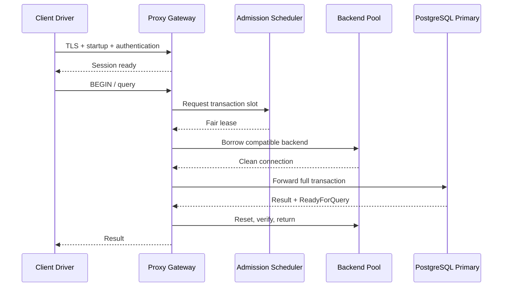
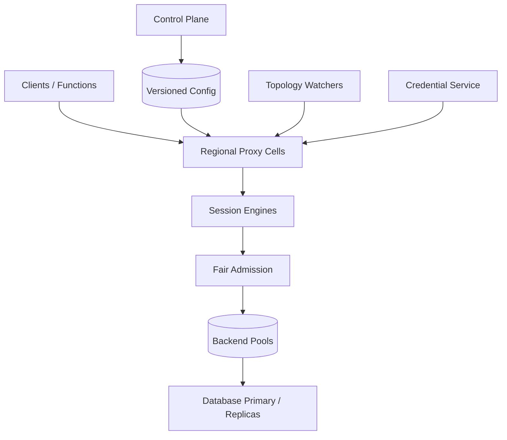

# Design a Multi-Tenant Database Connection Pooler and SQL Proxy

**Difficulty:** Hard  
**Themes:** databases, connection pooling, admission control, caching, queues, failover, consistency, multi-tenancy

> **Interview budget:** Requirements 5 minutes, entities 2 minutes, interface 5 minutes, high-level design 12 minutes, deep dives 15 minutes.  
> **Study note:** This walkthrough is intentionally more detailed than a 40–45 minute interview. Use the “say aloud” passages for the compressed version.

This follows the public [Hello Interview delivery framework](https://www.hellointerview.com/learn/system-design/in-a-hurry/delivery): establish requirements, name essential entities, define the interface, build a working design one operation at a time, and use deep dives to meet the non-functional requirements. The problem and solution are original.

---

## Interviewer prompt

> Design a managed database connection proxy for PostgreSQL-compatible databases. Thousands of application instances and serverless functions should connect to the proxy instead of opening a dedicated database connection. The proxy should pool and multiplex connections, enforce tenant limits, preserve transaction correctness, authenticate securely, and reduce disruption during database failover.

## Targeted clarifying questions and assumed answers

**Candidate:** Which workloads and protocols are in scope?  
**Interviewer:** PostgreSQL wire protocol, primarily short OLTP transactions. Long analytical queries exist but are a minority. We must support TLS, prepared statements where practical, and common session settings.

**Candidate:** What scale?  
**Interviewer:** 10,000 tenants, 5 million open client connections globally, 500,000 concurrently active clients, and 2 million transactions per second at peak. A database cluster usually allows 2,000 backend connections; a tenant may have dozens of clusters.

**Candidate:** Which pooling modes are required?  
**Interviewer:** Transaction pooling by default for maximum multiplexing, with session pooling or connection pinning when a workload uses session-local state that cannot safely move.

**Candidate:** Does the proxy parse or rewrite SQL?  
**Interviewer:** It may inspect protocol messages and a limited set of SQL/session commands for routing and safety, but it is not a full SQL optimizer and must not change query semantics.

**Candidate:** What is the failover goal?  
**Interviewer:** Detect a promoted primary and resume new transactions within 30 seconds. Never replay an ambiguous transaction automatically. Existing client TCP sessions should survive when possible.

**Candidate:** Can reads go to replicas?  
**Interviewer:** Optional read routing is a stretch goal. The core path goes to the primary. If included, it must define read-after-write behavior.

**Candidate:** Are client credentials passed to the database?  
**Interviewer:** Prefer short-lived proxy authentication and centrally managed database credentials. Support tenant-specific database roles and rotation without restarting clients.

**Candidate:** What is out of scope?  
**Interviewer:** Query optimization, schema migration, cross-database transactions, database storage replication, and backup/restore.

> **Scope statement:** “I’ll design a stateful protocol proxy that terminates client sessions, authenticates them, queues work under fair admission control, borrows a compatible backend connection for each transaction, resets it before reuse, and handles topology changes without guessing transaction outcomes.”

---

## 1. Requirements (~5 minutes)

### Functional requirements

1. **Accept and authenticate PostgreSQL client sessions.** Applications connect through the native protocol using TLS and proxy-issued or identity-backed credentials.
2. **Pool and multiplex backend connections safely.** The default transaction-pooling mode assigns a database connection only for the lifetime of a transaction; incompatible session state causes explicit pinning or session pooling.
3. **Protect databases and survive topology changes.** Enforce fair limits, queue bounded work, expose observability, rotate credentials, discover the current primary, drain unhealthy connections, and report ambiguous failures honestly.

### Out of scope

- optimizing or rewriting arbitrary SQL;
- database replication and promotion itself;
- distributed transactions across clusters;
- schema migration and backup;
- result-set caching in the core proxy;
- transparent replay of arbitrary transactions.

### Quantified non-functional requirements

1. **Scale:** 5M open client connections, 500K active, and 2M transactions/s globally across 10K tenants.
2. **Latency:** proxy overhead p99 below 5 ms when a warm backend is available; queue wait p99 below 50 ms under normal load; authentication p99 below 100 ms with warm identity metadata.
3. **Availability:** proxy endpoint 99.99%; a proxy-node failure must not corrupt database state; database-primary failover should accept new transactions within 30 seconds.
4. **Correctness:** never leak session state or credentials across clients; preserve transaction boundaries; never automatically replay a transaction if commit outcome is unknown.
5. **Isolation/security:** per-tenant and per-database quotas, encrypted transport, least-privilege backend roles, auditable configuration, credential rotation, and resistance to connection storms.

### Scale estimates that change the design

If each client connection consumed even 32 KiB of proxy memory:

\[
5{,}000{,}000 \times 32\text{ KiB} \approx 153\text{ GiB}
\]

Distributed across 200 gateway processes that is manageable, but TLS buffers, protocol state, file descriptors, and kernel queues require substantial headroom. We need event-driven networking and regional proxy cells, not one central process.

At 2M transactions/s with an average database transaction holding a backend for 10 ms:

\[
2{,}000{,}000 \times 0.010 = 20{,}000
\]

backend connections would be concurrently busy globally. The number is distributed across clusters, but a cluster capped at 2,000 connections can serve only about:

\[
2{,}000 / 0.010 = 200{,}000 \text{ transactions/s}
\]

before database CPU, locks, or I/O impose a lower bound. Connection pooling does not create database capacity; it protects and schedules it.

Assume a representative cluster has 100K client sessions, 10K active, but only 500 transaction-pooled backend connections. That 200:1 client-to-backend ratio is the product’s value, while the 500-connection limit becomes a correctness-bearing admission budget.

### Consistency and availability contract

| Surface | Contract |
|---|---|
| Client session | Best-effort continuity across backend swaps; protocol state remains at the proxy. |
| Transaction | One backend connection from `BEGIN` through `COMMIT/ROLLBACK`; never migrate mid-transaction. |
| Autocommit statement | Treated as a one-statement transaction and held on one backend until completion. |
| Session state | Only state modeled by the proxy may be replayed safely. Unknown state pins the client or is rejected by policy. |
| Failover | New transactions route to the confirmed primary. In-flight transactions may fail; ambiguous commit is returned as unknown and never replayed automatically. |
| Config/credentials | Versioned and eventually distributed; old/new credentials overlap during rotation. Security revocation has a bounded freshness SLO. |
| Overload | Fail fast or wait in a bounded fair queue; never create unbounded database connections or proxy memory. |

> **Say aloud:** “The proxy can multiplex sessions, but a transaction is indivisible: one backend from begin through commit. Pooling improves utilization, not database capacity. During failover I will preserve idle client sessions where possible, but an in-flight commit whose response was lost is ambiguous and must not be replayed.”

---

## 2. Core entities (~2 minutes)

| Entity | Important fields |
|---|---|
| `Tenant` | tenant ID, plan, regions, global quotas |
| `DatabaseTarget` | cluster ID, engine/version, endpoints, role, connection ceiling |
| `ProxyEndpoint` | hostname, region/cell, auth policy, pool policy |
| `ClientSession` | client ID, tenant, user/role, protocol state, transaction state, pin reason |
| `BackendConnection` | target, database user, server PID, state fingerprint, health, credential version |
| `PoolKey` | target, database, backend role, TLS/auth attributes, compatibility class |
| `PoolPolicy` | min/max connections, timeouts, reset query, reserve budget |
| `AdmissionLease` | tenant/target/class, granted slot, deadline, cost |
| `TopologyVersion` | writer/replicas, generation, health, observed time |
| `CredentialVersion` | secret reference, validity interval, rotation state |
| `AuditEvent` | actor, action, resource, before/after digest, request ID |

> **Say aloud:** “The core entities are client session, backend connection, pool key, policy, admission lease, topology version, and credential version. The proxy’s main job is to map many client sessions onto a small compatible backend pool without carrying one client’s state into another.”

---

## 3. System interface (~5 minutes)

The data path speaks PostgreSQL’s wire protocol so existing drivers work. Management uses HTTPS/gRPC.

### Create a proxy endpoint

```http
POST /v1/proxy-endpoints
Authorization: Bearer <tenant-admin-token>
Idempotency-Key: orders-prod-proxy

{
  "name": "orders-prod",
  "target_cluster_id": "pg_orders_01",
  "regions": ["us-east-1", "us-west-2"],
  "pool_mode": "TRANSACTION",
  "pool": {
    "max_backend_connections": 500,
    "min_idle": 40,
    "max_queue_ms": 200,
    "idle_timeout_seconds": 300
  },
  "auth_policy_id": "auth_workload_v7"
}
```

```json
{
  "endpoint_id": "pxy_7f3",
  "hostname": "orders-prod.proxy.example.net",
  "status": "PROVISIONING",
  "config_version": 1
}
```

### Native client connection

```text
postgresql://app_role@orders-prod.proxy.example.net:5432/orders?sslmode=verify-full
```

TLS terminates at the proxy. The startup packet names database, user, and requested parameters. Authentication derives tenant and workload identity from a short-lived token, mTLS principal, or approved password flow. The client cannot select another tenant by changing startup parameters.

### Transaction behavior

```sql
BEGIN;
UPDATE inventory SET reserved = reserved + 1 WHERE sku = 'A-19';
INSERT INTO reservations(id, sku) VALUES ('r_882', 'A-19');
COMMIT;
```

The proxy queues the first statement if necessary, borrows one backend, forwards the entire transaction on it, waits for a terminal ready-for-query state, resets/verifies connection state, and then returns it to the pool.

### Inspect endpoint health

```http
GET /v1/proxy-endpoints/pxy_7f3/status
```

```json
{
  "topology_generation": 184,
  "writer": "dbnode_12",
  "client_connections": 103842,
  "active_transactions": 417,
  "backend_connections": 468,
  "pinned_sessions": 31,
  "queue_depth": 822,
  "queue_wait_p99_ms": 37,
  "backend_utilization_pct": 84.2,
  "credential_version": 19,
  "data_through": "2026-10-17T20:07:52Z"
}
```

### Update policy safely

```http
PATCH /v1/proxy-endpoints/pxy_7f3
If-Match: "config:12"
Idempotency-Key: raise-orders-pool

{
  "pool": {"max_backend_connections": 600},
  "tenant_limits": {"default_active_transactions": 80}
}
```

Optimistic concurrency prevents two admins from silently overwriting policy. The control plane validates that the new ceiling remains below the database’s reserved connection budget.

### Drain an endpoint

```http
POST /v1/proxy-endpoints/pxy_7f3:drain

{
  "deadline_seconds": 60,
  "mode": "STOP_NEW_TRANSACTIONS"
}
```

Idle sessions receive a retryable error or alternate endpoint hint; active transactions get a grace period and are never moved mid-transaction.

---

## 4. Data flow



---

## 5. High-level design (~10–15 minutes)



### Operation 1: Establish a lightweight client session

1. Anycast/DNS selects a healthy regional proxy cell near the application and database.
2. An event-driven gateway completes TLS and PostgreSQL startup/authentication.
3. Identity service returns authoritative tenant, database allowlist, database role, and quota class.
4. Gateway creates lightweight `ClientSession` state: protocol phase, parameters, transaction state, prepared-statement metadata, and pin reason.
5. It does **not** borrow a database connection while the client is idle.

The session engine is stateful but horizontally partitioned by live TCP connection. Control metadata is cached locally with version and expiry. A gateway failure drops its client TCP sessions, but does not corrupt backend transactions; drivers reconnect through DNS/load balancing.

PostgreSQL normally establishes a server-side backend for each database connection, as described in [PostgreSQL’s connection-establishment documentation](https://www.postgresql.org/docs/current/connect-estab.html). The proxy’s value is avoiding a one-to-one backend for mostly idle clients.

### Operation 2: Admit and borrow for a transaction

When an idle session sends its first autocommit statement or `BEGIN`:

1. classify request by tenant, endpoint, workload class, and cost hints;
2. request an admission lease;
3. fair scheduler checks global, target, tenant, and class budgets;
4. if admitted, borrow a connection from the exact `PoolKey`;
5. if no idle backend exists and pool is below its ceiling, connect using current credential version;
6. otherwise enqueue with deadline or fail fast;
7. bind client session to backend until transaction ends.

`PoolKey` includes target cluster, database, backend role/user, TLS mode, protocol options, and state compatibility. Never reuse a connection under a different database identity merely by trusting client-supplied SQL.

The backend ceiling reserves slots for database administration, replication, migrations, and break-glass access. PostgreSQL documents that resource sizing is affected by `max_connections`; simply raising it is not free: [connections and authentication](https://www.postgresql.org/docs/current/runtime-config-connection.html).

### Operation 3: Detect transaction boundaries

The proxy tracks PostgreSQL protocol state and the server’s ready-for-query status:

- `I`: idle outside transaction;
- `T`: inside transaction;
- `E`: failed transaction awaiting rollback.

Autocommit holds the backend through the statement response. Explicit transactions hold it from `BEGIN` until successful `COMMIT`/`ROLLBACK` and final ready state. COPY, portals, streaming result sets, and protocol synchronization also keep the backend bound as required.

Never infer completion from SQL text alone. The authoritative state is the protocol conversation and server response.

### Operation 4: Reset and return safely

Before returning a connection:

1. ensure no open/failed transaction;
2. drain all result messages;
3. cancel or close portals;
4. run configured reset such as `DISCARD ALL` when compatible;
5. restore tracked parameters;
6. verify ready state and credential/topology generation;
7. return to the same pool key or close on uncertainty.

Reset has latency cost, so the proxy tracks a session-state fingerprint and can perform a minimal safe reset for known changes. Unknown commands that could create session-local state cause pinning or rejection, not optimistic reuse.

### Operation 5: Handle session features and pinning

Transaction pooling conflicts with features whose meaning lives in one database session:

- temporary tables;
- session advisory locks;
- LISTEN/NOTIFY subscriptions;
- session-level `SET` values not modeled by the proxy;
- cursors/portals spanning transactions;
- some prepared-statement behavior;
- role changes or extension-specific state.

Options:

1. reject unsupported behavior in strict transaction mode;
2. model/replay a safe subset;
3. pin the client to one backend;
4. configure explicit session pooling.

Choose modeling for common safe settings and prepared-statement metadata, pin for allowed uncommon state, and reject dangerous/unknown state under strict policies. PgBouncer’s documentation distinguishes session, transaction, and statement pooling and their compatibility constraints: [PgBouncer features](https://www.pgbouncer.org/features.html).

Pinning consumes a backend for an idle client, reducing multiplexing. Expose the pin reason and age; cap pinned sessions per tenant.

### Operation 6: Credential retrieval and rotation

The proxy authenticates clients separately from how it authenticates to PostgreSQL.

1. control plane stores an encrypted secret reference, never plaintext config;
2. credential agent retrieves/decrypts a short-lived version into protected memory;
3. new backend connections use the newest valid version;
4. old and new overlap during rotation;
5. old pooled connections drain gradually;
6. emergency revocation closes affected idle backends immediately and handles active transactions according to policy.

Cache decrypted credentials only briefly and key the cache by tenant/target/role/version. Do not log secrets or expose them to client processes.

### Operation 7: Discover topology and fail over

Topology watchers combine authoritative control-plane events with active health checks. Each update has a monotonically increasing generation.

On writer failure:

1. mark old writer generation draining/unhealthy;
2. stop assigning new transactions to it;
3. allow responses already received to finish, but close uncertain backends;
4. wait for authoritative promotion/fencing confirmation;
5. warm a small pool to the new writer;
6. route queued/new transactions there;
7. keep idle client sessions connected.

Do not automatically replay an in-flight transaction after connection loss. If the server may have committed but the response was lost, return an error class meaning outcome unknown. Applications use their own idempotency key or read-after-failure reconciliation.

### Operation 8: Bound overload fairly

Use hierarchical admission:

1. cell connection/CPU/memory limits;
2. database target active-transaction budget;
3. tenant guaranteed share and burst ceiling;
4. workload-class queues such as interactive, batch, admin;
5. per-client in-flight limit.

Weighted deficit round robin or weighted fair queuing prevents one tenant from occupying every backend. Requests have deadlines; expired queue entries fail with retry-after metadata. Queue length is bounded by memory and by the latency SLO.

Long transactions are not preempted because doing so can waste work and create ambiguity. Instead, enforce statement/transaction timeouts, separate analytical pools, and limit long-running concurrency.

### Baseline failure handling

| Failure | Behavior |
|---|---|
| Client disconnects while idle | Drop lightweight session only |
| Client disconnects in transaction | Cancel/rollback backend; close if clean state cannot be proven |
| Proxy process dies | Database detects socket loss and aborts open transaction; client reconnects |
| Credential service temporarily fails | Use unexpired cached version for existing policy; fail closed after expiry |
| Reset fails | Destroy backend connection; never return it to pool |
| Queue deadline expires | Return retryable overload error; do not keep invisible work |
| Writer fails before query | Route a new attempt only if nothing was sent |
| Writer fails during transaction | Return failure/unknown; never transparent replay |
| Config update partitions | Continue last valid version until bounded expiry; reject unsafe stale security policy |
| Tenant storm | Hierarchical quotas preserve other tenants’ guarantees |

> **Say aloud:** “The proxy holds five million lightweight client sessions but borrows a backend only for active work. Admission, not connection creation, is the pressure valve. A backend returns to the pool only after protocol-complete transaction termination and verified reset; otherwise we destroy it.”

---

## 6. Deep dives (~10–15 minutes)

### Deep dive A: Multiplexing versus session semantics

#### Where the baseline breaks

Naive transaction pooling assumes every connection is interchangeable after `COMMIT`. It fails when client A creates a temp table, changes search path, prepares a named statement, acquires a session advisory lock, or subscribes with LISTEN. Client B can observe leaked state or receive incorrect behavior.

#### Approaches

| Approach | Strength | Weakness |
|---|---|---|
| Session pooling | Maximum compatibility | Little multiplexing for idle clients |
| Statement pooling | Maximum reuse | Cannot support multi-statement transactions safely |
| Transaction pooling with blanket reset | Good reuse, simpler safety | Reset latency; some state cannot be reconstructed |
| Stateful virtualization + pinning fallback | Best balance | More protocol/state complexity |

Choose transaction pooling with explicit state virtualization and pinning fallback.

#### Session state model

Track a finite state machine, not arbitrary SQL meaning:

```text
SessionState
  transaction: IDLE | ACTIVE | FAILED
  parameters: modeled SET values
  prepared: client name -> SQL hash + parameter types
  portals: active protocol portals
  role: authenticated backend role
  pin_reason: optional enum
  backend_generation: optional
```

Simple `SET application_name` or `statement_timeout` can be modeled and replayed. `CREATE TEMP TABLE`, unknown extensions, session advisory locks, or LISTEN pin. `SET LOCAL` is transaction-scoped and naturally ends with the transaction.

Prepared statements require care because client-side names are session-local while backends change. Options are pinning, rejecting, or maintaining a mapping from logical prepared statement to backend-specific prepared state and lazily preparing on borrow. The mapping must incorporate SQL and parameter types, handle DEALLOCATE, and cap memory/cardinality.

#### Safe release invariant

A connection is reusable only if:

1. server says idle;
2. all result frames are drained;
3. no COPY or portal remains;
4. session-local locks/listeners/temp state are absent or reset;
5. role and database match pool key;
6. state fingerprint equals clean baseline;
7. topology and credential versions remain acceptable.

When uncertain, close. A new connection costs latency; a leaked tenant state is a security incident.

#### Pinning economics

If 2% of 100K clients pin, that is 2,000 backends—already the entire cluster limit. Therefore:

- cap pinned sessions;
- expose pin reason to developers;
- automatically unpin when state ends if provable;
- isolate session-mode endpoints/pools;
- provide migration guidance;
- alert on sudden pin-rate changes.

#### Observability

- multiplex ratio: open clients / backend connections;
- transaction reuse count per backend;
- pin rate/reason/duration by application;
- reset latency and failure;
- destroyed-on-uncertainty count;
- prepared statement cache hit/eviction;
- state leak invariant violations—must be zero.

> **Say aloud:** “Transaction pooling is safe only if I understand the protocol state that crosses transactions. I virtualize a small explicit subset, pin recognized session features, and reject unknown behavior in strict mode. If reset cannot prove a clean baseline, I close the backend.”

### Deep dive B: Fair admission, backpressure, and connection storms

#### Where the baseline breaks

Serverless scale-out may open 100K clients in seconds. If every gateway immediately opens database connections, the proxy becomes an attack amplifier. A single tenant with long transactions can occupy the whole pool, while a FIFO queue lets cheap interactive work sit behind expensive batch queries.

#### Options

| Approach | Benefit | Problem |
|---|---|---|
| Open connections on demand without ceiling | Low initial queueing | Can crash database |
| One global FIFO | Simple | No tenant isolation; head-of-line blocking |
| Static partition per tenant | Strong isolation | Wastes idle capacity |
| Guaranteed shares + borrowable burst capacity | Isolation and utilization | Scheduler complexity |

Choose hierarchical guaranteed shares with weighted fair scheduling and bounded borrowing.

#### Budgets

Let a 500-connection target reserve:

- 50 for admin/migration/emergency;
- 400 for normal traffic;
- 50 reserve connections used only when queue SLO is breached and DB health permits.

Within normal capacity, each tenant receives a minimum share and burst ceiling. Idle guaranteed capacity can be borrowed, but borrowers are throttled first when the owner needs it.

Admission uses active backend leases, not just queue length. A lease has deadline and workload class. Completion releases capacity. Leaks are reclaimed using proxy-process liveness and maximum transaction deadlines.

#### Queue design

Queues are partitioned by target and class but scheduled fairly across tenants. Bound by:

- maximum entries/bytes;
- maximum wait time;
- tenant queue quota;
- client in-flight limit.

Reject early when predicted wait exceeds deadline. Return SQLSTATE/retry metadata suitable for exponential backoff with jitter. Do not encourage synchronized immediate retry.

#### Adaptive sizing

Pool size responds slowly to:

- database CPU and memory;
- lock wait and transaction latency;
- connection establishment latency;
- proxy queue wait;
- configured hard ceiling.

Do not scale backend connections merely because queue depth rises: if the database CPU is saturated, more connections worsen throughput. Admission can reduce concurrency to improve total completion rate.

#### Overload priorities

Separate interactive OLTP, background jobs, and admin. Preserve a small emergency pool. Enforce statement timeout and idle-in-transaction timeout. Long analytical queries use another endpoint or workload group.

#### Observability

- connection attempts/s and TLS/auth CPU;
- active/idle/creating backend counts;
- queue depth and wait histogram by tenant/class;
- admission rejects and retry rate;
- backend utilization versus DB CPU/locks;
- fairness share and borrowed capacity;
- idle-in-transaction count/age;
- overload recovery time.

> **Say aloud:** “A pooler is fundamentally an admission controller. The hard connection ceiling protects the database, while weighted tenant shares prevent a noisy neighbor. Queueing is bounded by deadline; if the database is saturated, adding more connections is negative scaling.”

### Deep dive C: Failover, ambiguous commit, and topology fencing

#### Where the baseline breaks

Suppose the proxy sends COMMIT, the primary commits, and the connection breaks before the acknowledgment. Retrying the transaction on the promoted primary may duplicate an order or payment. Meanwhile stale topology caches may keep sending new transactions to the demoted writer.

#### Approaches

| Approach | Benefit | Problem |
|---|---|---|
| Replay every failed transaction | Appears seamless | Duplicates ambiguous commits and non-deterministic work |
| Never preserve client sessions | Simple | Larger application outage |
| Preserve sessions, fail in-flight work honestly | Safe and useful | Applications handle retries/reconciliation |
| Replay only provably unsent/idempotent work | Improves UX | Requires precise boundary and application contract |

Choose preserved idle sessions, no arbitrary replay, and optional replay only before any bytes reach a backend or under an explicit idempotency contract.

#### Topology generations

Every writer assignment has a generation. A backend connection records the generation used to create it. Routers accept only the newest confirmed generation. On promotion:

1. authoritative orchestrator fences old writer;
2. emits generation N+1;
3. watchers verify role/health;
4. proxy closes idle generation-N writer connections;
5. active generation-N transactions fail or finish only under strict confirmed policy;
6. warm minimum connections to N+1;
7. release queued work gradually.

DNS alone is insufficient because caches and connection reuse outlive DNS TTL. Use authoritative topology events plus active server-role checks.

#### Outcome taxonomy

- **Definitely not executed:** failure before sending; safe to retry.
- **Definitely rolled back:** server explicitly reports rollback; safe under app policy.
- **Definitely committed:** commit acknowledgment received.
- **Outcome unknown:** connection lost after work/COMMIT may have reached server; do not replay automatically.

Return a distinct error class with transaction/request ID. Applications should use business idempotency keys and query authoritative state after unknown outcomes.

#### Failover surge

All proxy nodes may try to warm hundreds of connections simultaneously. Coordinate a per-target connection-creation token bucket, use jitter, and ramp concurrency based on new primary health. Keep client sessions queued with deadlines; do not stampede the recovering database.

#### Observability and drills

- topology detection, confirmation, and pool-ready durations;
- old-generation borrow attempts—must be zero;
- connections closed by failover;
- transactions definitely failed versus unknown;
- reconnect creation rate and authentication load;
- queue growth during failover;
- application retry/idempotency outcomes;
- regular primary promotion and network-partition tests.

> **Say aloud:** “Failover can be connection-transparent but not transaction-magical. I keep idle client sessions, fence connections by topology generation, and warm the new writer gradually. A lost COMMIT response is `OUTCOME_UNKNOWN`; only the application’s business idempotency can reconcile it.”

### Deep dive D: Authentication, credential rotation, and policy caching

Separate client identity from database credentials. The proxy verifies workload identity and maps it to a least-privilege database role. Backend secrets live in a secret manager and are available only to the credential agent.

Policy cache entries contain version, expiry, tenant, endpoint, role mapping, and revocation generation. Normal updates are eventually distributed; emergency revocation pushes an invalidation and has a short maximum staleness. After expiry, fail closed if authorization cannot be refreshed.

Rotation stages: publish new credential, overlap validity, create new backends with it, drain old idle backends, wait for active work, revoke old version, verify no remaining connections. Roll back before revocation if authentication to the new version fails.

Prevent confused-deputy bugs by binding authenticated tenant, requested endpoint, database, and backend role in one signed authorization decision. Never accept an authoritative role from startup parameters alone.

Observe auth latency, cache hit/freshness, denied mappings, secret fetches, credential-version connection counts, rotation duration, emergency revocation propagation, and plaintext-secret exposure checks.

---

## Reliability and operations

### Cell design

Each regional cell contains load balancers, session engines, admission schedulers, pool workers, topology watchers, credential agents, and local versioned config caches. Cells are independently deployable and capped so one failure cannot consume every database connection.

For a given target, divide its backend budget across cells dynamically with a global allocation epoch. Cells may borrow capacity, but the sum of valid leases cannot exceed the hard target ceiling. During control-plane partition, use the last fenced allocation and stop growth rather than oversubscribe.

### Deployment and draining

- stop accepting new client sessions on the node;
- keep existing sessions;
- stop beginning new transactions near deadline;
- finish or timeout active transactions;
- return/close backend connections;
- disconnect idle clients with retry hints only at final deadline.

Never kill every proxy node simultaneously or let rolling deployment open a duplicate full backend pool.

### Key service-level indicators

**Client:** connections, TLS/auth latency, disconnects, protocol errors.  
**Pooling:** multiplex ratio, active/idle/creating backends, borrow latency, reuse count, reset failures, pinning.  
**Admission:** queue depth/wait, deadline expiration, fairness, rejects, tenant shares.  
**Database:** connect latency, query/transaction latency, CPU, locks, max-connection headroom.  
**Failover:** detection, fencing, new-writer warm time, unknown outcomes, recovery.  
**Security:** policy age, revocation age, auth denial, credential versions, audit completeness.

### Disaster and correctness drills

- kill a proxy mid-transaction and verify rollback/unknown behavior;
- inject connection loss before and after COMMIT;
- fail reset and verify connection destruction;
- create temp/session state and prove no cross-client leak;
- rotate/revoke credentials under load;
- promote a new writer and attempt stale-generation routing;
- open a serverless connection storm;
- run a noisy tenant beside a latency-sensitive tenant;
- partition control plane and verify no backend-budget oversubscription;
- drain a cell without interrupting completed transactions.

---

## 7. Concise final design

> “Regional event-driven proxy cells terminate millions of PostgreSQL client sessions and authenticate workload identity. Idle clients consume only lightweight proxy state. At the first statement or BEGIN, a hierarchical fair scheduler grants a bounded transaction lease and the session borrows a compatible backend from a pool keyed by target, database, role, and state class.
>
> “One backend remains bound through the transaction and complete protocol response. The proxy models a safe subset of session state, virtualizes prepared metadata where supported, pins allowed session-local behavior, and rejects unknown behavior in strict mode. A connection returns to the pool only after an idle server state and verified reset; uncertainty destroys it.
>
> “Topology generations fence stale writers. Failover preserves idle client sessions and warms the new primary under a token bucket, but never replays an ambiguous transaction. Credential versions overlap during rotation, tenant quotas prevent noisy neighbors, bounded queues provide backpressure, and every status exposes pool, queue, pinning, and failover health.”

## Requirements check

| Requirement | Design response |
|---|---|
| 5M client sessions | Event-driven regional session engines |
| Bounded DB connections | Hard target ceilings and admission leases |
| Transaction pooling | Borrow at BEGIN/statement; return after terminal ready state |
| Correct transaction semantics | One backend for complete transaction |
| Session features | Modeled state, pinning fallback, strict rejection |
| No state leakage | Pool keys, reset invariant, destroy on uncertainty |
| Multi-tenancy | Hierarchical quotas and weighted fair queues |
| Burst handling | Lightweight idle sessions, bounded queues, connection token buckets |
| Credential security | Identity mapping, secret manager, versioned overlap rotation |
| Failover under 30 seconds | Topology events, fencing generations, warm minimum pool |
| Ambiguous commit safety | Explicit unknown outcome; no automatic replay |
| Low proxy overhead | Warm pools, local versioned caches, event-driven I/O |
| Observability | Per-stage latency, pin/reset/admission/failover metrics |

---

## Interviewer follow-up questions with strong sample answers

### 1. Why not just increase PostgreSQL `max_connections`?

> “Each backend consumes process and database resources, and high concurrency can worsen cache and lock contention. Pooling keeps idle application sessions cheap and bounds active database work. It does not manufacture CPU or I/O capacity.”

### 2. When is transaction pooling unsafe?

> “When behavior depends on session-local state across transaction boundaries: temp tables, LISTEN, session locks, cursors, unmodeled SET values, and some prepared-statement patterns. Those require virtualization, pinning/session mode, or rejection.”

### 3. How do you know a transaction ended?

> “Track wire-protocol state and PostgreSQL’s ready-for-query status, including failed transaction state. Do not rely only on finding COMMIT text.”

### 4. What happens if reset fails?

> “Close the backend. Extra connection latency is preferable to leaking state or privileges into another client.”

### 5. Why not automatically replay after failover?

> “If COMMIT reached the old primary but its acknowledgment was lost, replay can duplicate a business action. Return outcome unknown and let a business idempotency key or state lookup reconcile it.”

### 6. How do prepared statements work with transaction pooling?

> “Maintain client logical metadata and lazily prepare an equivalent backend statement, scoped by SQL hash and parameter types. Handle DEALLOCATE and eviction. Unsupported protocol patterns pin or fail under policy.”

### 7. How do you prevent one tenant monopolizing the pool?

> “Guaranteed shares plus borrowable burst capacity, weighted fair scheduling, per-tenant queue and in-flight limits, and separate workload classes.”

### 8. What if the database is already CPU-saturated?

> “Do not grow the pool because the queue is long. Reduce admitted concurrency, preserve high-priority work, and let bounded deadlines fail quickly. More connections can lower throughput.”

### 9. How can idle client TCP sessions survive database failover?

> “They terminate at the proxy, not the database. The proxy swaps the backend pool after a new writer is confirmed. Only in-flight transaction state is lost or ambiguous.”

### 10. What is connection pinning?

> “Temporarily or permanently binding one client session to one backend because its state cannot safely move. It preserves compatibility but reduces multiplexing, so pin reason, duration, and tenant caps matter.”

### 11. How do you rotate credentials without an outage?

> “Overlap old and new versions, validate new connections, direct new backends to the new version, drain old connections, then revoke. Track remaining connections by version.”

### 12. Can you route reads to replicas?

> “Only with an explicit consistency contract. After a write, pin reads to the primary until a commit LSN is observed on a replica or the client opts into stale reads. Core design stays primary-only.”

### 13. What if a client disconnects mid-transaction?

> “Cancel or roll back the backend. Return it only after confirmed idle/reset state; otherwise close it. The database normally aborts when its socket disappears.”

### 14. Why key pools by database role?

> “Reusing a privileged backend for a less-privileged client risks confused-deputy and state-leak bugs. Role is part of the compatibility/security boundary.”

### 15. How does the proxy handle long queries?

> “They retain their backend, so isolate them in an analytical workload pool with lower concurrency and longer deadlines. Use statement timeouts; do not let them starve short OLTP work.”

### 16. How do multiple proxy cells share a 2,000-connection limit?

> “Allocate fenced per-cell budgets whose valid sum is below the hard ceiling. Rebalance slowly and stop growth on control-plane uncertainty.”

### 17. What would you cache?

> “Versioned identity policy, endpoint config, topology, DNS, and short-lived credentials. Result caching is out of core scope because invalidation and transaction visibility are different problems.”

### 18. How do you roll out a proxy version safely?

> “Canary a cell, compare protocol/reset/pinning metrics, stop new sessions on old nodes, drain transactions, and avoid duplicate full backend pools during overlap.”

---

## Common pitfalls

1. Claiming connection pooling increases database compute capacity.
2. Borrowing a backend per query inside an explicit transaction.
3. Detecting transaction boundaries only by parsing SQL text.
4. Ignoring failed-transaction protocol state.
5. Reusing a connection without a verified reset.
6. Treating unknown session commands as harmless.
7. Leaking temp tables, roles, settings, locks, or prepared state.
8. Allowing unrestricted pinning.
9. One FIFO queue for every tenant and workload.
10. Unbounded queueing during database saturation.
11. Opening a backend for every serverless client.
12. Growing the pool solely because queue depth rose.
13. Consuming every database connection and leaving none for admin recovery.
14. Sharing backends across incompatible database roles.
15. Passing long-lived database passwords to every client.
16. Rotating credentials by invalidating all old connections instantly.
17. Using DNS alone to identify the writer.
18. Reusing stale-writer connections after promotion.
19. Replaying ambiguous commits automatically.
20. Calling a lost response a rollback.
21. Letting all proxy nodes reconnect simultaneously after failover.
22. Dropping every idle client session during database promotion.
23. Caching authorization without version or expiry.
24. Oversubscribing the database when the global allocator partitions.
25. Killing active transactions during routine proxy deployment.
26. Hiding pin reason and queue wait from users.
27. Reporting only average latency instead of p99 queue/borrow time.
28. Mixing analytical and latency-sensitive transactions in one uncontrolled pool.
29. Implementing a full SQL optimizer inside the proxy.
30. Adding result caching without a consistency/invalidation contract.

## Closing perspective

The proxy must keep four boundaries explicit:

1. **Client session:** long-lived protocol identity and virtualized state.
2. **Transaction lease:** the fair right to consume scarce database concurrency.
3. **Backend connection:** a security- and state-compatible database session.
4. **Transaction outcome:** committed, rolled back, definitely unsent, or unknown.

Most serious bugs come from collapsing these boundaries—equating a client connection with a backend, treating queue depth as capacity, assuming COMMIT failure means rollback, or reusing a backend whose state is uncertain.

## Public references

- [Hello Interview: System Design Delivery Framework](https://www.hellointerview.com/learn/system-design/in-a-hurry/delivery)
- [PostgreSQL: How connections are established](https://www.postgresql.org/docs/current/connect-estab.html)
- [PostgreSQL: Connections and authentication](https://www.postgresql.org/docs/current/runtime-config-connection.html)
- [PgBouncer: Features and pooling modes](https://www.pgbouncer.org/features.html)
- [PgBouncer: Configuration](https://www.pgbouncer.org/config.html)
- [AWS: Amazon RDS Proxy](https://docs.aws.amazon.com/AmazonRDS/latest/UserGuide/rds-proxy.html)
