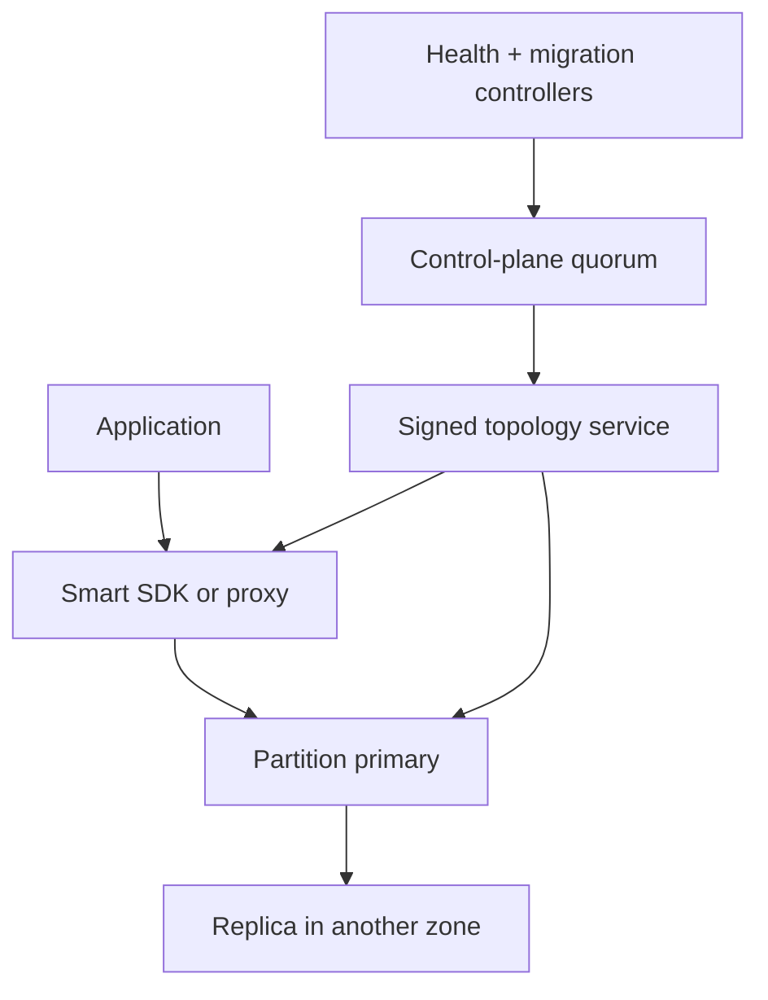

# Design a Multi-Tenant Distributed Cache Service

**Difficulty:** Senior / Staff  
**Primary themes:** consistent hashing, memory management, hot keys, cache stampedes, replication, bounded staleness, multi-tenant isolation

This is a 45-minute interview plan followed by a fuller educational walkthrough. In a real interview, spend about 5 minutes on requirements, 2 on entities, 5 on interfaces, 10–15 on the simplest complete design, and 10–15 on the most important deep dives. The expanded version below is meant for study, not as a script to recite end to end.

The organization follows Hello Interview’s public guidance: clarify requirements, define entities and interfaces, build a working high-level design one operation at a time, then harden it around the key non-functional requirements. Their [System Design Delivery Framework](https://www.hellointerview.com/learn/system-design/in-a-hurry/delivery) explicitly prioritizes a complete baseline before complexity. The problem, dialogue, estimates, and solution here are original.

## Interviewer prompt

> Design a managed distributed cache service, similar in spirit to Memcached or a subset of Redis, for thousands of internal and external applications. It should provide low-latency key-value access, TTL expiration, horizontal scaling, high availability, and protection against hot keys and noisy tenants.

## Targeted clarifying questions

**Candidate:** “Is this a durable database or a disposable cache in front of another source of truth?”

**Interviewer:** “A cache. Data may be lost during rare failures or resizing. Clients must retain an authoritative source. We still want high availability and predictable behavior.”

**Candidate:** “Which operations are required?”

**Interviewer:** “Get, multi-get, set with TTL, add-if-absent, compare-and-set, delete, and increment for integer counters. No arbitrary server-side scripts, transactions across keys, pub/sub, or secondary indexes.”

**Candidate:** “What item sizes and capacity should we support?”

**Interviewer:** “Keys up to 250 bytes, values up to 1 MB, with a typical value around 1 KB. A cluster may hold 20 TB of usable cache data.”

**Candidate:** “What scale and latency should I assume?”

**Interviewer:** “Across the fleet, 50 million operations per second at peak, roughly 90% reads. For items served within a region, target p99 under 2 ms for single-key gets and under 5 ms for bounded multi-get.”

**Candidate:** “How should consistency work?”

**Interviewer:** “Per-key mutations must be serialized on the owning primary. A successful write followed by a primary read should see the write. Replica reads may be stale and must be opt-in. Cross-key atomicity is out of scope.”

**Candidate:** “What should happen when memory fills?”

**Interviewer:** “Evict cache entries according to a configured policy. Tenants choose TTL defaults and one of a small set of policies, but cannot disable hard capacity protection.”

**Candidate:** “Do clients know cache nodes?”

**Interviewer:** “Provide a smart SDK for high-throughput clients and a stateless proxy endpoint for simple clients. Both must follow the same topology epochs and retry rules.”

**Candidate:** “How quickly must deletes and invalidations take effect?”

**Interviewer:** “Within the primary shard immediately after acknowledgement. Across optional replica reads, within two seconds. Security-sensitive authorization data should not rely on this cache.”

**Candidate:** “Is multi-region active-active required?”

**Interviewer:** “No. A cache cluster is regional. Applications can create independent regional clusters and refill them from their source of truth.”

**Candidate summary aloud:**

> “I’ll treat cached data as disposable, but cache metadata and ownership as strongly controlled. The fast path will route each key directly to one primary shard, replicate asynchronously for availability, and expose consistency explicitly. I’ll first make get/set/delete work, then deep-dive on topology changes, hot-key and stampede protection, and memory eviction.”

---

## 1. Requirements (~5 minutes)

### Core functional requirements

1. **Read cached values:** Support `GET` and bounded `MGET`, returning value, miss, or explicit error with TTL/version metadata where requested.
2. **Mutate individual keys:** Support `SET`, add-if-absent, compare-and-set, delete, and atomic integer increment with TTL.
3. **Operate elastic clusters:** Create and resize tenant-isolated logical clusters, rebalance keys, expire and evict entries, and survive node failures without a fleet-wide outage.

### Quantified non-functional requirements

- **Latency:** regional single-key `GET` p99 below 2 ms; bounded `MGET` p99 below 5 ms under normal load.
- **Availability:** 99.99% successful operations monthly per cluster, excluding documented overload rejection.
- **Scale:** 50 million peak operations/s fleet-wide, 20 TB usable capacity per large cluster, and values up to 1 MB.
- **Consistency:** primary read-after-write for one key; opt-in replica reads may lag by up to 2 seconds; no cross-key atomicity.
- **Elasticity:** add or remove capacity without stopping traffic and without moving the full keyspace.
- **Isolation:** tenant quotas bound memory, operations, bandwidth, connections, and hot-key impact.

### Scope and consistency/availability contract

The cache is not the source of truth. A successful write means the primary accepted the mutation into its in-memory state and local replication buffer. Tenants may choose:

- `availability=PRIMARY_ACK`: acknowledge after primary application; lower latency, recently written data may disappear if the primary fails before replication.
- `availability=REPLICA_ACK`: acknowledge after one replica confirms; higher latency, lower loss probability.

Reads default to the primary. `consistency=STALE_OK` may route to replicas and returns `replica_lag_ms` when requested. A topology or failover epoch fences old owners. The service never silently accepts a mutation on a node that knows it is stale.

TTL is an upper bound on normal visibility, not a real-time scheduling guarantee. A read treats an item as expired once its logical deadline passes even if background reclamation has not freed memory yet.

During overload, protect tail latency with admission control and explicit `OVERLOADED` errors. Serving arbitrarily slow responses would amplify retries and make the cache less available.

### Explicitly out of scope

- Durable recovery of every cached value
- Cross-key transactions, joins, scans, or secondary indexes
- Arbitrary scripts and complex Redis data structures
- Global active-active replication
- Using cached authorization decisions as the sole security authority
- Automatic reads from customer databases on a miss

### Scale estimates that change the design

At 50 million operations/s with 90% reads:

- reads: `45 million/s`;
- writes: `5 million/s`.

If one cache node sustains 250,000 small operations/s at the required p99 after reserving failure headroom:

`50,000,000 / 250,000 = 200 active serving nodes`.

Capacity dominates. At 20 TB usable and 128 GB usable item memory per node:

`20 TB / 128 GB ≈ 160 primary nodes`.

With one replica per primary and 30% headroom for failover, fragmentation, metadata, and skew, a large cluster needs roughly 400–450 physical nodes. This rules out a coordinator on every operation; routing must be client/proxy-local.

At 45 million reads/s and a 1 KB typical value, worst-case value egress is:

`45 GB/s ≈ 360 Gb/s`, before protocol and replication overhead.

Network locality, connection reuse, batching, and per-tenant bandwidth quotas matter as much as CPU.

Metadata overhead is also material. If 20 billion small items average only 1 KB of value but need 80 bytes for key, hash-table entry, TTL, version, allocator metadata, and pointers, overhead is roughly:

`20B × 80 B = 1.6 TB`.

The allocator and item-size distribution must be part of capacity planning.

**What I would say aloud:**

> “Capacity requires hundreds of nodes, and the QPS removes a central router from the hot path. The clients need a compact topology map, direct persistent connections, and a bounded redirect mechanism for stale maps. The 1.6-terabyte metadata estimate also means eviction and allocator fragmentation are first-class design concerns.”

---

## 2. Core entities (~2 minutes)

| Entity | Purpose | Important fields |
|---|---|---|
| `CacheCluster` | Tenant-visible regional cache | `cluster_id`, `tenant_id`, `region`, `memory_quota`, `policy`, `topology_epoch` |
| `Partition` | Stable ownership unit | `partition_id`, `hash_range`, `primary_node`, `replica_nodes`, `owner_epoch`, `state` |
| `CacheItem` | In-memory value | `tenant_key_hash`, `key`, `value`, `expires_at`, `cas_version`, `flags`, `size_class` |
| `Node` | Serving process/host | `node_id`, `zone`, `capacity`, `health`, `drain_state`, `software_version` |
| `TopologySnapshot` | Immutable routing map | `cluster_id`, `topology_epoch`, partition assignments, checksum, signature |
| `Migration` | Range movement workflow | `migration_id`, `partition_id`, `source`, `target`, `phase`, `cutover_epoch` |
| `TenantQuota` | Isolation policy | operation, byte, connection, memory, and hot-key budgets |

Avoid treating each cache item as control-plane metadata. Items live only on serving nodes and replicas. The durable control plane stores clusters, partitions, nodes, epochs, and policies—not billions of values.

---

## 3. API and system interface (~5 minutes)

Authentication yields tenant and cluster identity. The service derives the namespace from credentials; callers do not choose another tenant in the payload.

### Read one key

```http
GET /v1/cache/{cluster}/items/{base64url-key}?consistency=PRIMARY
Authorization: Bearer <service-token>
```

```http
HTTP/1.1 200 OK
ETag: "cas-981"
X-Cache-TTL-Ms: 18420
X-Topology-Epoch: 73
Content-Type: application/octet-stream

<value bytes>
```

A miss returns `404` with no negative implication about the backing database. The binary SDK protocol uses the same semantics without HTTP overhead.

### Write with TTL

```http
PUT /v1/cache/{cluster}/items/{base64url-key}
Authorization: Bearer <service-token>
Idempotency-Key: 4c62...
If-Match: "cas-980"
X-TTL-Ms: 60000
X-Durability: REPLICA_ACK
Content-Type: application/octet-stream

<value bytes>
```

```json
{
  "stored": true,
  "cas_version": 981,
  "expires_at": "2026-10-17T04:10:15.200Z",
  "owner_epoch": 73
}
```

`If-None-Match: *` implements add-if-absent. `If-Match` implements compare-and-set. An omitted condition means unconditional set.

### Delete

```http
DELETE /v1/cache/{cluster}/items/{base64url-key}
Authorization: Bearer <service-token>
Idempotency-Key: 54af...
```

The primary installs a short-lived tombstone/version barrier before acknowledgement so a lagging replica cannot immediately resurrect the old value after failover.

### Multi-get

```http
POST /v1/cache/{cluster}/items:batchGet
Authorization: Bearer <service-token>

{
  "keys": ["catalog:418", "price:418", "inventory:418"],
  "consistency": "PRIMARY",
  "max_response_bytes": 4194304
}
```

The SDK groups keys by partition, issues parallel requests, preserves input order, and returns per-key status. Bound key count and total bytes; one huge `MGET` must not monopolize a node or proxy.

### Atomic increment

```http
POST /v1/cache/{cluster}/items/{key}:increment
Authorization: Bearer <service-token>

{
  "delta": 1,
  "initial": 0,
  "ttl_ms": 300000
}
```

Increment is serialized only on the owning primary. It is useful for approximate application counters, not financial balances or global quotas.

### Topology discovery for smart clients

```http
GET /v1/cache/{cluster}/topology?after_epoch=72
Authorization: Bearer <service-token>
```

The response is a signed immutable snapshot or a delta plus checksum. Clients refresh in the background. A node receiving a request for a moved partition returns a bounded redirect with the newer epoch; clients cap redirects and then refresh topology.

**What I would say aloud:**

> “The API exposes CAS versions, TTL, durability choice, and topology epoch because those are the useful semantics. Authentication supplies tenant scope, multi-get is bounded, and increment is explicitly a cache primitive rather than a durable accounting operation.”

---

## 4. Optional data flow

### Read path

1. SDK namespaces and hashes the key using cluster-specific seed.
2. Its immutable topology snapshot maps the hash to a partition and primary or allowed replica.
3. The SDK reuses a multiplexed connection and sends cluster, partition, epoch, key, and consistency mode.
4. The node checks tenant admission, partition ownership epoch, and the hash table.
5. If the item exists and `expires_at > now`, return it and update approximate admission/recency metadata.
6. If absent or expired, return miss. Expired memory is reclaimed lazily or by background work.

### Write path

1. Route to the partition primary.
2. Validate owner epoch, quotas, item size, TTL, and optional CAS condition.
3. Allocate memory; evict eligible items if needed.
4. Assign a monotonically increasing per-partition sequence and per-item CAS version.
5. Apply to the primary and append to the in-memory replication stream.
6. Acknowledge after primary or replica confirmation according to the request policy.

### Refill path owned by the application

1. Application reads cache and receives a miss.
2. One caller obtains a short single-flight lease or uses local request coalescing.
3. That caller reads the source of truth.
4. It conditionally populates the cache with a bounded TTL and jitter.
5. Waiting callers share the result; they do not all hit the database.

The cache service may offer lease tokens to help, but it never receives credentials for or reads the customer’s source database.

---

## 5. High-level design (~10–15 minutes)



### Operation 1: route a key to the correct shard

The control plane maintains many logical partitions, for example 16,384 per large cluster, independent of physical node count. Hash the tenant namespace plus raw key to a partition:

```text
partition = hash(cluster_seed || tenant_namespace || key) mod 16_384
```

Then use the topology snapshot to map that partition to a primary and replicas. Separating logical partitions from nodes makes movement explicit and bounded: adding a node moves selected partitions rather than changing the hash result for most keys.

Classic consistent hashing with virtual nodes is another valid choice. Amazon’s published [Dynamo paper](https://www.amazon.science/publications/dynamo-amazons-highly-available-key-value-store) discusses consistent hashing and virtual nodes for incremental scale and load distribution. For a managed service, fixed logical partitions make capacity accounting, migration progress, and per-partition epochs easier to explain, while retaining the same goal of limited movement.

Topology lives in a replicated consensus-backed control plane because two primaries for one epoch can diverge. Data-plane nodes watch signed snapshots but continue serving their last valid assignments during a brief control-plane outage. The control plane is not called for each item operation.

Stale clients are normal. Every request carries `topology_epoch`; every partition owner has `owner_epoch`. A former owner refuses writes after it observes a higher cutover epoch. A current owner can reply `MOVED(partition, endpoint, epoch)`. Limit redirect chains to one or two hops to avoid loops during rapid changes.

### Operation 2: read and write in memory

Each node runs one process per NUMA domain or carefully pins worker threads and memory. The item index is a sharded concurrent hash table. Values are allocated from size classes rather than general-purpose `malloc` to reduce fragmentation and improve predictable reuse.

Memcached’s official [performance documentation](https://docs.memcached.org/serverguide/performance/) describes slab classes that divide pages into fixed-size chunks and reclaim items from an LRU when a class has no free chunks. Our design borrows the broad idea but adds per-tenant accounting and admission.

The read fast path avoids global locks:

- choose a hash-table stripe;
- verify key and cached hash;
- compare logical expiration;
- pin or copy the item safely;
- update recency probabilistically, not on every hit;
- return bytes on the existing connection.

The primary serializes mutations for one partition through a single ordered execution lane or striped locks. A mutation receives `partition_sequence`; the replica applies that sequence in order. `cas_version` can combine owner epoch and sequence so versions do not repeat after failover.

The cache does not fsync item data. It may keep a short replication backlog in memory or local ephemeral storage to let a recovering replica catch up, but recovery from complete loss is application refill.

### Operation 3: TTL expiration and delete

Every item stores absolute `expires_at` in server time. On read, expired means miss immediately. Background expiration uses a hierarchical timing wheel or sampled sweeper to reclaim memory without maintaining a costly exact priority queue for billions of entries.

TTL semantics need clock discipline. Nodes use synchronized clocks and reject extreme clock skew from service membership. For short TTLs, storing duration plus a monotonic insertion deadline locally avoids wall-clock jumps; replication carries a logical remaining lifetime and original absolute deadline conservatively.

Delete creates a tombstone containing key hash, delete version, and short expiry. Replicas apply the tombstone in order. Tombstones survive long enough to cover maximum allowed replication lag and failover. Without them, a replica that still has an older value could be promoted and resurrect deleted data.

For a cache-aside application update:

```text
1. commit authoritative database change
2. delete or version-bump the cache key
3. tolerate a bounded window where concurrent readers may have old data
```

If correctness cannot tolerate that window, cache immutable versioned keys such as `product:418:v27` and change a small authoritative pointer, or bypass the cache for that operation. The cache cannot make a non-transactional database-plus-cache dual write atomic.

### Operation 4: replicate and fail over

Place the replica in another availability zone. The primary streams ordered mutations and tracks replica applied sequence and lag.

On failure suspicion, the controller confirms loss using multiple signals, obtains a new control-plane epoch, promotes the most current eligible replica, and publishes topology. The old primary must be fenced before or as the new epoch becomes writable. If it returns later, it cannot accept epoch-old mutations.

Because this is a cache, choose availability over preserving every item. If the only replica is too stale or absent, start an empty primary for the partition. Return misses and let applications refill rather than keeping the cache unavailable. Surface a `cold_partition` signal so clients can rate-limit refills and protect databases.

Reads during failover may receive a transport error, `TRY_AGAIN`, or one bounded redirect. SDK retries must use budgets, exponential backoff, jitter, and idempotency/CAS rules. Never blindly retry non-idempotent increment after an ambiguous response; attach an operation ID with a short result cache or let the caller reconcile.

### Operation 5: expose a simple proxy without making it a bottleneck

Some clients cannot embed the smart SDK. Stateless regional proxies maintain the same topology map, pool connections, split `MGET`, enforce quotas, and merge responses. They do not own data or serialize keys.

Scale proxies horizontally and route clients by connection. A proxy failure only loses in-flight requests. Large clients should prefer direct SDK routing to avoid an extra network hop and double bandwidth through the proxy.

---

## 6. Deep dives (~10–15 minutes)

### Deep dive A: reshard without a miss storm or split brain

#### Where the baseline breaks

Modulo hashing by current server count remaps most keys when a node is added. Stopping traffic to copy a 128 GB node violates availability. Dual-writing without an epoch can create two writable owners. Simply starting an empty new node can cause a sudden backing-database refill storm.

#### Plausible approaches

| Approach | Strengths | Weaknesses |
|---|---|---|
| `hash(key) % node_count` | Very simple | Most keys move whenever node count changes |
| Consistent hash ring | Limited movement, decentralized routing | Virtual-node balancing and migration bookkeeping are subtle |
| Fixed logical partitions | Explicit movement, quotas, progress, epochs | Requires a durable partition map |

#### Choice and migration protocol

Use fixed logical partitions with epoch-fenced primary ownership.

For partition `p` moving from node A to B:

1. **Prepare:** Control plane records migration intent; A remains authoritative at epoch 80. B reserves memory.
2. **Snapshot:** A scans `p` incrementally and sends unexpired items with their versions and deadlines. Normal reads/writes continue.
3. **Catch up:** A streams mutations after snapshot sequence `s`. B applies them in order but does not serve primary traffic.
4. **Ready:** B reports caught up within a small lag threshold and passes checksum/sample validation.
5. **Cut over:** Consensus commits B as owner at epoch 81. B accepts epoch-81 writes. A rejects new writes and may forward epoch-80 clients briefly.
6. **Drain:** A keeps a read-only grace copy, then frees it after clients adopt the topology and replica placement is healthy.

If cached data is disposable, why copy at all? Copying preserves hit rate and protects the source database. For extremely cold partitions, the controller can choose empty migration. For hot partitions, throttle copy below foreground traffic and move them one at a time.

Client map updates are randomized to avoid every process reconnecting at once. Nodes support both old and new topology snapshots during a bounded transition but only one writable owner epoch.

#### Failure cases

- **B fails during snapshot:** abort; A remains owner.
- **A fails before cutover:** promote its existing replica or accept a cold partition; never infer that B is complete without a committed checkpoint.
- **Control plane fails before cutover:** continue epoch 80.
- **Cutover commits but notification is delayed:** B owns epoch 81; A rejects/redirects old writes.
- **Migration overloads NIC:** token-bucket copy traffic and prioritize foreground requests and replication.

Observe bytes/items remaining, mutation-log lag, old-epoch requests, redirect rate, reconnect rate, source hit-rate change, and database miss amplification.

**What I would say aloud:**

> “Resizing is a correctness problem for ownership and an availability problem for hit rate. A keeps serving while B snapshots and catches up. Consensus changes one fenced epoch, then A drains. Because the data is disposable, failure can fall back to a cold partition, but never to two writable owners.”

### Deep dive B: hot keys, stampedes, and retry amplification

#### Where the baseline breaks

Uniform hashing balances key count, not request popularity. One viral 1 KB key at 2 million reads/s can saturate a node or NIC. If that key expires, millions of clients may hit the backing database. Failure retries can multiply the load precisely when capacity has shrunk.

#### Plausible approaches

| Approach | Strengths | Weaknesses |
|---|---|---|
| Add more random virtual nodes | Helps aggregate skew | One key still has one owner |
| Replicate detected hot keys | Scales reads | Invalidation and replica freshness become harder |
| Client near-cache | Removes network load | More stale copies and process memory |
| Request coalescing/leases | Protects refill source | First requester latency and lease failure cases |

#### Selected layered defense

Use several mechanisms because no single one covers all stages.

**1. Detect:** Count-min sketches or sampled per-key counters identify high-frequency keys without a metric label per key. Confirm candidates with exact short-lived counters. Detect bandwidth hotness as well as operation hotness.

**2. Replicate reads:** Create a bounded hot-key replica set across zones. The topology carries a hot-key routing token or node returns a signed hint. Reads choose among replicas using power-of-two choices. Mutations still serialize at the primary and stream to hot replicas; primary-consistent reads bypass them.

**3. Near-cache:** SDKs may keep very hot immutable or versioned values for tens to hundreds of milliseconds. Bound size and TTL, and key entries by cluster epoch plus value version. Near-cache is opt-in because revocation-sensitive values cannot tolerate local staleness.

**4. Coalesce misses:** Within a process, use single-flight so one source load serves concurrent callers. Across processes, the cache may return a short lease token with a miss. Only the lease holder refills; others wait briefly, serve stale-if-allowed, or back off. A lease is not a distributed correctness lock—it only reduces duplicate source work.

**5. Prevent synchronized expiry:** Apply bounded TTL jitter, for example ±10%, unless exact expiry semantics are required. Support stale-while-revalidate where the application declares a stale grace interval.

**6. Control retries:** SDKs use retry budgets, exponential backoff with jitter, circuit breakers, and a maximum of one alternate-node attempt. Proxies perform request coalescing but never retry an unbounded fanout.

Negative caching can protect nonexistent keys, but use short TTLs and distinguish authoritative “not found” from transient source failure. Never cache a timeout as a durable absence.

#### Hot writes

Read replication does not solve a hot counter. A single-key increment is inherently serialized if exact. Options are:

- accept the primary throughput limit;
- shard an approximate counter into subkeys and sum asynchronously;
- batch increments at clients/proxies;
- move the durable counter to a database designed for the invariant.

The API should reject a request to pretend an approximate sharded counter has exact semantics.

#### Observability

Track per-partition QPS/bytes, top-key sketches, replication fanout, hot-key promotion time, near-cache hit rate, single-flight waiters, lease contention, miss-to-source amplification, retry multiplier, overload rejections, and stale-serve count.

**What I would say aloud:**

> “Hashing balances keys, not popularity. I detect heavy hitters, fan out only their reads, optionally use a tiny near-cache, and coalesce refill work. Exact hot writes remain serialized, so I either batch or relax the counter semantics rather than hiding the limit.”

### Deep dive C: eviction, TTL, fragmentation, and tenant fairness

#### Where the baseline breaks

Plain LRU is expensive to update at tens of millions of operations per second and vulnerable to one-time scans. Size-blind eviction may discard many valuable small items to admit one large cold value. A global policy lets one tenant evict another. Slab allocation can strand free memory in the wrong size class.

#### Plausible approaches

| Policy | Strengths | Weaknesses |
|---|---|---|
| Exact LRU | Intuitive recency | Lock/write overhead on every read; scan pollution |
| Sampled LRU | Cheap approximation | Can miss the globally coldest item |
| LFU with decay | Retains repeatedly useful keys | Slow adaptation without decay; metadata cost |
| TinyLFU admission + segmented recency | Resists scans and considers frequency | More implementation complexity |

Redis documents configurable LRU and LFU-style [eviction policies](https://redis.io/docs/latest/develop/reference/). For this service, choose a bounded menu rather than arbitrary plugins.

#### Selected design

Use per-tenant or weighted tenant pools over node-local size classes, with TinyLFU-like admission and segmented approximate LRU eviction:

- **window segment:** briefly admits new entries so they can prove reuse;
- **protected/probation segments:** retain entries that receive repeated hits;
- **frequency sketch:** compares incoming item frequency with an eviction candidate;
- **sampled recency:** avoids mutating a global list on every read;
- **size-aware score:** considers benefit per byte, not only item count.

Hard memory accounting includes key, value, allocator, replication, connection buffers, and migration reserve. Begin eviction before the process reaches OOM. Reserve capacity for failover and partition movement.

Large items use separate size classes and stricter admission because a 1 MB item can displace a thousand 1 KB items. Tenants receive a guaranteed share plus a burst pool. When a tenant exceeds its share, evict its entries first or reject its writes before harming compliant tenants.

Expiration and eviction are distinct:

- expiration removes logically dead data according to TTL;
- eviction removes still-valid data to make capacity.

Expose both metrics separately. A high expiration rate may be normal; rising early eviction with falling hit rate means capacity or policy trouble.

Size-class fragmentation requires a page rebalancer. It observes demand and moves empty or reclaimable pages between classes gradually. Never compact all live objects at once. If allocator fragmentation or process RSS remains unsafe, drain the node partition by partition and restart it.

#### Admission under memory pressure

For `SET`, estimate the full item footprint before allocation. If eviction cannot produce space within a bounded work budget, return `NO_MEMORY` or `OVERLOADED`; do not stall the event loop for a long eviction scan. Existing reads should remain fast even while new writes are rejected.

#### Observability

Track usable versus RSS memory, bytes by tenant/partition/size class, expired items, early evictions, rejected admissions, hit rate by size and tenant, frequency-sketch saturation, page reassignment, allocator fragmentation, mutation latency during eviction, and memory reserved for migration/failover.

**What I would say aloud:**

> “Eviction is admission control under a hard byte budget. I isolate tenants, compare incoming value against candidates, account for size, and use approximate metadata so reads stay cheap. Expiration, eviction, and allocator fragmentation are separate signals and need separate remedies.”

---

## Reliability, consistency, and operational behavior

### Control-plane reliability

Run the metadata quorum across three availability zones. All topology changes, promotions, drains, and policy updates are auditable state-machine entries. Distribute signed snapshots through redundant endpoints. Data nodes and clients can continue with the last valid snapshot during a short control-plane outage, but no new ownership transition begins.

### Data-plane reliability

- Primary and replica are placed in different zones and failure domains.
- Replication sequences expose exact lag; “healthy” is not merely a TCP connection.
- Nodes shed new writes before OOM and shed low-priority tenants before high-priority reserved workloads.
- Connection limits and fair queues prevent a client connection flood from exhausting file descriptors or event loops.
- Checksums protect protocol frames and migration snapshots from silent corruption.
- Canary partitions continuously exercise set/get/CAS/delete/expire/failover.

### Consistency details

For each partition, one primary epoch orders mutations. A primary read after acknowledged write observes it if routed with the returned epoch/version. Replica reads are explicitly stale. CAS compares the version on the primary and either writes one successor or returns conflict.

`MGET` is not a snapshot. Keys on different partitions can reflect different moments. If a caller needs a transactionally consistent group, the cache is the wrong authority; store a single immutable aggregate value or read the backing database.

Delete and overwrite races are ordered by the primary. Migration and failover preserve epoch plus sequence ordering. Tombstones prevent old replicas from resurrecting deleted values during the lag window.

### Security and tenancy

- mTLS or signed service tokens bind cluster and tenant.
- Namespace every key internally even if two tenants submit identical bytes.
- Encrypt traffic; use encrypted host volumes and memory-safe operational controls, while recognizing that plaintext must exist in RAM to serve.
- Redact keys and values from ordinary logs, traces, and metrics.
- Offer per-tenant encryption keys only if the threat model justifies their rotation and CPU cost.
- Enforce item size, key length, command, TTL, connection, bandwidth, and operation quotas at SDK/proxy and node.
- Do not let cache membership or miss timing reveal another tenant’s keys.

### Disaster recovery

Because cached values are disposable, do not build expensive cross-region backups. Back up the control-plane definitions, quotas, and topology intent. After regional loss, create an empty cluster in the recovery region and let applications warm it gradually from authoritative stores.

Provide warm-up controls: per-tenant refill rate limits, priority keys, prewarming jobs that read approved source exports, and gradual traffic shifting. The operational goal is protecting sources of truth, not pretending the cache survived intact.

### Service-level indicators

Measure:

- get/set/delete/CAS/increment p50/p95/p99 by cluster and result;
- hit, miss, expired, evicted, and overloaded rates;
- bytes and operations per tenant, node, partition, and size class;
- primary-to-replica lag and loss window;
- failover detection, epoch publication, and client adoption time;
- redirect and stale-topology rates;
- hot-key concentration and retry amplification;
- memory fragmentation, reserved headroom, and eviction CPU;
- migration throughput and hit-rate impact;
- cold-partition source-refill amplification.

Use sampled request traces with opaque key hashes, partition, topology epoch, owner epoch, queue delay, lookup time, and response bytes. Never attach raw keys or values.

---

## 7. Concise final design

A consensus-backed control plane divides each regional cache cluster into many fixed logical partitions, assigns one primary and cross-zone replica per partition, and publishes signed immutable topology snapshots. Smart SDKs route keys directly; stateless proxies offer the same behavior to simple clients. Every request carries a topology epoch, and every partition has a fenced owner epoch.

Serving nodes use sharded in-memory hash tables, size-class allocation, logical TTL checks, approximate admission/eviction metadata, and tenant-aware quotas. Primaries serialize per-partition mutations, assign sequence/CAS versions, replicate asynchronously or wait for one replica according to requested durability, and install tombstones for deletes. Replica reads are explicitly stale; multi-key reads are not snapshots.

Elastic resizing copies one partition while its old owner continues serving, catches up an ordered mutation stream, commits one epoch cutover, and drains the old copy. Hot-key replicas, optional SDK near-caches, single-flight refill, leases, TTL jitter, stale-while-revalidate, and retry budgets protect both cache nodes and backing databases. If data cannot be recovered, the service prefers a cold available partition and controlled refill because the authoritative copy lives elsewhere.

### Requirements check

| Requirement | Design response |
|---|---|
| GET and MGET | Direct partition routing, parallel bounded fanout, per-key statuses |
| SET/add/CAS/delete/increment | One fenced primary orders each key’s mutations |
| TTL | Read-time logical expiry plus background timing-wheel reclamation |
| Low latency | Client-local routing, persistent connections, sharded hash tables, approximate metadata |
| 50M operations/s | Hundreds of independent nodes, no coordinator on hot path |
| 20 TB clusters | Fixed logical partitions, size classes, tenant-aware eviction and headroom |
| High availability | Cross-zone replica, epoch-fenced promotion, cold-partition fallback |
| Primary read-after-write | Default primary routing with returned version/epoch |
| Optional stale reads | Replica routing with visible lag and two-second objective |
| Online resizing | Snapshot, catch-up stream, atomic epoch cutover, drain |
| Hot-key protection | Detection, bounded read replicas, near-cache, coalescing, admission |
| Stampede protection | Leases, single-flight, TTL jitter, stale-while-revalidate, retry budgets |
| Tenant isolation | Memory, QPS, byte, connection, size, and priority quotas |

**Closing statement aloud:**

> “The design separates durable ownership from disposable values. Clients route locally using signed topology; one epoch-fenced primary orders each partition; replicas improve availability but expose their staleness. Fixed logical partitions make resizing bounded, while hot-key replication and refill coalescing protect both the cache and source databases. Memory is managed as a tenant-aware byte budget with approximate admission and eviction, not as an unlimited hash map.”

---

## Realistic interviewer follow-ups and strong sample answers

### 1. “Why use fixed partitions instead of pure consistent hashing?”

> “Both limit movement. Fixed partitions make ownership epochs, migration progress, quotas, and replica placement explicit in a managed service. I can move 50 of 16,384 partitions without changing key-to-partition hashing. Consistent hashing with virtual nodes is also valid, but still needs comparable ownership and migration metadata.”

### 2. “Why replicate cache data if it is disposable?”

> “Replication reduces miss spikes, backing-database load, and user latency after ordinary node failures. It is cheaper than rebuilding a hot 128 GB working set repeatedly. But I do not turn it into database-grade durability; if replicas are unavailable, I can promote an empty partition.”

### 3. “Can a successful write be lost?”

> “Under `PRIMARY_ACK`, yes, if the primary fails before the replica receives it. Under `REPLICA_ACK`, the probability is lower because one replica has confirmed. The API states this tradeoff. Applications still cannot treat the cache as authoritative.”

### 4. “How does the client handle a stale topology?”

> “The old node returns a bounded redirect containing the newer epoch. The client retries once at the current owner and refreshes its signed snapshot in the background. Old owners are fenced from writes, so a stale map causes latency or an error, not two authoritative histories.”

### 5. “How do you prevent stale data after delete?”

> “The primary orders a tombstone with a higher version, replicates it, and acknowledges according to durability mode. The tombstone outlives the maximum allowed replica lag and failover window. Replica reads may still be stale within the documented bound; strict callers read the primary.”

### 6. “What happens if a 1 MB value is requested by millions of clients?”

> “The bottleneck is bandwidth, not hash lookup. Detect byte-heavy keys, create bounded read replicas, optionally allow very short client near-caching, rate-limit per tenant, and consider compression only when CPU and latency measurements justify it. The API also caps multi-get response bytes.”

### 7. “Why not exact LRU?”

> “Updating one global recency structure on every read adds synchronization and memory writes at extreme QPS. Sampled or segmented approximate recency with a frequency sketch gives better concurrency and resists one-time scans. A cache policy only needs a good victim, not the mathematically oldest item.”

### 8. “How do you avoid a thundering herd on expiry?”

> “Jitter expirations, coalesce requests within each client/proxy, issue one short refill lease across clients, and optionally serve bounded stale data while one caller refreshes. Retry budgets and source circuit breakers stop the protection mechanism from becoming another storm.”

### 9. “Is add-if-absent a distributed lock?”

> “It can coordinate a best-effort short cache lease, but it is not safe authority for external side effects. Eviction, TTL, failover, or pauses can invalidate assumptions. A real lock needs fencing tokens checked by the protected resource. Here leases only suppress duplicate refills.”

### 10. “How do you implement increment safely across failover?”

> “The partition primary serializes it and assigns an operation result under the owner epoch. For ambiguous retries, the client includes an operation ID and the new primary keeps a bounded dedup/result window, or the client treats the outcome as unknown. Financial or globally exact counters belong in a durable system.”

### 11. “What if one tenant fills the entire cache?”

> “Each tenant has accounted memory and operation shares. It may borrow from a burst pool, but when above entitlement its items are eviction candidates first and new writes can be rejected. Reserved tenants retain capacity, and fair queues prevent connection or QPS monopolization.”

### 12. “How do you warm a cluster after a regional failure?”

> “Start empty, shift traffic gradually, cap cache-miss concurrency, and coordinate with source owners. Prewarm only approved high-value keys from a snapshot or controlled job. The recovery SLO includes source protection; instantly directing full production traffic to an empty cache is not recovery.”

### 13. “Can MGET be strongly consistent?”

> “Each key can read its current primary, but the combined response is not one atomic snapshot across partitions. Cross-key snapshot consistency would require coordination that conflicts with the latency and cache role. Store the related fields in one value or read the source database when that invariant matters.”

### 14. “How would you support persistence later?”

> “I would first clarify whether this is warm restart or database durability. Periodic snapshots plus an append log can shorten warm-up, but durable acknowledged writes require stable storage, recovery ordering, stronger replication, and a different contract. At that point we are evolving toward a key-value database, not merely adding a flag.”

### 15. “What should happen when eviction work itself hurts latency?”

> “Start eviction before the hard limit, bound work per mutation, and reject new admissions when no victim is found within budget. Reads remain prioritized. Monitor mutation latency, eviction CPU, fragmentation, and free chunks by size class; add capacity or drain a fragmented node rather than performing an unbounded synchronous scan.”

---

## Common pitfalls

1. Calling the cache a source of truth while also allowing eviction.
2. Putting a central coordinator on every get or set.
3. Using `hash(key) % node_count` and remapping nearly all keys during resize.
4. Explaining consistent hashing without explaining ownership epochs and data movement.
5. Allowing the old and new partition owners to accept writes simultaneously.
6. Treating connection health as proof a replica is current.
7. Promising read-after-write while routing default reads to lagging replicas.
8. Claiming `MGET` is a cross-shard snapshot.
9. Forgetting tombstones and resurrecting deleted values after failover.
10. Using TTL cleanup timing as the visibility rule instead of checking expiry on reads.
11. Updating an exact global LRU list on every hit.
12. Ignoring allocator fragmentation and per-item metadata overhead.
13. Letting large items evict thousands of valuable small items without size-aware admission.
14. Sharing one eviction pool across tenants without quotas.
15. Assuming uniform hashing solves hot-key popularity.
16. Replicating a hot read without defining mutation and invalidation behavior.
17. Caching timeouts or transient errors as authoritative negative results.
18. Retrying ambiguous increments without idempotency or reconciliation.
19. Calling cache add-if-absent a safe distributed lock for external side effects.
20. Recovering an empty cache at full traffic and overwhelming the backing database.
21. Logging raw tenant keys or values in traces and metrics.
22. Adding persistence casually without changing the durability contract and architecture.

## A polished 60-second wrap-up

> “Each regional cluster is divided into many fixed logical partitions. A consensus-backed control plane assigns a fenced primary and cross-zone replica to every partition and distributes signed topology snapshots, while smart clients route directly without a coordinator. Nodes use sharded in-memory indexes, size-class allocation, logical TTL checks, tenant quotas, and approximate frequency-plus-recency eviction. Primaries serialize single-key mutations and replicate them under an explicit primary-ack or replica-ack policy; stale replica reads are opt-in. Resizing snapshots one partition, catches up its mutation stream, commits one owner epoch, and drains the old copy. Heavy-hitter replication, near-caching, refill leases, TTL jitter, and retry budgets prevent hot keys and misses from collapsing the cache or its source database. Since values are disposable, failover may create a cold partition, but ownership, isolation, and stated consistency never become ambiguous.”

## Public references

- [Hello Interview — System Design Delivery Framework](https://www.hellointerview.com/learn/system-design/in-a-hurry/delivery)
- [Amazon Science — Dynamo: Amazon’s Highly Available Key-Value Store](https://www.amazon.science/publications/dynamo-amazons-highly-available-key-value-store)
- [Memcached — Performance and Efficiency](https://docs.memcached.org/serverguide/performance/)
- [Memcached — Maintenance and Eviction Monitoring](https://docs.memcached.org/serverguide/maintenance/)
- [Redis — Reference and Eviction Policies](https://redis.io/docs/latest/develop/reference/)
