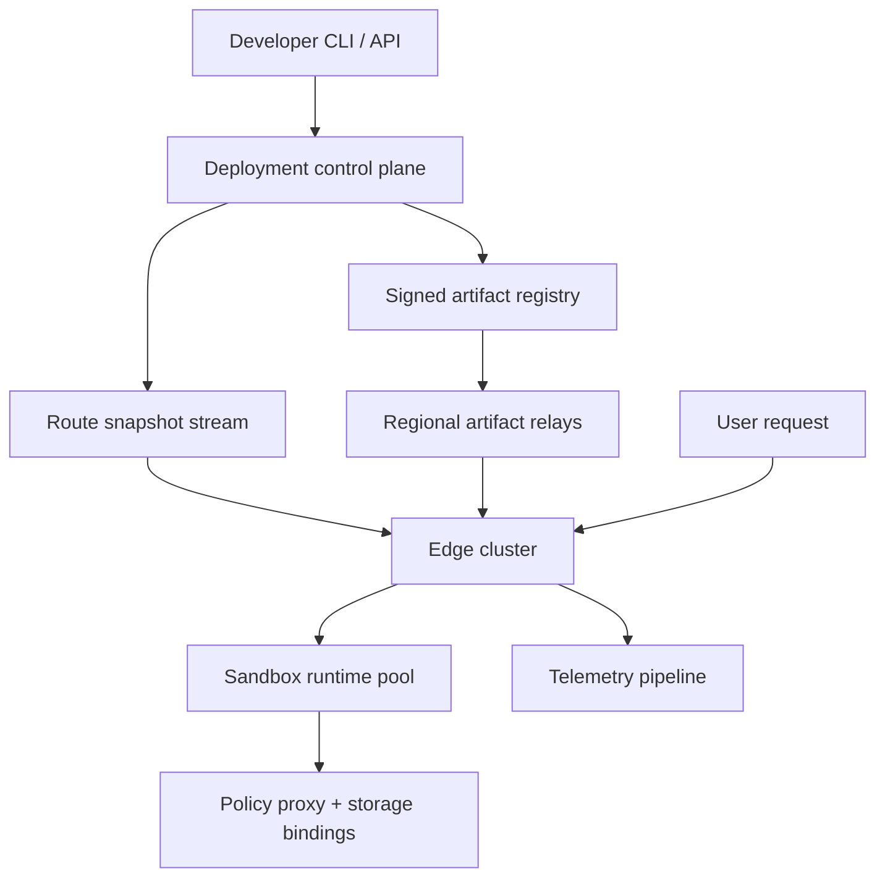

# Design a Global Edge Function Platform

**Difficulty:** Senior / Staff  
**Primary themes:** serverless runtimes, sandboxing, global routing, deployment propagation, cold starts, overload control, multi-tenant isolation, edge state

## How to use this walkthrough

In a 45-minute interview, spend about 5 minutes on requirements, 2 on entities, 5 on interfaces, 10–15 on the simplest complete design, and 10–15 on selected deep dives. This walkthrough is deliberately more detailed than a spoken answer so that the short interview version rests on explicit reasoning.

The structure follows Hello Interview's public delivery framework: clarify requirements, identify entities, define interfaces, build a working design one requirement at a time, and then harden it against the important non-functional requirements ([Hello Interview delivery framework](https://www.hellointerview.com/learn/system-design/in-a-hurry/delivery)).

---

## Interviewer prompt

> Design a global edge function platform similar to Cloudflare Workers or an edge-oriented serverless runtime. Developers upload small functions and bind them to hostnames and paths. Requests should execute near users with low latency, strong tenant isolation, rapid deployment, observability, and controlled access to external services and platform storage.

## Targeted clarifying questions and assumed answers

**Candidate:** Are these synchronous HTTP functions, asynchronous jobs, or both?

**Interviewer:** Prioritize synchronous HTTP request/response functions. You can mention asynchronous work but do not design a full workflow system.

**Candidate:** Which languages and packaging format must we support?

**Interviewer:** Start with JavaScript and WebAssembly. A deployment bundle is at most 10 MB compressed. Native extensions and arbitrary containers are out of scope.

**Candidate:** What scale should I assume?

**Interviewer:** The global platform receives 20 million requests per second at peak across 300 edge points of presence. There are 5 million deployed functions, but only about 500,000 are active in a given hour. A normal function gets little traffic, while a small number become extremely hot.

**Candidate:** What latency target matters?

**Interviewer:** Add less than 5 ms p99 platform overhead for a warm function, excluding the function's own compute and outbound network time. Ninety-nine percent of accepted deployments should become active globally within 60 seconds.

**Candidate:** What are the execution limits?

**Interviewer:** Default to 50 ms of CPU time, 128 MB of memory, a 2-second wall-clock deadline, a 1 MB response, and a bounded number of outbound subrequests. Plans may raise some limits.

**Candidate:** What availability and consistency do users expect?

**Interviewer:** Existing active versions should keep serving through a control-plane or single-region failure. A deployment becomes visible atomically per edge location: a request executes either the old complete version or the new complete version, never a partial bundle. Global rollout may be briefly mixed. Support instant rollback.

**Candidate:** Do functions have local disk or mutable process state?

**Interviewer:** No durable local disk. In-memory state may survive between requests but is only a cache. Offer bindings to edge cache, eventually consistent global key-value storage, strongly consistent per-key durable objects, and secrets.

**Candidate:** How is a request mapped to a tenant and function?

**Interviewer:** By verified hostname, path rule, environment, and rollout policy. Customers can use platform subdomains or their own domains.

**Candidate:** Can code make arbitrary outbound network calls?

**Interviewer:** Only through a policy-controlled fetch API. Enforce destination policy, timeouts, quotas, and SSRF protection.

**Candidate:** How strong must tenant isolation be?

**Interviewer:** Treat tenant code as hostile. A tenant must not read another tenant's memory, secrets, cache entries, logs, or traffic. Discuss both lightweight isolates and stronger microVM/process boundaries.

**Candidate:** Should requests move to a central region if the function is cold at the nearest edge?

**Interviewer:** Compare waiting locally, running in a nearby warm location, and proactively placing code. Choose a policy that preserves the latency goal without sending all traffic to a few regions.

**Candidate, summarizing aloud:** “I’ll design a two-plane system: a durable deployment control plane that produces immutable, signed versions, and a globally distributed data plane that routes each request to one complete version and runs hostile code under strict resource and network controls.”

---

## 1. Requirements (~5 minutes)

### Core functional requirements

Prioritize three capabilities:

1. **Deploy and manage versions.** A developer uploads code and configuration, binds it to routes, gradually releases it, observes health, and rolls back.
2. **Route and execute requests globally.** A request reaches a nearby healthy edge, resolves a route and version, obtains a ready sandbox, runs within limits, and returns a response.
3. **Expose safe platform capabilities.** Code can read secrets, call approved external destinations, use cache or durable state through bindings, and emit logs, metrics, and traces.

Out of scope for the core answer: arbitrary OCI containers, GPUs, long-running processes, cron scheduling, full CI/CD, custom kernels, interactive debugging in production, and designing every backing storage product.

### Quantified non-functional requirements

| Concern | Contract |
|---|---|
| Scale | 20M HTTP requests/s peak, 300 edge locations, 5M deployed functions |
| Warm latency | Under 5 ms p99 platform overhead, excluding user code and outbound I/O |
| Deployment | 99% of accepted deployments active globally within 60 seconds |
| Availability | 99.99% request-routing and execution availability; survive one edge or control-plane region failure |
| Isolation | Hostile multi-tenant code, bounded CPU/memory/I/O, tenant-scoped data and observability |
| Version consistency | Each request uses one immutable version; an edge switches route pointers atomically |
| Durability | Accepted versions and route history are replicated and recoverable; edge caches may be rebuilt |

### Consistency and availability contract

- **Deployment acceptance:** `READY` means the bundle was validated, content-addressed, signed, durably replicated, and assigned an immutable version. It does not mean every edge has activated it.
- **Activation:** each edge atomically swaps a route snapshot. In-flight requests remain pinned to the version selected at admission.
- **Global rollout:** different edge locations may briefly serve different allowed versions. The control plane reports rollout coverage and supports a barrier mode for customers willing to trade availability and latency for coordinated activation.
- **Rollback:** changes only the desired route pointer to a previous immutable version. It never mutates old code.
- **Local state:** globals and memory are opportunistic cache, not durable state. Correct applications use explicit storage bindings.
- **Request availability:** if the control plane is unreachable, the edge serves the last verified route/config snapshot. If the requested version is unavailable locally, it may fetch from a nearby artifact replica or route under an explicit fallback policy.

**What to say aloud:** “I separate version creation from version activation. Code bundles are immutable and content-addressed; mutable state is a small route pointer. That makes rollout and rollback cheap while ensuring a request never observes a partially updated deployment.”

### Scale estimates that change the design

Average traffic per location would be:

\[
20{,}000{,}000 / 300 \approx 66{,}700\ \text{requests/s},
\]

but geography and flash events make distribution highly skewed. Design edge clusters for several times the average and use load-aware anycast steering.

If all 5 million functions had a 10 MB bundle copied to every one of 300 locations, worst-case storage would be:

\[
5{,}000{,}000 \times 10\ \text{MB} \times 300 = 15\ \text{exabytes}.
\]

That is unnecessary because only 500,000 functions are active per hour and locality varies. Keep all artifacts in regional durable storage, cache popular compiled artifacts at edges, and place cold functions on demand.

At 20M requests/s, even a 1 KB access-log event creates about 20 GB/s or 1.7 PB/day before replication. Therefore, synchronous per-request logging cannot sit on the response path. Use bounded local buffers, sampling, aggregation, tenant quotas, and asynchronous export.

If each active sandbox reserves 128 MB, 100,000 idle sandboxes would consume 12.8 TB at one fleet scope. We cannot keep one warm process per deployed function. Lightweight isolates, shared runtimes, popularity-based admission, and aggressive eviction materially affect cost and cold-start latency.

---

## 2. Core entities (~2 minutes)

| Entity | Purpose |
|---|---|
| `Tenant` | Ownership, plan, quotas, billing and security boundary |
| `Function` | Stable logical application with environments and metadata |
| `FunctionVersion` | Immutable bundle, manifest, compatibility/runtime version, limits, digest, signature |
| `Route` | Verified hostname/path rule mapping to environment and rollout policy |
| `Deployment` | Desired version change, rollout state, health gates, actor, audit trail |
| `EdgeSnapshot` | Signed, monotonic route/config view consumed by one edge location |
| `Sandbox` | Runtime instance for one function version and isolation class |
| `Invocation` | Request admission and execution record with selected version and outcome |
| `Binding` | Tenant-scoped capability for secrets, cache, storage, queues, or outbound policy |

Do not expand every table now. Introduce fields with the components that need them.

**What to say aloud:** “The key distinction is between `Function`, which is a stable identity, and `FunctionVersion`, which is immutable executable content. `Route` is the small mutable pointer that lets us deploy or roll back without rewriting artifacts.”

---

## 3. API and system interface (~5 minutes)

Developer APIs use OAuth or scoped API tokens. `tenant_id` comes from the authenticated principal. Runtime bindings are capabilities injected by the platform; function code never supplies another tenant's binding identifier.

### Create a function version

For large bundles, the client first gets a pre-signed upload URL. The finalize call references the uploaded object.

```http
POST /v1/functions/fn_checkout/versions
Authorization: Bearer <developer-token>
Idempotency-Key: build-9842
Content-Type: application/json

{
  "bundle_uri": "upload://obj_8841",
  "bundle_sha256": "8af2...",
  "runtime": "javascript-2026-09",
  "entrypoint": "src/index.js",
  "limits": {
    "cpu_ms": 50,
    "memory_mb": 128,
    "wall_ms": 2000,
    "subrequests": 20
  },
  "bindings": ["secret/payment_token", "kv/catalog", "cache/default"]
}
```

```json
{
  "version_id": "fv_01K...",
  "status": "validating"
}
```

Validation is asynchronous because it includes unpacking, dependency inspection, compilation, policy checks, and deterministic smoke tests.

### Read version status

```http
GET /v1/functions/fn_checkout/versions/fv_01K...
Authorization: Bearer <developer-token>
```

```json
{
  "version_id": "fv_01K...",
  "status": "ready",
  "artifact_digest": "sha256:23ab...",
  "compiled_targets": ["v8-edge-19", "wasm-edge-8"],
  "created_at": "2026-10-17T08:12:00Z"
}
```

### Deploy to a route

```http
POST /v1/functions/fn_checkout/deployments
Authorization: Bearer <developer-token>
Idempotency-Key: release-2026-10-17-1
Content-Type: application/json

{
  "environment": "production",
  "route_id": "route_store_checkout",
  "target_version": "fv_01K...",
  "strategy": {
    "type": "progressive",
    "steps": [1, 10, 50, 100],
    "bake_seconds": 300,
    "max_error_rate": 0.01
  }
}
```

```json
{
  "deployment_id": "dep_73",
  "status": "propagating",
  "previous_version": "fv_01J..."
}
```

### Roll back

```http
POST /v1/deployments/dep_73/rollback
Authorization: Bearer <developer-token>
Idempotency-Key: incident-552
Content-Type: application/json

{"reason": "elevated origin timeout rate"}
```

Rollback creates a new audited desired-state transition to the previous immutable version.

### Runtime request contract

The platform owns the external HTTP interface. It invokes a standard handler:

```javascript
export default {
  async fetch(request, env, ctx) {
    const product = await env.CATALOG.get("sku-42");
    return Response.json(product, {
      headers: {"Cache-Control": "public, max-age=30"}
    });
  }
};
```

The runtime provides:

- immutable request metadata;
- tenant-scoped bindings in `env`;
- a controlled `fetch()` for outbound calls;
- cancellation/deadline signals;
- structured logging and trace context;
- a `waitUntil()`-like mechanism for short, bounded post-response work if the product supports it.

Cloudflare's public Workers documentation describes a comparable isolate-based runtime and fetch handler model, while noting that many isolates can share a runtime process ([How Workers works](https://developers.cloudflare.com/workers/reference/how-workers-works/)). This design uses the concept, not a claim that our implementation is identical.

### Deployment event stream

Edges consume an internal, authenticated stream:

```json
{
  "snapshot_epoch": 918244,
  "edge_scope": "global",
  "route_id": "route_store_checkout",
  "allowed_versions": [
    {"version_id": "fv_01J...", "weight": 90},
    {"version_id": "fv_01K...", "weight": 10}
  ],
  "not_before": "2026-10-17T08:15:00Z",
  "config_digest": "sha256:91cd...",
  "signature": "control-plane-signature"
}
```

Edges apply only valid signatures and monotonically increasing epochs. They fetch immutable artifacts by digest before advertising the version as locally ready.

---

## 4. Data flow

### Deployment flow

1. A developer uploads a bundle and finalizes a version with an idempotency key.
2. The build service verifies the digest, unpacks in an isolated worker, checks policy, and compiles JavaScript bytecode or WebAssembly for supported runtime targets.
3. The artifact service stores immutable source and compiled artifacts in replicated object storage, signs a manifest, and marks the version `READY`.
4. A deployment controller writes desired state and publishes a signed rollout snapshot.
5. Regional relays distribute snapshots and artifacts to edge locations.
6. Each edge verifies the snapshot, fetches missing artifacts, runs a local probe, and atomically activates the route pointer.
7. Edge acknowledgements feed rollout coverage and automated health gates.

### Request flow

1. DNS/anycast steers the client to a nearby healthy location.
2. TLS terminates at the edge; hostname ownership and certificate are already configured.
3. The router matches hostname and path using an in-memory immutable route snapshot.
4. A deterministic rollout function selects an allowed version for this request.
5. Admission control checks tenant, function, location, and global capacity.
6. The scheduler reuses a warm sandbox or creates one from a verified local compiled artifact.
7. The runtime injects bindings, starts budgets and deadlines, executes the handler, and mediates every privileged operation.
8. The edge returns the response, releases or retains the sandbox according to policy, and exports bounded telemetry asynchronously.

---

## 5. High-level design (~10–15 minutes)

### Compact architecture



The control plane is off the request path. The data plane at each edge can continue serving the last verified versions during a control-plane outage.

### Operation 1: build an immutable, executable version

The metadata database stores:

```text
FunctionVersion(
  tenant_id, function_id, version_id,
  source_digest, manifest_digest,
  runtime_abi, entrypoint,
  requested_limits, binding_schema,
  compiled_artifacts[{target, digest}],
  status, signature, created_at
)
```

The build service never executes untrusted build steps on control-plane hosts. It runs parsing, package extraction, compilation, and smoke tests in disposable isolated workers with no production credentials and restricted egress.

Validation includes:

- compressed and expanded size limits;
- zip-path traversal and decompression-bomb checks;
- supported imports and runtime APIs;
- WebAssembly validation;
- forbidden native code or dynamic library loading;
- declared binding compatibility;
- deterministic compilation under a pinned runtime toolchain;
- basic startup and memory checks.

Artifacts are content-addressed by cryptographic digest. Identical dependencies or bundles can share physical blobs while metadata remains tenant-scoped. A signed manifest binds code digest, runtime ABI, limits, and binding schema. Edges execute only artifacts whose manifest signature chains to an active platform key.

**What to say aloud:** “The artifact digest is the identity. The edge does not trust a filename or mutable URL; it verifies a signed manifest that commits to the code, runtime ABI, limits, and capabilities.”

### Operation 2: propagate and atomically activate a deployment

The deployment store holds:

```text
Deployment(
  tenant_id, deployment_id, route_id,
  previous_version, target_version,
  strategy, current_step,
  desired_state, status,
  snapshot_epoch, health_policy,
  actor_id, created_at
)
```

The controller uses an outbox or replicated log so desired-state commits and propagation cannot diverge. Regional relays fan out signed route snapshots rather than requiring every edge to maintain a connection to one global database.

At an edge:

1. receive a snapshot with epoch `N`;
2. verify signature, scope, expiration, and monotonic epoch;
3. fetch each referenced artifact through the nearest relay;
4. verify the content digest and manifest signature;
5. load or probe the runtime without exposing traffic;
6. construct a new immutable routing table; and
7. swap one pointer from table `N-1` to table `N`.

Readers do not lock. Each admitted request retains a reference to the old snapshot until it finishes. Garbage collection removes an old snapshot and artifacts only when no in-flight request or rollback window needs them.

For progressive rollout, version selection uses a stable hash:

```text
bucket = hash(route_id, rollout_salt, sticky_key) mod 10_000
```

The `sticky_key` is an authenticated session identifier when available, otherwise a privacy-preserving request key. Stable bucketing prevents a user from bouncing between versions while weights remain unchanged.

Automated gates compare target and baseline error rate, CPU-limit terminations, wall time, and origin failures. They pause rather than automatically declare causation from tiny samples. Rollback publishes a higher-epoch snapshot pointing to a known-good version.

### Operation 3: route and execute a request

The hot path cannot query a remote database.

Each edge cluster maintains:

- a read-only hostname/path radix tree or compiled matcher;
- route-to-rollout metadata;
- a local artifact cache indexed by digest;
- runtime pools separated by trust/isolation class;
- per-tenant and per-function admission counters;
- local circuit and overload state.

Request steps:

1. **TLS and identity.** Terminate TLS, derive the verified hostname, and attach a request ID and deadline.
2. **Route match.** Match normalized host and path against the immutable snapshot. Reject ambiguous or invalid normalization before user code.
3. **Version pin.** Apply rollout hashing and retain that version for the full invocation.
4. **Admission.** Spend global, location, tenant, function, CPU, memory, and subrequest budget.
5. **Sandbox selection.** Reuse a compatible idle isolate or initialize one from the compiled artifact.
6. **Execution.** Inject capability handles, not raw credentials. Start CPU accounting and wall timer.
7. **Response.** Validate status and headers, cap body size, stream with backpressure, and cancel remaining work at deadline.
8. **Cleanup.** Clear request-scoped handles and sensitive buffers. Reuse only if runtime health checks pass.

```text
Invocation(
  request_id, tenant_id, function_id, version_id,
  edge_id, admitted_at, start_at, finish_at,
  warm_state, cpu_us, memory_peak,
  subrequest_count, outcome_class,
  trace_id, sampled
)
```

Invocation data is buffered locally and exported asynchronously. The response path emits only bounded counters and trace sampling decisions.

### Operation 4: provide bindings without handing out credentials

The runtime exposes opaque handles such as `env.CATALOG`. Calling a handle crosses a narrow host API boundary into a binding proxy.

The proxy receives trusted invocation context:

```text
(tenant_id, function_id, version_id, binding_id, request_id, deadline)
```

It resolves the binding's current policy and credentials, enforces quotas and destination rules, attaches authentication, and records safe telemetry. Function code never sees database passwords, KMS keys, or another tenant's namespace.

For outbound `fetch()`:

- allow only approved schemes and ports;
- resolve through a controlled DNS service;
- reject private, loopback, link-local, metadata, and reserved targets;
- revalidate every redirect;
- enforce connect, TLS, first-byte, idle, and total deadlines;
- cap request/response bytes and concurrent subrequests;
- strip platform credentials and hop-by-hop headers;
- apply tenant egress policy and per-destination circuit breakers.

### Operation 5: observe and debug safely

Logs are written to a fixed-size per-invocation buffer. On overflow, truncate and increment a dropped-byte counter rather than block execution. Edge agents batch, compress, and export telemetry to regional collectors, which stream to tenant-partitioned storage.

Offer:

- sampled request traces with platform and user spans;
- bounded structured logs;
- aggregate metrics by function, version, route, and coarse edge region;
- deployment comparison dashboards;
- tail sampling for errors and unusual latency;
- an opt-in live-tail stream with strict rate and duration limits.

Never put raw secrets, authorization headers, binding credentials, or unrestricted request bodies into telemetry. Tenant-controlled metric names and labels require cardinality quotas.

---

## 6. Deep dives (~10–15 minutes)

In a normal interview, choose two. The three below cover security, latency/capacity, and consistency/state.

### Deep dive A: hostile-code isolation and runtime security

#### Where the baseline breaks

Running different customers' code in one runtime process is efficient, but a runtime escape, side channel, mis-scoped capability, or host API bug can cross tenant boundaries. Running every invocation in a new virtual machine is stronger but may miss the latency and density targets.

#### Plausible isolation choices

| Isolation unit | Strength | Startup/density | Best use |
|---|---|---|---|
| Language isolate in shared process | Small memory and very fast creation | Excellent | Short restricted JavaScript/Wasm with hardened runtime |
| Dedicated process | OS address-space boundary | Moderate | Debugging, risky features, suspicious tenants |
| Container | Namespaces/cgroups, packaging flexibility | Moderate to heavy | Trusted platform workloads or broader runtimes |
| MicroVM | Hardware virtualization boundary | Stronger | Native code, high-risk tenants, premium isolation |

Cloudflare publicly describes V8 isolates as lightweight, memory-isolated contexts that allow many tenant programs in one process ([Workers concepts](https://developers.cloudflare.com/learning-paths/workers/concepts/workers-concepts/)). Firecracker is an example of microVM technology purpose-built for secure multi-tenant function and container services ([Firecracker](https://firecracker-microvm.github.io/)). These illustrate the tradeoff; they do not eliminate the need for our own threat model.

#### Choice: tiered isolation

Use hardened isolates for the restricted JavaScript/WebAssembly default, with dynamic promotion to a process or microVM when risk or capability requires it.

Default-isolate safeguards:

- no native extensions, raw sockets, process APIs, filesystem access, JIT configuration, or direct syscalls;
- a tiny standards-based host API;
- tenant-scoped capability handles;
- per-isolate heap limits and per-invocation CPU accounting;
- runtime interrupt for deadline or CPU exhaustion;
- zeroed/reinitialized memory and handles before reuse;
- separate runtime processes across security cells so one process compromise has a bounded blast radius;
- prompt runtime patch rollout with canaries and rollback;
- periodic process recycling to clear latent corruption or fragmentation.

Promotion signals include privileged debugging, anomalous high-resolution timing behavior, repeated runtime faults, risky APIs, regulated isolation requirements, or arbitrary native modules in a future product tier.

#### CPU and wall time are different

CPU time measures actual execution. Wall time includes waiting for outbound I/O. A function can consume little CPU but hold memory and connections for seconds. Enforce both:

- interrupt after `cpu_ms` is exhausted;
- cancel invocation at `wall_ms`;
- cancel or detach child operations when the invocation ends;
- meter post-response work separately;
- cap outstanding promises, timers, streams, and subrequests.

#### Noisy-neighbor control

Use hierarchical scheduling:

1. host safety limits;
2. runtime-process limits;
3. tenant CPU and memory shares;
4. function concurrency and request-rate quotas;
5. invocation budgets.

A tenant token bucket handles bursts but enforces a long-run request/CPU rate. Weighted fair queues prevent a high-QPS tenant from occupying every runnable slot. Memory admission reserves headroom for the runtime and refuses a new sandbox before the host begins swapping.

#### Failure behavior

- CPU budget exceeded: terminate invocation with a platform error; sandbox may remain reusable only if cleanup is trustworthy.
- Out-of-memory inside isolate: terminate isolate, not the host process; repeated failures trigger quarantine.
- Runtime process crash: in-flight requests fail or retry only if method semantics allow; health manager removes the process and starts a clean one.
- Sandbox escape signal: quarantine the security cell, revoke credentials, preserve forensic metadata, rotate affected keys, and shift traffic.

**Interviewer:** Why not put every function in a microVM?

**Candidate:** “That is a valid security-first product, but five million mostly cold functions and a sub-5-ms warm overhead goal reward a smaller unit. I restrict the language and host API enough to use isolates for ordinary traffic, divide hosts into security cells, and promote risky capabilities or tenants to processes or microVMs. Isolation strength is a product contract, not a hidden implementation detail.”

### Deep dive B: cold starts, placement, and overload

#### Where the baseline breaks

Keeping every function warm everywhere is impossible. Loading every cold function only after the first request adds latency. Sending every miss to a central warm region defeats edge locality and can overload the fallback.

#### Cold-start stages

Break the latency into observable stages:

1. route/config miss;
2. artifact metadata lookup;
3. artifact transfer;
4. digest/signature verification;
5. compilation or bytecode deserialization;
6. sandbox creation;
7. module initialization;
8. binding initialization.

Optimization must target the dominant stage rather than calling all of it “cold start.”

#### Placement options

| Approach | Benefit | Cost/problem |
|---|---|---|
| Replicate every function everywhere | No artifact miss | Impossible storage and memory footprint |
| Pure on-demand local load | Simple and local | First-request latency and stampedes |
| Route cold request to warm nearby edge | Lower immediate latency | Extra network hop and locality complexity |
| Predictive placement and tiered caches | Good latency/cost balance | Forecasting and invalidation complexity |
| Provisioned warm capacity | Predictable for critical tenants | Customer cost and idle resources |

#### Choice: layered placement policy

Use four layers:

1. **Regional artifact durability:** all ready versions exist in several large regions.
2. **Edge SSD artifact cache:** compiled artifacts admitted by recency, frequency, size, and predicted demand.
3. **Warm isolate cache:** a much smaller memory pool admitted by recent concurrency and latency value.
4. **Optional reserved warmth:** customers reserve minimum warm instances in selected geographies.

On a local miss, race policy—not necessarily requests—between:

- local initialization from cached artifact;
- local artifact fetch and initialization;
- execution at a nearby warm location.

The router estimates each option using artifact size, relay RTT, initialization history, nearby warm capacity, and remaining request deadline. It chooses one execution target and cancels unused preparation work. Hedging actual non-idempotent invocations would risk duplicate side effects, so only hedge safe preparation unless the request is explicitly idempotent.

#### Singleflight and stampede prevention

The first burst to a cold function can send thousands of workers to fetch and compile the same artifact. Maintain a per-version singleflight promise at each host or cluster:

- one leader fetches/verifies/loads;
- waiters share the result within a small deadline;
- if the wait exceeds their budget, overflow policy may use another host/location;
- failures are cached briefly with jitter, but not long enough to hide recovery.

Prewarming uses deployment signals and traffic prediction. A new rollout can push the artifact and create a few sandboxes before receiving its traffic percentage. Hot-version metadata is shared regionally, but local demand remains the strongest signal.

#### Admission and overload

Every request consumes more than one resource: CPU, heap, outbound sockets, telemetry bandwidth, and sometimes storage operations. A single concurrency number is insufficient.

Admission checks:

- host runnable CPU and memory headroom;
- runtime-process health;
- tenant request and CPU tokens;
- function concurrency;
- edge-wide pending queue age;
- outbound and binding budgets;
- request deadline.

Keep the waiting queue short and deadline-aware. Once expected wait exceeds the useful deadline, fail fast with `429` or `503` plus a retry hint rather than spend resources on a response the client has abandoned.

Use reserved capacity pools:

- interactive traffic;
- platform control and health traffic;
- paid reserved tenants;
- best-effort traffic.

Allow borrowing when pools are idle, but reclaim gradually. Local overload signals feed anycast/load-aware routing so new connections shift to nearby locations. Do not move established requests after admission unless the protocol supports it.

#### Eviction policy

Warm sandboxes should not use exact global LRU, which creates contention. Use segmented approximate recency/frequency plus size and initialization cost:

```text
value_score = predicted_requests × cold_latency_saved / reserved_memory
```

Evict idle low-score sandboxes first. Retain the compiled artifact on SSD after evicting the isolate, so the next start is warm-ish rather than fully cold.

#### Observability

Track:

- warm, artifact-cached, and full-cold invocation rates;
- cold-start stage latency;
- singleflight waiters and failed initializations;
- route-to-nearby-edge rate and added network latency;
- queue age, admission rejection, deadline cancellation;
- sandbox reuse count and eviction reason;
- reserved-capacity utilization and borrowed share;
- per-tenant CPU throttling and fairness lag.

**What to say aloud:** “I do not solve cold starts with one cache. I separate immutable artifact placement, compiled-artifact caching, and warm sandbox residency. That gives graceful latency tiers and avoids paying 128 MB per function at every edge.”

### Deep dive C: global state, version semantics, and failure recovery

#### Where the baseline breaks

Developers see an ordinary program and may assume globals are durable or that all requests observe one database snapshot. At the edge, invocations can run in different locations, on different versions during rollout, and in sandboxes that disappear at any moment.

#### State product choices

| Binding | Consistency | Typical use | Tradeoff |
|---|---|---|---|
| Edge cache | Local/eventually propagated | HTTP responses, derived objects | May be stale or evicted |
| Global KV | Eventual, read-optimized | Configuration, catalogs | Fast global reads; stale after write |
| Durable object / actor | Strong order per object key | Sessions, counters, coordination | Requests may travel to key's home |
| Regional database binding | Database-defined | Durable business records | Higher RTT outside home region |
| Queue | Durable asynchronous handoff | Background effects | Not synchronous state |

Do not offer one ambiguous `storage.get()` API with unstated semantics. The binding type communicates consistency and failure behavior.

#### Request version pinning

At admission, record:

```text
(route_snapshot_epoch, version_id, binding_config_version, secret_version_set)
```

The invocation retains those references. A mid-request deployment cannot change code. Secret rotation may expose an overlap set, but a request uses a consistent binding view. Long-lived streaming connections need a maximum lifetime or explicit migration policy so old versions eventually drain.

#### Global KV

Writes go to a durable home region, enter a replication log, and propagate to regional/edge replicas. Reads normally use the local replica. The API returns a version or timestamp and documents bounded or unbounded staleness according to product capability.

For read-after-write, options include:

- route subsequent reads to the home region using a session token;
- wait until the local replica reaches a returned version;
- use a strongly consistent durable-object binding instead.

Do not pretend local low-latency reads and synchronous global consistency are free.

#### Durable objects

Hash an object key to a logical partition with one fenced active owner. Calls for the same object route to that owner, which serializes operations and commits durable state before acknowledgement. Replicas provide failover. Moving ownership increments an epoch; the storage layer rejects writes from stale owners.

This gives strong order **per object**, not across all objects. A shopping cart or room can fit; a globally contended single counter may become hot and should be sharded if exact total order is unnecessary.

#### Side effects and retries

The platform should not automatically retry an arbitrary invocation after code may have sent an external request. Retry only when:

- failure happened before user code began; or
- the method and platform operation are known idempotent; or
- the application supplied an idempotency key and the destination honors it.

For post-response asynchronous work, durably enqueue an intent before claiming acceptance. A best-effort `waitUntil()` cannot substitute for a durable queue when loss matters.

#### Control-plane and edge failure

| Failure | Behavior |
|---|---|
| Control-plane database unavailable | Existing edges serve last signed snapshot; block new deployments if durability is uncertain |
| Snapshot stream unavailable | Edge retains last valid snapshot and alerts on age |
| Artifact relay unavailable | Use alternate relay/region; keep serving cached versions |
| Edge location fails | Anycast/DNS shifts new traffic; no durable local state is lost |
| Route snapshot corrupted | Signature/digest check rejects it; stay on previous epoch |
| New runtime version crashes | Cell-level canary stops rollout; functions remain on prior compatible runtime |
| Durable-object owner fails | Replica elects a new fenced owner; callers retry ambiguous operations with IDs |
| Global KV replication lags | Serve documented stale reads or route consistency-sensitive reads to home |

#### Disaster recovery

Replicate artifact blobs, manifests, signing metadata, route history, tenant configuration, and secret ciphertext to a second control-plane region. Signing keys live behind a quorum-controlled key service; edges trust an overlapping key set during rotation.

The secondary region can reconstruct the desired snapshot stream. Since edges already cache immutable artifacts and verified snapshots, request serving continues while control-plane recovery proceeds. Recovery tests must prove that rollback targets and runtime ABIs remain available, not merely that metadata rows exist.

**Interviewer:** Can a global variable hold a counter?

**Candidate:** “Only as a disposable per-sandbox optimization. Requests can land in different locations or sandboxes, and either may be evicted. For an exact per-key counter I use a strongly ordered durable object; for a scalable approximate total I use sharded counters and asynchronous aggregation.”

---

## Reliability, operability, and security details

### Reconciliation loops

Event-driven propagation still needs repair:

- ready versions missing a compiled target;
- deployments whose desired snapshot lacks regional publication;
- edges stuck below the desired epoch;
- active routes referencing artifacts near lifecycle deletion;
- route certificates nearing expiry;
- sandboxes running an unsupported runtime ABI;
- telemetry partitions whose export cursor is stalled.

Reconcilers operate on bounded shards with checkpoints and idempotent actions. They never require a global full-table scan on every pass.

### Runtime and artifact supply-chain security

- Pin build images, compiler versions, and runtime ABIs.
- Sign manifests after validation; edges verify before load.
- Maintain software-bill-of-material metadata for platform-provided dependencies.
- Roll out runtime patches by security cell, edge cohort, and region.
- Keep a compatibility matrix so a new runtime cannot reinterpret old code silently.
- Revoke a vulnerable artifact or runtime through a signed high-priority snapshot.
- Audit deployment actors, key operations, binding changes, and emergency overrides.
- Separate build, control-plane, and data-plane credentials.

### SLOs and alerts

Measure from the tenant/user perspective:

- routing and execution availability;
- warm platform overhead p50/p95/p99;
- cold-start rate and stage latency;
- deployment acceptance and global activation coverage;
- stale edge snapshot age;
- sandbox termination by CPU, memory, wall time, and runtime fault;
- tenant throttling versus platform overload;
- binding latency/error by type, excluding secrets and raw destinations;
- log drop/truncation rate;
- rollback time and runtime-patch coverage;
- cross-tenant security invariant violations, which page immediately.

Availability reporting distinguishes:

- platform rejection or runtime failure;
- user-code exception;
- tenant quota rejection;
- origin/binding failure;
- client cancellation.

A function returning `500` by choice is not the same as the platform failing to invoke it.

---

## 7. Concise final design

A regionalized control plane validates hostile bundles in isolated builders, compiles them under pinned runtimes, stores content-addressed artifacts, and signs immutable manifests. Deployments update small desired route pointers and produce signed, monotonic snapshots through regional relays. Each edge verifies and preloads referenced artifacts, then atomically swaps an immutable routing table; admitted requests remain pinned to one complete version. The request path uses local route lookup, hierarchical admission, a warm-isolate or compiled-artifact cache, strict CPU/memory/wall/I/O budgets, and capability-based bindings. Lightweight isolates serve restricted JavaScript/Wasm efficiently, while risky features and tenants move to process or microVM isolation. Popularity-based placement, singleflight initialization, nearby-edge fallback, and optional reserved warmth balance cold latency with cost. Edge cache, eventual KV, and strongly ordered per-key durable objects expose distinct consistency contracts. The data plane survives control-plane outages using the last signed snapshot, and bounded reconciliation repairs missed propagation without entering the request path.

### Requirements check

| Requirement | Where it is met |
|---|---|
| Deploy and roll back | Immutable signed versions, desired route pointer, progressive snapshots |
| Global low-latency execution | Anycast, local route table, isolate pool, artifact cache |
| 20M requests/s | 300 independent edge locations, local admission and scheduling |
| Under 5 ms warm overhead | No remote control-plane lookup, lightweight sandbox reuse, bounded telemetry |
| Global activation within 60 seconds | Regional snapshot/artifact relays, edge acknowledgements, rollout coverage |
| Hostile tenant isolation | Restricted host API, isolates, security cells, process/microVM promotion |
| Resource limits | Hierarchical admission plus CPU, heap, wall, response, and subrequest budgets |
| Safe outbound access | Capability proxy, SSRF-safe resolver/egress policy, deadlines and quotas |
| State options | Explicit cache, eventual KV, durable object, database, and queue bindings |
| Failure survival | Last verified edge snapshot, immutable cached artifacts, multi-region control plane |
| Observability | Bounded local telemetry, async pipeline, version comparisons and sampled traces |

---

## Realistic interviewer follow-ups with strong sample answers

### 1. Why is the control plane not on the request path?

**Candidate:** “Request volume is 20 million per second and edges must survive control-plane outages. The control plane distributes signed immutable snapshots ahead of time; the hot path performs a local lookup. Fresh deployment state is eventually activated, while request availability uses the last verified snapshot.”

### 2. How can rollback be fast if artifacts are globally distributed?

**Candidate:** “Rollback changes a route pointer to a previous immutable digest. Edges retain recent rollback artifacts through a protection window, so most only apply a higher-epoch snapshot and atomically swap the routing table. If an artifact was evicted, the edge fetches it before activation.”

### 3. What happens to in-flight requests during deployment?

**Candidate:** “Admission pins the route epoch, version, and binding view. New requests see the new table after pointer swap; in-flight requests retain the old snapshot reference until completion. Old resources are reclaimed only after reference count and rollback policy allow it.”

### 4. Why compile centrally instead of at every edge?

**Candidate:** “Central or regional compilation avoids repeating expensive work 300 times, pins the toolchain, and lets us scan and sign the result. Edges still validate digest and compatibility. If CPU architecture differs, the manifest carries one compiled artifact per target.”

### 5. How do you stop one infinite loop?

**Candidate:** “The runtime accounts CPU independently of wall time and interrupts the invocation at its CPU budget. The tenant also has aggregate CPU tokens, so many small loops cannot monopolize a host. Repeated faults can quarantine the function or promote it to stronger isolation.”

### 6. Why is wall time separate from CPU time?

**Candidate:** “A function waiting on a slow origin may consume little CPU but still holds memory, sockets, queue slots, and a client connection. CPU protects compute; wall time protects retained resources and user latency. I enforce both.”

### 7. What if a function is cold locally but warm 20 ms away?

**Candidate:** “The scheduler estimates local artifact fetch plus initialization versus network RTT to the warm edge and the request deadline. It chooses one target. For side-effecting requests I do not hedge execution; I may hedge only artifact preparation.”

### 8. Can you guarantee zero cold starts?

**Candidate:** “Not economically for five million functions at every location. I offer latency tiers: warm isolate, locally compiled artifact, relay fetch, or nearby warm execution. Customers with strict needs can buy reserved warmth in selected geographies.”

### 9. Why not let code read a database password from an environment variable?

**Candidate:** “A capability binding avoids exposing reusable credentials to hostile code or logs. The host proxy receives trusted tenant/function identity, enforces policy and quotas, and attaches credentials for that operation. Revocation and rotation then happen centrally.”

### 10. How do you prevent SSRF through `fetch()`?

**Candidate:** “All outbound calls cross a controlled resolver and egress proxy. I validate the resolved address at connection time, block private and metadata ranges, pin the approved address for the connection, recheck redirects, restrict ports and schemes, and cap time and bytes.”

### 11. How do you choose isolate versus microVM?

**Candidate:** “It follows the security contract. Restricted JS/Wasm with a narrow host API uses hardened isolates for density. Native code, privileged debugging, anomalous tenants, or regulated workloads use a process or microVM. Security cells limit blast radius even for the default tier.”

### 12. How does canary routing remain sticky?

**Candidate:** “Hash route ID, rollout salt, and a stable privacy-safe request or session key into a fixed bucket space. Weight changes expand bucket ranges deterministically. The chosen version is recorded in traces so comparisons are auditable.”

### 13. What if an edge misses several snapshot events?

**Candidate:** “Snapshots are self-contained or retrievable by epoch, not fragile imperative patches. The edge requests the newest signed snapshot, fetches referenced artifacts, and atomically advances. A reconciler alerts on old epochs and repairs lagging locations.”

### 14. Can a customer get globally linearizable KV reads at edge latency?

**Candidate:** “Not simultaneously across arbitrary distances. The default KV favors local reads and eventual propagation. Strong per-key operations route to a durable object's home owner. I make the latency/consistency choice explicit rather than hiding it behind one API.”

### 15. How do you make logging reliable without slowing requests?

**Candidate:** “Each invocation writes to a bounded memory buffer; edge agents batch and export asynchronously. On pressure, logs are sampled or truncated with visible drop counters. If audit events require durability, they use a separate durable channel and are not treated like ordinary console logs.”

### 16. Would you automatically retry a request after a runtime crash?

**Candidate:** “Only if failure occurred before user code began or the operation is known idempotent. Once user code may have made an external side effect, the outcome is ambiguous. Automatic retries require an application idempotency contract.”

### 17. How do long-lived WebSockets affect deployment?

**Candidate:** “They pin an old version and consume resources far longer than ordinary HTTP. I would make them a separate product class with connection quotas, draining policy, maximum lifetime, and perhaps dedicated stateful actors. They should not silently inherit short-request assumptions.”

### 18. How do you roll out a runtime security patch?

**Candidate:** “Build a compatible signed runtime, canary it by security cell and edge cohort, watch platform faults and customer regressions, then expand rapidly. The route manifest records ABI compatibility. For a critical issue, revoke the old runtime and move affected functions to a safe version or stronger isolation.”

---

## Common pitfalls

1. Putting the deployment database on every request path.
2. Treating mutable function names as executable identity instead of immutable digests.
3. Activating a route before its artifact is verified and locally usable.
4. Updating route rules and code separately so requests observe incompatible mixtures.
5. Recompiling every bundle independently at all 300 locations.
6. Keeping one warm process for every deployed function.
7. Discussing “cold start” without separating transfer, compilation, sandbox, and initialization time.
8. Hedging non-idempotent invocations and causing duplicate side effects.
9. Sending every cold request to one central fallback region.
10. Using exact global LRU for sandbox eviction.
11. Enforcing CPU limits but ignoring wall time, sockets, or response bytes.
12. Using one global concurrency limit without tenant and function fairness.
13. Allowing memory pressure to reach host swapping before admission rejects work.
14. Giving hostile code raw secrets or database credentials.
15. Letting function code use unrestricted DNS, sockets, redirects, or metadata endpoints.
16. Assuming language isolates remove all side-channel and runtime-escape risk.
17. Claiming microVM security and isolate startup cost simultaneously without explaining the isolation unit.
18. Reusing a poisoned sandbox after an out-of-memory or runtime-corruption signal.
19. Treating in-memory globals or local disk as durable state.
20. Offering “global storage” without naming its consistency model.
21. Automatically retrying after user code may have produced an external side effect.
22. Blocking responses on unbounded logging or metric export.
23. Allowing tenant-controlled metric labels to exhaust the telemetry system.
24. Rolling out runtime changes globally without security-cell canaries.
25. Garbage-collecting old artifacts before the rollback and in-flight-request windows close.
26. Assuming deployment is complete because the control plane wrote desired state.
27. Having no reconciliation for lagging edges, missing artifacts, or expired certificates.
28. Counting user-code `500` responses as platform invocation downtime.
29. Ignoring privacy when choosing a sticky rollout key.
30. Designing every storage product instead of first tracing deploy, route, execute, and respond.

---

## A polished 90-second closing answer

> “I split the system into a durable control plane and an autonomous global data plane. The control plane validates hostile bundles in isolated builders, compiles them under pinned runtimes, stores content-addressed artifacts, and signs immutable manifests. Deployments publish signed monotonic route snapshots through regional relays. An edge fetches and verifies every referenced artifact before atomically swapping an immutable routing table; each admitted request stays pinned to one version. The hot path then performs local routing, hierarchical admission, sandbox selection, capability injection, execution under CPU, memory, wall-time, response, and subrequest budgets, and asynchronous telemetry export. Restricted JavaScript and Wasm use hardened isolates inside small security cells, while risky capabilities move to process or microVM isolation. Layered artifact and sandbox caches, singleflight initialization, nearby-edge fallback, and optional reserved warmth handle cold starts without replicating every function everywhere. Finally, cache, eventual KV, durable objects, and queues expose distinct consistency contracts, and the edge keeps serving its last signed snapshot through control-plane failures.”

## Public references

- [Hello Interview — System Design Delivery Framework](https://www.hellointerview.com/learn/system-design/in-a-hurry/delivery)
- [Cloudflare Workers — How Workers works](https://developers.cloudflare.com/workers/reference/how-workers-works/)
- [Cloudflare Workers — Security model](https://developers.cloudflare.com/workers/reference/security-model/)
- [Firecracker — Secure and fast microVMs for serverless computing](https://firecracker-microvm.github.io/)
- [AWS Lambda — Execution environment lifecycle](https://docs.aws.amazon.com/lambda/latest/dg/lambda-runtime-environment.html)

