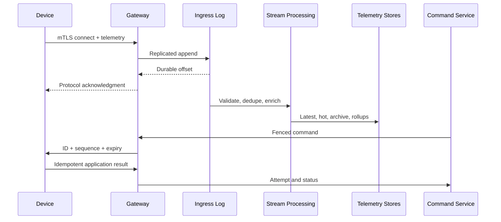
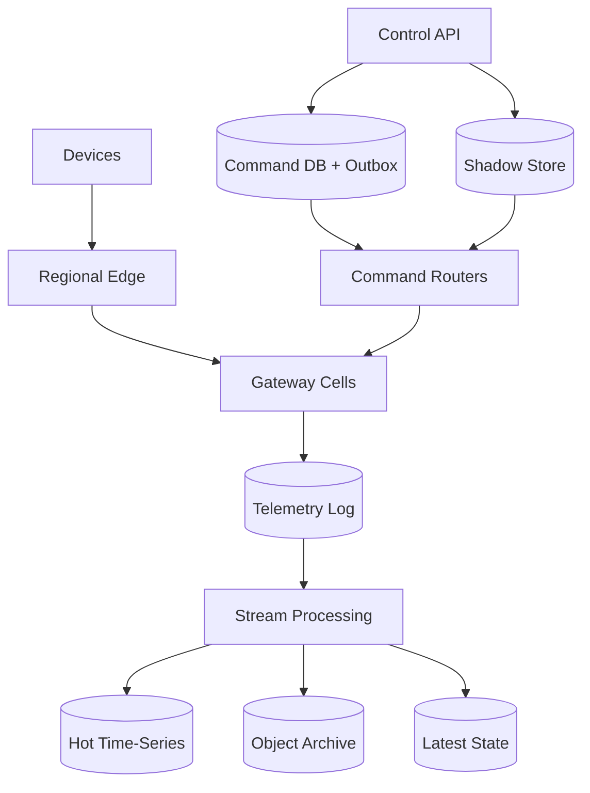
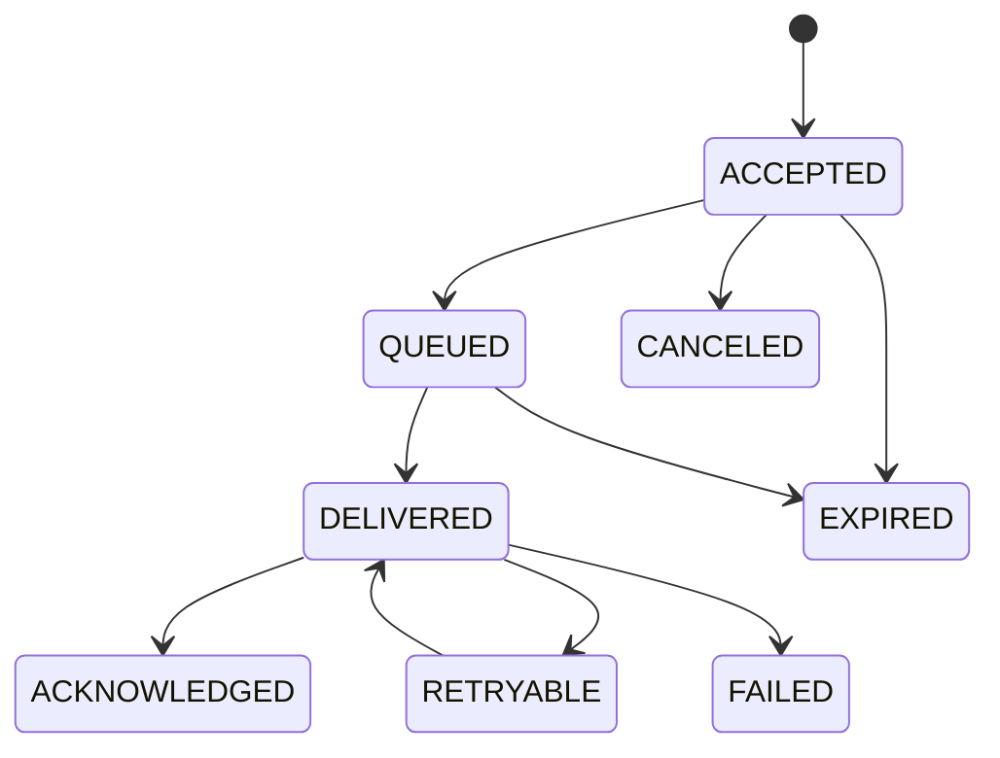

# Design a Global IoT Fleet Telemetry and Command Platform

**Difficulty:** Hard  
**Themes:** large-scale messaging, queues, time-series data, caching, reliability, consistency, security

> **Interview budget:** Requirements 5 minutes, entities 2 minutes, interface 5 minutes, optional flow 3 minutes, high-level design 12 minutes, deep dives 15 minutes.  
> **Study note:** This is deliberately more detailed than a 45-minute spoken answer. The “say aloud” passages are the compressed interview version.

This walkthrough uses the public [Hello Interview delivery framework](https://www.hellointerview.com/learn/system-design/in-a-hurry/delivery): clarify requirements, name essential entities, define the interface, build the simplest complete system one operation at a time, and then harden its bottlenecks. The problem and solution are original.

---

## Interviewer prompt

> Design a global platform for industrial sensors, thermostats, and vehicle gateways. Devices publish telemetry; operators query current and historical measurements; authorized applications send commands or configuration to one device or a fleet segment. Devices are often offline or on unreliable networks.

## Clarifying questions and assumed answers

**Candidate:** Which workflows matter most?  
**Interviewer:** Ingest telemetry, query telemetry/current state, and send commands with delivery status.

**Candidate:** What scale?  
**Interviewer:** 100 million registered devices, 20 million concurrent connections at peak, and 10 million active in a typical minute. An active device sends one 500-byte message every 10 seconds. Plan for 3× bursts during reconnects.

**Candidate:** What command guarantees are required?  
**Interviewer:** Never intentionally execute an expired command. Preserve order for commands in the same per-device control stream. Duplicates must be detectable. Do not assume exactly-once network delivery.

**Candidate:** How long can devices be offline?  
**Interviewer:** Hours or weeks. Ordinary commands expire in 24 hours; urgent commands may expire in 30 seconds. Desired configuration should remain visible when a device returns even if an old imperative command expired.

**Candidate:** Is telemetry loss acceptable?  
**Interviewer:** A tiny amount of low-priority data loss during a regional disaster is tolerable, but after a regional broker acknowledges an event it must survive node or AZ failure. Critical alarms need priority.

**Candidate:** What queries matter?  
**Interviewer:** A device’s last hour, fleet aggregates over days, and current known state. Keep raw telemetry hot for 30 days and archived for one year.

**Candidate:** Are fleet broadcasts allowed?  
**Interviewer:** Yes, but large rollouts need target preview, canaries, rate limits, pause, cancellation, and audit.

**Candidate:** What is out of scope?  
**Interviewer:** Factory provisioning, video, customer billing, and the firmware binary CDN. Certificate rotation and firmware rollout commands remain in scope.

> **Scope statement:** “I’ll design the device connectivity, telemetry, query, shadow, and command control planes. I’ll cover offline devices, safe fleet rollouts, regional failure, and security. Large firmware bytes live behind an external object store/CDN.”

---

## 1. Requirements (~5 minutes)

### Functional requirements

1. **Publish telemetry and alarms.** Authenticate each device, durably accept valid events, and route them to real-time and historical consumers.
2. **Query data and state.** Retrieve recent or historical measurements, fleet aggregates, connectivity, and desired versus reported configuration.
3. **Issue commands and track outcomes.** Target a device or controlled fleet rollout; queue eligible commands for offline devices; enforce order and expiry; report accepted, delivered, acknowledged, failed, expired, or canceled.

### Out of scope

- manufacturing key injection;
- firmware binary storage/CDN mechanics;
- arbitrary device-to-device messaging;
- customer billing;
- a general-purpose stream-processing product.

### Non-functional requirements

1. **Scale:** 100M registered, 20M connected, 10M active; 1M normal messages/s and 3M burst messages/s.
2. **Latency:** telemetry acknowledgement p99 under 200 ms in-region; critical alarm available to consumers p99 under 2 s; connected-device command delivery p99 under 1 s; recent point queries p95 under 500 ms.
3. **Availability/durability:** connection and ingestion 99.99%; control API 99.95%; no acknowledged telemetry loss after one node or AZ failure.
4. **Command correctness:** explicit expiry, stable ID, ordered per named device stream, duplicates safe, and honest ambiguous outcomes.
5. **Security:** mutual device authentication, tenant authorization, encryption, revocation, quotas, and immutable command audit.

### Scale estimates that change the design

Ten million active devices sending every ten seconds produce:

\[
10{,}000{,}000 \times 0.1 = 1{,}000{,}000 \text{ messages/s}
\]

At roughly 700 bytes including envelope and index overhead:

\[
1{,}000{,}000 \times 700 \times 86{,}400 \approx 60.5 \text{ TB/day}
\]

Thirty hot days is about 1.8 PB raw and one year is about 22 PB before compression. This rules out a single relational telemetry table.

**Decision:** partitioned durable log, stream projections, distributed time-series/columnar hot storage, and object archive.

At 20M connections and 10 KiB of session memory, session state alone is about 191 GiB. TLS, file descriptors, heartbeats, and reconnect CPU dominate. At 100K connections per gateway, 200 gateways are the theoretical minimum; with 50% target utilization and failure headroom, plan 400–500 globally.

If 5M devices reconnect over five minutes, that is about 16,700 new connections/s before telemetry backlog. Devices need randomized exponential backoff and cells need admission budgets.

### Consistency and availability contract

| Surface | Contract |
|---|---|
| Telemetry publish | Success means replicated append to the regional ingress log. Transport is at-least-once; stable event IDs drive dedupe. |
| Latest state | Eventual, normally seconds; expose device time, receive time, version, and freshness. |
| Historical queries | Eventual; late offline uploads may revise recent buckets; expose `data_through`. |
| Command creation | Strongly consistent per command ID/idempotency key; persist intent before returning `202`. |
| Ordering | Total order only within `(device_id, stream)` such as `safety` or `configuration`. |
| Execution | At-least-once delivery; effectively-once effect when the device journals IDs/results. Never claim universal exactly-once execution. |
| Shadow | Versioned optimistic concurrency; desired intent and reported observation may diverge. |
| Partition | Telemetry favors availability in a healthy region. Safety command delivery fails closed if unique session ownership is uncertain. |

> **Say aloud:** “Telemetry is a massive append stream and may become queryable eventually. Commands are lower volume but correctness-sensitive: persist intent, order within a device stream, attach expiry, fence session ownership, and require idempotent application acknowledgment. I will not promise exactly-once physical execution.”

---

## 2. Core entities (~2 minutes)

| Entity | Essential fields |
|---|---|
| `Tenant` | region policy, quotas, retention, key reference |
| `Device` | tenant, device ID, type, home region, certificate principal, tags |
| `DeviceSession` | session ID, gateway, region, connection epoch, lease expiry |
| `TelemetryEvent` | event ID, schema, device/receive time, boot ID, sequence, priority, payload |
| `DeviceShadow` | named component, desired/reported documents and versions |
| `Command` | command ID, device, stream, sequence, type, priority, expiry, status |
| `CommandAttempt` | epoch, attempt, delivered/ack times, result |
| `Rollout` | target snapshot, template, stages, guardrails, state |
| `DeviceGroup` | static members or versioned selector |
| `Schema` | ID/version, compatibility mode, decoder, limits |
| `AuditEvent` | actor, action, resource, request ID, payload digest, time |

> **Say aloud:** “The correctness-bearing nouns are session, telemetry event, shadow, command, attempt, and rollout. A session has a fencing epoch; a command has a stable ID, stream sequence, and expiry; the shadow separates desired from reported state.”

---

## 3. API and system interface (~5 minutes)

Northbound services use HTTPS/gRPC. Devices use MQTT 5 or a compact framed protocol over TLS. MQTT is standardized by OASIS and provides useful QoS, session-expiry, and message-expiry primitives; application semantics remain ours. See the [MQTT 5.0 standard](https://docs.oasis-open.org/mqtt/mqtt/v5.0/os/mqtt-v5.0-os.html).

### Authentication

Devices establish mutual TLS with a per-device certificate or hardware-backed key. The gateway derives tenant, device ID, topic prefix, capabilities, and policy from the principal. Payload fields cannot impersonate another device.

Human/service APIs use short-lived identity tokens. Tenant and actor come from authentication, not request bodies. Roles distinguish readers, operators, rollout approvers, and security admins.

### Publish telemetry

```text
MQTT PUBLISH
Topic: tenants/{derivedTenant}/devices/{derivedDevice}/telemetry
QoS: 1
Message Expiry: 300 seconds

{
  "event_id": "01JAG4JY...",
  "schema_id": "thermostat.telemetry.v4",
  "device_time": "2026-10-17T17:58:01.120Z",
  "boot_id": "boot_412",
  "device_sequence": 992188,
  "metrics": {"temperature_c": 22.4, "humidity_pct": 41.2}
}
```

The broker acknowledges after durable regional ingress. QoS 1 can redeliver, so `event_id` is the application dedupe key. Disposable heartbeats may use QoS 0.

### Query telemetry

```http
GET /v1/devices/dev_7f3/telemetry?metric=temperature_c&from=2026-10-17T16:00:00Z&to=2026-10-17T18:00:00Z&resolution=1m
Authorization: Bearer <operator-token>
```

```json
{
  "device_id": "dev_7f3",
  "series": [{
    "metric": "temperature_c",
    "points": [{"time": "2026-10-17T17:57:00Z", "min": 22.1, "max": 22.7, "avg": 22.4}]
  }],
  "data_through": "2026-10-17T17:59:42Z",
  "late_data_possible": true,
  "next_page_token": null
}
```

Long ranges require a rollup resolution; clients cannot accidentally request billions of raw points.

### Read/update a shadow

```http
GET /v1/devices/dev_7f3/shadows/hvac
```

```json
{
  "desired": {"mode": "eco", "target_c": 20.0},
  "desired_version": 18,
  "reported": {"mode": "comfort", "target_c": 22.0},
  "reported_version": 441,
  "delta": {"mode": "eco", "target_c": 20.0},
  "last_reported_at": "2026-10-17T17:59:40Z"
}
```

```http
PATCH /v1/devices/dev_7f3/shadows/hvac
If-Match: "desired:18"
Idempotency-Key: req_8ad...

{"desired": {"mode": "eco", "target_c": 19.5}}
```

The response returns desired version 19 and `PENDING_DEVICE`. Version preconditions prevent lost updates. Desired/reported state follows the broadly used pattern documented by [AWS IoT Device Shadow](https://docs.aws.amazon.com/iot/latest/developerguide/iot-device-shadows.html).

### Create a command

```http
POST /v1/devices/dev_7f3/commands
Authorization: Bearer <operator-token>
Idempotency-Key: stop-motor-incident-839

{
  "stream": "safety",
  "type": "STOP_MOTOR",
  "payload": {"reason_code": "OVERHEAT"},
  "priority": "CRITICAL",
  "expires_at": "2026-10-17T18:00:30Z",
  "precondition": {"reported_state_version_gte": 441}
}
```

```json
{
  "command_id": "cmd_01JAG...",
  "stream": "safety",
  "sequence": 882,
  "status": "ACCEPTED",
  "expires_at": "2026-10-17T18:00:30Z"
}
```

`202 Accepted` means durable command intent, not execution.

The device receives the same ID, sequence, expiry, connection epoch, payload, and signature. It journals processed IDs and returns the original result for a retry:

```json
{
  "command_id": "cmd_01JAG...",
  "stream": "safety",
  "sequence": 882,
  "result": "APPLIED",
  "device_time": "2026-10-17T18:00:02.104Z",
  "result_digest": "sha256:..."
}
```

### Create a fleet rollout

```http
POST /v1/rollouts
Idempotency-Key: hvac-eco-2026-10

{
  "target": {"group_id": "grp_us_school_hvac", "snapshot_membership": true},
  "command_template": {
    "stream": "configuration",
    "type": "APPLY_CONFIG",
    "payload": {"profile": "eco-v19"},
    "ttl_seconds": 86400
  },
  "stages": [
    {"percent": 1, "max_rate_per_second": 100},
    {"percent": 10, "max_rate_per_second": 1000},
    {"percent": 100, "max_rate_per_second": 5000}
  ],
  "pause_if": {"failure_rate_pct_gte": 2, "offline_rate_increase_pct_gte": 5}
}
```

Large rollouts require preview and explicit approval; creation does not synchronously fan out to every device.

---

## 4. Data flow



The ingress log is telemetry truth; the command database is control intent; the shadow store is desired/last-reported state; query stores are rebuildable projections.

---

## 5. High-level design (~10–15 minutes)



### Operation 1: Connect with fenced ownership

1. Anycast/DNS sends a device to a nearby healthy cell.
2. Gateway completes TLS and validates certificate, revocation, tenant, device, protocol, and policy.
3. A conditional write allocates a monotonically increasing `connection_epoch`.
4. Session directory stores device, session, epoch, gateway, region, and a short lease.
5. The new epoch fences the previous session; gateways renew leases.
6. Gateway subscribes to its command route and checks eligible pending work.

Gateways keep local routing state, but the directory is authoritative for control. A stale gateway cannot deliver a new command because both router and device reject an old epoch. Buffered telemetry from an old epoch may still be valid and is marked rather than automatically discarded.

### Operation 2: Ingest telemetry

Before acknowledgment, the gateway only:

1. authenticates from the session;
2. enforces topic/device/tenant byte quotas;
3. caps payload and batch sizes;
4. validates envelope and schema ID;
5. attaches authoritative tenant/device, receive time, region, and epoch;
6. chooses durability class;
7. appends to a regional multi-AZ log;
8. acknowledges after required replicas confirm.

Partition by `(tenant, hash(device_id))` to preserve per-device order without making one tenant a hot partition. Critical alarms use a separate priority topic so routine telemetry cannot starve them.

Why not write straight to the time-series database? The log absorbs connection bursts, decouples consumers, enables replay, and makes the acknowledgment’s durability meaning explicit.

### Operation 3: Build telemetry projections

The canonicalizer validates schema semantics, deduplicates `(tenant, device, event_id)`, flags sequence gaps, attaches time-quality metadata, and fans out.

**Latest state:** a conditional keyed update keeps value, device time, receive time, boot/sequence, event ID, and quality flags.

**Hot time series:** partition by tenant bucket, device hash, and time bucket; sort segments by device, metric, and event time. Keep raw 30 days plus one-minute/hour rollups.

**Archive:** batch compressed columnar files by region/tenant/date/hour in object storage. Late events append correction files; background compaction produces efficient segments.

**Alerts:** bounded event-time windows evaluate rules; critical alarms bypass expensive aggregate queues.

### Operation 4: Synchronize desired/reported state

1. Operator conditionally updates `desired_version`.
2. Shadow service writes immutable change plus current materialization and outbox atomically.
3. Router sends the delta if connected; otherwise current desired state persists.
4. Device applies supported fields and reports state with the desired version observed.
5. Service advances reported state and recomputes delta.

Only the newest desired value may matter, so a compacted change stream is appropriate; [Kafka log compaction](https://kafka.apache.org/documentation/#compaction) documents the “latest value per key” model.

A shadow is not a command queue: “target is 19.5°C” is convergent state; “unlock once” is an imperative and must not replay merely because state differs.

### Operation 5: Deliver a command

The API authorizes type/target, validates schema/preconditions/TTL, deduplicates `(tenant, idempotency_key)`, allocates the next per-stream sequence, and writes command plus outbox in one transaction.

The outbox publishes to a device-keyed command stream. The router reads current session/epoch, checks expiry, records an attempt, and sends only through the matching gateway. Gateway rechecks expiry and epoch. The device verifies signature, epoch, sequence, and expiry, then journals the result before acknowledging.



`DELIVERED` means bytes reached the session, not that the actuator succeeded.

For offline devices, index queued commands by device/stream/sequence. On reconnect fetch after the device’s acknowledged sequence, mark expired entries terminal, and bound queue count/bytes. Coalescible configuration can supersede older versions; imperative safety actions never silently coalesce.

### Operation 6: Run a fleet rollout

1. Resolve selector into a versioned membership snapshot.
2. Preview count and policy warnings; require approval when needed.
3. Generate deterministic per-device work lazily.
4. Start with a representative 1% stable-hash canary.
5. Issue under global/regional/in-flight budgets.
6. Observe acknowledgments, failures, disconnects, alarms, and reported version.
7. Pause automatically on guardrails.
8. Advance only after observation windows.
9. Cancel commands not yet delivered.

Every device command still uses the ordinary path. Rollout is orchestration, not a second delivery mechanism.

### Operation 7: Query telemetry

Authorize tenant/device/group; validate range and resolution; route recent reads to hot storage, long/fleet reads to rollups, and large scans to asynchronous archive export. Cache common dashboards with tenant, normalized query, resolution, and data-generation watermark.

### Baseline failure handling

| Failure | Response |
|---|---|
| Lost telemetry acknowledgment | Retry may append again; downstream event-ID dedupe suppresses effect |
| Gateway dies | Lease expires, device reconnects with higher epoch, stale gateway is fenced |
| Time-series store slow | Log absorbs lag; ingestion continues; queries show stale `data_through` |
| DB commits, publisher crashes | Transactional outbox republishes command |
| Router crashes after delivery | Same ID may redeliver; device journal returns original result |
| Device ack is lost | Retry returns journaled result without repeating effect |
| Region lost | New connections fail over; expose telemetry replicated-offset RPO; fence command owner |
| Poison event | Isolate in bounded dead-letter workflow without blocking partition |
| Runaway rollout | Rate limits and guardrails pause; cancel undelivered work |

> **Say aloud:** “Gateways own connections, not durable business state. Telemetry is acknowledged at the replicated log, then projected. Commands originate in a transactional database/outbox, route only to the fenced epoch, and retry by stable ID. Device journaling turns duplicate delivery into one effect.”

---

## 6. Deep dives (~10–15 minutes)

### Deep dive A: Effectively-once command effects

#### Where the baseline breaks

Cloud sends `STOP_MOTOR`; device stops; device acknowledges; gateway crashes before persisting the ack. Retrying may repeat the action, but not retrying might leave the motor running if the first packet was lost. Protocol-level QoS cannot atomically cover a physical actuator plus device durable state.

#### Options

| Approach | Benefit | Problem |
|---|---|---|
| At-most-once | No retry duplicates | Important commands can vanish |
| Call MQTT QoS 2 “exactly once” | Strong protocol handshake | Does not solve crash after physical effect |
| Distributed device transaction | Idealized atomicity | Not feasible across arbitrary devices/networks |
| At-least-once + ID + device journal | Practical and auditable | Requires durable local storage/idempotency |

Choose the last.

Device journal:

```text
processed_commands(command_id, stream, sequence, result, result_digest, completed_at)
```

Algorithm:

1. verify binding, signature, epoch, sequence, and expiry;
2. if ID exists, return stored result;
3. persist `IN_PROGRESS` before execution when recoverable;
4. execute with command-specific idempotency token if available;
5. persist final result before acknowledging;
6. advance acknowledged sequence;
7. publish result.

Classify operations as naturally idempotent (`set target`), deduplicatable (`apply config v19`), or non-repeatable (`dispense one unit`). A non-repeatable actuator should accept its own transaction ID. Otherwise an ambiguous crash produces `UNKNOWN`; the platform must not invent success or retry blindly.

Use named streams because strict order creates head-of-line blocking. `safety`, `configuration`, and `diagnostics` have separate sequences and device priorities. Within a stream, N+1 waits for N to acknowledge, expire, cancel, or be explicitly skipped.

Expiry is checked by API, router, gateway, and device. For short TTLs, establish authenticated server-time offset at session start and use a monotonic timer plus uncertainty. Fail closed for safety commands when time is untrustworthy. MQTT message expiry is helpful but not sufficient because commands traverse databases and reconnect queues too.

Observe acceptance-to-attempt, delivered-to-app-ack, retries, duplicate acks, stale epoch/order rejection, expiry location, stuck sequence gaps, journal capacity, and `UNKNOWN` age.

> **Say aloud:** “The irreducible ambiguity is failure between physical effect and acknowledgment. Stable IDs, sequences, and a durable device result journal make retries safe. If hardware cannot make an action idempotent, ambiguous failure is `UNKNOWN`, not fake exactly-once success.”

### Deep dive B: Sessions, reconnect storms, and regions

#### Where the baseline breaks

A half-open cellular session and a new connection can make two gateways believe they own one device. A region outage can also trigger millions of TLS handshakes, offline uploads, and queued-command drains simultaneously.

| Topology | Benefit | Problem |
|---|---|---|
| One global broker | Simple ownership | Global failure domain and latency |
| Independent regions, no coordination | Available | Split-brain commands |
| Home region only | Simple | Weak regional recovery |
| Regional cells + epochs | Bounded failures and safe failover | Ownership complexity |

Choose regional cells plus fencing. Each cell contains gateways, multi-AZ log, session directory, routers, local auth cache, and admission control. Normal utilization stays near 50–60% for failover headroom.

Session claim is a linearizable conditional update: increment epoch, set gateway owner, set 30-second lease. Commands carry the epoch. A gateway losing directory quorum stops command delivery before lease expiry. Device persists the highest epoch and rejects lower values.

Avoid a strongly consistent global session write on every publish. Normal ownership is regional. Cross-region migration uses a small ownership/fencing record. During uncertainty, accept telemetry in a healthy region but delay safety commands until one owner is proven—an explicit availability/consistency tradeoff.

Devices use full-jitter exponential backoff:

```text
delay = random(0, min(cap, base * 2^attempt))
```

Servers add connection tokens, `Retry-After`, TLS resumption, priority classes, gradual command draining, and upload budgets. Do not replay 24 hours of telemetry and all commands immediately after reconnect.

Telemetry copies asynchronously to a paired region/archive. Report last local durable offset and last replicated offset after disaster; do not promise zero loss without synchronous cross-region latency. Command intent is much smaller, so it can afford stronger cross-region durability.

Observe connections/s, handshake latency, claim conflicts, stale epochs, lease failures, retry distribution, backfill bytes, failover capacity, and command delays from ownership uncertainty. Regularly evacuate a cell.

> **Say aloud:** “Cells bound connection failures, and a monotonic epoch fences stale gateways. During a partition telemetry remains available, but safety control fails closed when ownership is uncertain. Backoff and separate backlog budgets are part of the protocol, not operational afterthoughts.”

### Deep dive C: Telemetry scale, hot keys, late data, and queries

#### Where the baseline breaks

Real fleets have broken devices publishing thousands of times/s, synchronized minute boundaries, giant tenants, offline backfills, high-cardinality metrics, and dashboards that want to scan every raw point.

At the 3M/s burst and 5K events/s per partition:

\[
3{,}000{,}000 / 5{,}000 = 600 \text{ active partitions}
\]

With skew, maintenance, and failover headroom, start with roughly 1,200–2,000 logical partitions across regions—not one per device.

Enforce per-device/tenant byte and message quotas. Sample or edge-aggregate only declared low-priority metrics; never sample critical alarms. Quarantine abuse and publish drop counters.

Store device time and receive time plus boot ID, sequence, time quality, and backlog flag. Device time supports historical meaning; receive time supports ingestion/security truth. Watermarks estimate event-time progress for aggregates but do not prove no older event can arrive. Late points create correction segments.

Dedupe layers:

1. short gateway retry cache;
2. exact stream state for active retry/backfill horizon;
3. idempotent segment/point key;
4. archive reconciliation;
5. Bloom filter only as a fast negative check, never proof that a critical event is duplicate.

Conflicting payloads under one event ID are quarantined, not last-write-wins.

Hot storage uses immutable compressed segments keyed by tenant bucket, device hash, and day; sort by device, metric, event time, and event ID. Build latest value, minute min/max/sum/count/last, and hourly rollups. Late data writes small correction segments until compaction.

Queries require time range, resolution, point limit, continuation token, and tenant budgets. Raw-year scans become asynchronous archive exports. Cache dashboard results by generation watermark rather than mass-invalidating individual keys.

If hot storage slows, the durable log absorbs bounded lag. Prioritize critical alarms/latest state, delay expensive rollups, expose freshness, and shed only policy-approved low-priority telemetry before log capacity becomes unsafe. Unbounded gateway memory is not backpressure.

Observe partition skew, top devices, duplicate/conflict rate, clock offset, sequence gaps, offset/event-time lag, compaction debt, scanned bytes, cache hits, and quota drops.

> **Say aloud:** “The log is the shock absorber and the archive is the long view. Raw hot data lives 30 days, normal dashboards use rollups, and long raw scans are asynchronous. Device time, receive time, boot ID, and sequence let offline uploads coexist with imperfect clocks.”

### Deep dive D: Fleet rollout safety

A wildcard publish can damage millions of devices and gives poor auditability. Instead, snapshot the target list for reproducibility, calculate the denominator, and avoid membership changing mid-rollout.

Each stage defines percentage/count, representative hardware/region mix, issue rate, in-flight maximum, observation duration, health thresholds, and approval. Stable hashing chooses canaries. Observe acknowledgments plus reboot, disconnect, battery, alarm, and reported-version regressions; a bad config may acknowledge successfully before causing failure.

Cancellation stops unmaterialized or undelivered work. It cannot undo a delivered physical effect. Applied commands require domain-specific compensation. The UI must say so.

Privileged mass commands need typed schemas, target preview, two-person approval above thresholds, reason/ticket, immutable template digest, fixed safety limits, and audited break-glass access.

> **Say aloud:** “A rollout is a guarded workflow over the one-device primitive, not a wildcard broadcast. Snapshot membership, canary, rate-limit, observe health, and pause automatically. Cancel prevents future delivery; it does not claim to reverse an applied action.”

---

## Reliability, security, and operations

### Security boundaries

- per-device certificate/hardware key; never one shared fleet secret;
- rapid revocation stream plus periodic live-session re-evaluation;
- topic ACL derived from authenticated principal;
- tenant-scoped encryption and separate command-signing keys;
- gateways deliver but cannot mint commands;
- strict schema/size/depth limits;
- command type mapped to role and device capability;
- immutable actor, target, payload-digest, approval, and outcome audit;
- break-glass access narrow and prominent;
- no sensitive payloads in ordinary logs.

### Retention

| Data | Retention |
|---|---:|
| Session lease | Seconds after expiry plus audit summary |
| Regional log | 24–72 hours |
| Raw hot telemetry | 30 days |
| Rollups/archive | 1 year/policy |
| Current shadow | Until device deletion |
| Pending command | Until terminal plus grace |
| Command/audit history | Years for privileged actions |
| Device result journal | Retry horizon plus sequence checkpoint |

### Disaster-recovery drills

- kill gateways and verify reconnect/epoch fencing;
- partition a stale gateway and confirm no command delivery;
- lose an AZ and then a complete cell;
- restore stream state and rebuild query projections;
- crash outbox publisher after DB commit;
- lose ack after a physical test action and verify dedupe;
- simulate a multi-million-device reconnect;
- pause/cancel a rollout at every stage;
- rotate and revoke credentials;
- reconcile command, shadow, and audit stores after restore.

### Key observability

**Connectivity:** authenticated success, connections/s, active sessions, stale leases, claim conflicts.  
**Telemetry:** accepted bytes/events, ack latency, replica health, consumer/event-time lag, critical alarm latency, duplicates, conflicts, quota drops.  
**Commands:** acceptance/delivery/app-ack latency, terminal outcomes, retries, expiry, stale epoch/order rejection, queue age, `UNKNOWN`, rollout pauses.  
**Queries:** p95/p99 by raw/rollup, scanned bytes, freshness, timeouts, cache hit rate.  
**Security:** failed certificates, revocation age, authorization denials, unusual target sizes, break-glass use, audit completeness.

---

## 7. Concise final design

> “Devices connect with mutual TLS to regional gateway cells. A linearizable lease assigns a monotonically increasing session epoch so stale gateways cannot deliver current commands. Gateways acknowledge QoS 1 telemetry only after a multi-AZ log append. Stream processors dedupe stable event IDs and build latest state, hot time series, rollups, alerts, and a one-year object archive.
>
> “The control plane stores versioned desired/reported shadows. Imperative commands enter a transactional database with an outbox, receive per-device-stream sequence and expiry, and route only to the fenced session. Delivery is at-least-once. Devices durably journal command IDs and results, making retries effect-safe. Ambiguous non-idempotent actions become `UNKNOWN`.
>
> “Fleet commands are staged workflows: target snapshot, canary, rate limit, observation, automatic pause, approval, and audit. During regional partitions telemetry favors availability, while safety control fails closed if unique ownership is uncertain. Query projections may lag without blocking telemetry durability or command intent.”

## Requirements check

| Requirement | Mechanism |
|---|---|
| 20M connections | Gateway cells and lightweight leases |
| 1M normal / 3M burst events/s | Partitioned durable logs, quotas, backpressure |
| Durable publish | Multi-AZ append before ack |
| Recent/history queries | Latest store, hot time series, rollups, archive |
| Current state | Versioned desired/reported shadows |
| Offline device | Bounded expiry-aware queues and durable desired state |
| Fast command | Local session routing |
| Ordering | Named per-device streams and sequences |
| Duplicate safety | Stable IDs and device result journal |
| Expiry | API/router/gateway/device checks |
| Fleet rollout | Snapshot, canary, budgets, pause/cancel, audit |
| Regional failure | Cells, failover headroom, epochs, explicit RPO |
| Security | mTLS, ACL/RBAC, quotas, encryption, signatures |
| Honest semantics | Eventual telemetry, strong intent, no false exactly-once |

---

## Interviewer follow-ups with strong answers

### 1. Why MQTT instead of HTTP?

> “MQTT gives compact long-lived bidirectional sessions, topics, QoS, session expiry, and message expiry. HTTP can still support capable devices. Stable IDs, fencing, expiry, and app acknowledgments remain application guarantees.”

### 2. Does MQTT QoS 2 give exactly-once execution?

> “No. It strengthens protocol delivery, not the transaction between a physical actuator and device durable state. A crash after effect remains ambiguous; use a command ID and journal.”

### 3. Why separate shadows and commands?

> “A shadow is convergent desired state where the latest value matters. A command is an imperative event such as unlock once. Replaying an old imperative because state differs can be dangerous.”

### 4. How do you prevent two gateways commanding one device?

> “A conditional session claim increments an epoch. Routers use only the current leased owner; envelopes carry the epoch; the device rejects lower epochs.”

### 5. What if the session directory is unavailable?

> “Existing telemetry may continue within a bounded grace, but safety command delivery stops when ownership cannot be proven. Control consistency wins over availability.”

### 6. What if a device is offline for a month?

> “Imperative commands expire. Current desired shadow persists. On reconnect, synchronize the latest delta and upload history under a bounded backfill budget.”

### 7. What if an acknowledgment is lost?

> “Retry the same command ID. The device returns the journaled result and does not repeat the effect.”

### 8. How can emergency stop bypass configuration backlog?

> “Use separate named streams. Safety has its own sequence and higher device priority; strict order remains within each stream.”

### 9. Can cancel undo a delivered command?

> “No. It prevents future delivery. Applied effects need domain-specific compensation, and the status must remain honest.”

### 10. How do you contain a flooding device?

> “Per-device and tenant quotas, separate alarm capacity, policy-approved sampling of low-priority data, quarantine, and explicit drop counters.”

### 11. Why store device and receive time?

> “Offline uploads make receive time wrong for history; device clocks drift. Keep both plus boot ID, sequence, and quality so queries can choose correctly.”

### 12. How do you query a year of raw data?

> “Usually use rollups. A true raw scan is an asynchronous archive job with budgets, not an interactive hot-store query.”

### 13. How do you recover the time-series store?

> “Rebuild recent data from the log and older data from normalized object storage. Query stores are projections.”

### 14. What if one tenant owns half the devices?

> “Partition by tenant plus hashed device buckets, allocate dedicated quota/maps, and answer fleet queries through distributed rollups.”

### 15. How do you roll out safely?

> “Snapshot targets, representative canaries, issue/in-flight caps, observation windows, health guardrails, automatic pause, and approvals.”

### 16. Regional consistency choice?

> “Telemetry accepts in a healthy region with explicit replication RPO. Command intent has stronger durability, and safety delivery waits for one fenced owner.”

### 17. Why not one database?

> “Telemetry is append-heavy and analytical; commands are transactional state machines with sequences and audit. Their workloads and guarantees conflict.”

### 18. How do revocations affect long sessions?

> “Gateways consume a revocation stream, re-evaluate sessions, disconnect high-risk principals, and block reconnect. Rotation permits a short overlap.”

### 19. What if the device journal fills?

> “Retain the retry horizon and acknowledged sequence checkpoint. If integrity/capacity is uncertain, fail closed for non-repeatable commands and report health.”

### 20. Where do caches help?

> “Bounded-freshness certificate/policy cache, short-lived session owner cache, latest-state reads, and dashboard queries keyed by generation. Never cache safety ownership past its lease.”

---

## Common pitfalls

1. Calling QoS 2 exactly-once physical execution.
2. Treating PUBACK as application success.
3. Omitting stable telemetry and command IDs.
4. Retrying non-idempotent physical actions blindly.
5. Hiding ambiguous outcomes instead of `UNKNOWN`.
6. Keeping dedupe only in volatile device memory.
7. One global order across all device work.
8. Letting config backlog block safety.
9. Delivering after expiry.
10. Trusting only device wall-clock time.
11. Omitting session fencing.
12. Global session coordination on every telemetry event.
13. Writing gateways directly to query storage.
14. Letting query-store failure block ingestion.
15. A relational table for a year of raw telemetry.
16. Raw scans for ordinary dashboards.
17. Ignoring device versus receive time.
18. Last-write-wins for conflicting event IDs.
19. Partitioning only by tenant.
20. Ignoring synchronized/reconnect bursts.
21. Draining all offline data at reconnect.
22. Treating a shadow as an imperative queue.
23. Wildcard broadcasting to millions at once.
24. No target preview, canary, or auto-pause.
25. Claiming cancellation reverses applied actions.
26. Shared fleet credentials.
27. Trusting identity in payload fields.
28. No separate critical-alarm capacity.
29. Zero regional-loss claim without synchronous replication.
30. Hiding data freshness.
31. Designing only for average throughput, not TLS storms.
32. Testing checkpoints but not restores.
33. Logging sensitive payloads indiscriminately.

## Closing perspective

Keep four meanings separate:

1. **Connectivity:** which fenced session owns the device.
2. **Observation:** which telemetry the platform durably received.
3. **Intent:** which desired state or command an authorized actor created.
4. **Effect:** what the device can prove it applied.

The durable log scales observation. The command database preserves intent. Epochs prevent split-brain control. Stable IDs and device journals make retries safe. Versioned shadows converge state without replaying dangerous imperatives.

## Public references

- [Hello Interview: System Design Delivery Framework](https://www.hellointerview.com/learn/system-design/in-a-hurry/delivery)
- [OASIS: MQTT Version 5.0](https://docs.oasis-open.org/mqtt/mqtt/v5.0/os/mqtt-v5.0-os.html)
- [MQTT.org: MQTT Specification](https://mqtt.org/mqtt-specification/)
- [AWS IoT: Device Shadow service](https://docs.aws.amazon.com/iot/latest/developerguide/iot-device-shadows.html)
- [AWS IoT: MQTT and persistent sessions](https://docs.aws.amazon.com/iot/latest/developerguide/mqtt.html)
- [Apache Kafka: Log compaction](https://kafka.apache.org/documentation/#compaction)
