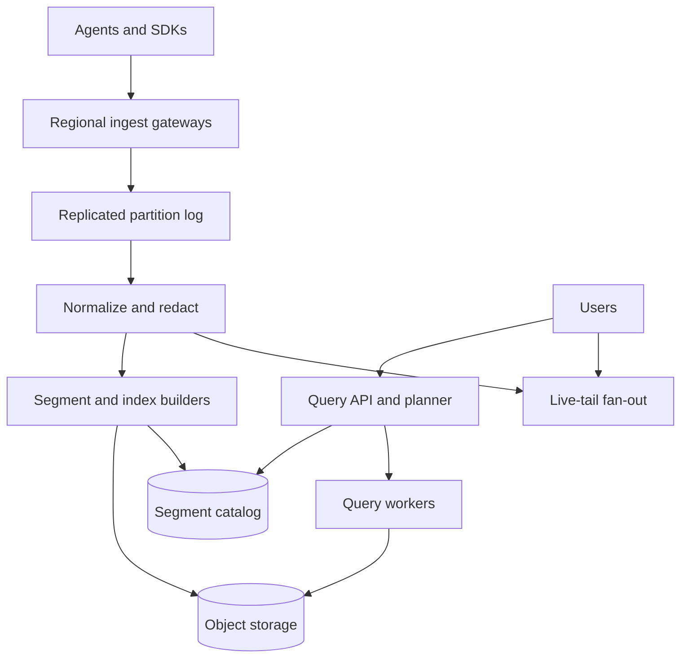

# Design a Global Log Ingestion and Search Platform

**Difficulty:** Medium–Hard  
**Primary themes:** streaming ingestion, queues, storage tiers, indexing, caching, backpressure, multi-tenancy, reliability, consistency, observability

## How to use this walkthrough

The interview time budget is about 45 minutes: requirements (5), entities (2), interfaces (5), high-level design (10–15), deep dives (10–15), and a short wrap-up. This document is deliberately more detailed than a live answer. In an interview, build one complete path first—ingest a log, make it searchable, query it—then use the non-functional requirements to justify partitioning, tiering, and overload controls.

The sequence follows the public [Hello Interview system-design delivery framework](https://www.hellointerview.com/learn/system-design/in-a-hurry/delivery): requirements, entities, API, a simple functional design, and focused deep dives. The design and dialogue are original.

---

## Interviewer prompt

> Design a multi-tenant platform similar to a large-scale log analytics service. Applications and agents continuously send structured and unstructured logs. Engineers can search recent logs by service, time, severity, attributes, or text; stream matching logs live; create saved queries and alerts; and retrieve older logs at higher latency. The platform must survive traffic bursts and regional failures without silently losing acknowledged data.

## Targeted clarifying questions and assumed answers

**Candidate:** Which operations are most important?  
**Interviewer:** Batch ingestion, search over a time range, live tail, and saved-query alerts. Focus on the first three; alerts can reuse the query pipeline.

**Candidate:** What volume should I design for?  
**Interviewer:** 10 PB of raw logs per day globally, 50 million events/s average, 5× bursts, and 100,000 concurrent interactive queries. A single tenant may burst to 5 million events/s.

**Candidate:** How quickly must logs become searchable?  
**Interviewer:** p99 within 10 seconds for hot data. Live tail should normally deliver within 2 seconds. Interactive queries over the last 15 minutes should return their first page within 2 seconds at p95.

**Candidate:** What retention is required?  
**Interviewer:** Seven days in a hot searchable tier, 30 days warm, and up to one year in a cold object-store tier. Tenants can configure shorter retention.

**Candidate:** Must ingestion preserve strict order?  
**Interviewer:** No global order. Preserve each producer stream's sequence where available, and expose both event time and observed/ingest time. Late events are accepted.

**Candidate:** Are duplicate events acceptable?  
**Interviewer:** Agents retry, so duplicates are possible. Offer best-effort deduplication when clients supply stable event IDs. Never claim exactly-once ingestion.

**Candidate:** What acknowledgement means success?  
**Interviewer:** After the service acknowledges a batch, it must survive an availability-zone loss. Search indexes may lag, but the accepted records cannot be silently dropped.

**Candidate:** What query language is needed?  
**Interviewer:** Boolean filters over indexed fields, time ranges, phrase/token search over bodies, sorting by time, pagination, and simple aggregations such as count by service or error code. No arbitrary joins.

**Candidate:** Can every arbitrary attribute be indexed?  
**Interviewer:** Logs may contain high-cardinality dynamic attributes. The platform needs schema-on-write normalization and controlled indexing, with raw attributes still recoverable.

**Candidate:** How strong is read-after-write?  
**Interviewer:** Ordinary search is eventually consistent within the 10-second freshness SLO. An ingest response may return a cursor that allows clients to request “search at least through this offset,” potentially waiting.

**Candidate:** What happens under overload?  
**Interviewer:** Protect durable ingestion and recent operational queries. Apply tenant quotas, backpressure, sampling only when explicitly configured, and degrade expensive historical search before dropping acknowledged logs.

**Candidate:** Are logs sensitive?  
**Interviewer:** Yes. Enforce tenant isolation, encryption, residency, field redaction, retention, and audit. Raw log bodies may contain secrets or personal data.

### Scope

In scope:

- agent/gateway ingestion and durable acknowledgement;
- parsing, normalization, redaction, routing, and indexing;
- hot, warm, and cold storage;
- interactive search, pagination, aggregations, and live tail;
- quotas, backpressure, failure recovery, and observability.

Out of scope:

- building application logging libraries;
- a full SIEM/rules product;
- distributed tracing and metrics backends;
- arbitrary data-lake SQL joins;
- visualization/dashboard frontend details.

> **What I would say aloud:** “I’ll make the acknowledgement contract precise first: accepted batches are replicated durably, while search is an asynchronous materialized view. That lets ingestion remain reliable even if parsing or indexing is behind.”

---

# 1. Requirements (~5 minutes)

## Core functional requirements

1. **Ingest logs durably.** Accept compressed batches, authenticate the tenant, validate limits, assign an ingest cursor, and acknowledge only after multi-AZ durability.
2. **Search and aggregate logs.** Filter by time and indexed fields, search message text, return stable cursor-based pages, and support bounded aggregations across hot/warm/cold tiers.
3. **Stream matching logs live.** Subscribe to a constrained query and receive new matching records with resume cursors and bounded buffers.

Alerts reuse continuous-query evaluation and are a natural extension rather than a separate ingestion path.

## Quantified non-functional requirements

| Dimension | Target | Design consequence |
|---|---:|---|
| Ingestion | 50M events/s average; 250M/s burst | Partitioned regional logs and aggressive batching |
| Raw volume | 10 PB/day | Compression, columnar segments, tiered object storage |
| Freshness | 99% searchable within 10 s | Streaming normalization/indexing and lag SLOs |
| Live tail | p95 under 2 s | Separate ephemeral fan-out from durable search |
| Query load | 100K concurrent queries | Query admission, shard pruning, caching, scatter limits |
| Hot query latency | p95 first page under 2 s for 15-minute windows | Time partitioning, inverted/skip indexes, hot caches |
| Availability | 99.99% ingestion API and hot search | Multi-AZ collectors, replicated logs, degraded read modes |
| Durability | no acknowledged batch lost after one-AZ failure | Quorum append before ACK |
| Isolation | tenant quotas, keys, residency, query fairness | Auth-derived tenant routing and work-based scheduling |

## Scale estimates that change the design

### Average event size

Ten petabytes/day at 50 million events/s gives:

\[
10 \times 10^{15} / (50 \times 10^6 \times 86{,}400) \approx 2.3\text{ KB/event}
\]

With 4:1 compression, durable compressed input averages about 29 GB/s globally and can burst near 145 GB/s. This requires regional ingestion, binary compression, large batches, sequential append, and partition parallelism. Per-event synchronous database writes are impossible.

### Index amplification

Indexing every token and dynamic attribute could exceed raw storage. If indexes average even 50% of compressed data, that is multiple petabytes per day. We therefore index a controlled set of dimensions, use selective text indexes/skip filters, and retain raw attributes in columnar or object storage.

### Query fan-out

A 24-hour query over 5-minute time partitions spans 288 buckets before tenant/service sharding. If each bucket has 100 shards, naive fan-out reaches 28,800 tasks for one query. The catalog must prune by tenant, time, service, and available indexes; query admission must cap residual fan-out.

> **What I would say aloud:** “The arithmetic rules out per-event transactions and universal indexing. We batch to a partitioned durable log, build immutable time-segmented indexes, and require the query planner to prune before it fans out.”

## Consistency and availability contract

- **Acknowledged ingestion:** durable across one availability-zone loss.
- **Search:** eventually consistent within 10 seconds under normal conditions.
- **Monotonic cursor:** an ingest response returns partition offsets. A query may require `min_cursor`; the coordinator waits up to a deadline or returns `INDEX_BEHIND` with observed cursors.
- **Ordering:** best effort by producer sequence; no global order. Results sort by `(event_time, ingest_time, event_id)` with explicit late-arrival semantics.
- **Deduplication:** best effort within a configured window for stable event IDs. At-least-once ingestion remains the contract.
- **Query snapshot:** one query pins a catalog generation and tier watermarks, giving stable pagination even while new segments appear.
- **Regional partition:** local ingestion continues if local quorum exists. Cross-region search may return partial results with explicit missing regions rather than pretend completeness.
- **Live tail:** at-most-once to a slow disconnected subscriber unless it resumes from a durable cursor; authoritative history remains in normal search.

---

# 2. Core entities (~2 minutes)

| Entity | Purpose |
|---|---|
| `Tenant` | Identity, region, plan, quotas, keys, and retention policy |
| `LogRecord` | Event/observed time, severity, body, resource, attributes, trace IDs, event ID |
| `IngestBatch` | Client batch ID, producer stream, sequence range, payload digest, and offsets |
| `Partition` | Ordered append stream for a tenant/routing key in one region |
| `Segment` | Immutable time-bounded columnar data and associated indexes |
| `IndexPolicy` | Fields/text rules, cardinality limits, redaction, and version |
| `CatalogEntry` | Segment time range, tenant, fields, statistics, tier, object URI, and generation |
| `SearchQuery` | Normalized filters, text expression, time range, limits, and consistency cursor |
| `QueryCursor` | Signed continuation containing query digest, snapshot generation, and positions |
| `TailSubscription` | Compiled filter, start cursor, buffer limits, and expiry |
| `RetentionPolicy` | Hot/warm/cold durations and deletion state |

The [OpenTelemetry Logs Data Model](https://opentelemetry.io/docs/specs/otel/logs/data-model/) is a useful public reference for mapping diverse sources into common timestamp, severity, body, resource, scope, and attribute concepts.

> **What I would say aloud:** “Segments are immutable search units, while the catalog is the routing index over them. That separation makes tiering and compaction cheap: publish a new catalog generation rather than mutating files in place.”

---

# 3. API and system interface (~5 minutes)

The gateway derives tenant, plan, region, and permissions from the API key or workload identity. A body-supplied tenant ID is ignored or rejected.

## 3.1 Ingest a batch

```http
POST /v1/logs:ingest
Authorization: Bearer <workload-token>
Content-Encoding: zstd
Idempotency-Key: agent-72-batch-90018
X-Producer-Stream: node-72/app
X-Sequence-Start: 870000
```

Decoded request:

```json
{
  "records": [
    {
      "timestamp": "2026-10-18T01:55:02.123Z",
      "severity": "ERROR",
      "service": "checkout",
      "body": "payment provider timeout",
      "attributes": {"region": "us-east", "error.code": "UPSTREAM_TIMEOUT"},
      "trace_id": "8f21...",
      "event_id": "01JAH..."
    }
  ]
}
```

```json
{
  "accepted": 5000,
  "rejected": 0,
  "cursor": {
    "region": "us-east",
    "partitions": {"p183": 99182771}
  },
  "dedupe_window_expires_at": "2026-10-18T02:10:02Z"
}
```

The same idempotency key with a different payload digest returns `409 Conflict`.

## 3.2 Search

```http
POST /v1/logs:search
```

```json
{
  "time": {"from": "2026-10-18T01:40:00Z", "to": "2026-10-18T01:55:00Z"},
  "filter": "service = 'checkout' AND severity >= ERROR AND attributes['region'] = 'us-east'",
  "text": "\"payment provider\" timeout",
  "sort": "EVENT_TIME_DESC",
  "limit": 200,
  "min_cursor": {"region": "us-east", "partitions": {"p183": 99182771}}
}
```

```json
{
  "records": [],
  "next_cursor": "eyJxdWVyeV9kaWdlc3QiOi...",
  "snapshot": {"catalog_generation": 44701, "observed_at": "2026-10-18T01:55:08Z"},
  "coverage": {"complete": true, "tiers": ["HOT"], "regions": ["us-east"]},
  "stats": {"segments_considered": 280, "segments_scanned": 14, "bytes_scanned": 8192000}
}
```

The cursor is opaque and signed. Clients cannot change tenant, query, snapshot, or shard positions inside it.

## 3.3 Aggregate

```http
POST /v1/logs:aggregate

{
  "time": {"from": "now-1h", "to": "now"},
  "filter": "service = 'checkout' AND severity >= ERROR",
  "group_by": ["attributes['error.code']"],
  "metric": "COUNT",
  "max_groups": 100
}
```

Bounded dimensions and `max_groups` prevent an accidental or malicious high-cardinality explosion.

## 3.4 Live tail

```http
POST /v1/tails

{
  "filter": "service = 'checkout' AND severity >= WARN",
  "start": "NOW",
  "max_events_per_second": 1000
}
```

The response returns a WebSocket/SSE endpoint and resume cursor. Live tail disallows unbounded regexes and historical scans.

---

# 4. Data flow

1. Agents buffer, compress, and retry batches with stable IDs.
2. Regional gateways authenticate, enforce size/rate limits, and route by tenant plus producer hash.
3. Ingest nodes append the raw envelope to a replicated durable log and return offsets.
4. Stream processors normalize timestamps/severity, redact fields, parse approved formats, deduplicate opportunistically, and route records.
5. Index builders create immutable time-bounded columnar segments plus selected indexes.
6. A catalog transaction publishes the segment only after all referenced objects are durable.
7. Query coordinators pin a catalog generation, prune segments, dispatch bounded tasks, merge results, and return signed cursors.
8. Older segments migrate to warm/cold storage without changing logical identity.
9. Retention removes catalog visibility first, then physical objects after a safety delay.

---

# 5. High-level design (~10–15 minutes)



## Operation 1: durably ingest one batch

The gateway performs cheap synchronous work only:

1. authenticate and derive tenant context;
2. validate compressed/uncompressed size, record count, and timestamp bounds;
3. reserve tenant byte/event quota;
4. choose a partition using `hash(tenant_id, producer_stream)`;
5. forward the compressed envelope with idempotency metadata;
6. wait for quorum append across availability zones;
7. return offsets as the ingest cursor.

The durable log stores the original envelope and ingestion metadata. Parsing/indexing is asynchronous, so malformed individual records can be routed to a tenant-visible rejection stream without losing the surrounding acknowledged batch.

`IngestBatch` stores `tenant_id`, `idempotency_key`, `payload_digest`, `producer_stream`, sequence range, offsets, and expiry. Repeating the same key and digest returns the original cursor; a different digest conflicts.

## Operation 2: normalize without destroying evidence

Processors map heterogeneous formats into a common `LogRecord`:

```text
LogRecord {
  tenant_id, event_time, observed_time, ingest_time,
  severity_number, body, service, resource,
  attributes, trace_id, span_id, event_id,
  source_partition, source_offset, schema_version
}
```

Keep three timestamps:

- `event_time`: source-reported occurrence time;
- `observed_time`: agent/collector observation time;
- `ingest_time`: durable-platform acceptance time.

This makes clock skew and late arrival visible. Default search filters event time, but operational debugging can use ingest time.

Redaction occurs before searchable storage and live fan-out. Rules are versioned. A record stores the applied policy revision; failures quarantine the record rather than leaking raw sensitive content into a fallback index.

## Operation 3: build a searchable hot segment

Builders consume normalized partitions and buffer records by `(tenant, time_bucket, routing_shard)`. They produce immutable segments containing:

- columnar core fields and attributes;
- min/max time and value statistics;
- dictionary encoding for repeated strings;
- sparse primary ordering, usually tenant/service/time;
- selected attribute indexes;
- token/inverted or Bloom-style text acceleration;
- footer checksums and row counts.

The builder uploads data and index objects, verifies them, then atomically inserts a `CatalogEntry`. Until catalog publication, queries cannot see the incomplete segment. Replayed input may rebuild the same deterministic segment ID; the catalog insertion is idempotent.

Very recent data may be served from small in-memory/delta segments before larger compaction. Once compacted segments publish, the catalog generation atomically supersedes deltas to prevent double results.

## Operation 4: search recent logs

The query API parses and normalizes the expression, authorizes every requested field, estimates cost, and creates a query snapshot. The planner:

1. restricts tenant and allowed regions;
2. intersects the time range with hot/warm/cold catalogs;
3. prunes using service/routing keys, min/max statistics, and index availability;
4. enforces a shard/byte/time budget;
5. schedules tasks near storage;
6. merges sorted top results and partial aggregations;
7. returns a signed continuation cursor.

Query workers use late materialization: evaluate cheap indexed predicates first, find candidate row IDs, then decode body and wide attributes only for candidates. This lowers I/O for selective queries.

## Operation 5: stable pagination while ingestion continues

Offset pagination is unstable and expensive. The first response returns a cursor containing:

```text
query_digest, tenant_id, catalog_generation,
tier_watermarks, sort_key, per_shard_positions,
expiry, signature
```

Subsequent pages reuse the pinned generation. Newly indexed logs do not appear halfway through the result set. Cursor expiry bounds how long old catalog generations and segment references must remain available.

## Operation 6: live tail

Normalized records also enter regional tail brokers partitioned by tenant and routing key. A subscription compiles a constrained filter and registers it with relevant brokers. Matching records flow to a gateway with:

- per-subscription event/byte limits;
- bounded buffers;
- heartbeats and cursors;
- slow-consumer disconnect;
- no guarantee that a live socket replaces durable history.

If the subscriber falls behind, the service returns the last cursor and closes the connection. The client searches durable storage from that cursor/time, then resumes live tail. This prevents one browser from backpressuring ingestion.

## Operation 7: tier old data

Hot segments sit on SSD-backed query nodes or high-performance object storage with aggressive caches. Warm segments remain columnar and indexed but use cheaper storage and shared compute. Cold segments use compressed object storage with sparse metadata and on-demand workers.

Tier migration is a catalog update:

1. copy/verify segment to the new tier;
2. publish a new catalog generation pointing to it;
3. retain the old object during a grace period for pinned queries;
4. delete the old copy after reference expiry.

Historical queries return an estimate or asynchronous query handle when they exceed interactive budgets.

## Operation 8: saved-query alerts

Instead of rerunning every query independently, group compatible alert filters by tenant/routing dimension. Stream evaluators consume normalized records, maintain window state, and emit idempotent alert evaluations. Alert notification delivery is downstream and at least once; each firing has a stable dedupe key.

---

# 6. Deep dives (~10–15 minutes)

## Deep dive A: burst absorption, backpressure, and truthful durability

### Where the baseline breaks

At 5× burst, parsing and indexing may fall behind. If gateways continue accepting without capacity bounds, the durable log fills. If they acknowledge before replication, node/AZ loss drops data. If they reject everything, one noisy tenant harms everyone.

### Options

| Approach | Benefit | Weakness |
|---|---|---|
| Synchronously parse/index before ACK | Immediate error feedback | High latency and index outage blocks ingestion |
| ACK in gateway memory | Very fast | Loses acknowledged data |
| Quorum append then asynchronous processing | Durable, isolates indexing | Search freshness can lag |

Choose quorum append. Search freshness becomes a separate SLO measured by source offset versus published segment watermark.

### Layered backpressure

1. Agent batches locally and uses exponential backoff with jitter.
2. Gateway enforces tenant bytes/s, events/s, batch size, and concurrent connections.
3. Partitions cap in-flight append bytes.
4. Processors publish lag and scale horizontally.
5. Builders adapt segment size but cap memory.
6. Query work cannot consume ingestion-reserved CPU/I/O.

Quotas use token buckets for short bursts plus rolling byte budgets. Limits are work based: compressed bytes alone are insufficient because a compression bomb or attribute-heavy payload can expand dramatically.

### Overload order

Under pressure:

1. reject or queue expensive cold queries;
2. reduce speculative query parallelism;
3. pause nonessential compaction and backfills;
4. protect hot queries and indexing;
5. apply tenant-specific ingest backpressure before global rejection;
6. accept sampling only if the tenant explicitly configured it and mark sampled counts.

Never silently sample after promising durable ingestion.

### Failure recovery

- Gateway dies before ACK: client retries same batch key.
- ACK response lost after commit: retry returns stored cursor.
- Consumer crashes: replay from durable offsets.
- Builder publishes object but not catalog: orphan sweeper deletes after grace.
- Catalog publishes but response is lost: deterministic segment ID makes replay a no-op.
- One AZ fails: partition leader continues from quorum replicas.

> **What I would say aloud:** “The durable log is the shock absorber and source of truth. I acknowledge only after quorum append, then expose indexing lag honestly instead of coupling customer durability to search availability.”

## Deep dive B: indexing arbitrary logs without bankrupting the system

### Where the baseline breaks

Tenants can emit thousands of attribute names, UUID-like values, stack traces, and unbounded message text. Universal inverted indexing creates huge write and storage amplification. No indexing makes interactive debugging too slow.

### Index choices

| Technique | Good for | Tradeoff |
|---|---|---|
| Sorted/primary columns | tenant, service, time | Excellent pruning only in ordering dimensions |
| Dictionary/bitmap | severity and low-cardinality attributes | Expensive for high-cardinality values |
| Inverted token index | selective text/terms | Significant build/storage cost |
| Bloom/skip filter | proving a token/value is absent | False positives still scan data |
| Min/max statistics | numeric/time ranges | Weak when values are unsorted |
| Raw column scan | rare fields | Slower but no index cost |

### Selected hybrid

- Always index tenant, time, service, severity, and a few resource fields.
- Let tenants nominate bounded custom fields under a plan budget.
- Track query frequency/selectivity and recommend indexes rather than auto-indexing every key.
- Store dynamic attributes in a map/columnar representation for fallback scans.
- Apply token/Bloom or inverted indexes to bodies according to tier and plan.
- Reject pathological regexes or execute them only after indexed prefilters.

Public ClickHouse material describes the same broad toolbox: sparse ordering indexes plus Bloom/token or inverted indexes for log text. The important interview point is not the product choice but using indexes to skip data while controlling amplification: [ClickHouse indexing practices](https://clickhouse.com/blog/10-best-practice-tips).

### Schema evolution

Attributes remain schemaless at API level, but physical types need control. For an indexed field, the registry records a type. Conflicting values can:

- coerce safely;
- enter a string fallback column;
- or be rejected/quarantined by strict policy.

Do not silently reinterpret numeric `latency_ms` as text across segments; query semantics would change by time range.

### Hot keys and skew

Partitioning solely by tenant overloads a shard for a huge tenant. Use `(tenant_id, virtual_shard)` where virtual shard derives from producer/service. The catalog merges these at query time. Large tenants receive dedicated partition ranges; small tenants share ranges.

### Cache design

- Cache immutable segment footers/index pages by digest.
- Cache normalized query plans by `(tenant, query_digest, schema_revision)`.
- Cache result pages only for bounded historical ranges, never an open-ended `to=now` without a short freshness key.
- Use admission policies so one full-table scan does not evict frequently used hot indexes.

> **What I would say aloud:** “I would not index every arbitrary attribute. I guarantee a small core index, meter custom indexes, and keep raw columnar attributes for fallback scans. Index choice follows selectivity and query frequency.”

## Deep dive C: query fan-out, fairness, and partial failure

### Where the baseline breaks

A broad regex over one year can touch millions of segments and monopolize workers. One slow shard can hold the response open. Concurrent large tenants can starve small interactive investigations.

### Cost-based admission

The planner estimates:

- segments and bytes after pruning;
- hot/warm/cold tier work;
- regex/text complexity;
- aggregation cardinality;
- expected worker seconds;
- cross-region egress.

Queries receive a work budget based on tenant plan and priority. Small recent searches enter an interactive queue; large searches become asynchronous jobs. Weighted fair scheduling charges actual bytes/CPU so splitting one query into many requests does not bypass quotas.

### Scatter-gather strategy

- Dispatch a bounded first wave to most promising time/tenant shards.
- For top-K newest queries, stop older shards once their maximum timestamp cannot beat the current cutoff.
- Hedge only straggling idempotent reads after a percentile delay.
- Cancel remaining tasks when the query limit is satisfied.
- Push partial aggregations to workers and merge compact states.

### Partial results

The response includes coverage:

```json
{
  "complete": false,
  "missing_regions": ["eu-west"],
  "timed_out_shards": 3,
  "scanned_through": "2026-10-17T23:00:00Z",
  "retry_token": "..."
}
```

For debugging, explicit partial results may be more useful than total failure. For audit/security workflows requiring completeness, the client sets `require_complete=true`; the service fails rather than returning incomplete evidence.

### Snapshot consistency across tiers

The coordinator pins a catalog generation and per-tier watermarks. A segment migrating from hot to warm may temporarily exist in both places but has one logical segment ID. The pinned catalog references exactly one visible copy, avoiding duplicates and gaps.

### Observability

- admission rejection and async-conversion rate;
- planning versus execution latency;
- segments considered/pruned/scanned;
- bytes scanned and cache hit rate;
- fan-out, stragglers, hedges, canceled tasks;
- partial-result rate by reason;
- CPU/I/O consumption by tenant and query class.

> **What I would say aloud:** “The query API is not an unlimited distributed grep. The planner estimates work after pruning, admits against a tenant budget, and converts broad historical searches into asynchronous jobs. Partial coverage is explicit.”

## Deep dive D: late data, duplicates, and stable time semantics

Event clocks can be wrong and agents can be offline for hours. Partition/index by ingest time for operational tractability while storing and secondarily organizing event time. A late event enters a current ingest segment with its old event timestamp; catalog statistics make it discoverable in event-time queries.

For very late data, maintain small late-arrival segments associated with old event-time buckets and compact them later. The query snapshot includes both base and late segments.

Best-effort dedupe uses `(tenant_id, event_id)` in a bounded probabilistic/exact window. Producer stream plus sequence can detect gaps and retries. Outside the window duplicates may remain; the API never promises global exactly-once semantics.

## Deep dive E: security, privacy, and deletion

- Derive tenant from authenticated identity at every boundary.
- Encrypt transport and storage with region/tenant-scoped keys where required.
- Apply redaction/tokenization before indexes and live tail.
- Use field-level authorization during query planning and projection.
- Audit queries, exports, saved alerts, and policy changes without recording sensitive result bodies.
- Cap result export and require stronger authorization for raw bodies.
- Retention first publishes tombstones/catalog removal, then deletes objects after pinned-query grace.
- Subject deletion uses searchable identity tokens or deletion manifests; immutable evidence stores only non-sensitive digests.
- A restored index must replay deletion tombstones through a watermark before serving traffic.

---

# Reliability and observability summary

## Failure-mode table

| Failure | Detection | Behavior | Recovery |
|---|---|---|---|
| Gateway dies before ACK | connection loss | client retries | idempotency returns original result if committed |
| Partition replica/AZ fails | quorum health | continue with quorum or reject before ACK | replace replica and replay log |
| Parser bug | rejection/quarantine spike | raw envelope remains durable | deploy fixed parser and replay |
| Index builder crashes | lease/offset lag | search freshness degrades | replay deterministic segment |
| Object upload succeeds, catalog write fails | orphan scan | object invisible | retry publish or garbage-collect |
| Catalog visible but object corrupt | checksum/read failure | exclude shard; mark partial | repair from replica/rebuild log |
| Query worker dies | task timeout | retry idempotent task | hedge/reassign within deadline |
| Live subscriber is slow | buffer watermark | disconnect with resume cursor | catch up through search |
| Region is unreachable | health/cursor lag | explicit partial result | reconcile after recovery |
| Cold tier unavailable | tier health | hot search continues | queue/retry historical job |

## Key SLOs

Ingestion:

- accepted events/bytes and p99 ACK latency;
- rejected/throttled bytes by tenant and reason;
- quorum failures and idempotency conflicts;
- durable-log utilization and time-to-full.

Freshness:

- durable offset to normalized offset;
- normalized offset to published segment watermark;
- end-to-end searchable lag p50/p95/p99;
- late-event and quarantine rates.

Query:

- time to first page and completion by tier;
- bytes/segments scanned per result;
- cache hit ratio;
- queue/admission delay;
- partial-result and timeout rate.

Correctness:

- duplicate segment IDs or overlapping catalog visibility;
- checksum failures;
- source offset gaps;
- cursor verification failures;
- redaction-policy misses detected by canaries.

---

# 7. Final design

## Concise final architecture

1. Regional gateways authenticate, enforce work-based quotas, batch, and route logs to partitioned multi-AZ durable logs.
2. Acknowledgement occurs after quorum append; parsing and indexing are asynchronous materialized views.
3. Stream processors normalize timestamps and severity, apply versioned redaction, preserve source offsets, and feed both builders and live tail.
4. Builders create immutable columnar time segments with a bounded hybrid of primary, attribute, token, and skip indexes.
5. A transactional catalog publishes complete segments and supports versioned snapshots, compaction, and tier migration.
6. Query planners authorize fields, pin a catalog generation, prune segments, estimate work, enforce fairness, and scatter bounded tasks.
7. Workers evaluate indexed predicates before decoding bodies, merge top-K/aggregates, and return signed cursor-based pages with explicit coverage.
8. Tail brokers provide low-latency best-effort streaming with bounded buffers; durable search is the recovery path.
9. Hot, warm, and cold tiers trade latency for cost without changing logical segment identity.
10. Replay, reconciliation, checksums, and explicit lag/coverage metrics make failures visible and recoverable.

## Requirements check

| Requirement | Design element |
|---|---|
| Durable ingestion | Multi-AZ quorum append before ACK |
| 50M events/s | Regional partitioning, compression, batching, sequential logs |
| Search within 10 s | Streaming normalization and incremental immutable segments |
| Recent interactive search | Time/service pruning, indexes, caches, late materialization |
| Stable pagination | Catalog snapshot plus signed per-shard cursor |
| Live tail | Separate regional brokers with resume-to-search |
| Burst tolerance | Durable buffer, quotas, backpressure, reserved ingestion capacity |
| One-year retention | Hot/warm/cold object-storage tiers |
| Multi-tenant fairness | Work estimation and weighted scheduling |
| No hidden gaps | Cursor watermarks and explicit partial coverage |
| Privacy | Early redaction, field authorization, scoped keys, audited access |

## Principal tradeoffs

- Durable ingestion is strongly acknowledged; search is eventually consistent.
- Immutable segments simplify correctness and tiering but require compaction.
- Indexing fewer fields reduces cost but makes rare-field queries slower.
- Live tail favors latency and bounded memory over guaranteed socket delivery.
- Partial results improve availability but are unacceptable when callers require complete evidence.
- Tiered storage lowers cost while increasing historical-query latency.

---

# Realistic interviewer follow-ups with strong sample answers

## 1. Why not write logs directly into Elasticsearch or another search database?

**Strong answer:** “At this scale I want a durable append log to decouple acknowledgement from index health and to provide replay. A search engine or columnar store can implement the hot query tier, but it remains a rebuildable materialized view rather than the sole durable acceptance boundary.”

## 2. Do you guarantee exactly-once ingestion?

**Strong answer:** “No. Agents retry across ambiguous network failures. Stable batch and event IDs provide idempotency and bounded deduplication, but the truthful contract is at least once with best-effort dedupe.”

## 3. Why keep event, observed, and ingest timestamps?

**Strong answer:** “Producer clocks drift and agents buffer offline. Event time represents the source claim, observed time helps isolate source versus transport delay, and ingest time anchors platform durability and freshness.”

## 4. How does a client get read-after-write?

**Strong answer:** “The ingest response returns partition offsets. Search accepts a minimum cursor and waits until the index watermark reaches it, or returns an explicit `INDEX_BEHIND` response by the deadline.”

## 5. How do you stop one tenant's burst from overwhelming everyone?

**Strong answer:** “Partition large tenants across virtual shards, enforce byte/event/expanded-size limits, schedule work fairly, isolate connector queues, and reserve resources for ingestion. A tenant-specific 429 happens before a global collapse.”

## 6. Why not index every attribute?

**Strong answer:** “Dynamic high-cardinality fields create enormous index amplification. I guarantee a core index, meter tenant-selected fields, and retain raw columnar attributes for fallback scans. Query telemetry guides future indexing.”

## 7. How do you paginate while new logs arrive?

**Strong answer:** “The first query pins a catalog generation and returns a signed cursor with the query digest and per-shard positions. Later pages use that same snapshot, so new segments do not shift or duplicate results.”

## 8. What happens when a query shard times out?

**Strong answer:** “For exploratory queries I return records plus explicit coverage, missing shards, and a retry token. If `require_complete` is set, I fail the query rather than presenting partial evidence as complete.”

## 9. How does live tail avoid harming ingestion?

**Strong answer:** “It consumes the normalized stream independently, enforces per-subscription limits and bounded buffers, and disconnects slow consumers with a resume cursor. Subscribers catch up through durable search.”

## 10. How do you query cold storage?

**Strong answer:** “The catalog prunes cold segments using metadata, then on-demand workers scan only selected objects. Small work can remain interactive; large work becomes an asynchronous job with progress and result expiry.”

## 11. How do you avoid duplicates during compaction or tier migration?

**Strong answer:** “Segments have stable logical IDs. A catalog generation atomically supersedes input segments with outputs or changes the visible physical location. Pinned queries keep their old references until cursor expiry.”

## 12. What if the parser is broken after data was acknowledged?

**Strong answer:** “The original envelope and offsets remain in the durable log. I quarantine failures, deploy a versioned parser fix, and replay. Search freshness degrades, but acknowledged data is not lost.”

## 13. How do alerts scale?

**Strong answer:** “Compile compatible saved filters into shared tenant/routing evaluators instead of rerunning full searches. Maintain bounded window state and emit idempotent firing IDs to a downstream notification system.”

## 14. What would you monitor first during an incident?

**Strong answer:** “Durable-log time-to-full, ingest rejection/ACK latency, normalization and index watermark lag, catalog publish errors, then query queue and partial-result rates. Durability capacity is the first safety boundary.”

---

# Common pitfalls

1. Writing every event synchronously to a relational database.
2. Acknowledging before multi-AZ durability.
3. Coupling ingestion availability to search-index availability.
4. Claiming exactly-once delivery across agent retries.
5. Losing the raw envelope after parsing.
6. Keeping only one timestamp.
7. Assuming producer clocks are correct.
8. Partitioning only by tenant and creating a giant hot shard.
9. Indexing every arbitrary key and value.
10. Allowing unbounded regex scans in live tail.
11. Using offset-based pagination over changing results.
12. Hiding stale indexes or missing regions.
13. Returning partial results without coverage metadata.
14. Letting one historical query fan out without a budget.
15. Letting query work consume ingestion-reserved resources.
16. Silently sampling during overload.
17. Backpressuring ingestion because a browser tail is slow.
18. Publishing a catalog entry before objects verify.
19. Double-counting input and compacted segments.
20. Deleting old-tier objects before pinned cursors expire.
21. Caching open-ended `to=now` results as if immutable.
22. Redacting after indexing or live distribution.
23. Logging raw query results in audit events.
24. Ignoring deletion tombstones during restore.

---

# A polished 90-second closing statement

> “I designed ingestion and search as separate reliability domains. Regional gateways authenticate and apply work-based quotas, then acknowledge only after a compressed batch reaches a multi-AZ quorum log. Stream processors normalize three timestamps, redact sensitive fields, preserve offsets, and feed live tail plus immutable segment builders. Builders create compressed columnar data with a bounded hybrid of core, custom-field, and text indexes, then atomically publish verified objects into a versioned catalog. Query coordinators pin a catalog generation, prune by tenant, time, service, and statistics, admit work against a fair budget, and scatter bounded tasks to workers that use late materialization. Signed cursors provide stable pagination, and responses expose missing shards and tier watermarks. Live tail uses bounded ephemeral fan-out and falls back to durable search. Hot, warm, and cold tiers reduce cost without changing logical segment identity. The major tradeoff is strong durability at ingestion with eventual search freshness; explicit offsets, lag SLOs, replay, and coverage metadata keep that tradeoff honest.”

# Public references

- [Hello Interview: System Design Delivery Framework](https://www.hellointerview.com/learn/system-design/in-a-hurry/delivery) — used for the interview delivery sequence.
- [OpenTelemetry Logs Data Model](https://opentelemetry.io/docs/specs/otel/logs/data-model/) — background on a common representation for heterogeneous logs.
- [OpenTelemetry Logging Specification](https://opentelemetry.io/docs/specs/otel/logs/) — background on collecting and translating existing and structured logs.
- [ClickHouse: Best-Practice Indexing Overview](https://clickhouse.com/blog/10-best-practice-tips) — an implementation reference for sparse ordering and Bloom/token indexes used to skip log data.
